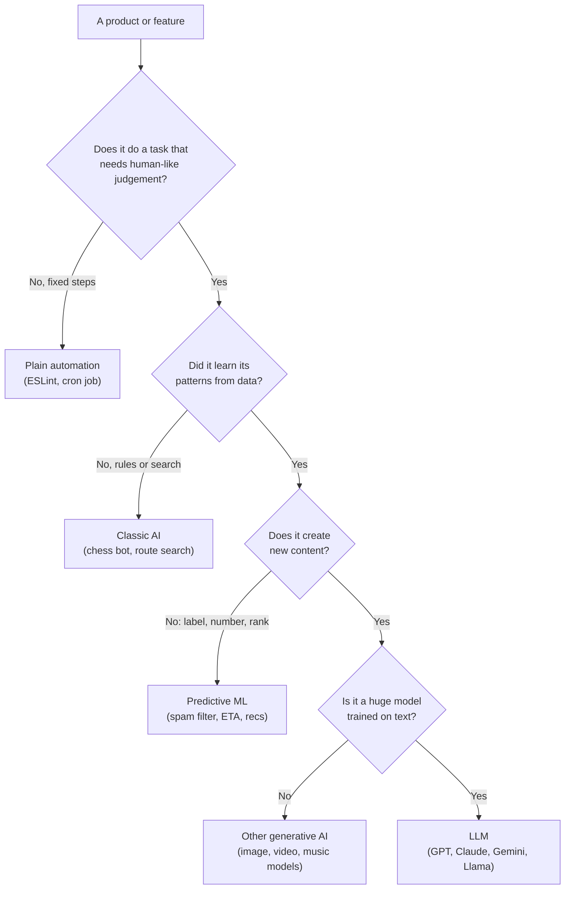
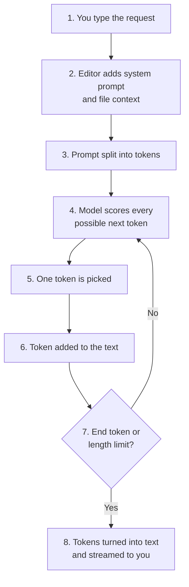
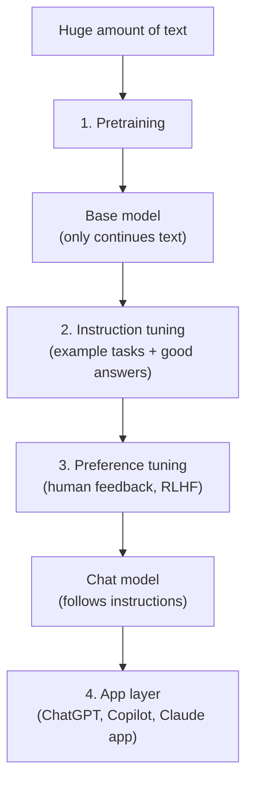
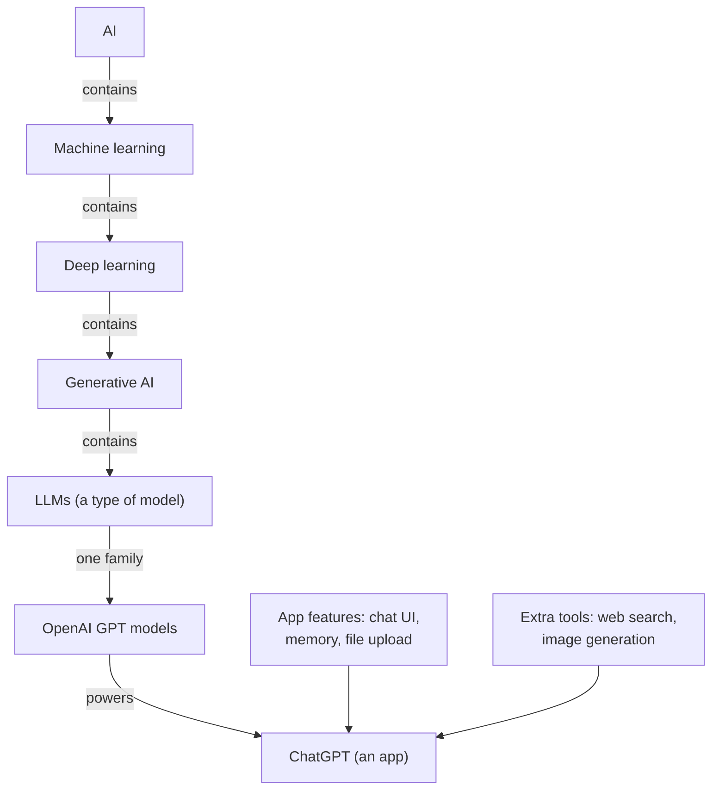

# A1-01 · AI, Generative AI and LLMs (explained for a React developer)

> **Lesson A1-01** · Type: Concept · Prerequisites: none · Leads to: A1-02, A1-03
>
> **Facts checked on:** 12 October 2026. Model names, product features and prices change fast. Anything marked *(may change)* should be re-checked before you post about it.

**Why this lesson matters:** "AI", "generative AI" and "LLM" get mixed up everywhere: in job posts, LinkedIn posts, even in meetings. If your words are precise, every later lesson (tokens, context, RAG, agents), every interview answer and every post you write becomes clearer.

## Learning goals

By the end of this lesson you will be able to:

1. Explain **AI, machine learning, deep learning, generative AI and LLMs** in plain words, and draw how they fit inside each other.
2. Look at any product (Maps ETA, spam filter, ChatGPT, an image generator) and say whether it is **generative**, and whether it uses an **LLM**.
3. Explain the difference between a **base model** and an **instruction-tuned chat model**, and what a **foundation model** is.
4. Answer the four lesson questions (section 8) without notes.
5. Explain the three main terms in **two minutes** using a React/Next.js example (section 7.3). This is your "done when" test.

---

## 1. The topic in one minute

- **AI (artificial intelligence):** the big umbrella. Any computer system doing a task that normally needs human intelligence: understanding language, recognising faces, planning a route, playing chess.
- **Machine learning (ML):** one way of building AI. Instead of you writing every rule, the computer **learns patterns from examples (data)**.
- **Generative AI:** AI that **creates new content**: text, images, audio, video or code.
- **LLM (large language model):** a generative AI model trained on a huge amount of text to **predict the next small piece of text** (called a *token*). ChatGPT, Claude and Gemini are **apps** built on top of LLMs.

**One-line memory trick:** every LLM is generative AI, today's generative AI is built with machine learning, and all machine learning is AI. It does **not** work the other way round: most AI is not generative, and most generative AI is not an LLM.

**Analogy (vehicles):**

| AI world | Vehicle world |
|---|---|
| AI | Vehicle (cycle, bullock cart, car, all of them) |
| Machine learning | Motor vehicle |
| Deep learning | Car |
| Generative AI | Electric car |
| LLM | One type of electric car, say an electric hatchback |
| ChatGPT | The Ola or Uber **app**. You book through the app, but the app is not the car. |

**Real-life example: one Google Maps trip uses three different things.**

- Finding a route is a classic **search** problem (algorithms explore possible paths and pick the best one). That is AI, but not necessarily machine learning.
- The **ETA** ("you'll reach in 34 min") is a **machine learning** prediction. Google DeepMind has described using a type of ML model called a *graph neural network* for Maps ETAs (it treats roads as a connected graph).
- If you ask a chatbot "plan a Sunday trip from Bengaluru to Nandi Hills with breakfast stops", that answer is written by an **LLM**.

---

## 2. Detailed definitions and why they matter

### 2.1 Why precise words help you

- **Interviews:** "I used AI" sounds vague. "I called an LLM API from a Next.js route handler to summarise product reviews, and kept the fraud check on a traditional ML model" sounds like someone who understands the trade-offs.
- **Posts:** wrong words get corrected in the comments. Correct words build trust.
- **Work decisions:** choosing between plain code, a traditional ML model and an LLM for a feature is a real engineering decision (section 8, question 4).
- **Next lessons:** tokens, context windows, RAG and agents all assume you know exactly what an LLM is.

### 2.2 AI (artificial intelligence)

**Definition:** the broad field of computer science that builds systems which perform tasks that normally need human intelligence, such as understanding language, recognising images, making decisions, planning and playing games.

**One-line meaning:** making computers do "thinking-type" tasks.

AI is a **goal**, not one technique. There are three big ways to reach it:

| Approach | How it works | Example |
|---|---|---|
| **Rules** (also called symbolic AI or expert systems) | Humans write the knowledge as if-then rules | Old medical "expert systems"; a rules engine that approves simple insurance claims |
| **Search** | The program explores many possible moves or paths and picks the best one | A chess engine; a tic-tac-toe bot using the *minimax* algorithm; route finding |
| **Machine learning** | The program learns patterns from data | Spam filter, Maps ETA, Netflix recommendations |

Real products usually **mix** these. For example, Google has written that Gmail's spam protection combines machine learning models with rule-based defences.

### 2.3 Machine learning (ML)

**Definition:** a way of building AI where a program **learns patterns from data** instead of following rules a human wrote by hand.

**One-line meaning:** show the computer lots of examples, and it figures out the pattern.

**Analogy:** teaching a child to recognise mangoes. You don't write a rulebook ("yellow-green, oval, 10 cm"). You show many mangoes and non-mangoes, and the child learns. ML works the same way.

**Developer example (pseudo-code, not meant to run):**

```ts
// RULE-BASED: you write the pattern yourself
function isSpamByRules(email: Email): boolean {
  return email.subject.includes("lottery") || email.body.includes("claim your prize");
}

// MACHINE LEARNING: the pattern is LEARNED from thousands of emails
// that people already marked as "spam" or "not spam".
// spamModel was trained earlier; here we only USE it (this is called "inference").
function isSpamByML(email: Email): boolean {
  return spamModel.predictSpamProbability(email) > 0.9;
}
```

**Why ML exists:** spammers keep changing their words, so hand-written rules keep breaking. A learned model can look at thousands of signals together and can be retrained on fresh examples. Google described exactly this reason for Gmail's ML-based spam filtering.

We only need the **concept** here. How models are trained (the maths, the datasets) is out of scope for this roadmap.

### 2.4 Deep learning (the bridge)

**Definition:** machine learning that uses **neural networks with many layers**. A neural network is a big structure of numbers (called *parameters* or *weights*) that gets adjusted during training until it gives good outputs.

**One-line meaning:** ML with very big, layered models that are good at messy data like photos, speech and text.

**Examples:** face unlock on your phone, speech-to-text in voice notes, and every modern LLM.

### 2.5 Generative AI

**Definition:** AI models that **create new content** (text, images, audio, video or code) that did not exist before in exactly that form.

**One-line meaning:** AI that makes things, not just judges things.

**The output test** is the easiest way to decide:

| If the output is... | It is usually... | Example |
|---|---|---|
| A label ("spam" / "not spam") | Predictive ML (not generative) | Gmail spam filter |
| A number (34 minutes, 82% risk) | Predictive ML (not generative) | Maps ETA, credit risk score |
| A ranking (top 10 shows for you) | Predictive ML (not generative) | Netflix recommendations |
| **New content** (a paragraph, an image, a song, a React component) | **Generative AI** | ChatGPT, Copilot, image generators |

**Examples of generative AI:** text and code (ChatGPT, Claude, Gemini, Copilot), images (DALL·E, Midjourney), video (Google Flow, Higgsfield; you will study these later), voice and music generators. *(Product names may change.)*

### 2.6 LLM (large language model)

**Definition:** a deep learning model trained on a **huge amount of text** to **predict the next token**. By predicting one token after another, it can write answers, code, summaries, emails and more.

**One-line meaning:** a very large "what text comes next?" machine.

Three words to unpack:

- **Token:** a small chunk of text the model reads and writes. It can be a whole word, part of a word, or a symbol. For example, one OpenAI tokenizer (called `o200k_base`) splits `Write a useDebounce hook in TypeScript` into 9 tokens: `[Write] [ a] [ use] [Deb] [ounce] [ hook] [ in] [ Type] [Script]`. *(Real output, shown in section 5. Different model families use different tokenizers, so the split varies.)*
- **Language model:** a model that predicts the next token, given the tokens before it. Your phone keyboard's next-word suggestion is a tiny language model.
- **Large:** billions of parameters, trained on trillions of tokens, using huge amounts of computing power. Section 8 (question 2) has real numbers.

**Base model vs instruction-tuned (chat) model:**

- A **base model** (also called a pretrained or "text" model) has only learned to continue text. Give it a question and it may continue with *more questions*, like a page from a quiz book, instead of answering.
- An **instruction-tuned model** (a chat model) has been trained further on examples of instructions with good answers, and then on human preferences, so it **follows instructions** and replies like an assistant. ChatGPT, Claude and Gemini use chat models. Section 6 explains this with a diagram, and the developer exercise lets you see it yourself.

**Note:** many modern LLMs also accept images, audio or files as input (called *multimodal* models). People still usually call them LLMs.

### 2.7 Foundation models

**Definition:** one large model, trained on broad data at scale, that can be **adapted to many different tasks**. The term was popularised by a 2021 Stanford report, *On the Opportunities and Risks of Foundation Models*, which gave BERT, GPT-3 and DALL·E as examples.

**One-line meaning:** one big base model, many uses.

**Developer analogy:** a foundation model is like a solid design system or a base Next.js starter. You build it once (very expensive), then many teams adapt it for their own apps: one for a support bot, one for code review, one for summarising PDFs. The adaptation can be fine-tuning, a good system prompt, or adding tools.

**Foundation model vs LLM:** they overlap a lot. Most big LLMs are foundation models. But foundation models also include image, audio and multimodal models, so "foundation model" is the wider word.

**Proof that a product is not a model:** GitHub Copilot lets you choose the model behind its chat from several providers, including OpenAI, Anthropic and Google *(checked 12 October 2026; the list may change)*. Same product, different foundation models underneath.

### 2.8 All the terms side by side

| Term | Definition (one line) | Example | Where you have probably used it as a developer |
|---|---|---|---|
| **AI** | Systems doing tasks that normally need human intelligence (rules, search or learning) | Chess engine, route finding, spam filter, ChatGPT | A game bot in a side project; Maps route; any of the rows below |
| **Machine learning** | Learns patterns from data instead of hand-written rules | Gmail spam filter, Maps ETA, Netflix recommendations | The "Recommended for you" row in apps you've built or used; fraud alerts on your card |
| *Deep learning* | ML with many-layered neural networks | Face unlock, speech-to-text | Unlocking your phone; voice typing a WhatsApp message |
| **Generative AI** | Models that create new text, images, audio, video or code | ChatGPT, Copilot, image generators | Generating a hero image or placeholder copy for a landing page |
| **LLM** | A huge text model that predicts the next token | GPT, Claude, Gemini, Llama model families | Copilot or Cursor completing your React component; asking a chatbot to explain an error |
| *Foundation model* | One big model adapted to many tasks | GPT-3, BERT, DALL·E (from the 2021 Stanford report) | Choosing which model Copilot Chat uses |

---

## 3. Words you need first

No AI background is needed. These eight words make the rest of the guide easy:

| Word | Plain meaning |
|---|---|
| **Model** | The "learned thing": a big file of numbers that turns an input into an output |
| **Data / dataset** | The examples a model learns from |
| **Training** | The (expensive) process of adjusting the model's numbers using data |
| **Inference** | Using an already-trained model to get an output. Every chat message you send is inference. |
| **Parameters (weights)** | The numbers inside a model. More parameters roughly means more capacity to learn patterns. |
| **Neural network** | A layered structure of parameters; the type of model used in deep learning |
| **Token** | A small chunk of text (word, part of a word or symbol) that an LLM reads and writes |
| **Prompt** | The input text you give an LLM |

---

## 4. How it all fits together

**Diagram: how AI, ML, deep learning, generative AI and LLMs nest**

```
+----------------------------------------------------------+
| ARTIFICIAL INTELLIGENCE (AI)                             |
| rules + search + learning                                |
| e.g. chess bot, Maps route finding                       |
|  +----------------------------------------------------+  |
|  | MACHINE LEARNING (ML)                              |  |
|  | learns patterns from data                          |  |
|  | e.g. spam filter, Maps ETA                         |  |
|  |  +----------------------------------------------+  |  |
|  |  | DEEP LEARNING                                |  |  |
|  |  | ML with big neural networks                  |  |  |
|  |  | e.g. face unlock, speech-to-text             |  |  |
|  |  |  +----------------------------------------+  |  |  |
|  |  |  | GENERATIVE AI                          |  |  |  |
|  |  |  | creates new content                    |  |  |  |
|  |  |  | e.g. image and video generators        |  |  |  |
|  |  |  |  +----------------------------------+  |  |  |  |
|  |  |  |  | LARGE LANGUAGE MODELS (LLMs)     |  |  |  |  |
|  |  |  |  | predict the next token of text   |  |  |  |  |
|  |  |  |  | e.g. GPT, Claude, Gemini, Llama  |  |  |  |  |
|  |  |  |  +----------------------------------+  |  |  |  |
|  |  |  +----------------------------------------+  |  |  |
|  |  +----------------------------------------------+  |  |
|  +----------------------------------------------------+  |
+----------------------------------------------------------+
```

**How to read this diagram:** each box sits fully inside the one around it. Start at the outside: AI is the whole field. Machine learning is one part of AI. Deep learning is one part of ML. Generative AI (as built today) is one part of deep learning. LLMs are one part of generative AI. Anything in an inner box also belongs to every outer box, so an LLM is also deep learning, ML and AI. But an outer box has many things that are **not** in the inner boxes: a chess bot is AI but not ML, and a spam filter is ML but not generative.

> **Optional advanced understanding: the nesting is a simplification**
>
> - Simple statistical text generators (for example *Markov chains*) generated text long before deep learning, so "generative" has existed outside deep learning. Today's useful generative AI, though, is built with deep learning.
> - Deep learning has many non-generative uses (face unlock, ETA prediction).
> - An LLM can be used for a non-generative job, like labelling support tickets as "billing" or "bug". The feature is a classifier, but it still runs on generative AI under the hood.
> - In ML research, "generative model" also has a narrower technical meaning. You don't need it for this roadmap.

**Diagram: is this thing AI, ML, generative AI or an LLM?**



**How to read this diagram:** start at the top with any product and answer each question. If it just runs fixed steps that you could write as a checklist, it is plain automation, not AI. If it makes judgement-type decisions but never learned from data, it is classic AI (rules or search). If it learned from data but outputs a label, number or ranking, it is predictive ML. If it creates new content, it is generative AI, and if that model is a huge text model, it is an LLM. You will use this flowchart in the intermediate exercise.

---

## 5. How an LLM produces an answer (step-by-step walkthrough)

**Scenario:** in VS Code you open Copilot Chat (Cursor or Claude Code work the same way) and type: *"Write a useDebounce hook in TypeScript."*

1. **You type the request** in the editor's chat panel.
2. **The editor adds context:** a hidden *system prompt* (instructions like "you are a coding assistant"), plus parts of your open files. Your short message becomes a longer prompt.
3. **The prompt is split into tokens.** `Write a useDebounce hook in TypeScript` becomes 9 tokens (see the real output below).
4. **The model scores every possible next token.** It runs once over all the tokens so far and gives each possible next token a probability, for example `import` 41%, `Here` 30%, `` ` `` 12% ... *(numbers illustrative)*.
5. **One token is picked.** Usually a likely one, with a little randomness (controlled by a setting called *temperature*).
6. **The new token is added to the text,** and the model runs again from step 4 with one more token. This loop repeats hundreds of times.
7. **It stops** when the model produces a special "end" token or hits a length limit.
8. **The tokens are turned back into text and streamed to you.** That is why the answer appears word by word.

**Diagram: one LLM answer, token by token**



**How to read this diagram:** follow the numbers from the top. Steps 1 to 3 happen once. Steps 4 to 7 form a loop: the model predicts one token, adds it, and goes back to step 4. Only when the model decides it is finished (or hits a limit) does it leave the loop at step 8.

**The key insight:** at no point does the model search a database of saved hooks. It **builds** the hook one token at a time, from patterns it learned during training. That is why it can write code it has never seen in exactly that form, and also why it can sometimes write code that looks right but is wrong.

**Real tokenizer output.** This was run with the `gpt-tokenizer` npm package (`o200k_base` encoding) on 12 October 2026:

```js
// tokens.mjs  (npm install gpt-tokenizer)
import { encode, decode } from "gpt-tokenizer/encoding/o200k_base";
for (const text of ["Write a useDebounce hook in TypeScript", "const [query, setQuery] = useState('');"]) {
  const ids = encode(text);
  const pieces = ids.map((id) => decode([id]));
  console.log(`${JSON.stringify(text)} -> ${ids.length} tokens`);
  console.log(pieces.map((p) => `[${p}]`).join(" "));
}
```

Real output:

```text
"Write a useDebounce hook in TypeScript" -> 9 tokens
[Write] [ a] [ use] [Deb] [ounce] [ hook] [ in] [ Type] [Script]
"const [query, setQuery] = useState('');" -> 12 tokens
[const] [ [] [query] [,] [ set] [Query] []] [ =] [ use] [State] [('] [');]
```

Notice that spaces are often part of a token (`[ hook]`), and that `useState` is two tokens. Tokens get their own lesson later; for now, just remember "LLMs see tokens, not words".

---

## 6. Base models, chat models, and where ChatGPT fits

### 6.1 How a chat model is made (high level only)

**Diagram: from raw text to a chat app**



**How to read this diagram:** go top to bottom. In step 1 the model reads a huge amount of text and learns to predict the next token; the result is a **base model**. In step 2 it is trained further on examples of instructions paired with good answers. In step 3 humans rank different answers and the model is tuned towards the ones people prefer (this is called *RLHF*, reinforcement learning from human feedback). The result is a **chat model**. In step 4 a company wraps the chat model in an app with a UI, a system prompt and extra tools.

Two real milestones:

- **InstructGPT (March 2022):** OpenAI showed that after instruction and preference tuning, people preferred the answers of a **1.3-billion-parameter** model over the original **175-billion-parameter** GPT-3, a model with over 100 times more parameters. Lesson: how a model is tuned matters as much as its size.
- **ChatGPT (launched 30 November 2022):** fine-tuned from a GPT-3.5 series model using the same RLHF approach. The models behind ChatGPT have changed many times since then *(may change)*.

**Base vs chat model, side by side** *(typical behaviour; exact outputs vary)*:

| | Base model | Chat (instruction-tuned) model |
|---|---|---|
| Trained on | Huge text only (pretraining) | Pretraining + instruction examples + human preferences |
| Prompt: `Write a one-line JavaScript function that adds two numbers.` | Often treats it as text to continue, e.g. adds more "exercise" lines or unrelated text | Replies like an assistant, e.g. `const add = (a, b) => a + b;` |
| Prompt: `The capital of France is` | Continues: ` Paris.` and may keep writing like an encyclopedia | Usually answers in a full sentence |
| Good for | Text completion, a starting point for further tuning | Assistants, chat apps, coding tools |
| Ollama example | `llama3.2:1b-text-q4_K_M` | `llama3.2:1b` |

**What is a chat template?** A chat model expects each message wrapped in special marker tokens that say "this is the system prompt", "this is the user", "now the assistant speaks". Apps and tools like Ollama add these markers for you. In the developer exercise you can print a model's template with `ollama show llama3.2:1b --template`, and you can switch it off with Ollama's `raw` mode to see what the model does without it.

### 6.2 Where ChatGPT fits

**Diagram: ChatGPT is an app, not a category**



**How to read this diagram:** the chain from "AI" down to "LLMs" is made of **categories** (kinds of things). "OpenAI GPT models" is one real **model family** inside the LLM category. "ChatGPT" is a **product** that uses those models, plus app features (chat history, memory, file upload) and extra tools (web search, image generation). So ChatGPT is not "AI" itself, not "an LLM" itself, and not even "GPT" itself. It is an app built on GPT models.

The same pattern holds everywhere: **Claude** (app) runs on Claude models, **Gemini** (app) runs on Gemini models, and **Copilot** (product) can run on models from several companies.

---

## 7. Real-life examples and developer use cases

### 7.1 Where you already meet them

| Everyday thing | What it is | Generative? | Uses an LLM? |
|---|---|---|---|
| Phone keyboard next-word suggestion | Small language model (ML) | Yes, a tiny bit (it suggests words) | Usually no: a small model, not a "large" one |
| Coding assistants (Copilot, Cursor, Claude Code) | LLM-based tools | Yes | Yes |
| Chatbots (ChatGPT, Claude, Gemini) | Apps on top of LLMs | Yes | Yes |
| Old website chatbots with fixed buttons ("Choose 1 for refund status") | Rule-based decision tree | No | No |
| Image tools (DALL·E, Midjourney) | Image generation models | Yes | Not an LLM (though often paired with a text model to understand your prompt) |
| Recommendations (Netflix, YouTube, food apps) | Predictive ML that ranks items | No | Usually no |
| Google Maps ETA | Predictive ML (graph neural networks) | No | No |
| Gmail spam filter | Predictive ML + rules | No | No |
| Face unlock | Deep learning (recognition) | No | No |

### 7.2 A React/Next.js developer's map

Imagine you are building a Next.js e-commerce app. Here is where each idea shows up:

| Feature in your app | What it is | Why |
|---|---|---|
| ESLint, Prettier, Zod form validation | **Not AI**, plain automation | Fixed rules you could write as a checklist |
| A tic-tac-toe bot on your 404 page using minimax | **Classic AI** (search), not ML | Makes "smart" moves by searching, never learned from data |
| "Recommended for you" carousel | **Machine learning** | Learned from clicks and orders; outputs a ranking |
| Fraud check at checkout | **Machine learning** (usually on tabular data) | Outputs a risk score from columns like amount, device, location |
| "Write product description" button calling an LLM API from a route handler | **Generative AI + LLM** | Creates new text, token by token |
| AI-generated hero banner image | **Generative AI**, not an LLM | Creates an image with an image model |
| Copilot completing your `ProductCard.tsx` | **LLM** | Predicts the next tokens of your code |

### 7.3 The two-minute explanation ("done when" test)

Read this aloud with a timer. It is about 260 words, which is roughly two minutes at a calm speaking pace (around 130 to 150 words a minute). Then explain it again in your own words without reading.

> Think of a Next.js shopping app I might build.
>
> ESLint fixing my code style is not AI. It's just fixed rules running automatically.
>
> AI is the big umbrella: any system doing something that normally needs human intelligence. Even a tic-tac-toe bot that searches every possible move is AI, and it never learned anything from data.
>
> Machine learning is the part of AI where the system learns patterns from data instead of me writing rules. The "Recommended for you" carousel is ML: it learned from millions of clicks and orders, and its output is a ranking. It doesn't create anything new.
>
> Generative AI is the part that creates new content. If I add a button that writes a product description, or generates a banner image, that's generative AI.
>
> An LLM, a large language model, is one kind of generative AI. It's trained on a huge amount of text to predict the next token, a small piece of a word, again and again. The description writer and Copilot autocompleting my React component both run on LLMs. Importantly, the LLM is not looking up answers in a database. It is generating them, which is why it can write new code, and also why it can be confidently wrong.
>
> And ChatGPT? It's not "AI" itself. It's an app built on OpenAI's GPT family of LLMs, with extra features like memory and web search.
>
> So: AI contains machine learning, machine learning contains generative AI, and generative AI contains LLMs. Most AI in your daily life, like spam filters and Maps ETAs, is not generative at all.

---

## 8. The four lesson questions, answered

### Q1. Is every AI system generative?

**No.** Most AI running in the world today is **predictive**, not generative. It outputs a label, a number, a ranking or a decision:

- Spam filter: a label (spam / not spam).
- Maps ETA: a number (34 minutes).
- Netflix: a ranking (which shows to put first).
- Card fraud check: a risk score.
- Face unlock: a yes/no decision.
- Chess engine: a move chosen by search (classic AI, not even ML).

Generative AI is the newest and most visible slice, which is why people wrongly think "AI = generative AI". Real products often mix both: a support tool might use predictive ML to route tickets and an LLM to draft the reply.

### Q2. What makes a language model "large"?

Three things grow together:

1. **Parameters:** the numbers inside the model. GPT-2 (2019) had 1.5 billion parameters and was called "large" at that time. GPT-3 (2020) had 175 billion.
2. **Training data:** Meta said Llama 3 (2024) was pretrained on **over 15 trillion tokens**.
3. **Compute:** training needs thousands of specialised chips running for weeks.

Some worked numbers, computed with code (real output below):

- Just **storing** GPT-3's 175 billion parameters at 16-bit precision (2 bytes each) needs **350 GB**. That does not fit on one normal GPU, let alone a laptop.
- A model with about **1 billion** parameters stored at 4-bit precision (half a byte each) needs about **0.5 GB**, which is **700 times** smaller. That is why the developer exercise can run a 1B model on your laptop. (The real `llama3.2:1b-text-q4_K_M` download is 808 MB, because the model is a little over 1B parameters and some parts are stored at higher precision.)
- If a novel is roughly 100,000 tokens *(a rough assumption)*, 15 trillion tokens is about **15 crore (150 million) novels** of text.

```js
// numbers.mjs: the worked numbers above
const gpt3GB = (175e9 * 2) / 1e9;      // 175B params x 2 bytes (16-bit)
const smallGB = (1e9 * 0.5) / 1e9;     // ~1B params x 0.5 byte (4-bit)
console.log(`GPT-3 weights at 16-bit: ${gpt3GB} GB`);
console.log(`1B model at 4-bit: ${smallGB} GB`);
console.log(`Ratio: ${gpt3GB / smallGB}x`);
console.log(`Novels equivalent: ${(15e12 / 100_000).toLocaleString("en-IN")}`);
```

Real output (Node.js 22, run on 12 October 2026):

```text
GPT-3 weights at 16-bit: 350 GB
1B model at 4-bit: 0.5 GB
Ratio: 700x
Novels equivalent: 15,00,00,000
```

There is **no official cutoff** for "large". It is relative and keeps moving: a 1.5B model was "large" in 2019 and is "small" today. Many companies also no longer publish parameter counts for their newest models. And bigger is not automatically better: remember the 1.3B InstructGPT that people preferred over 175B GPT-3.

### Q3. How can an LLM write code it has never seen in exactly that form?

Because it **learned patterns, not files**. During training it saw a huge amount of code and text, and learned patterns at many levels at once:

- **Syntax:** brackets, arrow functions, TypeScript generics.
- **Idioms:** a `useEffect` that sets a timer should return a cleanup function that clears it.
- **API shapes:** `setTimeout` returns an id; `clearTimeout` takes that id.
- **Naming and structure:** hooks start with `use`, props go in an interface.

When you ask for "a `useDebounce<T>` hook with a leading-edge option", no file with exactly that code needs to exist. The model **combines** these patterns, one token at a time, into something new.

**Analogy:** you can speak a sentence in your mother tongue that nobody has ever said before, because you know the patterns of the language, not a list of saved sentences. A developer who has read thousands of React codebases can also write a brand-new hook without copying any single file.

**The catch:** the model predicts what *looks* right, not what is *verified* right. So it can invent an npm package, a prop or an API option that does not exist. This is called a **hallucination**. Always check generated code with TypeScript, tests and the official docs.

### Q4. Where does traditional machine learning still beat an LLM?

| Situation | Why traditional ML often wins | Example |
|---|---|---|
| **Predictions from tabular data** (rows and columns) | Tree-based models like XGBoost and random forests are still very strong here; a 2022 study found they still beat deep learning on typical medium-sized tabular datasets | Credit risk, churn, fraud scores |
| **Huge volume, low latency, low cost** | A small model answers in milliseconds for a tiny cost per prediction; calling an LLM for every item is slow and expensive | Spam check on every email; ranking items on every page load |
| **Consistent, auditable output** | Same input gives the same output, and it is easier to explain which inputs mattered | Loan approvals that need clear reasons |
| **Precise numbers** | A regression model outputs a number directly; LLMs are weak at exact numbers without tools | ETA, demand forecasting |
| **On-device and private** | Tiny models run offline on a phone | Face unlock, keyboard suggestions |

And sometimes **plain code beats both**: GST calculation, form validation and permission checks should be deterministic rules, not AI.

LLMs win when the task is **open-ended language work**: unstructured text, few or no labelled examples, summarising, drafting, explaining, writing code.

---

## 9. Related concepts: confusing pairs

| Often confused | The real difference |
|---|---|
| **AI vs automation** | Automation runs fixed steps (a cron job, ESLint). AI does judgement-type tasks (deciding, recognising, generating). Not every automation is AI. |
| **AI vs ChatGPT** | AI is a whole field. ChatGPT is one product built on one family of LLMs. |
| **Model vs product** | GPT is a model family; ChatGPT is a product. Claude models power the Claude app. |
| **LLM vs chatbot** | A chatbot is an interface. It can be rule-based (fixed buttons) or LLM-based. |
| **LLM vs search engine or database** | A search engine finds existing pages; a database returns stored rows. An LLM **generates** text from learned patterns. Apps can combine them (an LLM with a web search tool), which you will learn in later lessons. |
| **Generative AI vs LLM** | Image, video and music models are generative AI but are not LLMs. |
| **Base model vs chat model** | A base model continues text; a chat model has been further tuned to follow instructions. |
| **Foundation model vs LLM** | Foundation model is the wider idea (one big model, many tasks, any modality). Most big LLMs are foundation models. |
| **Machine learning vs deep learning** | Deep learning is the part of ML that uses many-layered neural networks. |

---

## 10. Developer practice: see a raw base model with Ollama (optional)

**Goal:** see with your own eyes that a base model only *continues text*, and that the "assistant behaviour" comes from instruction tuning plus the chat template.

**What is Ollama?** A free tool that downloads *open-weight* models (models whose parameter files anyone can download) and runs them **on your own laptop**, with a local API at `http://localhost:11434`. Nothing you type leaves your machine.

### 10.1 Prerequisites

- Node.js 18 or newer (for built-in `fetch`).
- About 2.1 GB of free disk space for two small models (808 MB + 1.3 GB, sizes from the Ollama library page, *may change*).
- 8 GB RAM is comfortable for 1B models.
- Install Ollama:
  - macOS / Windows: download the app from <https://ollama.com/download> and open it.
  - Linux: `curl -fsSL https://ollama.com/install.sh | sh`

### 10.2 Pull the two models and look at the chat template

```bash
# Base ("text") model: pretrained only, NOT instruction-tuned
ollama pull llama3.2:1b-text-q4_K_M

# Instruction-tuned chat model of the same size
ollama pull llama3.2:1b

# Print the chat template Ollama wraps around your messages for the chat model
ollama show llama3.2:1b --template
```

In the template output, look for the special markers that separate the system prompt, the user message and the assistant reply. That wrapping is what turns "continue this text" into "reply as an assistant".

### 10.3 Quickest test: a raw completion with curl

```bash
curl http://localhost:11434/api/generate -d '{
  "model": "llama3.2:1b-text-q4_K_M",
  "prompt": "The capital of France is",
  "raw": true,
  "stream": false,
  "options": { "temperature": 0, "num_predict": 40 }
}'
```

- `raw: true` tells Ollama **not** to apply any template; the model sees exactly your text.
- `stream: false` returns one JSON object instead of a stream of pieces.
- `temperature: 0` makes the output (almost) repeatable; `num_predict: 40` limits it to 40 tokens.
- Look at the `"response"` field in the JSON: it is the model's continuation of your text.

### 10.4 Compare all three side by side with Node.js

Save as `raw-vs-chat.mjs`:

```js
// raw-vs-chat.mjs
// Compare: (1) a BASE model continuing raw text, (2) a CHAT model answering
// through the chat template, (3) the same CHAT model in raw mode (no template).
// Prerequisites: Node.js 18+ and Ollama running locally, with these pulled:
//   ollama pull llama3.2:1b-text-q4_K_M   # base ("text") model, ~808 MB
//   ollama pull llama3.2:1b               # instruction-tuned chat model, ~1.3 GB
// Run: node raw-vs-chat.mjs

const OLLAMA_URL = process.env.OLLAMA_URL ?? "http://localhost:11434";
const BASE_MODEL = "llama3.2:1b-text-q4_K_M";
const CHAT_MODEL = "llama3.2:1b";

const prompt = "Write a one-line JavaScript function that adds two numbers.";

// temperature 0 + fixed seed = repeatable output; num_predict caps the length
const options = { temperature: 0, seed: 42, num_predict: 60 };

async function post(path, body) {
  const res = await fetch(`${OLLAMA_URL}${path}`, {
    method: "POST",
    headers: { "Content-Type": "application/json" },
    body: JSON.stringify({ ...body, stream: false, options }),
  });
  if (!res.ok) throw new Error(`${path} failed: ${res.status} ${await res.text()}`);
  return res.json();
}

function show(title, text, tokens) {
  console.log(`\n=== ${title} (${tokens} tokens generated) ===`);
  console.log(text.trim());
}

// 1. Base model + raw mode: Ollama sends our text as-is; the model just continues it.
const base = await post("/api/generate", { model: BASE_MODEL, prompt, raw: true });
show("1. BASE model, raw text continuation", prompt + base.response, base.eval_count);

// 2. Chat model through /api/chat: Ollama wraps our message in the model's chat template.
const chat = await post("/api/chat", {
  model: CHAT_MODEL,
  messages: [{ role: "user", content: prompt }],
});
show("2. CHAT model, normal chat", chat.message.content, chat.eval_count);

// 3. Same chat model, but raw mode: no template, so it sees plain text again.
const chatRaw = await post("/api/generate", { model: CHAT_MODEL, prompt, raw: true });
show("3. CHAT model, raw mode (no template)", prompt + chatRaw.response, chatRaw.eval_count);
```

Run it:

```bash
node raw-vs-chat.mjs
```

**How this was checked:** on 12 October 2026 the script was run against a small mock server that returns the response format documented in Ollama's API docs (`response`, `message.content`, `eval_count`). Model downloads were not possible in that environment, so the **requests and response handling are verified**, but the model text below is **illustrative**. The mock run printed the three sections correctly and exited with code 0:

```text
=== 1. BASE model, raw text continuation (7 tokens generated) ===
Write a one-line JavaScript function that adds two numbers. MOCK-CONTINUATION

=== 2. CHAT model, normal chat (7 tokens generated) ===
MOCK-ANSWER

=== 3. CHAT model, raw mode (no template) (7 tokens generated) ===
Write a one-line JavaScript function that adds two numbers. MOCK-CONTINUATION
```

**Illustrative output with real models** (not a real run; your text and token counts will differ):

```text
=== 1. BASE model, raw text continuation (60 tokens generated) ===
Write a one-line JavaScript function that adds two numbers.
Write a one-line JavaScript function that subtracts two numbers.
Write a one-line JavaScript function that multiplies two numbers.
...

=== 2. CHAT model, normal chat (31 tokens generated) ===
const add = (a, b) => a + b;
This arrow function takes two numbers and returns their sum.

=== 3. CHAT model, raw mode (no template) (60 tokens generated) ===
Write a one-line JavaScript function that adds two numbers.
function add(a, b) { return a + b; } ... (often less tidy, may keep going)
```

**What to notice:**

1. The base model treats your instruction as **text to continue**, often like a worksheet or a web page, because that is all pretraining taught it.
2. The chat model answers like an assistant, because of instruction tuning **and** the chat template.
3. In raw mode, even the chat model loses part of its "assistant" behaviour, because the template markers are missing.

**Privacy note:** this runs fully on your laptop, so it is a safe place to experiment. For company code, still follow your company's policy.

---

## 11. Benefits, limitations, common mistakes and safety

### 11.1 Common mistakes and wrong mental models

**Wrong mental model 1: "AI means ChatGPT."**
- **Correction:** ChatGPT is **one product** built on **one family** of LLMs. AI also includes spam filters, Maps ETAs, face unlock, recommendation systems and chess engines, most of which are not generative at all.
- **Why it matters:** with this wrong model you will reach for an expensive LLM for problems a small, cheap ML model or plain code solves better.

**Mistake 2: calling every automation "AI".**
- "AI-powered form validation" that is really a regex, or "AI scheduling" that is a cron job, is plain automation.
- **Fix:** run it through the flowchart in section 4. If it only follows fixed steps, call it automation. Precise words make you sound more credible, not less.

**Wrong mental model 3: "An LLM looks answers up in a database."**
- **Correction:** an LLM has no table of questions and answers inside it. Its "knowledge" is spread across billions of parameters as patterns, and it **generates** every answer token by token.
- **What this explains:** it can write new code (good), it can be confidently wrong (bad), its knowledge stops at its training cutoff date, and the same question can get different answers.
- **Note:** some apps *add* a lookup step, like a web search tool or searching your documents, and then pass the results to the LLM. That lookup happens **outside** the model. You will learn this pattern (RAG) in a later lesson.

**Mistake 4: "Generative AI and LLM are the same thing."** Image, video and music models are generative AI but not LLMs.

**Mistake 5: "Bigger is always better."** The 1.3B InstructGPT was preferred over 175B GPT-3. For simple tasks, a small model is often faster and cheaper.

**Mistake 6: "The model learns from my chat in real time."** The model's parameters do not change while you chat. "Memory" features store notes separately and add them to future prompts. Whether a provider uses your conversations to train future models depends on its policy and your settings *(check each tool's settings; may change)*.

### 11.2 Benefits and limitations of LLMs

| Benefits | Limitations |
|---|---|
| One model handles many tasks (summarise, draft, explain, code) | **Hallucinations:** plausible but wrong output |
| You instruct it in plain language | **Knowledge cutoff:** doesn't know recent events unless the app adds search |
| Often needs no labelled training data | **Non-deterministic:** same prompt, different answers |
| Great for unstructured text | **Cost and latency** grow with the number of tokens |
| Fast to prototype a feature | Weak at exact maths and counting without tools |
| | Can reflect biases present in its training text |

### 11.3 When NOT to use an LLM

- The rule is fixed and known (tax calculation, validation, permissions): **write code**.
- You are predicting from rows and columns (risk, churn, fraud): **use traditional ML**.
- You need millions of cheap, fast decisions: **use a small model**.
- A wrong answer is costly and you cannot verify it: **don't rely on raw LLM output**.

### 11.4 Safety and privacy

- Do not paste secrets (`.env` files, API keys, tokens), customer data or confidential code into a public chatbot unless your company's policy allows it.
- Check whether a tool may use your data for training, and change the setting if needed.
- When you call an LLM API from a Next.js app, keep the API key on the **server** (a route handler or server action reading `process.env`), never in client-side code.
- Treat generated code like code from an unknown contributor: type-check it, test it and review it.
- For private experiments, local models (Ollama) keep your data on your machine.

---

## 12. Hands-on exercises

### Beginner (no code): draw the nesting and teach it

1. On paper, draw five nested rings: AI ⊃ machine learning ⊃ deep learning ⊃ generative AI ⊃ LLMs.
2. Write **two examples** in each ring (only in the ring where it fits best).
3. Draw "ChatGPT" **outside** the rings with an arrow saying "app built on" pointing to the LLM ring.
4. Explain it to a friend or family member who is not technical, in under three minutes.

**Expected outcome:** a drawing with five rings, ten correctly placed examples, and ChatGPT shown as an app.
**How to verify:** compare with the diagrams in sections 4 and 6.2. Then ask your friend: "Is a spam filter generative AI?" If they say "No, it only labels emails" your explanation worked.

### Intermediate (tool-based): generative or not? Ten products

1. **First, write your own answers** in a table (no peeking at the key).
2. Paste this prompt into **two different assistants** (for example ChatGPT and Claude, or Gemini):

```text
Classify each product below. For each one give:
(a) Generative AI or not generative
(b) Does it use an LLM? (yes / no / maybe)
(c) A one-line reason
Products:
1. Google Maps ETA
2. Gmail spam filter
3. Netflix recommendations
4. ChatGPT
5. An image generator like Midjourney
6. GitHub Copilot code suggestions
7. ESLint
8. Google Translate
9. Card fraud alerts from your bank
10. Phone keyboard next-word suggestions
Answer as a table.
```

3. Put your answers and both assistants' answers side by side and mark every disagreement.
4. For each disagreement, run the product through the flowchart in section 4 and write a one-line reason for the final answer.

**Expected outcome:** a 10-row comparison table with your final answers and reasons.
**How to verify:** use the answer key below. Disagreements on items 8 and 10 are normal; the reasoning matters more than the label. If an assistant calls ESLint "AI", that is a good example of mistake 2 for your post.

**Answer key:**

| # | Product | Generative? | Uses an LLM? | Reason |
|---|---|---|---|---|
| 1 | Google Maps ETA | No | No | Predicts a number (predictive ML, graph neural networks) |
| 2 | Gmail spam filter | No | No | Outputs a label (ML plus rules) |
| 3 | Netflix recommendations | No | Usually no | Outputs a ranking (predictive ML) |
| 4 | ChatGPT | Yes | Yes | App built on OpenAI's GPT family of LLMs |
| 5 | Image generator | Yes | No | Creates images with an image model (may use a text model to read your prompt) |
| 6 | GitHub Copilot | Yes | Yes | Predicts the next tokens of your code |
| 7 | ESLint | No | No | **Trap:** not even AI, just fixed rules |
| 8 | Google Translate | Grey zone | Maybe | Neural translation writes the translated sentence token by token, so it is generative in how it works, though it converts rather than creates; newer LLM-based features may be involved *(may change)* |
| 9 | Card fraud alerts | No | Usually no | A risk score from tabular data (predictive ML) |
| 10 | Keyboard next-word | Yes, in a small way | Usually no | Same "predict the next word" idea as an LLM, but with a small model; some newer phones run small on-device language models *(may change)* |

### Developer (optional): look at a raw completion

Follow section 10.

**Expected outcome:** you have seen all three outputs (base raw, chat, chat raw) and printed the chat template.
**How to verify:** write down three observations. You should see (1) the base model continuing your text instead of answering, (2) the chat model answering properly, and (3) the chat model behaving less like an assistant in raw mode. If the base model *does* answer neatly, try a few different prompts; base models sometimes answer simple ones by luck, because a page of text can contain question-and-answer pairs.

---

## 13. FAQ

**Is ChatGPT an LLM?**
Not exactly. ChatGPT is an **app**. The LLMs underneath it are OpenAI's GPT models. Saying "ChatGPT is an LLM-based chatbot" is accurate.

**Are Siri and Alexa AI?**
Yes. Classic voice assistants combine speech recognition (deep learning), intent detection (ML) and plenty of rules. Newer versions add LLMs for more open-ended conversation *(may change)*.

**Do I need maths to use LLMs well?**
No. To build with and teach AI tools, you need clear concepts (this lesson), good prompting, and an understanding of tokens, context and tools (coming lessons). The maths matters for people who train models.

**Why do I get a different answer when I ask the same question again?**
Because of step 5 in the walkthrough: the next token is picked with some randomness (controlled by temperature). Lower temperature means more repeatable answers.

**Is a "small language model" an LLM?**
Same technology, smaller size (for example 1 to 3 billion parameters, small enough for a laptop or phone). The line between "small" and "large" is fuzzy and keeps moving.

**Do LLMs "think"?**
They generate text by predicting tokens. Some newer models first write out step-by-step reasoning before the final answer (often called reasoning models), which makes them much better at multi-step problems. It is still token prediction underneath, so keep verifying important outputs.

**Is every chatbot an LLM?**
No. Many website chatbots are rule-based decision trees with fixed buttons. If it can only follow fixed paths, it is not an LLM.

---

## 14. Mini glossary

| Term | Meaning |
|---|---|
| **AI (artificial intelligence)** | The broad field of systems doing tasks that normally need human intelligence |
| **Automation** | A system that runs fixed steps; not AI by itself |
| **Classic (symbolic) AI** | AI built from hand-written rules and search, without learning from data |
| **Minimax** | A search algorithm for two-player games like tic-tac-toe or chess |
| **Machine learning (ML)** | Building systems that learn patterns from data |
| **Predictive ML** | ML that outputs a label, number or ranking (not new content) |
| **Deep learning** | ML using neural networks with many layers |
| **Neural network** | A layered structure of numbers (parameters) adjusted during training |
| **Parameters / weights** | The numbers inside a model that store what it learned |
| **Model** | The trained "thing" that turns inputs into outputs |
| **Training** | Adjusting a model's parameters using data |
| **Inference** | Using a trained model to produce an output |
| **Generative AI** | Models that create new text, images, audio, video or code |
| **LLM (large language model)** | A huge text model trained to predict the next token |
| **Token** | A small chunk of text (word, part of a word or symbol) that an LLM reads and writes |
| **Tokenizer** | The tool that splits text into tokens (and joins them back) |
| **Base model** | A model after pretraining only; it continues text |
| **Instruction tuning** | Extra training on instructions paired with good answers |
| **RLHF** | Reinforcement learning from human feedback: tuning a model towards answers people prefer |
| **Chat model** | An instruction-tuned model that replies like an assistant |
| **Chat template** | Special markers wrapping each message so the model knows who is speaking |
| **System prompt** | Hidden instructions an app adds before your message |
| **Foundation model** | One large model, trained on broad data, adapted to many tasks |
| **Multimodal** | Able to handle more than text, such as images or audio |
| **Hallucination** | Output that sounds right but is false or made up |
| **Temperature** | A setting that controls how random the token choice is |
| **Raw mode (Ollama)** | Sending a prompt to a model without any template |

---

## 15. Quiz

1. Which of these is **not** generative AI?
   a) Copilot suggesting a component  b) Google Maps ETA  c) An image generator  d) A ChatGPT reply
2. ESLint auto-fixing your code is best described as:
   a) Plain automation  b) Classic AI  c) Machine learning  d) Generative AI
3. Which nesting is correct?
   a) LLM ⊃ generative AI ⊃ ML ⊃ AI  b) AI ⊃ ML ⊃ deep learning ⊃ generative AI ⊃ LLMs  c) AI ⊃ LLMs ⊃ ML  d) Generative AI ⊃ AI ⊃ LLMs
4. At each step of generating an answer, an LLM:
   a) Searches a database of answers  b) Predicts the next token  c) Copies the closest matching file  d) Runs hand-written rules
5. You give a **base** model: "Write a one-line JavaScript function that adds two numbers." What is it most likely to do?
6. ChatGPT is best described as:
   a) The field of AI  b) An LLM  c) An app built on GPT models  d) A search engine
7. Which task suits traditional ML better than an LLM?
   a) Summarising support tickets  b) Predicting loan default risk from 30 columns of customer data  c) Drafting a follow-up email  d) Explaining a stack trace
8. True or false: "A model with more parameters is always better."
9. In one sentence, what is a foundation model?
10. Name two reasons an LLM can write code it has never seen in exactly that form, and one risk that comes with it.

---

## 16. Quiz answer key

1. **b) Google Maps ETA.** It predicts a number; it creates no new content.
2. **a) Plain automation.** ESLint follows fixed rules; it doesn't judge, search or learn.
3. **b) AI ⊃ ML ⊃ deep learning ⊃ generative AI ⊃ LLMs.**
4. **b) Predicts the next token,** then repeats with the new token added.
5. It will most likely **continue the text** (for example, add more similar "exercise" lines) instead of answering, because it was never instruction-tuned.
6. **c) An app built on GPT models,** with extra features like memory and tools.
7. **b) Predicting loan default risk from tabular data.** Tree-based ML models are strong, cheap, fast and easier to audit for this.
8. **False.** The 1.3B InstructGPT was preferred over 175B GPT-3; tuning matters, and small models are often enough for simple tasks.
9. One large model, trained on broad data at scale, that can be adapted to many different tasks.
10. It learned **patterns** (syntax, idioms, API shapes) rather than storing files, and it **combines** them token by token. Risk: **hallucination**, such as inventing a package or prop that doesn't exist.

---

## 17. Quick revision (cheat sheet)

```
AI            = systems doing human-intelligence tasks (rules, search, learning)
  ML          = learns patterns from data, not hand-written rules
    Deep L.   = ML with many-layered neural networks
      Gen AI  = creates new text / images / audio / video / code
        LLM   = huge text model that predicts the next token
ChatGPT       = an APP built on GPT models (product, not category)
```

- **Output test:** label, number or ranking → predictive ML. New content → generative AI.
- **LLM loop:** tokens in → score every next token → pick one → add it → repeat → stream out.
- **Large =** parameters (GPT-3: 175B) + data (Llama 3: 15T+ tokens) + compute. 175B at 16-bit = 350 GB just for weights.
- **Base model** continues text. **Chat model** = base + instruction tuning + preference tuning (RLHF) + chat template.
- **Foundation model** = one big model adapted to many tasks (wider than "LLM").
- **LLMs don't look things up;** they generate. Hence new code, and hallucinations.
- **Traditional ML wins** on tabular predictions, high volume, low cost, auditability. **Plain code wins** on fixed rules.
- **Not AI:** ESLint, cron jobs, regex validation.
- **Not generative:** spam filter, Maps ETA, Netflix recommendations, fraud alerts, face unlock.

---

## 18. Completion checklist and next step

- [ ] I can draw the five-ring nesting from memory, with two examples per ring.
- [ ] I can explain why ChatGPT is an app, not "AI" or "an LLM".
- [ ] I can apply the output test to any product.
- [ ] I can explain the token-by-token loop in my own words.
- [ ] I can explain base model vs chat model, and what instruction tuning and RLHF do (high level).
- [ ] I can answer the four lesson questions without notes.
- [ ] I finished the beginner and intermediate exercises (and optionally the Ollama one).
- [ ] I gave the two-minute explanation with a React/Next.js example, timed.

**Before A1-02 and A1-03** (the next lessons in your roadmap), make sure you are comfortable with:

- What a **token** is and that LLMs see tokens, not words.
- The **next-token loop** (section 5); most later concepts (context, cost, streaming, temperature) build on it.
- The difference between a **model** and a **product**, so tool comparisons later stay clear.
- Optional: keep **Ollama** installed. A local model is a free sandbox for future experiments.

---

## 19. Learn-in-public content ideas

Post only after you have done the exercises, and share **your own** real results.

1. **LinkedIn / X post: "AI vs generative AI vs LLM — explained for developers."**
   Structure: a hook ("Your spam filter is AI. It is not generative AI. Here's the difference."), a photo of your hand-drawn nesting diagram, the Next.js app mapping from section 7.2 (ESLint → automation, recommendations → ML, description writer → LLM), one corrected misconception (ChatGPT is an app, not AI itself), and a closing question ("Which product surprised you?").

2. **Instagram carousel: "Generative or not? 10 products."**
   One product per slide with the answer on the next slide, using your intermediate-exercise table. Include the grey zones (Translate, keyboard) and what the two assistants actually disagreed on.

3. **X thread or short video: "I ran a raw base LLM on my laptop, and it didn't answer my question."**
   Show your real outputs from section 10 (base raw, chat, chat raw), plus a snippet of the chat template from `ollama show --template`. Explain in two lines why instruction tuning turns a text-continuer into an assistant.

---

## 20. Sources and further reading

All links checked on **12 October 2026**.

- Bommasani et al. (Stanford), *On the Opportunities and Risks of Foundation Models* (2021): <https://arxiv.org/abs/2108.07258>
- OpenAI, *Better language models and their implications* (GPT-2, 2019): <https://openai.com/index/better-language-models/>
- Brown et al., *Language Models are Few-Shot Learners* (GPT-3, 2020): <https://arxiv.org/abs/2005.14165>
- Ouyang et al., *Training language models to follow instructions with human feedback* (InstructGPT, 2022): <https://arxiv.org/abs/2203.02155>
- OpenAI, *Introducing ChatGPT* (30 November 2022): <https://openai.com/index/chatgpt/>
- Meta, *Introducing Meta Llama 3* (April 2024): <https://ai.meta.com/blog/meta-llama-3/>
- Google DeepMind, *Traffic prediction with advanced graph neural networks* (Maps ETA, 2020): <https://deepmind.google/discover/blog/traffic-prediction-with-advanced-graph-neural-networks/>
- Google Workspace blog, *Ridding Gmail of 100 million more spam messages with TensorFlow* (2019): <https://workspace.google.com/blog/product-announcements/ridding-gmail-of-100-million-more-spam-messages-with-tensorflow>
- Gomez-Uribe and Hunt, *The Netflix Recommender System: Algorithms, Business Value, and Innovation* (ACM TMIS, 2015): <https://doi.org/10.1145/2843948>
- Grinsztajn et al., *Why do tree-based models still outperform deep learning on tabular data?* (2022): <https://arxiv.org/abs/2207.08815>
- GitHub Docs, *Supported AI models in GitHub Copilot* (may change): <https://docs.github.com/en/copilot/reference/ai-models/supported-models>
- Ollama API reference (moving to docs.ollama.com/api): <https://github.com/ollama/ollama/blob/main/docs/api.md>
- Ollama quickstart and Modelfile parameters: <https://docs.ollama.com/quickstart>, <https://docs.ollama.com/modelfile>
- Ollama download: <https://ollama.com/download>
- Ollama `llama3.2` tags (base "text" vs default chat models, sizes may change): <https://ollama.com/library/llama3.2/tags>
- `gpt-tokenizer` npm package (used for the token example): <https://www.npmjs.com/package/gpt-tokenizer>
