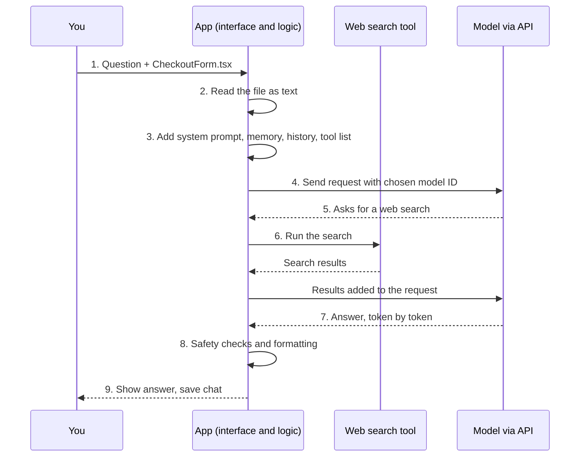
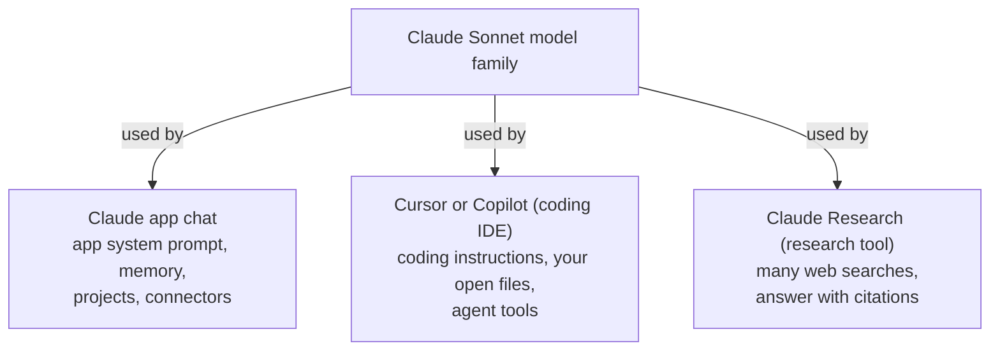
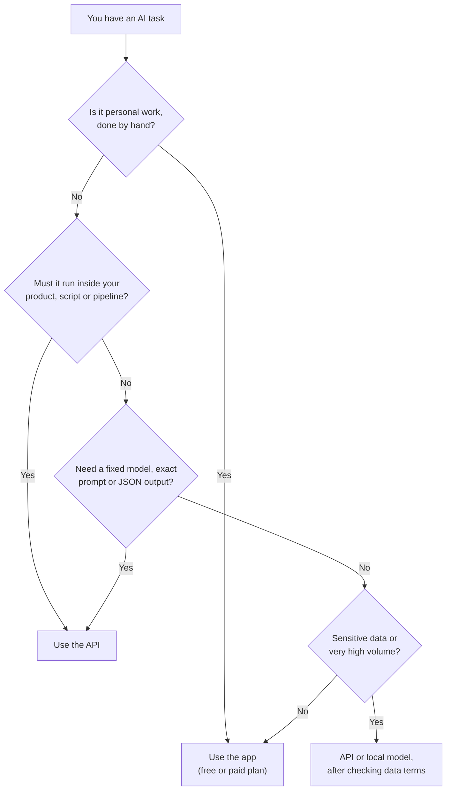

# A1-02 · AI models vs AI tools (why the same model feels different in different apps)

> **Lesson A1-02** · Type: Concept · Prerequisites: [A1-01 · AI, generative AI and LLMs](./a1-01-ai-generative-ai-and-llms.md) · Leads to: A3-06, A9-01
>
> **Facts checked on:** 12 October 2026, from each company's own docs and pricing pages. **Model names, default models, plans and prices change very often** (sometimes monthly). Everything marked *(may change)* must be re-checked before you post about it.

**Why this lesson matters:** in A1-01 you learned that ChatGPT is an app, not the model. This lesson goes one level deeper. The same model can feel smart in one app and dull in another, because the **app around the model** changes what the model sees and what it is allowed to do. Once you can see the two layers separately, you can compare tools fairly, explain AI products clearly in interviews, and know when to skip the app and call the **API** yourself.

## Learning goals

By the end of this lesson you will be able to:

1. Explain the difference between an **AI model** and an **AI tool** (app), with examples.
2. List exactly what the **app layer** adds: interface, system prompt, memory, file handling, connected tools, safety layers and model choice.
3. Read a **model ID** like `claude-sonnet-5-5` or `gemini-3.8-flash` and explain families, versions, aliases and why defaults change.
4. Explain the difference between **developer APIs** (OpenAI API, Claude API, Gemini API) and **consumer apps**, and when to use which.
5. Compare **monthly subscriptions** with **pay-per-token** API pricing using real numbers.
6. Answer the four lesson questions (section 8).
7. **Done when:** you can draw the app layer and the model layer for three tools you use (exercise in section 12).

---

## 1. The topic in one minute

- **AI model:** the trained "brain" (for example Claude Sonnet, GPT-6 Sol or Gemini 3.8 Flash). It only takes text (and sometimes images) in and gives tokens out. Developers reach it through an **API**.
- **AI tool:** the **product built around a model**: ChatGPT, the Claude app, the Gemini app, Cursor, GitHub Copilot, Gemini Notebook. The tool adds the interface, hidden instructions (a **system prompt**), memory, file handling, connected tools like web search, safety checks, and the choice of which model to call.
- **API:** a way for your code to send a request directly to the model and get the answer back, paying per token. No app layer, unless you build it.

**One-line memory trick:** *model = engine, tool = the whole car.*

**Analogy: engine vs car.** The same engine can go into a hatchback, an SUV and a delivery van. Each feels completely different to drive, because of the gearbox, the seats, the software, the speed limiter and what is loaded in the back. If you only ever drive the car, you might think "this engine is slow", when really the car's settings are holding it back. An AI model is the engine; ChatGPT, Cursor and Copilot are different cars built on top of engines.

**Real-life example:** on 12 October 2026, Claude Sonnet 5.5 is offered inside **Cursor** and inside **GitHub Copilot**, and Claude Sonnet models are also used in the **Claude app**. Ask all three to "explain this function" and you get three different answers: Cursor and Copilot have seen your open files and have coding instructions, while the Claude app has its own general-purpose instructions and maybe your saved memory. Same family of engine, three different cars.

---

## 2. Detailed definitions and why they matter

### 2.1 The model

**Definition:** a trained AI system (for chat and coding tools, an LLM) that takes an input and predicts output tokens. It is made by a **model provider** such as OpenAI, Anthropic or Google, and is usually reached through that provider's **API** (or through cloud platforms that resell it).

**One-line meaning:** the engine that actually generates the text.

**What the model does NOT have by itself:**

- No chat history: the API is **stateless**. Anthropic's docs say you must send the full conversation every time.
- No memory of you between requests.
- No web access, no files, no tools, unless the request describes tools and *your code* runs them.
- No idea of today's date, unless someone puts it in the prompt.

Remember this list. Everything on it is something the **app** adds.

### 2.2 The tool (the app layer)

**Definition:** a product that wraps one or more models with an interface and extra logic, so normal users can get value without writing code.

**One-line meaning:** everything between you and the model.

**What the app layer usually adds** (you will see each of these again in the walkthrough):

| App layer piece | What it does | Example |
|---|---|---|
| **Interface** | Chat box, buttons, file upload, model picker, rendering of code and tables | ChatGPT's message box; Cursor's editor panel |
| **System prompt** | Hidden instructions sent before your message: date, tone, formatting, rules | Anthropic publishes the system prompts used in the Claude apps and notes they **don't apply to the API** |
| **Conversation history** | Re-sends earlier messages so the model can "remember" the chat | Every chat app does this |
| **Memory** | Saves facts about you and adds them to future prompts | ChatGPT and Claude both list memory on their plan pages *(features may change)* |
| **File handling** | Turns PDFs, images, code files and repos into something the model can read | Uploading `CheckoutForm.tsx`; Cursor reading your project |
| **Connected tools** | Web search, running code, reading your Gmail or Docs, image generation | Claude Research uses the web and connected apps like Gmail and Google Docs |
| **Safety layers** | Extra checks on what goes in and comes out | Classifiers, content filters |
| **Model choice / routing** | Decides which model and which effort level to use | Cursor's **Auto** mode picks a model per request through Cursor Router |
| **Billing and limits** | Turns usage into a subscription with usage limits | "5x more usage" on a paid plan |

### 2.3 Model families, versions and IDs

**Definition:** a **model family** is a line of models from one provider (GPT, Claude, Gemini). Inside a family there are **tiers** (bigger and smaller models) and **versions** (newer releases). The **model ID** is the exact string your code sends to the API.

| Provider | Family | Tier / size examples | Example API model ID |
|---|---|---|---|
| Anthropic | Claude | Haiku (fast, cheap) → Sonnet → Opus → Fable (most capable) | `claude-sonnet-5-5` |
| OpenAI | GPT | Luna (cost-efficient) → Sol → Astra (most capable) | `gpt-6.1-sol` |
| Google | Gemini | Flash-Lite → Flash → Pro | `gemini-3.8-flash` |

*(IDs and tiers from each provider's models page on 12 October 2026; they will change.)*

**Pinned IDs vs aliases** (this matters a lot for developers):

- A **pinned** ID always means the same model. Anthropic's docs say that from the Claude 4.6 generation onward, a dateless ID like `claude-sonnet-4-6` is a fixed snapshot, and an updated model ships under a **new** ID.
- An **alias** is a moving pointer. Google's Gemini docs describe a "latest" alias such as `gemini-flash-latest` that always points to the newest release, plus **preview** and **experimental** models that are less stable.
- Even with a pinned ID, small behaviour differences can come from changes in the provider's **serving infrastructure** (routing, safety classifiers, sampling), as Anthropic's docs point out.

### 2.4 APIs vs apps

**Definition:** a **developer platform** gives you an API key, documentation, SDKs (code libraries), usage dashboards and per-token billing. A **consumer app** gives you a ready-made product with a subscription.

| | Developer API | Consumer app |
|---|---|---|
| Examples | OpenAI API, Claude API, Gemini API (with Google AI Studio) | ChatGPT, Claude app, Gemini app |
| Who it's for | Developers building products or automations | Anyone who wants to chat, write, research |
| You control | Model ID, system prompt, history, tools, output format | Only what the settings expose |
| You must build | History, memory, file handling, tools, UI, safety, cost limits | Nothing; it's ready |
| Billing | Pay per token (input and output priced separately) | Monthly subscription with usage limits |
| Is it included in the other? | No. OpenAI and Anthropic both say their app subscriptions **don't include API usage** (Anthropic's pricing page lists some API credits with Claude Max, so check current terms) | |

### 2.5 Same model, different tools

**Definition:** one model can be offered inside many products at once. Multi-model tools like **Cursor** and **GitHub Copilot** let you choose between models from several providers; single-provider apps like ChatGPT, Claude and Gemini use their own company's models.

**Why it matters:** when you say "Tool X is better than Tool Y", you might really be comparing two different models, or the same model with two different app layers. A fair comparison names **both** the tool and the model.

---

## 3. Words you need first

From A1-01 you already know **model**, **token**, **prompt**, **inference** and **base vs chat model**. New words in this lesson:

| Word | Plain meaning |
|---|---|
| **API** | Application Programming Interface: a URL your code calls to use a service. For AI, you send a prompt and get the model's output back. |
| **API key** | A secret password-like string that identifies your account for billing. Never put it in frontend code. |
| **SDK** | A code library (for example `npm install @anthropic-ai/sdk`) that makes calling an API easier |
| **System prompt** | Hidden instructions sent before the user's message that set the model's role, style and rules |
| **Context** | Everything the model can "see" for one request: system prompt + history + files + your message |
| **Stateless** | The API remembers nothing between requests; you must resend what matters |
| **Model provider** | The company that trains and serves the model (OpenAI, Anthropic, Google) |
| **Model ID** | The exact model name your code sends, such as `claude-haiku-5-5` |

---

## 4. How it works: the layers and one request

### 4.1 The layer diagram

**Diagram: the four layers between you and the model**

```
+------------------------------------------------------+
| 1. INTERFACE                                THE TOOL |
| chat box, file upload, model picker, buttons         |
+------------------------------------------------------+
                           |
                           v
+------------------------------------------------------+
| 2. APP LOGIC                                THE TOOL |
| system prompt, history, memory, file handling,       |
| tools (search, code run), safety layers,             |
| model choice or Auto routing                         |
+------------------------------------------------------+
                           |
                           v
+------------------------------------------------------+
| 3. MODEL API                                PROVIDER |
| HTTPS request: model ID + messages + settings        |
+------------------------------------------------------+
                           |
                           v
+------------------------------------------------------+
| 4. MODEL                                    PROVIDER |
| fixed trained weights; predicts the next token       |
+------------------------------------------------------+
```

**How to read this diagram:** start at the top, where you type. Layers 1 and 2 are **the tool** (the product company's work). Layers 3 and 4 belong to the **model provider**. Your message goes down through the interface into the app logic, which adds the system prompt, history, memory, files and tool definitions, picks a model, and sends one big request to the model API. The model only ever sees what layer 2 decided to send. The answer travels back up the same way, and the app may run tools, check safety and format the text before you see it.

**Who owns which layer?** In ChatGPT, the Claude app and the Gemini app, one company owns all four layers. In Cursor and GitHub Copilot, the tool company owns layers 1 and 2, and the model can come from OpenAI, Anthropic, Google or others. Cursor also offers its own model (Composer) *(may change)*.

### 4.2 Walkthrough: one request inside a chat app

**Scenario:** in a chat app (Claude, ChatGPT or Gemini), you attach `CheckoutForm.tsx` and type: *"Is this component accessible? Check the latest WCAG guidance."*

1. **You type the question and attach the file** in the interface.
2. **The app reads the file** and turns it into text (and images, if any) the model can read.
3. **The app builds the request:** its own system prompt (date, formatting rules, safety rules), your saved memory or project instructions, the earlier messages in this chat, the file, your question, and a list of tools the model may ask for (like web search).
4. **The app sends it to the model API**, using the model you picked or the one the app chose.
5. **The model reads everything and asks for a tool:** "search the web for the latest WCAG guidance".
6. **The app runs the web search** and sends the results back to the model.
7. **The model writes the answer** token by token, using the file, the search results and its training.
8. **The app checks and formats the answer:** safety checks, Markdown rendering, code blocks, citations.
9. **You see the answer,** and the app saves the chat (and maybe updates memory).

**Diagram: one chat request, step by step**



**How to read this diagram:** each vertical line is one participant; time flows downwards. The numbers match the walkthrough. Notice that **you never talk to the model directly**: every arrow to the model goes through the app. The model also never runs the search itself; it only *asks*, and the app does it (steps 5 and 6). Arrows from the app back to itself (steps 2, 3 and 8) are the hidden app-layer work.

**If you used the API directly instead,** steps 2, 3, 6, 8 and 9 would be **your code's job**. That is the real difference between an app and an API.

### 4.3 Same model, three tools

**Diagram: one model family, three different app layers**



**How to read this diagram:** the box at the top is the model family. Each box below is a different product using it, and the small text lists what that product's app layer adds. Same engine, three cars: the chat app is general-purpose, the coding IDE feeds in your code, and the research tool runs many searches before answering. *(On 12 October 2026, Cursor and Copilot both list Claude Sonnet 5.5; Claude Research is on paid Claude plans. May change.)*

**The seven knobs that differ between tools** (this is the full answer to "why does the same model answer differently?"):

1. **System prompt:** different hidden instructions → different tone, length, format and rules.
2. **Context:** history, memory, project files, open editor tabs or retrieved documents.
3. **Tools:** web search, code execution, codebase search, connected apps, or none.
4. **Model settings:** reasoning effort or "thinking" level, maximum answer length.
5. **Model routing:** an Auto mode or the plan you're on may pick a different (often cheaper) model than you think.
6. **Safety and post-processing:** extra filters, formatting, citation rendering.
7. **Randomness:** even with everything identical, sampling can give a different answer each time.

---

## 5. Six tools, their models and what they add

> **Checked on 12 October 2026 from each tool's own docs or pricing page.** Model lists and plans change very often. Treat this table as a snapshot and re-check the linked page before you rely on it. Prices are the individual-plan USD prices shown on the official pages; your local price and taxes may differ.

| Tool | Type | Models behind it (as stated by the tool) | What the app layer adds | Individual plans (USD/month) |
|---|---|---|---|---|
| **ChatGPT** ([pricing](https://chatgpt.com/pricing), [models help](https://help.openai.com/en/articles/20001354-gpt-6-and-other-models-in-chatgpt)) | Chat app (OpenAI) | Paid plans: GPT-6 family (Sol, with Astra behind "Pro") plus selectable GPT-5.6 models. Free and Go: a cheaper "Luna" model. *OpenAI's own pages differed on that day: the pricing page said GPT-6 Luna, the help center said GPT-5.6 Luna is becoming the Free/Go default.* | Model menu and Thinking levels, memory, deep research, image generation, Codex | Free; Go; Plus $20 (help center); Pro "from" a higher price |
| **Claude** ([pricing](https://claude.com/pricing)) | Chat app (Anthropic) | Free: Sonnet, Haiku. Pro: adds Opus (Fable via usage credits). Max: adds Fable. | Published app system prompts, memory, projects, Research, connectors, Claude Code on paid plans | Free; Pro $20 monthly ($17/month billed yearly); Max from $100 |
| **Gemini app** ([plans](https://gemini.google/subscriptions/)) | Chat app (Google) | Free: Gemini 3.5 Flash-Lite. AI Plus: 3.6 Flash and 3.1 Pro. AI Pro and Ultra: 3.8 Flash and 3.1 Pro. | Deep Research, Gemini Notebook, Google Flow credits, video generation, 1M-token context on Pro | Free; AI Plus $4.99; AI Pro $19.99; AI Ultra from $99.99 |
| **GitHub Copilot** ([plans](https://github.com/features/copilot/plans), [models](https://docs.github.com/en/copilot/reference/ai-models/supported-models)) | Coding assistant in your IDE (GitHub) | **You choose:** Anthropic Claude, OpenAI GPT, Google Gemini, Microsoft MAI-Code, xAI Grok and Kimi models | Inline code suggestions, chat and agent in the editor, usage billed in AI credits | Free; Pro $10; Pro+ $39 |
| **Cursor** ([models](https://cursor.com/docs/models), [pricing](https://cursor.com/pricing)) | AI code editor | **You choose:** OpenAI, Anthropic, Google, Meta and Grok models, plus Cursor's own Composer 2.5. **Auto** mode picks per request via Cursor Router. | Agent, MCP servers (a standard way to plug in extra tools; a later lesson), skills, hooks, cloud agents, Bugbot code review | Hobby free; Individual plans from $20 |
| **Gemini Notebook**, formerly **NotebookLM** ([announcement](https://blog.google/innovation-and-ai/products/gemini-notebook/notebooklm-gemini-notebook/), [help](https://support.google.com/notebooklm/answer/16164461)) | Research tool (Google) | Gemini. Google does **not** name the exact version. | Answers grounded in **your** uploaded sources with inline citations, audio overviews, mind maps, study guides; a cloud computer to run analysis code (Ultra first, rolling out to Pro) | Free; more with Google AI plans |

**Three patterns to notice:**

1. **Single-provider apps** (ChatGPT, Claude, Gemini, Gemini Notebook) only use their own company's models, and the model you get depends on your **plan**.
2. **Multi-model tools** (Copilot, Cursor) let you pick the model. In these tools, "Cursor is better than Copilot" means nothing unless you also say which model each one used.
3. **Even names change:** NotebookLM was renamed Gemini Notebook on 16 July 2026. If a product name can change in one day, model names certainly will.

---

## 6. Model names, versions and defaults

### 6.1 Reading a model ID

```
claude - sonnet - 5 - 5        gpt - 6.1 - sol        gemini - 3.8 - flash
  |        |      |   |          |     |     |          |       |      |
family    tier  major minor    family version tier    family version  tier
```

Some IDs carry extra signals:

- **A date** (older Claude models such as `claude-sonnet-4-5-20250929`): a frozen snapshot from that date.
- **`-preview`** (for example `gemini-3.1-pro-preview`): usable, but may change and has stricter limits.
- **`-latest`** (for example `gemini-flash-latest`): an alias that moves to each new release.

### 6.2 Why products change their default model

- **New releases:** providers ship new versions every few months, and apps switch to the newest one. For example, OpenAI's help center says GPT-6 replaced "Latest" in ChatGPT's model menu.
- **Cost and capacity:** free tiers often get the cheaper, faster model in a family.
- **Limits:** ChatGPT's help center says that when you hit a Thinking limit, ChatGPT may continue with another available model.
- **Retirement:** old models get deprecated and then removed from APIs on a published schedule.
- **Routing:** Auto modes (like Cursor's) pick a different model per request to balance cost and quality.

### 6.3 Note: model names change often

> **Every model name in this guide was correct on 12 October 2026 and will go out of date.** Write the **date** next to every model name you note down, compare or post about. The habit matters more than the names.

**How to keep up without burning out:**

1. Bookmark the official **models pages** (links in section 20) and check them when a big release is announced, not daily.
2. Note **tool + model + date** in every comparison you make or share.
3. In code, **pin the exact model ID** in one config value or environment variable, so upgrading is a one-line change you test on purpose.
4. Watch each provider's **deprecation page**, so your app never breaks when an old ID is retired.
5. Before switching to a new model, **test it on your own task** with a few saved prompts. Newer is not automatically better for *your* use case.
6. Prefer official docs over third-party blogs for model lists; blogs go stale fastest.

---

## 7. APIs vs apps, and how pricing works

### 7.1 The three developer platforms

| Platform | Where | How you set the system prompt | API key env variable |
|---|---|---|---|
| **OpenAI API** | [developers.openai.com/api](https://developers.openai.com/api/docs/models) | `instructions` parameter in the Responses API (or a `developer` role message) | `OPENAI_API_KEY` (used in OpenAI's examples) |
| **Claude API** | [platform.claude.com](https://platform.claude.com/docs/en/models/overview) | Top-level `system` parameter in the Messages API | `ANTHROPIC_API_KEY` (SDK default) |
| **Gemini API** + **Google AI Studio** | [ai.google.dev](https://ai.google.dev/gemini-api/docs/models), keys at [aistudio.google.com](https://aistudio.google.com/apikey) | `system_instruction` in the Interactions API | `GEMINI_API_KEY` or `GOOGLE_API_KEY` (if both are set, `GOOGLE_API_KEY` wins) |

**Google AI Studio** is Google's web workspace where you create Gemini API keys and try models in the browser before writing code.

### 7.2 Subscription vs pay-per-token

| | Monthly subscription (app) | Pay-per-token (API) |
|---|---|---|
| You pay for | Access to the app, with usage limits | Exactly the tokens you send and receive |
| Price shape | Fixed, for example $20/month | Varies with usage; input and output tokens priced separately |
| Good when | One person, daily use, wants memory, research, files | Code, products, automation, many users, batch jobs |
| Hidden cost | Hitting limits; less control | Long prompts and chat history are re-sent and re-billed every time |
| Free options | Free plans of each app | Gemini API free tier (Google lists free-tier data as used to improve its products); Claude API gives new users small free credits; local models with Ollama (A1-01) |

**API prices used below** (USD per 1 million tokens, standard tier, checked 12 October 2026; *may change*):

| Model ID | Input | Output |
|---|---|---|
| `claude-haiku-5-5` (prompts up to 100k tokens) | $0.10 | $0.50 |
| `gpt-6-luna` | $0.10 | $0.50 |
| `gemini-3.8-flash` (price until 31 Dec 2026; doubles from 1 Jan 2027) | $0.75 | $3.75 |
| `claude-sonnet-5-5` | $2.00 | $10.00 |
| `gpt-6.1-sol` | $2.00 | $10.00 |

### 7.3 Worked example: what would it cost?

```js
// cost.mjs: API cost estimates from official per-1M-token prices (checked 12 Oct 2026).
const PRICES = {                       // USD per 1M tokens: [input, output]
  "claude-haiku-5-5 (<=100k prompt)": [0.10, 0.50],
  "gpt-6-luna": [0.10, 0.50],
  "gemini-3.8-flash (till 31 Dec 2026)": [0.75, 3.75],
  "claude-sonnet-5-5": [2.00, 10.00],
  "gpt-6.1-sol": [2.00, 10.00],
};

function monthlyCost([inPrice, outPrice], { requestsPerDay, inputTokens, outputTokens, days = 30 }) {
  const requests = requestsPerDay * days;
  const inputCost = (requests * inputTokens / 1e6) * inPrice;
  const outputCost = (requests * outputTokens / 1e6) * outPrice;
  return inputCost + outputCost;
}

// Scenario A: a Next.js feature that summarises product reviews
const reviewFeature = { requestsPerDay: 2000, inputTokens: 1500, outputTokens: 300 };
console.log("A. Review summariser: 2,000 requests/day, 1,500 in + 300 out tokens, 30 days");
for (const [model, p] of Object.entries(PRICES)) {
  console.log(`   ${model.padEnd(36)} $${monthlyCost(p, reviewFeature).toFixed(2)}`);
}

// Scenario B: one person chatting heavily through the API instead of an app
const personalChat = { requestsPerDay: 40, inputTokens: 4000, outputTokens: 800 };
console.log("B. Personal chat: 40 messages/day, 4,000 in (incl. history) + 800 out, 30 days");
for (const [model, p] of Object.entries(PRICES)) {
  console.log(`   ${model.padEnd(36)} $${monthlyCost(p, personalChat).toFixed(2)}`);
}
```

Real output (`node cost.mjs`, Node.js 22, 12 October 2026):

```text
A. Review summariser: 2,000 requests/day, 1,500 in + 300 out tokens, 30 days
   claude-haiku-5-5 (<=100k prompt)     $18.00
   gpt-6-luna                           $18.00
   gemini-3.8-flash (till 31 Dec 2026)  $135.00
   claude-sonnet-5-5                    $360.00
   gpt-6.1-sol                          $360.00
B. Personal chat: 40 messages/day, 4,000 in (incl. history) + 800 out, 30 days
   claude-haiku-5-5 (<=100k prompt)     $0.96
   gpt-6-luna                           $0.96
   gemini-3.8-flash (till 31 Dec 2026)  $7.20
   claude-sonnet-5-5                    $19.20
   gpt-6.1-sol                          $19.20
```

**What the numbers teach** (the token counts are assumptions; real ones depend on your prompts):

- **Model choice changes cost 20 times** for the same feature ($18 vs $360 a month). Always test whether the cheap tier is good enough first.
- **For personal chatting,** a mid-tier model through the API costs about the same as a $20 subscription, but you lose memory, search, file handling and a nice UI. That is why most people should use the app for personal work.
- **For a product feature,** a subscription is not even an option: subscriptions are for using the provider's app, while the API is the product meant for putting a model inside *your* app.
- Reasoning ("thinking") tokens are usually billed as output, so a model that thinks a lot costs more than these estimates. Some providers also offer cheaper **batch** processing; Anthropic's Batch API, for example, gives a 50% discount for non-urgent jobs.

### 7.4 When should you use the API instead of the app?

**Diagram: app or API?**



**How to read this diagram:** start at the top with your task and answer each question. Personal, hand-done work goes to the app. Anything that must run inside your own product or a script needs the API. If you need precise control (a pinned model, your own system prompt, structured JSON), use the API. If the data is sensitive or the volume is huge, look at the API or a local model, and read the data-usage terms first.

---

## 8. The four lesson questions, answered

### Q1. Why can the same model answer differently in two apps?

Because the model only sees what the app sends it, and every app sends something different. The seven knobs from section 4.3:

1. **System prompt** (a coding tool says "be concise, prefer code"; a chat app says "be helpful, use Markdown").
2. **Context** (Cursor sends your open files; the chat app sends your memory and chat history).
3. **Tools** (one app can search the web, another can't).
4. **Model settings** (thinking level, answer length).
5. **Routing** (your plan or an Auto mode may be using a different model than you assume).
6. **Safety and post-processing.**
7. **Randomness** (even the same app gives different answers on two tries).

So before saying "Claude in Cursor is worse than Claude in the Claude app", check knobs 1 to 5 first.

### Q2. What exactly does the app layer add?

Everything in the layer diagram's layers 1 and 2:

- **Interface:** chat UI, file upload, model picker, Markdown and code rendering.
- **System prompt:** date, style, formatting and safety instructions.
- **History and memory:** re-sending the conversation; saving facts about you.
- **File handling:** turning PDFs, images and code into model input.
- **Connected tools:** web search, code execution, connectors to Gmail, Docs, GitHub.
- **Safety layers:** filters and classifiers on input and output.
- **Model choice:** the picker, plan defaults and Auto routing.
- **Billing and limits:** subscriptions and usage caps.

A good test: anything a developer would have to **build** around a raw API call is part of the app layer.

### Q3. When should you use the API instead of the app?

Use the **API** when:

- The AI must run **inside your product** (a "summarise reviews" button in your Next.js app).
- You are **automating** something (a script that tags 10,000 support tickets every night; batch discounts help here).
- You need **control**: a pinned model ID, your own system prompt, structured JSON output, no surprise default changes.
- You want to **compare models fairly**, with the same prompt and no app layer in between.
- You need to manage **cost per request** or use a cheaper tier than the app gives you.

Use the **app** when:

- It is your own day-to-day work (writing, learning, research, debugging help).
- You want ready-made features: memory, research mode, file handling, connectors.
- You don't want to write and maintain code, or handle API keys.

### Q4. Why do model names keep changing, and how do you keep up?

**Why they change:**

- Providers release new versions every few months and give them new names and IDs.
- Families add and rename tiers (fast/cheap vs powerful). OpenAI's current GPT models, for example, use tier names like Luna, Terra, Sol and Astra.
- Naming **schemes** change too: Anthropic moved from dated IDs to dateless pinned IDs with Claude 4.6; Google says its current naming convention applies to models from September 2025 onward.
- Older models get deprecated and retired.
- Even **product** names change (NotebookLM → Gemini Notebook, July 2026).

**How to keep up:** follow the six habits in section 6.3. The two most important: **always write tool + model + date**, and **pin model IDs in code**.

---

## 9. Related concepts: confusing pairs

| Often confused | The real difference |
|---|---|
| **ChatGPT vs GPT** | ChatGPT is an app; GPT is OpenAI's model family behind it (and behind many other products). |
| **Model vs tool** | The model generates tokens; the tool is the product around it (interface, prompts, memory, tools, safety, billing). |
| **Model family vs model version vs model ID** | Family = Claude / GPT / Gemini; version = 5.5 / 6.1 / 3.8; ID = the exact string for the API, like `claude-sonnet-5-5`. |
| **Pinned ID vs alias** | A pinned ID never changes its weights; an alias (like `gemini-flash-latest`) moves to new releases. |
| **App memory vs model memory** | Models have no memory between requests; "memory" is the app saving notes and re-sending them. |
| **Subscription vs API billing** | Separate products. A Plus or Pro subscription does not give you API usage (check each provider's current terms). |
| **System prompt vs your prompt** | The system prompt is set by the app or developer and applies to every message; your prompt is just this message. |
| **Developer platform vs consumer app** | Platform = keys, docs, SDKs, per-token billing (OpenAI API, Claude API, Gemini API + AI Studio). App = ready product for end users. |
| **Multi-model tool vs single-provider app** | Copilot and Cursor let you pick models from several companies; ChatGPT, Claude and Gemini use their own. |

---

## 10. Developer practice: the same model with and without a system prompt (optional)

**Goal:** prove to yourself that a big part of an "app's personality" is just a system prompt, and that the API remembers nothing.

### 10.1 Prerequisites

- Node.js 20 or newer (the Anthropic TypeScript SDK requires Node 20 LTS or later).
- A Claude Console account and an API key. Anthropic says new users get a small amount of free credits for testing; after that it is pay-per-token. The script uses the cheapest current model, `claude-haiku-5-5`, so each run costs a tiny fraction of a cent.
- **Never paste the key into code or commit it.** Keep it in an environment variable or a `.env` file listed in `.gitignore`.

**Zero-cost alternative:** the Gemini API has a free tier for its Flash models (Google says free-tier data may be used to improve its products, so don't send private data). A Gemini version of the same idea is at the end of this section.

### 10.2 Setup

```bash
mkdir system-prompt-demo && cd system-prompt-demo
npm init -y
npm install @anthropic-ai/sdk

# Put your key in .env (and never commit it)
echo 'ANTHROPIC_API_KEY=your-key-here' > .env
echo '.env' >> .gitignore
```

### 10.3 The script

Save as `system-prompt-demo.mjs`:

```js
// system-prompt-demo.mjs
// Same model, same user message: once WITHOUT a system prompt, once WITH one.
// Prerequisites: Node.js 20+, `npm install @anthropic-ai/sdk`, and an API key
// from the Claude Console saved in the ANTHROPIC_API_KEY environment variable.
// Run: node system-prompt-demo.mjs
// @ts-check
import Anthropic from "@anthropic-ai/sdk";

const client = new Anthropic(); // reads ANTHROPIC_API_KEY from the environment
const MODEL = "claude-haiku-5-5"; // cheapest current Claude model (checked 12 Oct 2026)
const PRICE_PER_MTOK = { input: 0.1, output: 0.5 }; // USD, prompts up to 100k tokens

const userMessage = "How should I store a user's login token in my React app?";

// This plays the role of the "app layer": the same instructions every request gets.
const SYSTEM_PROMPT = `You are a senior security reviewer for a banking app.
Answer in at most 5 short bullet points.
State the biggest risk first. If an approach is unsafe, say so directly.`;

/** @param {string} label @param {string | undefined} system */
async function ask(label, system) {
  const message = await client.messages.create({
    model: MODEL,
    max_tokens: 400,
    messages: [{ role: "user", content: userMessage }],
    ...(system ? { system } : {}), // the ONLY difference between the two calls
  });

  const text = message.content
    .filter((block) => block.type === "text")
    .map((block) => block.text)
    .join("\n");

  const { input_tokens, output_tokens } = message.usage;
  const cost = (input_tokens * PRICE_PER_MTOK.input + output_tokens * PRICE_PER_MTOK.output) / 1e6;

  console.log(`\n=== ${label} ===`);
  console.log(text);
  console.log(`[usage] input ${input_tokens} tokens, output ${output_tokens} tokens, about $${cost.toFixed(6)}`);
}

await ask("1. WITHOUT a system prompt", undefined);
await ask("2. WITH a system prompt", SYSTEM_PROMPT);
```

Run it (Node 20.6+ can load the `.env` file directly):

```bash
node --env-file=.env system-prompt-demo.mjs
```

### 10.4 How this was checked, and what you should see

**Checks done on 12 October 2026** (no paid API key was available in that environment):

1. **Type-check:** the script passed `tsc --checkJs` (TypeScript 7.0.2) against the official `@anthropic-ai/sdk` 0.133.0 types, so every parameter and response field used exists.
2. **Reaches the real API:** run with a deliberately invalid key, the request reached `api.anthropic.com` and came back with `401 authentication_error` ("invalid x-api-key"). So the endpoint and SDK setup are correct; only a real key is missing.
3. **Logic run against a mock:** the full script ran against a local mock server that returns the response shape shown in Anthropic's docs. The mock confirmed that call 1 was sent **without** a `system` field and call 2 **with** it. Real output of that mock run:

```text
=== 1. WITHOUT a system prompt ===
MOCK: default answer
[usage] input 18 tokens, output 120 tokens, about $0.000062

=== 2. WITH a system prompt ===
MOCK: answer shaped by system prompt
[usage] input 61 tokens, output 120 tokens, about $0.000066
```

**Illustrative output with a real key** (not a real run; your text and token counts will differ):

```text
=== 1. WITHOUT a system prompt ===
Great question! There are a few common options for storing tokens in React:
1. localStorage ... 2. sessionStorage ... 3. httpOnly cookies ...
(a longer, general explanation with pros and cons of each option)
[usage] input ~20 tokens, output ~400 tokens

=== 2. WITH a system prompt ===
- Biggest risk: storing the token in localStorage exposes it to any XSS bug.
- Prefer an httpOnly, Secure, SameSite cookie set by your server.
- ... (at most 5 short bullets)
[usage] input ~60 tokens, output ~120 tokens
```

**What to notice:**

1. Same model, same question, very different answers: length, format and focus all follow the system prompt. This is exactly what an app's hidden system prompt does.
2. The **input tokens go up** in call 2. You pay for the system prompt on **every** request, which is why apps keep theirs efficient.
3. The script never set `temperature`. Anthropic's docs say sampling parameters like `temperature` are not supported on Claude 4.7 and later models, a good example of how newer models can change API behaviour.

**Try next:**

- Add a fake "memory" line to the system prompt, such as `User preference: show TypeScript examples.` That is roughly how app memory works.
- Make a second request that asks "What did I just ask you?" **without** sending the first message again. The model won't know, because the API is stateless.

### 10.5 The same idea with the Gemini API (free tier)

```js
// @ts-check
// gemini-variant.mjs: the same idea with the Gemini Interactions API (has a free tier)
// Prerequisites: npm install @google/genai; GEMINI_API_KEY from Google AI Studio
import { GoogleGenAI } from "@google/genai";

const ai = new GoogleGenAI({}); // reads GEMINI_API_KEY (or GOOGLE_API_KEY) from the environment
const interaction = await ai.interactions.create({
  model: "gemini-3.8-flash",
  system_instruction: "You are a senior security reviewer for a banking app. Answer in at most 5 bullets.",
  input: "How should I store a user's login token in my React app?",
});
console.log(interaction.output_text);
```

**How this was checked:** it passed `tsc --checkJs` against the official `@google/genai` 2.28.0 types and matches the Interactions API examples in Google's docs. The Gemini endpoint was not reachable from the test environment, so it has **not** been run. Remove the `system_instruction` line to see the "without" version.

---

## 11. Benefits, limitations, common mistakes and safety

### 11.1 Common mistakes and wrong mental models

**Wrong mental model 1: "ChatGPT is the model."**
- **Correction:** ChatGPT is an **app** that uses OpenAI's GPT models. Which model you get depends on your plan, your picker choice and sometimes automatic switching.
- **Why it matters:** "ChatGPT got worse" might really mean "my plan now defaults to a different model" or "the app's system prompt changed".

**Mistake 2: comparing tools without noting which model each one used.**
- Example: "Cursor writes better React than Copilot." Maybe Cursor was on a top-tier model and Copilot on a small one.
- **Fix:** record **tool, model, plan, effort/mode, date and the exact prompt** for every comparison, and run each prompt at least twice.

**Mistake 3: assuming the newest model name is always best for your task.**
- Newer models can be slower or 20 times more expensive than you need (see the cost table), and they can change behaviour. For example, Anthropic's docs say prefilling responses is not supported on Claude 4.6 and later, and `temperature` is not supported on 4.7 and later. Code that worked before can return a 400 error after a "simple upgrade".
- **Fix:** keep a small set of your own test prompts and try a new model on them before switching.

**Wrong mental model 4: "The model remembers me."**
- **Correction:** the model has no memory; the **app** stores notes and re-sends them. Through the API, you would have to build that yourself.

**Mistake 5: "My subscription covers the API."**
- OpenAI and Anthropic both say app subscriptions and API billing are separate (check current terms; Anthropic's pricing page lists some API credits with Max).

**Mistake 6: putting an API key in React client code.**
- Google's docs warn never to expose keys client-side in production; the Anthropic SDK disables browser use by default for the same reason. Call the API from a **Next.js route handler or server action**, never from a component.

### 11.2 Apps vs APIs: benefits and limitations

| | Benefits | Limitations |
|---|---|---|
| **Apps** | Ready to use, memory, research, file handling, connectors, safety built in, fixed monthly price | You may not know which model answered; defaults and system prompts change without notice; usage limits; little control over format |
| **APIs** | Full control: pinned model, your system prompt, JSON output, automation; pay only for what you use; easy to compare models | You build history, memory, tools, UI and safety yourself; costs can spike; rate limits; you must protect your keys |

### 11.3 When this distinction does NOT matter much

- For quick personal questions, just use whichever app you like; the model-vs-tool detail rarely changes the outcome.
- When a tool hides its model (like Gemini Notebook), you can't pick anyway. Judge it by results on your own tasks.

### 11.4 Privacy and safety

- **Data terms differ** between a provider's app and its API, and between free and paid tiers. For example, Google's Gemini API pricing page lists free-tier data as used to improve its products and paid-tier data as not used. Gemini Notebook's help page says your data isn't used for training unless you give feedback.
- Read each tool's data settings before pasting company code or customer data, and follow your company's policy.
- Keep API keys in environment variables, rotate them if leaked, and set spending limits in the provider's console where available.

---

## 12. Hands-on exercises

### Beginner (no code): map six tools to their models

1. Pick **six AI tools you actually use** (for example ChatGPT, Claude, Gemini, Copilot, Cursor, Gemini Notebook).
2. For each, find the model(s) behind it **in the tool's own docs, model picker or pricing page**, not in a blog.
3. Fill in this table:

| Tool | Model(s) behind it | Who chooses the model? (me / plan / Auto / not disclosed) | Source URL (tool's own site) | Date checked |
|---|---|---|---|---|
| | | | | |

**Expected outcome:** six filled rows, each with an official source and a date.
**How to verify:** every row has a URL on the tool's own domain; multi-model tools say who chooses; tools that hide the model say "not disclosed" instead of a guess. Compare with section 5, but trust your fresher check if it differs.

### Intermediate (tool-based): same prompt, chat app vs coding tool

1. Choose a model family available in **both** a chat app and your coding tool, for example Claude Sonnet in the Claude app and in Cursor or Copilot, or a GPT model in ChatGPT and in Copilot.
2. In the coding tool, select that model **explicitly** in the model picker (not Auto).
3. Send this exact prompt in both:

````text
Review this React hook. List the bugs, then give a fixed version.

```tsx
import { useEffect, useState } from "react";

export function useUser(id: string) {
  const [user, setUser] = useState<any>(null);
  useEffect(() => {
    fetch(`/api/users/${id}`).then((r) => r.json()).then(setUser);
  }, []);
  return user;
}
```
````

4. Repeat once more in each tool (to separate randomness from app differences).
5. Record what changed:

| | Chat app | Coding tool |
|---|---|---|
| Exact model shown | | |
| Length (rough) | | |
| Format (prose, bullets, code-first) | | |
| Bugs found (missing `id` dependency, no cancel/race handling, `any`, no error state) | | |
| Did it use other project files or offer to edit your code? | | |
| Anything else different | | |

**Expected outcome:** both find the main bugs, but differ in length, tone and format; the coding tool is more likely to be code-first, refer to your project, or offer to apply the edit.
**How to verify:** differences that show up in **both** runs are app-layer differences; differences between run 1 and run 2 in the same tool are randomness. Screenshot the model picker in both tools as proof of the model used.

### Developer (optional): API with and without a system prompt

Follow section 10.

**Expected outcome:** two clearly different answers from the same model; higher input tokens in the system-prompt call; the "What did I just ask you?" test shows the API has no memory.
**How to verify:** compare the `[usage]` lines (input tokens must be higher in call 2), check that call 2 follows the format rules (5 bullets, risk first), and save both outputs for your post.

### "Done when" exercise: draw the layers for three tools

For three tools you use, draw the four layers from section 4.1 on paper, filling in this template for each:

```
Tool:          ______________________   (date checked: ________)
1. Interface:  ______________________
2. App logic:  system prompt? ___  memory? ___  files? ___
               tools: ____________  routing/Auto? ___
3. Model API:  provider(s): ________________
4. Model(s):   ______________________
```

You are done when you can explain each drawing in under a minute.

---

## 13. FAQ

**Can I see an app's system prompt?**
Sometimes. Anthropic publishes the system prompts used in the Claude web and mobile apps in its docs, and says those prompts don't apply to the API. Most other apps don't publish theirs.

**If I call the same model through the API, will I get the same answer as in the app?**
No. The API call has no app system prompt, no memory, no tools and no app formatting, and sampling adds randomness. You can get closer by writing a similar system prompt and sending similar context.

**Is the API "smarter" than the app?**
Same model, same weights. The differences come from the app layer and settings, or from the app quietly using a different model than you assumed.

**Why do some models cost more inside Copilot or Cursor?**
Bigger models cost more per token at the provider, and the tools pass that on. Copilot bills usage in AI credits; Cursor bills routed requests at the chosen model's list price (plus a Cursor rate for third-party models).

**What is "Auto" mode?**
A router inside the tool that picks a model for each request, usually to balance cost and quality. Convenient, but it makes comparisons harder, so switch it off when you test.

**Do I need a credit card for these APIs?**
It depends on the provider. The Gemini API has a free tier for its Flash models; Anthropic gives new Claude API users small free credits; OpenAI's help center says API usage is pay-as-you-go after you add a payment method *(terms may change)*.

**Should I learn one provider's API or all three?**
Learn one well (the concepts transfer), then skim the others. The shapes are similar: a model ID, a system prompt field, a list of messages, and a response with text and token usage.

---

## 14. Mini glossary

| Term | Meaning |
|---|---|
| **AI model** | The trained system that generates output (for example Claude Sonnet 5.5, GPT-6.1 Sol, Gemini 3.8 Flash) |
| **AI tool / app** | The product around one or more models (ChatGPT, Claude app, Cursor, Copilot) |
| **App layer** | Interface + app logic: system prompt, history, memory, files, tools, safety, routing, billing |
| **Model provider** | Company that trains and serves the model (OpenAI, Anthropic, Google) |
| **Model family** | A line of models from one provider (GPT, Claude, Gemini) |
| **Tier** | A size/speed level inside a family (Haiku, Sonnet, Opus; Luna, Sol, Astra; Flash-Lite, Flash, Pro) |
| **Model ID** | The exact string sent to the API, like `claude-sonnet-5-5` |
| **Pinned ID / snapshot** | An ID that always points to the same model weights |
| **Alias** | A moving name that points to the newest release, like `gemini-flash-latest` |
| **Preview / experimental** | Early models that may change and have stricter limits |
| **Deprecation / retirement** | The provider announcing, then actually removing, an old model ID |
| **API** | An endpoint your code calls to use the model |
| **API key** | Secret credential for your API account; keep it on the server |
| **SDK** | Official code library for calling an API |
| **Developer platform** | Where you get keys, docs and billing (OpenAI API, Claude Console, Google AI Studio) |
| **System prompt** | Hidden instructions applied to every request (`system`, `instructions`, `system_instruction`) |
| **Context** | Everything the model sees in one request |
| **Stateless** | The API keeps no memory between requests |
| **App memory** | Notes an app saves about you and adds to future prompts |
| **Connected tools / connectors** | Abilities the app gives the model: web search, code execution, Gmail, Docs, GitHub |
| **Safety layer** | Filters and classifiers an app or provider adds around the model |
| **Routing / Auto mode** | The tool choosing a model per request |
| **Subscription** | Fixed monthly price for an app, with usage limits |
| **Pay-per-token** | API billing: input and output tokens priced per million |
| **Free tier** | Limited free API usage (terms on data use may differ) |
| **Rate limit** | A cap on how many requests or tokens you can use per minute or day |
| **Batch API** | Cheaper, slower processing for non-urgent jobs |

---

## 15. Quiz

1. Which of these is a **model**, not a tool? a) ChatGPT b) Cursor c) `claude-sonnet-5-5` d) Gemini Notebook
2. Name four things the app layer adds that the raw API does not.
3. You ask the same question to Claude Sonnet in the Claude app and in Cursor and get different answers. Give three likely reasons.
4. True or false: "My ChatGPT Plus subscription lets me call the OpenAI API for free."
5. Your Next.js app needs a "summarise reviews" button for all users. App or API? Why?
6. What is the difference between `gemini-3.8-flash` and `gemini-flash-latest`?
7. Using the prices in section 7, about how many times more does `claude-sonnet-5-5` cost than `claude-haiku-5-5` for the same tokens?
8. Why is "Copilot is better than Cursor" an incomplete statement?
9. The Claude Messages API is stateless. What does that mean for your chat feature?
10. Give two habits that help you keep up with changing model names.

---

## 16. Quiz answer key

1. **c) `claude-sonnet-5-5`** is a model ID. The others are tools (apps).
2. Any four of: interface, system prompt, conversation history, memory, file handling, connected tools (search, code), safety layers, model choice/routing, billing and limits.
3. Different **system prompts**, different **context** (Cursor sends your open files; the app sends memory/history), different **tools**, different **settings or routing**, and **randomness**.
4. **False.** OpenAI's help center says API usage is billed separately, per token.
5. **API.** It must run inside your product for many users, with your own system prompt and cost control; a subscription is only for using the provider's own app.
6. `gemini-3.8-flash` is a specific **stable** model; `gemini-flash-latest` is an **alias** that moves to the newest Flash release.
7. **20 times** ($2 vs $0.10 input, $10 vs $0.50 output).
8. Because both are multi-model tools; the result depends heavily on **which model** each used (and the date, plan and mode).
9. Your code must **send the earlier messages every time** (and store them itself) if you want the model to "remember" the conversation.
10. Any two: write tool + model + date in every comparison; pin model IDs in code; bookmark official models and deprecation pages; test new models on your own prompts before switching; prefer official docs over blogs.

---

## 17. Quick revision (cheat sheet)

```
MODEL  = the engine: tokens in, tokens out. No memory, no tools, no date.
TOOL   = the car: interface + system prompt + history + memory
         + files + tools + safety + model choice + billing.
API    = you talk to the engine directly; you build the car.
```

- **Layers:** 1 Interface → 2 App logic → 3 Model API → 4 Model. Layers 1-2 = tool, 3-4 = provider.
- **Same model, different answers** because of: system prompt, context, tools, settings, routing, safety, randomness.
- **Model ID anatomy:** family-tier-version (`claude-sonnet-5-5`, `gpt-6.1-sol`, `gemini-3.8-flash`).
- **Pinned vs alias:** pinned never changes; `-latest` moves; `-preview` may change.
- **System prompt field:** Claude `system` · OpenAI `instructions` · Gemini `system_instruction`.
- **Pricing:** apps = monthly subscription with limits; APIs = per million input/output tokens. Separate bills.
- **Cost lesson:** same feature, $18/month on a small model vs $360 on a mid-tier one (section 7.3).
- **Use the API** for product features, automation, control and fair model comparisons. **Use the app** for personal work and built-in features.
- **Names change often:** always write tool + model + date.

---

## 18. Completion checklist and next step

- [ ] I can explain model vs tool with the engine-and-car analogy.
- [ ] I can draw the four-layer diagram from memory.
- [ ] I can list at least six things the app layer adds.
- [ ] I can read a model ID and explain pinned IDs vs aliases.
- [ ] I mapped six of my tools to their models, with official sources and dates.
- [ ] I ran the same prompt in a chat app and a coding tool and noted the differences.
- [ ] (Optional) I ran the API script with and without a system prompt.
- [ ] I can answer the four lesson questions.
- [ ] **Done when:** I drew the app layer and model layer for three tools I use.

**Before A3-06 and A9-01** (the next lessons this card leads to in your roadmap), make sure you are comfortable with:

- What a **system prompt** is and that it is applied on every request.
- That the API is **stateless** and that history and memory are app features.
- How **per-token pricing** works (input vs output, re-sent history costs money).
- Optional but useful: an API key stored safely in a `.env` file, ready for future experiments.

---

## 19. Learn-in-public content ideas

Post only after doing the exercises, and use **your own** results and dates.

1. **LinkedIn / X post: "ChatGPT is not GPT: why the same model feels different in different apps."**
   Structure: hook ("The same model gave me two different code reviews. Here's why."), the four-layer diagram (redraw it), the seven knobs list, your real comparison from the intermediate exercise (tool + model + date), and a closing tip ("Next time you compare AI tools, write down the model").

2. **Instagram carousel: "6 AI tools and the models behind them (checked on <your date>)."**
   One slide per tool from your beginner-exercise table, with a final slide: "These change every few months. Always check the tool's own docs."

3. **X thread or short video: "I removed the system prompt and the AI changed personality."**
   Show your real API outputs from section 10 side by side, including the token counts, and explain that every app is doing this behind the scenes.

---

## 20. Sources and further reading

All checked on **12 October 2026**. Model lists, plans and prices change often.

**Model providers and APIs**
- Anthropic, Models overview: <https://platform.claude.com/docs/en/models/overview>
- Anthropic, Model IDs and versioning: <https://platform.claude.com/docs/en/about-claude/models/model-ids-and-versions>
- Anthropic, Pricing (incl. Batch API and free credits FAQ): <https://platform.claude.com/docs/en/about-claude/pricing>
- Anthropic, Using the Messages API (stateless, sampling notes): <https://platform.claude.com/docs/en/build-with-claude/working-with-messages>
- Anthropic, TypeScript SDK: <https://platform.claude.com/docs/en/cli-sdks-libraries/sdks/typescript>
- Anthropic, Claude app system prompts (release notes): <https://platform.claude.com/docs/en/release-notes/system-prompts/overview>
- OpenAI, Models: <https://developers.openai.com/api/docs/models>
- OpenAI, API pricing: <https://developers.openai.com/api/docs/pricing>
- OpenAI, Text generation and `instructions`: <https://developers.openai.com/api/docs/guides/text>
- Google, Gemini models and version naming: <https://ai.google.dev/gemini-api/docs/models>
- Google, Gemini API pricing (free vs paid tier): <https://ai.google.dev/gemini-api/docs/pricing>
- Google, Gemini API keys and AI Studio: <https://ai.google.dev/gemini-api/docs/api-key>
- Google, Gemini text generation (Interactions API): <https://ai.google.dev/gemini-api/docs/text-generation>

**Tools and plans**
- ChatGPT pricing: <https://chatgpt.com/pricing>
- OpenAI Help, GPT-6 and other models in ChatGPT: <https://help.openai.com/en/articles/20001354-gpt-6-and-other-models-in-chatgpt>
- OpenAI Help, What is ChatGPT Plus: <https://help.openai.com/en/articles/6950777-what-is-chatgpt-plus>
- OpenAI Help, API usage and ChatGPT Plus: <https://help.openai.com/en/articles/8156019>
- Claude pricing: <https://claude.com/pricing>
- Claude Help, paid plans and API billing: <https://support.claude.com/en/articles/9876003>
- Claude Help, Research: <https://support.claude.com/en/articles/11088861>
- Gemini app plans: <https://gemini.google/subscriptions/>
- GitHub Copilot plans: <https://github.com/features/copilot/plans>
- GitHub Docs, Supported AI models in Copilot: <https://docs.github.com/en/copilot/reference/ai-models/supported-models>
- Cursor, Models: <https://cursor.com/docs/models>
- Cursor, Pricing: <https://cursor.com/pricing>
- Google, "NotebookLM is now Gemini Notebook" (16 July 2026): <https://blog.google/innovation-and-ai/products/gemini-notebook/notebooklm-gemini-notebook/>
- Gemini Notebook Help: <https://support.google.com/notebooklm/answer/16164461>
