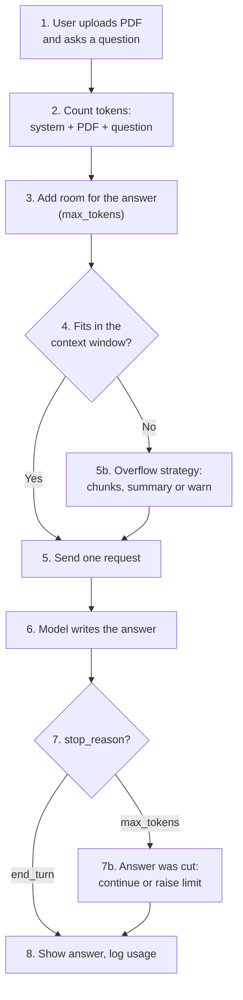

# A1-03 · Tokens and context windows

> **Lesson A1-03** · Type: Concept · Prerequisites: [A1-01 · AI, generative AI and LLMs](./a1-01-ai-generative-ai-and-llms.md) (and it helps to have done [A1-02 · AI models vs AI tools](./a1-02-ai-models-vs-ai-tools.md)) · Leads to: A1-06, A2-04, A4-08
>
> **Facts checked on:** 12 October 2026. All token counts in this guide come from **real tokenizers run on 12 October 2026**. Context-window sizes, output limits and prices come from official docs on the same day and **change often** (marked *may change*).

**Why this lesson matters:** tokens decide three things you care about as a developer: **cost** (you pay per token), **speed** (more tokens take longer) and **how much the model can see** (the context window). Truncated answers, "it forgot my instructions" and surprise API bills almost always start here. And for Indian apps there is one extra twist: the same message in Hindi or Gujarati can need many more tokens than in English, depending on the model.

## Learning goals

By the end of this lesson you will be able to:

1. Explain what a **token** and a **tokenizer** are, and why every model family counts differently.
2. Separate **input tokens** from **output tokens** and estimate the cost of a feature.
3. Show, with real numbers, why **Hindi and Gujarati** can cost more than English.
4. Explain exactly what fills a **context window**: system prompt, history, files, tool results and the answer.
5. Describe what happens on **overflow** (errors, truncation, summaries) and why long answers get **cut off**.
6. Explain the trade-offs of very long contexts: cost, speed and "lost in the middle".
7. **Done when:** you can estimate tokens and cost for a feature, and explain what fills a context window (exercises in section 10).

---

## 1. The topic in one minute

- **Token:** a small chunk of text that a model reads and writes. "Friday" is one token in English; the Hindi word "शुक्रवार" is 3 to 9 tokens depending on the model.
- **Tokenizer:** the tool that cuts text into tokens. **Each model family has its own**, so the same text gives different counts in GPT, Claude, Gemini or Llama.
- **Input vs output tokens:** what you send vs what the model writes back. Both are billed, usually **per million tokens**, and output is usually more expensive.
- **Context window:** the maximum number of tokens **one request** can hold: system prompt + chat history + files + tool results + your message + **the answer itself**.
- **Output limit:** the maximum length of one answer. Hit it, and the answer stops mid-sentence.

**One-line memory trick:** *tokens are the currency, the context window is the desk.*

**Analogy: an open-book exam desk.** For each question (each request), you may put pages on your desk: the instructions sheet, your notes, the textbook pages, and you also need space for your answer sheet. The desk has a fixed size. Whatever is not on the desk **right now** does not exist for this question, even if you read it yesterday. If you put too many pages, something falls off (or the examiner refuses). The model works exactly like this, every single request.

**Real-life example:** you build a WhatsApp-style support bot for an Indian shopping app. A customer writes in Gujarati, and the bot replies in Gujarati. With one tokenizer that reply costs about **1.5 times** the tokens of the English version; with another, about **8 times** (real counts in section 2.3). Same message, same meaning, very different bill.

---

## 2. Detailed definitions and why they matter

### 2.1 Tokens and tokenizers

**Definition:** a **token** is the unit of text an LLM reads and writes: a whole word, part of a word, a space plus a word, a punctuation mark, or even a raw byte. A **tokenizer** is the fixed algorithm and vocabulary (the list of known pieces) that converts text into token IDs and back.

**One-line meaning:** tokens are how the model "sees" text; the tokenizer decides where the cuts go.

**Real output: how the word "Friday" splits** (run on 12 October 2026 with the `gpt-tokenizer` and `@lenml/tokenizer-*` npm packages; the script is in section 6.1):

```text
Friday
  o200k_base : 1 token(s)  [Friday]
  Gemma 3    : 1 token(s)  [Friday]
  cl100k_base: 1 token(s)
  Llama 3    : 1 token(s)
  UTF-8 bytes: 6
शुक्रवार
  o200k_base : 3 token(s)  [श] [ुक्र] [वार]
  Gemma 3    : 3 token(s)  [शु] [क्र] [वार]
  cl100k_base: 9 token(s)
  Llama 3    : 4 token(s)
  UTF-8 bytes: 24
શુક્રવાર
  o200k_base : 4 token(s)  [શ] [ુક] [્ર] [વાર]
  Gemma 3    : 4 token(s)  [શ] [ુ] [ક્ર] [વાર]
  cl100k_base: 16 token(s)
  Llama 3    : 16 token(s)
  UTF-8 bytes: 24
```

Notice three things: the English word is one token everywhere; the Hindi and Gujarati words are always several tokens; and the count depends heavily on **which tokenizer** you use (4 vs 16 for the same Gujarati word).

**Which tokenizer is which:**

| Tokenizer | Used by | Can you run it offline? |
|---|---|---|
| `o200k_base` | OpenAI's GPT-4o-generation models | Yes (`gpt-tokenizer`, `tiktoken`) |
| `cl100k_base` | Older OpenAI models (GPT-4, GPT-3.5) | Yes |
| Llama 3 | Meta's Llama 3 open models | Yes |
| Gemma 3 | Google's Gemma 3 open models (not the Gemini API) | Yes |
| Qwen3 | Alibaba's Qwen3 open models | Yes |
| Claude, Gemini | Anthropic's and Google's API models | Use their **token-counting endpoints** (section 6.4) |

**Even one company can change tokenizers between versions.** Anthropic's docs say Claude Opus 4.7 and later models use a newer tokenizer that produces roughly **30% more tokens** for the same text than earlier models, and tell developers to re-count prompts with the exact model they plan to use. So never reuse token counts across models.

**Rules of thumb (English only):** OpenAI's help center says 1 token is about 4 characters or about ¾ of a word (100 tokens ≈ 75 words). Google says for Gemini 100 tokens is about 60-80 English words. Both warn these ratios **don't hold for other languages**, which is exactly what section 2.3 measures.

### 2.2 Input tokens vs output tokens

**Definition:** **input tokens** are everything you send in a request; **output tokens** are everything the model generates in response (including hidden "thinking" tokens on reasoning models).

**One-line meaning:** you pay for what goes in and what comes out, at two different prices.

| Model (list price, USD per 1M tokens, *may change*) | Input | Output | Output ÷ input |
|---|---|---|---|
| `claude-haiku-5-5` (prompts up to 100k tokens) | $0.10 | $0.50 | 5x |
| `gpt-6-luna` | $0.10 | $0.50 | 5x |
| `gemini-3.8-flash` (until 31 Dec 2026) | $0.75 | $3.75 | 5x |
| `claude-sonnet-5-5` | $2.00 | $10.00 | 5x |
| `gpt-6.1-sol` | $2.00 | $10.00 | 5x |

On every model above, **an output token costs five times an input token**. Two practical results:

- Long answers are expensive. Asking for "max 3 sentences" is a cost control.
- Anthropic's docs say thinking tokens are **billed as output tokens**, so a model that "thinks" a lot can cost more than its visible answer suggests.

Every API response reports both numbers (for example Claude's `usage.input_tokens` and `usage.output_tokens`), so you can log real usage.

### 2.3 Indian languages: English vs Hindi vs Gujarati

**The claim to test:** "Hindi and Gujarati need more tokens than English." Here is the same customer-support message in four forms, counted with five real tokenizers.

**The texts:**

- **English:** "Your order has been shipped and will reach you by Friday. You can track it in the Orders section of the app. If you need any help, reply to this message and our support team will contact you."
- **Hindi:** "आपका ऑर्डर भेज दिया गया है और शुक्रवार तक आप तक पहुँच जाएगा। आप ऐप के ऑर्डर सेक्शन में इसे ट्रैक कर सकते हैं। अगर आपको कोई मदद चाहिए, तो इस संदेश का जवाब दें और हमारी सपोर्ट टीम आपसे संपर्क करेगी।"
- **Gujarati:** "તમારો ઓર્ડર મોકલી દેવામાં આવ્યો છે અને શુક્રવાર સુધીમાં તમારા સુધી પહોંચી જશે. તમે એપના ઓર્ડર્સ વિભાગમાં તેને ટ્રેક કરી શકો છો. જો તમને કોઈ મદદ જોઈતી હોય, તો આ સંદેશનો જવાબ આપો અને અમારી સપોર્ટ ટીમ તમારો સંપર્ક કરશે."
- **Hinglish** (Hindi in Roman letters): "Aapka order bhej diya gaya hai aur Friday tak aap tak pahunch jayega. Aap app ke Orders section mein ise track kar sakte hain. Agar aapko koi madad chahiye, to is message ka jawab dein aur hamari support team aapse sampark karegi."

**Real token counts** (12 October 2026, `count-languages.mjs` in section 6.1):

| Language | Words | Characters | UTF-8 bytes | OpenAI o200k_base | OpenAI cl100k_base (older) | Meta Llama 3 | Google Gemma 3 | Alibaba Qwen3 |
|---|---|---|---|---|---|---|---|---|
| English | 38 | 191 | 191 | 42 | 42 | 42 | 42 | 42 |
| Hindi | 42 | 196 | 504 | 55 | 196 | 94 | 46 | 182 |
| Gujarati | 40 | 216 | 562 | 64 | 350 | 350 | 70 | 304 |
| Hinglish | 42 | 230 | 230 | 63 | 73 | 73 | 56 | 73 |

**Same table as "times English":**

| Language | o200k_base | cl100k_base | Llama 3 | Gemma 3 | Qwen3 |
|---|---|---|---|---|---|
| Hindi | 1.31x | 4.67x | 2.24x | 1.10x | 4.33x |
| Gujarati | 1.52x | 8.33x | 8.33x | 1.67x | 7.24x |
| Hinglish | 1.50x | 1.74x | 1.74x | 1.33x | 1.74x |

**What the numbers show:**

1. **Hindi and Gujarati always need more tokens than English** for the same meaning, in every tokenizer tested.
2. **How much more depends hugely on the tokenizer:** Gujarati is 1.5x in `o200k_base` but 8.3x in `cl100k_base` and Llama 3. Newer tokenizers with bigger vocabularies (`o200k_base` and Gemma 3 have about 200,000 and 262,000 pieces) handle Indian scripts far better than older ones.
3. **Gujarati costs more than Hindi** in every tokenizer here, probably because there is less Gujarati text on the internet for tokenizers to learn from.
4. **Hinglish is cheaper than Devanagari Hindi** in most tokenizers, but still more than English, because romanised Hindi words aren't common English pieces.
5. **Words are a bad measure:** the Hindi version has *more* words than English (42 vs 38) but needs anywhere from 1.1x to 4.7x the tokens.

**Why does this happen?** Tokenizers learn their pieces from training text, and most of that text is English. Common English words become single tokens. Less-common scripts get split into smaller pieces, sometimes down to raw **bytes**. In UTF-8 (the standard way computers store text), an English letter takes 1 byte, but a Devanagari or Gujarati character takes 3 bytes, which is why the Hindi text is 504 bytes for only 196 characters. A 2023 study by Petrov and others found the same text can differ by up to about **15 times** in token length across languages, and argued this creates unequal cost, speed and context limits for different language communities.

**Why it matters for Indian apps:** more tokens means higher cost, slower replies, a context window that fills faster, and long answers hitting the output limit sooner. The only way to know for **your** model is to measure (exercises in section 10).

### 2.4 The context window

**Definition:** Anthropic's docs describe the context window as all the text a language model can reference when generating a response, **including the response itself**, like a "working memory" for that request.

**One-line meaning:** the maximum size of one request plus its answer, in tokens.

**What counts toward it** (from Anthropic's docs; other providers work the same way in principle):

- The **system prompt**
- Every **message in the history** (user and assistant turns)
- **Files**: documents, PDFs, images (images and audio also become tokens)
- **Tool definitions** (the descriptions of tools the model may call)
- **Tool results** (search results, file contents, API responses)
- The **output** being generated, including **thinking** tokens

**Sizes on 12 October 2026** (API, *may change*):

| Model | Context window | Max output per request |
|---|---|---|
| Current Claude models (Haiku 5.5, Sonnet 5.5, Opus 5.5, Fable 5.1) | 1,000,000 tokens | 128,000 tokens |
| `gpt-6.1-sol` | 1,050,000 tokens | 128,000 tokens |
| `gemini-3.8-flash` | 1,048,576 tokens | 65,536 tokens |

**Apps can use a smaller window than the API.** Claude's help center says that in the Claude apps the newest models support up to 1M tokens and others 500K or 200K, and that part of the window is reserved for the reply.

**Important:** the window is **per request**. Nothing stays in it after the request finishes. If the app wants the model to "remember" something next turn, it must send it again.

### 2.5 Overflow: when content is bigger than the window

**Definition:** overflow happens when everything you want to send, plus room for the answer, is more than the context window.

**What APIs do** (Claude API, per Anthropic's docs):

- If the **input alone** is bigger than the window: the request fails with a `400 invalid_request_error` ("prompt is too long").
- On Claude 4.5 and newer models, if input plus `max_tokens` is bigger than the window, the request is accepted, but if generation reaches the limit it stops with `stop_reason: "model_context_window_exceeded"`.

**What apps do instead of failing:**

| Strategy | How it works | Downside |
|---|---|---|
| **Truncation** (first in, first out) | Drop the oldest messages | Early instructions and facts silently disappear |
| **Summarisation / compaction** | Replace old messages with a short summary | Details get lost in the summary |
| **Retrieval** (RAG, a later lesson) | Store documents outside, send only the relevant chunks | Depends on finding the right chunks |
| **Error or warning** | Tell the user to start a new chat or shorten input | Annoying, but honest |

Real examples: Anthropic's docs note chat interfaces such as claude.ai can manage the window on a rolling "first in, first out" basis, and Claude's help center says that when a chat nears the limit (with code execution enabled) Claude **summarises earlier messages** so the conversation can continue. On the API side, Anthropic offers **server-side compaction** (in beta) that does the same summarising for developers.

### 2.6 Long-context trade-offs

A 1M-token window sounds like "just send everything". It isn't free:

- **Cost:** every input token is billed on **every** request. A 500K-token document re-sent on 20 turns is 10 million input tokens.
- **Speed:** more input means more processing before the first word appears.
- **Quality ("context rot"):** Anthropic's docs say that as token count grows, accuracy and recall degrade, and call this **context rot**; curating what goes in matters as much as how much fits.
- **Lost in the middle:** a 2023 study (Liu and others) found models are most accurate when the relevant information is at the **start or end** of a long input, and noticeably worse when it is in the **middle**.

**Practical rule:** put instructions and the most important facts at the start or end, send only what the task needs, and don't treat a big window as a reason to stop thinking about what goes in.

**Prompt caching** (a later topic) can make repeated input cheaper, but Anthropic's docs are clear that cached tokens **still occupy the context window**: caching changes the price, not the space.

### 2.7 Output limits: why long answers get cut off

**Definition:** every request sets a **maximum number of output tokens** (Claude's `max_tokens` parameter), capped by the model's own limit (128K for current Claude models, 65,536 for `gemini-3.8-flash`). Apps also set their own limits.

**What you see:** the answer stops mid-sentence or mid-code-block. In the Claude API the response has `stop_reason: "max_tokens"` instead of `"end_turn"`.

**Why it happens more than you'd expect:**

- Thinking tokens count inside `max_tokens` on Claude (per Anthropic's docs), so a model that thinks a lot leaves less room for the visible answer.
- Hindi or Gujarati answers need more tokens for the same content, so they hit the limit sooner.
- The window itself can be the limit: if history and files use most of it, there isn't room left for a long answer.

**Fixes:** raise `max_tokens` (within the model limit), ask for a shorter answer, split the task ("first the plan, then each file"), or detect `stop_reason` and ask the model to continue.

---

## 3. Words you need first

From A1-01 you know **token**, **LLM** and the **next-token loop**; from A1-02 you know **system prompt**, **API** and **stateless**. New words here:

| Word | Plain meaning |
|---|---|
| **Tokenizer** | The fixed tool that splits text into tokens and joins them back |
| **Vocabulary** | The list of pieces a tokenizer knows (about 100,000 to 262,000 for the tokenizers tested here) |
| **Input tokens** | Tokens you send: system prompt, history, files, tool results, your message |
| **Output tokens** | Tokens the model generates, including hidden thinking |
| **Context window** | Maximum tokens for one request **plus** its answer |
| **`max_tokens`** | The output limit you set for one request |
| **`stop_reason`** | Why the answer ended: finished normally (`end_turn`), hit the output limit (`max_tokens`), and so on |
| **UTF-8 bytes** | How text is stored in a computer; English letters take 1 byte, Devanagari and Gujarati letters take 3 |
| **Truncation** | Dropping old content to make space |
| **Compaction** | Replacing old content with a shorter summary |

---

## 4. How it works

### 4.1 The React analogy: one request = one render

If you know React, you already know how a context window works.

| React (one render) | LLM (one request) |
|---|---|
| One call of your component function | One API request |
| The **props, state and context** available during that render | Everything in the **context window**: system prompt, history, files, tool results, your message |
| The component can only use what it receives **in this render** | The model can only use what is in **this request** |
| Local variables vanish when the render finishes | Nothing stays inside the model after the request |
| State lives **outside** your function (React keeps it) and is handed back next render | History and memory live **outside** the model (the app keeps them) and are re-sent next request |
| A parent forgets to pass a prop → the child has no idea it exists | The app drops old messages → the model "forgets" your early instructions |
| A list that keeps growing is re-processed on every render | A chat that keeps growing is **re-sent and re-billed** on every turn |
| Huge props make renders slow | Huge context makes requests slow and expensive |
| No hard limit on props size | A **hard limit**: the context window |

**Pseudo-code (not a real API, just the idea):**

```tsx
// The model behaves like a component that "renders" once per request.
type ContextWindow = {
  systemPrompt: string;     // like props the app always passes
  history: Message[];       // like state the app keeps and passes back in
  files: Document[];
  toolResults: ToolResult[];
  userMessage: string;
};

function ModelRender(props: ContextWindow): string {
  // Can ONLY use these props. No memory of the previous render.
  // The answer it writes also has to fit inside the same window.
  return generateAnswerTokenByToken(props);
}

// The app is the parent: it owns the history and re-sends ALL of it each time.
function ChatApp() {
  const [history, setHistory] = useState<Message[]>([]);
  async function send(userMessage: string) {
    const answer = await ModelRender({ systemPrompt, history, files, toolResults, userMessage });
    setHistory([...history, { role: "user", content: userMessage }, { role: "assistant", content: answer }]);
  }
}
```

### 4.2 One context window filling up

**Diagram: one context window filling up over a long session**

```
Turn 1  |STFFFFFFFFFFUAAA..................................|  used 286,000
Turn 20 |STFFFFFFFFFFHHHHHHHHHRRRUAAA......................|  used 526,000
Turn 60 |STFFFFFFFFFFHHHHHHHHHHHHHHHHHHHHHHHHHHHHRRRRRRRRRU|XXX  OVERFLOW by 26,000
```

**Legend:** `S` system prompt · `T` tool definitions · `F` files (PDFs, code) · `H` chat history · `R` tool results · `U` your new message · `A` space reserved for the answer · `.` free space · `X` does not fit.
Example window: 1,000,000 tokens drawn as 50 cells (1 cell = 20,000 tokens). Small parts are drawn as at least one cell, so the picture is approximate.

**How to read this diagram:** each row is the **same** context window at a different point in one long session. At turn 1 it holds the system prompt, tool definitions, an attached document, your message and room for the answer, with lots of free space. By turn 20, chat history (`H`) and tool results (`R`) have grown. By turn 60 everything no longer fits: the reserved answer space spills over the edge (`XXX`). At that point the API returns an error or the answer gets cut, or the app must drop or summarise old content. Notice that the system prompt and files are re-sent in **every** row: that is why each turn costs more.

### 4.3 Walkthrough: a "chat with your PDF" feature

**Scenario:** your Next.js app lets users upload a policy PDF and ask questions about it.

1. **The user uploads a PDF and asks a question.**
2. **Your server counts tokens** for system prompt + PDF + question, using the provider's token-counting endpoint.
3. **It adds room for the answer** (the `max_tokens` you plan to allow).
4. **It checks: does the total fit in the context window?**
5. **If it fits, it sends one request** with everything.
   - **5b. If it doesn't fit, it uses an overflow strategy:** send only the most relevant chunks of the PDF, summarise sections first, or tell the user the file is too big.
6. **The model writes the answer** token by token.
7. **Your server checks `stop_reason`.**
   - **7b. If it is `max_tokens`, the answer was cut:** ask the model to continue, or raise the limit next time.
8. **It shows the answer and logs `usage`** (input and output tokens) for cost tracking.

**Diagram: one request that respects the context window**



**How to read this diagram:** follow the numbers from the top. The two diamonds are the two places where tokens can bite you: step 4 (the input is too big for the window) and step 7 (the output hit its limit). Good apps check both instead of hoping.

---

## 5. Real-life examples and developer use cases

| Situation | What happens with tokens and context |
|---|---|
| **Hindi or Gujarati support bot** | More tokens per reply → higher cost, slower replies, output limits hit sooner. Measure with your model's counter before launch. |
| **Coding agent** (Cursor, Copilot, Claude Code) working on your repo | File contents, terminal output and search results (tool results) fill the window fast. Tool definitions take space too. Long agent sessions need compaction. |
| **"Chat with this 300-page PDF"** | The PDF can be hundreds of thousands of tokens and is re-sent on every question, unless the app retrieves only the relevant parts. |
| **A one-hour chat in ChatGPT or Claude** | History grows every turn. Eventually the app drops or summarises old turns, and early instructions fade. |
| **Uploading audio or video to Gemini** | Media becomes tokens too (numbers below). |
| **A React form that calls an LLM for every keystroke** | Many small requests: each one re-sends the system prompt. Debounce, and keep the system prompt short. |

**Media tokens (computed with code from Google's Gemini rates: 32 tokens per second of audio, 263 per second of video with static processing; *may change*):**

```js
// media-tokens.mjs: images, audio and video also become tokens.
// Rates from Google's Gemini token docs (checked 12 Oct 2026; may change).
const AUDIO_PER_SEC = 32;    // audio: 32 tokens per second
const VIDEO_PER_SEC = 263;   // video, static processing: 263 tokens per second
const WINDOW = 1_048_576;    // gemini-3.8-flash input limit

const podcast = 60 * 60 * AUDIO_PER_SEC;   // 1-hour podcast
const video = 10 * 60 * VIDEO_PER_SEC;     // 10-minute video
console.log(`1-hour audio   : ${podcast.toLocaleString("en-IN")} tokens (${((podcast / WINDOW) * 100).toFixed(1)}% of the window)`);
console.log(`10-minute video: ${video.toLocaleString("en-IN")} tokens (${((video / WINDOW) * 100).toFixed(1)}% of the window)`);
console.log(`Video minutes that fit in the window: about ${Math.floor(WINDOW / VIDEO_PER_SEC / 60)}`);
```

Real output (Node.js 22, 12 October 2026):

```text
1-hour audio   : 1,15,200 tokens (11.0% of the window)
10-minute video: 1,57,800 tokens (15.0% of the window)
Video minutes that fit in the window: about 66
```

---

## 6. Practical code: count tokens and compute cost

All scripts below were run on 12 October 2026 with Node.js 22. Set up a folder once:

```bash
mkdir token-lab && cd token-lab
npm init -y
npm install gpt-tokenizer @lenml/tokenizer-llama3 @lenml/tokenizer-gemma3 @lenml/tokenizer-qwen3
```

These packages run tokenizers **offline**, so no API key is needed for sections 6.1 to 6.3.

### 6.1 Count the same message in four languages

Save as `count-languages.mjs`:

```js
// count-languages.mjs: count tokens for the same message in 4 languages, with 5 real tokenizers.
// npm install gpt-tokenizer @lenml/tokenizer-llama3 @lenml/tokenizer-gemma3 @lenml/tokenizer-qwen3
import { encode as o200k } from "gpt-tokenizer/encoding/o200k_base";
import { encode as cl100k } from "gpt-tokenizer/encoding/cl100k_base";
import { fromPreTrained as llama3 } from "@lenml/tokenizer-llama3";
import { fromPreTrained as gemma3 } from "@lenml/tokenizer-gemma3";
import { fromPreTrained as qwen3 } from "@lenml/tokenizer-qwen3";

const texts = {
  English:
    "Your order has been shipped and will reach you by Friday. You can track it in the Orders section of the app. If you need any help, reply to this message and our support team will contact you.",
  Hindi:
    "आपका ऑर्डर भेज दिया गया है और शुक्रवार तक आप तक पहुँच जाएगा। आप ऐप के ऑर्डर सेक्शन में इसे ट्रैक कर सकते हैं। अगर आपको कोई मदद चाहिए, तो इस संदेश का जवाब दें और हमारी सपोर्ट टीम आपसे संपर्क करेगी।",
  Gujarati:
    "તમારો ઓર્ડર મોકલી દેવામાં આવ્યો છે અને શુક્રવાર સુધીમાં તમારા સુધી પહોંચી જશે. તમે એપના ઓર્ડર્સ વિભાગમાં તેને ટ્રેક કરી શકો છો. જો તમને કોઈ મદદ જોઈતી હોય, તો આ સંદેશનો જવાબ આપો અને અમારી સપોર્ટ ટીમ તમારો સંપર્ક કરશે.",
  "Hinglish (Hindi in Roman letters)":
    "Aapka order bhej diya gaya hai aur Friday tak aap tak pahunch jayega. Aap app ke Orders section mein ise track kar sakte hain. Agar aapko koi madad chahiye, to is message ka jawab dein aur hamari support team aapse sampark karegi.",
};

const llama = llama3(), gemma = gemma3(), qwen = qwen3();
const opts = { add_special_tokens: false }; // count only the text, not start/end markers
const tokenizers = {
  "OpenAI o200k_base": (t) => o200k(t).length,
  "OpenAI cl100k_base (older)": (t) => cl100k(t).length,
  "Meta Llama 3": (t) => llama.encode(t, opts).length,
  "Google Gemma 3": (t) => gemma.encode(t, opts).length,
  "Alibaba Qwen3": (t) => qwen.encode(t, opts).length,
};

const rows = {};
for (const [lang, raw] of Object.entries(texts)) {
  const text = raw.normalize("NFC");
  const row = {
    words: text.split(/\s+/).length,
    characters: [...text].length,
    "UTF-8 bytes": Buffer.byteLength(text, "utf8"),
  };
  for (const [name, count] of Object.entries(tokenizers)) row[name] = count(text);
  rows[lang] = row;
}
console.table(rows);

// How many times more tokens than English, per tokenizer
const ratios = {};
for (const lang of Object.keys(texts)) {
  ratios[lang] = Object.fromEntries(
    Object.keys(tokenizers).map((name) => [name, (rows[lang][name] / rows.English[name]).toFixed(2) + "x"])
  );
}
console.log("Tokens compared with English:");
console.table(ratios);
```

Run `node count-languages.mjs`. The real output is the two tables in section 2.3 (`console.table` prints them as boxes in your terminal).

To see **where** the cuts happen, save this as `word-pieces.mjs` (its real output is in section 2.1):

```js
// word-pieces.mjs: how one word ("Friday") splits in different tokenizers.
import { encode as o200k, decode as o200kDecode } from "gpt-tokenizer/encoding/o200k_base";
import { encode as cl100k } from "gpt-tokenizer/encoding/cl100k_base";
import { fromPreTrained as llama3 } from "@lenml/tokenizer-llama3";
import { fromPreTrained as gemma3 } from "@lenml/tokenizer-gemma3";

const llama = llama3(), gemma = gemma3();
const opts = { add_special_tokens: false };
const show = (ids, dec) => ids.map((id) => `[${dec([id])}]`).join(" ");

for (const word of ["Friday", "शुक्रवार", "શુક્રવાર"]) {
  const o = o200k(word), g = gemma.encode(word, opts);
  console.log(`${word}`);
  console.log(`  o200k_base : ${o.length} token(s)  ${show(o, o200kDecode)}`);
  console.log(`  Gemma 3    : ${g.length} token(s)  ${show(g, (x) => gemma.decode(x))}`);
  console.log(`  cl100k_base: ${cl100k(word).length} token(s)`);
  console.log(`  Llama 3    : ${llama.encode(word, opts).length} token(s)`);
  console.log(`  UTF-8 bytes: ${Buffer.byteLength(word)}`);
}
```

### 6.2 Cost of 1,000 support replies, per language

Save as `support-bot-cost.mjs`:

```js
// support-bot-cost.mjs: tokens and cost of 1,000 support replies in English, Hindi and Gujarati.
// npm install gpt-tokenizer @lenml/tokenizer-llama3
import { encode as o200k } from "gpt-tokenizer/encoding/o200k_base";
import { fromPreTrained } from "@lenml/tokenizer-llama3";

const llama = fromPreTrained();
const TOKENIZERS = {
  "OpenAI o200k_base": (t) => o200k(t).length,
  "Meta Llama 3": (t) => llama.encode(t, { add_special_tokens: false }).length,
};

// The parts of ONE request (the system prompt and order data stay in English)
const SYSTEM_PROMPT = `You are the support assistant for an Indian shopping app.
Reply in the same language the customer uses. Be polite and brief: at most 3 sentences.
Use only the order data provided. Never share another customer's details.
If an order is late by more than 7 days, offer to raise a complaint ticket.`;
const ORDER_DATA = JSON.stringify({ orderId: "4521", status: "shipped", carrier: "Express Courier",
  expectedDelivery: "2026-10-16", items: [{ name: "Cotton kurta", qty: 1 }, { name: "Steel bottle", qty: 2 }] });

const customer = {
  English: "Where is my order? I placed it last Monday and it still hasn't arrived.",
  Hindi: "मेरा ऑर्डर कहाँ है? मैंने इसे पिछले सोमवार को दिया था और यह अभी तक नहीं आया है।",
  Gujarati: "મારો ઓર્ડર ક્યાં છે? મેં તે ગયા સોમવારે આપ્યો હતો અને તે હજુ સુધી આવ્યો નથી.",
};
const reply = {
  English: "Your order has been shipped and will reach you by Friday. You can track it in the Orders section of the app. If you need any help, reply to this message and our support team will contact you.",
  Hindi: "आपका ऑर्डर भेज दिया गया है और शुक्रवार तक आप तक पहुँच जाएगा। आप ऐप के ऑर्डर सेक्शन में इसे ट्रैक कर सकते हैं। अगर आपको कोई मदद चाहिए, तो इस संदेश का जवाब दें और हमारी सपोर्ट टीम आपसे संपर्क करेगी।",
  Gujarati: "તમારો ઓર્ડર મોકલી દેવામાં આવ્યો છે અને શુક્રવાર સુધીમાં તમારા સુધી પહોંચી જશે. તમે એપના ઓર્ડર્સ વિભાગમાં તેને ટ્રેક કરી શકો છો. જો તમને કોઈ મદદ જોઈતી હોય, તો આ સંદેશનો જવાબ આપો અને અમારી સપોર્ટ ટીમ તમારો સંપર્ક કરશે.",
};

// Example list prices, USD per 1M tokens (checked 12 Oct 2026; may change)
// small = $0.10 in / $0.50 out, mid = $2 in / $10 out
const PRICES = { small: [0.1, 0.5], mid: [2, 10] };
const REQUESTS = 1000;

for (const [tokName, count] of Object.entries(TOKENIZERS)) {
  console.log(`\n=== Tokenizer: ${tokName} ===`);
  const rows = {};
  for (const lang of Object.keys(customer)) {
    const input = count(SYSTEM_PROMPT) + count(ORDER_DATA) + count(customer[lang]);
    const output = count(reply[lang]);
    const row = { "in/req": input, "out/req": output };
    for (const [label, [inP, outP]] of Object.entries(PRICES)) {
      const cost = (REQUESTS * (input * inP + output * outP)) / 1e6;
      row[`1k req, ${label}`] = `$${cost.toFixed(4)}`;
    }
    rows[lang] = row;
  }
  console.table(rows);
}
```

Real output (`node support-bot-cost.mjs`, 12 October 2026):

```text
=== Tokenizer: OpenAI o200k_base ===
┌──────────┬────────┬─────────┬───────────────┬─────────────┐
│ (index)  │ in/req │ out/req │ 1k req, small │ 1k req, mid │
├──────────┼────────┼─────────┼───────────────┼─────────────┤
│ English  │ 130    │ 42      │ '$0.0340'     │ '$0.6800'   │
│ Hindi    │ 137    │ 55      │ '$0.0412'     │ '$0.8240'   │
│ Gujarati │ 138    │ 64      │ '$0.0458'     │ '$0.9160'   │
└──────────┴────────┴─────────┴───────────────┴─────────────┘

=== Tokenizer: Meta Llama 3 ===
┌──────────┬────────┬─────────┬───────────────┬─────────────┐
│ (index)  │ in/req │ out/req │ 1k req, small │ 1k req, mid │
├──────────┼────────┼─────────┼───────────────┼─────────────┤
│ English  │ 130    │ 42      │ '$0.0340'     │ '$0.6800'   │
│ Hindi    │ 155    │ 94      │ '$0.0625'     │ '$1.2500'   │
│ Gujarati │ 233    │ 350     │ '$0.1983'     │ '$3.9660'   │
└──────────┴────────┴─────────┴───────────────┴─────────────┘
```

**What this teaches:**

- With a modern tokenizer, a Gujarati bot costs about a third more than English ($0.92 vs $0.68 per 1,000 on the mid model). With an older one, it costs almost **six times** more ($3.97).
- The **input** barely changes between languages, because the system prompt and order data stay in English. The penalty lands on the **output**, which is also the expensive side (5x input price). Keeping instructions in English and only the customer-facing text in Hindi or Gujarati is a real saving.
- These counts use open tokenizers. Your actual model (Claude, Gemini, GPT-6) has its own tokenizer, so **measure with its counter** (section 6.4) before budgeting.

### 6.3 Why each turn of a long chat costs more

Save as `long-chat-cost.mjs`:

```js
// long-chat-cost.mjs: why each turn of a chat costs more than the last.
// Every turn re-sends the system prompt + ALL earlier messages as input.
const SYSTEM = 600;        // tokens in the system prompt
const USER_MSG = 60;       // tokens in each user message
const REPLY = 300;         // tokens in each assistant reply
const PRICE = { input: 2, output: 10 }; // USD per 1M tokens (example mid-tier model)
const TURNS = 20;

let history = 0, totalCost = 0, totalInput = 0;
const rows = [];
for (let turn = 1; turn <= TURNS; turn++) {
  const input = SYSTEM + history + USER_MSG;        // what is sent this turn
  const cost = (input * PRICE.input + REPLY * PRICE.output) / 1e6;
  totalCost += cost; totalInput += input;
  if ([1, 2, 5, 10, 20].includes(turn)) rows.push({ turn, "input tokens": input, "output tokens": REPLY, "cost of this turn": `$${cost.toFixed(5)}` });
  history += USER_MSG + REPLY;                       // this turn becomes history for the next
}
console.table(rows);
console.log(`Total input tokens over ${TURNS} turns: ${totalInput.toLocaleString("en-IN")}`);
console.log(`Total cost of the chat: $${totalCost.toFixed(4)}`);
console.log(`Turn ${TURNS} sends ${(rows.at(-1)["input tokens"] / rows[0]["input tokens"]).toFixed(1)}x the input tokens of turn 1`);
const newText = SYSTEM + TURNS * (USER_MSG + REPLY);
console.log(`New text in the whole chat: ${newText.toLocaleString("en-IN")} tokens, but input billed: ${totalInput.toLocaleString("en-IN")} tokens`);
```

Real output (`node long-chat-cost.mjs`, 12 October 2026):

```text
┌─────────┬──────┬──────────────┬───────────────┬───────────────────┐
│ (index) │ turn │ input tokens │ output tokens │ cost of this turn │
├─────────┼──────┼──────────────┼───────────────┼───────────────────┤
│ 0       │ 1    │ 660          │ 300           │ '$0.00432'        │
│ 1       │ 2    │ 1020         │ 300           │ '$0.00504'        │
│ 2       │ 5    │ 2100         │ 300           │ '$0.00720'        │
│ 3       │ 10   │ 3900         │ 300           │ '$0.01080'        │
│ 4       │ 20   │ 7500         │ 300           │ '$0.01800'        │
└─────────┴──────┴──────────────┴───────────────┴───────────────────┘
Total input tokens over 20 turns: 81,600
Total cost of the chat: $0.2232
Turn 20 sends 11.4x the input tokens of turn 1
New text in the whole chat: 7,800 tokens, but input billed: 81,600 tokens
```

Only 7,800 tokens of new text were ever written in this chat, but **81,600 input tokens** were billed, because history is re-sent every turn.

### 6.4 Count tokens with your provider's endpoint (Claude example)

Offline tokenizers can't count for Claude or Gemini. Use their endpoints instead:

- **Claude API:** `client.messages.countTokens(...)` (endpoint `/v1/messages/count_tokens`). Anthropic's docs say it is **free to use** (rate-limited) and returns an **estimate** that may differ slightly from the real request.
- **Gemini API:** `client.models.countTokens({ model, contents })`, which returns `totalTokens`.

Save as `count-with-api.mjs` (needs `npm install @anthropic-ai/sdk` and an `ANTHROPIC_API_KEY`; see A1-02 for safe key setup):

```js
// count-with-api.mjs: count tokens with Claude's token-counting endpoint (free to use,
// rate-limited) and estimate the cost of 1,000 requests per language.
// Prerequisites: Node.js 20+, `npm install @anthropic-ai/sdk`, ANTHROPIC_API_KEY in the environment.
// Run: node --env-file=.env count-with-api.mjs
// @ts-check
import Anthropic from "@anthropic-ai/sdk";

const client = new Anthropic();
const MODEL = "claude-haiku-5-5";
const PRICE = { input: 0.1, output: 0.5 }; // USD per 1M tokens, prompts up to 100k (checked 12 Oct 2026)
const REQUESTS = 1000;

const SYSTEM_PROMPT =
  "You are the support assistant for an Indian shopping app. Reply in the customer's language, in at most 3 sentences.";

const samples = {
  English: {
    question: "Where is my order? I placed it last Monday and it still hasn't arrived.",
    reply: "Your order has been shipped and will reach you by Friday. You can track it in the Orders section of the app.",
  },
  Hindi: {
    question: "मेरा ऑर्डर कहाँ है? मैंने इसे पिछले सोमवार को दिया था और यह अभी तक नहीं आया है।",
    reply: "आपका ऑर्डर भेज दिया गया है और शुक्रवार तक आप तक पहुँच जाएगा। आप ऐप के ऑर्डर सेक्शन में इसे ट्रैक कर सकते हैं।",
  },
  Gujarati: {
    question: "મારો ઓર્ડર ક્યાં છે? મેં તે ગયા સોમવારે આપ્યો હતો અને તે હજુ સુધી આવ્યો નથી.",
    reply: "તમારો ઓર્ડર મોકલી દેવામાં આવ્યો છે અને શુક્રવાર સુધીમાં તમારા સુધી પહોંચી જશે. તમે એપના ઓર્ડર્સ વિભાગમાં તેને ટ્રેક કરી શકો છો.",
  },
};

for (const [lang, { question, reply }] of Object.entries(samples)) {
  // Input: exactly what the real request would send
  const input = await client.messages.countTokens({
    model: MODEL,
    system: SYSTEM_PROMPT,
    messages: [{ role: "user", content: question }],
  });
  // Output estimate: count the sample reply text on its own
  // (slightly high, because the count includes a few tokens of message wrapping)
  const output = await client.messages.countTokens({
    model: MODEL,
    messages: [{ role: "user", content: reply }],
  });
  const cost = (REQUESTS * (input.input_tokens * PRICE.input + output.input_tokens * PRICE.output)) / 1e6;
  console.log(`${lang.padEnd(9)} input ${input.input_tokens} | output ~${output.input_tokens} | ${REQUESTS} requests ≈ $${cost.toFixed(4)}`);
}
```

**How this was checked** (no API key was available in the test environment on 12 October 2026):

1. It passed `tsc --checkJs` against the official `@anthropic-ai/sdk` 0.133.0 types.
2. Run with a deliberately invalid key, the request reached `api.anthropic.com` and returned `401 authentication_error`, so the endpoint and setup are right.
3. The full logic ran against a local mock that returned **fake** counts (UTF-8 bytes ÷ 4). That run printed one line per language and exited cleanly, but its numbers are **not real Claude counts**, so they are not shown here.

**Expected output shape** (illustrative; your numbers will be Claude's real counts):

```text
English   input <n> | output ~<n> | 1000 requests ≈ $<cost>
Hindi     input <n> | output ~<n> | 1000 requests ≈ $<cost>
Gujarati  input <n> | output ~<n> | 1000 requests ≈ $<cost>
```

Compare the Hindi and Gujarati numbers with the English line: that ratio is the language penalty **for this exact model**. Re-run it whenever you switch models, since Anthropic says newer Claude models use a different tokenizer.

### 6.5 Estimate your own feature ("done when" tool)

Save as `estimate-feature.mjs` and replace the numbers with your feature's real measurements:

```js
// estimate-feature.mjs: fill in your own numbers to estimate tokens and monthly cost.
const feature = {
  systemPromptTokens: 800,   // measure your real system prompt with a tokenizer
  contextTokens: 1500,       // retrieved data, files or tool results per request
  userTokens: 120,           // average user message (in English)
  outputTokens: 400,         // average answer (in English); set max_tokens above this
  languageMultiplier: 1.5,   // e.g. Gujarati vs English, MEASURED for your model
  requestsPerDay: 3000,
  pricePerMTok: { input: 2, output: 10 }, // USD, from your provider's pricing page
};

const f = feature;
const input = f.systemPromptTokens + f.contextTokens + f.userTokens * f.languageMultiplier;
const output = f.outputTokens * f.languageMultiplier;
const perRequest = (input * f.pricePerMTok.input + output * f.pricePerMTok.output) / 1e6;
const perMonth = perRequest * f.requestsPerDay * 30;

console.log(`Tokens per request: ~${Math.round(input)} in + ~${Math.round(output)} out`);
console.log(`Cost per request:   $${perRequest.toFixed(5)}`);
console.log(`Cost per 1,000:     $${(perRequest * 1000).toFixed(2)}`);
console.log(`Cost per month:     $${perMonth.toFixed(2)} (${f.requestsPerDay.toLocaleString("en-IN")} requests/day x 30 days)`);
```

Real output with the example numbers (12 October 2026):

```text
Tokens per request: ~2480 in + ~600 out
Cost per request:   $0.01096
Cost per 1,000:     $10.96
Cost per month:     $986.40 (3,000 requests/day x 30 days)
```

---

## 7. The four lesson questions, answered

### Q1. Why does each turn of a long chat cost more than the last?

Because the API is stateless (A1-02). To "remember" the conversation, the app sends the **system prompt plus every earlier message** again on each turn, and you pay for all of it as input tokens again. In the example in section 6.3, turn 20 sent **11.4 times** the input tokens of turn 1, and the whole 20-turn chat billed **81,600** input tokens for only **7,800** tokens of new text. Attached files, tool results and (on some Claude models) earlier thinking blocks are re-sent too.

**What helps:** start a new chat for a new topic, keep replies short, let the app summarise old turns, and use prompt caching (a later topic) to make the repeated part cheaper.

### Q2. What counts toward the context window?

Everything in the request **plus** the answer:

- System prompt
- Tool definitions
- Chat history (user and assistant messages)
- Files, images, audio and video (all converted to tokens)
- Tool results (search results, file reads, API responses)
- Your new message
- The output being generated, including thinking tokens

Cached tokens still count (caching changes the price, not the space). The model's **training data does not count**: that is knowledge baked into the weights, not text in the window.

### Q3. Why can Hindi text cost more than the same English text?

1. **Tokenizers learn mostly from English text,** so common English words become single tokens while Hindi words are split into several pieces.
2. **Devanagari takes 3 bytes per character in UTF-8** (English takes 1). Tokenizers that fall back to bytes for unfamiliar text produce many more tokens.
3. **So the same meaning needs more tokens,** and you pay per token. In our real test, Hindi needed 1.10x to 4.67x the tokens of English depending on the tokenizer, and Gujarati 1.52x to 8.33x.
4. **The penalty usually hits output,** the side that costs 5x more, because the bot replies in Hindi.

Newer tokenizers have narrowed the gap a lot, so the honest answer is: **"can cost more, by how much depends on the model; measure it."**

### Q4. What happens when a document is bigger than the window?

- **Through the API:** the request fails. Claude's API returns `400 invalid_request_error` ("prompt is too long") when the input alone exceeds the window.
- **Inside apps:** the app may refuse the upload, drop older content, summarise, or search the document and send only matching parts.
- **What you should do as a developer:**
  1. **Retrieve:** split the document into chunks, store them, and send only the relevant chunks per question (RAG, a later lesson).
  2. **Summarise in parts:** summarise each section separately, then combine the summaries.
  3. **Trim:** remove boilerplate, repeated headers, images you don't need.
  4. **Switch model:** use a model with a bigger window (but remember cost and context rot).

Even when a big document **does** fit, sending only the relevant parts is often cheaper, faster and more accurate.

---

## 8. Related concepts: confusing pairs

| Often confused | The real difference |
|---|---|
| **Context window vs memory** | The window is the working set for **one request**. Memory is the **app** saving notes and re-sending them later. |
| **Context window vs output limit** | The window covers input + output together; the output limit caps the answer alone (128K for current Claude models, 65,536 for `gemini-3.8-flash`). |
| **Tokens vs words vs characters** | Models count tokens. Words and characters are only rough guides, and fail badly for Hindi and Gujarati. |
| **Input vs output tokens** | Input = what you send (cheaper); output = what the model writes (5x the price on the models in section 2.2). |
| **Training data vs context** | Training data is what the model learned once; the context is what it can see right now in this request. |
| **Context window vs rate limit** | The window caps one request; a rate limit caps how many requests or tokens per minute your account may use. |
| **Prompt caching vs context window** | Caching makes repeated input cheaper and faster; cached tokens still take space in the window. |
| **Truncation vs compaction vs retrieval** | Drop old content / summarise old content / store content outside and fetch only what's relevant. |

---

## 9. Benefits, limitations, common mistakes and safety

### 9.1 Common mistakes and wrong mental models

**Wrong mental model 1: "The context window is the model's memory."**
- **Correction:** it is the working set for **one request**, like the props of one React render. Nothing persists after the request unless the app sends it again. A 1M-token window doesn't mean the model "remembers" 1M tokens of your past chats.

**Mistake 2: counting words instead of tokens.**
- In our test the Hindi message had 42 words, but needed between 46 and 196 tokens depending on the tokenizer. Estimate with a tokenizer, not a word counter.

**Mistake 3: forgetting output tokens when estimating cost.**
- Output is usually 5x the price of input. Real calculation for the English support reply from section 6.2:

```js
// output-share.mjs: output tokens are fewer, but often most of the bill.
const input = 130, output = 42;          // English support reply (o200k counts from section 6.2)
const PRICE = { input: 0.1, output: 0.5 }; // USD per 1M tokens
const inCost = input * PRICE.input, outCost = output * PRICE.output;
console.log(`Output is ${((output / (input + output)) * 100).toFixed(0)}% of the tokens`);
console.log(`but ${((outCost / (inCost + outCost)) * 100).toFixed(0)}% of the cost`);
```

Real output:

```text
Output is 24% of the tokens
but 62% of the cost
```

**Mistake 4: reusing token counts across models.** Anthropic says Claude Opus 4.7 and later produce roughly 30% more tokens than earlier Claude models for the same text. Re-count when you switch.

**Mistake 5: "the window is huge, so send everything".** Cost and latency grow with every token, and accuracy degrades as context grows (context rot). Send what the task needs.

**Mistake 6: hiding the key instruction in the middle of a long prompt.** Models use the start and end of long inputs more reliably than the middle ("lost in the middle"). Put instructions at the top and repeat the key one near the end.

**Mistake 7: ignoring `stop_reason`.** If you don't check for `max_tokens`, users get half answers and half code blocks without any warning.

### 9.2 Benefits and limitations of big context windows

| Benefits | Limitations |
|---|---|
| Whole documents, long chats and big codebases fit in one request | Every input token is paid for on every request |
| Fewer moving parts than retrieval for medium-sized documents | Slower responses as input grows |
| The model can connect facts across far-apart sections | Accuracy and recall degrade with very long inputs (context rot, lost in the middle) |
| Apps can keep long conversations going | Apps may still drop or summarise old turns silently |

### 9.3 When tokens don't matter much

- Short personal chats on a subscription plan: you don't see a per-token bill (though long chats with big files use up plan limits faster).
- Quick prototypes with a few requests a day.

They matter a lot as soon as you have **many users, long documents, long chats, non-English text or agents**.

### 9.4 Privacy and safety

- Everything in the context window is **sent to the provider on every request**. Long contexts mean more of your (and your users') data leaves your server more often.
- Don't put secrets (API keys, passwords) or unnecessary personal data in system prompts, files or history.
- Log token **counts** for cost tracking; be careful about logging the full **content** of prompts that contain personal data.

---

## 10. Hands-on exercises

### Beginner (no code): English vs Hindi in a tokenizer page

1. Open a tokenizer web page: OpenAI's **Tokenizer** at <https://platform.openai.com/tokenizer>, or the **Tokenizer Playground** on Hugging Face at <https://huggingface.co/spaces/Xenova/the-tokenizer-playground>, which lets you compare different tokenizers.
2. Paste the **English** paragraph from section 2.3 and note the token count.
3. Paste the **Hindi** version, then the **Gujarati** version, and note both counts.
4. If the page lets you switch tokenizers, repeat with a second one.
5. Fill in:

| Text | Tokenizer | Tokens | Times English |
|---|---|---|---|
| English | | | 1.00x |
| Hindi | | | |
| Gujarati | | | |

**Expected outcome:** Hindi and Gujarati need more tokens than English; Gujarati usually needs the most; the gap changes with the tokenizer.
**How to verify:** if your page uses `o200k_base` or `cl100k_base` and you pasted the exact texts, your counts should match the table in section 2.3. If they differ slightly, check for an extra space or line break.

### Intermediate (tool-based): when do early instructions stop being followed?

1. Start a **new chat** in any AI app. First message:
   > For the rest of this chat: (1) end every reply with the word ROGER, and (2) never use bullet points.
2. Keep the chat going with **long inputs**: paste long articles, documentation pages or code files (2-3 pages each) and ask for a short summary of each.
3. Every 5 turns, check whether **both** rules are still followed.
4. Note the **turn number** where a rule first breaks, and roughly how many tokens you had pasted by then (paste your inputs into a tokenizer page to estimate).
5. At the end, ask: *"What were my two rules from the first message?"*

**Expected outcome:** one of three results, all useful: (a) a rule breaks well before the window could be full (attention fading in a long context), (b) the app shows it is summarising or "organising its thoughts" and the rules get lost or kept in the summary, or (c) the rules survive as long as you have patience. Modern apps with huge windows often hold out for a long time.
**How to verify:** compare your token estimate with the app's window size (section 2.4). If the rule broke far below the window size, it was a quality issue, not truncation. If the app can't answer step 5 correctly, the first message was dropped or summarised away.

### Developer (optional): count with code and price 1,000 requests

1. Run `count-languages.mjs`, `support-bot-cost.mjs` and `long-chat-cost.mjs` (section 6); your output should match this guide exactly, since the tokenizers run offline.
2. With an API key, run `count-with-api.mjs` (section 6.4) to get **your model's** real counts and the cost of 1,000 requests per language.
3. Put your measured numbers into `estimate-feature.mjs` (section 6.5) for one feature you might build.

**Expected outcome:** a cost-per-1,000 and cost-per-month figure for your feature in English and in Hindi or Gujarati.
**How to verify:** run one real request and compare `usage.input_tokens` in the response with your count (they should be very close; Anthropic says the count is an estimate). Check that your estimate includes **output** tokens.

### "Done when" check

Explain to a friend, using your own feature:
1. What fills its context window (system prompt, history, files, tool results, answer).
2. How many tokens one request uses, and what 1,000 requests cost.

---

## 11. FAQ

**Is a token the same as a word?**
No. In English a token is often a word or part of one ("useState" is two tokens in `o200k_base`); in Hindi or Gujarati a single word can be 3 to 16 tokens.

**Why does the same text give different counts in different models?**
Each model family (and sometimes each version) has its own tokenizer with its own vocabulary.

**Do spaces and punctuation count?**
Yes. Spaces are usually glued to the next word (`[ hook]`), and punctuation is often its own token.

**Does a bigger context window mean better answers?**
No. It means more *can* fit. Quality can drop as the window fills (context rot), and cost and latency grow.

**I'm on a subscription. Do tokens matter to me?**
Yes, indirectly: usage limits depend on how much you use, and long chats with big files and many tools use up limits faster. Claude's help center suggests turning off tools and connectors you don't need, because they use a lot of tokens.

**How can I make a Hindi or Gujarati bot cheaper?**
Keep instructions and data in English and only the customer-facing text in the local language; ask for short replies; pick a model whose tokenizer handles your language well (measure it); and consider Hinglish if it suits your users.

**What does "1M context" really mean?**
About a million tokens for input **and** output together, per request, through the API. Apps may give you less, and part of it is always reserved for the answer.

**Why did my answer stop halfway?**
It hit the output limit (`stop_reason: "max_tokens"`), or the window was nearly full. Raise `max_tokens`, shorten the input, or ask the model to continue.

---

## 12. Mini glossary

| Term | Meaning |
|---|---|
| **Token** | A chunk of text (word, part of a word, symbol or byte) that a model reads and writes |
| **Tokenizer** | The fixed tool that splits text into tokens and back |
| **Vocabulary** | The list of pieces a tokenizer knows |
| **Byte fallback** | Splitting unfamiliar text into raw bytes, which makes many tokens |
| **UTF-8** | Standard text encoding; 1 byte per English letter, 3 per Devanagari or Gujarati letter |
| **Input tokens** | Everything sent in a request |
| **Output tokens** | Everything generated, including thinking |
| **Thinking tokens** | Hidden reasoning tokens; billed as output on Claude |
| **Context window** | Maximum tokens for one request plus its answer |
| **Output limit / `max_tokens`** | Maximum tokens for one answer |
| **`stop_reason`** | Why generation stopped (`end_turn`, `max_tokens`, `model_context_window_exceeded`, ...) |
| **Overflow** | Content plus answer is bigger than the window |
| **Truncation** | Dropping old content to make room |
| **Compaction** | Summarising old content to make room |
| **Retrieval (RAG)** | Fetching only relevant chunks from stored documents (later lesson) |
| **Context rot** | Accuracy and recall degrading as the context grows |
| **Lost in the middle** | Models using information in the middle of long inputs less reliably |
| **Prompt caching** | Reusing a repeated prompt prefix more cheaply; still counts toward the window |
| **Token-counting endpoint** | An API that counts tokens for a request before you send it |
| **Usage** | The token counts a response reports (`input_tokens`, `output_tokens`) |
| **Rate limit** | A cap on requests or tokens per minute for your account |

---

## 13. Quiz

1. Which counts toward the context window? a) The model's training data b) The answer being generated c) Your API key d) Last week's chat in another tab
2. True or false: "The context window is the model's long-term memory."
3. A chat's input tokens at turn 1 are 660 and at turn 20 are 7,500. What is the main reason?
4. On the models in section 2.2, how much more does an output token cost than an input token?
5. In our test, which tokenizer gave Gujarati the biggest penalty, and roughly how big?
6. Give two reasons Hindi text can need more tokens than English.
7. The Claude API returns `400 invalid_request_error: prompt is too long`. What happened, and name two fixes.
8. Your answer ends with `stop_reason: "max_tokens"`. What does it mean?
9. In the React analogy, what is the context window, and what plays the role of state kept outside the component?
10. Why is "lost in the middle" a reason to put key instructions at the start or end of a long prompt?

---

## 14. Quiz answer key

1. **b) The answer being generated.** Training data is in the weights; the API key is not text sent to the model; other chats aren't in this request.
2. **False.** It's the working set for one request; nothing persists unless the app re-sends it.
3. The **whole history is re-sent** on every turn, so input grows with each turn.
4. **5 times** ($0.50 vs $0.10, $10 vs $2, $3.75 vs $0.75 per million).
5. **`cl100k_base` and Llama 3, about 8.33x** English (350 vs 42 tokens).
6. Any two: tokenizers learned mostly from English text; Devanagari takes 3 bytes per character and unfamiliar text falls back to bytes; common English words are single tokens while Hindi words split into pieces.
7. The **input alone was bigger than the context window.** Fixes: retrieve only relevant chunks, summarise in parts, trim the input, or use a model with a bigger window.
8. The answer **hit the output limit and was cut off.** Raise `max_tokens`, ask for a shorter answer, or ask the model to continue.
9. The context window = **the props (and state and context) available to one render**; the **app** (like a parent component holding state) keeps history and re-sends it each request.
10. Models use information at the **start and end** of long inputs more reliably than the **middle**, so instructions there are less likely to be missed.

---

## 15. Quick revision (cheat sheet)

```
TOKENS   = chunks of text; each model family has its own tokenizer
COST     = input tokens x input price + output tokens x output price
           (output is usually ~5x the price of input)
WINDOW   = system + tools + history + files + tool results
           + your message + THE ANSWER   (all in one request)
OVERFLOW = API error, or app truncates / summarises / retrieves
CUT OFF  = stop_reason "max_tokens" -> raise limit or continue
```

- **Count tokens, never words.** Hindi was 1.10x-4.67x English; Gujarati 1.52x-8.33x (real test, depends on tokenizer).
- **Long chats cost more each turn** because history is re-sent: turn 20 was 11.4x turn 1 in our example.
- **Window sizes (Oct 2026, API):** ~1M tokens for current Claude, `gpt-6.1-sol`, `gemini-3.8-flash`; max output 128K / 128K / 65,536.
- **Bigger isn't better by default:** context rot and lost in the middle. Send what's needed; put key instructions at the start and end.
- **React analogy:** one request = one render; the window = props for that render; the app is the parent that keeps state.
- **Measure for your model:** token-counting endpoints (Claude `countTokens`, Gemini `countTokens`) are the source of truth.

---

## 16. Completion checklist and next step

- [ ] I can explain token, tokenizer, input vs output tokens and context window in plain words.
- [ ] I measured English vs Hindi (and Gujarati) in a tokenizer page.
- [ ] I can list everything that counts toward a context window.
- [ ] I can explain why each turn of a long chat costs more, with numbers.
- [ ] I know what happens on overflow in the API and in apps.
- [ ] I know why answers get cut off and how to detect it (`stop_reason`).
- [ ] I ran the long-chat instruction test in an app and noted the result.
- [ ] (Optional) I ran the scripts and estimated cost for my own feature.
- [ ] **Done when:** I can estimate tokens and cost for a feature, and explain what fills its context window.

**Before A1-06, A2-04 and A4-08** (the next lessons this card leads to in your roadmap), make sure you are comfortable with:

- Reading `usage` (input and output tokens) from an API response.
- The idea that every request must carry everything the model needs.
- The overflow strategies (truncate, summarise, retrieve), since later lessons on memory, RAG and agents build on them.

---

## 17. Learn-in-public content ideas

Post only after running the measurements yourself, and share **your** numbers with the date and tokenizer names.

1. **LinkedIn / X post: "I counted tokens for English vs Hindi — here is why it matters for Indian apps."**
   Structure: hook ("The same support message cost 1.3x in Hindi with one model and 4.7x with another."), your token table (English, Hindi, Gujarati, Hinglish), one line on why (tokenizers learned mostly from English; Devanagari is 3 bytes per character), the cost impact for 1,000 replies, and the takeaway ("measure with your model's counter before you launch a vernacular feature").

2. **Instagram carousel: "Why your AI chat gets more expensive every message."**
   Slide 1: the React analogy (one request = one render). Slides 2-4: the context window filling up (turn 1, 20, 60). Slide 5: the 7,800 new tokens vs 81,600 billed tokens result. Last slide: three ways to keep chats cheap.

3. **X thread or short video: "I tried to make ChatGPT/Claude forget my first instruction."**
   Share your real result from the intermediate exercise: the turn number, your token estimate, and what the app did (kept the rule, dropped it, or summarised).

---

## 18. Sources and further reading

All checked on **12 October 2026**. Window sizes, limits and prices change often.

**Tokens and tokenizers**
- OpenAI Help, What are tokens and how to count them: <https://help.openai.com/en/articles/4936856-what-are-tokens-and-how-to-count-them>
- OpenAI Tokenizer (web page): <https://platform.openai.com/tokenizer>
- Hugging Face, The Tokenizer Playground: <https://huggingface.co/spaces/Xenova/the-tokenizer-playground>
- Google, Understand and count tokens (Gemini): <https://ai.google.dev/gemini-api/docs/tokens>
- `gpt-tokenizer` npm package: <https://www.npmjs.com/package/gpt-tokenizer>
- `@lenml/tokenizers` npm packages (Llama 3, Gemma 3, Qwen3 tokenizers used here): <https://www.npmjs.com/package/@lenml/tokenizers>
- Petrov et al., *Language Model Tokenizers Introduce Unfairness Between Languages* (2023): <https://arxiv.org/abs/2305.15425>

**Context windows, limits and overflow**
- Anthropic, Context windows (what counts, sizes, overflow, context rot, compaction): <https://platform.claude.com/docs/en/build-with-claude/context-windows>
- Anthropic, Token counting (free endpoint, ~30% tokenizer change on Opus 4.7+): <https://platform.claude.com/docs/en/build-with-claude/token-counting>
- Anthropic, Using the Messages API (`stop_reason`, `usage`): <https://platform.claude.com/docs/en/build-with-claude/working-with-messages>
- Claude Help, usage and length limits in chats: <https://support.claude.com/en/articles/11647753>
- OpenAI, GPT-6.1 Sol model page: <https://developers.openai.com/api/docs/models/gpt-6.1-sol>
- Google, Gemini 3.8 Flash model page: <https://ai.google.dev/gemini-api/docs/models/gemini-3.8-flash>
- Liu et al., *Lost in the Middle: How Language Models Use Long Contexts* (2023): <https://arxiv.org/abs/2307.03172>

**Prices used in the examples**
- Anthropic pricing: <https://platform.claude.com/docs/en/about-claude/pricing>
- OpenAI API pricing: <https://developers.openai.com/api/docs/pricing>
- Gemini API pricing: <https://ai.google.dev/gemini-api/docs/pricing>
