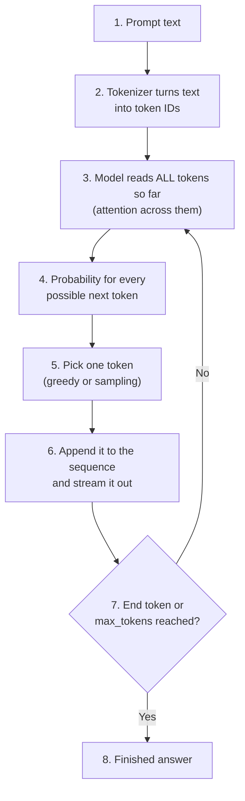
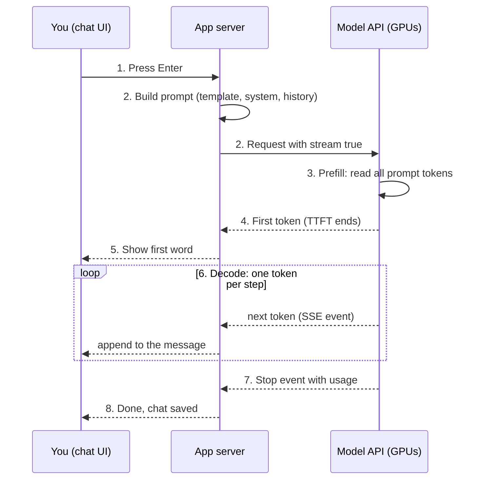
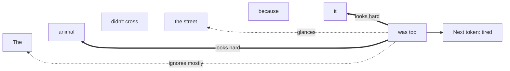
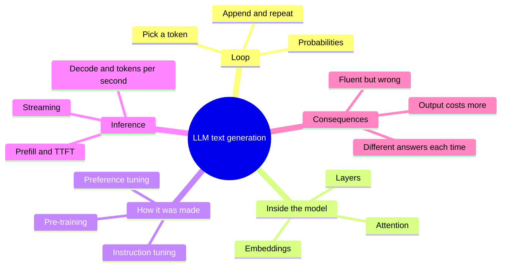

# A1-04 · How an LLM generates text

> **Lesson A1-04** · Type: Concept · Prerequisites: [A1-03 · Tokens and context windows](./a1-03-tokens-and-context-windows.md) (builds on [A1-01](./a1-01-ai-generative-ai-and-llms.md) and [A1-02](./a1-02-ai-models-vs-ai-tools.md)) · Leads to: A1-05, A1-07, A4-05
>
> **Facts checked on:** 13 October 2026. All probabilities, timings, embeddings and chat-template tokens in this guide are **real outputs** from programs run on 13 October 2026 (details in section 6). No maths is needed to follow anything here.

**Why this lesson matters:** one simple idea, *predict the next token, again and again*, explains a surprising amount: why answers appear word by word, why some apps feel slow before the first word, why the same question gets different answers, why a model can sound confident and still be wrong, and why prompts work at all. Once you can draw this loop on a whiteboard, the rest of the roadmap (prompting, RAG, agents) becomes much easier.

## Learning goals

By the end of this lesson you will be able to:

1. Explain the difference between **training** and **inference** in two sentences.
2. Draw the **generation loop**: tokens in → probabilities → pick one → append → repeat.
3. Explain **attention** in one sentence and **embeddings** at intuition level.
4. Say what **pre-training**, **instruction tuning** and **preference tuning** each add to a chat model.
5. Explain **time to first token**, **tokens per second**, **streaming** and why inference needs expensive GPUs.
6. Show how a **chat template** turns system, user and assistant messages into one token sequence.
7. **Done when:** you can whiteboard the generation loop and connect it to streaming and hallucination (section 10).

---

## 1. The topic in one minute

- An LLM writes **one token at a time**. For each step it looks at all the tokens so far, gives every possible next token a **probability**, **picks one**, adds it to the text, and repeats.
- It stops when it picks a special **end token** or hits the length limit (`max_tokens`, from A1-03).
- **Streaming** simply means the app shows you each token as soon as it is picked, instead of waiting for the whole answer.
- The model learned *which tokens tend to follow which* during **training** (done once, months ago, very expensive). When you press Enter, it is doing **inference** (using what it learned, right now, for your request).

**One-line memory trick:** *an LLM is autocomplete that runs in a loop.*

**Analogy: the one-word-at-a-time storyteller.** Imagine a group game where a storyteller may say only one word, then must look back at the whole story so far before choosing the next word. They have read millions of stories, so their choices sound natural. But they never write a draft, never go back to edit, and never check facts in a book. That is how an LLM produces text.

**Real-life example:** you type "Write a useDebounce hook" in ChatGPT, Claude or Cursor and press Enter. There is a short pause (the model is reading your whole prompt), then the code appears piece by piece (the loop is running, one token per step), and finally it stops (end token). Every AI chat you use works like this underneath.

---

## 2. Detailed definitions and why they matter

### 2.1 Training vs inference

| | Training | Inference |
|---|---|---|
| **What happens** | The model's parameters (billions of numbers) are adjusted, using huge amounts of text, so its next-token guesses get better | The finished model is used to answer one request; its parameters do **not** change |
| **When** | Once (plus occasional updates), before release | Every time anyone sends a message |
| **How long** | Weeks to months | Milliseconds to minutes per request |
| **Cost** | Enormous, paid once by the model company | Small per request, but paid on every request (your per-token price) |
| **React analogy** | Building and publishing your npm package | Every app that imports and calls your package |
| **Everyday analogy** | Years of school | Answering one exam question |

**One-line difference:** training is *learning* from data, once; inference is *using* what was learned, for your request, now.

Two consequences you will meet again:

- **The model doesn't learn from your chat.** Inference doesn't change the parameters. "Memory" features are the app saving notes and re-sending them (A1-02, A1-03).
- **The model's knowledge has a cutoff date.** It only knows what was in its training data, unless the app adds search results or documents to the prompt.

### 2.2 The generation loop

**Definition:** the generation loop is the repeated process by which an LLM turns a prompt into an answer: tokenize the input, compute a probability for every possible next token, choose one, append it, and repeat until a stop condition.

**One-line meaning:** predict, pick, append, repeat.

**A real example.** I gave a real (tiny) language model the text `Once upon a time, there was a little` and asked for its top 5 guesses for the next token. Real output:

```text
Prompt: "Once upon a time, there was a little"
Top 5 next tokens:
  " girl"       64.0%  ################################
  " boy"        21.5%  ###########
  " bird"        2.7%  #
  " dog"         1.8%  #
  " b"           1.5%  #
```

*Model: `stories15M`, a 15-million-parameter model trained on simple children's stories (TinyStories), run with llama.cpp on 13 October 2026. Big models like Claude or GPT have far bigger vocabularies and knowledge, but the loop is exactly the same.*

**Picking a token (sampling):** the model doesn't always take the top choice.

- **Greedy:** always pick the most likely token. Predictable, but can sound dull or get stuck repeating.
- **Sampling:** pick randomly, **weighted by the probabilities**. "girl" at 64% gets picked about 64% of the time, "boy" about 21% of the time. This is why "Regenerate" gives you a different answer.
- **Temperature:** a setting that sharpens or flattens the probabilities. Low temperature → safer, more predictable choices; high temperature → more variety (and more mistakes). Some newer models no longer let you change it: Anthropic's docs say Claude 4.7 and later accept only the default temperature.

**Real output: same prompt, different picks** (same model, `max_tokens` 25):

```text
greedy (temperature 0):    Once upon a time, there was a little girl named Lily. She loved to play outside in the sunshine. One day, she saw a big, red
greedy again:              Once upon a time, there was a little girl named Lily. She loved to play outside in the sunshine. One day, she saw a big, red
temperature 1.0, seed 1:   Once upon a time, there was a little boy named Tim. Tim had a toy phone that he loved to play with. One day, he decided to play with
temperature 1.0, seed 2:   Once upon a time, there was a little girl named Lily. She loved to play with her toys and go on adventures. One day, she went to
temperature 1.0, seed 3:   Once upon a time, there was a little girl named Lily. She loved to play with her toys and sing songs. One day, Lily's mom
```

**Each pick changes what can follow.** With seed 1 the sampler picked "boy" (the 21.5% option) instead of "girl", and the whole story changed: a new name (Tim), a new toy, a new plot. Every later token was predicted from a story about a boy. The model can't go back and change "boy". This is the most important property of the loop, and it explains both creativity and hallucination (section 7). Notice also that greedy decoding gave the same text twice: no randomness, no variety.

**Tokens can be pieces of words.** This model's vocabulary has no single token for "bunny" or "toy". The fifth guess above, `" b"`, is the first piece of " b" + "unny" (when I forced `" b"`, the next token was `"unny"`). For `Tom was sad because he lost his`, the top guess was `" to"` at 42.9%, and the next two tokens were `"y"` and `" car"`: " to" + "y" + " car" = " toy car". Each piece is still produced by a separate trip round the loop.

### 2.3 Transformers and attention

**Definition:** a **transformer** is the type of neural network used by almost all modern LLMs, introduced in the 2017 paper *Attention Is All You Need* (Vaswani and others). Its key ingredient is **attention**: a step where each token gathers information from the other tokens it can see, giving more weight to the ones that matter for its meaning.

**One-line meaning (this answers lesson question 3):** *attention lets each token look at the earlier tokens and decide which ones matter most for understanding it and predicting what comes next.*

**Analogy: reading a busy WhatsApp group.** Someone asks "So what time is the party?". You don't re-read all 200 messages equally. You skim most of them and read carefully the few that mention "time", "party" or "Saturday". Attention is the model doing that for every token, at every layer, automatically.

**Example: what does "it" mean?**

- "The animal didn't cross the street because it was too ___" → likely **tired** (here "it" = the animal)
- "The truck didn't cross the bridge because it was too ___" → likely **heavy** or **wide** (now "it" = the truck)

The two sentences have the same shape, but the best next word is different. To predict the blank, the latest position looks back hard at the noun that "it" refers to and only glances at words like "The". The diagram in section 4.3 shows this. *(These two examples are illustrations, not measured outputs.)*

**Two details worth knowing:**

1. **In chat models, tokens only look backwards.** A token can attend to tokens before it, never after (the future hasn't been written yet). That fits the one-token-at-a-time loop.
2. **Attention happens many times.** A transformer is a stack of layers (the tiny model in this guide has 6; big models have many more), and each layer has several attention "heads" that can focus on different things (grammar, who-is-who, code brackets...). You don't need the details for this roadmap; the Transformer Explainer exercise lets you see them.

### 2.4 Embeddings (a preview of A4-05)

**Definition:** an **embedding** is a list of numbers that represents a token (or a whole text) in a way that captures meaning: things with similar meanings get similar lists. OpenAI's embeddings guide describes it as a vector (list) of floating-point numbers, where the distance between two vectors measures how related they are.

**One-line meaning:** meaning, stored as coordinates.

**Analogy: a map of words.** On a map, Bengaluru and Mysuru are close; Bengaluru and London are far. Embeddings put words on a "meaning map" with hundreds of directions instead of two. Inside an LLM, the very first step turns each token into its embedding, and the transformer layers keep refining these lists as attention mixes in context.

**Real look inside a model.** Each token in the tiny `stories15M` model has an embedding of 288 numbers. Comparing them (1.00 = same direction, 0 = unrelated) gives this real output:

```text
Each token is a list of 288 numbers. First 5 numbers for " cat": -0.023, -0.009, -0.017, -0.022, -0.033
   cat vs dog    0.62
   cat vs car    0.24
 happy vs glad   0.53
 happy vs table  -0.03
  king vs queen  0.62
closest to "cat": dog, Cat, itten, Cat, bird
closest to "happy": happ, glad, happiness, pleased, excited
closest to "red": yellow, blue, green, brown, black
```

Nobody told the model that red and blue are both colours, or that cats and dogs are both pets. It learned these positions just from seeing which words appear in similar places in stories. In A4-05 you will use **embedding models** to build semantic search, the base of RAG.

### 2.5 How chat models are made

You saw this pipeline in A1-01; here is what each stage adds to the *generation loop*:

| Stage | What it trains on | What it adds | Result if you stopped here |
|---|---|---|---|
| **1. Pre-training** | Huge amounts of text (Meta said Llama 3 used over 15 trillion tokens) | Language, facts, code patterns: very good next-token probabilities | A **base model**: continues any text, but doesn't follow instructions (the `stories15M` model in this guide is one) |
| **2. Instruction tuning** | Examples of instructions paired with good answers | The habit of *answering* instead of just continuing; a chat format | A model that follows instructions, with uneven quality |
| **3. Preference tuning** (for example RLHF) | Human (or AI) rankings of better vs worse answers | Helpfulness, tone, refusing harmful requests, admitting uncertainty more often | A **chat model** like the ones behind ChatGPT, Claude and Gemini |

**Important:** none of these stages adds a different *generation mechanism*. The chat model still runs the same loop; it has just learned that after an "assistant" marker (section 2.7), helpful answers are the most probable continuation.

### 2.6 Inference in practice: TTFT, tokens per second, streaming, GPU cost

When you press Enter, two very different phases happen:

| Phase | What happens | Speed depends on | What you feel |
|---|---|---|---|
| **Prefill** | The model reads **all** your input tokens at once (system prompt, history, files, your message) | Mostly the **input length** and model size | The pause before the first word |
| **Decode** | The model generates output **one token at a time**, each step depending on the last | Model size and how fast the GPU can move its memory; repeated for every output token | The speed at which words appear |

NVIDIA's inference guide describes the same split: prefill processes the input in parallel and keeps the GPU busy, while decode produces one token per step and is limited mainly by memory speed. The model also keeps a **KV cache** (a memory of work already done for earlier tokens) so it doesn't redo it at every step.

**The two numbers to measure:**

- **Time to first token (TTFT):** Anthropic's docs define it as the time from sending the prompt until the model generates the first token of the response. Mostly prefill (plus network and queueing).
- **Tokens per second:** how fast tokens arrive after the first one. Mostly decode speed.

**Real measurement** (stories15M served by llama.cpp's `llama-server` on a 2-core cloud CPU, streamed over HTTP, 13 October 2026):

```text
Streaming the same request 3 times (client side):
run 1: TTFT 119.3 ms | total 518 ms | 120 tokens | 298 tokens/s after the first
run 2: TTFT 9.7 ms | total 302 ms | 120 tokens | 407 tokens/s after the first
run 3: TTFT 39.7 ms | total 292 ms | 120 tokens | 472 tokens/s after the first

What the server says it spent (prefill vs decode):
short prompt: read  14 tokens in  8.8 ms (0.63 ms each) | wrote 100 tokens at 2.41 ms each | writing is 3.8x slower per token
long  prompt: read 141 tokens in 23.5 ms (0.17 ms each) | wrote 100 tokens at 2.54 ms each | writing is 15.2x slower per token
```

**What these real numbers teach:**

1. **TTFT is not just the model.** Run 1 waited 119 ms for the first token, but the server says it needed under 10 ms to read a short prompt. Most of run 1 was the client opening a new connection and warming up. Runs 2 and 3 reused the connection and got their first token in 10 to 40 ms. With a real cloud API, TTFT also includes internet distance, TLS setup and queueing behind other users.
2. **Longer input → longer prefill.** Reading 141 tokens took about 23 ms; reading 14 took about 9 ms. With 100,000-token prompts on a big model, this is the pause you feel before the first word.
3. **Writing is much slower than reading, per token.** Each output token took about 2.5 ms, while each input token in the long prompt took about 0.17 ms: **about 15 times slower per token** in this run (13 to 17 times across three runs). Prefill handles many tokens in parallel; decode must do them one by one. This is the mechanical reason output tokens are priced higher.
4. **Big models are much slower than this tiny one.** A 15-million-parameter model writes hundreds of tokens per second on just 2 CPU cores. Models with billions of parameters need GPUs to reach a comfortable reading speed, so the numbers you get in the developer exercise (sections 6.4 and 6.5, with Ollama or a cloud API) will look very different.

**Streaming** means the server sends each token as soon as it is decoded (using Server-Sent Events, SSE) instead of one response at the end. It doesn't make the model faster, but users see progress immediately, which Anthropic's latency guide says can significantly improve perceived responsiveness.

**Why inference needs expensive GPUs:** every output token needs a pass through the whole model, and big models have billions of parameters that must sit in very fast GPU memory. Decode can't run in parallel within one answer (token 51 needs token 50), so long answers keep a GPU busy for longer. That is a big part of why output tokens cost more than input tokens (about 5x on the models in A1-03), why "thinking" models that write many hidden tokens are slower and costlier, and why smaller models (like Claude Haiku) are recommended for speed.

### 2.7 Chat templates

**Definition:** a **chat template** is the formatting recipe that turns a list of messages (system, user, assistant) into the one long token sequence a chat model was trained on, using special marker tokens to show where each turn starts and ends. Hugging Face's docs describe chat models as still being language models that continue a token sequence; chat training just teaches them a particular structure.

**One-line meaning:** the chat is one long text in disguise.

**Real output** using Meta's Llama 3 tokenizer and its chat template:

```text
=== What the model actually receives (one long string) ===
"<|begin_of_text|><|start_header_id|>system<|end_header_id|>\n\nYou are a helpful coding assistant. Answer briefly.<|eot_id|><|start_header_id|>user<|end_header_id|>\n\nWhat does useEffect do?<|eot_id|><|start_header_id|>assistant<|end_header_id|>\n\n"

=== As tokens: 30 in total ===
[<|begin_of_text|>] [<|start_header_id|>] [system] [<|end_header_id|>] [\n\n] [You] [ are] [ a] [ helpful] [ coding] [ assistant] [.] [ Answer] [ briefly] [.] [<|eot_id|>] [<|start_header_id|>] [user] [<|end_header_id|>] [\n\n] [What] [ does] [ useEffect] [ do] [?] [<|eot_id|>] [<|start_header_id|>] [assistant] [<|end_header_id|>] [\n\n]

Message text alone: 15 tokens; template markers added: 15 tokens
```

**What to notice:**

- Your neat `messages` array becomes **one long string**.
- Special tokens like `<|start_header_id|>`, `<|end_header_id|>` and `<|eot_id|>` ("end of turn") mark who is speaking. Each is a **single token** the model learned during instruction tuning.
- The template ends with an **open assistant header**. The most likely continuation of that is... an assistant reply. That is how "chatting" works: it's still the generation loop, continuing a document.
- When the model generates `<|eot_id|>`, the app knows the answer is finished.
- Here the markers doubled the token count (15 text + 15 markers). Every model family uses **different** markers, and using the wrong template noticeably hurts quality, which is why apps and libraries apply it for you.

---

## 3. Words you need first

From earlier lessons you know **token**, **tokenizer**, **context window**, **`max_tokens`**, **system prompt** and **base vs chat model**. New words here:

| Word | Plain meaning |
|---|---|
| **Parameters (weights)** | The billions of numbers inside a model that store what it learned |
| **Training** | Adjusting the parameters using data, once, before release |
| **Inference** | Using the trained model to answer a request |
| **Probability** | How likely the model thinks each possible next token is (all add up to 100%) |
| **Sampling** | Picking the next token at random, weighted by those probabilities |
| **Temperature** | A setting that makes picks safer (low) or more varied (high) |
| **Transformer** | The neural-network design used by modern LLMs |
| **Attention** | The step where each token gathers information from the relevant earlier tokens |
| **Embedding** | A list of numbers that represents meaning |
| **Prefill / decode** | Reading the whole prompt at once / generating output one token at a time |
| **TTFT** | Time to first token |
| **Streaming (SSE)** | Sending each token to the user as soon as it is generated |
| **Chat template** | The format that turns chat messages into one token sequence |

---

## 4. How it works

### 4.1 The generation loop

**Diagram: the generation loop**



**How to read this diagram:** start at the top. Steps 1 and 2 happen once. Steps 3 to 7 are the loop: the model reads everything so far, scores all possible next tokens, picks one, appends it, and goes back to step 3 with one more token. Step 6 is where streaming happens: each new token can be sent to the user immediately. The loop only ends at step 7, when the model picks its "end of turn" token or the app's length limit is reached. **Nothing in this loop looks anything up**: there is no search and no database, only "which token is likely next".

### 4.2 Walkthrough: what actually happens when you press Enter

**Scenario:** in a chat app built with Next.js, you type *"Explain useEffect in 5 bullets"* and press Enter.

1. **You press Enter.** The browser sends your message to the app's server.
2. **The server builds the prompt:** system prompt + chat history + your message, using the model's chat template (section 2.7), and calls the model API with `stream: true`.
3. **Prefill:** the model reads all the prompt tokens in one go. Long history or big files make this step longer.
4. **First token:** the model picks the first output token. The time from step 1 to here is the **time to first token**.
5. **The first word appears:** the API sends that token as a Server-Sent Event; the server forwards it; the UI shows it.
6. **Decode loop:** the model generates the next token, then the next, each sent immediately. The UI appends each one. This is the "typing" effect.
7. **Stop:** the model picks its end-of-turn token (or hits `max_tokens`). The API sends a final event with the token usage.
8. **Done:** the app saves the message to the chat history, ready to be re-sent next turn.

**Diagram: app → model with streaming**



**How to read this diagram:** time flows downwards; the numbers match the walkthrough. Solid arrows are requests, dashed arrows are streamed events coming back. The box labelled "loop" repeats once per output token. Notice that the user starts reading at step 5, long before step 7: that is the whole point of streaming. If the app did **not** stream, nothing would appear until step 7, even though the model's work would be exactly the same.

### 4.3 Attention, as an analogy

**Diagram: where the model "looks" before predicting the next word** *(illustrative, not measured)*



**How to read this diagram:** the words sit in a row, in order. The last position ("was too") is about to predict the next word, so it "looks back" at every earlier word. Thick arrows show where it pays the most attention: "it" and "animal" (who are we talking about?). Dotted arrows show weak attention: it glances at "the street" and mostly ignores "The". Because the important context is "an animal", **tired** gets a high probability. If the sentence were about a truck and a narrow bridge, attention would pick up different words and **heavy** or **wide** would become likely. Real models do this in many layers and many heads at once, and the weights are learned, not hand-written.

**React analogy:** attention is a bit like a component that reads from many context providers, but instead of reading all of them equally, it decides **for this render** how much to trust each one, and combines them into its own value.

---

## 5. Real-life examples and developer use cases

| What you see in an AI tool | What the generation loop explains |
|---|---|
| **The answer types itself out** | The app streams each token as soon as it is picked |
| **A pause before the first word**, longer with big files or long chats | Prefill has to read all input tokens first (TTFT) |
| **"Regenerate" gives a different answer** | Sampling picks tokens at random, weighted by probability |
| **"Stop generating" button** | The app cancels the stream; tokens already generated stay, the rest are never made |
| **Long answers take long; "thinking" models feel slower** | Every output token is one more loop step; thinking tokens are steps too |
| **Answers cut off mid-sentence** | The loop hit `max_tokens` before the end token (A1-03) |
| **Cursor/Copilot inline completions** | The same loop, with your code file as the prompt |
| **Confident but wrong facts (hallucinations)** | Fluent tokens are highly probable even when the fact isn't true (section 7, Q2) |
| **Prompts like "answer in JSON" work** | They change which continuations are probable |
| **Web search in ChatGPT/Claude** | The app gives the model a search tool; the model can't browse by itself (section 9) |

**Why prompts work at all:** the model always continues the most likely text for the context it sees. A clear role, examples and constraints change the context, so they change the probabilities of every next token. That is the bridge to prompting lessons later in the roadmap.

---

## 6. Practical code: watch the loop with a real model (optional)

Everything in this section was run on 13 October 2026. You don't need any of it to understand the lesson, but seeing real probabilities and timings makes the ideas stick.

### 6.1 Set up a tiny model you can inspect

Cloud APIs don't show you every next-token probability, so I used a tiny open model you can run anywhere:

- **Model:** `stories15M` from Andrej Karpathy's **llama2.c** project: 15 million parameters, 6 layers, trained on TinyStories (simple children's stories written by GPT-3.5 and GPT-4, from Eldan and Li's 2023 paper). It is a **base model**: it only continues stories.
- **Engine:** **llama.cpp**, the open-source engine many local AI tools build on, with its `llama-server` HTTP server.

```bash
# 1. Build llama.cpp (needs git, cmake and a C++ compiler)
git clone --depth 1 https://github.com/ggml-org/llama.cpp
cd llama.cpp
cmake -B build -DCMAKE_BUILD_TYPE=Release -DLLAMA_CURL=OFF -DLLAMA_OPENSSL=OFF -DLLAMA_BUILD_TESTS=OFF
cmake --build build --config Release -j 2 --target llama-server llama-convert-llama2c-to-ggml

# 2. Download the tiny model and its tokenizer (from the llama2.c README and repo)
wget https://huggingface.co/karpathy/tinyllamas/resolve/main/stories15M.bin
wget https://raw.githubusercontent.com/karpathy/llama2.c/master/tokenizer.bin

# 3. Convert it to GGUF (llama.cpp's model format), then set its real context length (256 tokens)
./build/bin/llama-convert-llama2c-to-ggml --copy-vocab-from-model tokenizer.bin \
  --llama2c-model stories15M.bin --llama2c-output-model stories15M.gguf
pip install ./gguf-py
python -m gguf.scripts.gguf_set_metadata stories15M.gguf llama.context_length 256 --force

# 4. Start the server on http://localhost:8080
./build/bin/llama-server -m stories15M.gguf --port 8080 -t 2 -c 256 -np 1 -a stories15M
```

*How I ran it:* llama.cpp commit `4413a19` (12 October 2026), Node.js 22, a 2-core cloud machine with no GPU. Hugging Face wasn't reachable from that machine, so I used the copy of `stories15M.bin` bundled in the `llama2.c-emscripten` npm package (same 60.8 MB size and settings: 288 dimensions, 6 layers, 32,000-token vocabulary, 256-token context). The converter sets the context to 128 by default, which is why step 3 changes it to the model's real 256.

**Easier alternative:** if you installed **Ollama** in A1-01, you can skip all of this for the streaming measurement in section 6.4 (it has an OpenAI-compatible API). Sections 6.2 and 6.3 need `llama-server`, because they use its probability and timing features.

### 6.2 See the next-token probabilities

```js
// next-token-probs.mjs: ask a local model for its top 5 guesses for the NEXT token.
// Needs llama.cpp's llama-server running (see section 6.1), default http://localhost:8080
const SERVER = process.env.SERVER ?? "http://localhost:8080";
const prompt = process.argv[2] ?? "Once upon a time, there was a little";

const res = await fetch(`${SERVER}/completion`, {
  method: "POST",
  headers: { "Content-Type": "application/json" },
  body: JSON.stringify({ prompt, n_predict: 1, n_probs: 5, temperature: 0, cache_prompt: false }),
});
const data = await res.json();
const { top_logprobs } = data.completion_probabilities[0];

console.log(`Prompt: "${prompt}"`);
console.log("Top 5 next tokens:");
for (const { token, logprob } of top_logprobs) {
  const percent = Math.exp(logprob) * 100;               // logprob -> probability
  const bar = "#".repeat(Math.max(1, Math.round(percent / 2)));
  console.log(`  ${JSON.stringify(token).padEnd(12)} ${percent.toFixed(1).padStart(5)}%  ${bar}`);
}
```

Real output (`node next-token-probs.mjs "Once upon a time, there was a little"` and `node next-token-probs.mjs "The sky was"`):

```text
Prompt: "Once upon a time, there was a little"
Top 5 next tokens:
  " girl"       64.0%  ################################
  " boy"        21.5%  ###########
  " bird"        2.7%  #
  " dog"         1.8%  #
  " b"           1.5%  #
Prompt: "The sky was"
Top 5 next tokens:
  " dark"       18.3%  #########
  " blue"        9.7%  #####
  " bright"      8.3%  ####
  " a"           7.1%  ####
  " full"        6.6%  ###
```

The model is fairly sure about "girl" after "there was a little", but "The sky was" has no clear winner: many continuations are plausible, so sampling can go many ways.

### 6.3 Sampling, and a fluent wrong answer

`sampling.mjs` produced the greedy-vs-seed output shown in section 2.2 (the server's default top-k and top-p filters were left on):

```js
// sampling.mjs: same prompt, greedy vs sampling with different random seeds.
const SERVER = process.env.SERVER ?? "http://localhost:8080";
const prompt = "Once upon a time, there was a little";

async function generate(label, settings) {
  const res = await fetch(`${SERVER}/completion`, {
    method: "POST",
    headers: { "Content-Type": "application/json" },
    body: JSON.stringify({ prompt, n_predict: 25, cache_prompt: false, ...settings }),
  });
  const { content } = await res.json();
  console.log(`${label.padEnd(26)} ${prompt}${content.replace(/\n/g, " ")}`);
}

await generate("greedy (temperature 0):", { temperature: 0 });
await generate("greedy again:", { temperature: 0 });
for (const seed of [1, 2, 3]) await generate(`temperature 1.0, seed ${seed}:`, { temperature: 1.0, seed });
```

Now ask the tiny model a question it has never learned anything about:

```js
// hallucination.mjs: a fluent answer about something the model never learned.
const SERVER = process.env.SERVER ?? "http://localhost:8080";
const prompt = 'Tom asked his mom, "What is the capital of France?" His mom smiled and said, "The capital of France is';
const res = await fetch(`${SERVER}/completion`, {
  method: "POST",
  headers: { "Content-Type": "application/json" },
  body: JSON.stringify({ prompt, n_predict: 30, temperature: 0, cache_prompt: false }),
});
const { content } = await res.json();
console.log(prompt + content);
```

Real output:

```text
Tom asked his mom, "What is the capital of France?" His mom smiled and said, "The capital of France is a big and beautiful place. It has many people and things to eat and live in." Tom was curious and asked, "What is a nation?"
```

And its top guesses for the first word of the answer (`node next-token-probs.mjs` with the same prompt):

```text
Prompt: "Tom asked his mom, "What is the capital of France?" His mom smiled and said, "The capital of France is"
Top 5 next tokens:
  " a"          32.4%  ################
  " very"       14.1%  #######
  " called"      9.6%  #####
  " an"          2.5%  #
  " where"       2.4%  #
```

"Paris" wasn't even in this model's top 200 guesses (I checked with `n_probs: 200`). The model has never seen geography, but it has seen thousands of stories where a mom answers a question kindly, so it produces a fluent, kind, **wrong** answer. Big models know Paris, of course, but the same mechanism produces confident mistakes about rare facts they never learned well (section 7, Q2).

### 6.4 Stream a response and measure TTFT and tokens per second

This is the card's developer exercise. It works with `llama-server` and, per Ollama's OpenAI-compatibility docs (which list `/v1/completions` with streaming and `include_usage`), with Ollama too. I tested it with `llama-server` only.

```js
// measure-stream.mjs: stream a completion and measure time to first token (TTFT) and tokens/second.
// Works with any OpenAI-compatible server: llama.cpp's llama-server (default below) or Ollama.
//   llama-server:  BASE_URL=http://localhost:8080/v1   (model name can be anything)
//   Ollama:        BASE_URL=http://localhost:11434/v1  MODEL=llama3.2:1b
// Run: node measure-stream.mjs "Once upon a time, there was a little"
const BASE_URL = process.env.BASE_URL ?? "http://localhost:8080/v1";
const MODEL = process.env.MODEL ?? "stories15M";
const prompt = process.argv[2] ?? "Once upon a time, there was a little";

async function measure({ show }) {
  const sentAt = performance.now();
  const res = await fetch(`${BASE_URL}/completions`, {
    method: "POST",
    headers: { "Content-Type": "application/json" },
    body: JSON.stringify({
      model: MODEL,
      prompt,
      max_tokens: 120,
      temperature: 0.8,
      seed: 42,
      stream: true,                              // ask for Server-Sent Events
      stream_options: { include_usage: true },   // ask for token counts at the end
    }),
  });
  if (!res.ok) throw new Error(`HTTP ${res.status}: ${await res.text()}`);

  let firstTokenAt = null, chunks = 0, usage = null, buffer = "";
  const decoder = new TextDecoder();
  for await (const bytes of res.body) {          // the body arrives piece by piece
    buffer += decoder.decode(bytes, { stream: true });
    const lines = buffer.split("\n");
    buffer = lines.pop();                        // keep any half-received line
    for (const line of lines) {
      if (!line.startsWith("data: ")) continue;  // SSE lines look like "data: {...}"
      const data = line.slice(6).trim();
      if (data === "[DONE]") continue;
      const event = JSON.parse(data);
      const piece = event.choices?.[0]?.text ?? "";
      if (piece) {
        firstTokenAt ??= performance.now();      // the moment the first token arrives
        chunks++;
        if (show) process.stdout.write(piece);   // print it immediately, like a chat UI
      }
      if (event.usage) usage = event.usage;
    }
  }
  const doneAt = performance.now();
  const outputTokens = usage?.completion_tokens ?? chunks;
  return {
    ttft: firstTokenAt - sentAt,
    total: doneAt - sentAt,
    outputTokens,
    tokensPerSecond: (outputTokens - 1) / ((doneAt - firstTokenAt) / 1000),
  };
}

// Run 1 is "cold" (new connection); runs 2-3 reuse the connection, like a busy app.
for (let run = 1; run <= 3; run++) {
  const r = await measure({ show: run === 1 });
  if (run === 1) console.log("\n---");
  console.log(`run ${run}: TTFT ${r.ttft.toFixed(1)} ms | total ${r.total.toFixed(0)} ms | ` +
    `${r.outputTokens} tokens | ${r.tokensPerSecond.toFixed(0)} tokens/s after the first`);
}
```

Real output (`node measure-stream.mjs "Once upon a time, there was a little"`):

```text
 boy named Timmy. Timmy loved to play with his toys. One day, Timmy's favorite toy car broke. He was sad and didn't know what to do.
Timmy's mom saw him crying and asked him what was wrong. Timmy showed her his broken car. His mom said, "Don't worry, Timmy. I have an idea. Let's go to the store and get some glue."
At the store, Timmy and his mom found the glue. It was a little bit sticky, but
---
run 1: TTFT 119.3 ms | total 518 ms | 120 tokens | 298 tokens/s after the first
run 2: TTFT 9.7 ms | total 302 ms | 120 tokens | 407 tokens/s after the first
run 3: TTFT 39.7 ms | total 292 ms | 120 tokens | 472 tokens/s after the first
```

The first line is the story, printed token by token as it arrived. Timings vary from run to run on a shared machine: across my repeated runs with short prompts, cold first requests took about 100 to 155 ms and warm requests about 5 to 70 ms.

To separate **prefill** from **decode**, ask `llama-server` for its own timings:

```js
// prefill-vs-decode.mjs: ask llama-server how long it spent READING the prompt (prefill)
// vs WRITING each output token (decode), for a short and a long prompt.
const SERVER = process.env.SERVER ?? "http://localhost:8080";
const story = "Lily lived in a small house near a big forest. Every morning, she woke up early and went outside " +
  "to look at the tall trees. The birds sang happy songs and the wind made the leaves dance. ";
const prompts = {
  short: "Once upon a time, there was a girl named Lily.",
  long: story.repeat(3) + "One day, Lily found a shiny key.",
};

for (const [kind, prompt] of Object.entries(prompts)) {
  const res = await fetch(`${SERVER}/completion`, {
    method: "POST",
    headers: { "Content-Type": "application/json" },
    // cache_prompt: false makes the server read the whole prompt again every time
    body: JSON.stringify({ prompt, n_predict: 100, seed: 1, cache_prompt: false }),
  });
  const { timings: t } = await res.json();
  const readEach = t.prompt_ms / t.prompt_n, writeEach = t.predicted_per_token_ms;
  console.log(`${kind.padEnd(5)} prompt: read ${String(t.prompt_n).padStart(3)} tokens in ${t.prompt_ms.toFixed(1).padStart(4)} ms ` +
    `(${readEach.toFixed(2)} ms each) | wrote ${t.predicted_n} tokens at ${writeEach.toFixed(2)} ms each ` +
    `| writing is ${(writeEach / readEach).toFixed(1)}x slower per token`);
}
```

Real output (one of three runs; the "x slower" figure for the long prompt was 13.2x to 17.2x across runs):

```text
short prompt: read  14 tokens in  8.8 ms (0.63 ms each) | wrote 100 tokens at 2.41 ms each | writing is 3.8x slower per token
long  prompt: read 141 tokens in 23.5 ms (0.17 ms each) | wrote 100 tokens at 2.54 ms each | writing is 15.2x slower per token
```

### 6.5 Measure a real cloud API (Claude)

Same idea with the Claude API, using the official TypeScript SDK's streaming events (`content_block_delta` with a `text_delta` carries each piece of text, per Anthropic's streaming docs):

```js
// measure-claude.mjs: stream a reply from the Claude API and log TTFT and tokens/second.
// Prerequisites: Node.js 20+, `npm install @anthropic-ai/sdk`, ANTHROPIC_API_KEY in the environment.
// Run: node --env-file=.env measure-claude.mjs
// @ts-check
import Anthropic from "@anthropic-ai/sdk";

const client = new Anthropic();
const sentAt = performance.now();
/** @type {number | null} */
let firstTokenAt = null;

const stream = client.messages.stream({
  model: "claude-haiku-5-5",
  max_tokens: 400,
  messages: [{ role: "user", content: "Explain React's useEffect in 5 short bullet points." }],
});

for await (const event of stream) {
  if (event.type === "content_block_delta" && event.delta.type === "text_delta") {
    firstTokenAt ??= performance.now();   // first visible text
    process.stdout.write(event.delta.text);
  }
}
const doneAt = performance.now();
const final = await stream.finalMessage(); // full message, including token usage

const out = final.usage.output_tokens;
const ttft = (firstTokenAt ?? doneAt) - sentAt;
console.log("\n---");
console.log(`input tokens       : ${final.usage.input_tokens}`);
console.log(`output tokens      : ${out}`);
console.log(`time to first token: ${ttft.toFixed(0)} ms`);
console.log(`total time         : ${(doneAt - sentAt).toFixed(0)} ms`);
console.log(`tokens per second  : ${((out - 1) / ((doneAt - (firstTokenAt ?? sentAt)) / 1000)).toFixed(1)} (after first text)`);
```

**How this was checked** (no API key was available in my test environment): it passed `tsc --checkJs` against the official `@anthropic-ai/sdk` 0.133.0 types, and with a deliberately invalid key the request reached `api.anthropic.com` and returned `401 authentication_error`. So the code and endpoint are right, but I have **no real Claude timings** to show. Expect your TTFT to be in the hundreds of milliseconds or more (internet distance, a much bigger model, other users), and run it a few times, since the first request also pays for connection setup.

**Illustrative output shape** (not a real run):

```text
- useEffect runs code after React renders ...
---
input tokens       : <n>
output tokens      : <n>
time to first token: <ms>
total time         : <ms>
tokens per second  : <n> (after first text)
```

### 6.6 See a chat template turn messages into one sequence

```js
// chat-template.mjs: how system, user and assistant messages become ONE token sequence.
// npm install @lenml/tokenizer-llama3   (Meta Llama 3 tokenizer + its chat template)
import { fromPreTrained } from "@lenml/tokenizer-llama3";

const tok = fromPreTrained();
const messages = [
  { role: "system", content: "You are a helpful coding assistant. Answer briefly." },
  { role: "user", content: "What does useEffect do?" },
];

// 1. Render the template as text (add_generation_prompt opens the assistant's turn)
const text = tok.apply_chat_template(messages, { tokenize: false, add_generation_prompt: true });
console.log("=== What the model actually receives (one long string) ===");
console.log(JSON.stringify(text));

// 2. Turn it into tokens and show each piece
const ids = tok.encode(text, { add_special_tokens: false });
console.log(`\n=== As tokens: ${ids.length} in total ===`);
console.log(ids.map((id) => `[${tok.decode([id]).replace(/\n/g, "\\n")}]`).join(" "));

// 3. How much did the template add on top of the message text?
const contentOnly = messages.map((m) => tok.encode(m.content, { add_special_tokens: false }).length)
  .reduce((a, b) => a + b, 0);
console.log(`\nMessage text alone: ${contentOnly} tokens; template markers added: ${ids.length - contentOnly} tokens`);
```

Real output: shown in section 2.7. (`useEffect` happens to be a single token in Llama 3's vocabulary.)

### 6.7 Look at real embeddings

```js
// embeddings.mjs: look at REAL word embeddings inside a tiny model (no maths needed to read the output).
// Needs two files from Karpathy's llama2.c project in the same folder:
//   stories15M.bin  (15M-parameter TinyStories model)   tokenizer.bin  (its 32,000-token vocabulary)
import { readFileSync } from "node:fs";

// 1. Read the vocabulary: for each token -> float score, int length, bytes
const tb = readFileSync("tokenizer.bin");
const vocab = [];
let off = 4; // skip max_token_length
for (let i = 0; i < 32000; i++) {
  const len = tb.readInt32LE(off + 4);
  vocab.push(tb.subarray(off + 8, off + 8 + len).toString("utf8"));
  off += 8 + len;
}
const idOf = new Map(vocab.map((t, i) => [t, i]));

// 2. The embedding table is the first block of weights: 32,000 rows x 288 numbers
const model = readFileSync("stories15M.bin");
const DIM = model.readInt32LE(0); // 288
const table = new Float32Array(model.buffer, model.byteOffset + 28, 32000 * DIM);
const row = (id) => table.subarray(id * DIM, (id + 1) * DIM);
const vec = (word) => row(idOf.get(" " + word)); // words that follow a space start with " "

// 3. Cosine similarity: 1 = same direction (similar meaning), 0 = unrelated
function similarity(a, b) {
  let dot = 0, na = 0, nb = 0;
  for (let i = 0; i < DIM; i++) { dot += a[i] * b[i]; na += a[i] * a[i]; nb += b[i] * b[i]; }
  return dot / Math.sqrt(na * nb);
}

console.log(`Each token is a list of ${DIM} numbers. First 5 numbers for " cat":`,
  Array.from(vec("cat").slice(0, 5), (x) => x.toFixed(3)).join(", "));
for (const [a, b] of [["cat", "dog"], ["cat", "car"], ["happy", "glad"], ["happy", "table"], ["king", "queen"]]) {
  console.log(`${a.padStart(6)} vs ${b.padEnd(6)} ${similarity(vec(a), vec(b)).toFixed(2)}`);
}
for (const word of ["cat", "happy", "red"]) {
  const v = vec(word);
  const nearest = vocab
    .map((t, id) => ({ t: t.trim(), s: similarity(v, row(id)) }))
    .filter((x) => x.t && x.t !== word)
    .sort((x, y) => y.s - x.s).slice(0, 5).map((x) => x.t);
  console.log(`closest to "${word}": ${nearest.join(", ")}`);
}
```

Run it in the folder with `stories15M.bin` and `tokenizer.bin` from section 6.1. Real output: shown in section 2.4. (`"itten"` appears because "kitten" is split into pieces in this vocabulary; pieces get embeddings too.)

---

## 7. The four lesson questions, answered

### Q1. Why does the answer appear word by word?

Because the model really does produce it **one token at a time**. Each token needs a full pass through the model, and the next token can't be computed until the previous one is chosen (it becomes part of the input). Apps use **streaming** to send each token to your screen as soon as it exists, instead of waiting for the end. So the "typing effect" isn't decoration: it is the decode loop made visible. (Apps sometimes group a few tokens per update, and pieces like " to" + "y" can make the stream look like it splits words.)

### Q2. How can a model be fluent and wrong at the same time?

Because **fluency and truth come from different places**:

1. The model is trained to produce **likely** text, and grammar, style and tone are extremely regular patterns, so it learns them very well.
2. Facts are different. OpenAI's 2025 research on hallucinations points out that arbitrary, rarely-seen facts (like a specific person's birthday) can't be predicted from patterns alone, and that common training and evaluation methods reward guessing over saying "I don't know".
3. The loop has **no fact-check step**. Once a wrong token is picked, every later token is chosen to fit it fluently, so the error gets a confident explanation.
4. Our real demo: the tiny model answered "The capital of France is a big and beautiful place..." Perfectly fluent, and "Paris" wasn't even in its top 200 guesses.

Anthropic's interpretability research (March 2025) adds a mechanism view: Claude's default is to say it doesn't know, and a "known entity" signal overrides that; when this misfires on something only partly familiar, it can answer confidently anyway.

**What helps:** give the model the facts (documents, search results), ask it to quote sources, allow it to say "I don't know", and verify important claims.

### Q3. What does attention do, in one sentence?

**Attention lets each token look at the other tokens it can see and decide which ones matter most for understanding it and predicting the next token.**

### Q4. What is the difference between training and inference?

**Training** happens once, before release: the model's parameters are adjusted using huge amounts of data, which takes weeks and enormous compute. **Inference** happens every time you send a message: the frozen model runs the generation loop on your prompt, and its parameters don't change. That is why chatting doesn't teach the model anything, why its knowledge has a cutoff date, and why you pay per token for inference.

---

## 8. Related concepts: confusing pairs

| Often confused | The real difference |
|---|---|
| **Training vs inference** | Learning the parameters once vs using them for each request |
| **Pre-training vs fine-tuning** | Learning language from huge text vs adjusting a pre-trained model for a style or task (instruction tuning, preference tuning) |
| **Base model vs chat model** | Continues any text vs trained to answer in a chat format (A1-01) |
| **Prefill vs decode** | Reading all input tokens in parallel vs generating output tokens one by one |
| **TTFT vs tokens per second** | How long until the first token vs how fast the rest arrive |
| **Streaming vs faster model** | Streaming shows tokens sooner; it doesn't make the model generate faster |
| **Greedy vs sampling** | Always the top token vs a weighted random pick |
| **Temperature vs creativity** | Temperature only reshapes probabilities; it can add variety, not knowledge |
| **Token vs embedding** | A token is the chunk of text (and its ID); an embedding is the list of numbers representing it |
| **Attention vs memory** | Attention works only within the current context window; it doesn't remember earlier chats |
| **Chat template vs system prompt** | The template is the format (markers); the system prompt is content placed inside it |

---

## 9. Benefits, limitations, common mistakes and safety

### 9.1 Common mistakes and wrong mental models

**Wrong mental model 1: "The model plans the whole answer, then types it."**
- **Correction:** the output is produced **one token at a time**, and each token is final once picked. There is no hidden finished draft being revealed slowly.
- **Nuance:** inside each step, the model can represent ideas about what's coming. Anthropic's research found Claude picks a rhyming word before writing the line that ends with it. But the text itself still comes out one token at a time, and the model can't go back and edit earlier tokens.
- **Why it matters:** it explains why asking a model to "think step by step" or to plan first can help: the plan becomes tokens in the context, which later tokens can use.

**Wrong mental model 2: "The model searches the internet by itself."**
- **Correction:** the model only generates tokens. It can **ask** for a search only when the app gives it a search tool, and the app (or API) runs the search. Anthropic's docs describe it this way: you add the web search tool to the request, Claude decides when to search, and the API runs the searches and gives Claude the results.
- **Why it matters:** without a search tool, a confident "latest" answer comes from training data, which has a cutoff date.

**Mistake 3: going deep into maths.**
- For your goal (using and building with AI tools), the loop, attention in one sentence, embeddings as "meaning coordinates", and prefill/decode are enough. The Transformer Explainer shows the inner steps visually if you're curious.

**Mistake 4: "Temperature 0 means correct."** Greedy decoding is repeatable, not truthful. The tiny model's France answer was generated at temperature 0.

**Mistake 5: "Streaming makes the model faster."** It makes the wait *feel* shorter; total generation time is the same.

**Mistake 6: "Fluent means reliable."** Fluency is the easy part for an LLM. Check facts, numbers and code, especially rare or recent ones.

### 9.2 What this mental model explains, and where it stops

| Explains well | Doesn't explain |
|---|---|
| Streaming, TTFT, why long answers take longer | Exactly *why* a model chose a specific token (still an active research area) |
| Why outputs vary, and why prompts and examples change results | What facts a particular model knows |
| Hallucinations, cut-off answers, chat templates | Training methods in detail (out of scope for this roadmap) |
| Why output tokens cost more | Every speed trick providers use (batching, caching, speculative decoding) |

### 9.3 Safety and privacy

- Fluent output is not verified output: review code and fact-check claims before you publish or ship them.
- Streaming code in your app should handle **cancellations** (user presses Stop) and **errors in the middle of a stream** (Anthropic's streaming docs mention errors like `overloaded_error` can arrive inside the event stream).
- Local models (llama.cpp, Ollama) keep prompts on your machine, which is useful for private experiments.

---

## 10. Hands-on exercises

### Beginner (no code): the next-word game on paper

1. Write the start of a sentence: **"After the meeting, Priya opened her laptop and"**.
2. List **five** possible next words and give each a rough percentage that adds up to 100% (for example: started 30%, checked 25%, saw 20%, closed 15%, cried 10%).
3. Pick one word. Now list five possible next words **after that word**.
4. Repeat for 6 to 8 words, then go back to step 2, pick a **different** first word, and continue again.
5. Compare the two sentences.

**Expected outcome:** two sentences that go in completely different directions after just one different choice, both fluent.
**How to verify:** explain to someone, using your paper: (a) why the second sentence couldn't "go back" and fix an early word, (b) why picking a 10% word sometimes makes a more interesting sentence, and (c) how a wrong but fluent fact could appear this way. If you can, you've understood sampling and hallucination.

### Intermediate (tool-based): explore the Transformer Explainer

1. Open **Transformer Explainer** at <https://poloclub.github.io/transformer-explainer/> (made by Georgia Tech researchers; it runs a real GPT-2 small model, about 124 million parameters, in your browser).
2. Type a sentence of your own, for example "The developer fixed the bug because it".
3. Look at the **next-token probabilities** at the end. Write down the top 3.
4. Move the **temperature** slider low and high and watch the probabilities change. Try switching between top-k and top-p sampling.
5. Hover over tokens in the **attention** view and note which earlier words light up for "it".
6. Write 5 to 8 sentences in your own words: what is an embedding, what did attention seem to connect, and what did temperature do?

**Expected outcome:** a short write-up describing tokenization, embeddings, attention and the probability list, in your own words.
**How to verify:** check your write-up against sections 2.2 to 2.4. If you described attention as "looking things up on the internet" or "memory of past chats", re-read section 2.3.

### Developer (optional): stream and measure TTFT and tokens per second

1. Run `measure-stream.mjs` (section 6.4) against Ollama (`BASE_URL=http://localhost:11434/v1 MODEL=llama3.2:1b`) or `llama-server`.
2. If you have a Claude API key, run `measure-claude.mjs` (section 6.5) three times.
3. Make a table: model, where it ran, TTFT (cold and warm), tokens per second.
4. Try a much longer prompt (paste a long document before the question) and see how TTFT changes.

**Expected outcome:** real TTFT and tokens-per-second numbers for at least one local or cloud model, plus evidence that longer prompts raise TTFT.
**How to verify:** your cold run should have a higher TTFT than warm runs; the long-prompt TTFT should be higher than the short-prompt one; tokens per second should stay roughly the same between short and long prompts.

### "Done when" check: whiteboard the loop

On a whiteboard or paper, without looking: draw the generation loop (section 4.1), then point to where **streaming** happens (each appended token is sent), and where **hallucination** can start (a fluent but wrong token is picked and the following tokens build on it).

---

## 11. FAQ

**Is "next-token prediction" all there is to an LLM?**
At the output level, yes: every answer, every line of code and every tool call is produced by this loop. What makes big models impressive is how good their next-token probabilities are, thanks to huge training and instruction/preference tuning.

**Does the model see my whole prompt at once?**
Yes. During prefill it processes all input tokens together; then during decode each new token can attend to everything before it.

**Why do "thinking" or "reasoning" modes take longer?**
They generate extra tokens (the thinking) before the visible answer. More tokens means more loop steps, more time and more output cost (A1-03).

**If I ask the same question twice, why are the answers different?**
Sampling picks tokens at random, weighted by probability, and one different early pick changes everything after it (section 2.2).

**Why does the first word take longer than the rest?**
The first token has to wait for prefill (reading all your input) plus network and queueing. After that, each token only needs one decode step.

**Why can't I set temperature on some new models?**
Some providers fix it. Anthropic's docs say Claude 4.7 and later models accept only the default temperature and suggest adjusting effort or prompting instead.

**Are embeddings the same as tokens?**
No. A token is a piece of text with an ID; its embedding is the list of numbers the model uses to represent it. In A4-05 you'll use separate embedding models that turn whole texts into one list of numbers for search.

**Do I need a GPU to try any of this?**
No. The tiny model in this guide ran on 2 CPU cores. Small chat models through Ollama also run on normal laptops, just more slowly than cloud APIs.

---

## 12. Mini glossary

| Term | Meaning |
|---|---|
| **Training** | Adjusting a model's parameters with data, once, before release |
| **Inference** | Running the trained model to answer a request |
| **Parameters / weights** | The numbers inside a model that store what it learned |
| **Generation loop** | Predict next-token probabilities → pick → append → repeat |
| **Probability distribution** | The list of all possible next tokens with how likely each is |
| **Greedy decoding** | Always picking the most likely token |
| **Sampling** | Picking a token at random, weighted by probability |
| **Temperature** | Setting that makes picks more predictable (low) or more varied (high) |
| **Top-k / top-p** | Filters that only allow the k most likely tokens, or the most likely tokens adding up to p |
| **Seed** | A number that fixes the randomness so a sampled result can be repeated |
| **End-of-turn token** | Special token that tells the app the answer is finished (e.g. `<|eot_id|>` in Llama 3) |
| **Transformer** | The neural-network design behind modern LLMs |
| **Attention** | Each token gathering information from the relevant tokens it can see |
| **Layer / head** | Repeated blocks of a transformer / parallel attention "views" inside a layer |
| **Embedding** | A list of numbers representing meaning |
| **Pre-training** | Learning next-token prediction on huge text |
| **Instruction tuning** | Training on instructions with good answers |
| **Preference tuning / RLHF** | Training towards answers humans prefer |
| **Prefill** | Reading all input tokens at once |
| **Decode** | Generating output tokens one at a time |
| **KV cache** | Stored work for earlier tokens so each decode step doesn't redo it |
| **TTFT** | Time to first token |
| **Tokens per second** | Output speed after the first token |
| **Streaming / SSE** | Sending each token as it is generated, using Server-Sent Events |
| **Chat template** | Format that turns messages into one token sequence with special markers |
| **Hallucination** | Fluent output that is false or made up |
| **GGUF** | File format used by llama.cpp (and Ollama) for local models |

---

## 13. Quiz

1. In the generation loop, what happens right after the model computes probabilities for the next token?
2. True or false: "When you chat with a model, it updates its parameters to learn from you."
3. Which phase mostly decides time to first token: prefill or decode? Why?
4. In the real measurement, about how many times slower was writing one token than reading one token (long prompt)?
5. In one sentence, what does attention do?
6. The tiny model said "The capital of France is a big and beautiful place." Name two reasons fluent-but-wrong output like this happens.
7. What does a chat template add to your messages, and why does it end with an open assistant header?
8. A user says "the AI looked it up online". In an app with no search tool, what actually happened?
9. Same prompt, temperature 0, run twice: same or different output? And at temperature 1.0 with different seeds?
10. In the real embeddings output, which words were closest to "red", and what does that show?

---

## 14. Quiz answer key

1. **One token is picked** (greedy or sampled), then **appended** to the sequence (and streamed), and the loop repeats.
2. **False.** Inference doesn't change the parameters; only training does.
3. **Prefill.** The model must read all input tokens before it can produce the first output token (plus network and queueing time).
4. **About 15 times** (2.54 ms per output token vs 0.17 ms per input token; 13x to 17x across runs).
5. Attention lets each token look at the other tokens it can see and decide which ones matter most for its meaning and for the next prediction.
6. Any two: the model is trained to produce *likely* text, not checked facts; rare facts can't be learned from patterns; there's no fact-check step in the loop; each new token is chosen to fit earlier ones, so an error gets a fluent continuation; training and evaluation can reward guessing over "I don't know".
7. Special marker tokens showing who is speaking and where each turn ends. It ends with an open assistant header so that the **most likely continuation is the assistant's reply**.
8. It generated the answer from patterns in its training data. Without a search tool, the model can't browse; only the app can run searches.
9. Temperature 0 (greedy): **the same** (we got identical text twice). Temperature 1.0 with different seeds: **different** (seed 1 gave a boy named Tim; seeds 2 and 3 gave Lily).
10. **yellow, blue, green, brown, black**. Embeddings place words used in similar ways close together: the model learned "colour words" as a group only from seeing text.

---

## 15. Quick revision (cheat sheet)

```
TRAINING  = learn parameters from data (once, expensive)
INFERENCE = use them for your request (every time, per-token price)

THE LOOP: tokens in -> probabilities for next token -> pick one
          -> append (and stream it) -> repeat until end token / max_tokens

PREFILL = read all input at once      -> decides time to first token
DECODE  = write one token per step    -> decides tokens per second
```

**Diagram: the whole lesson as a mind map**



**How to read this diagram:** the centre is the topic; each branch is one part of this lesson. Use it to test yourself: cover the leaves and try to explain each branch in one sentence.

- **Attention in one line:** each token looks at the earlier tokens that matter for it.
- **Embedding in one line:** meaning stored as a list of numbers; similar words sit close together.
- **Chat template:** messages become one long token sequence with role markers; the reply is just the continuation.
- **Real numbers (tiny model, 2 CPUs):** "little" → girl 64%, boy 21.5%; reading 141 tokens ≈ 23 ms, writing ≈ 2.5 ms per token (~15x slower per token).
- **Search** only happens when the app gives the model a search tool.
- **Fluent ≠ true.** Verify facts, numbers and code.

---

## 16. Completion checklist and next step

- [ ] I can explain training vs inference in two sentences.
- [ ] I can draw the generation loop and mark where streaming happens.
- [ ] I can explain attention in one sentence and embeddings with the "meaning map" idea.
- [ ] I know what pre-training, instruction tuning and preference tuning each add.
- [ ] I can explain TTFT, tokens per second, prefill and decode.
- [ ] I can explain how a chat template turns messages into one sequence.
- [ ] I played the next-word game and explored the Transformer Explainer.
- [ ] (Optional) I measured TTFT and tokens per second for a real model.
- [ ] **Done when:** I can whiteboard the generation loop and connect it to streaming and hallucination.

**Before A1-05, A1-07 and A4-05** (the next lessons this card leads to in your roadmap), make sure you are comfortable with:

- Probabilities and sampling (temperature, seeds), since settings and prompting lessons build on them.
- The idea that a prompt changes the probabilities of every next token.
- Embeddings as "meaning coordinates", which A4-05 turns into semantic search.

---

## 17. Learn-in-public content ideas

Post only after doing the exercises yourself, and use **your** numbers and screenshots.

1. **LinkedIn / X post: "What actually happens when you press Enter in an AI chat."**
   Structure: hook ("The AI isn't typing a finished answer. It's guessing one token at a time."), the 8-step walkthrough from section 4.2 in short lines, one real probability list (girl 64%, boy 21.5%), your own TTFT measurement, and the takeaway ("streaming = the loop made visible").

2. **Instagram carousel: "Why AI sounds confident even when it's wrong."**
   Slides: the next-word game, the "fluent but wrong" France example from the tiny model, why the loop has no fact-check step, and three ways to reduce hallucinations (give sources, allow "I don't know", verify).

3. **X thread or short video: "I measured how fast an AI model reads vs writes."**
   Share your prefill-vs-decode numbers (or mine, with credit and date), explain why writing each token is so much slower, and connect it to why output tokens cost more.

---

## 18. Sources and further reading

All checked on **13 October 2026**.

**Concepts and research**
- Vaswani et al., *Attention Is All You Need* (2017): <https://arxiv.org/abs/1706.03762>
- Ouyang et al., *Training language models to follow instructions with human feedback* (InstructGPT, 2022): <https://arxiv.org/abs/2203.02155>
- Meta, *Introducing Meta Llama 3* (15T+ training tokens): <https://ai.meta.com/blog/meta-llama-3/>
- OpenAI, *Why language models hallucinate* (5 September 2025): <https://openai.com/index/why-language-models-hallucinate/>
- Anthropic, *Tracing the thoughts of a large language model* (27 March 2025): <https://www.anthropic.com/research/tracing-thoughts-language-model>
- NVIDIA, *Mastering LLM Techniques: Inference Optimization* (prefill, decode, KV cache): <https://developer.nvidia.com/blog/mastering-llm-techniques-inference-optimization/>
- OpenAI, Embeddings guide: <https://developers.openai.com/api/docs/guides/embeddings>
- Hugging Face, Chat templates: <https://huggingface.co/docs/transformers/main/en/chat_templating>

**APIs and tools**
- Anthropic, Streaming messages (SSE event types): <https://platform.claude.com/docs/en/build-with-claude/streaming>
- Anthropic, Reducing latency (TTFT definition, streaming): <https://platform.claude.com/docs/en/test-and-evaluate/strengthen-guardrails/reduce-latency>
- Anthropic, Web search tool (how search is enabled): <https://platform.claude.com/docs/en/agents-and-tools/tool-use/web-search-tool>
- Ollama, OpenAI compatibility: <https://docs.ollama.com/api/openai-compatibility>
- Transformer Explainer (Georgia Tech): <https://poloclub.github.io/transformer-explainer/>

**Model and code used in the demos**
- Karpathy, llama2.c (stories15M model, tokenizer.bin; MIT licence): <https://github.com/karpathy/llama2.c>
- Eldan and Li, *TinyStories* (2023): <https://arxiv.org/abs/2305.07759>
- llama.cpp (llama-server, GGUF, llama2.c converter): <https://github.com/ggml-org/llama.cpp>
- `@lenml/tokenizer-llama3` (Llama 3 tokenizer and chat template in JavaScript): <https://www.npmjs.com/package/@lenml/tokenizer-llama3>
- `@anthropic-ai/sdk` (TypeScript SDK): <https://www.npmjs.com/package/@anthropic-ai/sdk>
