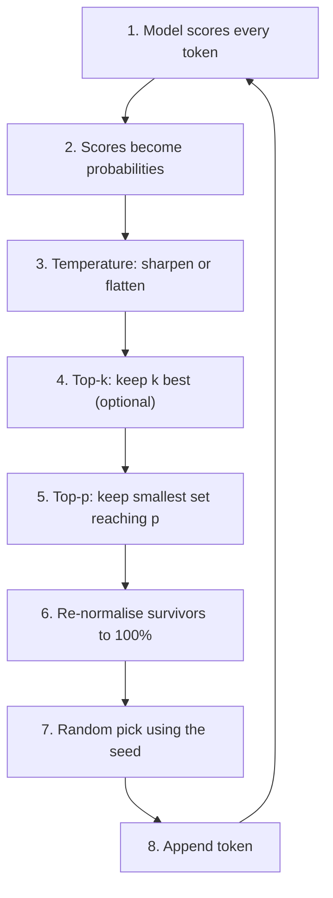
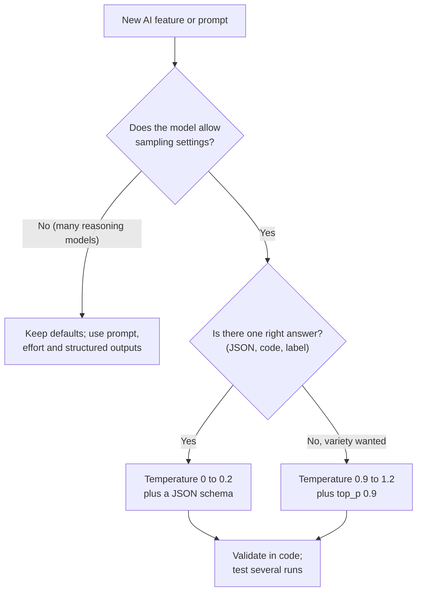

# A1-05 · Temperature and sampling

> **Lesson A1-05** · Type: Concept · Prerequisites: [A1-04 · How an LLM generates text](./a1-04-how-an-llm-generates-text.md) · Leads to: A2-03, A2-07
>
> **Facts checked on:** 13 October 2026. All probabilities and experiment results in this guide are **real outputs** of code run on 13 October 2026, using the same tiny `stories15M` model and llama.cpp setup as A1-04. Provider rules for these settings **change often** (marked *may change*); always check the docs for the exact model you use.

**Why this lesson matters:** the same prompt can give five different answers. Sometimes you want that (product names, taglines, ideas). Sometimes it's a bug (JSON extraction, code, tests). This lesson shows exactly where the variation comes from, which knobs control it, why those knobs behave differently on different models, and what *actually* makes JSON output reliable.

## Learning goals

By the end of this lesson you will be able to:

1. Explain **greedy decoding vs sampling** using real next-token probabilities.
2. Explain what **temperature**, **top-k** and **top-p** do, with a before-and-after picture.
3. Explain what a **seed** does, and why outputs can still differ with identical settings.
4. Know that many **reasoning and newer models restrict or ignore** these settings, and where to check.
5. **Pick settings per task**: extraction, code, chat, brainstorming.
6. Answer the four lesson questions (section 7).
7. **Done when:** you can pick settings per task and explain the variation you see (section 10).

---

## 1. The topic in one minute

- At every step, the model gives each possible next token a **probability** (A1-04). Something then has to **pick** one token. That picking step is called **sampling**, and it is where randomness enters.
- **Greedy** = always pick the most likely token (repeatable, can be dull).
- **Temperature** = makes the probabilities **sharper** (low: the favourite wins almost always) or **flatter** (high: unlikely tokens get a real chance).
- **Top-k / top-p** = remove unlikely tokens completely before picking (a safety net against weird words).
- **Seed** = fixes the random numbers so the same request can repeat its random picks.

**One-line memory trick:** *temperature changes the odds; top-k and top-p change who is allowed to play.*

**Analogy: a weighted dice.** Imagine a dice where "girl" covers 64% of the surface, "boy" 21% and thousands of tiny faces share the rest.

- **Low temperature** grows the big face until it covers almost everything: you nearly always roll "girl".
- **High temperature** shrinks the big faces and grows the tiny ones: you might roll something strange.
- **Top-k / top-p** saw off the tiny faces before you roll.
- **A seed** is like recording the exact throw, so you can repeat it.

**Real-life example:** ask a chat app "Suggest a name for my Hinglish AI YouTube channel" five times and you get five names, because the app samples. Your Next.js API route that extracts `{ name, city, quantity }` from WhatsApp orders should give the **same** JSON every time, so you would use low randomness **and** a JSON schema (section 2.6).

---

## 2. Detailed definitions and why they matter

### 2.1 Probabilities over the next token: greedy vs sampling

**Definition:** **greedy decoding** always chooses the highest-probability token; **sampling** chooses randomly, in proportion to the probabilities.

**One-line meaning:** greedy = always the favourite; sampling = a weighted lucky draw.

Real probabilities from the tiny model for the text `Once upon a time, there was a little` (from A1-04): **girl 64.0%, boy 21.5%, bird 2.7%, dog 1.8%**, and about 32,000 other tokens sharing the rest.

- **Greedy** picks "girl" every single time.
- **Sampling** picks "girl" about 64% of the time and "boy" about 21%, and very rarely something else.

Both are still the same model with the same knowledge. Only the **picking rule** differs.

### 2.2 Temperature: sharpening or flattening

**Definition:** **temperature** is a number that reshapes the next-token probabilities before sampling. Below 1 it **sharpens** them (likely tokens become even more likely); above 1 it **flattens** them (unlikely tokens gain probability). Temperature 0 is usually treated as greedy.

**One-line meaning:** the "confidence dial" for each pick.

**Diagram: the same next-token probabilities, before and after temperature** *(real numbers)*

```text
Temperature 0.5
  " girl"   |####################################    |  89.6%
  " boy"    |####                                    |  10.1%
  " bird"   |                                        |   0.2%
  " dog"    |                                        |   0.1%
  " b"      |                                        |   0.1%
  others    |                                        |   0.1%  (the other 31995 tokens)

Temperature 1.0  (the model's own probabilities)
  " girl"   |##########################              |  64.0%
  " boy"    |#########                               |  21.5%
  " bird"   |#                                       |   2.7%
  " dog"    |#                                       |   1.8%
  " b"      |#                                       |   1.5%
  others    |###                                     |   8.5%  (the other 31995 tokens)

Temperature 1.5
  " girl"   |#############                           |  32.4%
  " boy"    |######                                  |  15.7%
  " bird"   |##                                      |   4.0%
  " dog"    |#                                       |   3.0%
  " b"      |#                                       |   2.7%
  others    |#################                       |  42.4%  (the other 31995 tokens)
```

**How to read this diagram:** each block is the same moment in the same model: the next token after "Once upon a time, there was a little". Each bar's length is that token's chance of being picked (40 `#` = 100%). The middle block (temperature 1.0) is the model's own opinion. At **0.5**, "girl" jumps to almost 90%: picks become very predictable. At **1.5**, "girl" falls to about a third, and the **others** line (31,995 other tokens) jumps from 8.5% to 42.4%: almost every second pick could be a rare word. Nothing about the model changed, only the dial.

**How quickly the tail grows** (real, same prompt, computed by `tail-share.mjs` in section 6.1):

```text
T=0.2: top token 99.6% | outside top 5: 0.0% | tokens needed for 90%: 1
T=0.5: top token 89.6% | outside top 5: 0.1% | tokens needed for 90%: 2
T=1.0: top token 64.0% | outside top 5: 8.5% | tokens needed for 90%: 5
T=1.5: top token 32.4% | outside top 5: 42.4% | tokens needed for 90%: 125
T=2.0: top token 12.8% | outside top 5: 73.1% | tokens needed for 90%: 1137
```

At temperature 2.0, you need **1,137 different tokens** just to cover 90% of the probability. That is why very high temperatures produce gibberish (you'll see real examples in section 5).

**How it works, without maths:** the code in section 6.1 takes each token's log-probability, divides it by the temperature, and re-normalises everything back to 100%. Dividing by a small number exaggerates the gaps between tokens; dividing by a big number shrinks them.

**Typical ranges and defaults** *(may change)*: OpenAI's SDK documents temperature between 0 and 2; Anthropic's API reference documents 0 to 1 with a default of 1.0 (on the models that still accept it); Ollama and llama.cpp default to 0.8.

### 2.3 Top-k and top-p: who is allowed to be picked

**Definitions:**

- **Top-k:** keep only the **k** most likely tokens; everything else gets zero chance.
- **Top-p (nucleus sampling):** keep the **smallest set of most-likely tokens whose probabilities add up to p** (for example 90%); drop the rest. Introduced by Holtzman and others in 2019 to cut off the "unreliable tail" that makes text degenerate.
- **Min-p** (seen in llama.cpp and Ollama): drop tokens much less likely than the top one.

**One-line meaning:** temperature changes the odds; top-k and top-p decide who can play at all.

**Real example (same prompt, temperature 1.0):**

```text
Top-k = 3: only " girl", " boy", " bird" are allowed
Top-p = 0.9: the smallest set reaching 90% has 5 tokens (covers 91.5%):
  " girl" " boy" " bird" " dog" " b"
```

**Why both exist:** top-k uses a fixed count, which is too strict when many words are fine ("The sky was" has many good continuations) and too loose when only one is right. Top-p adapts: when the model is sure, the "nucleus" is small; when it's unsure, it's bigger.

**Real effect in our experiment** (section 5): at temperature 1.2, adding `top_p 0.9` raised correct answers on an extraction-style task from **5/20 to 10/20** and clean puppy names from **15/20 to 20/20**, while keeping variety.

**OpenAI's advice** (from its SDK documentation): change temperature **or** top_p, but generally not both.

### 2.4 Seeds and determinism

**Definition:** a **seed** is a starting number for the random-number generator. Same seed + same input + same settings + same system = the same random picks.

**One-line meaning:** a seed lets you replay the same "lucky draw".

**Real output** (`seeds.mjs`, section 6.3; the first block uses random seeds, so yours will differ):

```text
No seed (server picks a random one each time):
   "Fluffy. She liked to play with Fluffy"
   "Spot. Spot was very cute and soft."
   "Buddy. She liked to play with Buddy in the"
seed 7, three times:
   "Spot. She loved Spot very much. Spot"
   "Spot. She loved Spot very much. Spot"
   "Spot. She loved Spot very much. Spot"
seed 7 again, but the prompt has one extra space at the end:
   "12 inches. She loved her puppy very much."
   "12 inches. She loved her puppy very much."
   "12 inches. She loved her puppy very much."
```

Notice the last block: **one extra space** at the end of the prompt changed the tokens, so the same seed produced a completely different (and silly) continuation.

**Why outputs can still differ with "identical" settings:**

1. **The input isn't really identical:** an extra space, a different date in the system prompt, a different chat history or a different chat template changes the tokens.
2. **The model or serving setup changed:** new model versions, or (as Anthropic's docs note) infrastructure updates even under a pinned model ID (A1-02).
3. **Batching on shared GPU servers:** Thinking Machines Lab (September 2025) showed that results can change with **how many other requests are processed together**, which the server load decides and you can't control. They made outputs reproducible only by rewriting key GPU kernels to be "batch-invariant".
4. **Providers say so:** Anthropic's API reference notes that even with temperature 0.0, results will not be fully deterministic.

**Real demonstration of a hidden difference** (`hidden-difference.mjs`, section 6.3). Same prompt, same seed, same temperature; the only change is a server option, `cache_prompt`, that decides whether llama.cpp reuses earlier work or recomputes the prompt from scratch:

```text
cache_prompt=false: top token "1", log-prob -1.382429
cache_prompt=true : top token "1", log-prob -1.382716
cache_prompt=false, seed 1, T=1.2: "失数 Pro么\"."
cache_prompt=false, seed 1, T=1.2: "失数 Pro么\"."
cache_prompt=true , seed 1, T=1.2: "注ე two军scaleinnen policy Stop?wers are god"
cache_prompt=true , seed 1, T=1.2: "注ე two军scaleinnen policy Stop?wers are god"
```

The two ways of computing gave **slightly different numbers** (look at the 4th decimal of the log-probability). At temperature 1.2 with no filters, the probabilities are so flat that this tiny difference changed the very first pick, and the rest of the output followed. Re-running gives the same pair of results every time, so this isn't randomness: it's the computation path. Cloud APIs make similar choices for you (caching, batching, hardware) and you can't see them.

*Another test:* on the same small server, greedy (temperature 0) output stayed **identical** whether a request ran alone or alongside three others. Big shared GPU deployments behave differently (point 3 above), so never build a feature that depends on exact repeatability from a cloud API.

### 2.5 Reasoning and newer models restrict these settings

**This is the most important practical update in this lesson.** Many newer models, especially "reasoning" models that think before answering, no longer let you change sampling settings, or advise against it:

| Provider | What the docs say (checked 13 October 2026, *may change*) |
|---|---|
| **Anthropic (Claude)** | API reference: models released after Claude Opus 4.6 **do not support setting temperature** (1.0 is accepted for compatibility; other values return a 400 error). `top_k` is rejected; `top_p` only accepts values ≥ 0.99. Docs suggest steering with prompting and **effort** instead. |
| **Google (Gemini 3.x)** | Prompting guide: "strongly recommend keeping them at their default values"; changing them, for example setting temperature below 1.0, can cause "looping or degraded performance". |
| **OpenAI** | SDK docs: temperature 0 to 2; alter temperature or top_p, not both. Developers have reported that GPT-5-family reasoning models reject non-default temperature (OpenAI community forum, August 2025); I couldn't find this stated on the model page I checked, so **test your model** before relying on it. |
| **Ollama / llama.cpp (local)** | Full control: temperature, top_k, top_p, min_p, seed. Defaults: Ollama 0.8 / 40 / 0.9 / 0.0; llama.cpp 0.8 / 40 / 0.95 / 0.05. |

**Why providers do this:** reasoning models generate long hidden chains of thought, and they are tuned to work well at their default sampling. Changing it can make them loop or perform worse, so providers give you other controls: **reasoning effort**, **prompting**, and **structured outputs**.

### 2.6 Choosing settings per task

**Rule zero:** settings are a fine-tuning knob. **The prompt and the output format do most of the work.** For JSON, a schema (structured outputs) matters far more than temperature.

**Task → recommended starting settings** *(rules of thumb; only where the model lets you change them)*

| Task | Temperature | Top-p / top-k | Most important extra | Why |
|---|---|---|---|---|
| **JSON extraction** (orders, invoices, forms) | 0 to 0.2 | default | **Structured outputs / JSON schema**, then validate with Zod | One right answer; format must never break |
| **Classification / routing** (spam, ticket type) | 0 | default | Fixed list of labels (enum) in the schema | Same input should give the same label |
| **Code generation and refactoring** | 0 to 0.3 | default | Tests and type-checking | Small variations can break code |
| **Factual answers from your documents** (RAG) | 0 to 0.3 | default | Give sources; allow "I don't know" | You want faithful, repeatable answers |
| **General chat assistant** | provider default (often 0.7 to 1.0) | default | Good system prompt | Natural, varied tone |
| **Brainstorming names, taglines, hooks** | 0.9 to 1.2 | top_p 0.9 to 0.95 | Ask for many options, then pick | Variety is the goal; top-p keeps it sensible |
| **Creative writing, stories** | 0.8 to 1.1 | top_p 0.9 to 0.95 | Clear style instructions | Fresh wording without nonsense |
| **Automated tests / evaluations** | 0, fixed seed if supported | default | Pin the model ID; run several times anyway | Maximum repeatability (still not guaranteed) |
| **Reasoning models** (Claude after Opus 4.6, Gemini 3.x, reasoning GPT models) | **leave default** | **leave default** | Effort setting, prompt, structured outputs | Provider restrictions (section 2.5) |

Anthropic's own API reference gives the same direction for models that accept it: temperature closer to 0.0 for analytical or multiple-choice tasks, closer to 1.0 for creative and generative tasks.

### 2.7 Where you can change these settings

| Place | Can you change temperature etc.? |
|---|---|
| **APIs** (OpenAI, Claude on models that allow it, Gemini, Ollama, llama.cpp) | Yes, per request (`temperature`, `top_p`, `top_k`, `seed`) |
| **Playgrounds** (Google AI Studio's Run settings panel, other providers' consoles) | Yes, usually sliders; Google's docs say Run settings lets you adjust model parameters (UI may change) |
| **Local tools** (Ollama, llama.cpp) | Yes: in requests, in a Modelfile (`PARAMETER temperature 0.2`), or as server flags (`--temp`, `--top-p`) |
| **Consumer chat apps** (ChatGPT, Claude, Gemini apps) | Generally no; the app chooses for you *(may change)* |
| **Coding tools** (Cursor, Copilot) | Generally no; you choose the model and mode instead |

---

## 3. Words you need first

From A1-04 you know **probability**, **greedy**, **sampling**, **temperature** (briefly) and the **generation loop**. New or deeper words here:

| Word | Plain meaning |
|---|---|
| **Sampler** | The step after the model that turns probabilities into one chosen token |
| **Logit / log-probability** | The model's raw score for a token, before it becomes a percentage (you never need to compute these by hand) |
| **Distribution** | The full list of possible next tokens with their probabilities |
| **Long tail** | The thousands of individually unlikely tokens that together can hold a lot of probability |
| **Top-k** | Keep only the k most likely tokens |
| **Top-p (nucleus)** | Keep the smallest set of likely tokens that adds up to p |
| **Min-p** | Drop tokens much less likely than the top one |
| **Seed** | Starting number for the random generator |
| **Deterministic** | Same input always gives the same output |
| **Structured outputs** | A provider feature that forces the reply to match a JSON schema |
| **Grammar (GBNF)** | llama.cpp's way to force output into an exact format |
| **Effort** | A setting on newer models that controls how much the model thinks, used instead of sampling knobs |

---

## 4. How it works

### 4.1 Walkthrough: how one token gets picked

**Scenario:** your app asks a local model (Ollama or llama.cpp) for a product name with `temperature: 1.2, top_p: 0.9, seed: 42`. Here is what happens for **each** token:

1. **The model scores every token** in its vocabulary (32,000 for the tiny model; far more for big ones).
2. **The scores become probabilities** (they add up to 100%).
3. **Temperature reshapes them:** 1.2 flattens them a little, so rarer tokens get more chance.
4. **Top-k (if set) keeps only the k best** tokens.
5. **Top-p keeps the smallest group that adds up to 90%** and drops the tail.
6. **The survivors are re-normalised** back to 100%.
7. **A random number (from the seed) picks one** survivor, in proportion to its probability.
8. **The token is appended**, and the loop goes back to step 1 for the next token.

**Diagram: the sampler, step by step**



**How to read this diagram:** follow the numbers from the top; the arrow from step 8 back to step 1 is the generation loop from A1-04. Steps 1 and 2 are the **model** (its knowledge). Steps 3 to 7 are the **sampler** (the settings you control). That split is the key idea: **settings never add knowledge**; they only change how the model's existing opinions are turned into a choice. With temperature 0, step 7 simply takes the top token, and steps 4 and 5 don't matter. *(Engines differ in the order: llama.cpp's default order, for example, runs top-k, top-p and min-p first and applies temperature last. The idea is the same: reshape the odds, cut the tail, then draw.)*

### 4.2 Choosing settings for a task

**Diagram: picking settings for a request**



**How to read this diagram:** start at the top. First check the provider's docs for your exact model: if it doesn't accept these settings, stop tuning them and use the other levers. If it does, ask whether the task has one right answer. If yes, go low and add a schema; if you want variety, go higher and add top-p as a safety net. Either way, finish by validating the output in code and running the prompt several times.

---

## 5. Real experiment: 20 runs per setting, scored in code

**Setup:** the tiny `stories15M` model on llama.cpp (from A1-04), 20 runs per setting with seeds 1 to 20, other filters switched off except where stated. Three tasks:

- **A. Extract a colour:** `Ben had a big red ball. He kicked the red ball to his dog. The color of the ball was` → the one right answer is **red**.
- **B. Name a puppy:** `Lily got a new puppy. She named it` → many good answers.
- **C. JSON extraction:** a few-shot prompt showing three "Story → JSON" examples, then `Ben had a green car...` → right answer `{"name": "Ben", "toy": "car", "color": "green"}`. Run once as **free text** (C1) and once **forced by a grammar** (C2), llama.cpp's form of structured output.

**Real results** (`sampling-experiment.mjs`, section 6.2):

```text
A. Extract a colour (one right answer: red)
  T=0.2            : correct 20/20 | distinct answers 1/20 | most common: "red" x20
  T=1.2            : correct 5/20 | distinct answers 10/20 | most common: "a" x5
  T=1.2 + top_p 0.9: correct 10/20 | distinct answers 9/20 | most common: "red" x10

B. Name a puppy (creative, many good answers)
  T=0.2            : a clean name 20/20 | distinct answers 2/20 | most common: "Spot" x19
  T=1.2            : a clean name 15/20 | distinct answers 15/20 | most common: "Spot" x5
  T=1.2 + top_p 0.9: a clean name 20/20 | distinct answers 9/20 | most common: "Spot" x10

C1. JSON extraction, free text
  T=0.2            : valid JSON 0/20 | fully correct 0/20 | distinct answers 11/20 | most common: "1: \"Crabby!\"" x4
  T=1.2            : valid JSON 0/20 | fully correct 0/20 | distinct answers 20/20 | most common: "注ე twoὺSH Ха transition.  OfND^{-\\ тех said: servants wanted" x1
  T=1.2 + top_p 0.9: valid JSON 0/20 | fully correct 0/20 | distinct answers 20/20 | most common: "rianifolia.Externalfahr hit him right!\"" x1

C2. JSON extraction, grammar-constrained
  T=0.2            : valid JSON 20/20 | fully correct 0/20 | distinct answers 12/20 | most common: "{\"name\": \"Izagine\", \"toy\": \"car\", \"color\": \"yellow\"}" x3
  T=1.2            : valid JSON 20/20 | fully correct 0/20 | distinct answers 20/20 | most common: "{\"name\": \"Whereisy\", \"toy\": \"car\", \"color\": \"yellow\"}" x1
  T=1.2 + top_p 0.9: valid JSON 20/20 | fully correct 0/20 | distinct answers 20/20 | most common: "{\"name\": \"Thatoure\", \"toy\": \"car\", \"color\": \"pink\"}" x1
```

*Note:* when all 20 answers are different, the "most common" example is just the first one in the list, and in rows C1 the exact gibberish can change between re-runs because of the caching effect shown in section 2.4. The counts stayed the same when I re-ran the whole experiment.

**What the numbers show:**

1. **Low temperature = repeatable.** Task A: 20/20 "red", only 1 distinct answer. Task B: "Spot" 19 times out of 20.
2. **High temperature = variety, and more mistakes.** Task A dropped to 5/20 correct with 10 different answers. Task B gave 15 different names (good for brainstorming), but 5 runs weren't clean names.
3. **Top-p is a safety net.** At the same temperature 1.2, `top_p 0.9` doubled the correct answers on A (5 → 10) and made every puppy name clean (15 → 20), while keeping 9 different names.
4. **Temperature can't create a skill the model lacks.** This tiny model never saw JSON during training, so free-text JSON was **0/20 valid at every setting**, even the "safe" one.
5. **A format constraint fixes format, not truth.** With the grammar, JSON was **20/20 valid** at every setting, but **0/20 fully correct** (it invented names like "Izagine" and copied "yellow" from the examples). Low temperature made it *consistently* wrong, not right.

**The same lesson with a real chat model:** big instruction-tuned models (Claude, GPT, Gemini, Llama 3.2) are good at JSON, so your results with `json-runs.mjs` (section 6.4) will look much better. The pattern to look for is the same: low temperature → fewer distinct answers; high temperature → more variety and more broken or wrong JSON; a schema → valid JSON regardless.

**Where you see this in real tools:**

| What you notice | Explanation |
|---|---|
| "Regenerate" in ChatGPT, Claude or Gemini gives a new answer | The app samples with randomness |
| Copilot or Cursor suggestions differ slightly each time | Sampling, plus different surrounding code in the prompt |
| Your extraction endpoint occasionally returns a broken field | Sampling picked an unlikely token; add a schema and validation |
| A setting that worked on one model returns a 400 error on another | Newer models restrict sampling settings (section 2.5) |
| Very high temperature produces mixed-language gibberish | The flattened long tail (section 2.2) lets rare tokens win |

---

## 6. Practical code (optional)

All scripts in 6.1 to 6.3 need `llama-server` running the `stories15M` model on `http://localhost:8080`; the setup is in **A1-04, section 6.1**. They were run on 13 October 2026 with Node.js 22 and llama.cpp commit `4413a19`.

### 6.1 Temperature bars and top-k / top-p from real probabilities

```js
// temperature-bars.mjs: how temperature reshapes REAL next-token probabilities.
// Needs llama.cpp's llama-server with the stories15M model on http://localhost:8080 (see A1-04, section 6.1).
const SERVER = process.env.SERVER ?? "http://localhost:8080";
const prompt = "Once upon a time, there was a little";

// 1. Ask for the probability of EVERY token in the 32,000-token vocabulary
const res = await fetch(`${SERVER}/completion`, {
  method: "POST",
  headers: { "Content-Type": "application/json" },
  body: JSON.stringify({ prompt, n_predict: 1, n_probs: 32000, temperature: 0, cache_prompt: false }),
});
const all = (await res.json()).completion_probabilities[0].top_logprobs; // sorted, most likely first

// 2. Temperature: divide each log-probability by T, then re-normalise so everything adds up to 100%
function withTemperature(T) {
  const weights = all.map((t) => Math.exp(t.logprob / T));
  const total = weights.reduce((a, b) => a + b, 0);
  return weights.map((w) => w / total);
}

const SHOW = 5;
const bar = (p) => "#".repeat(Math.round(p * 40)).padEnd(40, " ");
for (const T of [0.5, 1.0, 1.5]) {
  const probs = withTemperature(T);
  console.log(`\nTemperature ${T.toFixed(1)}${T === 1 ? "  (the model's own probabilities)" : ""}`);
  for (let i = 0; i < SHOW; i++) {
    console.log(`  ${JSON.stringify(all[i].token).padEnd(9)} |${bar(probs[i])}| ${(probs[i] * 100).toFixed(1).padStart(5)}%`);
  }
  const rest = probs.slice(SHOW).reduce((a, b) => a + b, 0);
  console.log(`  ${"others".padEnd(9)} |${bar(rest)}| ${(rest * 100).toFixed(1).padStart(5)}%  (the other ${all.length - SHOW} tokens)`);
}

// 3. Top-k and top-p: which tokens are even allowed? (at temperature 1.0)
const p1 = withTemperature(1.0);
const topK = 3;
console.log(`\nTop-k = ${topK}: only ${all.slice(0, topK).map((t) => JSON.stringify(t.token)).join(", ")} are allowed`);
let cumulative = 0, kept = 0;
while (cumulative < 0.9) cumulative += p1[kept++];
console.log(`Top-p = 0.9: the smallest set reaching 90% has ${kept} tokens (covers ${(cumulative * 100).toFixed(1)}%):`);
console.log("  " + all.slice(0, kept).map((t) => JSON.stringify(t.token)).join(" "));
```

Real output: the bar diagram in section 2.2 and the top-k/top-p lines in section 2.3.

`tail-share.mjs` (the "how quickly the tail grows" numbers in section 2.2):

```js
// tail-share.mjs: how much probability sits OUTSIDE the top 5 tokens at each temperature,
// and how many tokens are needed to cover 90%. (Same data as temperature-bars.mjs.)
const SERVER = process.env.SERVER ?? "http://localhost:8080";
const res = await fetch(`${SERVER}/completion`, { method: "POST", headers: { "Content-Type": "application/json" },
  body: JSON.stringify({ prompt: "Once upon a time, there was a little", n_predict: 1, n_probs: 32000, temperature: 0, cache_prompt: false }) });
const all = (await res.json()).completion_probabilities[0].top_logprobs;
for (const T of [0.2, 0.5, 1.0, 1.5, 2.0]) {
  const w = all.map((t) => Math.exp(t.logprob / T)); const total = w.reduce((a, b) => a + b, 0);
  const p = w.map((x) => x / total);
  let c = 0, k = 0; while (c < 0.9) c += p[k++];
  console.log(`T=${T.toFixed(1)}: top token ${(p[0] * 100).toFixed(1)}% | outside top 5: ${(p.slice(5).reduce((a, b) => a + b, 0) * 100).toFixed(1)}% | tokens needed for 90%: ${k}`);
}
```

### 6.2 The 20-run experiment

```js
// sampling-experiment.mjs: 20 runs at two temperatures on three tasks, scored in code.
// Needs llama-server with stories15M on http://localhost:8080 (see A1-04, section 6.1).
const SERVER = process.env.SERVER ?? "http://localhost:8080";
const RUNS = 20;
const SETTINGS = [
  { label: "T=0.2", temperature: 0.2 },
  { label: "T=1.2", temperature: 1.2 },
  { label: "T=1.2 + top_p 0.9", temperature: 1.2, top_p: 0.9 },  // same high temperature, tail cut off
];

async function complete(prompt, extra) {
  const res = await fetch(`${SERVER}/completion`, {
    method: "POST",
    headers: { "Content-Type": "application/json" },
    // top_k 0, top_p 1, min_p 0 = switch OFF the other filters, so we see temperature alone
    body: JSON.stringify({ prompt, top_k: 0, top_p: 1, min_p: 0, ...extra }),
  });
  return (await res.json()).content;
}

const fewShot = `Story: Tom had a red ball. He played with it in the park.
Answer: {"name": "Tom", "toy": "ball", "color": "red"}
Story: Lily had a blue kite. She flew it at the beach.
Answer: {"name": "Lily", "toy": "kite", "color": "blue"}
Story: Sam had a yellow truck. He pushed it in the garden.
Answer: {"name": "Sam", "toy": "truck", "color": "yellow"}
Story: Ben had a green car. He raced it on the floor.
Answer: `;

// A grammar (llama.cpp's "GBNF") that FORCES the exact JSON shape: a form of structured output
const jsonGrammar = String.raw`root  ::= "{\"name\": \"" name "\", \"toy\": \"" toy "\", \"color\": \"" color "\"}"
name  ::= [A-Z] [a-z] [a-z]? [a-z]? [a-z]? [a-z]? [a-z]? [a-z]?
toy   ::= "ball" | "kite" | "truck" | "doll" | "car" | "bike"
color ::= "red" | "blue" | "yellow" | "pink" | "green" | "brown"`;

const parseJson = (s) => { try { return JSON.parse(s); } catch { return null; } };
const isRightJson = (o) => o?.name === "Ben" && o?.toy === "car" && o?.color === "green";

const tasks = [
  { name: "A. Extract a colour (one right answer: red)",
    run: (cfg, seed) => complete("Ben had a big red ball. He kicked the red ball to his dog. The color of the ball was",
      { n_predict: 1, seed, ...cfg }),
    clean: (s) => s.trim(), ok: (s) => s === "red" },
  { name: "B. Name a puppy (creative, many good answers)",
    run: (cfg, seed) => complete("Lily got a new puppy. She named it", { n_predict: 6, seed, stop: [".", ",", "\n"], ...cfg }),
    clean: (s) => s.trim(), ok: (s) => /^[A-Z][a-z]+$/.test(s) },   // "ok" here = a single proper name
  { name: "C1. JSON extraction, free text",
    run: (cfg, seed) => complete(fewShot, { n_predict: 30, seed, stop: ["\n"], ...cfg }),
    clean: (s) => s.trim(), ok: (s) => parseJson(s) !== null, right: (s) => isRightJson(parseJson(s)) },
  { name: "C2. JSON extraction, grammar-constrained",
    run: (cfg, seed) => complete(fewShot, { n_predict: 40, seed, grammar: jsonGrammar, ...cfg }),
    clean: (s) => s.trim(), ok: (s) => parseJson(s) !== null, right: (s) => isRightJson(parseJson(s)) },
];

for (const task of tasks) {
  console.log(`\n${task.name}`);
  for (const { label, ...cfg } of SETTINGS) {
    const answers = [];
    for (let seed = 1; seed <= RUNS; seed++) answers.push(task.clean(await task.run(cfg, seed)));
    const okCount = answers.filter(task.ok).length;
    const rightCount = task.right ? answers.filter(task.right).length : null;
    const counts = Object.entries(answers.reduce((m, a) => ((m[a] = (m[a] ?? 0) + 1), m), {}))
      .sort((a, b) => b[1] - a[1]);
    const [top, topN] = counts[0];
    console.log(`  ${label.padEnd(17)}: ${task.right ? "valid JSON" : task.name.startsWith("A") ? "correct" : "a clean name"} ${okCount}/${RUNS}` +
      (rightCount !== null ? ` | fully correct ${rightCount}/${RUNS}` : "") +
      ` | distinct answers ${counts.length}/${RUNS} | most common: ${JSON.stringify(top.slice(0, 60))} x${topN}`);
  }
}
```

Real output: section 5. It takes about 15 to 20 seconds on 2 CPU cores.

### 6.3 Seeds

```js
// seeds.mjs: what a seed does (and doesn't) control.
const SERVER = process.env.SERVER ?? "http://localhost:8080";
const prompt = "Lily got a new puppy. She named it";

async function name(settings) {
  const res = await fetch(`${SERVER}/completion`, {
    method: "POST",
    headers: { "Content-Type": "application/json" },
    body: JSON.stringify({ prompt, n_predict: 12, temperature: 1.0, ...settings }),
  });
  return (await res.json()).content.trim();
}

const show = async (label, settings) => {
  const runs = [];
  for (let i = 0; i < 3; i++) runs.push(await name(settings));
  console.log(`${label}\n${runs.map((r) => `   ${JSON.stringify(r)}`).join("\n")}`);
};
await show("No seed (server picks a random one each time):", {});
await show("seed 7, three times:", { seed: 7 });
await show("seed 7 again, but the prompt has one extra space at the end:", { seed: 7, prompt: prompt + " " });
```

Real output: section 2.4.

And the hidden-difference demonstration:

```js
// hidden-difference.mjs: same prompt, same seed, same temperature... different output?
// llama-server's cache_prompt option changes HOW the prompt is computed (reusing earlier work or not).
const SERVER = process.env.SERVER ?? "http://localhost:8080";
const prompt = `Story: Tom had a red ball. He played with it in the park.
Answer: {"name": "Tom", "toy": "ball", "color": "red"}
Story: Lily had a blue kite. She flew it at the beach.
Answer: {"name": "Lily", "toy": "kite", "color": "blue"}
Story: Sam had a yellow truck. He pushed it in the garden.
Answer: {"name": "Sam", "toy": "truck", "color": "yellow"}
Story: Ben had a green car. He raced it on the floor.
Answer: `;

async function complete(extra) {
  const res = await fetch(`${SERVER}/completion`, {
    method: "POST",
    headers: { "Content-Type": "application/json" },
    body: JSON.stringify({ prompt, temperature: 1.2, seed: 1, top_k: 0, top_p: 1, min_p: 0, stop: ["\n"], ...extra }),
  });
  return res.json();
}

// 1. The model's log-probability for its top first token, computed two ways
await complete({ prompt: "Hello there", n_predict: 1 });           // put a different prompt in the cache first
for (const cache_prompt of [false, true]) {
  const r = await complete({ cache_prompt, n_predict: 1, n_probs: 1, temperature: 0 });
  const top = r.completion_probabilities[0].top_logprobs[0];
  console.log(`cache_prompt=${String(cache_prompt).padEnd(5)}: top token ${JSON.stringify(top.token)}, log-prob ${top.logprob.toFixed(6)}`);
}

// 2. The same seed and temperature, sampled with and without cache reuse
await complete({ prompt: "Hello there", n_predict: 1 });
for (const cache_prompt of [false, false, true, true]) {
  const r = await complete({ cache_prompt, n_predict: 12 });
  console.log(`cache_prompt=${String(cache_prompt).padEnd(5)}, seed 1, T=1.2: ${JSON.stringify(r.content)}`);
}
```

Real output: section 2.4.

### 6.4 Developer exercise: 20 runs with a real chat model

This is the card's developer exercise for an **instruction-tuned** model. It works with any OpenAI-compatible chat endpoint: Ollama locally (Ollama's docs list `temperature`, `seed` and `response_format` as supported on `/v1/chat/completions`) or the Gemini API's OpenAI-compatible endpoint.

```js
// json-runs.mjs: 20 runs at two temperatures with a real chat model, scored in code.
// Works with any OpenAI-compatible chat endpoint:
//   Ollama (local):  BASE_URL=http://localhost:11434/v1  MODEL=llama3.2:1b
//   Gemini API:      BASE_URL=https://generativelanguage.googleapis.com/v1beta/openai  MODEL=gemini-3.8-flash  API_KEY=...
// Run: node --env-file=.env json-runs.mjs
const BASE_URL = process.env.BASE_URL ?? "http://localhost:11434/v1";
const MODEL = process.env.MODEL ?? "llama3.2:1b";
const RUNS = 20;
const TEMPERATURES = [0.2, 1.2];

async function chat(prompt, temperature) {
  const res = await fetch(`${BASE_URL}/chat/completions`, {
    method: "POST",
    headers: {
      "Content-Type": "application/json",
      ...(process.env.API_KEY ? { Authorization: `Bearer ${process.env.API_KEY}` } : {}),
    },
    body: JSON.stringify({ model: MODEL, temperature, messages: [{ role: "user", content: prompt }] }),
  });
  if (!res.ok) throw new Error(`HTTP ${res.status}: ${await res.text()}`);
  return (await res.json()).choices[0].message.content.trim();
}

const tasks = {
  extraction: {
    prompt: `Extract the order details as JSON with exactly these keys: "name", "city", "item", "quantity" (a number), "size".
Reply with the JSON only, no explanation and no code fences.
Message: "Hi, this is Priya from Pune. Please send 2 cotton kurtas in size M."`,
    valid: (text) => { try { JSON.parse(text); return true; } catch { return false; } },
    correct: (text) => {
      try {
        const o = JSON.parse(text);
        return o.name === "Priya" && o.city === "Pune" && o.quantity === 2 && /^m$/i.test(o.size) && /kurta/i.test(o.item);
      } catch { return false; }
    },
  },
  brainstorm: {
    prompt: "Suggest ONE name for a Hinglish YouTube channel about AI tools for developers. Reply with the name only.",
  },
};

for (const [taskName, task] of Object.entries(tasks)) {
  console.log(`\n${taskName} (${MODEL})`);
  for (const T of TEMPERATURES) {
    const answers = [];
    for (let i = 0; i < RUNS; i++) answers.push(await chat(task.prompt, T));
    const distinct = new Set(answers.map((a) => a.toLowerCase().replace(/\s+/g, " "))).size;
    const parts = [`distinct answers ${distinct}/${RUNS}`];
    if (task.valid) parts.unshift(`valid JSON ${answers.filter(task.valid).length}/${RUNS}`,
      `correct ${answers.filter(task.correct).length}/${RUNS}`);
    console.log(`  T=${T}: ${parts.join(" | ")}`);
    console.log(`    e.g. ${JSON.stringify(answers[0]).slice(0, 100)}`);
  }
}
```

**How this was checked:** no instruction-tuned model was available in my test environment, so I ran the script against a small **mock server** that returns known answers (always-valid JSON at low temperature; a mix of valid, code-fenced and wrong JSON at high temperature). The scoring matched the mock exactly. Real output **of the mock run** (not a model):

```text
extraction (mock-model)
  T=0.2: valid JSON 20/20 | correct 20/20 | distinct answers 1/20
    e.g. "{\"name\": \"Priya\", \"city\": \"Pune\", \"item\": \"cotton kurta\", \"quantity\": 2, \"size\": \"
  T=1.2: valid JSON 13/20 | correct 7/20 | distinct answers 3/20
    e.g. "{\"name\": \"Priya\", \"city\": \"Pune\", \"item\": \"cotton kurta\", \"quantity\": 2, \"size\": \"

brainstorm (mock-model)
  T=0.2: distinct answers 2/20
    e.g. "Code Aur AI"
  T=1.2: distinct answers 20/20
    e.g. "Channel idea 61"
```

**What to expect with a real model** (illustrative, not measured): low temperature should give few distinct answers and near-100% valid JSON; high temperature should give more distinct names and occasionally fenced or slightly wrong JSON. Two cautions:

- **Gemini 3.x:** Google strongly recommends keeping the default temperature and warns that going below 1.0 can cause looping. Running the low-temperature half of this exercise on Gemini 3 is a nice demonstration of Q4, but don't copy that setting into production.
- **Claude models released after Opus 4.6:** non-default temperature returns a 400 error, so this exercise doesn't apply. Use **structured outputs** instead: Anthropic's docs describe sending a JSON schema in `output_config.format`, which uses constrained decoding so the reply is always valid JSON for that schema (except in edge cases such as refusals or hitting `max_tokens`).

---

## 7. The four lesson questions, answered

### Q1. Why do identical prompts produce different answers?

1. **Sampling:** the model gives probabilities, and the sampler draws randomly from them. A different draw at the first uncertain token sends the whole answer in a new direction (A1-04).
2. **Settings:** higher temperature and looser top-p make different draws more likely. In our experiment, puppy names went from 2 distinct (T=0.2) to 15 distinct (T=1.2) out of 20.
3. **"Identical" often isn't:** a trailing space, a different date in the hidden system prompt, chat history or memory changes the tokens. Our seed test changed completely because of one extra space.
4. **Infrastructure:** on shared GPU servers, batching with other users' requests can change results even with greedy decoding (Thinking Machines Lab, 2025); providers like Anthropic state that even temperature 0 isn't fully deterministic. In our own demo, just changing whether the server reused cached work changed the output, with the same seed and temperature.

### Q2. Does temperature 0 make the model correct?

**No.** Temperature 0 makes the model pick its **favourite** token every time. That makes answers more **repeatable**, not more **accurate**. If the model's favourite is wrong, you get the same wrong answer every time. Our grammar-constrained JSON test at T=0.2 was 20/20 valid and 0/20 correct. Accuracy comes from the model's knowledge, a clear prompt, the right context (documents, examples) and validation, not from the dial.

### Q3. Which settings would you use for JSON extraction, and which for naming a product?

| | JSON extraction | Naming a product |
|---|---|---|
| Temperature | 0 to 0.2 (if the model allows it) | 0.9 to 1.2 |
| Top-p | default | 0.9 to 0.95 |
| Most important | **Structured outputs / JSON schema** + Zod validation | Ask for 10 to 20 options in one request, then shortlist |
| Also | Clear field definitions, an example, "reply with JSON only" | Constraints (length, language, tone, "must work in Hinglish") |
| On reasoning models | Keep defaults; rely on the schema | Keep defaults; ask for many varied options in the prompt |

### Q4. Why might a setting work on one model and not another?

1. **The provider restricts it:** Claude models released after Opus 4.6 reject non-default temperature with a 400 error; `top_k` is rejected and `top_p` only accepts values of 0.99 or more.
2. **The provider advises against it:** Google recommends default settings for Gemini 3.x and warns that temperature below 1.0 can cause looping or degraded performance.
3. **Different ranges and defaults:** OpenAI documents temperature 0 to 2; Anthropic documented 0 to 1; Ollama and llama.cpp default to 0.8, with different top-k/top-p defaults.
4. **Different models have different distributions:** a confident model barely changes at temperature 0.7; an unsure model changes a lot. The same number doesn't mean the same behaviour.
5. **Different engines apply filters in different orders** (llama.cpp applies temperature last by default).

---

## 8. Related concepts: confusing pairs

| Often confused | The real difference |
|---|---|
| **Temperature vs top-p** | Temperature reshapes all the odds; top-p removes the unlikely tail entirely |
| **Top-k vs top-p** | A fixed number of tokens vs however many it takes to reach a probability total |
| **Temperature 0 vs correct** | Repeatable vs true. Different things |
| **Seed vs determinism** | A seed fixes the random draws; it can't fix changed inputs, model updates or batching effects |
| **Low temperature vs structured outputs** | Low temperature makes broken JSON less likely; a schema makes it (almost) impossible |
| **Temperature vs effort** | Temperature changes how tokens are picked; effort (on newer models) changes how much the model thinks |
| **Sampling settings vs prompt** | Settings choose among the model's existing ideas; the prompt changes which ideas are likely in the first place |
| **Creativity vs randomness** | Higher temperature adds randomness; real creativity comes from a good prompt and many options to choose from |

---

## 9. Benefits, limitations, common mistakes and safety

### 9.1 Common mistakes and wrong mental models

**Wrong mental model 1: "Temperature 0 makes answers true."**
- **Correction:** it makes them **more repeatable**, not more accurate. The model's favourite answer can be wrong, and then it is wrong every time (our JSON test: 20/20 valid, 0/20 correct).
- **Why it matters:** teams set temperature 0 and stop checking outputs. Keep validating.

**Mistake 2: raising temperature to rescue a weak prompt.**
- If ideas are boring, a higher temperature mostly adds noise (in our example, at temperature 1.5, 42% of the probability sat outside the top 5 tokens). Fix the prompt instead: give constraints, examples, a persona, or ask for 15 options and pick.

**Mistake 3: assuming settings behave identically across models.**
- A setting can be rejected (Claude after Opus 4.6), discouraged (Gemini 3.x) or have a different range and default (OpenAI, Ollama, llama.cpp). Check the docs for the exact model ID, and re-test when you switch models.

**Mistake 4: changing temperature and top-p together without a reason.** OpenAI's docs recommend changing one, not both. Change one thing at a time and measure.

**Mistake 5: relying on temperature for valid JSON.** Use structured outputs (or JSON mode) **and** validate with a schema library like Zod; handle the rare failure (retry or show an error).

**Mistake 6: expecting a seed to make a cloud API perfectly repeatable.** It helps, but inputs, model versions and server batching still change results.

### 9.2 Benefits and limitations of sampling settings

| Benefits | Limitations |
|---|---|
| Cheap, instant control of variety | Can't add knowledge or skills the model lacks |
| Top-p keeps creative output sensible | Not available or discouraged on many newer reasoning models |
| Low temperature + seed improves repeatability for tests | Never guarantees identical output on shared cloud servers |
| Useful for generating many diverse options | High settings quickly produce nonsense (long tail) |

### 9.3 Safety

- For anything that writes to a database, sends money or runs code, **validate the model's output in code** (schema, allowed values, ranges). Never trust "it worked at temperature 0 last time".
- High-temperature output is more likely to include odd or off-topic text; don't use it directly in customer-facing messages without review.

---

## 10. Hands-on exercises

### Beginner (no code): same prompt, five runs

1. Open any chat app (ChatGPT, Claude or Gemini) and start a **new chat** each time (so history doesn't change the input).
2. Send exactly: *"Suggest one name for a Hinglish YouTube channel about AI tools for developers. Reply with the name only."*
3. Repeat in **five** new chats. Write all five answers in a table.
4. Then send a factual prompt five times: *"What is 17 x 23? Reply with the number only."*

**Expected outcome:** several different channel names (variety on a creative task), but the same number every time for the maths (when the model is very sure, sampling almost always picks the same token).
**How to verify:** count distinct answers for each prompt. Explain the difference using section 2.1: the creative prompt has many likely first tokens; the maths prompt has one very likely answer.

### Intermediate (tool-based): low vs high temperature in a playground

1. Open **Google AI Studio** (<https://aistudio.google.com>) and choose a model. In **Run settings**, find the temperature control (the panel may change; Google's docs say Run settings lets you adjust model parameters).
2. **Extraction task**, three runs at a low temperature and three at a high one:
   *"Extract as JSON with keys name, city, item, quantity, size: 'Hi, this is Priya from Pune. Please send 2 cotton kurtas in size M.' Reply with JSON only."*
3. **Brainstorm task**, three runs at each temperature: *"Give 5 names for a Hinglish AI tools channel."*
4. Note: identical answers? broken JSON? more creative names?
5. Read the model's docs: does Google recommend keeping its default temperature? (For Gemini 3.x it does.)

**Expected outcome:** extraction stays correct and similar at both temperatures for a strong model (maybe with small formatting differences at high temperature); brainstorm names vary much more at high temperature.
**How to verify:** for each run, paste the JSON into a JSON validator (or `JSON.parse` in your browser console). Write one sentence on whether the model's docs recommend the settings you used.

### Developer (optional): 20 runs at two temperatures

1. Run `json-runs.mjs` (section 6.4) with Ollama (`llama3.2:1b`) or the Gemini API.
2. Record valid-JSON rate, correct rate and distinct answers at T=0.2 and T=1.2.
3. Add Ollama's JSON mode (`response_format: { type: "json_object" }`) and run again.

**Expected outcome:** a small table like the one in section 5, but for a real chat model, plus a before/after showing what JSON mode changes.
**How to verify:** the script's counts come from `JSON.parse` and field checks, so re-running should give similar (not identical) numbers. If both temperatures give 20/20 valid JSON, try a harder message (two items, a missing size) and see where they start to differ.

### "Done when" check

For each of these, write the settings you'd use and one sentence why: (1) extracting GST numbers from invoices, (2) generating 10 Instagram hooks for your post, (3) unit tests generated by an agent in CI, (4) the same tasks on a Claude model released after Opus 4.6.

---

## 11. FAQ

**Is temperature 0 exactly the same as greedy decoding?**
In most engines, yes: it picks the top token. Some APIs treat 0 as "very low" instead, and cloud infrastructure can still cause small differences, so test rather than assume.

**What temperature do ChatGPT, Claude or Gemini apps use?**
The apps don't publish a single number and don't let you change it in normal use *(may change)*. Assume "some randomness" and use the API or a playground if you need control.

**Should I use top-k or top-p?**
Top-p adapts to how sure the model is, so it's the more common choice. Many engines use both with defaults (Ollama: top_k 40, top_p 0.9). Change one thing at a time.

**Why did the same seed give a different result?**
Something else changed: the prompt (even one space), the model version, the engine, or the server's batching. A seed only fixes the random numbers.

**Does higher temperature make the model smarter or more creative?**
It makes picks more random. Some randomness helps variety; too much produces nonsense. For better ideas, improve the prompt and ask for more options.

**How do I get reliable JSON on models that don't allow temperature?**
Use the provider's structured outputs feature with a JSON schema, then validate in your code. That's more reliable than any temperature setting anyway.

**Do these settings matter for image or video generation tools?**
Those tools have their own randomness controls (often a "seed" or "variation" option). The idea is similar: fix the seed to repeat a result, change it to explore. You'll meet this in the creative-tools lessons.

---

## 12. Mini glossary

| Term | Meaning |
|---|---|
| **Sampling** | Choosing the next token at random, weighted by probability |
| **Sampler** | The step that applies settings and picks the token |
| **Greedy decoding** | Always choosing the most likely token |
| **Temperature** | Reshapes probabilities: low sharpens, high flattens |
| **Long tail** | Many unlikely tokens that together can hold a lot of probability |
| **Top-k** | Keep only the k most likely tokens |
| **Top-p / nucleus sampling** | Keep the smallest set of likely tokens adding up to p |
| **Min-p** | Drop tokens far less likely than the top one |
| **Seed** | Starting number that makes random draws repeatable |
| **Deterministic** | Same input always gives the same output |
| **Batch invariance** | Getting the same result no matter how many other requests are processed together |
| **Reasoning model** | A model that thinks (generates hidden reasoning) before answering |
| **Effort** | Setting on newer models controlling how much they think |
| **Structured outputs** | Provider feature forcing replies to match a JSON schema |
| **JSON mode** | A simpler feature that asks for valid JSON without a specific schema |
| **Grammar (GBNF)** | llama.cpp's way to force an exact output format |
| **Zod** | A TypeScript library for validating data against a schema |

---

## 13. Quiz

1. What is the difference between greedy decoding and sampling?
2. In the real bar diagram, what happened to the "others" share when temperature went from 1.0 to 1.5?
3. True or false: "Temperature 0 makes the model's answers correct."
4. What does top-p 0.9 do?
5. In our experiment at temperature 1.2, what did adding top_p 0.9 change for the extraction-style task?
6. You fixed the seed but got a different answer. Give three possible reasons.
7. You send `temperature: 0.2` to a Claude model released after Opus 4.6. What happens, and what should you use instead for reliable JSON?
8. Which settings would you pick for (a) extracting invoice fields as JSON, (b) brainstorming 10 product names?
9. Why couldn't any temperature make the tiny model produce valid JSON without a grammar?
10. Why is "raise the temperature" usually the wrong fix for boring ideas?

---

## 14. Quiz answer key

1. Greedy always takes the most likely token; sampling picks randomly in proportion to the probabilities.
2. It jumped from **8.5% to 42.4%**: rare tokens got a much bigger chance.
3. **False.** It makes answers more repeatable, not more accurate; a wrong favourite stays wrong.
4. It keeps the smallest set of most-likely tokens whose probabilities add up to 90% and removes the rest before picking.
5. Correct answers went from **5/20 to 10/20** (and puppy names became 20/20 clean).
6. Any three: the prompt changed (even one space), different chat history or system prompt, a different model version or engine, server caching or batching changed the computation (our `cache_prompt` demo), the provider doesn't guarantee determinism.
7. It returns a **400 error** (only the default 1.0 is accepted). Use **structured outputs** with a JSON schema (`output_config.format`) and validate the result.
8. (a) Temperature 0 to 0.2 if allowed, a JSON schema, validation. (b) Temperature 0.9 to 1.2 with top_p 0.9 to 0.95, and ask for many options in one request.
9. The model never learned JSON, so JSON tokens were never likely; temperature only reshapes existing probabilities and can't add a skill.
10. Higher temperature mainly adds random, often worse tokens; better ideas come from a better prompt (constraints, examples, many options).

---

## 15. Quick revision (cheat sheet)

```
MODEL   -> probabilities for every next token     (knowledge)
SAMPLER -> temperature + top-k/top-p + seed -> one token   (settings)

temperature < 1 : sharper, more repeatable      (0 = always the favourite)
temperature > 1 : flatter, more variety, more nonsense
top-k           : keep the k best tokens
top-p           : keep the smallest set adding up to p (adaptive safety net)
seed            : repeat the same random draws (not a guarantee in the cloud)
```

- **Real numbers:** "girl" 64% at T=1.0 → 89.6% at 0.5 → 32.4% at 1.5; tail outside top 5: 0.1% → 8.5% → 42.4%.
- **Real experiment:** T=0.2 → 20/20 correct, 1 distinct; T=1.2 → 5/20 correct, 10 distinct; T=1.2 + top_p 0.9 → 10/20 correct.
- **Temperature 0 ≠ true.** Repeatable ≠ accurate.
- **JSON:** low temperature helps, **schema + validation** guarantees.
- **Newer models:** Claude after Opus 4.6 rejects non-default temperature; Gemini 3.x recommends defaults. Check docs per model.
- **Where to change:** APIs, playgrounds, local tools; generally not in consumer apps.

| Task | Start with |
|---|---|
| JSON / labels / code | T 0 to 0.2 + schema + validation |
| Chat | provider default |
| Brainstorm / creative | T 0.9 to 1.2 + top_p 0.9 |
| Reasoning models | defaults + prompt + effort + structured outputs |

---

## 16. Completion checklist and next step

- [ ] I can explain greedy vs sampling with the dice analogy.
- [ ] I can read the temperature bar diagram and explain the long tail.
- [ ] I can explain top-k vs top-p.
- [ ] I can explain what a seed does and four reasons outputs still differ.
- [ ] I know which providers restrict these settings and where to check.
- [ ] I ran the five-runs exercise in an app and the playground comparison.
- [ ] (Optional) I ran the 20-run script with a real chat model.
- [ ] **Done when:** I can pick settings per task and explain the variation I see.

**Before A2-03 and A2-07** (the next lessons this card leads to in your roadmap), make sure you are comfortable with:

- Separating **what the model knows** (probabilities) from **how it picks** (settings).
- Structured outputs and schema validation as the reliable way to get JSON.
- Testing a prompt several times instead of trusting one run.

---

## 17. Learn-in-public content ideas

Post after running the exercises yourself, and share **your** results with the model name and date.

1. **LinkedIn / X post: "Same prompt, five different answers — why, and how to control it."**
   Structure: your five channel-name answers as the hook, the dice analogy, the real temperature bar diagram (girl 64% → 90% → 32%), the one-line rule ("temperature changes the odds; top-p decides who can play"), and the task-settings table.

2. **Instagram carousel: "Temperature 0 doesn't mean correct."**
   Slides: the misconception, the JSON experiment (20/20 valid, 0/20 correct), why (repeatable ≠ accurate), and the real fix (schema + validation + good context).

3. **X thread: "The temperature setting I copied stopped working on newer models."**
   Explain Claude's 400 error for non-default temperature on newer models, Gemini 3's "keep defaults" advice, and what to use instead (effort, prompt, structured outputs). Add your own test results.

---

## 18. Sources and further reading

All checked on **13 October 2026**. Provider rules change often.

**Provider documentation**
- Anthropic, Messages API reference (temperature, top_p, top_k ranges, deprecations, determinism note): <https://platform.claude.com/docs/en/api/messages/create>
- Anthropic, Structured outputs: <https://platform.claude.com/docs/en/build-with-claude/structured-outputs>
- Anthropic, Reducing latency (temperature and effort notes): <https://platform.claude.com/docs/en/test-and-evaluate/strengthen-guardrails/reduce-latency>
- Google, Gemini prompting strategies (keep Gemini 3.x defaults; topP default 0.95): <https://ai.google.dev/gemini-api/docs/prompting-strategies>
- Google, Gemini OpenAI compatibility: <https://ai.google.dev/gemini-api/docs/openai>
- Google, AI Studio quickstart (Run settings): <https://ai.google.dev/gemini-api/docs/ai-studio-quickstart>
- OpenAI, `openai` npm package (Responses API docstrings for temperature and top_p): <https://www.npmjs.com/package/openai>
- OpenAI Developer Community, "GPT-5 removed parameters" thread (August 2025, community report, not official docs): <https://community.openai.com/t/gpt-5-removed-parameters-logprob-top-p-temperature/1345768>
- Ollama, Modelfile parameters (defaults): <https://docs.ollama.com/modelfile>
- Ollama, OpenAI compatibility (supported fields): <https://docs.ollama.com/api/openai-compatibility>

**Research**
- Holtzman et al., *The Curious Case of Neural Text Degeneration* (top-p / nucleus sampling, 2019): <https://arxiv.org/abs/1904.09751>
- Thinking Machines Lab (Horace He and others), *Defeating Nondeterminism in LLM Inference* (10 September 2025): <https://thinkingmachines.ai/blog/defeating-nondeterminism-in-llm-inference/>

**Model and engine used in the experiments**
- llama.cpp (llama-server, samplers, GBNF grammars): <https://github.com/ggml-org/llama.cpp>
- Karpathy, llama2.c (`stories15M`): <https://github.com/karpathy/llama2.c>
