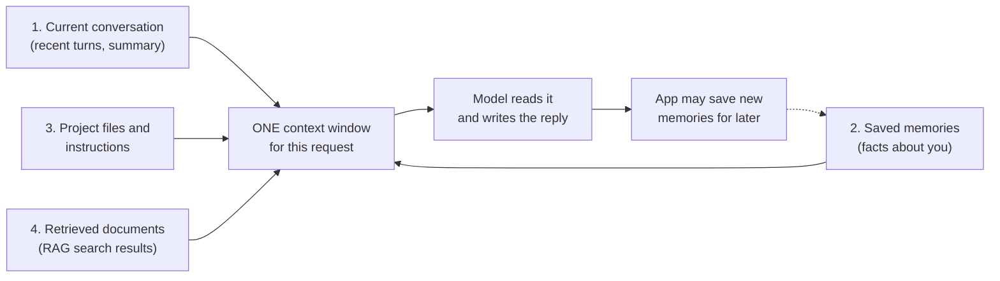
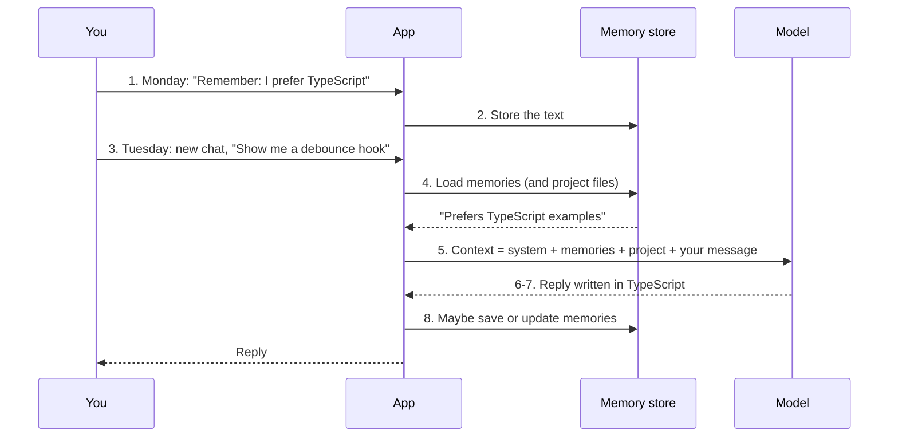
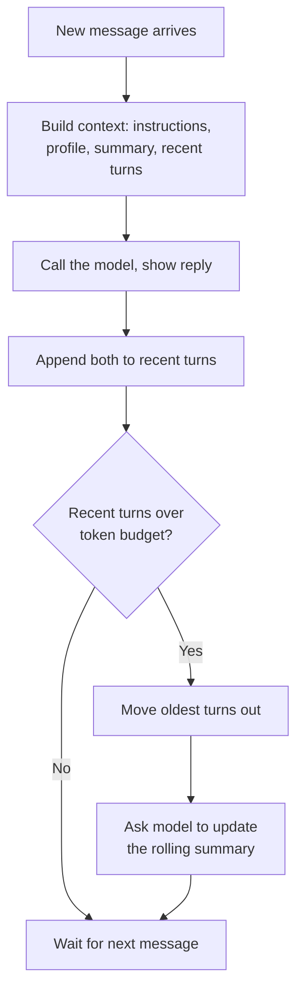

# A1-06 · Memory vs context

> **Lesson A1-06** · Type: Concept · Prerequisites: [A1-03 · Tokens and context windows](./a1-03-tokens-and-context-windows.md) (also uses ideas from A1-02 and A1-04) · Leads to: A2-04, A3-01, A9-01
>
> **Facts checked on:** 14 October 2026, from OpenAI's and Anthropic's own help centres and docs. Memory features change **very often** (names, plans, settings paths); everything about a specific product is marked *may change*. The demo code in section 6 was run on the same day.

**Why this lesson matters:** ChatGPT "remembers" your name, Claude knows your coding style, Cursor follows your project rules. But a brand-new chat sometimes forgets everything you said yesterday. Once you understand that **all "memory" is just text that the app puts back into the context window**, you can predict what an assistant will remember, protect your privacy, and design memory for your own apps.

## Learning goals

By the end of this lesson you will be able to:

1. Name the **four sources** that fill a context window: the current conversation, saved memories, project files and instructions, and retrieved documents (RAG).
2. Explain how **product memory** works in ChatGPT and Claude, and how they differ.
3. **View, edit and delete** memories, and use temporary or incognito chats.
4. Apply a **privacy checklist** for personal and work data.
5. Design memory for **your own chat app**: history, rolling summaries, user profiles, vector memory.
6. Answer the four lesson questions (section 7).
7. **Done when:** you can draw where memory, conversation history and project files enter the context window (section 10).

---

## 1. The topic in one minute

- **Context** = everything the model can see **in this one request** (A1-03). Nothing else exists for the model.
- **Memory** = information an **app** saves somewhere (a database, a file) and **puts back into the context** of later requests or new chats.
- The model itself **does not learn or change** from your chats (A1-04: inference doesn't change the weights). "Memory" is always the app re-sending stored text.
- A context window is filled from **four sources**: (1) the current conversation, (2) saved memories across chats, (3) project files and instructions, (4) documents retrieved for this question (RAG).

**One-line memory trick:** *memory is a note the app keeps; context is the page the model reads right now.*

**Analogy: a doctor with a patient file.** The doctor (the model) doesn't remember you from last year. Before your appointment, the receptionist (the app) pulls your **file** (saved memories), clips today's **notes** (current conversation), adds the clinic's **guidelines** (project instructions) and maybe a **lab report** relevant to today's problem (retrieved documents), and puts it all on the desk. The doctor reads the desk and responds. If the receptionist forgets to pull the file, the doctor "forgets" you.

**Real-life example:** you told ChatGPT last week "I prefer TypeScript examples". If that was saved as a memory, today's new chat gets TypeScript examples. If it wasn't saved, and the app doesn't reference that old chat, the new chat starts blank, even though the old chat is still in your sidebar.

---

## 2. Detailed definitions and why they matter

### 2.1 Context vs memory

| | Context (context window) | Memory |
|---|---|---|
| **What** | All the tokens in one request: instructions, history, files, your message, the answer | Stored text (facts, summaries, notes) kept **outside** the model |
| **Lives in** | The request being processed right now | A database, file or account setting owned by the app |
| **Lifetime** | One request | Until you or the app edit or delete it |
| **Who decides** | The app assembles it for every request | The app (sometimes the model suggests what to save) |
| **How the model "uses" it** | Reads it directly | Only after the app copies it **into** the context |

**Definition of memory (for AI assistants):** information an application stores across conversations and re-inserts into the context window so the model can use it later.

**One-line meaning:** memory = saved text + "paste it back in" logic.

### 2.2 The four sources of context

1. **The current conversation:** all earlier messages in this chat, re-sent every turn (A1-03). Long chats may be **trimmed or summarised** by the app.
2. **Saved memories across chats:** facts and preferences the app stored about you ("prefers TypeScript", "works at a fintech company"). Also custom instructions you typed in settings.
3. **Project files and instructions:** documents and instructions attached to a **project** (ChatGPT Projects, Claude Projects) or a repo (`CLAUDE.md` in Claude Code, rules files in coding tools). They apply to every chat in that project.
4. **Retrieved documents (RAG):** text found by **searching** a knowledge base for *this* question, like searching your uploaded docs, the web, or even your past chats. RAG (retrieval-augmented generation) gets its own lessons later.

**Diagram: four sources flowing into one context window**



**How to read this diagram:** for every single request, the app collects text from the four boxes on the left and packs it into one context window (together with your new message and room for the answer). The model only ever sees that window. After the reply, the app may store something new as a memory (the dotted arrow), which feeds box 2 next time. **There is no arrow into the model itself**: nothing is written into the model's weights.

### 2.3 How product memory works

All major assistants use the same basic idea (store text → add it to future contexts), but the details differ a lot. Common building blocks:

- **Explicit saved facts:** you say "remember that I use pnpm", the app stores it.
- **Automatic memories:** the app decides something is worth keeping and saves it.
- **Summaries of past chats:** the app writes a short profile or summary from your history.
- **Searching past chats:** the app retrieves relevant old conversations when needed (this is RAG over your chat history).
- **Project-scoped memory:** memory kept separately per project, so client A's details don't leak into client B's chats.

### 2.4 Two tools compared: ChatGPT vs Claude

> **Checked on 14 October 2026** from OpenAI's [Memory FAQ](https://help.openai.com/en/articles/8590148-memory-faq), [Projects in ChatGPT](https://help.openai.com/en/articles/10169521-projects-in-chatgpt) and [Temporary Chat FAQ](https://help.openai.com/en/articles/8914046), and Anthropic's [chat search and memory](https://support.claude.com/en/articles/11817273) and [projects](https://support.claude.com/en/articles/9517075-what-are-projects) articles. Settings paths and plan availability **may change**.

| Feature | ChatGPT (OpenAI) | Claude (Anthropic) |
|---|---|---|
| **Main memory types** | **Saved memories** (details you ask it to remember, or it saves as useful) and **Reference chat history** (draws on relevant past chats) | **Memory**: a summary of key insights from your non-project chats, **updated every 24 hours**; plus **chat search** that looks up past chats when you ask |
| **How it reaches the model** | Saved memories and relevant past-chat information are referenced in new chats | The memory summary is **provided as context for every new standalone chat**; chat search pulls past context only when you ask (shown as a tool call, using RAG) |
| **Where to view and edit** | Settings › Personalization › Memory (memory summary; edit, delete; ask "what do you remember?") | Settings › Capabilities › **View and edit memory**; or tell Claude in a chat what to remember |
| **Turn off / reset** | Turn Memory off, or "Delete and turn off memory"; turning off chat-history reference schedules derived info for deletion within 30 days | **Pause** (keeps memory, stops using it) or **Reset** (permanently deletes all memory, including project memories) |
| **Projects** | Project instructions override your custom instructions inside the project; memory is **default** or **project-only** (project-only: saved memories aren't used, and chats can't reach outside the project) | Each project has its **own memory space and summary**, separate from other projects; chat search inside a project stays in that project |
| **Project files** | Free 5, Go/Plus 25, Pro/Business/Enterprise/Edu 40 files per project | Knowledge files used as context; on paid plans it switches to **RAG mode** near the context limit (up to 10x capacity, per Anthropic) |
| **No-memory chats** | **Temporary Chat**: not in history, doesn't create or update memories, not used for training; a copy may be kept up to 30 days for safety | **Incognito chat** (ghost icon): not saved to history, not added to memory, not searched later |
| **Deleting chats** | Deleting a chat does **not necessarily** delete a memory saved from it; delete the saved memory too (logs of deleted memories may be kept up to 30 days) | Deleted conversations are removed from memory; updates can take up to 24 hours |
| **Plans** | Controls vary by plan, region and workspace (no simple per-plan list on the FAQ) | Memory and incognito on all plans including free; chat search on paid plans |
| **Training on your data** | Personal accounts: may be used for model improvement while "Improve the model for everyone" is on (Data controls); Business/Enterprise/Edu don't train by default | Consumer Free/Pro/Max: you choose in Privacy Settings (announced August 2025; 5-year retention if you allow training, 30 days if not); Team, Enterprise and API are excluded |

**Key differences to remember:**

- ChatGPT keeps **individual saved memories** (things you ask it to remember, or that it saves as useful); Claude's memory is a **summary refreshed every 24 hours**, so a fact may not appear in a new chat until the next day *(as described on 14 October 2026)*.
- Both separate **project memory**, but in different ways: ChatGPT lets you choose default vs project-only per project; Claude always keeps each project's memory separate.
- Same idea, different behaviour. Never assume one tool's memory rules apply to another.

**Coding tools work the same way, with files.** Claude Code's docs explain that each session starts with a fresh context window, and two mechanisms carry knowledge across sessions: **`CLAUDE.md`** files you write (project, user or local scope) and **auto memory** notes it writes itself; both are loaded at the start of every session. A `CLAUDE.md` is literally a Markdown file pasted into context. Many coding tools use a similar "rules file" approach.

### 2.5 Managing memory

- **View:** check what's stored at least once a month (settings paths in the table above). You can also ask: "What do you remember about me?"
- **Edit:** fix wrong or outdated facts (a wrong memory makes every future answer slightly wrong).
- **Delete:** remove anything sensitive or no longer true. In ChatGPT, also delete the memory itself, not just the chat it came from.
- **Pause or turn off:** for a period when you're working on sensitive things.
- **Temporary / incognito chats:** for one-off sensitive questions you don't want remembered. They still go to the provider's servers, and may be kept for a limited time for safety (ChatGPT: up to 30 days for temporary chats; Claude Enterprise: incognito chats kept at least 30 days).

### 2.6 Privacy checklist

**Never put these into memory, project files or regular chats:**

- [ ] Passwords, API keys, tokens, `.env` contents, private SSH keys
- [ ] Aadhaar, PAN, passport, bank account or card numbers, UPI PINs, OTPs
- [ ] Other people's personal data (customers, colleagues, family) without a clear reason and permission
- [ ] Client data, unreleased financials, confidential code or contracts, unless your employer's approved tool and policy allow it
- [ ] Health, legal or financial details you wouldn't want stored for years

**Before using AI for work:**

- [ ] Check your employer's AI policy: which tools are approved, and what data may go into them
- [ ] Prefer the company workspace (business or enterprise plans) over a personal account for work data; OpenAI says business workspaces don't train on content by default, and Anthropic's consumer training choice doesn't apply to Team, Enterprise or API
- [ ] Keep client projects in separate projects (ChatGPT project-only memory; Claude projects are separate by default)
- [ ] Don't mix personal memories ("my salary", "my health") into a work account

**Regular hygiene:**

- [ ] Review saved memories monthly; delete anything sensitive or wrong
- [ ] Check your training setting (ChatGPT: Data controls › "Improve the model for everyone"; Claude: Privacy Settings)
- [ ] Use temporary / incognito chats for one-off sensitive questions
- [ ] Remember: deleting a chat may not delete memories made from it (ChatGPT)

### 2.7 Memory in your own apps

If you build a chat feature with an API (A1-02), **you** are the app, so you decide what's remembered. The API itself is stateless.

| Technique | What you store | What goes into context | Good for | Watch out for |
|---|---|---|---|---|
| **Full conversation history** | Every message in a DB | All earlier messages | Short chats | Cost grows every turn (A1-03); eventually overflows |
| **Trimmed history (sliding window)** | Every message | Only the last N messages or tokens | Simple bots | Early facts silently disappear |
| **Rolling summary** | A short summary updated as old turns are dropped | Summary + recent turns | Long chats | Details lost in summarising; summary calls cost tokens |
| **User profile memory** | Key facts per user (JSON row) | The profile, every new chat | Personalisation ("prefers Hindi replies") | Privacy, outdated facts, users must be able to see and delete |
| **Vector memory** | Past messages or notes as embeddings (A4-05) | Only the few most relevant memories for this message | Large histories, "remember that thing from March" | Retrieval can miss or pick the wrong memory |
| **Model-managed memory files** | Files the model writes via a tool | Whatever the model reads back | Long-running agents | Needs strict validation (see below) |

**Model-managed memory example:** Anthropic's API offers a **memory tool** (`memory_20250818`). Claude asks to view, create or edit files under `/memories`, and **your application** executes those operations on storage you control. Anthropic's docs warn that you must validate every path to prevent directory-traversal attacks (like `/memories/../../secrets.env`), cap file sizes and expire old memories.

---

## 3. Words you need first

From A1-02 and A1-03 you know **context window**, **system prompt**, **stateless API** and **token**. New words here:

| Word | Plain meaning |
|---|---|
| **Memory (product memory)** | Text an app stores about you or past chats and adds to future contexts |
| **Saved memory** | A specific fact stored on purpose ("prefers TypeScript") |
| **Memory summary** | A short profile the app writes from your past chats |
| **Custom instructions** | Preferences you type in settings that are added to every chat |
| **Project** | A workspace with its own instructions, files and (often) its own memory |
| **Project-scoped memory** | Memory kept separately per project |
| **Temporary / incognito chat** | A chat that isn't saved to history or memory |
| **RAG (retrieval-augmented generation)** | Searching a store of documents and adding the best matches to the context |
| **Rolling summary** | A summary of older messages that is updated as the chat grows |
| **Vector memory** | Memories stored as embeddings so the most relevant ones can be found by meaning |
| **Embedding** | A list of numbers representing meaning (A1-04, A4-05) |

---

## 4. How it works

### 4.1 Walkthrough: how a saved memory reaches the model

**Scenario:** on Monday you tell an assistant "Remember: I prefer TypeScript examples". On Tuesday you open a **new chat** and ask "Show me a debounce hook".

1. **Monday: you ask it to remember** (or the app decides the fact is useful).
2. **The app stores the text** "Prefers TypeScript examples" in its memory store, linked to your account. The model is unchanged.
3. **Tuesday: you start a new chat.** Its conversation history is empty.
4. **The app loads your memories** (and, if relevant, your project instructions and files).
5. **The app builds the context:** system prompt + memories + project material + any retrieved documents + your new message.
6. **The model reads the context** and sees "prefers TypeScript examples" as plain text, like any other instruction.
7. **The reply uses TypeScript.** It *looks* like the model remembered you.
8. **The app may update memory** afterwards (immediately, or in a later batch, depending on the product).

**Diagram: one saved memory, from Monday to Tuesday**



**How to read this diagram:** time flows downwards and the numbers match the walkthrough. Notice that the model appears only once, at step 5, and it receives **text**. Everything that feels like "remembering" happens in the app and the memory store. If step 4 doesn't happen (memory off, incognito chat, a project with project-only memory), the model has no way to know your preference.

### 4.2 Memory inside your own app: trim + rolling summary

**Diagram: what your app does after every turn**



**How to read this diagram:** every message goes through the top three boxes. Then the app checks whether the raw recent history has grown past a token budget. If it has, the oldest turns are removed from "recent" and folded into the rolling summary (one extra, cheap model call). The context stays roughly the same size no matter how long the chat runs, at the cost of losing exact wording from early turns. The code in section 6 does exactly this.

---

## 5. Real-life examples and developer use cases

| What you notice | What's really happening |
|---|---|
| ChatGPT greets you by name in a new chat | A saved memory (or chat-history reference) was added to the context |
| A new Claude chat doesn't know something you said an hour ago | Claude's memory summary updates every 24 hours; the fact isn't in the summary yet *(as documented on 14 October 2026)* |
| Inside a project, the assistant follows "use formal English" | Project instructions are added to every chat in that project |
| A client name shows up in an unrelated chat | Memory (or chat-history reference) brought it in; use project-only memory or separate projects |
| Cursor or Claude Code follows your repo conventions | A rules file (like `CLAUDE.md`) is loaded into context at session start |
| A long chat "forgets" its first instruction | Not memory at all: the conversation was trimmed or summarised (A1-03) |
| "Search my past chats for the budget we discussed" | RAG over your chat history (Claude shows it as a tool call) |
| Your own support bot remembers a customer's preferred language | You stored it in a user-profile row and add it to the system prompt |

---

## 6. Practical code: a tiny chat with real memory mechanics

**Goal:** a Node.js chat that (1) keeps recent turns under a token budget, (2) folds older turns into a rolling summary, (3) stores explicit "remember:" facts in a file that survives into new chats, and (4) adds toy retrieved documents, printing how many tokens each source puts into the context.

**Prerequisites:** Node.js 20+, then:

```bash
mkdir memory-chat && cd memory-chat
npm init -y
npm install gpt-tokenizer @anthropic-ai/sdk
```

Save as `memory-chat.mjs`:

```js
// memory-chat.mjs: a tiny chat app that "remembers" the way real assistants do.
// Four sources go into every request:
//   1. project instructions   2. saved memories (memory.json, survives new chats)
//   3. conversation: a rolling summary of old turns + the most recent turns (trimmed by a token budget)
//   4. retrieved documents (toy keyword search; real RAG uses embeddings, see A4-05)
// The model: Claude API if ANTHROPIC_API_KEY is set, otherwise a built-in mock (so you can run it free).
// Run: node memory-chat.mjs
// @ts-check
import Anthropic from "@anthropic-ai/sdk";
import { encode } from "gpt-tokenizer/encoding/o200k_base";
import { existsSync, readFileSync, writeFileSync, rmSync } from "node:fs";

const MEMORY_FILE = "memory.json";
const RECENT_BUDGET = 90;          // max tokens of raw recent history (tiny on purpose, to see trimming)
const tokens = (/** @type {string} */ s) => encode(s).length; // estimate with one tokenizer

const PROJECT_INSTRUCTIONS = "You help an Indian developer plan a Next.js side project. Be brief.";
const DOCS = [                      // pretend knowledge base for retrieval
  { id: "pricing.md", text: "Pricing plan: free tier up to 100 invoices a month, Pro at 499 rupees a month." },
  { id: "stack.md", text: "Tech stack: Next.js App Router, PostgreSQL with Prisma, deployed on Vercel." },
  { id: "gst.md", text: "GST rule used in the app: invoices show 18 percent GST split into CGST and SGST." },
];

// ---------- the model layer ----------
const client = process.env.ANTHROPIC_API_KEY ? new Anthropic() : null;
/** @param {string} system @param {{role: "user" | "assistant", content: string}[]} messages */
async function callModel(system, messages) {
  if (client) {
    const res = await client.messages.create({ model: "claude-haiku-5-5", max_tokens: 300, system, messages });
    return res.content.flatMap((b) => (b.type === "text" ? [b.text] : [])).join("");
  }
  // Mock model: summarises by keeping the user's lines; otherwise echoes what it was given.
  const last = messages[messages.length - 1].content;
  if (system.startsWith("SUMMARISE")) {
    const userLines = last.split("\n").filter((l) => l.startsWith("user:")).map((l) => "- " + l.slice(6, 70));
    return userLines.join("\n");
  }
  return `(mock reply to "${last.slice(0, 40)}")`;
}

// ---------- memory stores ----------
const loadMemories = () => (existsSync(MEMORY_FILE) ? JSON.parse(readFileSync(MEMORY_FILE, "utf8")) : []);
const saveMemory = (/** @type {string} */ fact) => writeFileSync(MEMORY_FILE, JSON.stringify([...loadMemories(), fact], null, 2));

function retrieve(/** @type {string} */ question) {           // toy retrieval: shared words
  const words = new Set(question.toLowerCase().match(/[a-z]{4,}/g) ?? []);
  return DOCS.filter((d) => (d.text.toLowerCase().match(/[a-z]{4,}/g) ?? []).some((w) => words.has(w)));
}

// ---------- one chat session ----------
function newChat() {
  /** @type {{role: "user" | "assistant", content: string}[]} */
  let recent = [];
  let summary = "";

  async function trimHistory() {
    const size = () => recent.reduce((n, m) => n + tokens(m.content), 0);
    if (size() <= RECENT_BUDGET) return;
    const old = [];
    while (size() > RECENT_BUDGET && recent.length > 2) old.push(...recent.splice(0, 2)); // oldest user+assistant pair
    const transcript = old.map((m) => `${m.role}: ${m.content}`).join("\n");
    summary = await callModel("SUMMARISE the conversation in short bullet points. Keep facts and decisions.",
      [{ role: "user", content: `Previous summary:\n${summary || "(none)"}\n\nNew turns:\n${transcript}` }]);
    console.log(`   [trimmed ${old.length} old messages into the rolling summary]`);
  }

  /** @param {string} text @param {boolean} [showContext] print exactly what the model receives */
  return async function send(text, showContext = false) {
    if (text.toLowerCase().startsWith("remember:")) saveMemory(text.slice(9).trim()); // explicit "save this"
    const memories = loadMemories();
    const docs = retrieve(text);
    const system = [
      PROJECT_INSTRUCTIONS,
      memories.length ? `Saved memories about the user:\n- ${memories.join("\n- ")}` : "",
      summary ? `Summary of earlier conversation:\n${summary}` : "",
      docs.length ? `Retrieved documents:\n${docs.map((d) => `[${d.id}] ${d.text}`).join("\n")}` : "",
    ].filter(Boolean).join("\n\n");
    const messages = [...recent, { role: /** @type {const} */ ("user"), content: text }];

    const parts = {
      instructions: tokens(PROJECT_INSTRUCTIONS),
      memories: memories.length ? tokens(memories.join("\n")) : 0,
      summary: tokens(summary),
      docs: tokens(docs.map((d) => d.text).join("\n")),
      recent: recent.reduce((n, m) => n + tokens(m.content), 0),
      message: tokens(text),
    };
    const total = Object.values(parts).reduce((a, b) => a + b, 0);
    console.log(`> ${text}`);
    console.log(`   context tokens: ${Object.entries(parts).map(([k, v]) => `${k} ${v}`).join(" | ")} | total ~${total}`);

    if (showContext) console.log(`   --- what the model receives ---\n   SYSTEM: ${system.replaceAll("\n", "\n   ")}\n` +
      messages.map((m) => `   ${m.role.toUpperCase()}: ${m.content}`).join("\n") + "\n   ---");
    const reply = await callModel(system, messages);
    console.log(`   ${reply}`);
    recent.push({ role: "user", content: text }, { role: "assistant", content: reply });
    await trimHistory();
  };
}

// ---------- demo script ----------
if (existsSync(MEMORY_FILE)) rmSync(MEMORY_FILE);   // start clean for the demo
console.log("=== Chat 1 ===");
let send = newChat();
await send("Hi, I'm Priya. I'm building a GST invoice app for small shops.");
await send("remember: Priya prefers TypeScript and Tailwind.");
await send("Which database should I use with my stack?");
await send("Let's keep the free tier small. What is our pricing plan?");
await send("Can you draft three feature names for the dashboard?", true);

console.log("\n=== Chat 2 (brand-new chat, next day) ===");
send = newChat();
await send("What styling library do I like, and what was my app about?", true);
```

Run it (no API key needed; it uses the built-in mock model):

```bash
node memory-chat.mjs
```

**Real output** (run on 14 October 2026 with the **mock model**; token counts are real `o200k_base` counts):

```text
=== Chat 1 ===
> Hi, I'm Priya. I'm building a GST invoice app for small shops.
   context tokens: instructions 15 | memories 0 | summary 0 | docs 0 | recent 0 | message 16 | total ~31
   (mock reply to "Hi, I'm Priya. I'm building a GST invoic")
> remember: Priya prefers TypeScript and Tailwind.
   context tokens: instructions 15 | memories 9 | summary 0 | docs 0 | recent 33 | message 11 | total ~68
   (mock reply to "remember: Priya prefers TypeScript and T")
> Which database should I use with my stack?
   context tokens: instructions 15 | memories 9 | summary 0 | docs 19 | recent 58 | message 9 | total ~110
   (mock reply to "Which database should I use with my stac")
> Let's keep the free tier small. What is our pricing plan?
   context tokens: instructions 15 | memories 9 | summary 0 | docs 22 | recent 81 | message 13 | total ~140
   (mock reply to "Let's keep the free tier small. What is ")
   [trimmed 2 old messages into the rolling summary]
> Can you draft three feature names for the dashboard?
   context tokens: instructions 15 | memories 9 | summary 17 | docs 0 | recent 75 | message 10 | total ~126
   --- what the model receives ---
   SYSTEM: You help an Indian developer plan a Next.js side project. Be brief.
   
   Saved memories about the user:
   - Priya prefers TypeScript and Tailwind.
   
   Summary of earlier conversation:
   - Hi, I'm Priya. I'm building a GST invoice app for small shops.
   USER: remember: Priya prefers TypeScript and Tailwind.
   ASSISTANT: (mock reply to "remember: Priya prefers TypeScript and T")
   USER: Which database should I use with my stack?
   ASSISTANT: (mock reply to "Which database should I use with my stac")
   USER: Let's keep the free tier small. What is our pricing plan?
   ASSISTANT: (mock reply to "Let's keep the free tier small. What is ")
   USER: Can you draft three feature names for the dashboard?
   ---
   (mock reply to "Can you draft three feature names for th")
   [trimmed 2 old messages into the rolling summary]

=== Chat 2 (brand-new chat, next day) ===
> What styling library do I like, and what was my app about?
   context tokens: instructions 15 | memories 9 | summary 0 | docs 0 | recent 0 | message 14 | total ~38
   --- what the model receives ---
   SYSTEM: You help an Indian developer plan a Next.js side project. Be brief.
   
   Saved memories about the user:
   - Priya prefers TypeScript and Tailwind.
   USER: What styling library do I like, and what was my app about?
   ---
   (mock reply to "What styling library do I like, and what")
```

**How this was checked:** with no API key, the script ran end to end using its mock model, so the replies and the summary text are mock (the mock "summary" simply keeps the user's lines). The **memory mechanics are real**: token budgeting, trimming, the summary slot, the memory file, retrieval and context assembly. The real-API path passed `tsc --checkJs` against `@anthropic-ai/sdk` 0.133.0, and with an invalid key the request reached `api.anthropic.com` and returned `401 authentication_error`. Set `ANTHROPIC_API_KEY` to get real replies and real summaries.

**What to notice in the output:**

1. **Turn 2:** "remember:" saved a fact; from then on, `memories 9` tokens appear in every context.
2. **Turns 3 and 4:** the toy retrieval added `stack.md` and `pricing.md` (`docs 19` and `docs 22`), only when the question matched.
3. **Turn 4:** recent history crossed the 90-token budget, so the oldest pair was folded into the summary; turn 5 shows `summary 17` and the full context the model receives.
4. **Chat 2:** a brand-new chat has `recent 0` and `summary 0`. The model receives only the instructions, the **saved memory** and the question. It can know Priya likes **Tailwind** (saved memory), but it has **no way** to know her app is about **GST invoices**: that fact lived only in Chat 1's history and summary.

---

## 7. The four lesson questions, answered

### Q1. Why does a brand-new chat "forget" what you said yesterday?

Because every request is built from scratch (the API is stateless, A1-02), and a new chat starts with an **empty conversation history**. The model never stored yesterday's chat inside itself. Yesterday's words come back only if the app copies them in: as a saved memory, a memory summary, a chat-history reference, a project file, or a search over past chats. If that feature is off, not yet updated (Claude's summary refreshes every 24 hours), or the fact was never saved, the new chat "forgets". In our demo, Chat 2 knew "Tailwind" (saved) but not "GST invoice app" (only in Chat 1's history).

### Q2. How does a saved memory actually reach the model?

As **ordinary text in the context window**. The app stores the memory (in its database), and when you start a chat it loads the relevant memories and inserts them into the context, usually near the system prompt, before your message. Claude's help centre says its memory summary is provided as context for every new standalone chat; OpenAI's FAQ describes saved memories and chat history being referenced in new chats. The model reads that text exactly like your instructions; it has no separate "memory organ".

### Q3. How is memory different from RAG?

| | Memory | RAG |
|---|---|---|
| **Purpose** | Continuity about **you** and past interactions | Facts from a **knowledge source** relevant to this question |
| **Typical content** | Preferences, role, ongoing projects, decisions | Document chunks, policies, code, web pages |
| **Size** | Small, curated | Can be huge (thousands of documents) |
| **When added** | Usually every new chat (summary/profile) | Per question, only the best-matching chunks |
| **Written by** | The app (often automatically) or you | Usually not changed by chatting; you upload or index documents |

They overlap: **searching past chats** is RAG applied to your history, and **vector memory** in your own app uses RAG techniques for memories. A simple rule: memory answers "who is this user and what did we decide?"; RAG answers "what do the documents say about this question?".

### Q4. How would you add memory to your own chat app?

1. **Store conversation history** per chat in your database (the API won't).
2. **Send recent turns** within a token budget; **summarise older turns** into a rolling summary (section 6).
3. **Keep a user profile:** a few explicit facts per user (from a "remember this" action or a settings form), added to the system prompt of every new chat.
4. **For large histories, add vector memory:** embed past notes and retrieve only the most relevant ones per message (A4-05).
5. **Give users control:** a page to view, edit and delete memories, and an option for chats that aren't saved.
6. **Protect data:** don't store secrets, encrypt sensitive rows, set retention limits, and (for model-managed memory files) validate every path.

---

## 8. Memory vs context vs RAG

| | **Context (window)** | **Memory** | **RAG** |
|---|---|---|---|
| **One-line meaning** | What the model sees in this request | Saved notes the app re-adds later | Search results added for this question |
| **Lives where** | Inside one request | App's database or files | A document store or search index |
| **Lasts how long** | One request | Until edited or deleted | As long as the documents are indexed |
| **Content** | Everything: instructions, history, files, memories, retrieved text, your message | Facts about the user and past work | Relevant chunks from documents, web or past chats |
| **Who fills it** | The app, for every request | The app (or the model via a tool), sometimes you | A retrieval step, using keywords or embeddings |
| **Example** | This chat's last 20 messages + system prompt | "Priya prefers TypeScript and Tailwind" | `pricing.md`: "Pro at 499 rupees a month" |
| **Limited by** | The context window size (A1-03) | Product rules, storage, privacy settings | Search quality, chunk size, window space |
| **Fails how** | Overflow, trimming, lost in the middle | Outdated or wrong facts, privacy leaks | Retrieves the wrong chunk or misses the right one |

**Other confusing pairs:**

| Often confused | The real difference |
|---|---|
| **Memory vs training** | Memory is stored text re-added to context; training changes the model's weights (and only happens offline, A1-04) |
| **Chat history vs memory** | History is this chat's messages; memory carries information **across** chats |
| **Custom instructions vs memory** | Instructions you write in settings vs facts the app saves or summarises |
| **Project files vs RAG** | Project files may be added in full; when they're too big, tools switch to retrieving parts (Claude's RAG mode for projects) |
| **Temporary chat vs private** | Not saved to your history/memory, but still processed by the provider and possibly kept for a limited time |

---

## 9. Benefits, limitations, common mistakes and safety

### 9.1 Common mistakes and wrong mental models

**Wrong mental model 1: "The model learns from my chats in real time."**
- **Correction:** memory is **stored text added back into context**, not live retraining. The model's weights don't change while you chat. If a provider ever uses your chats for training, that is a separate, slow, offline process controlled by your privacy settings, and it doesn't make the model "remember you".
- **Why it matters:** if you delete or edit a memory, the next chat changes immediately (or after the product's update cycle). Nothing is "burnt into" the model.

**Mistake 2: putting secrets or client data into memory.**
- Memories are re-sent with every new chat and may be kept for a long time. Keep passwords, ID numbers and client data out (checklist in section 2.6).

**Mistake 3: assuming every tool's memory works the same way.**
- ChatGPT saves individual memories and can reference chat history; Claude uses a summary refreshed every 24 hours plus on-request chat search; project memory rules differ; coding tools use files. Check each tool's docs.

**Mistake 4: "Deleting the chat deletes the memory."** Not necessarily in ChatGPT: delete the saved memory too.

**Mistake 5: "A long chat forgetting things is a memory problem."** Usually it's context trimming or summarisation (A1-03). Start a new chat, or put key facts in project instructions.

**Mistake 6: "Incognito means nobody can see it."** It means not saved to your history or memory. The provider still processes it and may keep it for a limited time for safety.

### 9.2 Benefits and limitations of memory

| Benefits | Limitations |
|---|---|
| Less repeating yourself; answers fit your style | Can store wrong or outdated facts that quietly affect every answer |
| Projects keep different work separate | Behaviour differs across tools and changes often |
| Long chats can continue via summaries | Summaries lose detail; memories use context tokens on every request |
| Personalised apps feel smarter | Privacy and compliance risks; users need view/edit/delete controls |

### 9.3 When memory is NOT useful

- One-off tasks, sensitive topics, or shared/demo accounts (use temporary or incognito chats).
- Strict, repeatable outputs (tests, evaluations) where hidden memories would change results; turn memory off or use the API.
- Work for different clients in the same account without project separation.

---

## 10. Hands-on exercises

### Beginner (no code): view, edit and delete memories in two assistants

1. **ChatGPT:** open Settings › Personalization › Memory. Read what's stored. Edit one item (or tell ChatGPT the correction) and delete one item.
2. **Claude:** open Settings › Capabilities › **View and edit memory**. Read the summary, edit one line, and note whether memory is on, paused or off.
3. In each app, ask in a new chat: *"What do you remember about me?"* Compare with what the settings page showed.
4. Open a **Temporary Chat** (ChatGPT) or **incognito chat** (Claude) and ask the same question.

**Expected outcome:** a short list of what each assistant stores, one edited and one deleted entry, and the observation that temporary/incognito chats behave differently.
**How to verify:** start a new normal chat and check that the deleted item no longer appears when you ask what it remembers. In Claude, allow for the documented 24-hour update cycle before concluding.

### Intermediate (tool-based): inside vs outside a project

1. Create a project (ChatGPT or Claude) called "Shop Billing App".
2. Add **instructions**: *"Answer as a senior Next.js developer. Always use TypeScript and Tailwind. Keep answers under 150 words."*
3. Upload one **file**, for example a short `requirements.md` with 5 features of a billing app.
4. Inside the project, ask: *"Which feature should I build first, and why?"*
5. Outside the project (a normal chat), ask the same question.
6. In ChatGPT, try switching the project to **project-only memory** and ask "What do you know about me?" inside the project.

**Expected outcome:** inside the project, the answer refers to your requirements file and follows the TypeScript/Tailwind/150-word rules; outside, it's generic.
**How to verify:** quote one sentence from each answer that proves where the information came from (the file, the instructions, or nowhere). Draw the four-sources diagram for each case and mark which sources were present.

### Developer (optional): a tiny Node.js chat with trimming and a rolling summary

1. Run `memory-chat.mjs` (section 6) with the mock model.
2. Change `RECENT_BUDGET` to 40 and 200 and compare how often trimming happens.
3. Add a "forget:" command that removes a fact from `memory.json`.
4. With an API key, run it against the real model and read the real rolling summary.

**Expected outcome:** you can point to the exact line where each of the four sources enters the context, and show the token count per source.
**How to verify:** in Chat 2, the context printout should include saved memories but **no** recent turns and **no** summary; after "forget:", the memory should disappear from the next context printout.

### "Done when" check

Without looking, draw one context window and show where **memory**, **conversation history** (recent turns and summary) and **project files/instructions** enter it, plus where RAG results go. Then explain why Chat 2 in the demo didn't know about the GST app.

---

## 11. FAQ

**Does ChatGPT or Claude change its model when it remembers me?**
No. The model's weights stay the same. Memory is text the app stores and adds to your future chats.

**Why did my new Claude chat not know what I said this morning?**
Claude's memory summary is updated every 24 hours (per its help centre, checked 14 October 2026), and the summary covers non-project chats. You can ask Claude to search past chats (paid plans) or tell it the fact again.

**Is a project's knowledge the same as memory?**
No. Project files and instructions are material **you** add to a project; memory is what the app learns about you over time. Both end up in the context.

**Do memories use up my context window?**
Yes, a little: every memory, instruction and project file added to a chat takes tokens (in the demo, the saved memory cost 9 tokens on every request). Claude's help centre also suggests keeping project instructions short and turning off unneeded tools to save context.

**Can I use one memory across ChatGPT and Claude?**
Not automatically. They are separate products with separate memory stores. Copy the important facts (role, preferences, stack) into each tool's custom instructions or memory yourself.

**Should my own app save memories automatically?**
Start with explicit, user-visible memory ("Remember this" button or settings page). Automatic memory is powerful but needs careful privacy design and a way for users to see and delete what you store.

**Is RAG a kind of memory?**
It's a retrieval technique. You can use it for memory (vector memory, searching past chats) or for knowledge (documents). The difference is what you store and why.

---

## 12. Mini glossary

| Term | Meaning |
|---|---|
| **Context window** | Everything the model sees in one request |
| **Memory** | Stored information an app adds back into later contexts |
| **Saved memory** | A specific stored fact |
| **Memory summary** | An app-written summary of you and your past chats |
| **Reference chat history** | ChatGPT feature that draws on relevant past chats |
| **Chat search** | Claude feature that searches past chats on request (uses RAG) |
| **Custom instructions** | Standing preferences you set in settings |
| **Project** | Workspace with its own instructions, files and memory scope |
| **Project-only memory** | ChatGPT option that keeps a project's memory separate from everything else |
| **Temporary chat / incognito chat** | Chats not saved to history or memory |
| **RAG** | Retrieving relevant documents and adding them to the context |
| **Conversation history** | The messages of the current chat, re-sent every turn |
| **Sliding window** | Keeping only the most recent messages |
| **Rolling summary** | A summary of older messages, updated as the chat grows |
| **User profile memory** | Key facts per user stored by your app |
| **Vector memory** | Memories stored as embeddings and retrieved by meaning |
| **Memory tool** | Anthropic API tool where Claude manages memory files that your app stores |
| **`CLAUDE.md`** | Instruction file Claude Code loads into context at the start of every session |
| **Path traversal** | An attack using `../` to reach files outside an allowed folder |

---

## 13. Quiz

1. True or false: "When ChatGPT remembers my name, it has updated its model with my data."
2. Name the four sources that can fill a context window.
3. You start a new chat and the assistant doesn't know what you said yesterday. Give two possible reasons.
4. How does a saved memory reach the model?
5. In Claude, how often is the memory summary updated, and where do you view it?
6. What does ChatGPT's "project-only" memory change?
7. In the demo, why did Chat 2 know about Tailwind but not about the GST invoice app?
8. Give one difference between memory and RAG.
9. Name three things that should never go into AI memory.
10. In your own app, what does a rolling summary solve, and what does it cost?

---

## 14. Quiz answer key

1. **False.** The app stored your name as text and adds it to new chats; the model's weights don't change.
2. The **current conversation**, **saved memories across chats**, **project files and instructions**, and **retrieved documents (RAG)**.
3. Any two: memory is off or paused; the fact was never saved; Claude's summary hasn't updated yet (24-hour cycle); you're in a temporary/incognito chat; you're in a project with separate (project-only) memory; the tool doesn't reference chat history.
4. As **plain text the app inserts into the context window** (usually near the system prompt) when building the request.
5. **Every 24 hours**; Settings › Capabilities › **View and edit memory** (checked 14 October 2026).
6. Saved memories aren't referenced in that project's chats, and the project's chats can only reference other chats in the same project (and outside chats can't reference them).
7. "Prefers TypeScript and Tailwind" was **saved to memory.json** (re-added to every new chat); "GST invoice app" lived only in **Chat 1's history and summary**, which a new chat doesn't get.
8. Any one: memory is about the user and past interactions, RAG is about documents; memory is small and usually added to every chat, RAG adds only the chunks relevant to this question; memory is often written automatically from chats, RAG sources are usually uploaded or indexed.
9. Any three: passwords, API keys or tokens; ID numbers (Aadhaar, PAN, passport); bank or card numbers, OTPs; client confidential data; other people's personal data; sensitive health or legal details.
10. It keeps the context **small and bounded** in long chats while preserving the gist of early turns; it **costs** extra model calls (tokens) and **loses exact details** from the old turns.

---

## 15. Quick revision (cheat sheet)

```
CONTEXT = what the model sees in ONE request
MEMORY  = text the APP stores and pastes back into later requests
RAG     = search results added for THIS question

One context window  <-  1. current conversation (recent turns + summary)
                    <-  2. saved memories / memory summary / custom instructions
                    <-  3. project files and instructions (CLAUDE.md, rules)
                    <-  4. retrieved documents (RAG)
The model's weights never change while you chat.
```

- **ChatGPT:** saved memories + reference chat history; Settings › Personalization › Memory; Temporary Chat; projects can be project-only.
- **Claude:** memory summary updated every 24 hours, added to every new standalone chat; chat search on paid plans; Settings › Capabilities; incognito chats; each project has its own memory.
- **New chat forgets** = empty history; only what the app re-adds is there.
- **Own app:** history in DB → recent turns under a budget → rolling summary → user profile → vector memory for big histories → user controls.
- **Privacy:** no secrets, IDs, client data; use the company workspace for work; review memories monthly; temporary/incognito for one-offs.

---

## 16. Completion checklist and next step

- [ ] I can name the four sources of context and draw them flowing into one window.
- [ ] I can explain why a new chat forgets, and how a saved memory reaches the model.
- [ ] I can explain the differences between ChatGPT's and Claude's memory.
- [ ] I viewed, edited and deleted a memory in two assistants.
- [ ] I compared answers inside and outside a project.
- [ ] I applied the privacy checklist to my own accounts.
- [ ] (Optional) I ran the memory chat demo and changed the budget.
- [ ] **Done when:** I can draw where memory, conversation history and project files enter the context window.

**Before A2-04, A3-01 and A9-01** (the next lessons this card leads to in your roadmap), make sure you are comfortable with:

- Assembling a context from several sources and counting its tokens.
- The difference between memory (about the user) and retrieval (about documents).
- Storing conversation state in your own app, since the API won't do it for you.

---

## 17. Learn-in-public content ideas

Post after doing the exercises yourself, using your own screenshots (blur anything personal).

1. **LinkedIn / X post: "AI memory vs conversation context — what is actually remembered."**
   Structure: hook ("ChatGPT doesn't learn from your chats. Here's what actually happens."), the four-sources diagram, the doctor-and-patient-file analogy, one difference between ChatGPT and Claude memory (with the date you checked), and the privacy checklist's top 3 items.

2. **Instagram carousel: "I checked what two AI assistants remember about me."**
   Slides: where to find memory settings in each app, what you found (redacted), what you edited or deleted, and temporary vs incognito chats.

3. **X thread or short demo video: "I built a 113-line Node.js chat with memory."**
   Show the context printout from section 6: the token cost of each source, the moment trimming kicks in, and Chat 2 knowing your saved preference but not your old chat.

---

## 18. Sources and further reading

All checked on **14 October 2026**. Product features and settings paths change often.

**ChatGPT (OpenAI)**
- Memory FAQ (saved memories, reference chat history, controls, training note): <https://help.openai.com/en/articles/8590148-memory-faq>
- Projects in ChatGPT (project-only memory, file limits): <https://help.openai.com/en/articles/10169521-projects-in-chatgpt>
- Temporary Chat FAQ: <https://help.openai.com/en/articles/8914046>

**Claude (Anthropic)**
- Use Claude's chat search and memory to build on previous context: <https://support.claude.com/en/articles/11817273>
- What are projects? (project knowledge, RAG mode): <https://support.claude.com/en/articles/9517075-what-are-projects>
- Updates to our consumer terms (training choice, retention; 28 August 2025): <https://www.anthropic.com/news/updates-to-our-consumer-terms>
- Claude Code: How Claude remembers your project (`CLAUDE.md`, auto memory): <https://code.claude.com/docs/en/memory>
- Claude API memory tool (client-side memory files, path traversal warning): <https://platform.claude.com/docs/en/agents-and-tools/tool-use/memory-tool>
- Claude API context windows (compaction, context editing): <https://platform.claude.com/docs/en/build-with-claude/context-windows>
- Claude Help, usage and length limits (keep instructions short, turn off unneeded tools): <https://support.claude.com/en/articles/11647753>

**Research (optional advanced reading)**
- Packer et al., *MemGPT: Towards LLMs as Operating Systems* (2023), on managing memory beyond the context window: <https://arxiv.org/abs/2310.08560>

**Code used in the demo**
- `gpt-tokenizer` (token counts): <https://www.npmjs.com/package/gpt-tokenizer>
- `@anthropic-ai/sdk` (TypeScript SDK): <https://www.npmjs.com/package/@anthropic-ai/sdk>
