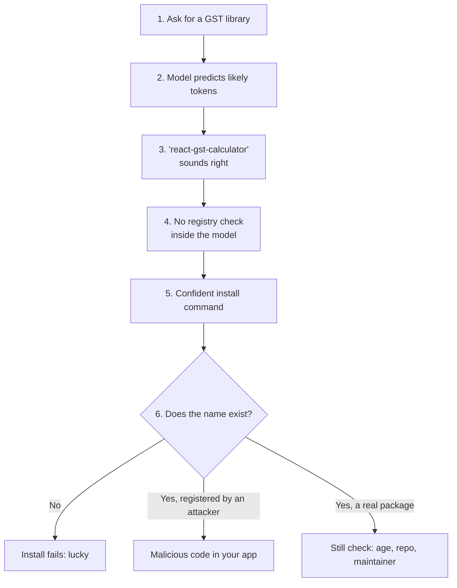
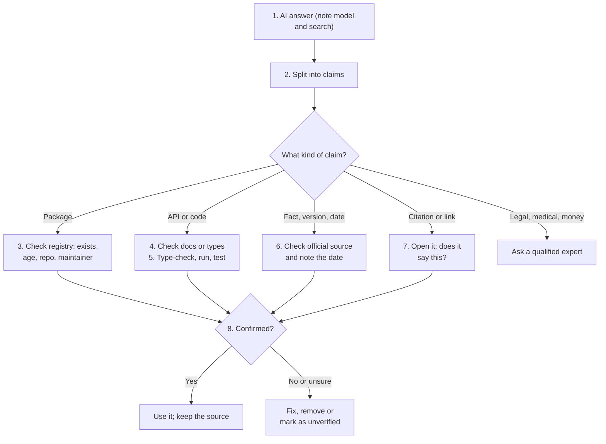

# A1-07 · Hallucinations and model limitations

> **Lesson A1-07** · Type: Concept · Prerequisites: [A1-04 · How an LLM generates text](./a1-04-how-an-llm-generates-text.md) (also uses A1-03, A1-05 and A1-06) · Leads to: A2-06, A5-08
>
> **Facts checked on:** 18 October 2026. Every example in the hallucination table is a **real, documented case** with a source in section 18. The two scripts in section 6 were run on the same day against the real npm and PyPI registries.

**Why this lesson matters:** AI output ends up in your code, your docs and your LinkedIn posts. Once it's published under your name, its mistakes are **your** mistakes. Lawyers have been fined, an airline was ordered to pay, and attackers now register package names that AI models invent. Knowing *how* models fail, and having a quick way to check them, is what makes you trustworthy as an engineer and as a creator.

## Learning goals

By the end of this lesson you will be able to:

1. Explain what a **hallucination** is and **why** it happens, using the generation loop from A1-04.
2. Recognise the main **types**: invented facts, fake citations, made-up packages and APIs, wrong reasoning, outdated knowledge.
3. Explain the **knowledge cut-off** and what a **web search tool** changes (and doesn't).
4. Use a **verification flowchart** and a personal checklist to check AI output quickly.
5. Know the other **limitations**: privacy, latency, cost, bias, safety refusals, non-determinism.
6. Know **when not to use AI**: exact calculations, and legal, medical or financial decisions without an expert.
7. **Done when:** you have a short personal verification checklist and use it every time (section 10).

---

## 1. The topic in one minute

- A **hallucination** is output that **sounds right but is false**: an invented fact, a fake citation, a package that doesn't exist.
- It happens because an LLM **predicts likely text**, token by token. It has no built-in step that checks facts (A1-04). Fluent and true are different things.
- Common types: **invented facts**, **fake citations**, **made-up packages and APIs**, **wrong reasoning**, **outdated knowledge**.
- You reduce it with **grounding** (give it real sources), **tools** (search, code execution), **citations you actually open**, and **verification steps**. You never get it to zero.

**One-line memory trick:** *an LLM is a brilliant writer, not a fact-checker.*

**Analogy: the confident uncle at a wedding.** Ask him the way to a hotel in a city he visited once. He won't say "I'm not sure". He'll give you directions in a confident voice, with landmarks, and some of them will be wrong. He isn't lying; he's filling gaps with what *sounds* right. You'd still check Google Maps. Treat AI output the same way.

**Real-life example:** in June 2023, a US federal judge fined two lawyers and their firm **$5,000** in *Mata v. Avianca*: they had filed a brief citing court cases that **didn't exist**, generated with ChatGPT, and kept standing by them after the court questioned them.

---

## 2. Detailed definitions and why they matter

### 2.1 What a hallucination is, and why it happens

**Definition:** a hallucination is model output that is **fluent and plausible but false or unsupported**: it states something that isn't true, isn't in the given sources, or doesn't exist.

**One-line meaning:** confident text with nothing true underneath.

**Why it happens (connecting to A1-04):**

1. **The model predicts likely tokens.** "Likely" is about patterns in training text, not about truth. Grammar and style are very regular, so the model writes fluently even when the facts are missing.
2. **Rare facts can't be learned from patterns.** OpenAI's September 2025 research on hallucinations explains that arbitrary, rarely-seen facts (like a specific person's birthday) can't be predicted from patterns alone.
3. **Training and tests reward guessing.** The same OpenAI research argues that common training and evaluation methods reward guessing over saying "I don't know", because a lucky guess scores better than an honest "not sure".
4. **There's no fact-check in the loop.** Once a wrong token is picked, every later token is chosen to fit it fluently (A1-04, A1-05).
5. **"I recognise this" can misfire.** Anthropic's interpretability research (March 2025) found that Claude's default is to say it doesn't know, and a "known entity" signal overrides that. When the signal fires for something only *partly* familiar, the model answers confidently anyway.

You saw this live in A1-04: a tiny model asked for the capital of France fluently answered "a big and beautiful place". "Paris" wasn't even in its top 200 guesses.

### 2.2 Types of hallucinations, with real examples

| Type | What it looks like | Real, documented example | How to catch it |
|---|---|---|---|
| **Invented facts** | A wrong fact stated confidently | **Google Bard, February 2023:** its launch ad claimed the James Webb Space Telescope took the first pictures of a planet outside our solar system. False: the European Southern Observatory's Very Large Telescope did, in 2004. Alphabet lost about $100 billion in market value that week. | Check one primary source (NASA, official docs) |
| **Fake citations** | Real-looking references to cases, papers or URLs that don't exist | ***Mata v. Avianca*, June 2023:** lawyers filed a brief with nonexistent judicial opinions and fake quotes generated with ChatGPT; the judge fined them $5,000. A 2024 Stanford study found legal hallucination rates of **58% (GPT-4) to 88% (Llama 2)** on specific questions about real federal cases. | **Open every citation** and confirm it says what the AI claims |
| **Made-up packages** | `npm install` or `pip install` of a package that doesn't exist | **2024 study (Spracklen and others):** 576,000 code samples from 16 models; at least **5.2%** of recommended packages were hallucinated for commercial models and **21.7%** for open-source models, with **205,474** unique fake names. A researcher (Bar Lanyado, Lasso Security) registered a harmless package under an AI-invented name, `huggingface-cli`, and it got about **30,000 downloads** in three months. | Check the registry before installing (script in section 6.1) |
| **Made-up APIs** | Functions, options or endpoints that don't exist in a real library | **2024 Amazon study (Jain and others):** GPT-4o produced valid calls for only about **38.6%** of rarely used APIs; adding documentation helped. | Check the official docs or TypeScript types; run it |
| **Wrong reasoning** | Steps that look logical but reach a wrong answer | **Apple's GSM-Symbolic study (October 2024):** adding one irrelevant-but-plausible sentence to a maths word problem cut accuracy by **up to 65%** across the models tested. | Recompute in code; check each step |
| **Outdated knowledge** | Correct once, wrong now | **Claude API changes:** prefilling the assistant's reply returns a 400 error on Claude 4.6 and later, and non-default `temperature` is rejected on models released after Opus 4.6 (A1-05). Code written from older examples breaks. | Check the current docs and changelog, with the date |
| **Invented policies** (business chatbots) | A bot states rules your company never made | ***Moffatt v. Air Canada*, February 2024:** the airline's chatbot told a grieving passenger he could book now and apply for a reduced bereavement fare within 90 days of the ticket being issued, which contradicted the airline's real policy. A Canadian tribunal ordered Air Canada to pay about **CAD 650**, rejecting its argument that the chatbot was a separate legal entity. | Ground the bot in the real policy text; test it; add human review |

### 2.3 Knowledge cut-off vs web access

**Definition:** a **knowledge cut-off** is the date after which a model's training data stops. The model knows nothing about later events unless the app gives it new information in the context.

**One-line meaning:** the date the model's "newspaper subscription" ended.

**Examples** *(from the providers' model pages, checked October 2026; may change)*: Anthropic lists a reliable knowledge cut-off of **June 2026** for its current models (Opus 5.5, Sonnet 5.5, Haiku 5.5); OpenAI lists **30 April 2026** for `gpt-6.1-sol`. Google's Gemini 3.8 Flash page didn't state one when I checked.

**What web search changes:**

- The model can only search when the **app gives it a search tool** (A1-04). Anthropic's docs describe it: you add the web search tool to the request, Claude decides when to search, the API runs the searches, and the reply includes **citations**.
- Search results are added to the **context** (A1-06): that's RAG with the web as the source.

**What web search does NOT fix:**

- **Bad sources:** the search can return outdated blogs, SEO spam or wrong answers.
- **Misreading:** the model can still misquote or over-summarise what a page says.
- **Citation drift:** a citation can be real but not actually support the sentence next to it.
- **No search triggered:** the model may answer from memory without searching. Check whether the answer has citations at all.

### 2.4 Reducing hallucinations (deep dive in A2-06)

Anthropic's "Reduce hallucinations" guide lists practical techniques; they work with any model:

| Technique | What you do | Why it helps |
|---|---|---|
| **Allow "I don't know"** | Say: "If the documents don't contain the answer, say so" | Removes the pressure to guess |
| **Ground in sources** | Give the docs or data; ask it to answer **only** from them | Facts come from text you control, not memory |
| **Quote first** | For long documents, ask for exact quotes first, then the answer | Ties claims to real text |
| **Require citations** | Ask for a source for each claim; remove claims without one | Makes the answer checkable |
| **Use tools** | Web search for recent facts; code execution for maths; your own APIs for live data | Tools give real data instead of guesses |
| **Verify** | Ask it to check its own claims against the sources; run the code; run the prompt several times and compare | Inconsistency across runs is a warning sign |

Anthropic's guide is honest about the limit: these techniques significantly reduce hallucinations but **don't eliminate them**, so critical information still needs validation.

### 2.5 Other limitations

| Limitation | What it means | Real example or number | What to do |
|---|---|---|---|
| **Privacy** | Your prompts and files go to the provider's servers; they may be kept and, on some plans, used for training | ChatGPT personal accounts: may be used for model improvement while "Improve the model for everyone" is on; Anthropic consumer plans: 5-year retention if you allow training, 30 days if not (A1-06) | Follow your employer's policy, use work workspaces, never paste secrets (A1-06 checklist) |
| **Latency** | Answers take time: prefill before the first token, then one token per step | In A1-04's measurement, writing each token was about **15x** slower than reading each prompt token; long prompts raise time to first token | Stream, keep prompts short, use smaller models for simple tasks |
| **Cost** | You pay per token; output costs more than input | Output tokens cost about **5x** input on the models in A1-03; Gujarati text needed up to **8.3x** the tokens of English with older tokenizers | Estimate before building (A1-03); trim context; choose the right model |
| **Bias** | Outputs can repeat stereotypes and treat groups unequally | *Indian-BhED* (2023): most tested models produced stereotypical outputs about caste and religion in India; tokenizers make some languages cost more (A1-03) | Test with Indian names, languages and contexts; human review for people-related decisions |
| **Safety refusals** | Models refuse some requests, sometimes harmless ones | *XSTest* (2023): a benchmark of 250 **safe** prompts that look unsafe, built because models wrongly refuse them ("exaggerated safety") | Rephrase with clear context; use the right tool; don't try to trick safety systems |
| **Non-determinism** | The same prompt can give different answers | Sampling and server effects (A1-05); even temperature 0 isn't guaranteed identical | Test several runs; use schemas; don't rely on exact repeats |
| **Context limits** | Only what fits in the window is seen; long contexts degrade | Context rot and "lost in the middle" (A1-03) | Send only what's needed; put key instructions at the start and end |

### 2.6 When not to use AI (or not alone)

**Use plain code instead when the answer must be exact:**

- Tax, GST, EMI, invoice totals, currency, dates and time zones, counting, sorting, searching exact text. An algorithm is **exact, fast, free and repeatable**; an LLM is "probably right" (real demo in section 6.2).

**Don't rely on AI without a qualified expert when:**

- **Legal:** contracts, court filings, compliance (remember *Mata v. Avianca* and the 58-88% legal hallucination rates).
- **Medical:** diagnosis, medicines, dosage.
- **Financial:** investment, tax filing, loans. (AI can help you **prepare questions** and understand terms; a professional decides.)
- **Safety-critical or customer-binding answers:** anything your company is legally bound by (*Moffatt v. Air Canada*).

### 2.7 Newer models: better, not perfect

Hallucinations **shrink, they don't disappear**, and progress isn't even smooth. When OpenAI released o3 and o4-mini in April 2025, its own system card reported **higher** hallucination rates on its PersonQA test (o3: 33%, o4-mini: 48%) than the older o1 (16%); OpenAI said more research was needed to understand why. Every new model needs fresh testing on **your** tasks.

---

## 3. Words you need first

From A1-04 you know the **generation loop**, **training vs inference** and **sampling**; from A1-06 you know **context** and **RAG**. New words here:

| Word | Plain meaning |
|---|---|
| **Hallucination** | Fluent, plausible output that is false or unsupported |
| **Grounding** | Giving the model real sources and asking it to answer from them |
| **Citation** | A reference to the source that supports a claim |
| **Primary source** | The original: official docs, the law itself, the paper, the company's own page |
| **Knowledge cut-off** | The date after which a model's training data stops |
| **Web search tool** | A tool the app gives the model so it can fetch current pages |
| **Slopsquatting** | Attackers registering package names that AI models tend to invent |
| **Supply-chain attack** | Getting malicious code into your app through a dependency you install |
| **Bias** | Systematic unfairness or stereotypes in outputs |
| **Over-refusal** | A model refusing a harmless request because it looks risky |
| **Deterministic** | Always the same output for the same input (like plain code) |

---

## 4. How it works

### 4.1 Why a model invents an npm package

1. **You ask:** "How do I calculate GST in my React app? Use a library."
2. **The model predicts likely tokens.** In its training data, many real packages follow the shape `react-` + topic + `-calculator` or `-helper`.
3. **The pieces fit together fluently:** `react` → `-gst` → `-calculator`. Every token is "likely" given the ones before.
4. **Nothing checks the registry.** The model doesn't look anything up unless it has a tool (A1-04).
5. **The answer looks perfect:** `npm install react-gst-calculator` with a neat usage example.
6. **You install it.** If the name doesn't exist, you get an error (you were lucky). If an attacker has already registered that name (**slopsquatting**), you may install malicious code.

**Diagram: from a plausible name to a supply-chain risk**



**How to read this diagram:** follow the numbers from the top. Steps 2 to 4 are the generation loop: a name is assembled from likely pieces and never checked. Step 6 is where your safety depends on what's actually on npm. The research in section 2.2 found these invented names often **repeat**, which is exactly why attackers can predict and register them.

### 4.2 Walkthrough: checking an AI answer before you ship it

**Scenario:** you ask an assistant how to use a feature from a library release you heard about last month, and it replies with code, a package list, a version number and two links.

1. **Note the setup:** which model, and was web search on? (No citations = probably answered from memory.)
2. **Split the answer into claims:** packages, API names and options, versions and dates, facts, citations.
3. **Packages:** check each one exists on the registry and looks trustworthy (section 6.1).
4. **APIs:** check function names and options against the official docs or the library's TypeScript types (your editor's autocomplete is a quick check).
5. **Run it:** type-check, run the code, run a test.
6. **Facts, versions, dates:** check the official changelog or docs, and note the date you checked.
7. **Citations:** open every link; confirm the page exists **and** says what the AI claims.
8. **Decide:** keep what's confirmed, fix or remove the rest, and record your sources. For legal, medical or money decisions, ask an expert.

**Diagram: the verification flowchart**



**How to read this diagram:** the numbers match the walkthrough. Every claim type has its own quick check, and all of them end at the same question in step 8: did you confirm it from something other than the AI? High-stakes topics skip the DIY checks and go straight to an expert. This flowchart is the starting point for your personal checklist in section 10.

---

## 5. Real-life examples and developer use cases

| Where you use AI | Typical hallucination | Your quick check |
|---|---|---|
| **Copilot / Cursor writing code** | Invented package, wrong option name, outdated API | Registry check, TypeScript errors, run tests |
| **Asking ChatGPT or Claude about a new release** | Old behaviour described as current; invented features | Official changelog and docs, with date |
| **Writing a LinkedIn or X post with AI** | Fake statistic ("73% of developers..."), misattributed quote | Find the original study; if you can't, delete the number |
| **Research summaries** | Fake or mismatched citations | Open every link; check the quoted sentence exists |
| **Customer support bot for your app** | Invented refund or delivery policy (Air Canada) | Ground in the real policy text; refuse when unsure; test |
| **Maths, GST, EMI, dates** | Small arithmetic or rounding errors | Do it in code |
| **Indian context questions** | Wrong local facts, stereotypes, poor Hindi/Gujarati | Test with local examples; human review |

---

## 6. Practical code: two quick verification tools

Both scripts ran on 18 October 2026 with Node.js 22.

### 6.1 Check every package before `npm install`

This reads the `import` lines from a file and checks each package on the **real npm registry** (and optionally PyPI). The example file below was **written by me to look like typical AI output**; it was not generated by a model.

`ai-snippet.tsx`:

```tsx
// A snippet written to LOOK like typical AI output (it was not generated by a model).
// Some imports are real packages; others are plausible names that may or may not exist.
import { z } from "zod";
import { useForm } from "react-hook-form";
import { useQuery } from "@tanstack/react-query";
import { calculateGST } from "react-gst-calculator";
import { OtpProvider } from "next-auth-otp-provider";
import debounce from "lodash/debounce";
```

`check-packages.mjs`:

```js
// check-packages.mjs: before you `npm install` what an AI suggested, check every package is real
// and looks trustworthy. Reads imports from a file, plus optional PyPI names.
// Run: node check-packages.mjs ai-snippet.tsx [--pypi name1,name2]
import { readFileSync } from "node:fs";

const [file, flag, pypiList] = process.argv.slice(2);
const code = readFileSync(file, "utf8");

// 1. Collect package names from import/require statements ("lodash/debounce" -> "lodash")
const specifiers = [...code.matchAll(/(?:from\s+|require\(\s*)["']([^"'.][^"']*)["']/g)].map((m) => m[1]);
const npmNames = [...new Set(specifiers.map((s) => (s.startsWith("@") ? s.split("/").slice(0, 2).join("/") : s.split("/")[0])))];

const daysSince = (iso) => Math.floor((Date.now() - new Date(iso).getTime()) / 86_400_000);

async function checkNpm(name) {
  const res = await fetch(`https://registry.npmjs.org/${name.replace("/", "%2F")}`);
  if (res.status === 404) return { name, verdict: "DOES NOT EXIST", note: "likely hallucinated; do not install a look-alike" };
  const p = await res.json();
  const latest = p["dist-tags"]?.latest;
  const age = daysSince(p.time.created);
  const versions = Object.keys(p.versions ?? {}).length;
  const warnings = [];
  if (age < 90) warnings.push(`only ${age} days old`);
  if (versions < 3) warnings.push(`only ${versions} version(s)`);
  if (!p.repository) warnings.push("no source repository");
  if (p.versions?.[latest]?.deprecated) warnings.push("latest version deprecated");
  return { name, verdict: warnings.length ? "EXISTS, CHECK CAREFULLY" : "exists",
    note: `latest ${latest}, created ${p.time.created.slice(0, 10)}, ${versions} versions${warnings.length ? " | " + warnings.join(", ") : ""}` };
}

async function checkPypi(name) {
  const res = await fetch(`https://pypi.org/pypi/${name}/json`);
  if (res.status === 404) return { name: `pypi:${name}`, verdict: "DOES NOT EXIST", note: "likely hallucinated" };
  const p = await res.json();
  const releases = Object.keys(p.releases ?? {}).length;
  const firstUpload = Object.values(p.releases).flat().map((f) => f.upload_time_iso_8601).sort()[0];
  return { name: `pypi:${name}`, verdict: releases < 3 ? "EXISTS, CHECK CAREFULLY" : "exists",
    note: `latest ${p.info.version}, first upload ${firstUpload?.slice(0, 10) ?? "n/a"}, ${releases} release(s), summary: ${JSON.stringify((p.info.summary ?? "").slice(0, 60))}` };
}

const results = [];
for (const n of npmNames) results.push(await checkNpm(n));
if (flag === "--pypi") for (const n of pypiList.split(",")) results.push(await checkPypi(n));
for (const r of results) console.log(`${r.verdict.padEnd(24)} ${r.name.padEnd(26)} ${r.note}`);
```

Run it:

```bash
node check-packages.mjs ai-snippet.tsx --pypi huggingface-cli,requests
```

**Real output** (live registry data, 18 October 2026):

```text
exists                   zod                        latest 4.6.7, created 2020-03-07, 1013 versions
exists                   react-hook-form            latest 7.90.0, created 2019-03-20, 1101 versions
exists                   @tanstack/react-query      latest 5.104.4, created 2022-07-19, 541 versions
DOES NOT EXIST           react-gst-calculator       likely hallucinated; do not install a look-alike
DOES NOT EXIST           next-auth-otp-provider     likely hallucinated; do not install a look-alike
exists                   lodash                     latest 4.18.1, created 2012-04-23, 117 versions
DOES NOT EXIST           pypi:huggingface-cli       likely hallucinated
exists                   pypi:requests              latest 2.34.2, first upload 2011-02-14, 163 release(s), summary: "Python HTTP for Humans."
```

**What this shows:**

- `react-gst-calculator` and `next-auth-otp-provider` **don't exist** on npm (as of the check). If an AI suggested them, the right move is to find a real, maintained library, **not** to install the closest-sounding name.
- `huggingface-cli` returned **not found** on PyPI when I checked on 18 October 2026. It's the AI-invented name from the 2024 experiment in section 2.2; whatever was registered then isn't on PyPI now. Registries change over time, so always check at install time.
- Real packages pass, with their age and version count. The script also warns about **very new**, **single-version** or **repo-less** packages, typical signs of a squatted name.

**Limits:** "exists" doesn't mean "safe". For anything new to you, also check the repository, maintainers, weekly downloads (on the npm website) and recent issues.

### 6.2 Tasks where plain code beats an LLM

```js
// code-beats-llm.mjs: three tasks where plain code is exact and an LLM is only "probably right".
// npm install gpt-tokenizer
import { encode, decode } from "gpt-tokenizer/encoding/o200k_base";

// 1. Counting letters: the model never sees letters, only tokens
const word = "strawberry";
const pieces = encode(word).map((id) => decode([id]));
console.log(`"${word}" as the model sees it: ${pieces.map((p) => `[${p}]`).join(" ")} (${pieces.length} tokens)`);
console.log(`Letters "r" counted by code: ${[...word].filter((c) => c === "r").length}`);

// 2. Big multiplication: exact with BigInt, while a model predicts digit-chunks as tokens
const a = 987654321987654321n, b = 123456789123456789n;
const product = (a * b).toString();
console.log(`\n${a} x ${b} = ${product}`);
console.log(`The answer is ${product.length} digits; as tokens: ${encode(product).length} chunks like ` +
  encode(product).slice(0, 4).map((id) => `[${decode([id])}]`).join(" ") + " ...");

// 3. GST on an invoice, in paise (integers) so rounding is exact and repeatable
const items = [{ name: "Cotton kurta", pricePaise: 89_900, qty: 2 }, { name: "Steel bottle", pricePaise: 34_950, qty: 3 }];
const subtotal = items.reduce((sum, i) => sum + i.pricePaise * i.qty, 0);
const gst = Math.round(subtotal * 0.18);                        // 18% GST
const cgst = Math.floor(gst / 2), sgst = gst - cgst;            // split into CGST + SGST
const rupees = (p) => `Rs ${(p / 100).toFixed(2)}`;
console.log(`\nSubtotal ${rupees(subtotal)} | CGST ${rupees(cgst)} | SGST ${rupees(sgst)} | Total ${rupees(subtotal + gst)}`);
```

**Real output:**

```text
"strawberry" as the model sees it: [st] [raw] [berry] (3 tokens)
Letters "r" counted by code: 3

987654321987654321 x 123456789123456789 = 121932631356500531347203169112635269
The answer is 36 digits; as tokens: 12 chunks like [121] [932] [631] [356] ...

Subtotal Rs 2846.50 | CGST Rs 256.18 | SGST Rs 256.19 | Total Rs 3358.87
```

**What this shows:**

- The model sees "strawberry" as **3 tokens** (`st`, `raw`, `berry`), not 10 letters, which is why letter-counting questions trip models up. Code counts **3** "r"s exactly.
- A 36-digit product is **12 token-chunks** to a model, each predicted rather than calculated. `BigInt` gets it exactly (I also cross-checked it in Python).
- The GST invoice is computed in **paise** so rounding is exact and repeatable: Rs 2846.50 + CGST Rs 256.18 + SGST Rs 256.19 = **Rs 3358.87**, every time.

Models can often get these right, especially if they use a code-execution tool. But "often" isn't good enough for an invoice.

---

## 7. The four lesson questions, answered

### Q1. Why would a model invent an npm package that does not exist?

Because it **predicts plausible text**, and package names follow very regular patterns (`react-` + topic + `-helper`). Every piece of `react-gst-calculator` is a likely token, so the whole name comes out fluent and confident. The model has **no registry check** in its generation loop (unless a tool is added), and training rewards confident answers over "I'm not sure". Rare, niche tasks make it worse: the 2024 package study found **205,474** unique invented names across 576,000 code samples, and research on APIs found GPT-4o gave valid calls for only about 38.6% of rarely used APIs.

### Q2. How do you check an AI-written claim quickly?

1. **Identify the claim type** (package, API, fact, citation, number).
2. **Use the fastest independent check:** registry lookup for packages (seconds), TypeScript/run for code, official docs or changelog for versions and features, open the link for citations, code for maths.
3. **Prefer primary sources** (official docs, the law, the paper itself) over blogs or another AI.
4. **Note the date** you checked fast-changing facts.
5. **If you can't confirm it in a few minutes, don't publish or ship it**; mark it unverified or remove it.

### Q3. What is a knowledge cut-off, and how does web search change it?

The **knowledge cut-off** is the date the model's training data ends (for example, June 2026 for Anthropic's current models, 30 April 2026 for `gpt-6.1-sol`, per their model pages). Without tools, the model knows nothing newer and may confidently describe old behaviour as current. A **web search tool** lets the app fetch current pages and add them to the context, so the model can answer about recent events with citations. But search doesn't guarantee truth: sources can be wrong, the model can misread them, and citations still need opening.

### Q4. Name a task where a plain algorithm beats an LLM.

**Calculating GST or EMI on an invoice.** Code gives the exact, repeatable answer instantly and for free; an LLM predicts digits as tokens and may get rounding wrong. Other examples: counting letters or words, sorting, date and time-zone arithmetic, exact text search, validating an email or PAN format with a regex, and checking whether a package exists (section 6).

---

## 8. Related concepts: confusing pairs

| Often confused | The real difference |
|---|---|
| **Hallucination vs bug in your code** | The model generated false content; a bug is your code doing the wrong thing (AI-written code can contain both) |
| **Hallucination vs outdated knowledge** | Outdated answers were true once; hallucinations were never true. Both need checking |
| **Hallucination vs bias** | Hallucination = false content; bias = systematically unfair or stereotyped content, which can be "true-sounding" and still harmful |
| **Hallucination vs refusal** | One invents an answer; the other declines to answer (sometimes wrongly) |
| **Confident vs correct** | Tone comes from language patterns; correctness comes from evidence |
| **Citation vs verified source** | A citation is a claim that a source exists and supports the text; you verify it by opening it |
| **Knowledge cut-off vs web search** | What the model learned in training vs what the app fetches now |
| **Grounding vs RAG** | Grounding is the goal (answer from real sources); RAG is one way to supply them (A1-06) |

---

## 9. Benefits, limitations, common mistakes and safety

### 9.1 Common mistakes and wrong mental models

**Wrong mental model 1: "It sounded confident, so it is right."**
- **Correction:** fluency and accuracy come from different places. Grammar and tone are easy patterns; facts are not. The Bard ad, the *Mata v. Avianca* citations and the Air Canada policy were all written in a perfectly confident voice.
- **Why it matters:** confidence is the most persuasive and least reliable signal you get. Judge by evidence, not tone.

**Mistake 2: trusting citations without opening them.**
- A citation can be entirely invented (fake cases), real but irrelevant, or real but saying the opposite. Open each one and find the exact sentence.

**Mistake 3: expecting the next model to remove hallucinations entirely.**
- They shrink, they don't disappear, and sometimes a newer model does worse on a test (o3 and o4-mini vs o1 on PersonQA). Keep your checks for every model.

**Mistake 4: installing whatever package the AI names.** Run the registry check; avoid look-alike names; check the repository and maintainers.

**Mistake 5: asking the same AI "are you sure?" as your only check.** It may "agree" or "correct" itself either way. Use an independent source or a tool.

**Mistake 6: using AI for exact numbers.** Use code (section 6.2).

### 9.2 Safety and responsibility

- **Supply chain:** AI-suggested dependencies are a real attack surface (slopsquatting). Check before installing, pin versions, review lockfile changes.
- **Customer-facing bots:** your company is responsible for what its bot says (*Moffatt v. Air Canada*). Ground bots in real policies and test them with tricky questions.
- **Publishing:** you're responsible for numbers and quotes in your posts. "AI said so" isn't a source.
- **Privacy:** checking facts often means pasting text into tools; follow the A1-06 privacy checklist.

### 9.3 Where AI still shines

Drafting, explaining, brainstorming, summarising **documents you provide**, writing first versions of code you will test, translating with review, and turning your notes into structure. The rule isn't "don't use AI"; it's "verify what matters".

---

## 10. Hands-on exercises

### Beginner (no code): five citations, opened one by one

1. Ask any assistant **without** web search (or with it off): *"Give me 5 academic citations (authors, title, year, link) about the impact of UPI on small kirana shops in Gujarat."*
2. Open **every** link and search every title.
3. Fill in:

| # | Exists? | Same authors/year? | Says what the AI claimed? |
|---|---|---|---|
| 1 | | | |

4. Repeat with web search **on**, and compare.

**Expected outcome:** on a niche topic without search, some citations are likely to be invented or mismatched; with search, more should be real, but still check that each supports the claim.
**How to verify:** a citation counts as "verified" only if you found the original page or paper and the relevant sentence yourself.

### Intermediate (tool-based): two assistants vs the official docs

1. Pick a feature from a library release in the **last few months** (check the library's official changelog or release notes for the date).
2. Ask two assistants: *"How do I use <feature> in <library> <version>? Show code."* Note whether each used web search.
3. Compare both answers with the official docs: correct API names? correct version? invented options?

**Expected outcome:** a short comparison table showing which details each assistant got right, wrong or invented, and whether web search made a difference.
**How to verify:** every "right" mark should point to a line in the official docs; every "wrong" mark should have the correct value from the docs next to it.

### Developer (optional): run AI-written code and log what was invented

1. Ask an assistant for a small script using a **recent** version of a library you know (for example, a Next.js route handler using a recent feature).
2. Run `check-packages.mjs` on it, then type-check and run it.
3. Log each problem: invented package, invented API or option, outdated syntax, wrong version, wrong logic.

**Expected outcome:** a list of real errors you found, by type, from your own run.
**How to verify:** each item should include the error message or the doc line that proves it was wrong.

### "Done when": your personal verification checklist

Copy this, adjust it, and use it **every time** before you ship code or publish a post:

```text
MY AI VERIFICATION CHECKLIST
[ ] Which model? Was web search on? Any citations?
[ ] Packages: exist on the registry? real repo? not a look-alike?
[ ] Code: type-checks, runs, tests pass?
[ ] APIs/options: match the official docs for MY version?
[ ] Facts, versions, dates: checked in a primary source (date noted)?
[ ] Numbers: recomputed in code, not trusted from text?
[ ] Citations/quotes: opened, and the exact sentence found?
[ ] Legal / medical / financial: an expert has checked it?
[ ] If unsure after 5 minutes: remove it or mark it "unverified".
```

---

## 11. FAQ

**Do models lie on purpose?**
No. Hallucination isn't deception; it's the model producing likely-sounding text without a reliable fact check. The result can still mislead, so the responsibility to check is yours.

**Does web search stop hallucinations?**
It reduces them for current facts, because real pages are added to the context. It doesn't stop the model misreading pages, picking bad sources, or answering without searching. Open the citations.

**Is asking "are you sure?" useful?**
Sometimes it catches a slip, but the same model may confidently defend or flip any answer. Use it as a hint, never as the verification.

**Which kinds of questions are most risky?**
Niche or rare topics, very recent events, exact numbers, specific citations, quotes, names, dates, version-specific APIs, and anything about real people.

**Are reasoning ("thinking") models safer?**
Often better at multi-step problems, but not hallucination-free: OpenAI's own April 2025 numbers showed o3 and o4-mini hallucinating more than o1 on one test. Measure on your tasks.

**Can I make my own app hallucinate less?**
Yes: ground it in your documents, require citations, allow "I don't know", use structured outputs and validation, give it tools for live data and maths, and test with hard questions. A2-06 goes deeper.

**Is it okay to use AI for health or legal questions at all?**
It can help you understand terms and prepare questions for a doctor or lawyer. Decisions should come from a qualified professional.

---

## 12. Mini glossary

| Term | Meaning |
|---|---|
| **Hallucination** | Fluent output that is false, unsupported or invented |
| **Invented fact** | A false statement presented as true |
| **Fake citation** | A reference to a source that doesn't exist or doesn't say what's claimed |
| **Package hallucination** | An AI-suggested library name that doesn't exist |
| **Slopsquatting** | Registering AI-invented package names to spread malicious code |
| **API hallucination** | A function, option or endpoint that doesn't exist in the real library |
| **Knowledge cut-off** | The date a model's training data ends |
| **Grounding** | Answering from provided, real sources |
| **Primary source** | The original authoritative source |
| **Citation drift** | A real source that doesn't actually support the sentence it's attached to |
| **Bias** | Systematic unfairness or stereotypes in outputs |
| **Over-refusal / exaggerated safety** | Refusing a harmless request that looks risky |
| **Non-determinism** | Different outputs for the same input |
| **Deterministic task** | A task with one exact answer, best done by code |
| **Verification checklist** | Your fixed list of checks before using AI output |

---

## 13. Quiz

1. In one sentence, why do LLMs hallucinate?
2. Name the five main hallucination types from this lesson.
3. What happened in *Mata v. Avianca*, and what's the lesson?
4. What did the 2024 package study find for commercial vs open-source models?
5. What is slopsquatting?
6. What is a knowledge cut-off, and name two things web search does NOT fix.
7. The AI's answer has three links. What exactly do you check?
8. Name a task where a plain algorithm beats an LLM, and say why.
9. True or false: "The newest model won't hallucinate."
10. Give three items from the limitations table other than hallucinations.

---

## 14. Quiz answer key

1. They **predict likely text** token by token, with no built-in fact check, and rare facts can't be learned from patterns (plus training and tests reward guessing).
2. **Invented facts, fake citations, made-up packages/APIs, wrong reasoning, outdated knowledge** (plus invented policies in business bots).
3. Lawyers filed a brief citing **nonexistent cases** generated with ChatGPT and were fined **$5,000** (June 2023). Lesson: open and verify every citation, especially in high-stakes work.
4. At least **5.2%** of recommended packages were hallucinated for commercial models and **21.7%** for open-source models (205,474 unique fake names).
5. Attackers **registering package names that AI models tend to invent**, so developers who follow the AI install malicious code.
6. The **date a model's training data ends**. Web search doesn't fix: bad or outdated sources, the model misreading pages, citations that don't support the claim, or the model answering without searching.
7. That each link **opens**, is the **right source** (author, date) and contains the **exact claim**.
8. GST/EMI/invoice totals (or counting, sorting, date maths): code is **exact, repeatable and free**; an LLM predicts digits as tokens and can be slightly wrong.
9. **False.** Hallucinations shrink but don't disappear; o3 and o4-mini even scored worse than o1 on PersonQA.
10. Any three: **privacy, latency, cost, bias, safety refusals, non-determinism, context limits**.

---

## 15. Quick revision (cheat sheet)

```
HALLUCINATION = fluent + plausible + false (the loop predicts, it doesn't check)

TYPES: invented facts | fake citations | fake packages/APIs | wrong reasoning | outdated
CHECKS: registry | docs/types + run | primary source + date | open every link | code for maths
NEVER ALONE: legal, medical, financial, customer-binding answers -> expert / real policy
```

- **Real cases:** Bard JWST claim (2023), *Mata v. Avianca* fake cases ($5,000 fine, 2023), Air Canada bot policy (2024), 205,474 fake package names (2024 study), `huggingface-cli` (~30,000 downloads of a test package).
- **Knowledge cut-off:** what the model knows alone (e.g. June 2026 for current Claude models); search adds current pages but not guaranteed truth.
- **Reduce it:** allow "I don't know", ground in sources, quote first, require citations, use tools, verify.
- **Other limits:** privacy, latency, cost, bias, over-refusal, non-determinism, context limits.
- **Code beats LLM:** counting, maths, GST/EMI, dates, sorting, exact search, format validation.
- **Mindset:** confident ≠ correct; citations must be opened; new models still hallucinate.

---

## 16. Completion checklist and next step

- [ ] I can explain why hallucinations happen using the generation loop.
- [ ] I can name the five types, with one real example each.
- [ ] I can explain knowledge cut-off vs web search, and what search doesn't fix.
- [ ] I opened five AI citations and recorded which were real.
- [ ] I compared two assistants against official docs on a recent feature.
- [ ] (Optional) I ran AI-written code and logged what was invented.
- [ ] I know the other limitations and when not to use AI.
- [ ] **Done when:** I have my personal verification checklist and use it every time.

**Before A2-06 and A5-08** (the next lessons this card leads to in your roadmap), make sure you are comfortable with:

- Grounding: giving the model sources and asking it to answer only from them.
- Opening and checking citations quickly.
- Running AI-written code with type-checks and tests before trusting it.

---

## 17. Learn-in-public content ideas

Only share hallucinations **you actually caught**, with the model name, the date and proof (screenshot plus the correct source).

1. **LinkedIn / X post: "Five hallucinations I caught this week — and how I check AI output now."**
   Structure: one line per real catch (type + what was wrong + the correct source), then your verification checklist from section 10, and the takeaway ("confident ≠ correct").

2. **Instagram carousel: "AI invented an npm package. Here's why that's dangerous."**
   Slides: the invented name, the `check-packages.mjs` output, what slopsquatting is, the 2024 study numbers, and "check before you install".

3. **X thread: "When NOT to use an LLM (use 5 lines of code instead)."**
   Use your own versions of the strawberry tokens, the BigInt product and the GST invoice in paise, with real output screenshots.

---

## 18. Sources and further reading

All checked on **18 October 2026**.

**Real cases**
- NPR, "Google shares drop $100 billion after its new AI chatbot makes a mistake" (9 February 2023): <https://www.npr.org/2023/02/09/1155650909/google-chatbot--error-bard-shares>
- LawSites, "Court imposes sanctions on lawyers who filed bogus cases after relying on ChatGPT" (*Mata v. Avianca*, June 2023): <https://www.lawnext.com/2023/06/court-imposes-sanctions-on-lawyers-who-filed-bogus-cases-after-relying-on-chatgpt-for-legal-research.html>
- Business Standard, "Explained: Why Air Canada had to refund a customer misled by a chatbot" (February 2024): <https://www.business-standard.com/world-news/explained-why-air-canada-had-to-refund-a-customer-misled-by-a-chatbot-124021900234_1.html>
- Simon Willison, "Diving deeper into AI package hallucinations" (Lasso Security's `huggingface-cli` experiment, 1 April 2024): <https://simonwillison.net/2024/Apr/1/diving-deeper-into-ai-package-hallucinations/>
- Techzine, "New OpenAI models hallucinate more often than their predecessors" (o3/o4-mini PersonQA, April 2025): <https://www.techzine.eu/news/applications/130720/new-openai-models-hallucinate-more-often-than-their-predecessors/>

**Research**
- Spracklen et al., *We Have a Package for You! A Comprehensive Analysis of Package Hallucinations by Code Generating LLMs* (2024): <https://arxiv.org/abs/2406.10279>
- Jain et al., *On Mitigating Code LLM Hallucinations with API Documentation* (2024): <https://arxiv.org/abs/2407.09726>
- Dahl et al., *Large Legal Fictions: Profiling Legal Hallucinations in Large Language Models* (2024): <https://arxiv.org/abs/2401.01301>
- Mirzadeh et al., *GSM-Symbolic: Understanding the Limitations of Mathematical Reasoning in LLMs* (2024): <https://arxiv.org/abs/2410.05229>
- OpenAI, *Why language models hallucinate* (5 September 2025): <https://openai.com/index/why-language-models-hallucinate/>
- Anthropic, *Tracing the thoughts of a large language model* (27 March 2025): <https://www.anthropic.com/research/tracing-thoughts-language-model>
- Khandelwal et al., *Indian-BhED: A Dataset for Measuring India-Centric Biases in LLMs* (2023): <https://arxiv.org/abs/2309.08573>
- Röttger et al., *XSTest: A Test Suite for Identifying Exaggerated Safety Behaviours in LLMs* (2023): <https://arxiv.org/abs/2308.01263>

**Provider documentation**
- Anthropic, Reduce hallucinations: <https://platform.claude.com/docs/en/test-and-evaluate/strengthen-guardrails/reduce-hallucinations>
- Anthropic, Web search tool: <https://platform.claude.com/docs/en/agents-and-tools/tool-use/web-search-tool>
- Anthropic, Models overview (knowledge cut-offs): <https://platform.claude.com/docs/en/models/overview>
- Anthropic, Using the Messages API (prefill no longer supported on Claude 4.6+): <https://platform.claude.com/docs/en/build-with-claude/working-with-messages>
- OpenAI, GPT-6.1 Sol model page (knowledge cut-off): <https://developers.openai.com/api/docs/models/gpt-6.1-sol>

**Registries used by the script**
- npm registry: <https://registry.npmjs.org/>
- PyPI JSON API: <https://pypi.org/pypi/requests/json>
