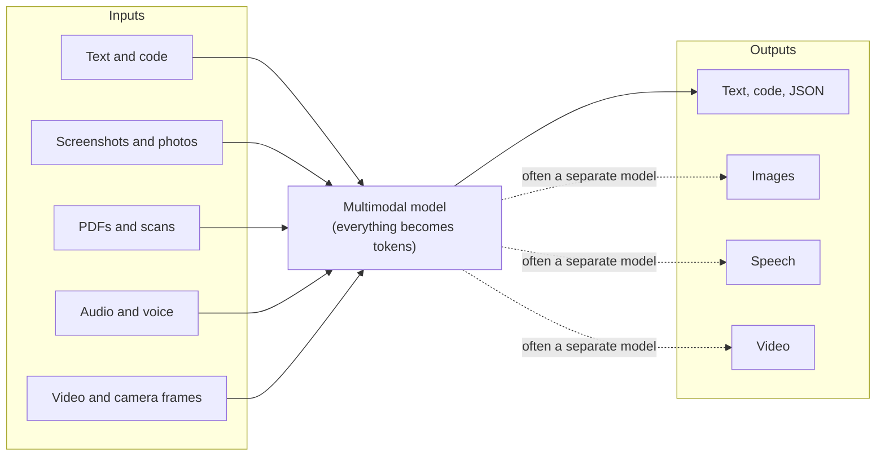
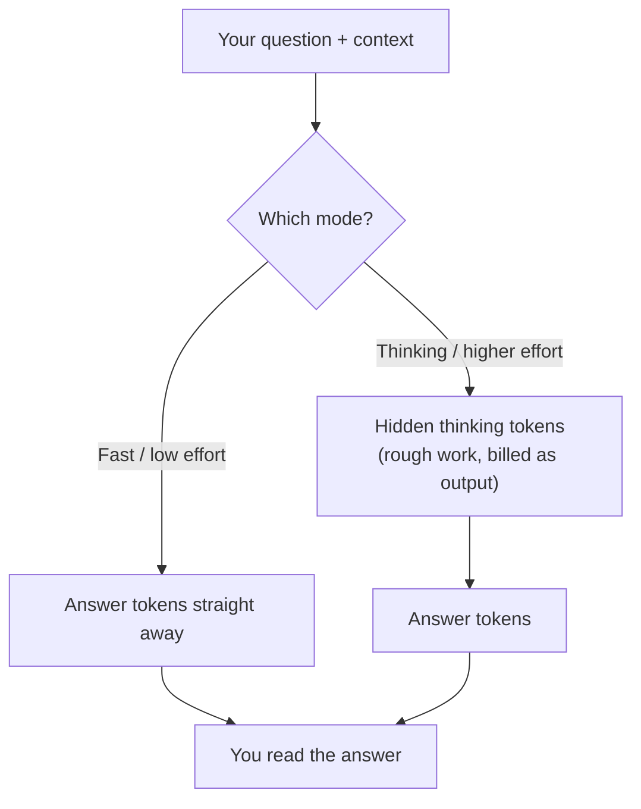
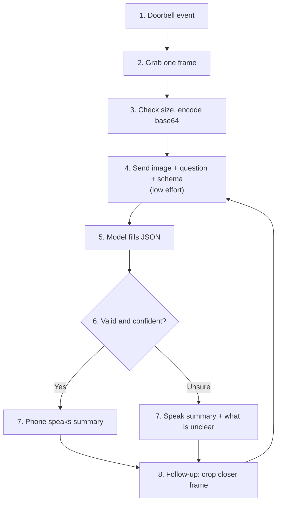
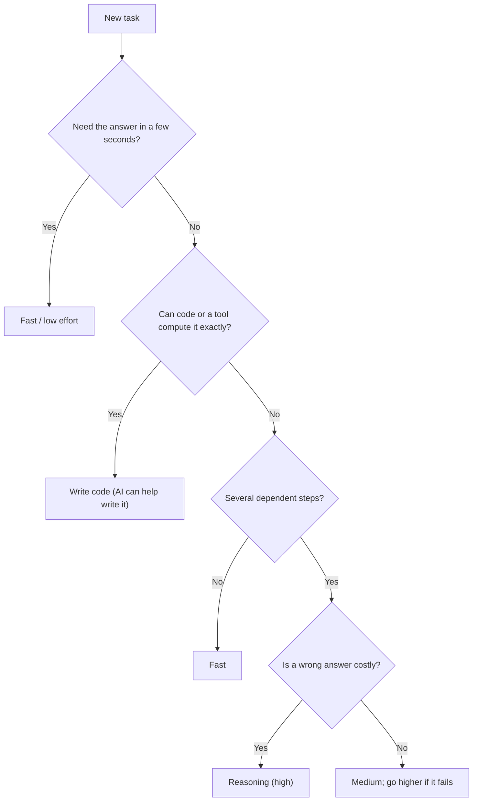
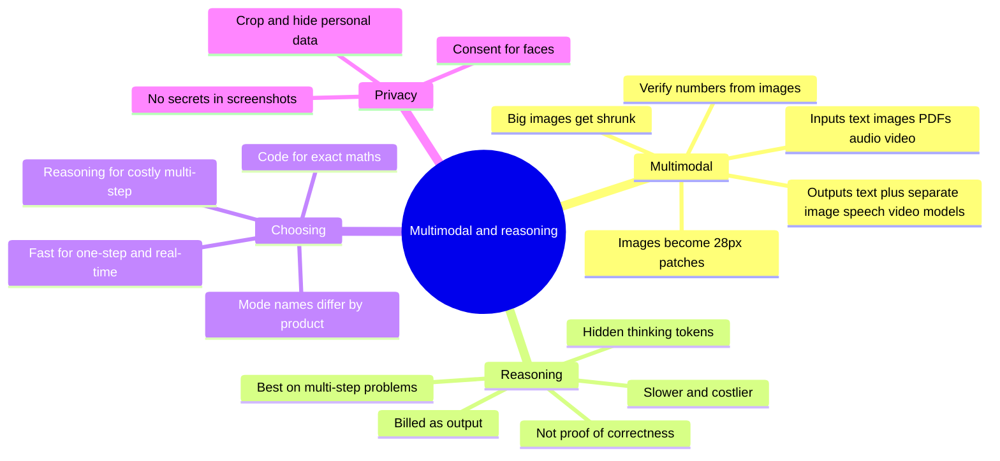

# A1-08 · Multimodal and reasoning models

> **Lesson A1-08** · Type: Concept · Prerequisites: [A1-04 · How an LLM generates text](./a1-04-how-an-llm-generates-text.md) (also uses A1-03 tokens, A1-05 sampling and A1-07 limitations) · Leads to: A3-03, A6-01, A9-03
>
> **Facts checked on:** 22 October 2026. Model names, mode names, limits and prices change often; every provider fact here has a dated source in section 19.
>
> **What was actually run for this guide:** the image-token calculator, the contrast checker, the cost calculator and a real **downscaling experiment** (a classic OCR model reading numbers from screenshots) were all run here, and their real output is pasted below. The two API scripts were type-checked against the official Claude SDK and confirmed to reach the Claude API, but **no vision or reasoning model was called** (no API key in this workspace). So the "fast vs reasoning" comparisons come from **published research**, clearly labelled, plus a template for you to run your own.

**Why this lesson matters:** today's models can read screenshots, photos, PDFs and audio, and many can "think" longer before they answer. Both features cost extra time and money. If you pick the wrong mode, you either wait 2 minutes for a one-line answer, or you get a fast, confident, wrong answer to a hard question. Choosing deliberately is a daily skill for a developer using AI, and it is the heart of your DoorSight idea (camera frame in, spoken description out).

## Learning goals

By the end of this lesson you will be able to:

1. Explain **multimodal** input and output (screenshots, photos, PDFs, audio and video in; text, images and speech out), and draw the modalities diagram from memory.
2. Explain how an **image becomes tokens**, why big images get **shrunk**, and what that does to small text and numbers.
3. Explain what a **reasoning (thinking) model** does differently, why it is slower and costlier, and why its reasoning is **not proof** of correctness.
4. Use **effort settings and thinking modes** in apps and APIs, knowing that **mode names differ between products**.
5. Decide **fast vs reasoning** for a task using a decision table, and say why.
6. Name which of **your projects** (DoorSight, GlamQuote, Shop Suite) need multimodal input, and what to check.
7. **Done when:** you choose the mode deliberately for each task and can say why in one sentence.

---

## 1. The topic in one minute

- **Multimodal** means a model can take in (or produce) more than text: images, PDFs, audio, video, speech. Under the hood, an image is cut into small squares, and each square becomes a **token**. Then the same generation loop from A1-04 runs.
- **Reasoning models** (also called **thinking** modes) write hidden "rough work" tokens before the final answer. That helps on multi-step problems, but every thinking token costs time and money (it's billed as output).
- These are **two separate dials**: what the model can *see and say* (modalities), and how long it *thinks* (effort). A fast model can read an image; a reasoning model can be text-only.
- Neither dial makes the model **always right**. Small text in a shrunk screenshot gets misread, and long reasoning can still end in a wrong answer.

**One-line memory trick:** *multimodal = more senses; reasoning = more rough work. Neither is a guarantee.*

**Analogy: a CA checking your bills.**
- **Multimodal** is like your CA accepting a WhatsApp photo of a bill instead of a typed list. Handy, but if the photo is blurry, he may read ₹8,093 as ₹8,698.
- **Reasoning** is like asking him to "check properly, take your time". He does rough work on the side, re-checks totals and catches tricky GST rules. It's slower and he bills more hours. For "what's 18% of 1,000?" that extra time is a waste.

**Real-life example:** in September 2024, OpenAI reported that its reasoning model **o1** averaged **74%** on the AIME 2024 maths exam (one try per problem), while **GPT-4o**, its fast model, averaged **12%**. In the same post, OpenAI noted that o1-preview **"is not preferred on some natural language tasks"**. More thinking helped hugely on maths, and not on everything.

---

## 2. Detailed definitions and why they matter

### 2.1 Multimodal models

**Definition:** a **modality** is a type of data: text, image, audio, video. A **multimodal model** can accept more than one modality as input, produce more than one as output, or both.

**One-line meaning:** a model that can work with more than words.

**Simple real-life example:** you share a screenshot of a React Native error screen with an assistant and ask, "What's wrong?" It reads the red error box (image in) and explains the fix (text out).

**Why it exists:** a lot of real information isn't typed text. It's in screenshots, scanned bills, diagrams, charts, voice notes and camera feeds. Before multimodal models, you had to convert everything to text first (OCR for images, transcription for audio) and lose layout, colour and context on the way.

**Where it's used:** screenshot-to-UI code, reading architecture diagrams, extracting text and tables from PDFs and photos, voice assistants, describing a camera frame for a blind user, checking a UI for accessibility problems.

**When it's NOT useful:**
- When you already have the **source data**. Don't screenshot a chart and ask for numbers if you have the CSV. Send the CSV.
- When you need **exact numbers** from a low-quality image and can't verify them.
- When the image contains **private data** you shouldn't upload.
- For simple text recognition at scale, a dedicated OCR tool can be cheaper and more predictable.

### 2.2 Reasoning models and thinking modes

**Definition:** a **reasoning model** (or a model in a **thinking mode**) generates internal reasoning tokens before its final answer. It can restate the problem, try an approach, check intermediate results and change direction. Claude's docs describe it this way: Claude "restates what is being asked, tries approaches, checks intermediate results, and abandons paths that do not hold up."

**One-line meaning:** the model does rough work before answering.

**Simple real-life example:** you ask, "My `useEffect` fetch runs twice and sometimes shows stale data. Why?" A fast answer may say "React Strict Mode" and stop. A thinking answer may also check for a missing cleanup, a race between two requests and a stale closure, then pick the most likely cause from your code.

**Why it exists:** in a single pass, a model has to get everything right "on the first try" (Claude docs). Multi-step problems (maths, debugging, planning, analysis) need intermediate work. Writing that work down as tokens gives the model more computation before it commits to an answer. OpenAI's 2024 post called this **test-time compute**: performance improves the more time the model spends thinking.

**Where it's used:** tricky bugs, algorithm design, architecture trade-offs, multi-step maths and estimates, long agent tasks, careful analysis of documents.

**When it's NOT useful:**
- Simple lookups, formatting, renaming, short translations, classification.
- **Latency-critical** features like voice replies or a doorbell description. Nobody waits a minute at the door.
- When the **input is the problem**. Thinking harder doesn't add pixels to a blurry photo.
- When **code can compute the answer exactly** (A1-07): GST, EMI, dates, sums.

### 2.3 Fast vs reasoning is now usually a dial, not two models

In 2024 you picked between separate models: a "normal" one (GPT-4o) or a "reasoning" one (o1). Today most providers put a **dial** on the same model:

- **Claude API:** `output_config.effort` = `low`, `medium`, `high`, `xhigh` or `max`. Current Claude models use **adaptive thinking**: the model decides when and how much to think, and effort steers it.
- **OpenAI API:** `reasoning.effort`, with values from `none` to `max` depending on the model.
- **Gemini API:** `thinking_level`, from `minimal` to `high` depending on the model.
- **Apps:** ChatGPT has **Instant** and thinking levels; Claude apps have an **Effort** menu and a **Thinking** toggle.

Claude's docs make an important point: effort "is a behavioral signal, not a strict token budget. At lower effort levels, Claude still thinks on sufficiently difficult problems, but thinks less." So "fast mode" doesn't always mean "zero thinking".

> **Note: mode names change between products, and over time.** "Thinking", "Extended", "Instant", "Pro", "Extra high", `xhigh`, `thinking_level: high`... the same idea has different names in every product, and the names change with new releases (ChatGPT's "Thinking Light" option is already gone). Even the **same name** can mean different things: Claude's docs say Sonnet 5.5's effort levels are "recalibrated", so `high` on Sonnet 5.5 doesn't produce the same amount of thinking as `high` on Sonnet 5. Learn the **idea** (more effort = more thinking tokens = slower and costlier), then check each product's current menu or docs, with the date. The full table, as checked on 22 October 2026, is in section 4.4.

---

## 3. Words you need first

| Term | Simple meaning |
|---|---|
| **Modality** | A type of data: text, image, audio, video. |
| **Multimodal** | Works with more than one modality. |
| **Vision / image understanding** | The model reads images. It doesn't necessarily *create* them: Claude, for example, "cannot generate, produce, edit, manipulate, or create images" (Claude docs). |
| **Patch / visual token** | A small square of the image (28 × 28 pixels for Claude) that becomes one token. |
| **Downscaling** | Shrinking an image to fewer pixels. Providers do this to large images automatically. |
| **OCR** | Optical character recognition: turning text in an image into real text. |
| **STT (speech-to-text)** | Turning audio into text (transcription). |
| **TTS (text-to-speech)** | Turning text into spoken audio. |
| **Reasoning model / thinking mode** | A model or setting that writes hidden reasoning tokens before answering. |
| **Thinking tokens / reasoning tokens** | Those hidden tokens. Billed as **output tokens**, even when you don't see them. |
| **Effort** | A setting for how much work (thinking and output) the model puts in. |
| **Adaptive thinking** | The model decides by itself whether and how much to think, guided by effort. |
| **Overthinking** | Spending lots of thinking on a simple problem for little or no benefit. |
| **Latency** | How long you wait. **TTFT** (time to first token) from A1-04 is part of it. |

---

## 4. How it works

### 4.1 Input and output modalities

**Diagram: what can go into a model, and what can come out**



**How to read this diagram:** everything on the left is turned into tokens and fed into the model. Text out (including code and JSON) is what LLMs produce natively. The dotted arrows mean images, speech and video output usually come from a **specialised model** (an image generator, a text-to-speech voice, a video model) that the app chains after the LLM. One product can feel "fully multimodal" while really being several models joined together.

**Who accepts what (checked 22 October 2026; this changes often):**

| Provider (API) | Inputs it accepts | Outputs | Notes |
|---|---|---|---|
| **Claude** | Text, images (JPEG, PNG, GIF, WebP), PDFs | Text (incl. code, JSON) | No audio input block in the official SDK (v1.1.0). Claude "is an image understanding model only": it can't generate images. Up to 600 images per request (100 on models with a 200k context window). |
| **Gemini** | Text, images, audio, video, documents | Text; separate Gemini models for images and speech | Audio is billed at **32 tokens per second**, up to 9.5 hours per prompt. |
| **OpenAI** | Text, images; audio through realtime and transcription models (e.g. `gpt-transcribe`) | Text; separate models for images (`gpt-image-2.5-sunburst`, `gpt-image-2.5-flare`) and speech (`gpt-realtime-2.1`, `gpt-4o-mini-tts`) | Model names from OpenAI's models page, 22 October 2026. |

**Two ways to build a voice feature:**
- **Pipeline:** speech → **STT** → text LLM → **TTS** → speech. Easy to build, easy to debug, and you can log the text. Each hop adds latency.
- **Native speech-to-speech:** one realtime model hears audio and answers in audio. Lower latency and it keeps tone of voice, but it's harder to inspect and usually costs more.

Apps add their own voice layer on top: for example, Claude's apps have a **voice mode** (beta) on mobile, desktop and web. Its help page doesn't say which of the two designs it uses, which is a good reminder that "voice" in an app doesn't tell you what the model itself accepts.

DoorSight's spoken output is the pipeline style: image in → text description → the phone speaks it.

### 4.2 How an image becomes tokens

From A1-03 you know text is cut into tokens. Images are cut too, into **patches**. For Claude, each patch is a **28 × 28 pixel** square, and each patch is one **visual token**. Claude's docs give the formula: `⌈width / 28⌉ × ⌈height / 28⌉`.

**Diagram: a 168 × 84 px image cut into patches**

```
168 x 84 px image -> 6 x 3 patches of 28 x 28 px -> 18 visual tokens

+-----+-----+-----+-----+-----+-----+
|  t1 |  t2 |  t3 |  t4 |  t5 |  t6 |
+-----+-----+-----+-----+-----+-----+
|  t7 |  t8 |  t9 | t10 | t11 | t12 |
+-----+-----+-----+-----+-----+-----+
| t13 | t14 | t15 | t16 | t17 | t18 |
+-----+-----+-----+-----+-----+-----+
```

**How to read this diagram:** each box is one 28 × 28 square of pixels, and each becomes one token (t1 to t18). A phone screenshot of 1170 × 2532 needs 42 × 91 = **3,822** of these boxes. After this step, the model runs the same next-token loop you saw in A1-04, with the image tokens sitting in the context like a very long prompt.

**The important part: big images get shrunk first.** Every model has a maximum image size. Claude's docs (checked 22 October 2026):

| Resolution tier | Models | Max long edge | Max visual tokens |
|---|---|---|---|
| High-resolution | Claude 4.7 and later (all current models) | 2,576 px | 4,784 |
| Standard | Older models | 1,568 px | 1,568 |

An image larger than either limit is **downscaled** (shrunk, keeping its shape) before the model sees it. The model never sees your original pixels. It sees the smaller copy. Small text in that copy can become a blur of 6-pixel-high digits.

Here is what that means for real screen sizes, computed with the resize rule from Claude's docs (script in section 6.1):

```text
Self-check against docs examples: OK

Image                          | Tier     | Sent as   | Scale | Tokens
-------------------------------|----------|-----------|-------|-------
Phone screenshot               | high-res | 1170x2532 |  1.00 |  3822
Phone screenshot               | standard | 725x1568  |  0.62 |  1456
Long scrolling screenshot      | high-res | 502x2576  |  0.43 |  1656
Long scrolling screenshot      | standard | 306x1568  |  0.26 |   616
Laptop screenshot (1080p)      | high-res | 1920x1080 |  1.00 |  2691
Laptop screenshot (1080p)      | standard | 1456x819  |  0.76 |  1560
4K monitor screenshot          | high-res | 2576x1449 |  0.67 |  4784
4K monitor screenshot          | standard | 1456x819  |  0.38 |  1560
Doorbell camera frame (720p)   | high-res | 1280x720  |  1.00 |  1196
Doorbell camera frame (720p)   | standard | 1280x720  |  1.00 |  1196
Doorbell camera frame (1080p)  | high-res | 1920x1080 |  1.00 |  2691
Doorbell camera frame (1080p)  | standard | 1456x819  |  0.76 |  1560

One 1280x720 frame = 1196 input tokens on a high-res-tier model.
claude-haiku-5-5   $0.000120 per frame, $0.12 per 1,000 frames (image input only)
claude-sonnet-5-5  $0.002392 per frame, $2.39 per 1,000 frames (image input only)
claude-opus-5-5    $0.004784 per frame, $4.78 per 1,000 frames (image input only)
30-second doorbell clip  = 960 audio tokens on Gemini
1-minute voice note      = 1920 audio tokens on Gemini
5-minute call            = 9600 audio tokens on Gemini
```

**What this output tells you:**
- A normal **phone screenshot** fits on current models without shrinking (3,822 tokens). On an older standard-tier model it shrinks to 62% of its size.
- A **4K monitor screenshot** shrinks to 67% even on current models, and to **38%** on older ones. That's where small text gets into trouble (see the experiment in section 7.1).
- A **720p doorbell frame** isn't resized at all and costs about **1,196 input tokens**: roughly $0.12 per 1,000 frames on Haiku 5.5, or $2.39 on Sonnet 5.5, for the image part only.
- For comparison, audio on Gemini is counted by time: a 30-second clip is 960 tokens and a 1-minute voice note is 1,920.

**PDFs:** Claude converts each PDF page into an image **and** extracts the text, and gives both to the model. Its docs estimate **1,500–3,000 text tokens per page**, plus the image tokens for each page. A 20-page scanned PDF is a big prompt.

### 4.3 How a reasoning (thinking) model works

**Diagram: fast answer vs thinking answer**



**How to read this diagram:** both paths use the same generation loop (A1-04). The thinking path first generates a block of reasoning tokens: restating the problem, trying approaches, checking. Only after that does it write the answer. Those extra tokens are why it's slower (you wait for them before the answer starts) and costlier (they are billed as output tokens).

**What you see vs what you pay for:**
- **Claude:** the thinking text you see is "never the raw chain of thought". It's a **summary**, or nothing at all: on current Claude models the thinking display defaults to `"omitted"`. You are "charged for the full thinking tokens", not the summary. Hiding the thinking speeds up the first visible text, but "Omitting reduces latency, not cost."
- **OpenAI:** reasoning tokens "are not visible through the API" but "are billed as output tokens".
- **Gemini:** "response pricing is the sum of output tokens and thinking tokens."

**Optional advanced understanding: why does writing more tokens help?** In A1-04 you saw that each generated token is one full pass through the model. A thinking model gets many extra passes before it commits to an answer, and each pass can read the rough work written so far (it's in the context). So it can break a problem into steps, keep intermediate results, and notice "wait, that's wrong". That's the simple intuition. Providers train these models with extra techniques (OpenAI's 2024 post mentions reinforcement learning) that are beyond this course.

### 4.4 Effort and thinking controls, product by product

> **Mode names change between products.** This table is a snapshot from 22 October 2026. Check the current menu or docs before you rely on it.

| Product | "Fast" end | "Think more" end | Notes |
|---|---|---|---|
| **Claude apps** (claude.ai, desktop, mobile) | Effort: **Low** | **Medium**, **High**, **Extra high**, **Max**; **Thinking** toggle ("Extended" on older models) | Thinking can't be turned off on Haiku 5.5, Sonnet 5.5, Opus 5.5, Fable 5.1 or Opus 5. Extra high only on Opus 4.7 and newer. |
| **Claude API** | `output_config: { effort: "low" }` | `"medium"`, `"high"`, `"xhigh"`, `"max"` | Default is `medium` on Opus 5.5 and Haiku 5.5, `high` on other models. Adaptive thinking is on by default on current models. |
| **ChatGPT** | **Instant** | **Medium**, **High**, **Extra High** (Thinking); **Pro Standard**, **Pro Extended** | Instant can switch to Medium on complex requests (you can turn this off). Plans get different options. |
| **OpenAI API** | `reasoning: { effort: "none" }` or `"minimal"`, `"low"` | `"medium"`, `"high"`, `"xhigh"`, `"max"` | "Supported values are model-dependent". `gpt-6.1-sol` doesn't support `none` or `minimal`; its default is `medium`. |
| **Gemini API** | `thinking_level: "minimal"` or `"low"` | `"medium"`, `"high"` | Supported levels depend on the model. Gemini 3.x models think by default. |

Two habits that save you trouble:
1. **Set effort explicitly** in code. Defaults differ between models (Claude Opus 5.5 defaults to `medium`, Sonnet 5.5 to `high`), and they change between versions.
2. **Leave room in `max_tokens`.** Thinking counts toward it. If the limit is hit during thinking, you can pay for tokens and get no visible answer (OpenAI and Gemini both warn about this; Claude's docs say to set a large `max_tokens` at higher effort).

### 4.5 Walkthrough: a DoorSight frame becomes a spoken description

Scenario: someone rings the doorbell. A blind user wants to know who or what is at the door, in a few seconds, by voice.

1. **Event:** the doorbell fires a "ring" or "motion" event.
2. **Capture:** the app grabs **one frame** (say 1280 × 720) from the camera feed. One frame, not a whole video: cheaper, faster, and less personal data.
3. **Prepare:** the app checks the size (1,196 tokens, no resize needed) and encodes it as base64. On Amazon Bedrock, Claude images must be base64, at most 5 MB each.
4. **Ask:** the app sends the image, a short question ("Who or what is at the door?") and a **JSON schema**, with **low effort**. Speed matters more than deep thinking here.
5. **Model:** the image becomes visual tokens; the model fills in the schema: `spoken_summary`, `objects`, `text_seen`, `uncertain`.
6. **Check:** the app checks that the JSON is valid, that `stop_reason` is normal, and whether `uncertain` has anything in it.
7. **Speak:** the phone reads `spoken_summary` aloud with text-to-speech. If something was uncertain, it says so honestly: "I can't read the label clearly."
8. **Follow-up:** if the user asks, "Is the parcel for my flat?", the app can send a **cropped, closer** frame of the label. Better pixels help more than more thinking.

**Diagram: the DoorSight flow, step by step**



**How to read this diagram:** follow the numbers. Steps 1 to 5 turn a camera event into structured text. Step 6 is the safety check: the app never speaks something it couldn't parse, and it passes on the model's own uncertainty instead of hiding it. Step 8 loops back with a better image (a crop) rather than simply asking the model to "think harder" about the same blurry pixels.

---

## 5. Choosing a mode: fast vs reasoning

### 5.1 The decision table

| Task | Pick | Why | Still verify by |
|---|---|---|---|
| Rename variables, format code, JSON → TypeScript types | **Fast** | One-step pattern work | TypeScript compiler, lint |
| Explain a clear error message | **Fast** | The answer is mostly in the message | Apply the fix, run again |
| Screenshot → first draft of a React / React Native component | **Fast or medium** | Copying a layout, not deep logic; you'll iterate anyway | Render it next to the screenshot |
| Bug across several files: async, race condition, stale state | **Reasoning (high)** | Many interacting parts; the first guess is often wrong | A failing test that now passes |
| Algorithm, data model or migration plan | **Reasoning** | Trade-offs and edge cases | Review + edge-case tests |
| Multi-step estimate (costs, capacity, GST with special rules) | **Reasoning, or better: code** | Each step depends on the last | Recompute in code |
| Read the total from a clear bill photo | **Fast** | Reading, not reasoning | Add up the line items yourself |
| Exact numbers from a dense chart or a 4K screenshot | **Neither fixes it.** Get the source data, or crop | Lost pixels can't be "thought back" | Compare with the source |
| Doorbell description, voice reply | **Fast (low effort)** | Waiting time matters most | Log uncertain cases, user feedback |
| Classify 10,000 support tickets | **Fast (low effort, smaller model)** | Cost × volume | Spot-check a random sample |
| Security review of login / payment code | **Reasoning (high)** | A miss is expensive | Human review + tests |
| Long agent task (big refactor, research) | **Medium to high** (Claude's docs suggest `xhigh` for long coding work on some models) | Many steps and tool calls | Diff review, CI |

**Rule of thumb:** a reasoning mode is worth it when **all four** are true:
1. The task has **several dependent steps** (one mistake breaks the rest).
2. A **wrong answer is expensive** (production bug, money, security, your reputation).
3. The answer is **hard to verify** quickly yourself.
4. You **can wait** (seconds to minutes).

If the task is one step, latency-critical, limited by a bad input, or something code can compute exactly, the extra thinking is mostly wasted money.

### 5.2 The decision flowchart

**Diagram: picking the mode for a new task**



**How to read this diagram:** start at the top and answer each question honestly. Speed requirements come first (a doorbell can't wait). Then ask whether code can do it exactly (A1-07: plain code beats an LLM at sums and dates). Only multi-step, costly problems go to the slowest, most expensive mode.

### 5.3 Escalate and de-escalate

- **Start fast** for everyday, low-risk work. **Go up** a level when the answer is wrong twice, contradicts a test, or ignores part of the problem.
- **Start high** when a mistake is costly. **Come down** when answers are right but slow. Claude's docs say the same: reduce effort "if a task completes but takes longer than necessary".
- Whatever the mode, **tests and checks decide**, not the model's confident tone.

---

## 6. Practical code

Prerequisites: Node.js 20.9 or newer (`sharp` needs it; tested here on Node 22.22.0), and for the API scripts, a Claude API key in an environment variable. **Never hardcode keys.**

```bash
mkdir multimodal-lab && cd multimodal-lab
npm init -y
npm install @anthropic-ai/sdk sharp   # tested with @anthropic-ai/sdk 1.1.0 and sharp 0.35.5
export ANTHROPIC_API_KEY="your-key"     # only needed for sections 6.3 and 6.4
```

### 6.1 How many tokens is my image? (`image-tokens.mjs`)

This copies the resize rule from Claude's vision docs and checks itself against the examples printed in the docs before it prints anything. If the docs change, the self-check fails loudly instead of printing wrong numbers.

```js
// image-tokens.mjs: how big is an image "in tokens" for Claude, and does it get shrunk?
// Uses the resize rule from Claude's vision docs (checked 22 Oct 2026).
// Run: node image-tokens.mjs
const TIERS = {
  "high-res": { maxEdge: 2576, maxTokens: 4784 }, // Claude 4.7 and later models
  standard: { maxEdge: 1568, maxTokens: 1568 }, // older models
};

const countTokens = (w, h) => Math.ceil(w / 28) * Math.ceil(h / 28); // one token per 28x28 patch

function roundTiesToEven(v) {
  const f = Math.floor(v);
  if (v - f !== 0.5) return Math.round(v);
  return f % 2 === 0 ? f : f + 1;
}

// Largest aspect-preserving size that fits both limits (reference logic from the docs).
function resizedSize(w, h, maxEdge, maxTokens) {
  const fits = (a, b) =>
    Math.ceil(a / 28) * 28 <= maxEdge && Math.ceil(b / 28) * 28 <= maxEdge && countTokens(a, b) <= maxTokens;
  if (fits(w, h)) return [w, h];
  if (h > w) {
    const [rh, rw] = resizedSize(h, w, maxEdge, maxTokens);
    return [rw, rh];
  }
  const ar = w / h;
  let lo = 1, hi = w;
  while (lo + 1 < hi) {
    const mid = Math.floor((lo + hi) / 2);
    if (fits(mid, Math.max(roundTiesToEven(mid / ar), 1))) lo = mid;
    else hi = mid;
  }
  return [lo, Math.max(roundTiesToEven(lo / ar), 1)];
}

// Self-check against the examples printed in the docs.
const check = (got, want) => { if (got.join("x") !== want) throw new Error(`docs mismatch: ${got} vs ${want}`); };
check(resizedSize(1920, 1080, 1568, 1568), "1456x819");
check(resizedSize(3840, 2160, 2576, 4784), "2576x1449");
check(resizedSize(1075, 1520, 1568, 1568), "924x1307");
console.log("Self-check against docs examples: OK\n");

/** @type {[string, number, number][]} */
const images = [
  ["Phone screenshot", 1170, 2532],
  ["Long scrolling screenshot", 1170, 6000],
  ["Laptop screenshot (1080p)", 1920, 1080],
  ["4K monitor screenshot", 3840, 2160],
  ["Doorbell camera frame (720p)", 1280, 720],
  ["Doorbell camera frame (1080p)", 1920, 1080],
];

const PRICE_PER_MTOK_INPUT = { "claude-haiku-5-5": 0.1, "claude-sonnet-5-5": 2, "claude-opus-5-5": 4 }; // USD, standard rates

console.log("Image                          | Tier     | Sent as   | Scale | Tokens");
console.log("-------------------------------|----------|-----------|-------|-------");
for (const [name, w, h] of images) {
  for (const [tier, { maxEdge, maxTokens }] of Object.entries(TIERS)) {
    const [rw, rh] = resizedSize(w, h, maxEdge, maxTokens);
    const t = countTokens(rw, rh);
    console.log(`${name.padEnd(30)} | ${tier.padEnd(8)} | ${`${rw}x${rh}`.padEnd(9)} | ${(rw / w).toFixed(2).padStart(5)} | ${String(t).padStart(5)}`);
  }
}

// Cost of one 720p doorbell frame on current (high-res tier) models.
const [fw, fh] = resizedSize(1280, 720, 2576, 4784);
const frameTokens = countTokens(fw, fh);
console.log(`\nOne 1280x720 frame = ${frameTokens} input tokens on a high-res-tier model.`);
for (const [model, price] of Object.entries(PRICE_PER_MTOK_INPUT)) {
  const perFrame = (frameTokens * price) / 1e6;
  console.log(`${model.padEnd(18)} $${perFrame.toFixed(6)} per frame, $${(perFrame * 1000).toFixed(2)} per 1,000 frames (image input only)`);
}

// Audio for comparison: Gemini's audio docs (updated 23 Sep 2026) say 32 tokens per second.
for (const [label, secs] of [["30-second doorbell clip", 30], ["1-minute voice note", 60], ["5-minute call", 300]]) {
  console.log(`${label.padEnd(24)} = ${secs * 32} audio tokens on Gemini`);
}
```

Run it with `node image-tokens.mjs`. The **real output** is in section 4.2.

### 6.2 Check a contrast claim yourself (`contrast.mjs`)

Use this in the beginner exercise: when an assistant says "this grey text fails contrast", don't trust its eyes. It estimated the colours from pixels. Pick the real hex values from your code or DevTools and compute the ratio with the WCAG formula.

```js
// contrast.mjs: check an AI's colour-contrast claim yourself (WCAG 2.2, SC 1.4.3).
// Run: node contrast.mjs            or   node contrast.mjs "#9CA3AF" "#FFFFFF"
const channel = (v8) => {
  const c = v8 / 255;
  return c <= 0.04045 ? c / 12.92 : ((c + 0.055) / 1.055) ** 2.4;
};
const luminance = (hex) => {
  const n = parseInt(hex.replace("#", ""), 16);
  const [r, g, b] = [(n >> 16) & 255, (n >> 8) & 255, n & 255].map(channel);
  return 0.2126 * r + 0.7152 * g + 0.0722 * b;
};
const ratio = (a, b) => {
  const [hi, lo] = [luminance(a), luminance(b)].sort((x, y) => y - x);
  return (hi + 0.05) / (lo + 0.05);
};

const pairs = process.argv.length >= 4
  ? [[process.argv[2], process.argv[3], "your colours"]]
  : [
      ["#9CA3AF", "#FFFFFF", "light grey hint text on white"],
      ["#6B7280", "#FFFFFF", "mid grey text on white"],
      ["#FFFFFF", "#3B82F6", "white text on bright blue button"],
      ["#FFFFFF", "#2563EB", "white text on darker blue button"],
    ];

for (const [fg, bg, label] of pairs) {
  const r = ratio(fg, bg); // WCAG says do not round: 4.499 fails 4.5
  const normal = r >= 4.5 ? "PASS" : "FAIL";
  const large = r >= 3 ? "PASS" : "FAIL";
  console.log(`${fg} on ${bg}  ${r.toFixed(2)}:1  normal text ${normal}, large text ${large}  (${label})`);
}
```

**Real output** (`node contrast.mjs`):

```text
#9CA3AF on #FFFFFF  2.54:1  normal text FAIL, large text FAIL  (light grey hint text on white)
#6B7280 on #FFFFFF  4.83:1  normal text PASS, large text PASS  (mid grey text on white)
#FFFFFF on #3B82F6  3.68:1  normal text FAIL, large text PASS  (white text on bright blue button)
#FFFFFF on #2563EB  5.17:1  normal text PASS, large text PASS  (white text on darker blue button)
```

WCAG 2.2 (SC 1.4.3, level AA) needs **4.5:1** for normal text and **3:1** for large text (18 pt, or 14 pt bold). So a light grey hint text like `#9CA3AF` on white **fails**, and white on a bright blue button only passes for large text. A model looking at a screenshot can easily say "contrast looks fine" here, because the button *looks* readable to a sighted person on a good screen.

### 6.3 Image + question → structured description (`describe-image.mjs`)

This is the developer exercise and the core of a DoorSight-style feature. It resizes the image itself (so you know exactly what the model sees and what it costs), sends it to Claude with a JSON schema, and prints the parsed result, the time taken and the thinking tokens.

```js
// describe-image.mjs: image + question -> structured JSON description (Claude API).
// Setup:  npm install @anthropic-ai/sdk sharp
// Run:    ANTHROPIC_API_KEY=... node describe-image.mjs samples/front-door.png
// Check without calling the API:  node describe-image.mjs samples/front-door.png --dry-run
import { readFile } from "node:fs/promises";
import Anthropic from "@anthropic-ai/sdk";
import sharp from "sharp";

const MODEL = process.env.MODEL ?? "claude-haiku-5-5"; // fast + cheap for a "what's at my door" style task
const EFFORT = /** @type {"low" | "medium" | "high" | "xhigh" | "max"} */ (process.env.EFFORT ?? "low");
const MAX_EDGE = 2576, MAX_TOKENS = 4784; // high-resolution tier (Claude 4.7 and later)

// Same resize rule as image-tokens.mjs (from Claude's vision docs), so the API
// receives exactly the image we send and does not shrink it again.
const countTokens = (w, h) => Math.ceil(w / 28) * Math.ceil(h / 28);
const roundEven = (v) => (v - Math.floor(v) === 0.5 ? (Math.floor(v) % 2 ? Math.floor(v) + 1 : Math.floor(v)) : Math.round(v));
function resizedSize(w, h) {
  const fits = (a, b) =>
    Math.ceil(a / 28) * 28 <= MAX_EDGE && Math.ceil(b / 28) * 28 <= MAX_EDGE && countTokens(a, b) <= MAX_TOKENS;
  if (fits(w, h)) return [w, h];
  if (h > w) return resizedSize(h, w).reverse();
  let lo = 1, hi = w;
  while (lo + 1 < hi) {
    const mid = Math.floor((lo + hi) / 2);
    if (fits(mid, Math.max(roundEven(mid / (w / h)), 1))) lo = mid;
    else hi = mid;
  }
  return [lo, Math.max(roundEven(lo / (w / h)), 1)];
}

// The shape we want back. Objects need additionalProperties: false for structured outputs.
const schema = {
  type: "object",
  additionalProperties: false,
  required: ["spoken_summary", "people_count", "objects", "text_seen", "uncertain"],
  properties: {
    spoken_summary: { type: "string", description: "One short sentence a screen reader can speak." },
    people_count: { type: "integer", description: "Approximate number of people visible." },
    objects: {
      type: "array",
      items: {
        type: "object",
        additionalProperties: false,
        required: ["name", "position"],
        properties: {
          name: { type: "string" },
          position: { type: "string", enum: ["left", "center", "right"] },
        },
      },
    },
    text_seen: { type: "array", items: { type: "string" }, description: "Exact visible text, copied." },
    uncertain: { type: "array", items: { type: "string" }, description: "Things you are not sure about." },
  },
};

const file = process.argv[2];
if (!file) throw new Error("Usage: node describe-image.mjs <image> [--dry-run]");
const input = await readFile(file);
const meta = await sharp(input).metadata();
const [w, h] = resizedSize(meta.width, meta.height);
// Resize ourselves so we control the token cost; send as PNG to avoid JPEG artifacts on text.
const png = await sharp(input).resize(w, h).png().toBuffer();

console.log(`Image: ${meta.width}x${meta.height} -> sending ${w}x${h} (~${countTokens(w, h)} image tokens)`);
console.log(`Model: ${MODEL}, effort: ${EFFORT}, payload: ${(png.length / 1024).toFixed(0)} KB`);

if (process.argv.includes("--dry-run")) {
  console.log("Dry run: schema fields ->", Object.keys(schema.properties).join(", "));
  process.exit(0);
}

const client = new Anthropic(); // reads ANTHROPIC_API_KEY from the environment
const started = Date.now();
const msg = await client.messages.create({
  model: MODEL,
  max_tokens: 2000,
  output_config: { effort: EFFORT, format: { type: "json_schema", schema } },
  system:
    "You describe camera images for a blind user. Only describe what is visible. " +
    "Do not guess identities. Put anything unclear into 'uncertain'.",
  messages: [
    {
      role: "user",
      content: [
        { type: "image", source: { type: "base64", media_type: "image/png", data: png.toString("base64") } },
        { type: "text", text: "Who or what is at the door? Describe it for the user." },
      ],
    },
  ],
});

if (msg.stop_reason !== "end_turn") console.warn(`Warning: stop_reason=${msg.stop_reason}; output may be incomplete.`);
const text = msg.content.find((b) => b.type === "text")?.text ?? "{}";
console.log(JSON.parse(text));
console.log(
  `Took ${Date.now() - started} ms; input ${msg.usage.input_tokens} tokens, output ${msg.usage.output_tokens}` +
    ` (thinking ${msg.usage.output_tokens_details?.thinking_tokens ?? 0})`
);
```

To test it fairly, you need an image whose contents you **know exactly**. This small script draws one (a 1280 × 720 "front door" frame) and prints its ground truth:

```js
// make-test-image.mjs: draw a test "front door" camera frame whose contents you KNOW,
// so you can grade a vision model's answer against the truth.
// Run: node make-test-image.mjs   (writes samples/front-door.png)
import { mkdir } from "node:fs/promises";
import sharp from "sharp";

const svg = `
<svg xmlns="http://www.w3.org/2000/svg" width="1280" height="720">
  <rect width="1280" height="720" fill="#c8c4bc"/>
  <rect y="560" width="1280" height="160" fill="#968c80"/>
  <rect x="480" y="90" width="320" height="470" fill="#6e4628"/>
  <circle cx="770" cy="330" r="10" fill="#dcbe5a"/>
  <rect x="560" y="130" width="160" height="50" fill="#f0f0eb"/>
  <text x="583" y="166" font-family="sans-serif" font-weight="bold" font-size="30" fill="#141414">FLAT 4B</text>
  <rect x="860" y="470" width="220" height="150" fill="#c49660"/>
  <line x1="860" y1="520" x2="1080" y2="520" stroke="#966e3c" stroke-width="6"/>
  <text x="900" y="590" font-family="sans-serif" font-weight="bold" font-size="28" fill="#aa1414">FRAGILE</text>
  <text x="20" y="46" font-family="sans-serif" font-weight="bold" font-size="26" fill="#ffffff">FRONT DOOR  14:32</text>
</svg>`;

// Ground truth: what a correct description must contain.
const truth = {
  people_count: 0,
  objects: ["door (center)", "parcel box (right)"],
  text_seen: ["FRONT DOOR 14:32", "FLAT 4B", "FRAGILE"],
};

await mkdir("samples", { recursive: true });
const info = await sharp(Buffer.from(svg)).png().toFile("samples/front-door.png");
console.log(`Wrote samples/front-door.png (${info.width}x${info.height}, ${info.size} bytes)`);
console.log("Ground truth:", JSON.stringify(truth));
```

**Real output** (`node make-test-image.mjs`):

```text
Wrote samples/front-door.png (1280x720, 31147 bytes)
Ground truth: {"people_count":0,"objects":["door (center)","parcel box (right)"],"text_seen":["FRONT DOOR 14:32","FLAT 4B","FRAGILE"]}
```

**How `describe-image.mjs` was checked here:**

1. **Dry run (real output)** on that test image, plus a 4000 × 3000 photo to show the resize:

```text
Image: 1280x720 -> sending 1280x720 (~1196 image tokens)
Model: claude-haiku-5-5, effort: low, payload: 30 KB
Dry run: schema fields -> spoken_summary, people_count, objects, text_seen, uncertain
Image: 4000x3000 -> sending 2212x1659 (~4740 image tokens)
Model: claude-haiku-5-5, effort: low, payload: 14 KB
Dry run: schema fields -> spoken_summary, people_count, objects, text_seen, uncertain
```

2. **Type-check:** passed `tsc --checkJs` against `@anthropic-ai/sdk` 1.1.0, so the request shape (`output_config.effort`, `output_config.format`, the image block) matches the official SDK types.
3. **Request reaches the API (real output with a deliberately fake key; the long error line is trimmed):**

```text
Image: 1280x720 -> sending 1280x720 (~1196 image tokens)
Model: claude-haiku-5-5, effort: low, payload: 30 KB
AuthenticationError: 401 {"type":"error","error":{"type":"authentication_error"
```

A 401 means the request was built and sent, and only the key was rejected. **No model answer was produced here.**

**How to judge your real result:** because the test image was drawn in code, its **ground truth** is known exactly: one closed brown door in the centre, a sign "FLAT 4B" on the door, a parcel on the right marked "FRAGILE", the overlay text "FRONT DOOR 14:32", and **zero people**. When you run the script with a real key, compare the model's `people_count`, `objects` and `text_seen` with this list item by item. Then try an image with tiny text and see what moves into `uncertain` (or doesn't).

**Notes:**
- Structured outputs make the reply **valid JSON** "in most cases", but not *true* JSON: the schema guarantees the shape, not the facts (same lesson as A1-05). Two documented exceptions: `stop_reason: "refusal"` and `stop_reason: "max_tokens"`, where the output may not match the schema. The script warns on any non-normal `stop_reason`.
- The script sends PNG, not heavily compressed JPEG: Claude's docs warn that heavy JPEG compression "can make text difficult to read".
- For DoorSight on Amazon Bedrock, the idea is the same, but the request goes through the Bedrock SDK, images must be base64, and each image must be at most 5 MB.

### 6.4 Same question, two efforts (`compare-effort.mjs`)

For the intermediate exercise, done through the API. It asks one tricky bill question at `low` and `high` effort and prints time, tokens, cost and whether the answer is correct. The correct answer is **computed in code** first, so you're not trusting either mode.

```js
// compare-effort.mjs: same question, two effort levels, side by side.
// Setup:  npm install @anthropic-ai/sdk
// Run:    ANTHROPIC_API_KEY=... node compare-effort.mjs
// Check without calling the API:  node compare-effort.mjs --dry-run
import Anthropic from "@anthropic-ai/sdk";

const MODEL = process.env.MODEL ?? "claude-sonnet-5-5";
const PRICE = { input: 2, output: 10 }; // USD/MTok for claude-sonnet-5-5 (checked 22 Oct 2026); update if you change MODEL
const LEVELS = /** @type {const} */ (["low", "high"]);

// A small bill problem with a trap: the discount applies only to the part above Rs 500.
const items = [{ price: 128.5, qty: 3 }, { price: 49.75, qty: 4 }];
const subtotal = items.reduce((s, i) => s + i.price * i.qty, 0);
const discount = subtotal > 500 ? 0.05 * (subtotal - 500) : 0;
const expected = Math.round((subtotal - discount) * 1.05); // 5% GST after discount, nearest rupee

const question =
  "A shop bill has 3 items at Rs 128.50 and 4 items at Rs 49.75. " +
  "A 5% discount applies only to the part of the subtotal above Rs 500. " +
  "Then 5% GST is added to the discounted amount. Round the final total to the nearest rupee. " +
  "Explain briefly, then end with a line 'ANSWER: <number>'.";

console.log(`Expected answer (computed in code): ${expected}`);
if (process.argv.includes("--dry-run")) process.exit(0);

const client = new Anthropic(); // reads ANTHROPIC_API_KEY from the environment
const rows = [];
for (const effort of LEVELS) {
  const t0 = Date.now();
  const msg = await client.messages.create({
    model: MODEL,
    max_tokens: 16000, // room for thinking + answer; thinking counts toward this limit
    output_config: { effort },
    messages: [{ role: "user", content: question }],
  });
  const ms = Date.now() - t0;
  const text = msg.content.filter((b) => b.type === "text").map((b) => b.text).join("\n");
  const got = Number(text.match(/ANSWER:\s*(?:Rs\.?\s*)?([\d,]+)/i)?.[1]?.replaceAll(",", ""));
  const { input_tokens, output_tokens } = msg.usage;
  const thinking = msg.usage.output_tokens_details?.thinking_tokens ?? 0;
  const cost = (input_tokens * PRICE.input + output_tokens * PRICE.output) / 1e6;
  rows.push({ effort, ms, output_tokens, thinking, cost: cost.toFixed(5), answer: got, correct: got === expected });
}
console.table(rows);
```

**Real output here** (dry run, then a fake key to confirm the request is sent; the error line is trimmed):

```text
Expected answer (computed in code): 609
Expected answer (computed in code): 609
AuthenticationError: 401 {"type":"error","error":{"type":"authentication_error"
```

**What to expect when you run it with a real key:** `console.table` prints one row per effort level with `ms`, `output_tokens`, `thinking`, `cost`, `answer` and `correct`. Expect `high` to use more thinking tokens and take longer. Whether `low` gets it wrong is something you have to **measure**, not assume: this problem is fairly easy, and modern models at low effort still think on hard-looking problems. Run each level 3 times (A1-05: answers vary) and record all runs in the table from section 7.6.

---

## 7. Side-by-side experiment results

Five comparisons, each labelled with where it comes from. Section 7.1 was **run here**. Sections 7.2 to 7.4 are **published research** (no model was run here). Section 7.5 is **computed** from real prices with stated assumptions. Section 7.6 is the template for **your own** experiment.

### 7.1 Run here: does shrinking a screenshot break the numbers?

**Question:** when a provider downscales a big screenshot, can small numbers still be read correctly?

**Method:**
1. A script drew three fake "sales report" screenshots full of known numbers like `Rs 47,855.21` (dark grey text on white): a normal phone screenshot, a long scrolling phone screenshot, and a 4K laptop screenshot with 16 px text (normal for a 4K screen at 100% zoom).
2. Each image was shrunk to the exact size Claude's documented resize rule gives for the **high-resolution tier** (current models) and the **standard tier** (older models), then blown back up so the reader got the same canvas size. Detail lost in shrinking stays lost.
3. **Tesseract 5.3.4**, a classic OCR engine (a small neural network for reading text), read every version. Its numbers were compared with the truth.

**Results (real output):**

```text
scene                                            version           sent as text px   correct wrong
phone screenshot (1170x2532, 36px text)          original        1170x2532    36.0     60/60     0
phone screenshot (1170x2532, 36px text)          high-res tier   1170x2532    36.0     60/60     0
phone screenshot (1170x2532, 36px text)          standard tier    725x1568    22.3     60/60     0
long scrolling screenshot (1170x6000, 36px text) original        1170x6000    36.0   144/144     0
long scrolling screenshot (1170x6000, 36px text) high-res tier    502x2576    15.4   144/144     0
long scrolling screenshot (1170x6000, 36px text) standard tier    306x1568     9.4   144/144     0
laptop 4K screenshot (3840x2160, 16px text)      original        3840x2160    16.0   240/240     0
laptop 4K screenshot (3840x2160, 16px text)      high-res tier   2576x1449    10.7   240/240     0
laptop 4K screenshot (3840x2160, 16px text)      standard tier    1456x819     6.1   136/240    39

Examples of confident wrong readings (OCR read -> real value):
  47,855.28  ->  47,855.21
  4,752.67  ->  54,752.67
  08,372.75  ->  98,372.75
```

| Screenshot | Text height after shrinking | Numbers read correctly | Wrong numbers it "read" |
|---|---|---|---|
| Phone, current models | 36 px (not shrunk) | 60 / 60 | 0 |
| Phone, older models | 22.3 px | 60 / 60 | 0 |
| Long scroll, older models | 9.4 px | 144 / 144 | 0 |
| 4K laptop, current models | 10.7 px | 240 / 240 | 0 |
| **4K laptop, older models** | **6.1 px** | **136 / 240 (56.7%)** | **39** |

**What it shows:**
- Normal phone screenshots were **fine**, even shrunk. Don't panic about every screenshot.
- The failure came from **small text on a big screen, shrunk a lot**: 6 px digits.
- The dangerous part is the **39 wrong numbers**: each one looks like a perfectly normal value. `47,855.21` became `47,855.28`, and `54,752.67` became `4,752.67` (a **10× error**). Nothing in the output says "I'm unsure". Of everything the OCR returned for that image, 22.3% was wrong.

**Honest limits of this experiment:** this is a classic OCR model, not a multimodal LLM. A modern vision LLM may read 6 px digits better, or it may "fix" them into plausible but wrong numbers using context. The images are synthetic and tidy (real screenshots add colours, icons, busy layouts and compression). What carries over is the **mechanism**: fewer pixels per character means more guessing, and guesses look like real data. The fix is also the same: **send the source data, crop the region, or zoom in before the screenshot**, and check numbers against the source.

### 7.2 Published: a fast model vs a reasoning model (OpenAI, 12 September 2024)

From OpenAI's "Learning to reason with LLMs". **Not run here.**

| Benchmark | GPT-4o (fast) | o1 (reasoning) |
|---|---|---|
| AIME 2024 maths (average, one try per problem) | 12% (1.8 / 15) | 74% (11.1 / 15) |
| Codeforces competitive programming | 808 Elo (11th percentile) | 1,673 Elo (89th percentile) |
| GPQA Diamond, PhD-level science (pass@1) | 50.6% | 77.3% |
| Some natural-language tasks | – | "o1-preview is not preferred on some natural language tasks" |

**Takeaway:** on multi-step maths and competitive coding, thinking made a huge difference (a 78-percentile jump on Codeforces). On some natural-language tasks, people did not prefer the thinking model (o1-preview).

### 7.3 Published: overthinking a simple question (Chen and others, December 2024)

From "Do NOT Think That Much for 2+3=? On the Overthinking of o1-Like LLMs". **Not run here.**

| | Conventional models | o1-like reasoning models |
|---|---|---|
| Tokens used to answer "what is the answer of 2 plus 3?" | baseline | **1,953% more** on average (about 20.5×) |
| Separate solutions written for that question (QwQ-32B-Preview) | – | **13 solutions**, though the first was already correct |

**Takeaway:** for an easy question, thinking adds cost and delay, not accuracy.

### 7.4 Published: reasoning helps in the middle, not at the ends (Apple, June 2025)

From "The Illusion of Thinking" (Shojaee, Mirzadeh and others), comparing reasoning models with standard models at **equal compute** on puzzles of controlled difficulty. **Not run here.**

| Problem complexity | Who did better |
|---|---|
| Low | Standard models "surprisingly outperform" reasoning models |
| Medium | "Additional thinking in LRMs demonstrates advantage" |
| High | "Both models experience complete collapse" |

The same paper reports that the reasoning models struggled with exact computation and reasoned inconsistently across puzzles.

**One more data point (from A1-07):** in April 2025, OpenAI's own system card reported higher hallucination rates on its PersonQA test for its newer reasoning models o3 (33%) and o4-mini (48%) than for o1 (16%). More reasoning isn't the same as fewer made-up facts.

### 7.5 Computed: what "more thinking" costs for one coding question

Real Claude prices (22 October 2026). The **thinking-token counts and the speed are assumptions** chosen for illustration; your real numbers will differ, so measure them with `usage.output_tokens_details.thinking_tokens` (section 6.4).

```js
// mode-cost.mjs: what does "more thinking" cost for one coding question?
// Prices: Claude pricing page, checked 22 Oct 2026 (USD per million tokens).
// Thinking-token counts and speed below are ASSUMPTIONS for illustration;
// measure your own with usage.output_tokens_details.thinking_tokens.
const PRICES = {
  "claude-haiku-5-5": { input: 0.1, output: 0.5 }, // prompts up to 100k tokens
  "claude-sonnet-5-5": { input: 2, output: 10 },
  "claude-opus-5-5": { input: 4, output: 20 },
};

const task = { inputTokens: 6000, answerTokens: 800 }; // a file + error log in, a fix out
const modes = [
  { name: "fast (low effort)", thinkingTokens: 300 },
  { name: "balanced (medium)", thinkingTokens: 3000 },
  { name: "deep (high effort)", thinkingTokens: 12000 },
];
const ASSUMED_TOKENS_PER_SECOND = 80; // illustration only; real speed varies by model and load

const usd = (n) => `$${n.toFixed(4)}`;
console.log(`Task: ${task.inputTokens} input tokens, ${task.answerTokens}-token visible answer\n`);
console.log("Model              | Mode               | Output tokens | Cost/request | Cost/1,000");
console.log("-------------------|--------------------|---------------|--------------|-----------");
for (const [model, p] of Object.entries(PRICES)) {
  for (const m of modes) {
    const out = m.thinkingTokens + task.answerTokens; // thinking is billed as output
    const cost = (task.inputTokens * p.input + out * p.output) / 1e6;
    console.log(
      `${model.padEnd(18)} | ${m.name.padEnd(18)} | ${String(out).padStart(13)} | ${usd(cost).padStart(12)} | ${("$" + (cost * 1000).toFixed(2)).padStart(10)}`
    );
  }
}

console.log(`\nGeneration time at an assumed ${ASSUMED_TOKENS_PER_SECOND} output tokens/second (any model):`);
for (const m of modes) {
  const out = m.thinkingTokens + task.answerTokens;
  console.log(`  ${m.name.padEnd(18)} ~${(out / ASSUMED_TOKENS_PER_SECOND).toFixed(0)} s before the answer is complete`);
}

const s = PRICES["claude-sonnet-5-5"];
const fast = (task.inputTokens * s.input + (300 + task.answerTokens) * s.output) / 1e6;
const deep = (task.inputTokens * s.input + (12000 + task.answerTokens) * s.output) / 1e6;
console.log(`\nOn Sonnet 5.5, deep costs ${(deep / fast).toFixed(1)}x the fast mode for this task.`);
console.log(`Break-even: deep mode is worth it if it saves more than ${usd(deep - fast)} of your time or rework per question.`);
```

**Real output** (`node mode-cost.mjs`):

```text
Task: 6000 input tokens, 800-token visible answer

Model              | Mode               | Output tokens | Cost/request | Cost/1,000
-------------------|--------------------|---------------|--------------|-----------
claude-haiku-5-5   | fast (low effort)  |          1100 |      $0.0011 |      $1.15
claude-haiku-5-5   | balanced (medium)  |          3800 |      $0.0025 |      $2.50
claude-haiku-5-5   | deep (high effort) |         12800 |      $0.0070 |      $7.00
claude-sonnet-5-5  | fast (low effort)  |          1100 |      $0.0230 |     $23.00
claude-sonnet-5-5  | balanced (medium)  |          3800 |      $0.0500 |     $50.00
claude-sonnet-5-5  | deep (high effort) |         12800 |      $0.1400 |    $140.00
claude-opus-5-5    | fast (low effort)  |          1100 |      $0.0460 |     $46.00
claude-opus-5-5    | balanced (medium)  |          3800 |      $0.1000 |    $100.00
claude-opus-5-5    | deep (high effort) |         12800 |      $0.2800 |    $280.00

Generation time at an assumed 80 output tokens/second (any model):
  fast (low effort)  ~14 s before the answer is complete
  balanced (medium)  ~48 s before the answer is complete
  deep (high effort) ~160 s before the answer is complete

On Sonnet 5.5, deep costs 6.1x the fast mode for this task.
Break-even: deep mode is worth it if it saves more than $0.1170 of your time or rework per question.
```

**Takeaway:** the model you pick changes cost about 20× (Haiku vs Sonnet), and the effort you pick changes it about 6× on top of that, mainly because **thinking is billed as output**, the expensive kind of token. Time grows in the same way. If you ask 50 such questions a day, the gap between "always deep" and "deep only when needed" adds up quickly.

### 7.6 Your own side-by-side: the template

Fill this in for the intermediate exercise (section 11). Run each mode **3 times**, because answers vary (A1-05).

| Task | Mode / effort | Run | Time to full answer | Correct? (checked how) | Thinking tokens (API) or "thought for…" (app) | Notes |
|---|---|---|---|---|---|---|
| Bill problem (answer: 609) | Fast | 1 | | | | |
| Bill problem | Fast | 2 | | | | |
| Bill problem | Fast | 3 | | | | |
| Bill problem | Reasoning | 1 | | | | |
| Bill problem | Reasoning | 2 | | | | |
| Bill problem | Reasoning | 3 | | | | |
| Your tricky bug (known fix) | Fast | 1–3 | | | | |
| Your tricky bug | Reasoning | 1–3 | | | | |

Then write **one sentence** per task: "For this kind of task I'll use ___ because ___." That sentence is the "done when" of this lesson.

**Optional advanced: reproduce the OCR experiment.** It's Python, because Tesseract and Pillow were already installed here. Needs `pip install pillow` and the `tesseract` command.

```python
# ocr_experiment.py: does downscaling a screenshot destroy small numbers?
# Draws two fake screenshots with known numbers, shrinks them the way Claude's
# documented resize rule would, then asks Tesseract OCR (a small neural
# text-recognition model) to read the numbers back. Compares with the truth.
# Usage: python3 ocr_experiment.py [output-folder]   (needs Pillow + the tesseract CLI)
import math, os, random, re, subprocess, sys
from PIL import Image, ImageDraw, ImageFont

FONT = "/usr/share/fonts/truetype/dejavu/DejaVuSans.ttf"
OUT = sys.argv[1] if len(sys.argv) > 1 else "ocr-out"
os.makedirs(OUT, exist_ok=True)

def tokens(w, h):
    return math.ceil(w / 28) * math.ceil(h / 28)

def resized_size(w, h, max_edge, max_tokens):
    # Same logic as the reference implementation in Claude's vision docs.
    def fits(a, b):
        return (math.ceil(a / 28) * 28 <= max_edge and math.ceil(b / 28) * 28 <= max_edge
                and tokens(a, b) <= max_tokens)
    if fits(w, h):
        return (w, h)
    if h > w:
        rh, rw = resized_size(h, w, max_edge, max_tokens)
        return (rw, rh)
    ar = w / h
    lo, hi = 1, w
    while lo + 1 < hi:
        mid = (lo + hi) // 2
        if fits(mid, max(round(mid / ar), 1)):
            lo = mid
        else:
            hi = mid
    return (lo, max(round(lo / ar), 1))

def make_numbers(n, seed):
    rnd = random.Random(seed)
    return [f"{rnd.randint(1, 99)},{rnd.randint(0, 999):03d}.{rnd.randint(0, 99):02d}" for _ in range(n)]

def draw_table(size, font_px, rows, cols, seed, title):
    w, h = size
    img = Image.new("RGB", (w, h), "white")
    d = ImageDraw.Draw(img)
    font = ImageFont.truetype(FONT, font_px)
    d.text((40, 30), title, fill="black", font=ImageFont.truetype(FONT, font_px * 2))
    nums = make_numbers(rows * cols, seed)
    col_w = (w - 80) // cols
    row_h = int(font_px * 2.2)
    for r in range(rows):
        for c in range(cols):
            x, y = 40 + c * col_w, 30 + font_px * 4 + r * row_h
            d.text((x, y), f"Rs {nums[r * cols + c]}", fill=(60, 60, 60), font=font)
    return img, nums

def ocr_numbers(img, path):
    img.save(path)
    txt = subprocess.run(["tesseract", path, "-", "--psm", "6"], capture_output=True, text=True).stdout
    return re.findall(r"\d{1,2},\d{3}\.\d{2}", txt)

def nearest(x, truth):
    # Closest true number by edit distance, to show what a wrong reading should have been.
    def dist(a, b):
        prev = list(range(len(b) + 1))
        for i, ca in enumerate(a, 1):
            cur = [i]
            for j, cb in enumerate(b, 1):
                cur.append(min(prev[j] + 1, cur[j - 1] + 1, prev[j - 1] + (ca != cb)))
            prev = cur
        return prev[-1]
    return min(truth, key=lambda t: dist(x, t))

def score(truth, found):
    found_left = list(found)
    hits = 0
    for t in truth:
        if t in found_left:
            hits += 1
            found_left.remove(t)
    wrong = len(found_left)  # numbers OCR "read" that are not in the truth
    return hits, wrong, found_left

scenes = [
    ("phone screenshot (1170x2532, 36px text)", (1170, 2532), 36, 30, 2, 1),
    ("long scrolling screenshot (1170x6000, 36px text)", (1170, 6000), 36, 72, 2, 3),
    ("laptop 4K screenshot (3840x2160, 16px text)", (3840, 2160), 16, 40, 6, 2),
]
tiers = [("original", None), ("high-res tier", (2576, 4784)), ("standard tier", (1568, 1568))]

examples = []
print(f"{'scene':48} {'version':14} {'sent as':>10} {'text px':>7} {'correct':>9} {'wrong':>5}")
for name, size, fpx, rows, cols, seed in scenes:
    img, truth = draw_table(size, fpx, rows, cols, seed, "Sales report")
    for tier, limits in tiers:
        w, h = size if limits is None else resized_size(*size, *limits)
        scale = w / size[0]
        small = img.resize((w, h), Image.LANCZOS)
        # Blow it back up so OCR gets the same canvas size; lost detail stays lost.
        seen = small.resize(size, Image.BICUBIC)
        found = ocr_numbers(seen, f"{OUT}/{seed}-{tier.replace(' ', '-')}.png")
        hits, wrong, bad = score(truth, found)
        print(f"{name:48} {tier:14} {f'{w}x{h}':>10} {fpx * scale:7.1f} {f'{hits}/{len(truth)}':>9} {wrong:>5}")
        examples += [(x, nearest(x, truth)) for x in bad[:3]]

print("\nExamples of confident wrong readings (OCR read -> real value):")
for x, t in examples[:6]:
    print(f"  {x}  ->  {t}")
```

Run: `python3 ocr_experiment.py ./out` (it writes the shrunk images into `./out` so you can look at them).

---

## 8. The four lesson questions, answered

### Q1. When is a reasoning model worth the extra time and cost?

When the task has **several dependent steps**, a **wrong answer is costly**, the answer is **hard for you to verify** quickly, and you **can wait**. That's where the published gains are biggest (o1 vs GPT-4o: 12% → 74% on AIME maths, 11th → 89th percentile on Codeforces). It's **not** worth it for one-step tasks (overthinking: on "what is the answer of 2 plus 3?", o1-like models used about 20× the tokens of conventional models for the same answer), for latency-critical features, for bad inputs (thinking can't fix a blurry image), or when code can compute the answer exactly. In money terms (section 7.5): deep mode on Sonnet 5.5 cost about 6× the fast mode for one coding question, so it's worth it when it saves you more than that difference in time or rework.

### Q2. What can go wrong when a model reads a screenshot?

1. **Shrinking:** big screenshots are downscaled before the model sees them; small text becomes blurry (section 4.2).
2. **Wrong numbers that look right:** in the experiment in section 7.1, 39 numbers came back wrong, including a 10× error, with no warning.
3. **Missing context:** anything scrolled off, cropped, hidden in a tooltip or behind a modal isn't there. The model may guess it.
4. **Colours and sizes are estimated, not measured:** "this contrast is fine" is an opinion from pixels. Measure with a tool (section 6.2).
5. **Charts:** values read off bars and lines are estimates. OpenAI's docs say models "may struggle to understand graphs or text where colors or styles—like solid, dashed, or dotted lines—vary."
6. **Positions and counts are approximate:** Claude's docs call coordinates "approximate" and counts "not always precisely accurate".
7. **Low quality:** rotated, blurry, heavily compressed or very small images (Claude's docs mention under 200 pixels) cause more mistakes.
8. **Private data leaks:** notifications, names, phone numbers, OTPs, API keys, customer data and addresses in the screenshot are uploaded along with it.
9. **Instructions hidden in the image:** text inside a screenshot ("ignore your instructions and…") is read like any other text. Treat text from images as data, never as commands, especially in agents.

### Q3. How do you choose between fast and reasoning modes for a coding task?

1. **Classify the task:** one-step pattern work (rename, format, types, boilerplate, explain an obvious error) → **fast**. Many interacting parts (async bugs, race conditions, state across files, design, migration, security) → **reasoning**.
2. **Check the cost of being wrong:** throwaway script → fast. Payment flow or auth → reasoning, plus human review.
3. **Check whether you're waiting:** inline autocomplete and quick chat → fast. A background agent task → higher effort is fine.
4. **Escalate on evidence:** if the fast answer fails a test twice, go up a level. If high effort keeps giving correct answers slowly, come down.
5. **Let tests decide:** a reasoning mode's long explanation isn't proof. A failing test that now passes is.

### Q4. Which of your projects need multimodal input, and why?

| Project | Multimodal need | Why | What to watch |
|---|---|---|---|
| **DoorSight AI** (Android accessibility companion, Ring camera + Amazon Bedrock spoken descriptions) | **Core: image in → text → speech out** | The whole product *is* "describe this camera frame for someone who can't see it" | **Latency** (fast/low effort, small frames, stream or speak quickly). **Honesty** (pass on `uncertain`; never invent text like house numbers). **People** (Claude won't name people in images; describe, don't identify). **Privacy** (visitors and neighbours didn't consent: send single frames, don't store them longer than needed, tell users). Bedrock: base64 only, max 5 MB per image. |
| **GlamQuote AI** (hairstyle and nail try-on, YouCam API, Gemini for text recommendations) | **Mostly handled already** | Photo try-on is done by a specialised API (YouCam), not by an LLM. Gemini recommendations from the user's text preferences don't need images | Adding "analyse my selfie" with an LLM is optional. It means sending face photos (sensitive data) to another provider, and the model's judgement of face shape can be wrong. Keep it text-only unless users clearly benefit and agree. |
| **Shop Suite** (offline-first billing for kirana shops) | **Possible later: bill or label photos** | Photographing a supplier bill to add stock faster would save typing | **Numbers are the whole point** of a billing app, and section 7.1 shows how digits get misread. Always show extracted values for the shopkeeper to confirm, and recompute totals in code. Cloud vision also needs internet, which conflicts with offline-first; an on-device OCR library would fit better for the offline path. |

**Short version:** DoorSight needs multimodal input by definition, so mode choice (fast) and honesty about uncertainty are design decisions. GlamQuote's image needs are already met by a specialised API. Shop Suite could use photos later, but only with human confirmation of every number.

---

## 9. Real-life examples and related concepts

### 9.1 Developer use cases

| Use case | Input → output | Good mode | Watch out for |
|---|---|---|---|
| Screenshot → UI code | Image → JSX / React Native code | Fast or medium | Spacing and colours approximated; check against the design tokens |
| Reading an architecture diagram | Image → explanation | Fast | Arrows and small labels misread; ask it to list every box it sees first |
| Extracting text from a PDF contract | PDF → text / JSON | Fast; reasoning for "what does clause 7 imply?" | Tables split across pages; check key numbers against the PDF |
| Error screenshot → fix | Image → text | Fast | Paste the error **text** when you can: it's cheaper and exact |
| Voice notes → tasks | Audio → text → JSON | Fast | Names and numbers in speech get mis-transcribed |
| Camera frame → spoken description (DoorSight) | Image → text → speech | Fast / low effort | Latency, uncertainty, privacy |
| Accessibility review of a screen | Image → list of issues | Medium | Contrast and sizes must be measured, not eyeballed |

### 9.2 Confusing pairs

| Pair | The difference |
|---|---|
| **Multimodal vs reasoning** | Multimodal = what it can take in and give out. Reasoning = how long it thinks. Two separate dials. |
| **Image understanding vs image generation** | Reading an image vs creating one. Claude does the first, not the second. |
| **OCR vs vision LLM** | OCR only turns pixels into characters. A vision LLM also understands layout and meaning, and can also guess wrong more fluently. |
| **Pipeline voice vs native speech-to-speech** | STT → LLM → TTS (simple, inspectable) vs one realtime audio model (faster, keeps tone, harder to debug). |
| **Thinking summary vs real reasoning** | What you see is a summary (or nothing). You pay for the full thinking tokens. |
| **Effort vs `max_tokens`** | Effort is a behaviour signal ("try this hard"). `max_tokens` is a hard limit that includes thinking. |
| **Effort vs temperature** (A1-05) | Temperature changes randomness when picking tokens. Effort changes how much work is done before and during the answer. On current Claude models, temperature can't even be changed. |
| **"Reasoning" vs "correct"** | A long, careful-looking chain can still end in a wrong answer. |

---

## 10. Benefits, limits, common mistakes, safety and privacy

**Benefits, in one place:**
- **Multimodal:** no more retyping what's in a screenshot, bill, diagram or PDF; layout and visual context survive; new products become possible (DoorSight only exists because models can describe images).
- **Reasoning:** much stronger on multi-step maths, competitive coding and tricky debugging (section 7.2); fewer "first idea, wrong idea" answers; one model can cover both quick and deep work with an effort dial.
- **Both are dials, not switches:** you pay for them only when a task needs them, if you choose deliberately.

### 10.1 Wrong mental models, corrected

**Wrong model 1: "Reasoning models are always better."**
**Corrected:** they're better at **multi-step** problems and cost more everywhere. On simple tasks they can be **worse** (Apple: standard models "surprisingly outperform" reasoning models at low complexity) and they overthink (13 solutions to "2 plus 3"). They're slower, and thinking tokens are billed as output. Use them when the four conditions in section 5.1 are true.

**Wrong model 2: "The model sees my screenshot exactly like I do."**
**Corrected:** it sees a **shrunk copy** cut into 28 × 28 squares. On a 4K screenshot with an older model, 16 px text becomes about 6 px. It also never sees metadata, off-screen content or the real hex values of colours.

**Wrong model 3: "If it reasoned for 2 minutes, the answer must be right."**
**Corrected:** reasoning is **not proof**. Apple found complete collapse at high complexity, OpenAI's newer reasoning models hallucinated *more* on one test, and the thinking you see is only a summary. Only checks prove things: tests, recomputation in code, the source document.

### 10.2 Common mistakes

1. **Trusting numbers read from images.** Check every number that matters against the source, or recompute it (section 7.1).
2. **Uploading screenshots with private data.** Use the checklist below.
3. **Screenshotting text you could paste.** An error message, a log, a CSV: paste the text. It's cheaper, exact and searchable.
4. **Sending huge images "for quality".** Above the limit they get shrunk anyway, and you pay for the maximum tokens. Crop to the region that matters instead.
5. **Using high effort for everything** (slow and expensive) or **low effort for everything** (fast and shallow on hard bugs).
6. **Not setting effort explicitly in code,** then being surprised when a new model has a different default.
7. **A small `max_tokens` with thinking on,** so the model runs out during thinking and you get a cut-off or empty answer.
8. **Assuming mode names mean the same thing everywhere.** "High" in ChatGPT, `high` in the Claude API and `thinking_level: "high"` in Gemini are different settings on different models.

### 10.3 Privacy checklist before you upload a screenshot or photo

- [ ] **Crop** to only what the question needs.
- [ ] **Hide** names, phone numbers, emails, addresses, OTPs, order IDs, customer data.
- [ ] **No secrets:** API keys, tokens, `.env` values, internal URLs, QR codes.
- [ ] **Notifications** at the top of a phone screen often contain private messages. Turn on Do Not Disturb before capturing.
- [ ] **Other people's faces** (visitors, family, customers): do you have a good reason and their consent?
- [ ] **Work data:** is this tool approved by your company for this kind of data?
- [ ] **Know the tool's data settings** (A1-06): training opt-out, retention, temporary chats.

### 10.4 Safety notes from the providers' docs

- Claude "cannot be used to name people in images and refuses to do so".
- Claude "cannot determine whether an image is AI-generated". Don't use it as a fake-image detector.
- Claude is "not designed to interpret complex diagnostic scans such as CTs or MRIs". OpenAI's docs say the same about medical images.
- OpenAI's system blocks CAPTCHA submissions "for safety reasons".
- High-stakes use of image interpretations needs **human review**, says Claude's documentation.

---

## 11. Hands-on exercises

### Beginner (no code): an accessibility check of a UI screenshot

1. Pick **one screen you built** (a login, list or settings screen from any of your apps) or a public website. Take a screenshot and go through the **privacy checklist** in section 10.3 first.
2. Give it to any assistant (Claude, ChatGPT or Gemini) with this prompt:
   > "You are an accessibility reviewer. List every accessibility problem you can see in this screenshot. For each one, give: the element, the problem, the WCAG success criterion if you know it, and how confident you are (high / medium / low). Say clearly which things you cannot judge from a screenshot."
3. Copy each claim into a table: **Claim · How I checked · Verdict (correct / partly / wrong / can't tell)**.
4. Check each claim yourself:
   - **Contrast:** take the real hex colours from your code or the browser DevTools colour picker, then run `node contrast.mjs "#fg" "#bg"` (section 6.2) or any WCAG contrast checker. Normal text needs **4.5:1**, large text **3:1**.
   - **Touch target size:** measure in DevTools or Android Studio's Layout Inspector. WCAG 2.2 (SC 2.5.8, level AA) needs at least **24 × 24 CSS pixels**.
   - **Labels for icon buttons:** turn on **TalkBack** (Android) or **VoiceOver** (iOS) and listen, or check `accessibilityLabel` / `aria-label` in your code.
   - **Things a screenshot can't show** (screen-reader order, focus states, labels in code): mark "can't tell", even if the model sounded sure.

**Expected outcome:** a table where some claims are confirmed, some are wrong and some can't be judged from an image. Expect claims about visible things (low-contrast grey text, tiny icons, text inside images) to be more reliable than claims about invisible things (screen-reader labels, focus order).

**How to verify:** every row has evidence (a ratio, a measurement or what TalkBack/VoiceOver actually said). Count your accuracy: confirmed ÷ (confirmed + wrong). That number is how much you can trust a screenshot review **for your kind of screens**.

### Intermediate (tool-based): fast mode vs reasoning mode, same problem

1. Pick a problem with a **known answer**:
   - the bill problem from section 6.4 (correct answer **609**), and
   - one real bug from your own code whose fix you already know (for example, a stale closure in a `useEffect`, or an off-by-one in pagination).
2. Pick the two ends of one app's mode menu:
   - **ChatGPT:** Instant vs High (or Medium if High isn't on your plan).
   - **Claude:** Effort **Low** vs **High**, with Thinking on for High. Some models don't let you turn thinking off, so compare effort levels there.
3. Use a **fresh chat** each time (a temporary or incognito chat if available) so earlier answers don't leak in (A1-06).
4. Time each run with a stopwatch, from pressing send until the answer is complete.
5. Do **3 runs per mode** and fill in the template from section 7.6.
6. Write one sentence per task: "For this kind of task I'll use ___ because ___."

**Expected outcome:** the reasoning mode is clearly slower. On the bill problem, both modes may well be right; on a genuinely tricky bug, the reasoning mode is more often right, but not every time. Sometimes the fast mode gets it right and the slow one over-complicates it.

**How to verify:** correctness is judged only against the known answer (609, or the fix that makes your test pass), never against how confident the explanation sounds.

### Developer (optional): image + question → structured description via the API

1. Set up the project from section 6 and export your `ANTHROPIC_API_KEY`.
2. Run `node make-test-image.mjs`, then `node describe-image.mjs samples/front-door.png`.
3. Compare the JSON with the printed ground truth: `people_count` should be 0; `text_seen` should contain the 3 strings; `objects` should include the door and the parcel.
4. Run again with `EFFORT=high node describe-image.mjs samples/front-door.png`. Compare the time, the thinking tokens and the accuracy.
5. Make a hard case: a 4K screenshot of a table with small numbers. Check every number it returns against the source.

**Expected outcome:** valid JSON with all 5 fields; a low-effort answer in a few seconds (measure yours); more thinking tokens and more time at high effort, often with no accuracy gain on a simple scene; on the small-number screenshot, some numbers wrong or listed as uncertain.

**How to verify:** `JSON.parse` succeeds and no `stop_reason` warning is printed; each ground-truth item is checked off by hand; every number from the hard case is compared with the source table. Record time and thinking tokens for both efforts in the section 7.6 table.

### "Done when": your mode choices, written down

Write a 5-line note for yourself, for example:

```
Quick edits, types, boilerplate          -> fast / low (tests check it)
Bugs with async, state or many files     -> reasoning / high (until the test passes)
Numbers from screenshots or photos       -> get the source data; else verify every number
Voice or camera features (DoorSight)     -> fast / low, small frames, say what's uncertain
Maths, GST, dates                        -> code, not a model
```

You're done when you use it without thinking, and can explain each line in one sentence.

---

## 12. FAQ

**Is a reasoning model a different model from the normal one?**
It used to be (GPT-4o vs o1 in 2024). Today it's often the **same model with an effort or thinking setting**. Current Claude models think adaptively by default; you steer how much with effort.

**Can I see what the model was thinking?**
Partly. Claude returns a **summary** of its thinking (or nothing, which is the default on current models); OpenAI doesn't show reasoning tokens through its API; Gemini can return thought summaries. You still pay for the full thinking.

**Does low effort mean no thinking?**
Not always. Claude's docs: at lower effort, Claude "still thinks on sufficiently difficult problems, but thinks less".

**Why does the same image cost different tokens on different models?**
Each provider cuts images differently (Claude: 28 × 28 px patches; OpenAI: 32 × 32 px patches with a model multiplier on newer models; Gemini: 258 tokens per tile) and has different size limits.

**Should I send screenshots as JPEG or PNG?**
For text-heavy screenshots, PNG (no compression artefacts). For photos, a good-quality JPEG is fine. Claude's docs warn that heavy JPEG compression can make text hard to read.

**Can a model tell me if an image is AI-generated?**
Don't rely on it. Claude's docs say it "cannot determine whether an image is AI-generated".

**Is reasoning the same as "let's think step by step" in my prompt?**
Related idea, different mechanism. Asking for steps makes the model write reasoning in the **visible** answer. Thinking modes do it in separate, billed reasoning tokens, using training aimed at reasoning. Both cost tokens; both can still be wrong.

**Will higher effort fix a misread number in an image?**
Usually not. If the pixels are gone after shrinking, more thinking can't bring them back. Crop, zoom or send the source data.

**Can Claude listen to audio files through the API?**
The official Claude SDK (v1.1.0, checked 22 October 2026) has no audio input block: transcribe first (STT) and send the text, or use a model that accepts audio (for example Gemini, or OpenAI's realtime and transcription models).

---

## 13. Mini glossary

| Term | Meaning |
|---|---|
| **Modality** | A type of data: text, image, audio, video. |
| **Multimodal model** | A model that accepts and/or produces more than one modality. |
| **Image understanding (vision)** | Reading and describing images; not the same as generating them. |
| **Patch / visual token** | A small square of an image (28 × 28 px for Claude) that becomes one token. |
| **Downscaling** | Shrinking an image; providers do it automatically above their limits. |
| **High-resolution tier** | Claude 4.7 and later: up to 2,576 px long edge and 4,784 visual tokens. |
| **OCR** | Optical character recognition: turning text in images into real text. |
| **STT / TTS** | Speech-to-text (transcription) / text-to-speech (synthetic voice). |
| **Speech-to-speech (realtime)** | One model that hears audio and answers in audio. |
| **Reasoning model / thinking mode** | Writes hidden reasoning tokens before the answer. |
| **Thinking (reasoning) tokens** | Those hidden tokens; billed as output, count toward `max_tokens`. |
| **Effort** | How much work the model puts into a response, thinking included (`low` to `max` on Claude). |
| **Adaptive thinking** | The model decides whether and how much to think; effort steers it. |
| **Summarized / omitted thinking** | Claude returns a summary of the thinking, or an empty thinking block; billing is the same. |
| **Test-time compute** | Extra computation spent while answering (thinking), rather than during training. |
| **Overthinking** | Lots of thinking on an easy problem, for little or no benefit. |
| **Structured output** | Forcing the reply into a JSON schema; guarantees shape, not truth. |
| **Ground truth** | The known correct answer you grade a model against. |
| **Contrast ratio** | WCAG measure of text vs background brightness; 4.5:1 for normal text at level AA. |

---

## 14. Quiz

1. A 1170 × 2532 phone screenshot sent to a current Claude model costs about how many image tokens? (a) 258 (b) 1,568 (c) 3,822 (d) 4,784
2. True or false: if you set Claude's thinking `display` to `"omitted"`, you don't pay for thinking tokens.
3. Which task most deserves a high-effort reasoning mode? (a) Convert a JSON sample to TypeScript types (b) A race condition across three files (c) A doorbell description (d) Classifying 10,000 tickets
4. On an older (standard-tier) Claude model, what size does a 3840 × 2160 screenshot get shrunk to?
5. In the OCR experiment (section 7.1), what was the most dangerous result, and why?
6. According to Apple's "Illusion of Thinking" paper, who did better on **low-complexity** problems: standard models or reasoning models?
7. You want exact sales numbers from a chart, and you have the CSV it was made from. What should you send the model?
8. Give two reasons why "High" in ChatGPT and `effort: "high"` in the Claude API aren't the same setting.
9. In the DoorSight walkthrough, why does the follow-up step send a **cropped frame** instead of switching to maximum effort?
10. Which of these can Claude **not** do with images? (a) Read the text in them (b) Describe a scene (c) Generate a new image (d) Compare two images

---

## 15. Quiz answer key

1. **(c) 3,822.** ⌈1170 / 28⌉ × ⌈2532 / 28⌉ = 42 × 91 = 3,822, under the 4,784 limit, so it isn't shrunk.
2. **False.** "Omitting reduces latency, not cost." You're charged for the full thinking tokens.
3. **(b).** Several interacting parts, and the first guess is often wrong. (a) is one-step pattern work, (c) needs speed, (d) needs low cost at volume.
4. **1456 × 819** (about 38% of the original), so 16 px text becomes about 6 px.
5. **39 wrong numbers that looked completely normal**, including a 10× error (`54,752.67` read as `4,752.67`), with no warning. Missing data is easy to notice; plausible wrong data isn't.
6. **Standard models.** The paper says they "surprisingly outperform" reasoning models at low complexity; reasoning helps at medium complexity; both collapse at high complexity.
7. **The CSV** (or compute the numbers in code yourself). Never make a model read numbers from pixels when you have the source.
8. Any two of: they're different products running different models; each product defines its own levels; even within one provider, levels are recalibrated between versions (Sonnet 5.5 vs Sonnet 5); supported values are model-dependent.
9. **Latency and physics:** the user is waiting at the door, and higher effort adds thinking time. If the label is unreadable, the pixels aren't there; a closer crop gives the model more real detail, and more thinking can't create it.
10. **(c).** Claude is an image *understanding* model; it "cannot generate, produce, edit, manipulate, or create images".

---

## 16. Quick revision (cheat sheet)

**Diagram: the whole lesson on one page**



**How to read this diagram:** the centre is the lesson; each branch is one idea you should be able to explain in a sentence. If any leaf doesn't make sense, go back to its section.

```
MULTIMODAL = more senses       REASONING = more rough work (billed as output)
Image tokens (Claude) = ceil(w/28) x ceil(h/28); current max 2,576 px / 4,784 tokens
Phone screenshot ~3,822 tokens | 720p frame ~1,196 | 4K -> shrunk to 2576x1449
Worth thinking when: multi-step + costly if wrong + hard to verify + can wait
Not worth it: one-step, real-time, blurry input, or code can compute it
Effort: Claude low..max | OpenAI reasoning.effort | Gemini thinking_level | names change!
Always: set effort explicitly, leave room in max_tokens, verify numbers, hide private data
```

- **Published:** o1 vs GPT-4o: AIME 12% → 74%; overthinking: ~20× the tokens for "2 plus 3"; Apple: standard models win at low complexity, everyone collapses at high.
- **Run here:** 6 px digits after shrinking → 136/240 correct and 39 plausible wrong numbers.
- **Computed:** deep vs fast on Sonnet 5.5 ≈ 6× the cost for one coding question (assumed token counts).

---

## 17. Completion checklist and next step

- [ ] I can draw the input and output modalities diagram and explain the dotted arrows.
- [ ] I can explain how an image becomes tokens, and compute the tokens for a screenshot.
- [ ] I can explain why big screenshots get shrunk and what that does to small numbers.
- [ ] I can explain what thinking tokens are, how they're billed, and why reasoning isn't proof.
- [ ] I know where the effort or thinking control is in the apps and APIs I use, and that the names differ.
- [ ] I did the accessibility screenshot check and measured how many claims were right.
- [ ] I compared a fast and a reasoning mode on the same problem, with 3 runs each.
- [ ] (Optional) I got a structured JSON description of an image from the API and graded it against ground truth.
- [ ] **Done when:** I choose the mode deliberately for each task and can say why in one sentence.

**Before A3-03, A6-01 and A9-03** (the next lessons this card leads to in your roadmap), make sure you are comfortable with:

- Sending an image plus a question to an API and getting **structured JSON** back.
- Setting **effort explicitly** and measuring time, output tokens and thinking tokens.
- The **privacy checklist** for images and screenshots.
- **Verifying** anything a model reads from an image before you use it.

---

## 18. Learn-in-public content ideas

Share only results you actually measured, with the model name, the mode and the date.

1. **LinkedIn / X post: "Fast vs reasoning models: when the extra thinking is worth it."**
   Structure: your section 7.6 table (time and correctness for both modes on the bill problem and one real bug), the four-condition rule from section 5.1, and one surprise from your runs (for example, the fast mode was right and the slow one over-complicated it, or the reverse).

2. **Instagram carousel: "Your screenshot is not what the AI sees."**
   Slides: a 4K screenshot → the 1456 × 819 copy an older model sees → the 28 × 28 patch idea → your own OCR or vision run showing wrong numbers → "send the data, crop, or verify".

3. **X thread: "Building DoorSight: why my camera-to-speech feature uses the fast mode."**
   Only after you've built and measured it: latency per frame, image tokens per frame (about 1,196 for 720p), how you handle `uncertain`, and what you decided about visitors' privacy.

---

## 19. Sources and further reading

All checked on **22 October 2026**. Provider pages change often; dates in brackets are the page's own "last updated" date where it showed one.

**Anthropic (Claude) documentation**
- Vision (formats, limits, image tokens, limitations): <https://platform.claude.com/docs/en/build-with-claude/vision>
- Coordinates and bounding boxes (exact resize rule and reference code): <https://platform.claude.com/docs/en/build-with-claude/vision-coordinates>
- PDF support: <https://platform.claude.com/docs/en/build-with-claude/pdf-support>
- Thinking (adaptive thinking, display, billing): <https://platform.claude.com/docs/en/build-with-claude/thinking>
- Effort: <https://platform.claude.com/docs/en/build-with-claude/effort>
- Structured outputs: <https://platform.claude.com/docs/en/build-with-claude/structured-outputs>
- Pricing: <https://platform.claude.com/docs/en/about-claude/pricing>
- Claude Help Center, "Change the model, effort, and thinking settings": <https://support.claude.com/en/articles/8664678>
- Claude Help Center, "Use voice mode" (16 September 2026): <https://support.claude.com/en/articles/11101966>
- Anthropic TypeScript SDK (v1.1.0 used here): <https://github.com/anthropics/anthropic-sdk-typescript>

**OpenAI documentation and research**
- Reasoning models guide: <https://developers.openai.com/api/docs/guides/reasoning>
- Images and vision guide: <https://developers.openai.com/api/docs/guides/images-vision>
- Models page (image, realtime, TTS and transcription model names): <https://developers.openai.com/api/docs/models>
- Help Center, "GPT-5.5 in ChatGPT" (model picker modes): <https://help.openai.com/en/articles/11909943>
- "Learning to reason with LLMs" (12 September 2024): <https://openai.com/index/learning-to-reason-with-llms/>
- Techzine, "New OpenAI models hallucinate more often than their predecessors" (April 2025): <https://www.techzine.eu/news/applications/130720/new-openai-models-hallucinate-more-often-than-their-predecessors/>

**Google (Gemini) documentation**
- Thinking (2026-10-14): <https://ai.google.dev/gemini-api/docs/thinking>
- Image understanding (2026-09-23): <https://ai.google.dev/gemini-api/docs/image-understanding>
- Audio understanding (2026-09-23): <https://ai.google.dev/gemini-api/docs/audio>

**Research**
- Chen et al., *Do NOT Think That Much for 2+3=? On the Overthinking of o1-Like LLMs* (December 2024): <https://arxiv.org/abs/2412.21187>
- Shojaee, Mirzadeh et al. (Apple), *The Illusion of Thinking* (June 2025): <https://machinelearning.apple.com/research/illusion-of-thinking>

**Accessibility standards**
- W3C, Understanding SC 1.4.3 Contrast (Minimum): <https://www.w3.org/WAI/WCAG22/Understanding/contrast-minimum.html>
- W3C, Understanding SC 2.5.8 Target Size (Minimum): <https://www.w3.org/WAI/WCAG22/Understanding/target-size-minimum.html>

**Tools used in this lesson**
- Tesseract OCR (5.3.4 used here): <https://github.com/tesseract-ocr/tesseract>
- sharp image library (0.35.5 used here): <https://sharp.pixelplumbing.com/>
