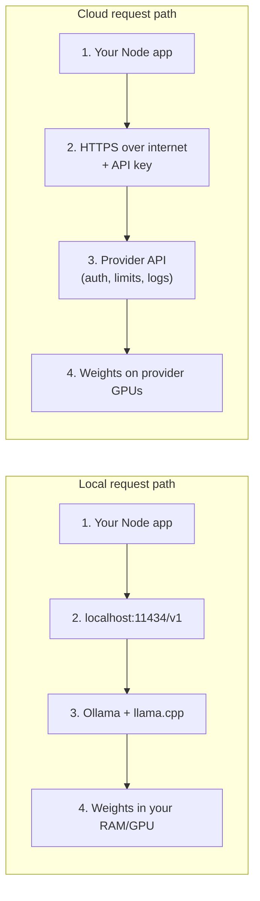
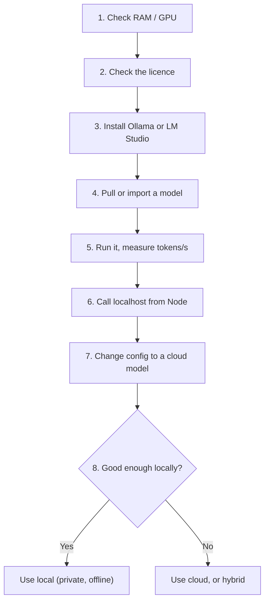
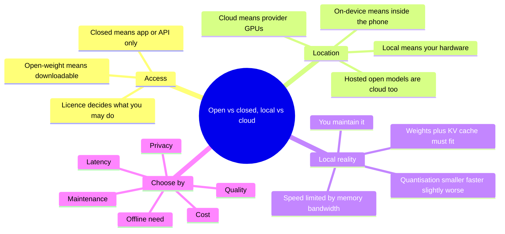

# A1-09 · Open vs closed, local vs cloud models

> **Lesson A1-09** · Type: Concept · Prerequisites: [A1-02 · AI models vs AI tools](./a1-02-ai-models-vs-ai-tools.md) (also uses A1-03 tokens and context, A1-04 generation and A1-06 privacy) · Leads to: A3-06, A9-03
>
> **Facts checked on:** 23 October 2026. Model names, licences, prices and app features change often; every fact has a dated source in section 19.
>
> **What was actually run for this guide:** Ollama 0.40.9 and llama.cpp (build 4413a19) on this lesson's workspace: a cloud machine with **2 CPU cores (Intel Xeon, 2.10 GHz), about 7 GiB RAM and no GPU**. Large models couldn't be downloaded here, so the benchmark uses **stories15M**, a tiny 24.4-million-parameter model that only writes children's stories. Its numbers are real and show the trade-offs clearly, but they are **not** what an 8B model will do on your laptop. The Node.js client ran for real against local Ollama, and was confirmed to reach Claude's API with a fake key (401). No cloud model was actually called.

**Why this lesson matters:** "Which model?" is only half the decision. The other half is **where it runs** and **what you're allowed to do with it**. Where the model runs decides who sees your data, what you pay, whether it works offline and how much maintenance you sign up for. The licence decides whether you can ship it in a product. For side projects and private experiments, open-weight models running on your own laptop are now a real option, as long as you know their limits.

## Learning goals

By the end of this lesson you will be able to:

1. Explain the two separate questions: **closed vs open-weight** (can you download the model?) and **local vs cloud** (whose computer runs it?).
2. Explain why **open-weight is not the same as open-source**, and read a model licence for the clauses that matter.
3. Run a model locally with **Ollama** or **LM Studio**, and explain **quantisation** as "smaller and faster, with some quality loss".
4. Estimate whether a model **fits your laptop** (RAM / GPU memory) and how fast it could be.
5. Call a local model and a cloud model from **Node.js** with the same code, switching only config.
6. Explain what **on-device AI** on phones is good for (concept; details in A9-03).
7. **Done when:** you can recommend local or cloud for three of your projects, with reasons (section 8).

---

## 1. The topic in one minute

- A **closed model** (Claude, GPT, Gemini) is only available through the provider's app or API. You never get the model file.
- An **open-weight model** (Llama, Qwen, Mistral, Gemma, gpt-oss) can be **downloaded**. Each comes with its own **licence**, and some licences restrict use.
- **Local** means the model runs on *your* machine (laptop, phone, office server). **Cloud** means it runs on someone else's GPUs and you send your data over the internet.
- These are **two different questions**. Open weights can run in the cloud (hosted open models), and closed models can never run locally.
- Local runtimes like **Ollama** and **LM Studio** make it easy, using **quantised** (compressed) model files: smaller and faster, with some quality loss.
- Trade-offs: **quality** (frontier cloud models win), **privacy** (local wins), **cost** (local has no per-token fee, but you pay in hardware, time and electricity), **latency**, and **maintenance** (local is your job).

**One-line memory trick:** *closed/open = can I get the file? local/cloud = whose computer does the work?*

**Analogy: food.**
- A **closed model** is a restaurant's secret dish. You can order it (app) or get it delivered (API), but you never get the recipe.
- An **open-weight model** is a recipe you can take home. The fine print may say "home use only" or "mention our brand if you sell this". That fine print is the **licence**.
- **Local** is cooking in your own kitchen: private and always available, but your kitchen (RAM, GPU) limits what you can cook, and the washing up (updates, setup) is yours.
- **Cloud** is a restaurant kitchen: bigger, faster, better chefs, but your order (your data) goes to them, and you pay per plate.
- **Quantisation** is like a ready-to-cook pack that's been compressed to fit your fridge: it saves space and time, and tastes nearly the same, but not exactly.

**Real-life example:** OpenAI's **gpt-oss-20b** (August 2025) is open-weight under the Apache 2.0 licence. OpenAI says it can run on devices with 16 GB of memory, so you can run it in Ollama on a 16 GB laptop with no internet. The same model is also **hosted** in the cloud: Groq lists it at $0.075 per million input tokens and $0.30 per million output tokens (checked 23 October 2026). Same weights, two very different ways to run them.

---

## 2. Detailed definitions and why they matter

### 2.1 Closed models

**Definition:** a closed (proprietary) model's weights are kept private by the provider. You can only use it through their apps or API, on their servers, under their terms.

**One-line meaning:** you rent access; you never own a copy.

**Examples (October 2026):** Claude (Haiku 5.5, Sonnet 5.5, Opus 5.5), OpenAI's GPT models (e.g. `gpt-6.1-sol`), Google's Gemini models.

**Why people use them:** usually the **best quality**, biggest context windows, built-in tools (search, code execution), no hardware to manage, and they scale from 1 user to 1 million.

**When they're NOT the right fit:** data that must not leave your device or company, offline use, very high-volume simple tasks where per-token costs add up, or when you need to control exactly which model version runs forever (closed models get retired).

### 2.2 Open-weight models

**Definition:** an open-weight model's **weights** (the billions of numbers learned in training, from A1-01) are published for download. You can run them on your own hardware or on any provider that hosts them, **under the terms of the model's licence**.

**One-line meaning:** you can download the model and run it yourself, if the licence allows your use.

**Examples (checked 23 October 2026), each with its own licence:**

| Family (maker) | Example model | Licence |
|---|---|---|
| **Llama** (Meta) | Llama 4 | **Llama 4 Community License** (custom; has conditions, see section 7) |
| **Qwen** (Alibaba) | Qwen3.8-27B | **Apache 2.0** (per its Hugging Face page) |
| **Mistral** (Mistral AI) | Mistral Small 4, Ministral 3 | **Apache 2.0**, but Mistral Medium 3.5 is "Modified MIT" and Voxtral TTS is **CC BY-NC 4.0** (non-commercial) |
| **Gemma** (Google) | Gemma 4 (E2B, E4B, 12B, 26B A4B, 31B) | **Apache 2.0** for Gemma 4; earlier Gemma versions used Google's own Gemma Terms of Use |
| **gpt-oss** (OpenAI) | gpt-oss-20b, gpt-oss-120b | **Apache 2.0** |

**Open-weight is not open-source.** The Open Source Initiative's **Open Source AI Definition 1.0** (October 2024) asks for much more than downloadable weights: the freedom to use the system "for any purpose and without having to ask for permission", "the complete source code used to train and run the system", and "sufficiently detailed information about the data used to train the system", all under OSI-approved terms. Most open-weight models share the weights only, not the training data or training code, and some licences add restrictions. So say "open-weight" unless you've checked.

### 2.3 Local vs cloud

**Definition:** **local** inference means the model's computation happens on hardware you control (your laptop, phone or office server). **Cloud** inference means it happens on a provider's servers, and your prompt travels over the internet to reach them.

**One-line meaning:** whose computer does the maths?

**Why it matters:** where the computation happens decides **who can see your data**, **whether it works offline**, **how fast it is** (your laptop vs a data-centre GPU), **how you pay** (per token vs hardware and electricity) and **who maintains it**.

### 2.4 Hosted open models

**Definition:** a provider runs open-weight models on its own GPUs and sells access through an API, just like a closed model.

**Examples (checked 23 October 2026):**
- **Groq** lists `openai/gpt-oss-20b` ($0.075 / $0.30 per million input / output tokens), `openai/gpt-oss-120b` ($0.15 / $0.60) and Llama models.
- **Amazon Bedrock** lists Llama 3.3 70B Instruct, Llama 4 Maverick 17B Instruct, Qwen3 32B, gpt-oss-120b, Gemma 4 31B, Mistral Large 3, DeepSeek-R1 and more, next to closed models like Claude. (Relevant for DoorSight, which already uses Bedrock.)
- **Ollama cloud models**: Ollama, the local runtime, now also offers models with a `:cloud` tag (for example `gemma4:cloud`) that "run on Ollama's servers". So "I used Ollama" no longer automatically means "it ran locally".

**Why use them:** open-weight model, data-centre speed, no hardware. **Watch out:** your data now goes to that provider, so the privacy benefit of open weights disappears. The model's licence still applies to what you build.

### 2.5 On-device AI (concept; details in A9-03)

**Definition:** a small model running **inside a phone** (or in a phone's operating system), so features work offline and data stays on the device.

**Examples (checked 23 October 2026):**
- **Android: Gemini Nano** runs in the AICore system service. Apps reach it through the ML Kit GenAI APIs for summarisation, proofreading, rewriting, image description and speech recognition, or through a Prompt API. Google's page says it lets you build features "without needing a network connection or sending data to the cloud". It's unavailable on some devices, so Google recommends **hybrid** fallback to a cloud model.
- **Apple: the Foundation Models framework** gives apps an on-device model that Apple says excels at "summarization, entity extraction, text and image understanding, refinement" and more; "when you need more reasoning capabilities and context size", Apple points you to Private Cloud Compute or a server model. It needs a device that supports Apple Intelligence.
- **Bring your own small model:** Gemma 4's small models are "built for ultra-mobile, edge, and browser deployment", with mobile versions of about 1.1 GB (E2B) and 2.5 GB (E4B).

---

## 3. Words you need first

| Term | Simple meaning |
|---|---|
| **Weights / parameters** | The numbers inside a model. "8B" means about 8 billion of them. |
| **Closed model** | Weights kept private; access only through the provider's app or API. |
| **Open-weight model** | Weights downloadable, under a licence. |
| **Open-source (AI)** | A stricter idea: weights *plus* training code *plus* detailed data information, under OSI-approved terms. |
| **Licence** | The legal terms for using the weights (and, separately, the app or runtime). |
| **Inference** | Running a model to get an answer (as opposed to training it). |
| **Runtime / inference engine** | The software that loads the weights and runs them: llama.cpp, Ollama, LM Studio. |
| **GGUF** | A single-file model format used by llama.cpp, Ollama and LM Studio. |
| **Quantisation** | Storing each weight with fewer bits (e.g. 4 instead of 16): smaller, often faster, slightly worse. |
| **Bits per weight (bpw)** | How many bits each weight takes on average. F16 = 16, Q8_0 ≈ 8.5, Q4_K_M ≈ 4.9. |
| **RAM / VRAM / unified memory** | System memory / a graphics card's own memory / memory shared by CPU and GPU (Apple Silicon). |
| **Memory bandwidth** | How fast data moves from memory to the processor. It limits how fast tokens can be generated. |
| **KV cache** | Memory the model uses to hold the current context (A1-03). Longer context = more memory. |
| **Tokens per second (t/s)** | Speed of reading the prompt or writing the answer. |
| **OpenAI-compatible API** | A server that accepts the same requests as OpenAI's API, so the same client code works. |
| **Hosted open model** | Open weights served by a cloud provider through an API. |
| **On-device AI** | A small model running on the phone itself. |

---

## 4. How it works

### 4.1 The comparison tables

**Table 1: closed vs open vs local vs cloud (the four words)**

| Term | What it means | Examples (Oct 2026) | Main benefit | Main catch |
|---|---|---|---|---|
| **Closed** | Weights private; use only through the provider's app or API | Claude, GPT, Gemini | Best quality, zero setup, built-in tools | Your data goes to the provider; per-token cost; models can change or be retired |
| **Open-weight** | Weights downloadable under a licence | Llama 4, Qwen3.8, Gemma 4, gpt-oss, Mistral Small 4 | Choice of where to run it; you control the version | Licence varies per model; usually below frontier quality |
| **Local** | The model runs on hardware you control | Ollama or LM Studio on a laptop; Gemini Nano on a phone | Privacy, works offline, no per-token fee | Limited by your RAM / GPU; slower; you maintain it |
| **Cloud** | The model runs on a provider's GPUs | Claude API; gpt-oss on Groq; Llama on Bedrock | Big models, fast, scales to many users | Needs internet; data handling depends on the provider; pay per use |

**Table 2: the four real deployment options, compared**

| | Closed model, cloud API | Open weights, hosted in cloud | Open weights, local laptop | On-device (phone) |
|---|---|---|---|---|
| **Quality ceiling** | Highest (frontier models) | High (largest open models) | Limited by your RAM; small and quantised models | Small models; short, simple tasks |
| **Who sees your prompts** | The provider | The hosting provider | Only your machine (unless the app adds cloud features) | Stays on the phone |
| **Cost model** | Per token | Per token (often cheaper) | Hardware + electricity + your time | Free per call; uses the user's battery |
| **Latency** | Network + queue; fast GPUs | Network + queue; fast GPUs | No network; speed depends on your hardware | No network; small model, slower chips |
| **Works offline?** | No | No | Yes | Yes |
| **Maintenance** | Provider's job | Provider's job | Yours: updates, disk space, model choice | Yours + device support differs |
| **Licence to check** | Provider's terms | Model licence + provider terms | Model licence + runtime terms | Platform terms (or model licence if you bundle one) |
| **Example** | Claude Haiku 5.5 | gpt-oss-20b on Groq | gpt-oss-20b in Ollama | Gemini Nano via ML Kit |

### 4.2 The request path: local vs cloud

**Diagram: where your prompt travels**



**How to read this diagram:** read each row left to right; the answer comes back the same way. In the **local** row, the request goes to `localhost` (your own machine) and never touches the internet; Ollama's FAQ says: "Ollama runs locally. We don't see your prompts or data when you run locally." In the **cloud** row, your prompt crosses the internet, is checked against your API key and rate limits, may be logged under the provider's data policy, and runs on their GPUs. The code in your app is almost identical in both rows: only the URL, key and model name change (section 6.1).

### 4.3 What a local runtime actually does

1. **You get a model file.** For Ollama and LM Studio, that's usually a **GGUF** file: the weights plus the tokenizer (A1-03) and settings, in one file.
2. **The runtime loads it into memory.** Ollama and LM Studio use **llama.cpp** under the hood (the Ollama download used here ships llama.cpp's `llama-server`). The weights go into RAM, GPU memory, or both.
3. **It runs the same generation loop as A1-04:** read the prompt (fast, all at once), then write the answer one token at a time (slower).
4. **It serves an API.** Ollama listens on `127.0.0.1:11434` by default; LM Studio's examples use port `1234`. Both offer OpenAI-compatible endpoints.
5. **It keeps the model warm.** Ollama keeps a model in memory "for 5 minutes before being unloaded", so the second request skips the loading time (section 5.3).

**Diagram: what has to fit in memory**

```
+--------------------------------------------------+
| 16 GB laptop running an 8B model (Q4_K_M)        |
+--------------------------------------------------+
| Operating system, browser, VS Code, Slack        |
| (varies: check Activity Monitor / Task Manager)  |
+--------------------------------------------------+
| Model weights            4.6 GiB                 |
+--------------------------------------------------+
| KV cache (8k context)    1.0 GiB                 |
+--------------------------------------------------+
| Runtime overhead + free headroom                 |
+--------------------------------------------------+
```

**How to read this diagram:** everything stacked here must fit in your memory at the same time. Your normal apps are already using part of it. The model weights are the biggest fixed block. The KV cache grows with the length of the conversation (A1-03): longer context, more memory. If the stack doesn't fit, the runtime either moves part of the model to slower memory or the whole computer slows down. Numbers are from `memory-calc.mjs` in section 6.2.

### 4.4 Quantisation: smaller and faster, with some quality loss

**Definition:** quantisation stores each weight with **fewer bits**. Original weights are often 16-bit numbers; a 4-bit version keeps a rougher approximation of each one.

**One-line meaning:** the same model, saved at lower precision.

**Analogy:** a phone photo saved as a smaller JPEG. It looks almost the same at normal size and takes far less space; zoom into fine detail and you see the loss.

**How to read the names** (llama.cpp / GGUF naming):
- `F32`, `F16`: full or half precision (32 or 16 bits per weight). No quantisation loss (F16 is the usual "original").
- `Q8_0`: about 8.5 bits per weight. Usually almost no visible loss.
- `Q4_K_M`: about 4.9 bits per weight. The common default for laptops.
- `Q3_K_M`, `Q2_K`: smaller still; quality drops noticeably.

**Published numbers for a real 8B model** (llama.cpp's own measurements for Llama 3 8B on an NVIDIA RTX 4090, from its perplexity README; **not run here**):

| Format | Size | Perplexity (lower = better) | Same top token as F16 |
|---|---|---|---|
| F16 | 14.97 GiB | 6.233 | (reference) |
| Q8_0 | 7.96 GiB | 6.234 | 97.7% |
| Q6_K | 6.14 GiB | 6.253 | 96.0% |
| Q4_K_M | 4.58 GiB | 6.407 | 91.9% |
| Q2_K | 2.96 GiB | 9.752 | 71.1% |

**What this shows:** Q4_K_M is **31%** of the F16 size, perplexity rises only **2.8%**, and the most likely next token matches F16 about **92%** of the time. Q2_K saves another third of the space, but perplexity jumps **56%**. "Perplexity" here simply means how surprised the model is by real text: lower is better.

**Averages hide bad moments.** The same llama.cpp table shows that for Q4_K_M, in the worst 0.1% of tokens, the probability of the correct token dropped by 56 percentage points or more. Most text looks fine; occasional words, numbers or rare-language tokens can go wrong. Test on **your** content (for you, that includes Hindi and Gujarati) before trusting a quantised model.

### 4.5 Hardware reality: laptop vs cloud GPUs

The rule of thumb: **weights size ≈ parameters × bits per weight ÷ 8**, plus the KV cache for your context, plus your operating system and apps. Here it is computed for common model sizes (script in section 6.2):

```text
Self-check against llama.cpp's Llama 3.1 8B sizes: OK

Weights only (GiB) |     F16 |    Q8_0 |    Q6_K |  Q4_K_M |  Q3_K_M
-------------------|---------|---------|---------|---------|--------
3B                 |     5.6 |     3.0 |     2.3 |     1.7 |     1.4
8B                 |    15.0 |     7.9 |     6.1 |     4.6 |     3.7
14B                |    26.1 |    13.9 |    10.7 |     8.0 |     6.5
27B                |    50.3 |    26.7 |    20.6 |    15.4 |    12.6
70B                |   130.4 |    69.3 |    53.5 |    39.9 |    32.6

KV cache for Llama 3.1 8B: 128 KiB per token of context
    4096 tokens of context -> 0.5 GiB extra
    8192 tokens of context -> 1.0 GiB extra
   32768 tokens of context -> 4.0 GiB extra
  131072 tokens of context -> 16.0 GiB extra

Upper bound for an 8B model at 9.5 GB/s memory bandwidth (real speed is lower):
  F16     <= 0.6 tokens/s
  Q8_0    <= 1.1 tokens/s
  Q4_K_M  <= 1.9 tokens/s
```

**What this output tells you:**
- On an **8 GB** laptop, a **3B** model at Q4_K_M (1.7 GiB) is comfortable; an 8B model (4.6 GiB) is tight once your browser and editor are open.
- On a **16 GB** laptop, **8B at Q4_K_M or Q8_0** fits, and so does gpt-oss-20b (OpenAI: "edge devices with 16 GB of memory").
- **27B** needs about 15 GiB at Q4_K_M: a 32 GB machine. **70B** needs about 40 GiB even at Q4_K_M: workstation or cloud territory.
- **Long context costs memory too:** 128k tokens of context on Llama 3.1 8B needs 16 GiB for the KV cache alone, more than the model itself.
- **Speed is limited by memory bandwidth.** Writing each token reads (roughly) all the weights. On this cloud machine (about 9.5 GB/s measured), an 8B Q4_K_M model could do **at most about 1.9 tokens per second**. Laptops with fast memory or a GPU do much better, which is why the same model feels very different on different machines.

**Where the memory lives:**
- **Apple Silicon Macs** use **unified memory**: the GPU can use most of the system RAM, so a 16 GB or 32 GB Mac runs local models well for its size.
- **Windows / Linux with an NVIDIA GPU**: speed depends on the GPU's own memory (**VRAM**). A model that doesn't fit in VRAM partly runs on the CPU and slows down.
- **CPU only:** works, but slowly (like this guide's cloud machine).
- **Cloud GPUs** have far more memory per card: OpenAI says gpt-oss-120b runs "efficiently on a single 80 GB GPU". That's not a laptop.

**Note for you:** your company laptop restricts desktop app installs, so do the local exercises on a personal machine. Don't work around IT policy.

### 4.6 Walkthrough: run a model locally, then switch the same app to the cloud

1. **Check your hardware:** RAM (and GPU memory if you have a GPU). Use the table in section 4.5 to pick a size: 3B for 8 GB, 8B or gpt-oss-20b for 16 GB.
2. **Check the licence** of the model you picked, for your use (personal experiment vs product).
3. **Install a runtime** (Ollama or LM Studio) on a personal machine.
4. **Get the model:** `ollama pull llama3.2` (2.0 GB, the 3B version) or import a GGUF file with a one-line `Modelfile` (`FROM ./model.gguf`).
5. **Run it and measure:** `ollama run llama3.2 --verbose` prints the tokens per second.
6. **Call it from Node.js** through `http://localhost:11434/v1` with the OpenAI SDK.
7. **Switch to a cloud model** by changing only config: base URL, API key and model name.
8. **Compare** quality, speed, cost and privacy on **your** task, and decide local, cloud or hybrid.

**Diagram: the walkthrough, step by step**



**How to read this diagram:** follow the numbers. Steps 1 and 2 are the ones beginners skip: hardware decides *what can run*, and the licence decides *what you may do with it*. Steps 6 and 7 use the same Node code, so the final comparison in step 8 is fair: same prompt, same client, only the model's location changes.

---

## 5. Benchmark numbers from this machine

### 5.1 The setup

- **Machine:** this lesson's cloud workspace: 2 CPU cores (Intel Xeon @ 2.10 GHz), about 7 GiB RAM, **no GPU**. Measured memory bandwidth: about 9.5 GB/s.
- **Model:** **stories15M** (24.4 million parameters, trained only on simple children's stories, 256-token context). A toy, chosen because it was the only model available offline here. It is a **base model**, not a chat model: it just continues a story.
- **Tools:** llama.cpp (build 4413a19): `llama-quantize` to make smaller versions, `llama-bench` for speed, `llama-perplexity` for quality; and **Ollama 0.40.9** to serve it like you would on a laptop.
- **Quality test:** I wrote 12 short children's stories (the test scored five 256-token chunks of them) and compared each smaller version with the full F32 model on that text: how often both pick the **same most-likely next token**, and **perplexity** (lower = better).
- The exact commands are in `run-benchmark.sh` (section 6.4).

### 5.2 Results: size, memory, speed and quality

**Real results** (speed = average of 5 runs ± variation):

| Format | Avg bits per weight | File size | Peak RAM | Reading prompt (tokens/s) | Writing answer (tokens/s) | Same top token as F32 | Perplexity (lower = better) |
|---|---|---|---|---|---|---|---|
| F32 | 32.00 | 93.8 MiB | 113.1 MiB | 8,355 ± 430 | 576 ± 45 | 100% (baseline) | 5.590 (baseline) |
| F16 | 16.00 | 47.3 MiB | 92.7 MiB | 7,938 ± 423 | 805 ± 34 | 99.7 ± 0.2% | 5.602 |
| Q8_0 | 8.50 | 25.4 MiB | 59.2 MiB | 18,978 ± 1,009 | 1,417 ± 24 | 98.0 ± 0.6% | 5.587 |
| Q5_0 | 6.64 | 20.0 MiB | 47.0 MiB | 6,304 ± 430 | 1,076 ± 79 | 88.5 ± 1.3% | 5.855 |
| Q4_0 | 6.01 | 18.2 MiB | 48.3 MiB | 17,288 ± 1,009 | 1,467 ± 87 | 80.9 ± 1.6% | 6.274 |

**Run-to-run variation** (the whole benchmark was run 3 times; real output):

```text
F32   writing tokens/s across 3 runs: 576, 588, 519  (spread 13%)
F16   writing tokens/s across 3 runs: 805, 782, 701  (spread 15%)
Q8_0  writing tokens/s across 3 runs: 1,417, 1,399, 1,410  (spread 1%)
Q5_0  writing tokens/s across 3 runs: 1,076, 1,112, 1,039  (spread 7%)
Q4_0  writing tokens/s across 3 runs: 1,467, 1,592, 1,464  (spread 9%)
```

**What the numbers say:**
- **Q8_0 is the sweet spot here:** 3.7× smaller than F32, **2.5× faster** at writing, perplexity unchanged (−0.1%), and the same top token 98% of the time.
- **Q4_0 vs Q8_0:** 28% smaller, but **no clear speed gain** (+3.6%, inside the run-to-run noise) and quality drops: the top token differs from F32 about **once every 5 tokens**, and perplexity is **12% worse**.
- **Smaller is not always faster:** Q5_0 was about **24% slower** than Q8_0. On a CPU, unpacking 5-bit numbers costs extra work, and this tiny model is probably limited by computation, not memory. For big models on a laptop, memory bandwidth is the limit, so smaller usually *is* faster: in llama.cpp's published 8B table, Q4_K_M writes 2.5× faster than F16.
- **The 4-bit format matters.** Q4_0 is an older, simpler 4-bit format; Q4_K_M is smarter. In llama.cpp's own Llama 3 8B scoreboard, Q4_0 raises perplexity by **7.5%** but Q4_K_M by only **2.8%**, and Q4_K_M keeps the same top token 92% of the time. So when a model offers Q4_K_M, prefer it. (At Q8_0, our tiny model and the 8B model lost about the same: 98.0% vs 97.7% same top token.)
- **Why does Q4_0 show 6.01 bits per weight, not 4?** In this tiny model, one big output table (35 of its 93 MiB) is kept at 8-bit for quality, which raises the average. Also, K-quants like Q4_K_M need row sizes divisible by 256, and this model's rows are 288 wide, so they weren't meaningful here.

### 5.3 The same model in Ollama: cold vs warm

The Q8_0 file was imported into Ollama with a three-line `Modelfile`:

```text
FROM ./stories15M-Q8_0.gguf
PARAMETER num_ctx 256
PARAMETER num_predict 60
```

Then `ollama create stories15m -f Modelfile` and `ollama run stories15m --verbose "Once upon a time, there was a little cat named"`. **Real output**, first after unloading the model (cold), then straight after (warm):

```text
== cold run
total duration:       351.912954ms
load duration:        264.20759ms
prompt eval count:    12 token(s)
prompt eval rate:     3591.74 tokens/s
eval count:           60 token(s)
eval rate:            814.03 tokens/s
== warm run
total duration:       78.049658ms
load duration:        666.782µs
prompt eval count:    12 token(s)
prompt eval rate:     620.35 tokens/s
eval count:           60 token(s)
eval rate:            835.63 tokens/s
```

**What it shows:** the first request paid **264 ms** to load the model; the second paid **0.7 ms**, because Ollama keeps models in memory for 5 minutes by default. For an 8B model on a laptop, that cold load can take several seconds, so the first message always feels slower. Ollama's writing speed (814–836 tokens/s) is a bit below `llama-bench`'s 1,400 because it includes the overhead of a real server; for a model this tiny, that overhead is a big share of the work.

### 5.4 Your laptop: fill this in

Run the intermediate exercise (section 11) and record your own numbers:

| Machine (CPU / GPU / RAM) | Model and quant | Download size | Cold load time | Prompt reading (tokens/s) | Writing (tokens/s) | Felt usable for chat? |
|---|---|---|---|---|---|---|
| | `llama3.2:1b` | 1.3 GB | | | | |
| | `llama3.2` (3B) | 2.0 GB | | | | |
| | (16 GB+ only) `gpt-oss:20b` | | | | | |

One simple test for chat: if the text appears faster than you can read it, it feels fine; if you're waiting for words, it doesn't. Prompt reading speed matters more when you paste long documents. Write down what *you* felt, since that's the decision that matters.

---

## 6. Practical code

Prerequisites: Node.js 20 or newer (tested here on Node 22.22.0) and `npm install openai` (tested with openai 7.43.0). For the local profile, Ollama running with a model pulled. For cloud profiles, an API key in an environment variable. **Never hardcode keys.**

### 6.1 One client, local or cloud (`llm-client.mjs`)

Ollama, LM Studio, Groq and Claude's compatibility layer all speak the **OpenAI-compatible** Chat Completions format. So one client works for all of them; only the base URL, key and model name change. This is the developer exercise.

```js
// llm-client.mjs: one code path for local and cloud models (OpenAI-compatible API).
// Switch models by config only:  LLM_PROFILE=ollama | lmstudio | claude | groq
// Setup: npm install openai
// Run:   node llm-client.mjs "Your prompt"
import OpenAI from "openai";

const PROFILES = {
  ollama: { baseURL: "http://localhost:11434/v1", keyEnv: null, model: "stories15m" },
  lmstudio: { baseURL: "http://localhost:1234/v1", keyEnv: null, model: "your-loaded-model" },
  claude: { baseURL: "https://api.anthropic.com/v1/", keyEnv: "ANTHROPIC_API_KEY", model: "claude-haiku-5-5" },
  groq: { baseURL: "https://api.groq.com/openai/v1", keyEnv: "GROQ_API_KEY", model: "openai/gpt-oss-20b" },
};

const profileName = process.env.LLM_PROFILE ?? "ollama";
const profile = PROFILES[/** @type {keyof typeof PROFILES} */ (profileName)];
if (!profile) throw new Error(`Unknown LLM_PROFILE "${profileName}". Use: ${Object.keys(PROFILES).join(", ")}`);

// Local servers ignore the key, but the SDK needs a non-empty string. Cloud keys come from env vars.
const apiKey = profile.keyEnv ? process.env[profile.keyEnv] : "not-needed-locally";
if (!apiKey) throw new Error(`Set ${profile.keyEnv} in your environment first.`);

const client = new OpenAI({ baseURL: process.env.LLM_BASE_URL ?? profile.baseURL, apiKey });
const model = process.env.LLM_MODEL ?? profile.model;
const prompt = process.argv[2] ?? "Once upon a time, there was a little cat named";

const t0 = performance.now();
let firstTokenAt = 0;
let text = "";
let completionTokens = 0;
let serverRate = 0; // Ollama and llama.cpp add a non-standard "timings" field; cloud APIs don't
const stream = await client.chat.completions.create({
  model,
  max_tokens: 60,
  stream: true,
  stream_options: { include_usage: true }, // ask for token counts in the last chunk
  messages: [{ role: "user", content: prompt }],
});
for await (const chunk of stream) {
  const delta = chunk.choices[0]?.delta?.content ?? "";
  if (delta && !firstTokenAt) firstTokenAt = performance.now();
  text += delta;
  if (chunk.usage) completionTokens = chunk.usage.completion_tokens;
  const timings = /** @type {any} */ (chunk).timings;
  if (timings?.predicted_per_second) serverRate = timings.predicted_per_second;
}
const end = performance.now();

console.log(`[${profileName}] model=${model} url=${client.baseURL}`);
console.log(text.trim());
// Client-side speed is fine for normal models; for very fast local models chunks arrive in bursts,
// so prefer the server's own number when it is available.
const clientRate = (completionTokens - 1) / ((end - firstTokenAt) / 1000);
const speed = serverRate ? `${serverRate.toFixed(1)} tokens/s (server-reported)` : `${clientRate.toFixed(1)} tokens/s (client-measured)`;
console.log(
  `time to first token: ${(firstTokenAt - t0).toFixed(0)} ms | total: ${(end - t0).toFixed(0)} ms | ` +
    `${completionTokens} tokens | generation speed: ${speed}`
);
```

**Real output: local Ollama** (`node llm-client.mjs`):

```text
[ollama] model=stories15m url=http://localhost:11434/v1
One day, Amanimimmam said, "I think I found an incredible piece of cheese!"
Amumberedimamam replied, "I know something better!"
Just then, Amena replied, "What? I found something delicious!"
Varam
time to first token: 150 ms | total: 155 ms | 60 tokens | generation speed: 689.7 tokens/s (server-reported)
```

The story is nonsense-ish because stories15M is a tiny story model, not a chat model; the point is the plumbing and the timing. With `llama3.2` or `gpt-oss:20b` on your laptop, set `LLM_MODEL` to that name.

**Real output: switching to the cloud** (`LLM_PROFILE=claude`, with a deliberately fake key):

```text
AuthenticationError: 401 Invalid Anthropic API Key
```

The 401 shows the same code reached Claude's API; only the key was rejected. **No cloud model answered here.** With a real `ANTHROPIC_API_KEY`, the same script prints Claude Haiku 5.5's answer and a client-measured speed (cloud APIs don't send llama.cpp's `timings` field).

**Real output: two common mistakes** (LM Studio not running; Groq key not set):

```text
APIConnectionError: Connection error.
Error: Set GROQ_API_KEY in your environment first.
```

**Notes:**
- Ollama says the API key is "required but ignored" locally; the script sends a dummy string.
- Claude's OpenAI compatibility layer is, in Anthropic's words, "primarily intended to test and compare model capabilities, and is not considered a long-term or production-ready solution for most use cases". For a real Claude app, use the official Claude SDK (A1-08 did).
- "Compatible" doesn't mean identical. Each server ignores or rejects some fields (for example, Claude's layer ignores `response_format`, and current Claude models reject non-default `temperature`). Test every profile you plan to use.
- The Groq profile wasn't run here (this workspace can't reach Groq), so treat it as documented, not tested.

### 6.2 Will it fit, and how fast could it be? (`memory-calc.mjs`)

```js
// memory-calc.mjs: will a model fit on my laptop, and how fast could it be?
// Bits per weight come from llama.cpp's quantize README (Llama 3.1 8B table, checked 23 Oct 2026).
// Run: node memory-calc.mjs
const BPW = { F16: 16.0005, Q8_0: 8.5008, Q6_K: 6.5633, Q4_K_M: 4.8944, Q3_K_M: 3.996 };
const GiB = 2 ** 30;
const weightsGiB = (params, bpw) => (params * bpw) / 8 / GiB;

// Self-check against llama.cpp's published sizes for Llama 3.1 8B (8.03B parameters).
for (const [q, want] of [["Q4_K_M", 4.58], ["Q8_0", 7.95], ["F16", 14.96]]) {
  const got = weightsGiB(8.03e9, BPW[/** @type {keyof typeof BPW} */ (q)]).toFixed(2);
  if (Number(got) !== want) throw new Error(`self-check failed for ${q}: ${got} vs ${want}`);
}
console.log("Self-check against llama.cpp's Llama 3.1 8B sizes: OK\n");

/** @type {[string, number][]} */
const models = [["3B", 3e9], ["8B", 8.03e9], ["14B", 14e9], ["27B", 27e9], ["70B", 70e9]];
const quants = /** @type {(keyof typeof BPW)[]} */ (Object.keys(BPW));
console.log("Weights only (GiB) | " + quants.map((q) => q.padStart(7)).join(" | "));
console.log("-------------------|-" + quants.map(() => "-------").join("-|-"));
for (const [name, params] of models) {
  console.log(`${name.padEnd(18)} | ` + quants.map((q) => weightsGiB(params, BPW[q]).toFixed(1).padStart(7)).join(" | "));
}

// The context also needs memory (the KV cache). Llama 3.1 8B: 32 layers, 8 KV heads,
// 128 values per head, keys + values, 2 bytes each (FP16 cache).
const kvBytesPerToken = 2 * 32 * 8 * 128 * 2;
console.log(`\nKV cache for Llama 3.1 8B: ${kvBytesPerToken / 1024} KiB per token of context`);
for (const ctx of [4096, 8192, 32768, 131072]) {
  console.log(`  ${String(ctx).padStart(6)} tokens of context -> ${((ctx * kvBytesPerToken) / GiB).toFixed(1)} GiB extra`);
}

// Speed ceiling: each new token reads (roughly) all the weights once, so
// tokens/s <= memory bandwidth / weight size. Bandwidth measured on this cloud machine.
const MEASURED_GB_PER_S = 9.5;
console.log(`\nUpper bound for an 8B model at ${MEASURED_GB_PER_S} GB/s memory bandwidth (real speed is lower):`);
for (const q of ["F16", "Q8_0", "Q4_K_M"]) {
  const bytes = weightsGiB(8.03e9, BPW[/** @type {keyof typeof BPW} */ (q)]) * GiB;
  console.log(`  ${q.padEnd(7)} <= ${(MEASURED_GB_PER_S * 1e9 / bytes).toFixed(1)} tokens/s`);
}
```

Run it with `node memory-calc.mjs`. The **real output** is in section 4.5. The self-check at the top makes sure the formula reproduces llama.cpp's published sizes before it prints anything.

### 6.3 Money vs time (`local-vs-cloud-cost.mjs`)

A privacy-sensitive job: summarise 1,000 internal notes. Cloud prices are real; the local speeds are **example values** for you to replace with your own measurements.

```js
// local-vs-cloud-cost.mjs: summarise 1,000 private notes. Money (cloud) vs time (local).
// Cloud prices: Claude pricing page and Groq models page, checked 23 Oct 2026 (USD per million tokens).
// LOCAL_* speeds are EXAMPLE values: replace them with your own numbers from the Ollama exercise.
const jobs = 1000, inputTokens = 1500, outputTokens = 150;

const cloud = {
  "Claude Haiku 5.5 (closed)": { input: 0.1, output: 0.5 },
  "Claude Sonnet 5.5 (closed)": { input: 2, output: 10 },
  "gpt-oss-20b on Groq (open weights, hosted)": { input: 0.075, output: 0.3 },
  "gpt-oss-120b on Groq (open weights, hosted)": { input: 0.15, output: 0.6 },
};
console.log(`Job: ${jobs} notes x (${inputTokens} tokens in + ${outputTokens} tokens out)\n`);
for (const [name, p] of Object.entries(cloud)) {
  const usd = (jobs * (inputTokens * p.input + outputTokens * p.output)) / 1e6;
  console.log(`${name.padEnd(44)} $${usd.toFixed(2)}`);
}

const LOCAL_PROMPT_TOKENS_PER_S = 200; // example: reading the prompt
const LOCAL_GEN_TOKENS_PER_S = 20; // example: writing the answer
const secs = jobs * (inputTokens / LOCAL_PROMPT_TOKENS_PER_S + outputTokens / LOCAL_GEN_TOKENS_PER_S);
console.log(`\nLocal model (example speeds ${LOCAL_PROMPT_TOKENS_PER_S}/${LOCAL_GEN_TOKENS_PER_S} tokens/s): $0 in API fees,`);
console.log(`but about ${(secs / 3600).toFixed(1)} hours of your laptop running at full load.`);
```

**Real output:**

```text
Job: 1000 notes x (1500 tokens in + 150 tokens out)

Claude Haiku 5.5 (closed)                    $0.23
Claude Sonnet 5.5 (closed)                   $4.50
gpt-oss-20b on Groq (open weights, hosted)   $0.16
gpt-oss-120b on Groq (open weights, hosted)  $0.32

Local model (example speeds 200/20 tokens/s): $0 in API fees,
but about 4.2 hours of your laptop running at full load.
```

**What it shows:** for this job, cloud APIs cost between **$0.16 and $4.50**. A local model costs $0 in fees but keeps your laptop busy for hours. So for most side projects, **local is not chosen to save money**; it's chosen for **privacy, offline use, or learning**. Local starts to win on money only at large, steady volumes on hardware you already have.

### 6.4 Reproduce the benchmark (`run-benchmark.sh`, optional advanced)

These are the exact steps behind section 5. You need llama.cpp built from source (`cmake -B build && cmake --build build --target llama-quantize llama-bench llama-perplexity`), a GGUF model and a text file to score.

```bash
#!/usr/bin/env bash
# run-benchmark.sh: quantise one GGUF model, then measure size, speed and quality loss.
# Needs llama.cpp built (llama-quantize, llama-bench, llama-perplexity) and a text file to score.
# Usage: ./run-benchmark.sh model-F32.gguf eval.txt   (BIN=path/to/llama.cpp/build/bin)
set -euo pipefail
BIN=${BIN:-./build/bin}
SRC=$1; TEXT=$2; THREADS=${THREADS:-2}

cp "$SRC" model-F32.gguf
for q in F16 Q8_0 Q5_0 Q4_0; do
  "$BIN/llama-quantize" model-F32.gguf "model-$q.gguf" "$q" "$THREADS" > "quantize-$q.log" 2>&1
done

# Speed: 128-token prompt reading (pp128) and 128-token writing (tg128), 5 repeats each.
"$BIN/llama-bench" -m model-F32.gguf -m model-F16.gguf -m model-Q8_0.gguf -m model-Q5_0.gguf \
  -m model-Q4_0.gguf -p 128 -n 128 -t "$THREADS" -r 5 -o md 2>/dev/null | tee bench.md

# Quality: save the F32 model's next-token probabilities, then compare each smaller version to them.
"$BIN/llama-perplexity" -m model-F32.gguf -f "$TEXT" -c 256 -t "$THREADS" --kl-divergence-base base.kld > ppl-F32.txt 2>&1
for q in F16 Q8_0 Q5_0 Q4_0; do
  "$BIN/llama-perplexity" -m "model-$q.gguf" -t "$THREADS" --kl-divergence-base base.kld --kl-divergence > "kld-$q.txt" 2>&1
  echo "$q: $(grep -E '^Same top p:' "kld-$q.txt")"
done
```

**Real output of a full rerun** (the speed numbers differ slightly from section 5.2, which is the run-to-run variation; the quality numbers are identical because they are deterministic):

```text
| model                          |       size |     params | backend    | threads |            test |                  t/s |
| ------------------------------ | ---------: | ---------: | ---------- | ------: | --------------: | -------------------: |
| llama ?B (guessed) all F32     |  93.11 MiB |    24.41 M | CPU        |       2 |           pp128 |    7722.18 ± 1107.95 |
| llama ?B (guessed) all F32     |  93.11 MiB |    24.41 M | CPU        |       2 |           tg128 |       519.38 ± 42.20 |
| llama ?B F16                   |  46.56 MiB |    24.41 M | CPU        |       2 |           pp128 |     8115.68 ± 417.77 |
| llama ?B F16                   |  46.56 MiB |    24.41 M | CPU        |       2 |           tg128 |       701.37 ± 81.26 |
| llama ?B Q8_0                  |  24.74 MiB |    24.41 M | CPU        |       2 |           pp128 |    20645.75 ± 547.51 |
| llama ?B Q8_0                  |  24.74 MiB |    24.41 M | CPU        |       2 |           tg128 |      1410.28 ± 62.60 |
| llama ?B Q5_0                  |  19.31 MiB |    24.41 M | CPU        |       2 |           pp128 |     6067.43 ± 202.89 |
| llama ?B Q5_0                  |  19.31 MiB |    24.41 M | CPU        |       2 |           tg128 |      1038.65 ± 44.91 |
| llama ?B Q4_0                  |  17.50 MiB |    24.41 M | CPU        |       2 |           pp128 |   16955.76 ± 1887.83 |
| llama ?B Q4_0                  |  17.50 MiB |    24.41 M | CPU        |       2 |           tg128 |      1464.32 ± 80.28 |

build: 4413a19 (1)
F16: Same top p: 99.685 ± 0.223 %
Q8_0: Same top p: 97.953 ± 0.562 %
Q5_0: Same top p: 88.504 ± 1.267 %
Q4_0: Same top p: 80.945 ± 1.560 %
```

---

## 7. Licences: what "open" actually lets you do

> **Licence caution box: read before you ship**
>
> - **"Open-weight" is not a licence.** Each model has its own licence, and it can differ **within one family**. Mistral publishes models under Apache 2.0, a "Modified MIT" licence (Mistral Medium 3.5) and **CC BY-NC 4.0** (Voxtral TTS: **non-commercial**).
> - **Custom licences add conditions.** The Llama 4 Community License (effective 5 April 2025) requires you to "prominently display 'Built with Llama'", to include "Llama" at the beginning of the name of any model you build from it, to follow Meta's Acceptable Use Policy, and, if your products had more than **700 million monthly active users**, to request a separate licence from Meta.
> - **Licences change between versions.** Gemma 4 uses Apache 2.0; earlier Gemma versions used Google's own Gemma Terms of Use. Check the exact version you download.
> - **Quantised copies and fine-tunes still carry the original licence's conditions.** A GGUF uploaded by a stranger is still a copy of the original model (Llama's attribution and naming rules, for example, cover derivatives), and the upload page may not repeat the terms. Go back to the original model's page.
> - **The app has a licence too.** Ollama and llama.cpp are MIT-licensed. LM Studio is closed-source; its terms (version 23 August 2026) license it for "personal and / or internal business purposes" and rule out using it as a "software-as-a-service". A free download is not permission to build a paid service on it.
> - **Hosted providers add their own terms** on top of the model licence.
> - **Not legal advice.** For a real product, save the licence text with the date, and ask someone qualified if anything is unclear.

**A quick licence checklist for a model you want to use in a product:**

- [ ] Which exact model and version? (Name, size, date.)
- [ ] Licence name and link, saved with the date you read it.
- [ ] Commercial use allowed? Any user-count limit?
- [ ] Attribution or naming rules ("Built with …", name prefixes)?
- [ ] Acceptable-use or prohibited-use policy you must follow and pass on to your users?
- [ ] Rules on using its outputs to train other models?
- [ ] Is the runtime or app you ship with also licensed for your use?

---

## 8. The four lesson questions, answered

### Q1. When would you choose a local model over a cloud one?

Choose **local** when at least one of these is true, **and** a smaller model is good enough for the task:

- **Privacy:** the data must not leave your machine (client documents, personal data, unreleased code your company allows you to process locally).
- **Offline:** it has to work without internet (travel, a kirana shop with a patchy connection, a demo in a basement).
- **Learning and experiments:** you want to see tokens, quantisation and speed for yourself, with no bill.
- **Control:** you want the exact same model version forever, with no surprise retirement or behaviour change.
- **Big steady volume on hardware you already own:** only then does it usually save money (section 6.3).

Choose **cloud** when you need the best quality, long context, strong reasoning, multimodal input, many users at once, or simply no setup. For many apps the honest answer is **hybrid**: a small local or on-device model for quick, private tasks, and a cloud model when the task is hard.

### Q2. What does quantisation trade away?

It trades **precision** for **size and (usually) speed**:
- **Quality:** small on average for a good format (Llama 3 8B at Q4_K_M: perplexity +2.8%, same top token 92% of the time), larger at low bits (Q2_K: +56%). In this guide's own benchmark, a tiny model in the older Q4_0 format lost more: 81% top-token agreement and 12% worse perplexity.
- **Rare-case reliability:** averages hide bad moments. In the worst 0.1% of tokens, Q4_K_M dropped the correct token's probability by 56 percentage points or more. Numbers, rare words and less common languages are where to test.
- **Not always speed:** on a CPU with a tiny model, Q5_0 was 24% *slower* than Q8_0. On laptops with big models, smaller is usually faster, because memory bandwidth is the limit.
- **It doesn't shrink the context's memory:** the KV cache is separate (16 GiB for 128k tokens on Llama 3.1 8B).

### Q3. Is an open-weight model always free for commercial use?

**No.** "Open-weight" only says you can download it. The **licence** decides what you can do: Apache 2.0 (Qwen3.8-27B, Gemma 4, gpt-oss, many Mistral models) is permissive; the Llama 4 Community License adds attribution, naming, an acceptable-use policy and a 700-million-user threshold; some models are **non-commercial** (Mistral's Voxtral TTS, CC BY-NC 4.0). And even with a permissive licence, it isn't *free to run*: you pay for hardware, hosting or a provider's per-token price. See the caution box in section 7.

### Q4. What is on-device AI good for in a mobile app?

Good for **short, frequent, private tasks** that must feel instant or work offline: summarising a note or chat, proofreading and rewriting a message, classifying or tagging content, extracting fields, describing an image, speech-to-text. Android's Gemini Nano offers these through the ML Kit GenAI APIs; Apple's Foundation Models framework offers similar tasks on Apple Intelligence devices.

**Limits:** small models (weaker reasoning and knowledge), not every phone supports it, token limits, battery and heat, and app size if you bundle your own model (Gemma 4's mobile versions are about 1.1 GB and 2.5 GB). Both Google and Apple point to **hybrid** designs: fall back to a cloud model when the device can't do it or the task is too hard. From React Native, this means a native module or bridge; A9-03 covers it properly.

### 8.5 "Done when": local or cloud for three of your projects

| Project | Recommendation | Reasons |
|---|---|---|
| **DoorSight AI** (Android accessibility companion; Ring camera + Amazon Bedrock spoken descriptions) | **Cloud** (Bedrock) for the main description. **Test** an on-device fallback later. | Description quality is the product for blind and low-vision users, so use a strong model. Phones vary a lot, so on-device quality would be uneven. Bedrock already offers both closed (Claude) and open-weight models (Gemma 4 31B, Llama 4 Maverick, Qwen3 and more), so you can compare quality and price **without leaving AWS** (check which of them accept image input on Bedrock first). Gemini Nano's on-device image description could be an offline fallback on supported phones, but test whether it's good enough before promising it. Tell users that camera frames go to the cloud. |
| **GlamQuote AI** (React Native + Expo; YouCam try-on; Gemini text recommendations) | **Cloud** (stay with Gemini). | Recommendations are low-volume, and quality matters more than offline use. Try-on already runs on YouCam's API. Bundling a 1–2 GB model into an Expo beauty app would hurt downloads for little gain. On-device text could be an extra later, not a need now. |
| **Shop Suite** (offline-first billing for kirana shops; Expo + Electron) | **Local / on-device** for any AI feature, with cloud as an optional extra. | "Offline-first" is the core promise, and shop sales data is private. Good candidates: smart item search, matching Hindi or Gujarati item names, summarising the day's sales. Prices, totals and GST stay in plain code (A1-07). If the Electron app ships a model, both the **runtime** (llama.cpp: MIT) and the **model** (for example an Apache 2.0 model) must allow distribution; LM Studio's terms rule out distributing it, so it can't be bundled. |

---

## 9. Related concepts and differences

### 9.1 Ollama vs LM Studio vs llama.cpp

| | **llama.cpp** | **Ollama** | **LM Studio** |
|---|---|---|---|
| **What it is** | The core open-source inference engine (C/C++) | A runtime + model manager built on llama.cpp | A desktop app with a GUI, model browser and local server |
| **How you use it** | Command line, build from source or download a release | Command line + simple app; `ollama run`, `ollama pull` | Click to download and chat; developer server mode |
| **Local API** | `llama-server` (OpenAI-compatible) | `http://localhost:11434/v1` | `http://localhost:1234/v1` (examples use port 1234) |
| **Licence** | MIT | MIT | Closed-source; personal and internal business use |
| **Best for** | Benchmarks, custom builds, embedding in your own app | Developers who want quick local models + an API | Beginners who prefer a GUI; quick model comparison |
| **Cloud twist** | – | Also offers `:cloud` models that run on Ollama's servers | – |

### 9.2 Confusing pairs

| Pair | The difference |
|---|---|
| **Open-weight vs open-source** | Downloadable weights vs weights + training code + data information under OSI-approved terms. |
| **Local vs on-device** | Local = hardware you control (laptop, server). On-device = specifically inside a phone or other consumer device, usually with a small built-in model. |
| **Hosted open model vs closed API** | Both are cloud APIs. The hosted open model could also be run elsewhere (or locally); the closed one can't. |
| **Quantised big model vs small full-precision model** | An 8B model at Q4_K_M (4.6 GiB) takes less memory than a 3B model at F16 (5.6 GiB). The bigger quantised model is often the better use of the same memory, but test on your task. |
| **OpenAI-compatible API vs OpenAI's model** | "Compatible" describes the request format. The model behind it can be anything: Llama in Ollama, Claude, gpt-oss on Groq. |
| **Free licence vs free to run** | Apache 2.0 costs nothing to use, but hardware, electricity or hosting still cost money. |
| **Model vs tool** (A1-02) | `gpt-oss-20b` is a model. Ollama, LM Studio and ChatGPT are tools around models. |

---

## 10. Benefits, limits, common mistakes, safety and privacy

**Benefits, in one place:** local and open-weight models give you privacy, offline use, version control, no per-token bill, and a way to really *see* how models behave. Cloud and closed models give you the best quality, scale and zero maintenance. Hosted open models sit in between: open weights at data-centre speed.

### 10.1 Wrong mental models, corrected

**Wrong model 1: "Open-weight means open-source software."**
**Corrected:** open-weight means you can download the weights. The licence can still restrict use (Llama's conditions, non-commercial Mistral models), and the training data and code are usually not published. Use the word the licence supports.

**Wrong model 2: "A model on my laptop will match Claude or GPT."**
**Corrected:** laptop models are smaller and quantised. They're good for focused tasks (summaries, extraction, simple code, experiments) and weaker at long reasoning, broad knowledge and long context. Even OpenAI's laptop-friendly gpt-oss-20b is the *smaller* of its two open models; the larger one needs an 80 GB GPU.

**Wrong model 3: "Local is automatically private."**
**Corrected:** only the parts that really run locally are private. Ollama's `:cloud` models run on Ollama's servers; apps can add web search or sync features; and a local server opened to your network can be reached by others. Ollama's docs say you can "disable cloud features" to stay local-only. The simplest proof: **turn off Wi-Fi** and see if it still works.

**Wrong model 4: "Smaller files are always faster."**
**Corrected:** usually true for big models on laptops (memory-bound), but in this guide's CPU benchmark Q5_0 was 24% slower than Q8_0. Measure on your machine.

### 10.2 Common mistakes

1. **Skipping the licence check** before using a model in a product (section 7).
2. **Downloading GGUF files from unknown uploaders.** Prefer the model maker's official page or a well-known publisher, and treat files like any download.
3. **Opening the local server to the network** (`OLLAMA_HOST=0.0.0.0`) on shared or café Wi-Fi. The docs show how to do it, but not a login step, so keep it on `127.0.0.1` unless you add your own protection.
4. **Forgetting context memory:** a model that fits at 4k context can run out of memory at 32k.
5. **Judging speed from the first message:** the first request includes loading the model (264 ms vs 0.7 ms here; seconds for big models).
6. **Comparing different quantisations without saying so:** "Llama 8B" at Q2_K and at Q8_0 are very different models in practice.
7. **Installing on a locked-down company laptop** against IT policy. Use a personal machine.
8. **Forgetting battery and heat** on laptops and phones: local inference runs the chip hard.

### 10.3 Safety and privacy notes

- **Safety becomes your job.** Cloud providers add their own safety systems. With local weights, your app must add input and output checks. Licences like Llama's come with an acceptable-use policy you must follow. On Android, AICore "applies built-in safety filters" for Gemini Nano.
- **Fake data first:** test any new tool (local or cloud) with **made-up** personal data, as in the beginner exercise.
- **Know your data path:** for each feature, write down where prompts go (device, your server, which provider) and tell your users.
- **Updates:** a local model never updates itself. That's stability, but also means no fixes unless you pull a newer version.

---

## 11. Hands-on exercises

### Beginner (no code): cloud vs local on fake personal data

1. Copy this **fake** document (every name, number and address is made up):

   ```text
   Customer follow-up notes (FAKE DATA FOR TESTING)
   1. Ramesh Fakename, +91 00000 00001, ramesh@example.com, Flat 12, Test Nagar, Sample City.
      Wants a refund of Rs 2,499 for order TEST-1001. Upset about a 6-day delivery delay.
   2. Priya Testwala, +91 00000 00002, priya@example.com. Wants her billing address changed
      to 45 Demo Road, Sample City. Shared her (fake) PAN ABCDE1234F on the call.
   3. Arjun Dummy, +91 00000 00003, arjun@example.com. Asked for a GST invoice for order
      TEST-1002 (Rs 18,750). Says he will cancel if he doesn't get it by Friday.
   ```

2. **Cloud:** paste it into Claude, ChatGPT or Gemini (a temporary or incognito chat; A1-06) with: *"Summarise these notes in 3 bullet points for my manager. Do not include any names, phone numbers, emails, addresses or ID numbers."*
3. **Local:** do the same in Ollama (`ollama run llama3.2`) or LM Studio with a small model.
4. **Turn off Wi-Fi** and run the local one again. Then try the cloud one.
5. Compare in a small table: **accurate?** (3 requests, 2 amounts, 1 deadline), **leaked anything?** (search the summary for `00000`, `example.com`, `ABCDE`, `Fakename`), **time taken**, **where the data went**.

**Expected outcome:** the cloud summary is usually more complete and follows the "no identifiers" rule better; the small local model may miss a detail or leak an identifier despite the instruction. The local model still works with Wi-Fi off; the cloud one doesn't.

**How to verify:** tick each fact (3 requests, Rs 2,499, Rs 18,750, "by Friday") against the source, and search each summary for the identifier strings above. Write one line: "For private notes like this, I'd use ___ because ___."

### Intermediate (tool-based): run a small model and measure tokens per second

1. On a **personal** machine, install **Ollama** (or LM Studio).
2. Pull two sizes: `ollama pull llama3.2:1b` (1.3 GB) and `ollama pull llama3.2` (the 3B version, 2.0 GB).
3. Run each with timing: `ollama run llama3.2 --verbose "Explain React's useEffect in three lines."`
4. Note `load duration`, `prompt eval rate` (reading) and `eval rate` (writing). Run **3 times**.
5. Run `ollama stop llama3.2`, then run once more to see a **cold** load again.
6. Fill in the table in section 5.4. If you use LM Studio instead, start its local server and measure with `LLM_PROFILE=lmstudio node llm-client.mjs` (section 6.1).

**Expected outcome:** the 1B model writes faster than the 3B model; the first (cold) run has a much longer load time than warm runs; your numbers are far lower than this guide's tiny-model numbers (Llama 3.2 1B and 3B are roughly 50× and 130× bigger than stories15M), and very different from any number online, because they depend on your chip and memory.

**How to verify:** your three warm runs should be within roughly 10–15% of each other (this guide's runs varied by 1–15%). If one run is far off, close other heavy apps and rerun. Compare the 1B and 3B writing speeds: the ratio should be roughly in line with their size difference.

### Developer (optional): local endpoint, then cloud, by config only

1. Copy `llm-client.mjs` (section 6.1) and run `npm install openai`.
2. Run it against Ollama: `LLM_MODEL=llama3.2 node llm-client.mjs "Give me 3 test cases for a login form."`
3. Switch to the cloud **without editing code**: `LLM_PROFILE=claude ANTHROPIC_API_KEY=... node llm-client.mjs "Give me 3 test cases for a login form."` (or `groq` with a Groq key).
4. Optional: try `LLM_PROFILE=lmstudio LLM_MODEL=<model loaded in LM Studio>`.
5. Compare the two answers, time to first token, and speed.

**Expected outcome:** the same script works for both; the local run has no network delay but writes more slowly (for real models) and gives a simpler answer; the cloud answer is usually better. Errors look like section 6.1's examples if a server isn't running or a key is missing.

**How to verify:** `git diff` (or a file compare) shows **no code changes** between runs, only different environment variables. Save both outputs side by side.

---

## 12. FAQ

**Do I need a GPU to run models locally?**
No. CPU-only works for small models (this guide's benchmark had no GPU). Apple Silicon Macs (unified memory) and PCs with an NVIDIA GPU are much faster.

**Is Ollama free?**
Ollama's software is MIT-licensed and free for local use. Its **cloud** models need an account and are covered by its pricing page; you can disable cloud features to stay local-only.

**Which model should I start with?**
On 8 GB RAM: `llama3.2:1b` or `llama3.2` (3B). On 16 GB: the 3B models comfortably, or try `gpt-oss:20b` (OpenAI says it runs with 16 GB of memory). Check each licence.

**What's the difference between GGUF and MLX models?**
GGUF is the llama.cpp file format used across Ollama and LM Studio. MLX is Apple's machine-learning framework for Apple Silicon; Ollama's library lists `-mlx` tags for some models. On a Mac, try both and measure.

**Are local models safe from prompt injection and hallucinations?**
No. They're the same kind of model (A1-07), usually smaller, so they can be *more* error-prone. Local only changes where they run.

**Is quantisation the same as a "distilled" model?**
No. Quantisation stores the **same** model at lower precision. A distilled model is a **different, smaller** model trained to imitate a bigger one. (How training works is outside this course.)

**Can my existing tools use a local model?**
If a tool lets you set a custom OpenAI-compatible base URL, point it at `http://localhost:11434/v1` (Ollama) or `http://localhost:1234/v1` (LM Studio). Check each tool's settings and docs.

**Does "open-weight" mean I can see how the model was trained?**
Usually not. Most open-weight releases share the weights and a model card, not the full training data or code.

---

## 13. Mini glossary

| Term | Meaning |
|---|---|
| **Closed model** | Weights kept private; use only through the provider's app or API. |
| **Open-weight model** | Weights published for download, under a specific licence. |
| **Open-source AI (OSI definition)** | Weights + complete training and running code + detailed data information, all under OSI-approved terms. |
| **Licence** | The legal terms for using model weights, apps or runtimes. |
| **Local inference** | Running a model on hardware you control. |
| **Cloud inference** | Running a model on a provider's servers over the internet. |
| **Hosted open model** | Open weights served by a cloud provider through an API. |
| **On-device AI** | A small model running on a phone or other consumer device. |
| **Runtime / inference engine** | Software that loads and runs a model (llama.cpp, Ollama, LM Studio). |
| **GGUF** | Single-file model format for llama.cpp-based runtimes. |
| **Quantisation** | Storing weights with fewer bits: smaller and usually faster, with some quality loss. |
| **Bits per weight** | Average bits used to store each weight (F16 = 16, Q4_K_M ≈ 4.9). |
| **Perplexity** | How surprised a model is by real text; lower is better. |
| **Same top token** | How often a smaller version picks the same most-likely next token as the original. |
| **KV cache** | Memory that holds the current context; grows with context length. |
| **Memory bandwidth** | Speed of moving data from memory to the processor; caps tokens per second. |
| **Unified memory** | Memory shared by CPU and GPU (Apple Silicon). |
| **VRAM** | A graphics card's own memory. |
| **OpenAI-compatible API** | An API that accepts OpenAI-style requests, so the same client works. |
| **Cold / warm start** | First request that loads the model / later requests while it stays in memory. |
| **Hybrid inference** | Using an on-device or local model first and a cloud model as fallback. |

---

## 14. Quiz

1. Which two separate questions do "closed vs open" and "local vs cloud" answer?
2. True or false: if a model's weights are downloadable, you may use it in any commercial product.
3. Name two conditions in the Llama 4 Community License.
4. An 8B model at Q4_K_M needs about how much memory for its weights, and how much extra for 32k tokens of context (Llama 3.1 8B)?
5. In this guide's benchmark, what happened to quality when going from Q8_0 to Q4_0 on stories15M?
6. Why can a smaller quantised file sometimes be *slower*?
7. You used Ollama, so your prompt definitely never left your laptop. True or false? Why?
8. Give two things on-device AI is good for in a mobile app, and two of its limits.
9. Your app works with Ollama at `http://localhost:11434/v1`. What do you change to use a cloud model instead?
10. Which runtime from this lesson could you **not** bundle inside your own distributed app, according to its terms?

---

## 15. Quiz answer key

1. **Closed vs open:** can you get the weights? **Local vs cloud:** whose computer runs the model?
2. **False.** The licence decides. Some are permissive (Apache 2.0), some add conditions (Llama), some are non-commercial (Voxtral TTS, CC BY-NC 4.0).
3. Any two of: display "Built with Llama"; start derived model names with "Llama"; follow the Acceptable Use Policy; request a licence from Meta if you had more than 700 million monthly active users.
4. About **4.6 GiB** for the weights, plus about **4.0 GiB** for 32k tokens of KV cache.
5. Top-token agreement with F32 fell from **98.0% to 80.9%** and perplexity went from about 5.59 to **6.27** (12% worse), with no clear speed gain.
6. Unpacking low-bit numbers costs extra computation. When a model is small enough that computation, not memory bandwidth, is the limit (as it probably was on this CPU), that extra work can cost more than the smaller file saves (Q5_0 was 24% slower than Q8_0).
7. **False.** Ollama also offers `:cloud` models that run on Ollama's servers, and apps can add online features. Check the model tag, disable cloud features if you want, and test with Wi-Fi off.
8. **Good for:** offline features, privacy, instant short tasks (summarise, proofread, rewrite, classify, describe an image, speech-to-text), no per-call cost. **Limits:** small-model quality, device support varies, token limits, battery/heat, app size if you bundle a model.
9. Only config: the **base URL**, the **API key** (from an environment variable) and the **model name** (section 6.1).
10. **LM Studio.** Its terms license it for personal and internal business use and rule out distributing it or using it as a service. llama.cpp and Ollama are MIT-licensed.

---

## 16. Quick revision (cheat sheet)

**Diagram: the whole lesson on one page**



**How to read this diagram:** four branches, four ideas. "Access" and "Location" are the two separate questions; "Local reality" is what you sign up for when you run models yourself; "Choose by" is the checklist for every project decision.

```
CLOSED = can't download (Claude, GPT, Gemini)   OPEN-WEIGHT = downloadable + LICENCE
LOCAL = your hardware (Ollama :11434, LM Studio :1234)   CLOUD = provider GPUs (+ hosted open)
Memory ~ params x bits/8 (+ KV cache): 8B Q4_K_M ~4.6 GiB; 32k context on Llama 3.1 8B +4 GiB
Quantisation: Q8_0 ~ no loss | Q4_K_M small loss (8B: same top token ~92%) | Q2_K big loss
My CPU run (stories15M): Q8_0 2.5x faster than F32, 98% same top token; Q4_0 81%
Licence check: commercial? user limits? attribution/naming? AUP? runtime terms?
Local wins: privacy, offline, control, learning   Cloud wins: quality, scale, zero setup
```

---

## 17. Completion checklist and next step

- [ ] I can explain closed vs open-weight and local vs cloud as two separate questions.
- [ ] I can explain why open-weight isn't open-source, and I've read one real model licence.
- [ ] I compared a cloud and a local model on fake personal data, including the Wi-Fi-off test.
- [ ] I installed Ollama or LM Studio on a personal machine and measured tokens per second (3 runs, cold and warm).
- [ ] I can estimate whether a model fits my RAM, including context memory.
- [ ] (Optional) I called a local and a cloud model from Node.js by changing only config.
- [ ] I can say what on-device AI is good for in a mobile app, and its limits.
- [ ] **Done when:** I can recommend local or cloud for three of my projects, with reasons (section 8.5).

**Before A3-06 and A9-03** (the next lessons this card leads to in your roadmap), make sure you are comfortable with:

- Switching between models with an **OpenAI-compatible base URL**, key and model name.
- Reading a **model licence** with the checklist in section 7.
- Estimating **memory** (weights + context) and measuring **tokens per second**.
- The idea of **hybrid** apps: on-device or local first, cloud as fallback.

---

## 18. Learn-in-public content ideas

Share only numbers you measured yourself, with your machine, model, quantisation and date.

1. **LinkedIn / X post: "I ran an LLM on my laptop — what works offline and what does not."**
   Structure: your machine and model, your section 5.4 numbers (cold vs warm, tokens per second), the Wi-Fi-off test, one task it did well and one it failed, and your rule for when you'd still use the cloud.

2. **Instagram carousel: "Open-weight ≠ open-source."**
   Slides: the two questions (download? / whose computer?), three real licences (Apache 2.0, the Llama 4 clauses, a non-commercial Mistral model), and the 7-point licence checklist from section 7.

3. **X thread: "Quantisation in numbers."**
   Your own Q8 vs Q4 measurements (or this guide's stories15M table, credited), llama.cpp's Llama 3 8B numbers (Q4_K_M at 31% of the size, 92% same top token), and the surprise: "smaller isn't always faster".

---

## 19. Sources and further reading

All checked on **23 October 2026**. Dates in brackets are the page's own date where it showed one.

**Runtimes**
- Ollama docs, OpenAI compatibility: <https://docs.ollama.com/api/openai-compatibility>
- Ollama docs, importing a GGUF model: <https://docs.ollama.com/import>
- Ollama docs, FAQ (default address, keep-alive, privacy when running locally): <https://docs.ollama.com/faq>
- Ollama docs, cloud models: <https://docs.ollama.com/cloud>
- Ollama licence (MIT): <https://github.com/ollama/ollama/blob/main/LICENSE>
- Ollama library pages: <https://ollama.com/library/llama3.2> and <https://ollama.com/library/gemma4>
- LM Studio developer docs: <https://lmstudio.ai/docs/developer> and OpenAI compatibility: <https://lmstudio.ai/docs/developer/openai-compat>
- LM Studio terms (version 23 August 2026): <https://lmstudio.ai/terms>
- llama.cpp (MIT; quantize and perplexity READMEs at build 4413a19): <https://github.com/ggml-org/llama.cpp/blob/master/tools/quantize/README.md> and <https://github.com/ggml-org/llama.cpp/blob/master/tools/perplexity/README.md>

**Models and licences**
- Meta, Llama 4 Community License Agreement (effective 5 April 2025): <https://dev.meta.ai/llama/llama4/license>
- Google, Gemma models overview (2026-07-08): <https://ai.google.dev/gemma/docs/core>
- Qwen3.8-27B model page (Apache 2.0): <https://huggingface.co/Qwen/Qwen3.8-27B>
- Mistral, models overview (licences per model): <https://docs.mistral.ai/getting-started/models/models_overview/>
- OpenAI, "Introducing gpt-oss" (5 August 2025): <https://openai.com/index/introducing-gpt-oss/>
- Open Source Initiative, Open Source AI Definition 1.0 (28 October 2024): <https://opensource.org/ai/open-source-ai-definition>

**Hosted open models and cloud APIs**
- Groq, models (IDs, speeds, prices): <https://console.groq.com/docs/models>
- Amazon Bedrock, models at a glance: <https://docs.aws.amazon.com/bedrock/latest/userguide/model-cards.html>
- Anthropic, OpenAI SDK compatibility: <https://platform.claude.com/docs/en/cli-sdks-libraries/libraries/openai-sdk>
- Anthropic, pricing: <https://platform.claude.com/docs/en/about-claude/pricing>

**On-device AI**
- Android Developers, Gemini Nano (2026-10-08): <https://developer.android.com/ai/gemini-nano>
- Apple Developer, Foundation Models framework: <https://developer.apple.com/documentation/foundationmodels>

**Model used in the benchmark**
- stories15M comes from Andrej Karpathy's llama2.c project (TinyStories models): <https://github.com/karpathy/llama2.c>
