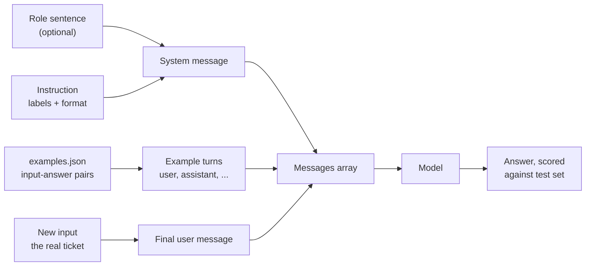
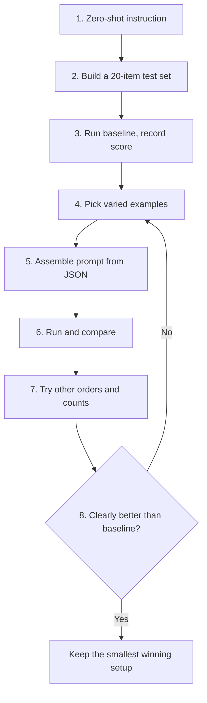
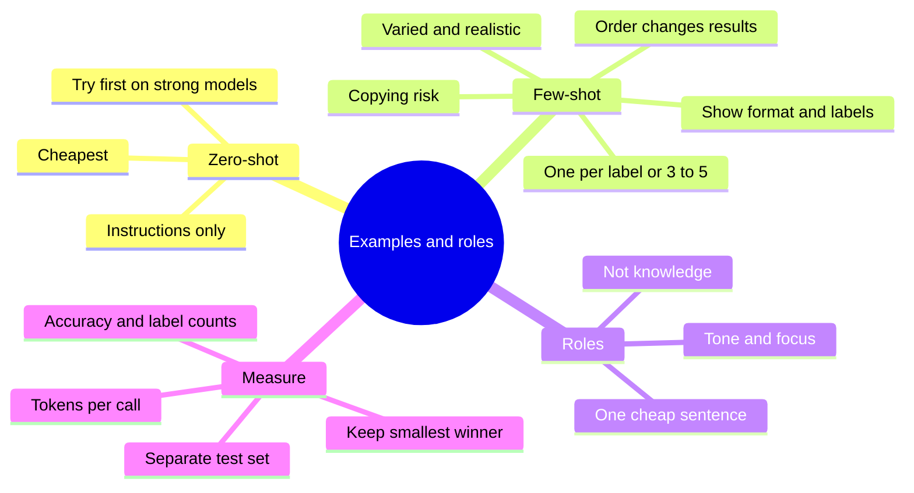

# A2-02 · Examples: zero-shot, few-shot and roles

> **Lesson A2-02** (lesson 11 in your roadmap) · Type: Concept · Prerequisites: [A2-01 · Prompt structure and instruction layers](./a2-01-prompt-structure-and-instruction-layers.md) (also uses A1-03 tokens and A1-05 sampling) · Leads to: A2-05, A2-07
>
> **Facts checked on:** 23 October 2026. Provider advice and research papers are linked with dates in section 19.
>
> **What was actually run for this guide:** every experiment used **SmolLM2-135M-Instruct**, a tiny (135-million-parameter) chat model, running locally with llama.cpp at temperature 0, so every number below is real and repeatable: a 20-ticket classification test, all 24 orderings of the same examples, 8 commit messages and a role test. A tiny model shows the *effects* of examples and roles very clearly, including the bad ones. It does **not** show how big the gains are on Claude, ChatGPT or Gemini; the exercises in section 11 are where you measure that on your own tasks. No cloud model was called.

**Why this lesson matters:** examples are the fastest way to show a model the format, tone and quality you want. Three good examples often say more than three paragraphs of rules. But examples are powerful in both directions: the model can copy them too literally, and the order you put them in can change the results. Roles ("act as a senior engineer") are even more misunderstood: they change how the model sounds and what it focuses on, not what it knows.

## Learning goals

By the end of this lesson you will be able to:

1. Explain **zero-shot** vs **few-shot** prompting, and when each is enough.
2. **Choose examples** that are varied, realistic and cover edge cases, and use **negative examples** carefully.
3. Explain how example **order** and **count** change results and **token cost**.
4. Explain what a **role** changes (tone, focus) and what it cannot change (knowledge).
5. Use **style matching** ("write like these three posts of mine") without getting copies.
6. Keep examples in a **JSON file** and **assemble the prompt in code**.
7. **Done when:** a small test set shows a measurable improvement from your examples (sections 5 and 11).

---

## 1. The topic in one minute

- **Zero-shot:** you give only instructions. "Classify this ticket as billing, delivery, technical or account."
- **Few-shot:** you give instructions **plus a few worked examples** (input → correct output). The model copies the pattern.
- **Role:** you tell the model who to act as ("You are a senior support lead"). This changes **tone and focus**, not **knowledge**.
- Examples mainly teach **format**, **label set** and **style**. They're powerful, so they can also **hurt**: if every example is about the cart, every answer may mention the cart.
- **Order and count matter.** The same four examples in a different order changed accuracy from 5/20 to 14/20 in this lesson's test. More examples cost more tokens on every call and aren't automatically better.

**One-line memory trick:** *instructions tell, examples show, roles set the voice. Test all three.*

**Analogy: training a new cashier at a kirana shop.** You can **tell** them how to write a bill: item, quantity, price, total (zero-shot). Or you can **show** them three old bills (few-shot): they'll pick up the format in seconds. But if all three bills were for rice, they may start writing "rice" on everything, and if one old bill had a mistake, they'll copy that too. Telling them "behave like the owner" (a role) changes how they talk to customers; it doesn't teach them prices they never learned.

**Real-life example (run for this guide):** asked for commit messages for 8 changes, the tiny model got **0/8** in the right format zero-shot, even with the rules written out. With **3 varied examples** it got **3/8**. With 3 examples that were all `fix(cart): …`, it got **7/8** in the right format, but **all 8** messages said `(cart)`, including "fix(cart): add a dark mode toggle to the settings screen". Examples work, and they get copied (section 5.4).

---

## 2. Detailed definitions and why they matter

### 2.1 Zero-shot prompting

**Definition:** a prompt with instructions (and context) but **no worked examples** of the task.

**One-line meaning:** tell, don't show.

**When it's enough:**
- The task is common and well understood by the model (summarise, translate, explain, fix this error).
- The output format is simple, or enforced another way (structured output, A1-05).
- You're using a strong or reasoning model. OpenAI's reasoning guide says: "Try zero shot first, then few shot if needed."

**When it's not:** your format or labels are specific to you (your commit style, your ticket categories, your brand voice), or the model keeps getting the shape wrong.

### 2.2 Few-shot prompting

**Definition:** a prompt that includes a small number of **input → output examples** before the real input. One example is "one-shot". The model learns the pattern **from the prompt itself**, with no retraining: the GPT-3 paper (2020) described this as tasks and "few-shot demonstrations specified purely via text interaction with the model", "without any gradient updates or fine-tuning". This is also called **in-context learning**.

**One-line meaning:** show the model a few solved examples, then give it the next one.

**What examples actually teach:** a 2022 study (Min and others, "Rethinking the Role of Demonstrations") found something surprising: "randomly replacing labels in the demonstrations barely hurts performance". What mattered more was showing "the label space", "the distribution of the input text" and "the overall format of the sequence". In plain words: examples mostly teach **what the answers look like and which answers are allowed**, more than which answer is right for which input. (Newer models are better at using the right labels, but the lesson stands: examples are very strong format signals.)

**What providers recommend (checked 23 October 2026):**
- **Anthropic:** examples are "one of the most reliable ways to steer Claude's output format, tone, and structure". Make them **relevant**, **diverse** and **structured** (wrapped in `<example>` tags), and "Include 3–5 examples for best results."
- **OpenAI:** few-shot means "including a handful of input/output examples in the prompt"; show "a diverse range of possible inputs with the desired outputs". For reasoning models: zero-shot first.
- **Google:** "We recommend to always include few-shot examples in your prompts", but "if you include too many examples, the model may start to" overfit; keep formatting consistent across examples.

### 2.3 Choosing examples

Good examples are:
1. **Varied:** different lengths, phrasings and labels. Not four tickets that all start with "My order…".
2. **Realistic:** taken from (anonymised) real inputs, with the same messiness: typos, Hinglish, missing details.
3. **Covering edge cases:** the inputs your model gets wrong: an ambiguous ticket, a refund that's both billing and delivery, a Hinglish message.
4. **Balanced:** roughly equal coverage of each label, or the model leans towards the most common one (section 5.2: eight examples, and 18 of 20 answers became "billing").
5. **Correct and current:** examples with old formats or wrong answers are copied too.

### 2.4 Negative examples

**Definition:** an example of what **not** to produce ("Bad: Updated stuff").

**Use with care:** models copy what they see, and a bad example is still text they see. Safer patterns:
- Label it clearly and pair it with the fix: `Bad: "Updated stuff" → Good: "fix(auth): handle expired reset links"`.
- Prefer describing what to do instead. Anthropic's guidance: "Tell Claude what to do instead of what not to do."

In this lesson's test, one clearly labelled bad commit message was **not** copied (0/8), but it also didn't improve the results (section 5.4).

### 2.5 Order and quantity

- **Order:** research found that just reordering the same examples can move results from near state-of-the-art to near random ("Fantastically Ordered Prompts", Lu and others, 2021), and that models are biased towards answers that appear near the end of the prompt and answers common in their training data ("Calibrate Before Use", Zhao and others, 2021). In this lesson, the same four examples in 24 orders scored anywhere from **5/20 to 14/20** (section 5.3).
- **Quantity:** every example is sent on **every call**, so it costs input tokens every time (section 5.6). More examples can also *reduce* quality by biasing the model (section 5.2). Start with 1 example per label (or 3–5 total), measure, and add only if the test set improves.

### 2.6 Role prompting

**Definition:** telling the model who to act as, usually in the system prompt: "You are a senior React reviewer", "You are a kindergarten teacher".

**What it changes:** **tone, vocabulary, focus and format**. Anthropic: setting a role "focuses Claude's behavior and tone for your use case. Even a single sentence makes a difference."

**What it can't change:** the model's **knowledge and ability**. A 2023 study (Zheng and others) tested personas on 2,410 factual questions across four model families and concluded that "adding personas in system prompts does not improve model performance" compared with no persona; the authors found the effect of any particular persona largely unpredictable. In this lesson: a "senior software engineer" role scored 8/10 vs 7/10 without a role on factual questions (one question different), a "kindergarten teacher" role completely changed the vocabulary, and no role made the tiny model notice security bugs it couldn't see anyway (section 5.5).

### 2.7 Style matching

"Write like these three posts of mine" is few-shot prompting for **style**. Do it well:
- Give **3 of your real posts** that differ in topic but share the voice you want.
- Say **what to copy** (tone, sentence length, structure, how you open and close) and **what not to copy** (topics, specific phrases, numbers).
- Give the **new topic and facts** separately, inside their own tags.
- Check the draft for phrases copied word for word from your examples.

### 2.8 When examples hurt

- **Literal copying:** the model reuses names, numbers, scopes or phrases from the examples ("(cart)" in every commit message; in A2-01, "Chennai" copied into a Jaipur customer's record).
- **One-kind examples:** all examples share one label, so every output gets that label (section 5.2: 20/20 "delivery").
- **Label bias:** too many examples, or an unbalanced set, pull answers towards one label.
- **Repetitive outputs:** every post starts with the same hook as your examples.
- **Token waste:** long examples on every call, for a task the model already does well zero-shot.

---

## 3. Words you need first

| Term | Simple meaning |
|---|---|
| **Zero-shot** | Instructions only, no worked examples. |
| **One-shot / few-shot** | Instructions plus one / a few worked examples (input → output). |
| **Example (demonstration)** | One input paired with the output you want. |
| **In-context learning** | The model picking up a pattern from examples in the prompt, without retraining. |
| **Label** | The category or answer for an example ("billing", "delivery"). |
| **Label space** | The set of allowed answers (the four ticket categories). |
| **Negative example** | An example of what not to produce, clearly marked as bad. |
| **Edge case** | An unusual or tricky input that's easy to get wrong. |
| **Role (persona)** | Who the model should act as; sets tone and focus. |
| **Style matching** | Using your own writing as examples so the output sounds like you. |
| **Test set** | Inputs with known correct answers, used to measure a prompt. |
| **Accuracy** | Correct answers ÷ total answers on the test set. |
| **Prompt assembly** | Building the final prompt in code from parts (role, instruction, examples, input). |

---

## 4. How it works

### 4.1 Zero-shot vs few-shot vs role: the comparison

| | **Zero-shot** | **Few-shot** | **Role** |
|---|---|---|---|
| **What you give** | Instructions (+ context) | Instructions + 1–5 worked input → output examples | One sentence: who the model is and who it's talking to |
| **What it mainly changes** | Nothing beyond the instructions | Format, allowed labels, style and tone, by imitation | Tone, vocabulary, focus, level of detail |
| **What it can't do** | Show a format you can't describe | Add knowledge the model lacks; guarantee correct labels | Add knowledge or ability; make the model "senior" |
| **Token cost** | Lowest | Highest: every example is resent on every call | Very low (one sentence) |
| **Main risk** | Wrong format, guessed conventions | Literal copying, label bias, order effects | False confidence: sounds expert, isn't more accurate |
| **Best for** | Common tasks, strong or reasoning models | Your own formats and labels, brand voice, small models | Audience fit, review focus, tone |
| **In this lesson's tests** | 4/20 tickets; 0/8 commit messages | Up to 10/20 tickets (14/20 with the best order); 3/8 commit messages | Same accuracy (8/10 vs 7/10 facts); clearly different vocabulary |

The three combine well: a role sentence + a short instruction + 3–5 varied examples is a common, strong pattern. Use the test set to decide which parts earn their tokens.

### 4.2 How a few-shot prompt is assembled from parts

**Diagram: prompt assembly from parts**



**How to read this diagram:** the prompt isn't typed by hand each time. Your code builds it from four parts: the role and the instruction become the **system message**, each example in `examples.json` becomes a pair of **user / assistant turns** (as if the model had already answered those correctly), and the real input goes last as the **final user message**. Because the parts live in a file, you can swap examples, change their order or count, and re-run the same test set to see what changed.

Real output of `node show-assembly.mjs` (section 6.3), showing the messages built for one Hinglish ticket with the role and four examples:

```text
system    | You are a senior customer-support team lead with 10 years of experience. Classify the support ticket into exactly one category: billing, delivery, technical, or account. Reply with only the category name.
user      | I paid with my credit card but got no receipt.
assistant | billing
user      | My order was supposed to arrive yesterday.
assistant | delivery
user      | The checkout button does nothing when I tap it.
assistant | technical
user      | How can I update my saved address in my profile?
assistant | account
user      | Paise kat gaye lekin order confirm nahi hua.
```

**Why examples as chat turns?** Providers accept examples in several formats: `<example>` tags inside a message (Anthropic's suggestion), examples inside the developer message (OpenAI's guide), or earlier user/assistant turns like above. In A2-01's experiment, the tiny model did best with earlier chat turns and got confused by tagged examples. Strong models handle all three; test the format on your model.

### 4.3 Walkthrough: building a few-shot ticket classifier

1. **Write the zero-shot instruction:** the task, the allowed labels and the output format.
2. **Build a test set:** 20 real-looking tickets with known labels, balanced across the four categories, including Hinglish ones.
3. **Run the zero-shot baseline** and record accuracy and which labels it predicts.
4. **Pick examples:** one varied, realistic example per label (not taken from the test set).
5. **Assemble the prompt in code** from `examples.json` (role, instruction, examples, new input).
6. **Run and compare** accuracy and the label distribution against the baseline.
7. **Vary order and count:** shuffle the examples, try 1, 4 and 8, try a role. Note the token cost of each.
8. **Keep the smallest setup that wins** on the test set, and re-test whenever you change the model.

**Diagram: the walkthrough, step by step**



**How to read this diagram:** steps 1 to 3 give you a number to beat. Steps 4 to 7 are experiments, each measured on the same test set. The decision at step 8 sends you back to choosing examples, not to adding more words. "Smallest winning setup" means fewest tokens for the same score, because every example is paid for on every call.

---

## 5. Experiments: what examples and roles really did

### 5.1 The setup

- **Model:** SmolLM2-135M-Instruct (Apache 2.0) from the `llm-smollm2` PyPI package, run with llama.cpp's `llama-server` at **temperature 0**, so each prompt always gives the same answer.
- **Ticket test set:** 20 fake support tickets for an online shop, 5 per category (billing, delivery, technical, account), 4 of them in Hinglish (`tickets.json`, section 6.4). Examples come from a separate pool (`examples.json`), never from the test set.
- **Scoring:** by code. For tickets, the first category word the reply mentions; anything else counts as "other".
- **Caveat:** a 135M model is weak, so absolute scores are low. Watch the **differences between setups**, and repeat on your own model.

### 5.2 Results: zero-shot vs few-shot vs role on 20 tickets

Real output of `node classify-tickets.mjs`:

```text
┌─────────┬────────────────────────────────────┬──────────┬───────────────┬───────────────────────────────────────────────────────────┐
│ (index) │ setup                              │ accuracy │ prompt tokens │ predicted                                                 │
├─────────┼────────────────────────────────────┼──────────┼───────────────┼───────────────────────────────────────────────────────────┤
│ 0       │ 'zero-shot'                        │ '4/20'   │ 55            │ 'delivery 2, account 3, other 15'                         │
│ 1       │ 'zero-shot + role'                 │ '4/20'   │ 72            │ 'billing 4, delivery 1, account 2, other 13'              │
│ 2       │ 'zero-shot, 288-word instructions' │ '2/20'   │ 385           │ 'delivery 1, account 1, other 18'                         │
│ 3       │ '1 example (billing only)'         │ '8/20'   │ 79            │ 'billing 11, delivery 2, technical 2, account 1, other 4' │
│ 4       │ '4 examples, one per category'     │ '7/20'   │ 144           │ 'billing 6, delivery 2, account 8, other 4'               │
│ 5       │ '4 examples, reversed order'       │ '10/20'  │ 144           │ 'billing 1, delivery 9, technical 6, account 4'           │
│ 6       │ '8 examples, two per category'     │ '7/20'   │ 245           │ 'billing 18, technical 1, account 1'                      │
│ 7       │ "4 examples, all 'delivery'"       │ '5/20'   │ 143           │ 'delivery 20'                                             │
└─────────┴────────────────────────────────────┴──────────┴───────────────┴───────────────────────────────────────────────────────────┘
```

**What the table shows:**
- **Zero-shot: 4/20**, and **15 of 20** answers weren't a category at all ("other"). The model didn't know what kind of answer you wanted.
- **The role added nothing** to accuracy (4/20) and still left 13 answers unusable.
- **The 288-word instruction made it worse: 2/20**, with 18 unusable answers, at **385** prompt tokens. Long rules didn't teach this model the format.
- **One example doubled accuracy to 8/20** and cut unusable answers from 15 to 4, but pulled 11 answers towards its own label, "billing".
- **Four examples (one per label): 7/20 or 10/20 depending only on order**, at **144** tokens, about a third of the long instruction.
- **Eight examples: 7/20**, and **18 of 20** answers became "billing". More examples made the model *less* varied, not more accurate.
- **Four examples that were all "delivery": every single answer was "delivery"** (20/20). It got 5/20 right only because 5 tickets really were about delivery.

### 5.3 Results: the same four examples in all 24 orders

Real output of `node order-test.mjs`:

```text
24 orders of the same 4 examples (B=billing, D=delivery, T=technical, A=account):
worst: TBDA 5/20 | median: 10/20 | best: DTAB 14/20
all scores: 5 5 6 7 7 7 7 9 9 9 10 10 10 10 10 10 10 10 10 11 11 13 13 14
```

Same four examples, same 20 tickets, same model: only the **order** changed, and accuracy ranged from **5/20 to 14/20** (median 10/20). That's the effect the "Fantastically Ordered Prompts" paper describes, and it found the effect across model sizes, so bigger models aren't immune. Test a couple of orders (or shuffle) before trusting a few-shot prompt.

### 5.4 Results: commit messages (the beginner exercise)

Eight changes, five setups. "Valid format" = Conventional Commits `type(scope): summary` with a lowercase scope and at most 72 characters. Real output of `node commit-messages.mjs`:

```text
┌─────────┬─────────────────────────────────────┬──────────────┬────────────┬────────────────┬─────────────┬────────────────────┐
│ (index) │ setup                               │ valid format │ right type │ distinct types │ uses (cart) │ copied bad example │
├─────────┼─────────────────────────────────────┼──────────────┼────────────┼────────────────┼─────────────┼────────────────────┤
│ 0       │ 'zero-shot, no rules'               │ '0/8'        │ '0/8'      │ 0              │ '0/8'       │ '0/8'              │
│ 1       │ 'zero-shot, written rules'          │ '0/8'        │ '0/8'      │ 0              │ '0/8'       │ '0/8'              │
│ 2       │ '3 varied examples'                 │ '3/8'        │ '3/8'      │ 2              │ '0/8'       │ '0/8'              │
│ 3       │ '3 examples, all fix(cart)'         │ '7/8'        │ '2/8'      │ 1              │ '8/8'       │ '0/8'              │
│ 4       │ '3 varied + 1 labelled bad example' │ '3/8'        │ '2/8'      │ 2              │ '0/8'       │ '0/8'              │
└─────────┴─────────────────────────────────────┴──────────────┴────────────┴────────────────┴─────────────┴────────────────────┘

[zero-shot, no rules]
  1. Added a dark mode toggle to the settings screen.
  2. Added a bug in the product list API.
  3. Added README with steps to run the app on Android.
  4. Added a new line to the commit message.
  5. Added unit tests for the price formatting helper.
  6. Added a new line to the commit message.
  7. Added 1.0.0 to the Git repository.
  8. Added Hindi translations for the checkout screen.

[zero-shot, written rules]
  1. The dark mode toggle to the settings screen.
  2. The product list API returns an empty array when the product list is empty.
  3. Here's the updated README with the steps to run the app on Android:
  4. Renamed getUserData to fetchUserProfile everywhere, no behaviour change.
  5. The price formatting helper is a built-in function in the price format class that can be used to format a price in a specific format. The function is implemented in the price format class, which is
  6. The login button should now work with the new login feature.
  7. I'm sorry for your loss. I'm sorry for any inconvenience you may have had. I'm glad you're enjoying the benefits of React Native.
  8. The checkout screen is designed to be easy to use and provide a seamless user experience. The checkout screen is designed to be easy to use and provide a seamless user experience. The checkout screen is designed to

[3 varied examples]
  1. settings(dark): add dark mode toggle to settings screen
  2. fix(api): handle error when product list API returns empty array
  3. docs(readme): add local setup steps to run on Android
  4. docs(getUserData): add new local setup steps
  5. npm(tests): add unit tests for the price formatting helper
  6. fix(login): handle failed login attempts
  7. npx: upgrade to npx-react-native-devtools-npx-npx-npx-npx-npx-npx-npx-npx-
  8. hk(hk): add Hindi translations for checkout screen

[3 examples, all fix(cart)]
  1. fix(cart): add a dark mode toggle to the settings screen
  2. fix(cart): remove product from cart after page refresh
  3. fix(cart): run the app on Android with the specified steps
  4. fix(cart): rename getUserData to fetchUserProfile to no effect on getUserData.
  5. fix(cart): add unit tests for price formatting helper
  6. fix(cart): remove login button after failed attempt
  7. fix(cart): upgrade to 0.80 in the new version of React Native.
  8. fix(cart): add English translations for checkout screen

[3 varied + 1 labelled bad example]
  1. settings(dark): add dark mode toggle to settings screen
  2. fix(api): handle API crash when product list is empty
  3. docs(README): add local setup steps
  4. docs(getUserData): add new local setup steps
  5. npm(test): add unit tests for the price formatting helper
  6. fix(login): handle failed login attempts
  7. npx: upgrade to npx-react-native-devtools-npx-npx-npx-npx-npx-npx-npx-npx-
  8. docs(hii): add Hindi translations for the checkout screen
```

**What it shows:**
- **Zero-shot, with or without written rules: 0/8.** The tiny model mostly repeated the change description. Rules alone didn't work.
- **Three varied examples: 3/8 valid**, and the model started using real types (`fix`, `docs`). It also invented some (`settings(dark)`, `npm(tests)`) and one answer collapsed into a loop (`npx-npx-npx…`).
- **Three examples, all `fix(cart)`: 7/8 valid format, but all 8 used `(cart)`** and only 2 had the right type. "fix(cart): add a dark mode toggle to the settings screen" is the clearest picture of examples copied too literally.
- **A labelled bad example** ("Updated stuff and fixed some bugs.") wasn't copied (0/8), but didn't improve anything either.

### 5.5 Results: what a role changes

Real output of `node role-test.mjs`:

```text
Part 1: knowledge (correct answers out of 10)
  no role                    7/10   per question: Y Y n n Y Y Y Y Y n
  senior software engineer   8/10   per question: Y Y Y n Y Y Y Y Y n

Part 2: tone (totals across 4 explanations)
  no role                technical words 3 | child-friendly words 0 | average word length 4.96
    first sentence about "a cache": "A cache is a device or system that stores and retrieves data, often in a way that is difficult to access or retrieve"
  kindergarten teacher   technical words 0 | child-friendly words 3 | average word length 4.20
    first sentence about "a cache": "A cache is a device or resource that is intentionally hidden or destroyed, often to conceal evidence or to avoid being discovered."
  backend architect      technical words 4 | child-friendly words 0 | average word length 5.32
    first sentence about "a cache": "A cache is a data structure that stores frequently accessed data, such as cache data structures, which are designed to efficiently retrieve data from a database"

Part 3: focus (reviews that mention a security issue, out of 4)
  no role                    0/4
  senior security engineer   0/4
  senior UI designer         0/4
```

**What it shows:**
- **Knowledge:** 7/10 without a role, 8/10 as a "senior software engineer". The only difference was the `useEffect` question; both versions still made up facts elsewhere (in the full answers, both invented a "history" for PostgreSQL's port). One question out of ten is noise, not expertise, matching the persona study's finding.
- **Tone:** the role clearly changed the language. The "kindergarten teacher" used **no** technical words and shorter words (average 4.20 letters); the "backend architect" used the most technical words and the longest words (5.32). But the teacher's definition of a cache ("intentionally hidden or destroyed, often to conceal evidence") was simply **wrong**: a different voice, not more knowledge.
- **Focus:** none of the three roles made the model notice the security problems in four risky lines of code (SQL built by string concatenation, `eval` of user input, `innerHTML` with user text, a hard-coded secret key): **0/4 each**. A "security engineer" role can point a capable model's attention at security; it can't give a 135M model an ability it doesn't have.

### 5.6 What examples cost

Real output of `node example-cost.mjs` (token counts measured above, prices from Claude's pricing page, 23 October 2026):

```text
Measured: one short ticket example adds about 23.8 tokens.
The 288-word instruction prompt cost 385 tokens; 4 examples cost 144.

Extra cost of the examples for 1,00,000 calls (input tokens only):
  4 short examples (this lesson)            95 tokens/call -> Claude Haiku 5.5 $0.95 | Claude Sonnet 5.5 $19.00
  5 realistic examples of ~200 tokens     1000 tokens/call -> Claude Haiku 5.5 $10.00 | Claude Sonnet 5.5 $200.00
  20 realistic examples of ~200 tokens    4000 tokens/call -> Claude Haiku 5.5 $40.00 | Claude Sonnet 5.5 $800.00
```

**What it shows:** short examples are cheap; long ones on high-volume calls are not. Five realistic 200-token examples on 1,00,000 calls cost about **$10 on Haiku 5.5** or **$200 on Sonnet 5.5** in extra input tokens alone. If three examples give the same score as eight on your test set, the extra five are pure cost.

### 5.7 Honest limits of these experiments

- A tiny model exaggerates these effects. Copying, label bias and order sensitivity may be milder on large models, but the research papers in section 19 report them on large models too.
- 20 tickets and 8 commit changes are small test sets. On a real feature, use 50–100 items before trusting a 1–2 point difference.
- Temperature 0 removes randomness from sampling (A1-05); on a real app with default settings, run each setup a few times.

---

## 6. Practical code: examples in a JSON file, prompt assembled in code

This is the developer exercise. Prerequisites: Node.js 20+ (tested on 22.22.0), `npm install openai` (tested with 7.43.0), and any OpenAI-compatible server. The setup used here (from A2-01): `llama-server -m SmolLM2-135M-Instruct.Q4_1.gguf --port 8090 --jinja`. With Ollama, set `LLM_BASE_URL=http://localhost:11434/v1` and `LLM_MODEL=<model>`; for a cloud model, also set `LLM_API_KEY` from your environment (**never hardcode keys**).

### 6.1 The helper (`llm.mjs`, same as A2-01)

```js
// llm.mjs: tiny helper around any OpenAI-compatible chat endpoint.
// Default: the local llama-server used for this lesson (SmolLM2-135M-Instruct on port 8090).
// Ollama:  LLM_BASE_URL=http://localhost:11434/v1 LLM_MODEL=<model you pulled>
// Claude:  LLM_BASE_URL=https://api.anthropic.com/v1/ LLM_API_KEY=$ANTHROPIC_API_KEY LLM_MODEL=claude-haiku-5-5
import OpenAI from "openai";

const baseURL = process.env.LLM_BASE_URL ?? "http://127.0.0.1:8090/v1";
const isLocal = /localhost|127\.0\.0\.1/.test(baseURL);
export const MODEL = process.env.LLM_MODEL ?? "smollm2-135m-instruct";
const client = new OpenAI({ baseURL, apiKey: process.env.LLM_API_KEY ?? "not-needed-locally" });

/** Send chat messages; returns the reply text and why it stopped. */
export async function ask(/** @type {any[]} */ messages, maxTokens = 400) {
  const res = await client.chat.completions.create({
    model: MODEL,
    messages,
    max_tokens: maxTokens,
    // temperature 0 makes local runs repeatable. Current Claude models reject
    // non-default temperature, so it is only sent to local servers.
    ...(isLocal ? { temperature: 0 } : {}),
  });
  return { text: res.choices[0].message.content ?? "", finish: res.choices[0].finish_reason };
}
```

### 6.2 The parts file (`examples.json`)

Role, short instruction, the long 288-word instruction used for comparison, 8 varied examples (two per label) and 4 one-kind examples:

```json
{
  "instruction": "Classify the support ticket into exactly one category: billing, delivery, technical, or account. Reply with only the category name.",
  "role": "You are a senior customer-support team lead with 10 years of experience.",
  "varied": [
    [
      "I paid with my credit card but got no receipt.",
      "billing"
    ],
    [
      "My order was supposed to arrive yesterday.",
      "delivery"
    ],
    [
      "The checkout button does nothing when I tap it.",
      "technical"
    ],
    [
      "How can I update my saved address in my profile?",
      "account"
    ],
    [
      "The coupon discount was not applied to my total.",
      "billing"
    ],
    [
      "Delivery partner marked it as 'customer not available' but I was home.",
      "delivery"
    ],
    [
      "The page keeps showing a 'Something went wrong' error.",
      "technical"
    ],
    [
      "I'd like to turn on two-factor login for my account.",
      "account"
    ]
  ],
  "oneKind": [
    [
      "My order was supposed to arrive yesterday.",
      "delivery"
    ],
    [
      "Delivery partner marked it as 'customer not available' but I was home.",
      "delivery"
    ],
    [
      "Tracking has not moved for three days.",
      "delivery"
    ],
    [
      "Can I change the delivery time slot?",
      "delivery"
    ]
  ],
  "detailedInstruction": "You are classifying customer support tickets for an Indian online shopping app. Read the ticket carefully and choose exactly one category from this list: billing, delivery, technical, or account. Use billing for anything about money: payments that failed or were deducted twice, refunds, extra fees or charges, coupons and discounts that did not apply, invoices, GST bills, receipts, UPI, credit cards, debit cards, wallets and cash on delivery amounts. Use delivery for anything about the physical order after it is placed: late orders, tracking that does not update, parcels marked delivered but not received, damaged or opened packages, changing the delivery address or time slot, and problems with the delivery partner. Use technical for problems with the app or website itself: crashes, blank or white screens, buttons that do nothing, error messages, pages or images that do not load, search that spins forever, slow screens, notification problems after an update, and anything that looks like a bug. Use account for anything about the customer's profile and login: changing email or mobile number, passwords and reset links, two-factor login, suspicious logins from other places, saved addresses in the profile, and deleting the account or personal data. Some tickets are written in Hinglish, which mixes Hindi and English words, so read the meaning rather than looking only for English keywords. If a ticket seems to fit two categories, choose the one that describes the main problem the customer wants fixed. Think about what team would solve the problem: the payments team, the logistics team, the engineering team or the accounts team. Do not explain your answer, do not add punctuation, do not repeat the ticket, and do not write a greeting. Reply with only the single category name in lowercase."
}
```

### 6.3 Assembling the prompt (`assemble.mjs`, `show-assembly.mjs`)

```js
// assemble.mjs: build a chat prompt from parts kept in examples.json.
// Parts: optional role + instruction (system), examples as earlier chat turns, then the new input.
import { readFileSync } from "node:fs";

export const parts = JSON.parse(readFileSync(new URL("./examples.json", import.meta.url), "utf8"));

/**
 * @param {object} opts
 * @param {string} opts.input             the new ticket to classify
 * @param {[string, string][]} [opts.examples]  [input, answer] pairs, in the order to show them
 * @param {boolean} [opts.withRole]       prepend the role sentence to the system message
 * @param {boolean} [opts.detailed]       use the long, detailed instruction instead of the short one
 */
export function buildMessages({ input, examples = [], withRole = false, detailed = false }) {
  const instruction = detailed ? parts.detailedInstruction : parts.instruction;
  const system = withRole ? `${parts.role} ${instruction}` : instruction;
  const messages = [{ role: "system", content: system }];
  for (const [exampleInput, answer] of examples) {
    messages.push({ role: "user", content: exampleInput });
    messages.push({ role: "assistant", content: answer });
  }
  messages.push({ role: "user", content: input });
  return messages;
}
```

```js
// show-assembly.mjs: print the messages assemble.mjs builds for one ticket (no model call).
import { buildMessages, parts } from "./assemble.mjs";

const messages = buildMessages({
  input: "Paise kat gaye lekin order confirm nahi hua.",
  examples: parts.varied.slice(0, 4),
  withRole: true,
});
for (const m of messages) console.log(`${m.role.padEnd(9)} | ${m.content}`);
```

Real output: section 4.2.

### 6.4 The test set and the comparison (`tickets.json`, `classify-tickets.mjs`)

```json
{
  "labels": ["billing", "delivery", "technical", "account"],
  "test": [
    ["I was charged twice for the same order. Please refund one payment.", "billing"],
    ["Why is there an extra Rs 49 convenience fee on my bill?", "billing"],
    ["My UPI payment failed but the money was deducted from my account.", "billing"],
    ["Can I get a GST invoice for my last purchase?", "billing"],
    ["Paise kat gaye lekin order confirm nahi hua.", "billing"],
    ["My parcel shows delivered but I never received it.", "delivery"],
    ["The delivery is late by 4 days. Where is my order?", "delivery"],
    ["Can you deliver to my office address instead of home?", "delivery"],
    ["The package arrived with a broken seal and a damaged box.", "delivery"],
    ["Order kab tak aayega? Tracking update nahi ho raha.", "delivery"],
    ["The app crashes every time I open the cart screen.", "technical"],
    ["The website shows a blank white page on Safari.", "technical"],
    ["Images are not loading in the product gallery.", "technical"],
    ["Search results keep spinning and never load.", "technical"],
    ["App update ke baad notifications band ho gaye.", "technical"],
    ["How do I change the email address on my account?", "account"],
    ["I want to delete my account and all my data.", "account"],
    ["I forgot my password and the reset link has expired.", "account"],
    ["Someone else logged into my account from another city.", "account"],
    ["Mera mobile number badalna hai profile mein.", "account"]
  ]
}
```

```js
// classify-tickets.mjs: zero-shot vs few-shot vs role on 20 labelled support tickets.
// Run: node classify-tickets.mjs   (needs llm.mjs, assemble.mjs, examples.json, tickets.json)
import { readFileSync } from "node:fs";
import { ask } from "./llm.mjs";
import { buildMessages, parts } from "./assemble.mjs";

const { labels, test } = JSON.parse(readFileSync("tickets.json", "utf8"));
const varied = parts.varied; // 8 examples: billing, delivery, technical, account, then the same order again

const setups = {
  "zero-shot": {},
  "zero-shot + role": { withRole: true },
  "zero-shot, 288-word instructions": { detailed: true },
  "1 example (billing only)": { examples: varied.slice(0, 1) },
  "4 examples, one per category": { examples: varied.slice(0, 4) },
  "4 examples, reversed order": { examples: varied.slice(0, 4).reverse() },
  "8 examples, two per category": { examples: varied },
  "4 examples, all 'delivery'": { examples: parts.oneKind },
};

// First category word the reply mentions, or "other".
const labelOf = (reply) => {
  const text = reply.toLowerCase();
  const hits = labels.map((l) => [l, text.indexOf(l)]).filter(([, i]) => i >= 0).sort((a, b) => a[1] - b[1]);
  return hits.length ? hits[0][0] : "other";
};

// Prompt length in tokens, using the local server's own template and tokenizer (llama.cpp only).
async function promptTokens(messages) {
  const base = "http://127.0.0.1:8090";
  const post = (path, body) =>
    fetch(base + path, { method: "POST", headers: { "content-type": "application/json" }, body: JSON.stringify(body) }).then((r) => r.json());
  const { prompt } = await post("/apply-template", { messages });
  return (await post("/tokenize", { content: prompt })).tokens.length;
}

const rows = [];
for (const [name, opts] of Object.entries(setups)) {
  let correct = 0;
  const predicted = Object.fromEntries([...labels, "other"].map((l) => [l, 0]));
  for (const [ticket, gold] of test) {
    const { text } = await ask(buildMessages({ input: ticket, ...opts }), 20);
    const label = labelOf(text);
    predicted[label]++;
    if (label === gold) correct++;
  }
  const tokens = await promptTokens(buildMessages({ input: test[0][0], ...opts }));
  rows.push({
    setup: name,
    accuracy: `${correct}/20`,
    "prompt tokens": tokens,
    predicted: Object.entries(predicted).filter(([, n]) => n).map(([l, n]) => `${l} ${n}`).join(", "),
  });
}
console.table(rows);
```

Real output: section 5.2. `promptTokens()` uses llama.cpp's `/apply-template` and `/tokenize` endpoints, so token counts only work against `llama-server`; delete it (or use your provider's token-counting API) for other servers.

### 6.5 Optional advanced: the other experiment scripts

These produced sections 5.3 to 5.6.

```js
// order-test.mjs: the same 4 examples in all 24 possible orders. Does order alone change accuracy?
// Run: node order-test.mjs
import { readFileSync } from "node:fs";
import { ask } from "./llm.mjs";
import { buildMessages, parts } from "./assemble.mjs";

const { labels, test } = JSON.parse(readFileSync("tickets.json", "utf8"));
const four = parts.varied.slice(0, 4);
const permutations = (arr) =>
  arr.length <= 1 ? [arr] : arr.flatMap((x, i) => permutations([...arr.slice(0, i), ...arr.slice(i + 1)]).map((p) => [x, ...p]));
// Same scoring as classify-tickets.mjs: the first category word the reply mentions.
const labelOf = (reply) => {
  const text = reply.toLowerCase();
  const hits = labels.map((l) => [l, text.indexOf(l)]).filter(([, i]) => i >= 0).sort((a, b) => a[1] - b[1]);
  return hits.length ? hits[0][0] : "other";
};

const results = [];
for (const order of permutations(four)) {
  let correct = 0;
  for (const [ticket, gold] of test) {
    const { text } = await ask(buildMessages({ input: ticket, examples: order }), 20);
    if (labelOf(text) === gold) correct++;
  }
  results.push({ order: order.map(([, label]) => label[0].toUpperCase()).join(""), correct });
}
results.sort((a, b) => a.correct - b.correct);
const scores = results.map((r) => r.correct);
console.log(`24 orders of the same 4 examples (B=billing, D=delivery, T=technical, A=account):`);
const median = (scores[11] + scores[12]) / 2;
console.log(`worst: ${results[0].order} ${scores[0]}/20 | median: ${median}/20 | best: ${results[23].order} ${scores[23]}/20`);
console.log(`all scores: ${scores.join(" ")}`);
```

```js
// commit-messages.mjs: zero-shot vs three examples vs three same-kind examples for commit messages.
// Run: node commit-messages.mjs
import { ask } from "./llm.mjs";

// Eight changes and the Conventional Commits type each one should get.
const changes = [
  ["Added a dark mode toggle to the settings screen.", ["feat"]],
  ["Fixed a crash when the product list API returns an empty array.", ["fix"]],
  ["Updated README with steps to run the app on Android.", ["docs"]],
  ["Renamed getUserData to fetchUserProfile everywhere, no behaviour change.", ["refactor"]],
  ["Added unit tests for the price formatting helper.", ["test"]],
  ["Fixed the login button staying disabled after a failed attempt.", ["fix"]],
  ["Upgraded React Native from 0.79 to 0.80.", ["chore", "build"]],
  ["Added Hindi translations for the checkout screen.", ["feat"]],
];
const varied = [
  ["Added a field to enter a coupon code in the cart.", "feat(cart): add coupon code input"],
  ["Password reset links stopped working after they expired; now we show a clear message.", "fix(auth): handle expired reset links"],
  ["Wrote local setup steps in the README.", "docs(readme): add local setup steps"],
];
const oneKind = [
  ["Cart total was wrong when quantity was zero.", "fix(cart): correct total when quantity is zero"],
  ["Cart items disappeared after a page refresh.", "fix(cart): keep items after page refresh"],
  ["GST in the cart showed too many decimals.", "fix(cart): round GST to two decimals"],
];
const RULES =
  "Write a one-line git commit message in Conventional Commits format: type(scope): summary. " +
  "Types: feat, fix, docs, refactor, test, chore. Lowercase, imperative mood, at most 72 characters. Reply with only the message.";
const STYLE = "Write a one-line git commit message for the change, in the same style as the earlier examples. Reply with only the message.";

const turns = (examples) => examples.flatMap(([c, m]) => [{ role: "user", content: c }, { role: "assistant", content: m }]);
const setups = {
  "zero-shot, no rules": (c) => [{ role: "user", content: `Write a git commit message for this change: ${c}` }],
  "zero-shot, written rules": (c) => [{ role: "system", content: RULES }, { role: "user", content: c }],
  "3 varied examples": (c) => [{ role: "system", content: STYLE }, ...turns(varied), { role: "user", content: c }],
  "3 examples, all fix(cart)": (c) => [{ role: "system", content: STYLE }, ...turns(oneKind), { role: "user", content: c }],
  "3 varied + 1 labelled bad example": (c) => [
    { role: "system", content: `${STYLE}\nBad example, never write like this: "Updated stuff and fixed some bugs."` },
    ...turns(varied),
    { role: "user", content: c },
  ],
};

const FORMAT = /^(feat|fix|docs|refactor|test|chore|build|perf|style|ci)(\([a-z0-9-]+\))?: \S.*$/;
const rows = [];
const samples = {};
for (const [name, build] of Object.entries(setups)) {
  let format = 0, rightType = 0, cartScope = 0, badCopy = 0;
  const types = new Set();
  samples[name] = [];
  for (const [change, expected] of changes) {
    const line = (await ask(build(change), 40)).text.trim().split("\n")[0].replace(/^["'`]+|["'`]+$/g, "");
    samples[name].push(line);
    const m = line.match(FORMAT);
    if (m && line.length <= 72) format++;
    if (m) types.add(m[1]);
    if (m && expected.includes(m[1])) rightType++;
    if (/\(cart\)/.test(line)) cartScope++;
    if (/updated stuff/i.test(line)) badCopy++;
  }
  rows.push({ setup: name, "valid format": `${format}/8`, "right type": `${rightType}/8`, "distinct types": types.size, "uses (cart)": `${cartScope}/8`, "copied bad example": `${badCopy}/8` });
}
console.table(rows);
for (const [name, lines] of Object.entries(samples)) {
  console.log(`\n[${name}]`);
  lines.forEach((l, i) => console.log(`  ${i + 1}. ${l}`));
}
```

```js
// role-test.mjs: does a role add knowledge, or only change focus?
// Run: node role-test.mjs
import { ask } from "./llm.mjs";

// Part 1: knowledge. Ten questions with known answers.
/** @type {[string, RegExp][]} */
const questions = [
  ["Which HTTP status code means 'Not Found'?", /404/],
  ["What is the default port for PostgreSQL?", /5432/],
  ["Which React hook is used to run side effects?", /useEffect/],
  ["What does CSS stand for?", /cascading style sheets/i],
  ["Which HTTP method usually creates a new resource in a REST API?", /\bPOST\b/],
  ["Which Git command creates a new branch and switches to it?", /checkout -b|switch -c/],
  ["What does JSON stand for?", /javascript object notation/i],
  ["What is the default port for HTTPS?", /443/],
  ["Which JavaScript array method keeps only the items that pass a test?", /filter/],
  ["Which JavaScript keyword declares a variable that cannot be reassigned?", /\bconst\b/],
];
const roles = {
  "no role": null,
  "senior software engineer": "You are a senior software engineer with 15 years of experience.",
};
console.log("Part 1: knowledge (correct answers out of 10)");
for (const [name, role] of Object.entries(roles)) {
  const marks = [];
  for (const [q, answer] of questions) {
    const messages = role ? [{ role: "system", content: role }, { role: "user", content: q }] : [{ role: "user", content: q }];
    marks.push(answer.test((await ask(messages, 60)).text) ? "Y" : "n");
  }
  console.log(`  ${name.padEnd(26)} ${marks.filter((m) => m === "Y").length}/10   per question: ${marks.join(" ")}`);
}

// Part 2: tone. Same four questions, three roles. Count technical words, child-friendly words, word length.
const topics = ["an API", "a database", "a cache", "the cloud"];
const tones = {
  "no role": null,
  "kindergarten teacher": "You are a kindergarten teacher talking to five-year-old children.",
  "backend architect": "You are a senior backend architect talking to experienced engineers.",
};
const TECH = /\b(http|https|endpoint|json|rest|server|client|request|response|latency|query|queries|schema|sql|index|scalab\w*|throughput|protocol|architecture|distributed|replica\w*|ttl|invalidation|infrastructure|virtuali\w*)\b/gi;
const KID = /\b(imagine|like a|toy|toys|friend|friends|magic|box|fun|play|little|kids|children)\b/gi;
console.log("\nPart 2: tone (totals across 4 explanations)");
for (const [name, role] of Object.entries(tones)) {
  let tech = 0, kid = 0, words = 0, letters = 0, cacheAnswer = "";
  for (const topic of topics) {
    const user = `Explain what ${topic} is in three sentences.`;
    const messages = role ? [{ role: "system", content: role }, { role: "user", content: user }] : [{ role: "user", content: user }];
    const text = (await ask(messages, 120)).text;
    tech += (text.match(TECH) ?? []).length;
    kid += (text.match(KID) ?? []).length;
    const w = text.match(/[A-Za-z]+/g) ?? [];
    words += w.length;
    letters += w.join("").length;
    if (topic === "a cache") cacheAnswer = text.trim().split(". ")[0];
  }
  console.log(`  ${name.padEnd(22)} technical words ${tech} | child-friendly words ${kid} | average word length ${(letters / words).toFixed(2)}`);
  console.log(`    first sentence about "a cache": ${JSON.stringify(cacheAnswer)}`);
}

// Part 3: focus. Four snippets, each with a security problem. Does the review mention security?
const snippets = [
  'const rows = await db.query("SELECT * FROM users WHERE id = " + req.query.id);',
  "const result = eval(req.body.formula);",
  "commentBox.innerHTML = userComment;",
  'const stripe = new Stripe("sk_live_51HxFAKEKEY");',
];
const reviewers = {
  "no role": null,
  "senior security engineer": "You are a senior security engineer.",
  "senior UI designer": "You are a senior UI designer.",
};
const SECURITY = /secur|inject|sanitiz|escap|xss|vulnerab|attack|malicious|secret|api key|leak|untrusted/i;
console.log("\nPart 3: focus (reviews that mention a security issue, out of 4)");
for (const [name, role] of Object.entries(reviewers)) {
  let mentions = 0;
  for (const code of snippets) {
    const user = `Review this line of Node.js code in 2 short sentences:\n${code}`;
    const messages = role ? [{ role: "system", content: role }, { role: "user", content: user }] : [{ role: "user", content: user }];
    if (SECURITY.test((await ask(messages, 80)).text)) mentions++;
  }
  console.log(`  ${name.padEnd(26)} ${mentions}/4`);
}
```

```js
// example-cost.mjs: what do examples cost in input tokens and money?
// Token counts are the measured prompt sizes from classify-tickets.mjs (SmolLM2's tokenizer;
// Claude's tokenizer gives different but similar-sized counts). Prices: Claude pricing page, 23 Oct 2026.
const measured = { zeroShot: 55, fourExamples: 144, eightExamples: 245, longInstructions: 385 };
const perExample = (measured.eightExamples - measured.zeroShot) / 8;
console.log(`Measured: one short ticket example adds about ${perExample.toFixed(1)} tokens.`);
console.log(`The 288-word instruction prompt cost ${measured.longInstructions} tokens; 4 examples cost ${measured.fourExamples}.\n`);

const PRICE_PER_MTOK_INPUT = { "Claude Haiku 5.5": 0.1, "Claude Sonnet 5.5": 2 };
/** @type {[string, number][]} */
const scenarios = [
  ["4 short examples (this lesson)", 4 * perExample],
  ["5 realistic examples of ~200 tokens", 5 * 200],
  ["20 realistic examples of ~200 tokens", 20 * 200],
];
const calls = 100_000; // e.g. a month of support tickets
console.log(`Extra cost of the examples for ${calls.toLocaleString("en-IN")} calls (input tokens only):`);
for (const [name, tokens] of scenarios) {
  const costs = Object.entries(PRICE_PER_MTOK_INPUT).map(([model, price]) => `${model} $${((tokens * calls * price) / 1e6).toFixed(2)}`);
  console.log(`  ${name.padEnd(38)} ${String(Math.round(tokens)).padStart(5)} tokens/call -> ${costs.join(" | ")}`);
}
```

---

## 7. Copyable templates

### 7.1 Few-shot template for a chat assistant

```text
<instruction>
Classify the support ticket into exactly one category: billing, delivery, technical, or account.
Reply with only the category name.
</instruction>

<examples>
<example><input>I paid with my credit card but got no receipt.</input><output>billing</output></example>
<example><input>My order was supposed to arrive yesterday.</input><output>delivery</output></example>
<example><input>The checkout button does nothing when I tap it.</input><output>technical</output></example>
<example><input>How can I update my saved address in my profile?</input><output>account</output></example>
</examples>

<input>
{the new ticket}
</input>
```

Checklist before you use it: one example per label (or 3–5 total) · examples look different from each other · at least one tricky or Hinglish example · none copied from your test set · output format shown exactly as you want it.

### 7.2 Commit messages from your own repo (beginner exercise)

Run `git log --oneline -30` in one of your repos and pick **three varied** messages (different types and scopes, for example one `feat`, one `fix`, one `docs`). Then:

```text
Write a one-line commit message for the change below, in the same style as these examples from our repo.
Copy the format, not the scopes: pick the scope that matches the change.

<examples>
<example><change>{what changed}</change><message>{real message 1}</message></example>
<example><change>{what changed}</change><message>{real message 2}</message></example>
<example><change>{what changed}</change><message>{real message 3}</message></example>
</examples>

<change>{the new change, or paste `git diff --stat` and a one-line summary}</change>
```

### 7.3 Style matching: "write like these three posts of mine"

```text
<task>Write a LinkedIn post about the topic and facts below.</task>

<facts>
{your real results: numbers, what you tried, what surprised you}
</facts>

<my_posts>
<post>{your post 1}</post>
<post>{your post 2, different topic}</post>
<post>{your post 3, different topic}</post>
</my_posts>

<copy_from_my_posts>
Tone, sentence length, how I open with a concrete result, how I end with one question, easy Indian English.
</copy_from_my_posts>

<do_not_copy>
Topics, numbers, hooks or exact phrases from my posts. Only use facts from <facts>.
</do_not_copy>

<output_format>Under 180 words. No more than 3 hashtags.</output_format>
```

After you get the draft, search it for any 5-word phrase that also appears in your examples, and rewrite those parts.

### 7.4 A role sentence that helps (and its limit)

```text
You are a senior {role} reviewing this for {audience}.
Focus on {what to look for: security risks / accessibility / performance}.
If you are not sure about something, say so instead of guessing.
```

The role points attention and sets the voice. It doesn't add knowledge, so keep your checks (tests, docs, A1-07's verification habits) in place.

---

## 8. The four lesson questions, answered

### Q1. When is zero-shot enough?

When the task is common for the model (explain, summarise, translate, fix an error), the output format is simple or enforced another way, and you're using a capable or reasoning model (OpenAI: "Try zero shot first, then few shot if needed"). Measure it on a small test set: if zero-shot already scores well, examples only add cost. Move to few-shot when the format, labels or style are **yours** and the model keeps guessing them, as with this lesson's ticket categories (zero-shot 4/20, with 15 unusable answers).

### Q2. How many examples are worth their token cost?

Start with **one per label, or 3–5 in total** (Anthropic's suggestion is 3–5), measure, and add more only if the test set clearly improves. In this lesson, 1 example lifted accuracy from 4/20 to 8/20; 4 examples gave 5–14/20 depending only on their order; 8 examples gave 7/20 and pushed 18 answers to one label. Every example is resent on every call: five 200-token examples on 1,00,000 calls cost about $200 extra on Sonnet 5.5 (section 5.6). Keep the **smallest set that wins**.

### Q3. What does a role actually change?

**Tone, vocabulary, focus and format**, and sometimes how much detail the model gives. It does **not** add knowledge or ability: the persona study found no accuracy gain on 2,410 factual questions, and in this lesson the "senior engineer" role changed one factual answer out of ten while the "kindergarten teacher" changed the whole vocabulary (and still got the definition wrong). Use roles to set the audience and point attention, not to make a model "senior".

### Q4. Why can examples make outputs repetitive?

Because examples are the strongest signal of "what an answer looks like", and models imitate them: the same scope (`(cart)` in 8/8 commit messages), the same label (20/20 "delivery" with one-kind examples), the same opening line in every post. Research shows examples mainly teach format and the label space, so a narrow set of examples teaches a narrow format. Fix it with **varied** examples, balanced labels, a line saying what to copy and what not to copy, and by checking outputs for copied phrases.

---

## 9. Related concepts and differences

| Pair | The difference |
|---|---|
| **Few-shot vs fine-tuning** | Few-shot puts examples in the prompt, costs tokens every call, and changes instantly. Fine-tuning changes the model itself (not covered in this course). Try few-shot first. |
| **Few-shot vs RAG** (later lessons) | Few-shot examples show *how* to answer; RAG retrieves *facts* to answer with. Some apps retrieve the most similar past examples for each input ("dynamic few-shot"), combining both. |
| **Role vs system prompt** (A2-01) | The system prompt is the layer; a role is one sentence you often put in it. |
| **Examples vs instructions** | Instructions describe the rule; examples show it. Examples win for format and style, instructions win for rules that are hard to show (limits, safety). |
| **Examples vs structured output** (A1-05) | Examples *encourage* a format; a JSON schema *enforces* a shape. Use both when the shape matters. |
| **Style matching vs copying** | Style is tone, rhythm and structure; copying is reusing phrases, hooks and facts. Ask for the first, check for the second. |
| **Negative examples vs constraints** | "Bad: …" shows what to avoid but is still text the model sees; a constraint ("max 72 characters") states it directly. |

**Where you'll use this as a developer:** commit messages and PR descriptions in your team's style, ticket or feedback classification, extracting fields in a fixed format, release notes, test-case generation in your test framework's style, LinkedIn posts in your own voice, and any small or local model (A1-09), where examples often matter more than long instructions.

---

## 10. Benefits, limits, common mistakes, safety and privacy

**Benefits:** examples are the quickest way to show format, labels, tone and quality; they work without retraining; they're easy to version in a JSON file; and they let small or local models do tasks that instructions alone can't get them to do (section 5).

**Limits:** examples cost tokens on every call; they get copied; order and balance change results; they can't add knowledge; and a prompt tuned on one model may need new examples on the next one.

### 10.1 Wrong mental models, corrected

**Wrong model 1: "A senior-engineer role makes the model senior."**
**Corrected:** a role shapes **tone and focus**, not **knowledge**. The persona study found no accuracy gain from personas on factual questions; in this lesson, the role changed one answer out of ten and none of the three roles made the model spot security bugs it couldn't see. Use roles for voice and attention; use tests and docs for correctness.

**Wrong model 2: "More examples are always better."**
**Corrected:** 8 examples did worse than 1 here, and pulled 18 of 20 answers to one label. Past 3–5 good ones, measure before adding more.

**Wrong model 3: "The model learns the right answers from my examples."**
**Corrected:** it mostly learns the **format** and the **set of allowed answers** (Min and others: randomly replacing labels "barely hurts performance"). That's why examples fix format so well, and why balance and variety matter more than you'd expect.

### 10.2 Common mistakes

1. **All examples of one kind**, so every output looks the same (20/20 "delivery"; `(cart)` in every commit message).
2. **Too many examples**, wasting tokens and adding bias. Keep the smallest set that wins.
3. **Testing on your examples.** Keep the test set separate, or your score is meaningless.
4. **Never changing the order.** A single lucky order can hide a fragile prompt (5/20 to 14/20 here).
5. **Unclear negative examples.** A bad example without a clear "Bad:" label looks like a good one.
6. **Examples that disagree with the instructions** (the rule says "max 72 characters", an example has 90). The model often follows the example.
7. **Out-of-date examples** after your format changes. Version `examples.json` with the code.

### 10.3 Safety and privacy

- **Real data in examples:** examples from real tickets, emails or chats are sent on **every** call. Remove names, phone numbers, order IDs and addresses first (A1-06).
- **Company code and commit history:** check your company's AI policy before pasting internal commit messages or code into a cloud tool.
- **Examples can carry instructions:** a pasted example that contains "ignore previous instructions" is still prompt-injection text (A2-01). Treat example files as code: review changes.
- **Your own posts as style examples** are fine, but don't include private messages or other people's content you don't have permission to reuse.

---

## 11. Hands-on exercises

### Beginner (no code): commit messages, zero-shot vs three examples from your repo

1. Pick 5 recent changes from one of your repos (or describe 5 changes you made this week).
2. In a fresh chat, ask zero-shot: "Write a one-line commit message for this change: …" for each.
3. In another fresh chat, use the template in section 7.2 with **three varied** messages from `git log --oneline -30`.
4. Score each message: right format? right type? right scope (not copied from an example)? under 72 characters?
5. Bonus: repeat with three examples of the **same** type and scope, and count how many outputs copy that scope.

**Expected outcome:** on a capable assistant, zero-shot messages are reasonable but generic (often not your team's format); with your three examples, most follow your exact style. With same-kind examples, you'll likely see the copied scope appear where it doesn't belong.

**How to verify:** a 5-row table with the four checks per setup, and a count like "with examples: 5/5 in our format vs 1/5 zero-shot".

### Intermediate (tool-based): a few-shot ticket classifier tested on 20 inputs

1. Write 20 fake support tickets for one of your apps (GlamQuote or Shop Suite work well), 5 per category, a few in Hinglish. Write down the correct label for each **before** testing.
2. In one assistant, run a **zero-shot** prompt over all 20 (paste them one at a time, or ask for one label per line for the whole list).
3. Run a **few-shot** prompt using the template in section 7.1 with **one example per label** that isn't in your test set.
4. Swap the order of the examples and run once more.
5. Record accuracy and the label counts for each run.

**Expected outcome:** on a strong model, zero-shot may already score high on clear categories. Few-shot should help on your tricky or Hinglish tickets and on the exact output format. If zero-shot already scores 20/20, that's a valid finding: you don't need examples for this task.

**How to verify:** a results table like section 5.2 (setup · accuracy · label counts). "Measurable improvement" means a difference you can point to on the same 20 items, not a feeling.

### Developer (optional): examples in JSON, prompt assembled in code

1. Copy `llm.mjs`, `examples.json`, `assemble.mjs`, `tickets.json` and `classify-tickets.mjs` from section 6.
2. Run it against a local model (Ollama or `llama-server`), then against a cloud model by changing only the `LLM_*` environment variables.
3. Replace the tickets and examples with your own app's categories.
4. Add one setup of your own (for example "3 examples + role") and rerun.

**Expected outcome:** a results table with accuracy, prompt tokens and label counts per setup, for two models. On a strong cloud model, expect higher scores everywhere and smaller differences between setups.

**How to verify:** the script's own table; no code changes between models, only environment variables; examples and test set never overlap.

### "Done when": a measurable improvement

You're done when, for one real task, you can show a table where your examples beat zero-shot on the **same test set**, and you can say how many tokens that improvement costs per call.

---

## 12. FAQ

**Where should examples go: system message, user message or chat turns?**
All three work on strong models. OpenAI's guide puts them in the developer message; Anthropic suggests `<example>` tags; earlier user/assistant turns (section 6) worked best for the tiny model in A2-01. Pick one, keep the format consistent, and test.

**Do my examples need to be perfect?**
They need the right **format** and realistic inputs; the model copies the format most. Wrong answers in examples can still be copied, so keep them correct, but obsess more about variety and balance.

**Should I include an example for every possible case?**
No. Cover each label once and your known tricky cases; let the instruction cover the rest. If you need dozens of examples, consider whether the task needs retrieval of similar examples or a different approach.

**Do reasoning models need examples?**
Less often. OpenAI's advice for reasoning models is zero-shot first, then a few examples if needed, keeping them closely aligned with the instructions.

**Does "You are an expert" help at all?**
It can improve tone and focus, and one sentence is cheap. It doesn't make answers more correct on average, so don't rely on it for accuracy.

**How do I stop the model copying my examples?**
Use more varied examples, say explicitly what to copy (format, tone) and what not to copy (topics, names, numbers), and check outputs for copied phrases.

---

## 13. Mini glossary

| Term | Meaning |
|---|---|
| **Zero-shot** | Instructions only, no examples. |
| **One-shot** | Instructions plus one example. |
| **Few-shot** | Instructions plus a few worked examples. |
| **Demonstration / example** | One input with the output you want. |
| **In-context learning** | Learning a pattern from examples in the prompt, without retraining. |
| **Label / label space** | One answer category / the set of allowed answers. |
| **Negative example** | A clearly marked example of what not to produce. |
| **Edge case** | A rare or tricky input. |
| **Label bias** | The model favouring one label because of the examples' balance or order. |
| **Order effect** | Results changing when the same examples are reordered. |
| **Literal copying** | The model reusing names, scopes, numbers or phrases from examples. |
| **Role / persona** | Who the model should act as; shapes tone and focus. |
| **Style matching** | Using your own writing as examples so the output sounds like you. |
| **Test set** | Inputs with known answers, kept separate from the examples. |
| **Prompt assembly** | Building the final messages in code from role, instruction, examples and input. |
| **Dynamic few-shot** | Picking the most similar examples for each new input at run time. |

---

## 14. Quiz

1. What's the difference between zero-shot and few-shot prompting?
2. According to Min and others (2022), what do examples mostly teach the model?
3. In section 5.2, what happened when all four examples were labelled "delivery"?
4. The same four examples, in 24 different orders, gave what range of accuracy?
5. Why can adding more examples make results worse?
6. True or false: "You are a senior engineer" makes answers more accurate.
7. How should you include a negative example so it isn't copied?
8. You want posts that sound like you, but every draft starts with the same hook as your first example post. What do you change?
9. Five 200-token examples, 1,00,000 calls, Sonnet 5.5 at $2 per million input tokens: roughly how much extra do the examples cost?
10. Why must your test set be separate from your examples?

---

## 15. Quiz answer key

1. **Zero-shot** gives instructions only; **few-shot** adds a few worked input → output examples before the real input.
2. The **format** of answers, the **label space** (which answers are allowed) and the **kind of inputs** to expect, more than which label is correct for which input.
3. **Every answer became "delivery"** (20/20). It scored 5/20 only because 5 tickets really were about delivery.
4. **5/20 to 14/20** (median 10/20). Order alone changed the result.
5. They cost tokens on every call, and an unbalanced or long list can **bias** the model towards one label (8 examples → 18 of 20 answers "billing").
6. **False.** Roles change tone and focus; a persona study found no accuracy gain on factual questions, and here the role changed only one answer out of ten.
7. Label it clearly ("Bad: …") and pair it with the corrected version, or describe what to do instead. Check outputs for copies.
8. Use **more varied** example posts (different openings), add a "do not copy hooks or phrases" line, and check drafts for repeated phrases.
9. 1,000 tokens × 1,00,000 calls = 100 million tokens → **about $200**.
10. If the test inputs are also examples, the model has effectively seen the answers, so the score overstates how well it handles new inputs.

---

## 16. Quick revision (cheat sheet)

**Diagram: the whole lesson on one page**



**How to read this diagram:** three ways to steer a model (zero-shot, few-shot, roles) and one habit that decides between them (measure). Every branch of "Few-shot" is something you can see in this lesson's tables.

```
ZERO-SHOT = instructions only        FEW-SHOT = instructions + 1-5 worked examples
ROLE = tone + focus, NOT knowledge   ("senior engineer" != senior)
EXAMPLES TEACH: format, allowed labels, style  (more than the right answers)
CHOOSE: varied, realistic, balanced, edge cases, correct, never from the test set
NEGATIVE: label "Bad:", pair with the fix, or state the rule instead
ORDER: same 4 examples, 24 orders -> 5/20 to 14/20 ; shuffle and test
COUNT: 1 per label or 3-5 ; 8 examples -> 18/20 "billing" ; tokens on EVERY call
COPYING: all fix(cart) -> 8/8 "(cart)" ; all "delivery" -> 20/20 "delivery"
DONE: separate test set shows a measurable gain at a known token cost
```

---

## 17. Completion checklist and next step

- [ ] I can explain zero-shot vs few-shot, and when zero-shot is enough.
- [ ] I can choose varied, realistic, balanced examples and use negative examples safely.
- [ ] I can explain how order and count change results and token cost.
- [ ] I can explain what a role changes and what it can't.
- [ ] I compared zero-shot vs three examples for commit messages from my own repo.
- [ ] I built a few-shot classifier and tested it on 20 labelled inputs.
- [ ] (Optional) I keep examples in a JSON file and assemble the prompt in code.
- [ ] **Done when:** a small test set shows a measurable improvement from my examples.

**Before A2-05 and A2-07** (the next lessons this card leads to in your roadmap), make sure you are comfortable with:

- Building and keeping a small **labelled test set** separate from your examples.
- Measuring **accuracy, label counts and tokens** for each prompt setup.
- Assembling prompts **in code** from versioned parts.
- Spotting **copying and bias** in outputs.

---

## 18. Learn-in-public content ideas

Share only results you measured, with the model, setup and date.

1. **LinkedIn / X post: "Three examples beat a 300-word prompt."**
   Structure: your own ticket or commit-message test set, zero-shot vs long instructions vs 3–4 examples (accuracy and prompt tokens), the copying surprise, and your rule of thumb. This lesson's tiny-model numbers (2/20 with 288 words at 385 tokens vs up to 10/20 with four examples at 144 tokens) can be your starting point, credited as a tiny-model test.

2. **Instagram carousel: "Same examples, different order, different answers."**
   Slides: the 24-order result (5/20 to 14/20), why it happens (research), and "shuffle and test before you trust a few-shot prompt".

3. **X thread: "What 'act as a senior engineer' really does."**
   Your own role test: accuracy with and without a role, a tone comparison (kindergarten teacher vs architect), and the takeaway: roles set the voice, tests check the truth.

---

## 19. Sources and further reading

All checked on **23 October 2026**.

**Provider guidance**
- Anthropic, Prompting best practices (examples: relevant, diverse, structured, 3–5; giving Claude a role): <https://platform.claude.com/docs/en/build-with-claude/prompt-engineering/claude-prompting-best-practices>
- OpenAI, Prompt engineering (few-shot learning, message structure): <https://developers.openai.com/api/docs/guides/prompt-engineering>
- OpenAI, Reasoning best practices ("Try zero shot first, then few shot if needed"): <https://developers.openai.com/api/docs/guides/reasoning-best-practices>
- Google, Gemini prompt design strategies (few-shot recommendation, overfitting warning; 2026-10-13): <https://ai.google.dev/gemini-api/docs/prompting-strategies>
- Anthropic, Pricing (input token prices used in section 5.6): <https://platform.claude.com/docs/en/about-claude/pricing>

**Research**
- Brown et al., *Language Models are Few-Shot Learners* (May 2020): <https://arxiv.org/abs/2005.14165>
- Zhao et al., *Calibrate Before Use: Improving Few-Shot Performance of Language Models* (February 2021): <https://arxiv.org/abs/2102.09690>
- Lu et al., *Fantastically Ordered Prompts and Where to Find Them: Overcoming Few-Shot Prompt Order Sensitivity* (April 2021): <https://arxiv.org/abs/2104.08786>
- Min et al., *Rethinking the Role of Demonstrations: What Makes In-Context Learning Work?* (February 2022): <https://arxiv.org/abs/2202.12837>
- Zheng et al., *When "A Helpful Assistant" Is Not Really Helpful: Personas in System Prompts Do Not Improve Performances of Large Language Models* (November 2023, revised October 2024): <https://arxiv.org/abs/2311.10054>

**Model and tools used in the experiments**
- `llm-smollm2` on PyPI (SmolLM2-135M-Instruct, Apache 2.0): <https://pypi.org/project/llm-smollm2/>
- llama.cpp (`llama-server`, build 4413a19): <https://github.com/ggml-org/llama.cpp>
- Conventional Commits specification (commit message format used in section 5.4): <https://www.conventionalcommits.org/en/v1.0.0/>
