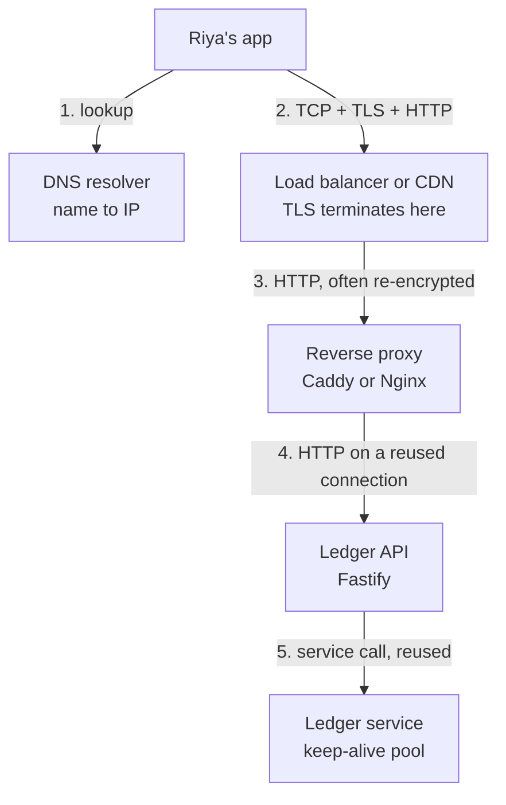
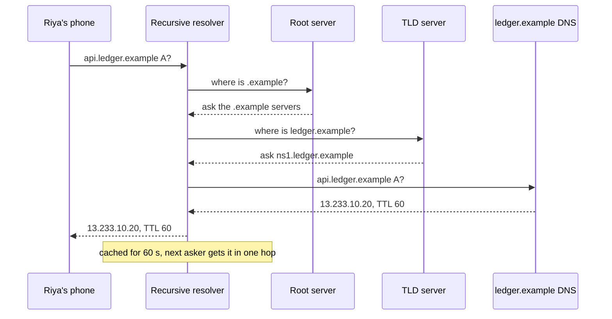
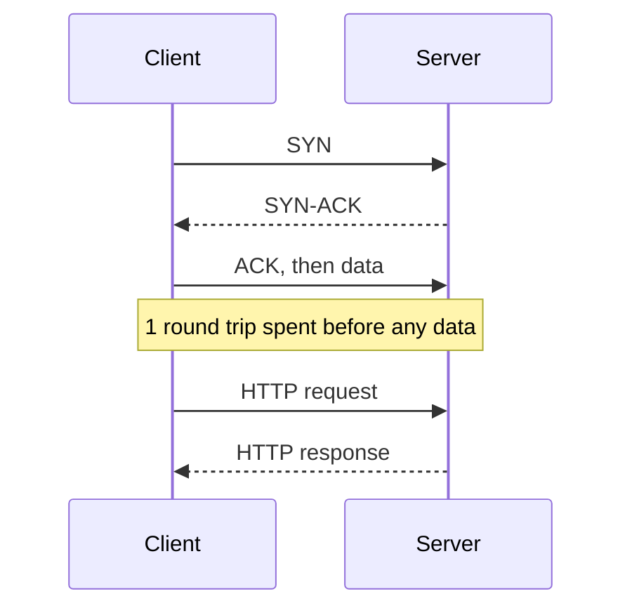
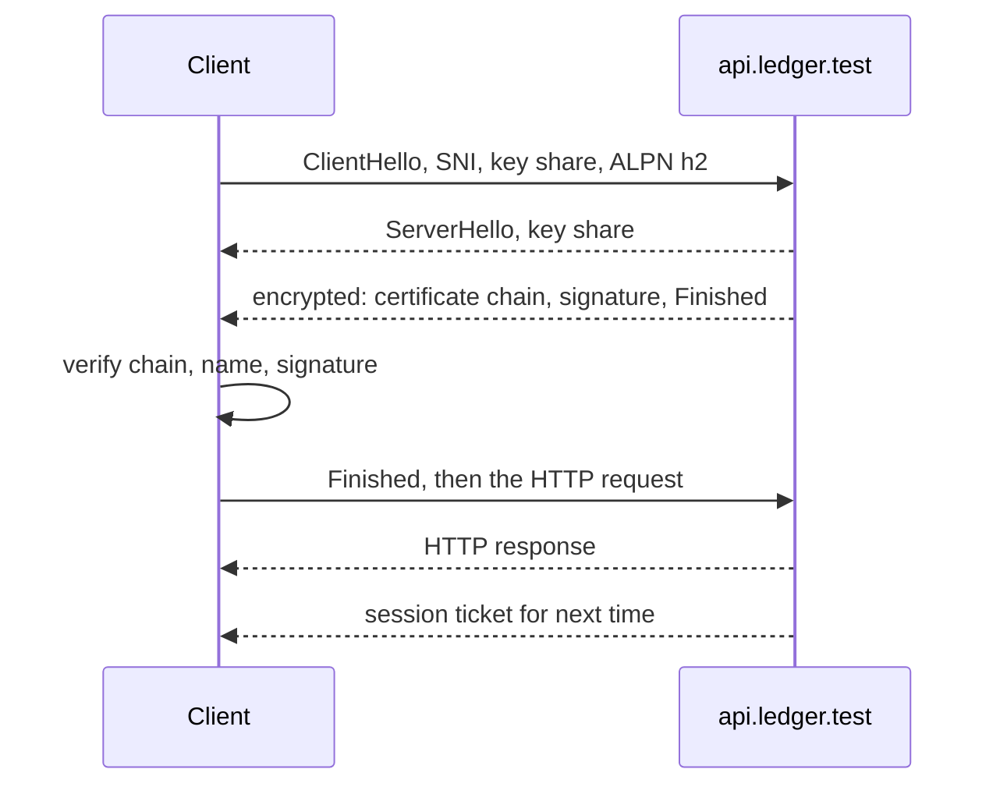
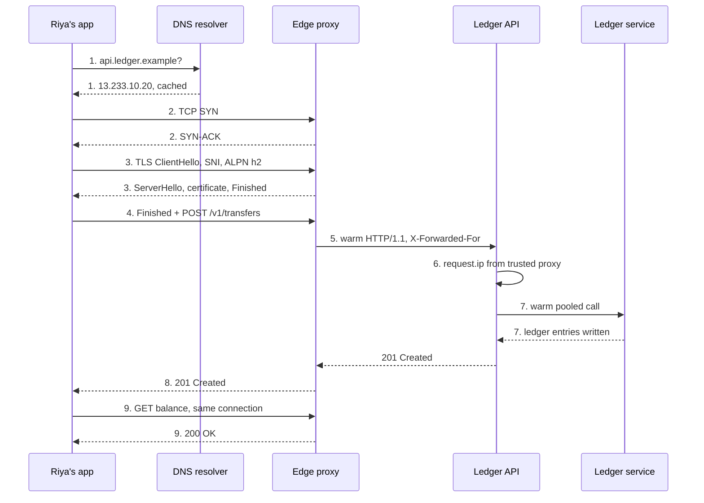
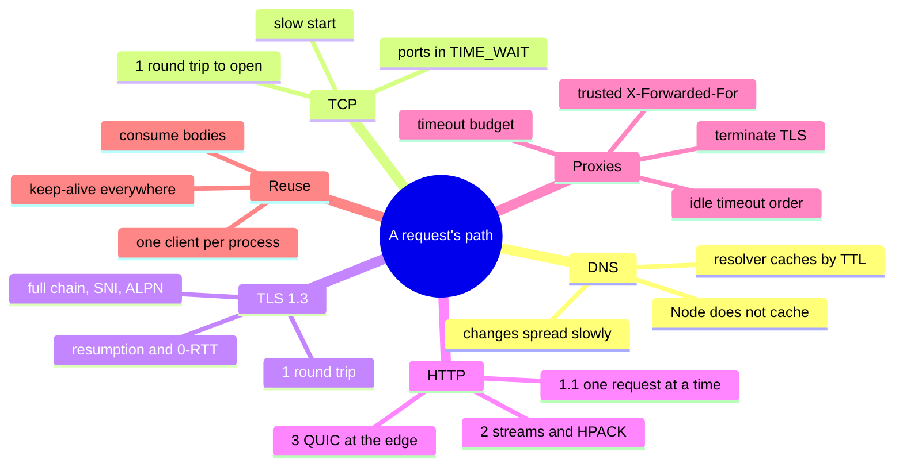

# P1-01 · How a request travels

| | |
|---|---|
| **Phase** | 1 · Backend foundations |
| **Prerequisites** | None |
| **Leads to** | P1-02 · The Node.js runtime · P3-03 (load balancing) · P5-01 · Observability with OpenTelemetry |
| **Repo path** | `system-design/phase-1/p1-01-how-a-request-travels.md` |

**After this card you can:**

1. Name every round trip between "Riya taps Pay" and "the app shows JSON", and put a rough cost in milliseconds on each.
2. Explain why a new HTTPS connection costs several round trips and a reused one costs one, and stop your services from paying that cost again and again.
3. Read `curl -w` timings and an `openssl s_client` handshake, and say where the time went.
4. Put a reverse proxy in front of a Fastify app without breaking client IPs, timeouts or keep-alive.
5. Choose between HTTP/1.1, HTTP/2 and HTTP/3 for a given hop, and say what each one does and does not fix.

> **About the numbers in this guide.** Everything marked **Real output** was run while writing this guide on 21 Oct 2026, on a 2-vCPU Linux sandbox with Node.js 22.22.0, undici 8.12.3, Fastify 5.12.7, Caddy 2.11.7, curl 8.5.0 and OpenSSL 3.0.13. Two limits shaped the setup, and the guide says so wherever it matters:
> - **No direct internet and no DNS.** The sandbox reaches public sites only through an egress proxy, so the one public-site measurement includes that extra hop, and DNS lookups could not be measured here at all.
> - **Everything else ran on one machine,** where a round trip takes microseconds. To make round trips visible, a small relay (`proxy/wan-sim.ts`, in the lab) adds a fixed delay to every packet. It cannot delay the TCP handshake itself, so on a real network add one more round trip to every "cold" number.
>
> Everything marked **Expected** was not run here. **Versions** (checked 21 Oct 2026): Node.js 24 is in maintenance LTS since 20 Oct 2026 and Node.js 26 becomes the active LTS on 28 Oct 2026; nginx 1.30.6 stable and 1.31.7 mainline; Caddy 2.11.7; curl 8.23.0 is the latest release.

---

## 🧭 The concept in one minute

A **request** is a message from a client (Riya's app) to a server (the ledger API). Before the first byte of that message can travel, the client must find the server (**DNS**), open a connection (**TCP**) and make it private (**TLS**). Only then does the **HTTP** request go out, usually through one or more **proxies** before it reaches your code.

**One line:** a request is not one round trip; a cold HTTPS request is four or more, and a warm one is one.

**Analogy.** Calling a new chemist to order medicine. First you look up the number on Justdial (**DNS**). You dial and wait for "hello?" before you speak (**TCP**). You both confirm who you are and agree to speak in a code no one else knows (**TLS**). Only then do you place the order (**HTTP**). If you keep the line open, your next order skips everything except the last step. That is **keep-alive**. Most calls go to a receptionist first, who passes them on to the right person (the **reverse proxy**).

**On the ledger platform.** Riya pays ₹500 from her phone on 4G. With a 50 ms round trip to the server and 30 ms of server work, the first request of the session costs about **200 ms**, and a request on the same connection a few seconds later costs about **80 ms** (computed in "How it works"). Inside the platform, the transfer service calls the ledger service 1,000 times in a batch. With a new HTTPS connection per call it took **2.8 s** here; with one shared connection pool it took **0.25 s**.

---

## 🔥 The problem it solves

Here is the ledger platform with the defaults a new team usually ships. Every number was measured or computed in this guide.

1. **Every service call opens a new connection.** The transfer service creates a new HTTP client for each call to the ledger service. For 1,000 calls over HTTPS, that cost **2,777 ms instead of 254 ms**, and opened **1,000 TCP connections instead of 10**. On a real network each one also waits for DNS and an extra round trip.
2. **The proxy gives up before the app does.** Caddy waits 2 seconds; the transfer takes 5. Riya's app gets **504 Gateway Timeout after 2.0 s**, but the transfer **commits at 5.0 s**. She taps Pay again. Only the idempotency key from P1-03 stops a second debit.
3. **The app believes whatever IP the client claims.** With `trustProxy: true`, a client that sends `X-Forwarded-For: 203.0.113.7` makes the rate limiter and the audit log record **203.0.113.7**. Brute-force limits per IP stop working.
4. **Nobody knows where the 200 ms go.** "The API is slow" is reported, but nobody can say whether it is DNS, the handshakes, the proxy, or the code. `curl -w` answers that in one line.

This card fixes all four: connection reuse, a timeout budget, trusted-proxy settings, and a way to measure each phase.

---

## 📚 Before you start

There are no earlier cards. You only need to know how to run a Node.js script and a terminal command.

**Key terms**

| Term | Plain meaning |
|---|---|
| Round trip (RTT) | Time for a message to go to the other side and an answer to come back. Mumbai to Mumbai can be 1 to 5 ms; a 4G phone to a cloud region is often 30 to 80 ms; India to the US East coast is about 200 ms. |
| Latency | How long one request takes, end to end. |
| DNS | The internet's phone book: turns `api.ledger.example` into an IP address. |
| Resolver | The DNS server that does the lookup for you (your ISP's, `8.8.8.8`, `1.1.1.1`) and caches answers. |
| TTL | "Time to live": how many seconds a DNS answer may be cached. |
| TCP | The protocol that gives a reliable, ordered byte stream between two machines. |
| TLS | Encryption and identity on top of TCP. HTTPS is HTTP over TLS. |
| Handshake | The opening messages that set up TCP or TLS before data flows. |
| Certificate | A signed document saying "this public key belongs to `api.ledger.example`". |
| SNI | Server Name Indication: the hostname the client sends at the start of TLS, so one IP can serve many sites. |
| Keep-alive | Reusing one open connection for many requests. |
| Connection pool | A set of open connections a client keeps and reuses. |
| Head-of-line blocking | One slow item at the front of a queue holds up everything behind it. |
| Reverse proxy | A server in front of your app that receives client requests and forwards them (Nginx, Caddy, Envoy, a cloud load balancer). |
| TLS termination | The point where TLS is decrypted. After it, traffic may be plain HTTP or re-encrypted. |
| ALPN | The TLS extension where client and server agree on HTTP/1.1 or HTTP/2 during the handshake. |
| TTFB | Time to first byte: from the start until the first byte of the response arrives. |

---

## 🧠 How it works

### Mental model: layers, each with its own setup cost

Each layer needs the one below it, and each new connection pays every layer's setup again.

| Layer | What it does | Setup cost on a new connection | Paid again on a reused connection? |
|---|---|---|---|
| DNS | Name to IP | 0 (cached) to several round trips (cache miss) | No (the connection already has an IP) |
| TCP | Reliable byte stream | 1 round trip (SYN, SYN-ACK, ACK) | No |
| TLS 1.3 | Encryption and identity | 1 round trip (TLS 1.2: 2) | No |
| HTTP | The request and response | 1 round trip, plus server time | **Yes: this is the only cost of a warm request** |

**Diagram: the layers a request crosses on the ledger platform**



**How to read this diagram.** Riya's app first asks DNS where the API lives, then opens one connection to the platform's edge. The edge decrypts TLS and forwards the request over connections it keeps open to the proxy. The proxy forwards it to the Fastify app, again over a kept-open connection. The app calls another service through its own connection pool. Only the hop from Riya's phone is "cold"; every hop inside the platform should already have a warm connection waiting. The full step-by-step sequence, with round trips, is in the Walkthrough.

### Cold vs warm, in round trips

The same `GET /v1/wallets/{id}/balance`, for a phone with a 50 ms round trip to the server, a 20 ms round trip to its DNS resolver, and 30 ms of server work. Computed, not measured:

```text
cold, TLS 1.3   |DNS 20|--TCP 50--|--TLS 50--|--HTTP 50 + server 30--|   = 200 ms
cold, TLS 1.2   |DNS 20|--TCP 50--|-----TLS 100------|--HTTP 50 + 30--|   = 250 ms
warm (reused)                                        |--HTTP 50 + 30--|   =  80 ms
```

A DNS cache miss adds roughly another 100 ms on top. On a 200 ms round trip (a user in India calling a US region), the cold request becomes about 650 ms, of which only 30 ms is server work. This is why connection reuse and where the servers sit matter more than most code tweaks.

---
## 🔬 Deep dive

One subsection per item on the card, in the card's order.

### 1. DNS resolution: resolvers, records, TTLs and slow changes

**What it is.** DNS turns a name into an address. Your app does not ask the whole internet; it asks a **recursive resolver** (your ISP's, Jio's, `8.8.8.8`, `1.1.1.1`, or the one inside your cloud network). The resolver either has the answer cached, or it walks the tree: root servers, then the `.example` servers, then the servers that own `ledger.example`.

**Diagram: one DNS lookup on a cache miss**



**How to read this diagram.** The phone makes one request and waits. On a cache miss, the resolver does three more round trips on the phone's behalf. On a cache hit, only the first and last arrows happen. Most lookups for a popular name are cache hits; the first user after the TTL expires pays the full walk.

**The records a backend engineer meets**

| Record | Means | Ledger example |
|---|---|---|
| `A` | Name → IPv4 address | `api.ledger.example → 13.233.10.20` |
| `AAAA` | Name → IPv6 address | `api.ledger.example → 2406:da1a::1` |
| `CNAME` | Name → another name (an alias); the resolver then looks up that name | `api.ledger.example → ledger-alb-123.ap-south-1.elb.amazonaws.com` |
| `NS` | Which servers own this zone | `ledger.example → ns1.dnsprovider.com` |
| `TXT` | Free text: domain verification, email rules (SPF, DMARC) | `"google-site-verification=..."` |

Two gotchas: a `CNAME` cannot sit at the bare domain (`ledger.example` itself), which is why DNS providers offer "ALIAS" or "flattening" records; and each `CNAME` in a chain can cost another lookup.

**TTL, and why DNS changes take time to spread.** The TTL tells every cache how long it may keep an answer. When you change a record, nothing is "pushed"; each cache keeps the old answer until its copy expires. And several layers cache: the resolver, the operating system, the browser, and your own app.

- **A long TTL** (1 hour, 1 day): fewer lookups, but a change takes up to that long to reach everyone.
- **A short TTL** (30 to 60 s): changes spread fast, but more lookups, and more load and dependence on DNS.
- **Negative answers are cached too.** "This name does not exist" is remembered for the time set in the zone's SOA record. A typo'd lookup before you create a record can stick.
- **Long-lived connections never ask again.** A keep-alive connection pool keeps talking to the old IP until those connections close. After a DNS change, old pods or old load balancers must keep serving until connections drain.

**Moving the API to a new load balancer, safely:**
1. A day before, lower the record's TTL to 60 s (and wait for the old TTL to pass).
2. Point the record at the new address.
3. Keep the old address serving for at least the old TTL, plus your clients' connection lifetime.
4. Raise the TTL again.

**DNS inside Node.js.** `dns.lookup()` (what `http`, `undici` and `fetch` use by default) calls the operating system's `getaddrinfo` on the libuv thread pool, which has 4 threads by default (P1-02). Node itself does not cache the answer, so every **new** connection does a fresh lookup. Two ways to avoid paying for it: reuse connections (this card), or add undici's DNS cache, `interceptors.dns()`, which keeps answers for the record's TTL.

**Try it on your machine** (not run here: the sandbox has no DNS access). The `ANSWER SECTION` shows each record with its remaining TTL in seconds; run the command twice and the TTL counts down, because the second answer comes from the resolver's cache.

```bash
dig api.github.com A +noall +answer         # name, TTL, class, type, value
dig api.github.com A +noall +answer         # again: same answer, smaller TTL (cached)
dig +trace api.github.com A                 # the full walk: root, TLD, authoritative
```

**When not to rely on DNS.** DNS is a slow, cached switch. It is fine for "which region or load balancer", and wrong for fast failover between servers. Use a load balancer's health checks for that (P3-03).

### 2. TCP: the three-way handshake, reuse, and the cost of new connections

**What it is.** TCP turns unreliable packets into a reliable, ordered stream of bytes. Before any data, client and server exchange three messages: SYN ("let's talk"), SYN-ACK ("okay"), ACK ("okay"). The client can send data right after its ACK, so a new connection costs **one round trip** before the first request byte.

**Diagram: TCP handshake, then the first request**



**How to read this diagram.** Time runs down. The first exchange carries no useful data; it only proves both sides are there and agrees on starting sequence numbers. With TLS, another round trip follows before the request (Deep dive 3).

**Minimal version:** `minimal/round-trips.ts`. It does what `curl -w` measures, by hand, against the 40 ms relay.

```ts
// What curl -w measures, done by hand: TCP connect, TLS handshake, then one HTTP request.
// Run against the 40 ms RTT relay: npx tsx minimal/round-trips.ts api.ledger.test 9443
import { readFileSync } from "node:fs";
import net from "node:net";
import tls from "node:tls";

const [host = "api.ledger.test", port = "9443"] = process.argv.slice(2);
const t0 = performance.now();
const ms = () => `${(performance.now() - t0).toFixed(1).padStart(6)} ms`;

const tcp = net.connect(Number(port), host, () => {
  console.log(`${ms()}  TCP connected`);                      // 1 round trip on a real network (SYN, SYN-ACK)
  const secure = tls.connect({ socket: tcp, servername: host, ca: readFileSync("certs/root.pem"), ALPNProtocols: ["http/1.1"] }, () => {
    console.log(`${ms()}  TLS ${secure.getProtocol()} done, ALPN ${secure.alpnProtocol}`); // TLS 1.3: 1 round trip
    secure.write(`GET /v1/wallets/e73a25de-e42b-6ad6-b150-4c76d3a969c5/balance HTTP/1.1\r\nHost: ${host}\r\nConnection: close\r\n\r\n`);
  });
  let first = true;
  secure.on("data", (chunk: Buffer) => {
    if (first) console.log(`${ms()}  first byte: ${chunk.toString().split("\r\n")[0]}`); // 1 more round trip
    first = false;
  });
  secure.on("end", () => console.log(`${ms()}  connection closed`));
});
```

**Real output** (40 ms round trip added by the relay; see the limit in the note at the top)

```text
   7.0 ms  TCP connected
  68.2 ms  TLS TLSv1.3 done, ALPN http/1.1
 112.4 ms  first byte: HTTP/1.1 200 OK
 113.2 ms  connection closed
```

**What to notice**
- **TCP took 7 ms here only because the relay cannot delay the kernel's handshake.** On a real 40 ms link it would take 40 ms.
- **TLS took one round trip plus CPU work** (about 61 ms, including first-run start-up in the script). **The request took one more round trip** (44 ms).
- Three round trips before the first byte of a "simple" GET, and that is with DNS already cached.

**More costs of a new connection**
- **Slow start.** A new TCP connection starts by sending only about 10 packets (roughly 14 KB) before waiting for an acknowledgement, then grows. A large first response takes extra round trips on a new connection; a warm connection has already grown.
- **Ports and TIME_WAIT.** The side that closes a connection keeps it in `TIME_WAIT` for a while. Linux's default port range here is 32768 to 60999, or **28,232 ports**. With a 60 s wait, that is about **470 new connections per second** to one IP and port before the client runs out of ports and calls start failing with `EADDRNOTAVAIL`. Connection reuse avoids this completely.
- **The server pays too:** each new connection costs it an accept, a socket, and usually a TLS handshake.

**When a new connection is fine.** A command-line tool that makes one call. A connection to a service you call once an hour. Everywhere else, reuse.

### 3. TLS 1.3: the handshake, certificate chains, SNI, resumption, and termination

**What it is.** TLS gives the connection three things: **privacy** (encryption), **integrity** (tampering is detected) and **identity** (the certificate proves the server owns the name). TLS 1.3 (RFC 8446, 2018) needs **one round trip**; TLS 1.2 needed two.

**Diagram: a TLS 1.3 handshake**



**How to read this diagram.** The client guesses the key-exchange method and sends its half of the key immediately, so the server can answer with everything in one flight. From the server's second message on, everything is encrypted, including the certificate. The client checks the certificate and sends its first request in the same flight as its `Finished`. The session ticket at the end lets the next connection skip the certificate step.

**TLS 1.3 vs TLS 1.2, measured.** Same request through the 40 ms relay. **Real output** (`curl -w`, cumulative seconds):

```text
TLS 1.3, run 1:  tcp 0.000469  tls done 0.048008  first byte 0.091403
TLS 1.3, run 2:  tcp 0.000466  tls done 0.044832  first byte 0.087758
TLS 1.2:         tcp 0.000436  tls done 0.087742  first byte 0.133348
```

The TLS phase took **44 to 48 ms with TLS 1.3** (one round trip) and **87 ms with TLS 1.2** (two). The request phase was one round trip in both (43 to 46 ms).

**Certificate chains.** The server sends its own certificate (the **leaf**) plus one or more **intermediate** certificates. The client already trusts a small set of **root** certificates and checks that each certificate is signed by the next, that the leaf's name matches, and that nothing has expired.

**Real output** (`openssl s_client` against Caddy, using this guide's lab CA)

```text
depth=2 CN = Ledger Lab Root CA
depth=1 CN = Ledger Lab Intermediate CA
depth=0 CN = api.ledger.test
Certificate chain
 0 s:CN = api.ledger.test
   i:CN = Ledger Lab Intermediate CA
 1 s:CN = Ledger Lab Intermediate CA
   i:CN = Ledger Lab Root CA
Peer signature type: ECDSA
Server Temp Key: X25519, 253 bits
Verification: OK
New, TLSv1.3, Cipher is TLS_AES_128_GCM_SHA256
ALPN protocol: h2
    TLS session ticket lifetime hint: 604800 (seconds)
```

**What to notice**
- `s:` is the certificate's subject, `i:` who issued it. Each `i:` matches the next `s:`, up to the root, which the client must already trust and which the server does not send.
- **Forgetting the intermediate** is the classic misconfiguration: browsers often cope, but `curl`, Node.js and mobile apps fail with "unable to verify the first certificate". Always serve the full chain (`chain.pem` in the lab).
- `X25519` is the key exchange, `TLS_AES_128_GCM_SHA256` the cipher, and `ALPN protocol: h2` means client and server agreed on HTTP/2 inside the handshake, at no extra cost.

**SNI.** One IP address can serve many names. The client puts the name it wants (`api.ledger.test`) in the `ClientHello`, so the server picks the right certificate. SNI travels unencrypted, so a network observer can see which name you connect to (but not the path or the data). Encrypted Client Hello (ECH) is an extension that hides it; support is still rolling out.

**Session resumption.** After the handshake, the server sends a session ticket. A client that reconnects can present it and skip the certificate exchange.

**Real output** (`openssl s_client -sess_in` with the saved ticket)

```text
Reused, TLSv1.3, Cipher is TLS_AES_128_GCM_SHA256
```

Resumption still costs a round trip in TLS 1.3, but saves the certificate transfer and the signature checks (CPU on both sides). TLS 1.3 also allows **0-RTT** ("early data"): the client sends a request together with the resumed `ClientHello`. Early data can be **replayed** by an attacker, so it must only ever carry safe, idempotent requests. Never a `POST /v1/transfers`.

**Where TLS terminates.** Decrypting needs the private key and costs CPU, so you choose where it happens:

| Where | How it looks | Good for | Watch out for |
|---|---|---|---|
| CDN or edge | TLS ends at the CDN; a second TLS connection to your origin | Global users, DDoS protection, HTTP/3 | The CDN sees plain traffic; keep origin TLS on |
| Cloud load balancer | TLS ends at the ALB; HTTP or re-encrypted TLS to pods | Managed certificates, simple apps | Pass `X-Forwarded-Proto` so the app knows it was HTTPS |
| Reverse proxy (Caddy, Nginx, Envoy) | TLS ends at the proxy next to the app | Full control, self-hosted | Key management, certificate renewal |
| The app itself | Node.js `https` or Fastify `https` option | Service-to-service mTLS, small setups | CPU in the event loop, every app handles keys |
| Service mesh sidecar | Envoy next to each pod, mTLS between services | Zero-trust inside the cluster (P1-05's service identity) | More moving parts |

Fintech platforms usually terminate public TLS at the edge or load balancer **and** encrypt again inside the network, because "inside" is not automatically safe.

**Certificates now expire faster.** Under CA/Browser Forum ballot SC-081, publicly trusted TLS certificates issued from 15 March 2026 can be valid for at most **200 days**, dropping to 100 days in March 2027 and **47 days in March 2029**. Manual renewal is no longer realistic: automate it (ACME, as Caddy does by default, or your cloud's certificate manager).

### 4. HTTP/1.1: anatomy, keep-alive and head-of-line blocking

**What it is.** HTTP/1.1 is text: a request line, header lines, a blank line, then an optional body. The response has the same shape with a status line.

**Real output** (`curl -v --http1.1` through Caddy; TLS lines removed, the blank separator lines shown as `>` and `<`)

```text
> GET /v1/wallets/e73a25de-e42b-6ad6-b150-4c76d3a969c5/balance HTTP/1.1
> Host: api.ledger.test:8443
> User-Agent: curl/8.5.0
> Accept: */*
>
< HTTP/1.1 200 OK
< Alt-Svc: h3=":8443"; ma=2592000
< Content-Length: 90
< Content-Type: application/json; charset=utf-8
< Date: Wed, 21 Oct 2026 03:32:52 GMT
< Via: 1.1 Caddy
<
```

The 90-byte JSON body follows the empty line.

**What to notice**
- `>` lines are what curl sent; `<` lines are what came back. The empty line ends the headers.
- `Host` is required in HTTP/1.1: one IP and port can serve many sites.
- `Via: 1.1 Caddy` and `Alt-Svc` were added by the proxy, not by Fastify (Deep dives 6 and 7).
- `Content-Length: 90` tells the client exactly where the body ends, so the connection can carry the next request.

**Keep-alive.** In HTTP/1.1, connections stay open by default after a response, until either side sends `Connection: close` or an idle timeout passes. Node's `http.globalAgent` keeps connections alive by default since Node.js 19 (**Real output** here: `http.globalAgent.keepAlive = true`), but a `new http.Agent()` still defaults to `keepAlive: false`.

**Head-of-line blocking.** One HTTP/1.1 connection carries one request at a time. Pipelining (sending several without waiting) exists in the spec, but responses must come back in order, and browsers never turned it on by default. So one slow response blocks everything behind it on that connection.

**Minimal version:** `minimal/hol.ts`. One slow request (300 ms) followed by nine instant ones, all on one connection.

```ts
// Head-of-line blocking: one slow request followed by 9 fast ones, all on ONE connection.
import http from "node:http";
import http2 from "node:http2";

const handler = (path: string, end: (body: string) => void) =>
  setTimeout(() => end(`done ${path}`), path === "/slow" ? 300 : 0); // /slow takes 300 ms, the rest are instant

const h1 = http.createServer((req, res) => handler(req.url!, (b) => res.end(b))).listen(7101);
const h2 = http2.createServer((req, res) => handler(req.url!, (b) => res.end(b))).listen(7102); // h2c, cleartext
const paths = ["/slow", ...Array.from({ length: 9 }, (_, i) => `/fast${i + 1}`)];

async function viaHttp1(): Promise<number[]> {
  const agent = new http.Agent({ keepAlive: true, maxSockets: 1 }); // one connection, like one browser socket
  const t0 = performance.now();
  const done = await Promise.all(paths.map((p) => new Promise<number>((resolve) =>
    http.get({ port: 7101, path: p, agent }, (res) => res.resume().on("end", () => resolve(performance.now() - t0))))));
  agent.destroy();
  return done;
}

async function viaHttp2(): Promise<number[]> {
  const session = http2.connect("http://127.0.0.1:7102");
  const t0 = performance.now();
  const done = await Promise.all(paths.map((p) => new Promise<number>((resolve) => {
    const stream = session.request({ ":path": p });   // every request is its own stream on the same connection
    stream.resume().on("end", () => resolve(performance.now() - t0));
  })));
  session.close();
  return done;
}

const fmt = (xs: number[]) => `slow ${xs[0]!.toFixed(0)} ms | fast ones finished at ${xs.slice(1).map((x) => x.toFixed(0)).join(", ")} ms`;
console.log("HTTP/1.1, 1 connection:", fmt(await viaHttp1()));
console.log("HTTP/2,   1 connection:", fmt(await viaHttp2()));
h1.close(); h2.close();
```

**Real output** (two runs)

```text
HTTP/1.1, 1 connection: slow 319 ms | fast ones finished at 321, 323, 325, 327, 329, 331, 333, 335, 336 ms
HTTP/2,   1 connection: slow 307 ms | fast ones finished at 10, 10, 10, 10, 10, 11, 11, 11, 11 ms
HTTP/1.1, 1 connection: slow 316 ms | fast ones finished at 318, 320, 322, 323, 325, 326, 328, 330, 332 ms
HTTP/2,   1 connection: slow 306 ms | fast ones finished at 9, 9, 9, 9, 10, 10, 10, 10, 10 ms
```

**What to notice**
- On HTTP/1.1, nine instant requests waited about **320 ms** behind the slow one.
- On HTTP/2, the same nine finished in about **10 ms**, while the slow one was still running.
- Browsers work around HTTP/1.1's limit by opening up to about six connections per host, which multiplies every handshake cost.

**When HTTP/1.1 is fine.** Between your proxy and your app, on a fast local network, with a pool of keep-alive connections: it is simple, every tool speaks it, and the pool gives you parallelism. That is how most proxies talk to upstreams today.

---
### 5. HTTP/2: many streams on one connection, header compression, and gRPC

**What it is.** HTTP/2 keeps HTTP's meaning (methods, status codes, headers) but changes the wire format. Messages are cut into binary **frames**, and each request-response pair is a **stream** with its own ID. Frames from many streams interleave on **one** TCP connection, so a slow response no longer blocks the others (the HTTP/2 lines in Deep dive 4).

**Header compression (HPACK).** Every HTTP/1.1 request repeats the same headers as text: cookies, user agent, tokens. HTTP/2's HPACK keeps a table of headers already sent on this connection and replaces repeats with small index numbers.

**Minimal version:** `minimal/hpack.ts`. 100 requests with the same headers, counting the bytes the client really sent.

```ts
// Header compression: 100 GETs with the same headers, counted in bytes the client actually sent.
import http from "node:http";
import http2 from "node:http2";
import type { Socket } from "node:net";

const common = {
  cookie: `theme=dark; lang=hi-IN; experiment=${"y".repeat(150)}`,
  "user-agent": "LedgerApp/4.2 (Android 15; Pixel 8)",
  accept: "application/json",
};
const withToken = { ...common, authorization: `Bearer ${"x".repeat(700)}` }; // a JWT-sized token (P1-05)
const N = 100;
const h1 = http.createServer((_req, res) => res.end("ok")).listen(7201);
const h2 = http2.createServer((_req, res) => res.end("ok")).listen(7202);

async function http1Bytes(headers: Record<string, string>): Promise<number> {
  const agent = new http.Agent({ keepAlive: true, maxSockets: 1 });
  let socket: Socket | undefined;
  for (let i = 0; i < N; i++) {
    await new Promise<void>((resolve) => {
      http.get({ port: 7201, path: "/v1/wallets/w_42/balance", agent, headers: { ...headers, "x-request-id": `req-${i}` } },
        (res) => res.resume().on("end", resolve)).on("socket", (s) => (socket = s));
    });
  }
  agent.destroy();
  return socket!.bytesWritten;
}

async function http2Bytes(headers: Record<string, string>): Promise<number> {
  const session = http2.connect("http://127.0.0.1:7202");
  for (let i = 0; i < N; i++) {
    await new Promise<void>((resolve) =>
      session.request({ ":path": "/v1/wallets/w_42/balance", ...headers, "x-request-id": `req-${i}` }).resume().on("end", resolve));
  }
  const bytes = session.socket.bytesWritten;
  session.close();
  return bytes;
}

for (const [name, headers] of [["cookie + user-agent only", common], ["plus a 700-byte bearer token", withToken]] as const) {
  const [a, b] = [await http1Bytes(headers), await http2Bytes(headers)];
  console.log(`${name.padEnd(30)} HTTP/1.1 ${a.toLocaleString("en-IN").padStart(9)} B | HTTP/2 ${b.toLocaleString("en-IN").padStart(8)} B | ${(100 - (b / a) * 100).toFixed(0)}% smaller`);
}
h1.close(); h2.close();
```

**Real output**

```text
cookie + user-agent only       HTTP/1.1    37,890 B | HTTP/2    4,707 B | 88% smaller
plus a 700-byte bearer token   HTTP/1.1  1,10,290 B | HTTP/2   67,007 B | 39% smaller
```

**What to notice**
- Without a token, HTTP/2 sent **88% fewer bytes**: after the first request, repeated headers cost a byte or two each.
- With an `Authorization` header, the saving fell to **39%**. Node.js marks `Authorization` (and short `Cookie` values) as **sensitive** and never adds them to the compression table, because compressed secrets can leak through size-based attacks. So the 700-byte token is sent in full every time.
- On a phone's slow upload link, header bytes are real latency. This is one reason HTTP/2 helps mobile apps.

**Why gRPC uses HTTP/2.** gRPC (P1-04) needs many concurrent calls on one connection, long-lived streams in both directions, and **trailers** (headers sent after the body, where gRPC puts its status). HTTP/2 provides all three. Browsers cannot read HTTP/2 trailers from JavaScript, which is why browsers use gRPC-Web or Connect through a proxy instead.

**When HTTP/2 helps**
- Many small requests to one origin, especially over a high round-trip link (mobile apps, web pages with many API calls).
- gRPC between services.
- Replacing six HTTP/1.1 connections (six handshakes) with one.

**When it does not**
- **Packet loss.** All streams share one TCP connection. When one packet is lost, TCP holds back **every** stream until it is resent: head-of-line blocking moved down a layer. On a lossy mobile link, HTTP/2 can be slower than several HTTP/1.1 connections.
- **One big download.** One stream gains nothing from multiplexing.
- **Proxy to app on a fast local network.** A pool of HTTP/1.1 keep-alive connections works just as well, and most proxies speak HTTP/1.1 to upstreams by default (Caddy accepted HTTP/2 from curl here and spoke HTTP/1.1 to Fastify).
- **It needs its own protections.** In 2023 the "Rapid Reset" attack (CVE-2023-44487) opened and cancelled streams very fast to overload servers. Keep proxies and Node.js patched, and limit concurrent streams.

### 6. HTTP/3 and QUIC: faster setup over UDP, mostly at the edge

**What it is.** HTTP/3 (RFC 9114, 2022) runs on **QUIC** (RFC 9000, 2021), a transport built on UDP. QUIC puts reliability, ordering and TLS 1.3 encryption into one protocol.

**What it changes**
- **Faster setup:** the transport and TLS handshakes are combined, so a new connection needs **one round trip** instead of TCP's one plus TLS's one. A resumed connection can send data in **0-RTT** (with the same replay warning as TLS early data).
- **No TCP head-of-line blocking:** each stream is recovered separately, so a lost packet only delays its own stream.
- **Connection migration:** a connection has an ID instead of being tied to an IP and port. When Riya walks out of her office Wi-Fi onto 4G, the connection can survive the IP change.

**How a client finds out.** A server advertises HTTP/3 in a header on an HTTP/1.1 or HTTP/2 response, or in an `HTTPS` DNS record. Caddy does this by default. **Real output** (`curl -sI` against the lab's Caddy):

```text
HTTP/2 200
alt-svc: h3=":8443"; ma=2592000
via: 1.1 Caddy
```

`ma=2592000` means "remember this for 30 days". The next connection may try QUIC on UDP port 8443. The curl build in this sandbox has no HTTP/3 support, so HTTP/3 was not measured here; `curl --http3` works on builds that include it.

**Where you meet it.** At CDNs and the edge: Cloudflare, CloudFront, Google, and Caddy or nginx (HTTP/3 since 1.25) at your own edge. Inside a data centre, TCP with keep-alive is cheap and well understood, so HTTP/3 rarely appears between services. Node.js has an experimental `node:quic` module (added in v23.8.0, "Stability 1.0 - Early development", behind `--experimental-quic`), so a Node.js app does not serve HTTP/3 itself; the edge does.

**Watch out for:** networks that block or throttle UDP (some offices and hotels). Clients then fall back to HTTP/2 over TCP silently, so always keep TCP working.

### 7. Proxies: forward vs reverse, and what Nginx, Envoy and load balancers do

**What it is.** A proxy is a server that sits between client and destination and forwards traffic.

| | Forward proxy | Reverse proxy |
|---|---|---|
| Works for | The client side | The server side |
| Who configures it | The client or its network (`HTTPS_PROXY`) | The service owner |
| Example | A company proxy all laptops use; this guide's sandbox egress proxy | Caddy, Nginx, Envoy, an AWS ALB in front of the ledger API |
| What it hides | Clients from the internet | Servers from clients |
| Typical jobs | Filtering, caching, access control for outbound traffic | TLS termination, routing, load balancing, buffering, timeouts |

**What a reverse proxy does for the ledger API**
- **TLS termination** and certificate renewal.
- **Routing** by host and path: `/v1/*` to the API, `/admin/*` to the back office, `/ws` to the notification service.
- **Load balancing** across several app instances, with health checks (P3-03).
- **Buffering:** it reads slow clients' uploads fully, then sends them to the app in one burst, so a phone on 2G does not hold an app connection for 30 seconds.
- **Timeouts and limits:** connect, read and idle timeouts; maximum body size (413) and header size.
- **Connection reuse:** many client connections become a few long-lived connections to the app.
- **Headers:** adds `X-Forwarded-For`, `X-Forwarded-Proto`, `Via`, `Alt-Svc`.
- **Protocol translation:** HTTP/2 or HTTP/3 from the client, HTTP/1.1 to the app.

**What it can break, measured here**

**1. The client IP.** Behind a proxy, every request comes from the proxy's IP. The proxy writes the real one into `X-Forwarded-For`. **Real output** (Fastify `trustProxy: "127.0.0.1"`, Caddy at 127.0.0.1):

```text
through Caddy from 127.0.0.3, lying with X-Forwarded-For: 203.0.113.7
{"ip":"127.0.0.3","ips":["127.0.0.1","127.0.0.3"],"host":"api.ledger.test:8443","protocol":"https"}

straight to the app from 127.0.0.2, same lie
{"ip":"127.0.0.2","ips":["127.0.0.2"],"host":"127.0.0.1:3000","protocol":"http"}
```

Caddy ignores `X-Forwarded-*` values from clients it does not trust and writes the real client address itself, so the app saw `127.0.0.3`, not the lie. The direct request came from `127.0.0.2`, which is not a trusted proxy, so Fastify ignored its header too. `protocol: "https"` comes from `X-Forwarded-Proto`: without it, an app behind a TLS-terminating proxy thinks every request is plain HTTP and can build wrong redirect URLs.

**2. Timeouts.** The proxy has its own clock. **Real output** (Caddy `response_header_timeout 2s`, a transfer that takes 5 s):

```text
03:29:28.569
status 504 after 2.005651s
03:29:30.585
03:29:28.581 transfer started reqId req-j
03:29:33.585 transfer committed reqId req-j
{"level":"error",...,"msg":"net/http: timeout awaiting response headers",...,"uri":"/v1/transfers",...}
```

Riya saw **504 after 2.0 s**. The transfer kept running and **committed 3 seconds later**. The app had no idea the client was gone. The fix is a timeout budget (Hands-on lab, step 2): the app's own deadline is shorter than the proxy's, so the app answers first, and money-moving requests carry an idempotency key (P1-03) so a retry cannot pay twice.

**3. Idle connections and random 502s.** The proxy keeps idle connections to the app open for reuse; the app also closes idle connections after its `keepAliveTimeout`. If the app closes first, the proxy can send a request on a connection that is being closed at that moment, and the user gets a **502**. The rule at every hop: **the server keeps idle connections open longer than the client side does.** Caddy keeps upstream connections for 2 minutes by default, Node.js's own `http` server closes idle ones after 5 s, and Fastify's default is 72 s; AWS ALBs default to a 60 s idle timeout. The lab sets Caddy's `keepalive 50s` against Fastify's 72 s, and the app refuses to start if the order is wrong.

**4. More things a proxy changes:** response buffering (which delays Server-Sent Events unless turned off for that route), retries of failed requests (a proxy that retries a `POST` can create a second transfer), body-size limits, WebSocket upgrades, and dropped connections during deploys unless instances drain first (P3-03).

**Nginx, Caddy, Envoy and cloud load balancers**

| | Nginx | Caddy | Envoy | Cloud load balancer (ALB, GCLB) |
|---|---|---|---|---|
| Typical use | Classic edge proxy and web server | Simple edge proxy with automatic HTTPS | Service mesh sidecar, API gateway, gRPC | Managed entry point in a cloud |
| Config | Text files, reload | Caddyfile or JSON API | YAML or a control plane (xDS) | Console, Terraform |
| TLS certificates | You bring and renew them | Automatic (ACME) by default | You or the mesh provide them | Managed by the cloud |
| HTTP/3 | Since 1.25 | On by default | Yes | Some (at the CDN layer) |
| Upstream default you must know | Before 1.29.7, HTTP/1.0 to upstreams; even now `Connection: close` unless you configure keep-alive | Keep-alive 2 min to upstreams | Rich timeouts and retries per route | Idle timeout (ALB: 60 s) |

### 8. Headers backends care about

**Host.** Which site the client wants, because one IP serves many names. Proxies pass it through (Caddy does by default). Never build absolute URLs from it without a list of allowed hosts: a client controls this header.

**X-Forwarded-For.** A comma-separated list. Each proxy **appends** the address it received the request from. The client controls everything to the left of the entries your own proxies added.

**Minimal version:** `minimal/xff.ts`. Pick the client IP by walking the list from the right.

```ts
// Which IP is the real client? Walk X-Forwarded-For from the RIGHT, skipping proxies you trust.
function clientIp(remoteAddress: string, xff: string | undefined, trusted: Set<string>): string {
  if (!trusted.has(remoteAddress)) return remoteAddress;           // not from our proxy: ignore its header entirely
  const hops = (xff ?? "").split(",").map((s) => s.trim()).filter(Boolean);
  for (let i = hops.length - 1; i >= 0; i--) {                     // the rightmost entries were added by our proxies
    if (!trusted.has(hops[i]!)) return hops[i]!;                   // first untrusted hop = the client as our edge saw it
  }
  return hops[0] ?? remoteAddress;
}

const ourProxies = new Set(["10.0.1.5", "10.0.2.9"]);              // the load balancer and Caddy
const cases: Array<[string, string, string | undefined]> = [
  ["honest client via proxy", "10.0.1.5", "49.36.120.10"],
  ["lying client via proxy", "10.0.1.5", "203.0.113.7, 49.36.120.10"], // proxy APPENDED the real IP after the lie
  ["lying client, proxy bypassed", "49.36.120.10", "203.0.113.7"],
  ["lying client via two proxies", "10.0.1.5", "203.0.113.7, 49.36.120.10, 10.0.2.9"],
];
for (const [name, remote, xff] of cases) {
  const right = clientIp(remote, xff, ourProxies);
  const naive = (xff ?? remote).split(",")[0]!.trim();             // what "take the first value" code does
  console.log(`${name.padEnd(30)} remote=${remote.padEnd(13)} XFF="${xff}"\n${"".padEnd(30)} correct=${right}  naive-first=${naive}`);
}
```

**Real output**

```text
honest client via proxy        remote=10.0.1.5      XFF="49.36.120.10"
                               correct=49.36.120.10  naive-first=49.36.120.10
lying client via proxy         remote=10.0.1.5      XFF="203.0.113.7, 49.36.120.10"
                               correct=49.36.120.10  naive-first=203.0.113.7
lying client, proxy bypassed   remote=49.36.120.10  XFF="203.0.113.7"
                               correct=49.36.120.10  naive-first=203.0.113.7
lying client via two proxies   remote=10.0.1.5      XFF="203.0.113.7, 49.36.120.10, 10.0.2.9"
                               correct=49.36.120.10  naive-first=203.0.113.7
```

**What to notice**
- "Take the first value" returns whatever the attacker wrote, in three of four cases.
- If the request did not come from your proxy, its `X-Forwarded-For` means nothing. That is what `trustProxy` with specific addresses does in Fastify.
- The standard header `Forwarded: for=49.36.120.10;proto=https` (RFC 7239) carries the same information in one structured header; `X-Forwarded-*` is still far more common.

**X-Forwarded-Proto and X-Forwarded-Host.** The original scheme and host, before TLS termination and routing. Trust them only from your proxies, for the same reason.

**Content-Length vs chunked transfer.** The receiver must know where a body ends.

**Real output** (`curl -D -` with `--http1.1` through Caddy)

```text
HTTP/1.1 200 OK                          <- GET .../balance (a small JSON object)
Content-Length: 90
Content-Type: application/json; charset=utf-8
HTTP/1.1 200 OK                          <- GET .../statement.csv (streamed rows)
Content-Type: text/csv
Transfer-Encoding: chunked
```

A body whose size is known up front gets `Content-Length`. A streamed body (a statement export, P1-02's streams) is sent in **chunks**, each prefixed with its size, ending with a zero-size chunk. HTTP/2 and HTTP/3 have no chunked encoding: frames carry the data and the last one is marked as the end. Security note: if a proxy and an app disagree about where a body ends (for example, both headers present), an attacker can hide a second request inside the first ("request smuggling"). Keep proxies and servers up to date and reject messages with both headers.

**Cache headers (a preview of P3-02).** Every response should say whether it may be cached:

| Response | Header | Why |
|---|---|---|
| Wallet balance, transaction list | `Cache-Control: no-store` | Money and personal data: never cached by browsers, CDNs or proxies |
| Exchange-rate or fee table, same for everyone | `Cache-Control: public, max-age=60` | Safe to share for a minute |
| A resource with a version | `ETag: "v12"`, then `If-None-Match` from the client | The server answers `304 Not Modified` with no body (P1-03) |
| A response that differs by language | `Vary: Accept-Language` | Caches keep one copy per language |

---

## ⚖️ Comparisons and trade-offs

### HTTP/1.1 vs HTTP/2 vs HTTP/3 (must-include)

| | HTTP/1.1 | HTTP/2 | HTTP/3 |
|---|---|---|---|
| Standard | RFC 9112 (1997 origins) | RFC 9113 (2015 origins) | RFC 9114 (2022) |
| Transport | TCP | TCP | QUIC over UDP |
| Format | Text | Binary frames | Binary frames |
| Requests per connection at once | 1 (browsers open about 6 connections) | Many streams | Many streams |
| Head-of-line blocking | Per connection, at the HTTP level | Fixed at HTTP level; still at TCP level on packet loss | None between streams |
| Header compression | None | HPACK (88% fewer bytes here without a token) | QPACK |
| New-connection setup | TCP (1 RTT) + TLS 1.3 (1 RTT) | Same as HTTP/1.1; HTTP/2 chosen inside TLS via ALPN | 1 RTT combined; 0-RTT on resumption |
| Survives an IP change | No | No | Yes (connection migration) |
| Encryption | Optional | Required by browsers | Always |
| Where you see it | Proxy to app, simple clients, curl defaults to HTTP/1.1 over plain HTTP | Browsers and apps to the edge, gRPC between services | CDNs and edges talking to browsers and apps |
| Best for | Simple, debuggable hops with connection pools | Many small requests, gRPC | Mobile users, lossy or changing networks |

### Ways to keep service-to-service calls fast

| | New client per call | One shared keep-alive pool | HTTP/2 to the downstream |
|---|---|---|---|
| Connections for 1,000 calls (lab) | 1,000 | 10 | 1 (multiplexed) |
| Handshakes paid | Every call | Once per pooled connection | Once |
| Measured (HTTPS, 1,000 calls) | 2,777 ms | 254 ms | Not measured |
| Risk | Port exhaustion, TLS CPU | Stale connections after deploys; needs idle-timeout alignment | One slow connection affects all streams |
| Use it for | Nothing in production | The default | gRPC, or many concurrent calls to one service |

---
## 🚶 Walkthrough on the ledger platform: Riya pays ₹500 from a cold app

Riya opens the app on 4G and pays ₹500 to Amit. Her phone has no open connection yet. Assume a 50 ms round trip to the platform and a DNS answer cached at her mobile operator's resolver. The numbers in this list match the diagram.

1. **DNS.** The phone asks its resolver for `api.ledger.example`. The resolver has it cached: one round trip to the resolver, about 20 ms.
2. **TCP.** The phone opens a TCP connection to the edge proxy's IP: SYN, SYN-ACK, ACK. One round trip, 50 ms.
3. **TLS 1.3.** `ClientHello` with SNI `api.ledger.example` and ALPN `h2`. The proxy answers with its certificate chain and finishes in one round trip, 50 ms. TLS terminates here.
4. **HTTP/2 request.** `POST /v1/transfers` with `Authorization` and `Idempotency-Key` (P1-03, P1-05). It goes out together with the TLS `Finished`.
5. **The proxy forwards it.** It adds `X-Forwarded-For: <Riya's IP>` and `X-Forwarded-Proto: https`, and sends it over an **already open** HTTP/1.1 connection to the Fastify app. No handshake: well under a millisecond on the local network.
6. **The app handles it.** Fastify trusts only the proxy's address, so `request.ip` is Riya's IP, used by the rate limiter and the audit log (P1-05, P1-08). The app's own deadline (25 s) is shorter than the proxy's read timeout (30 s).
7. **A service call, on a warm pool.** The transfer service calls the ledger service through the process's shared undici `Agent`. The connection is reused: about 1 to 2 ms instead of a fresh TCP and TLS setup.
8. **The response.** `201 Created` goes back through the proxy: the second half of step 4's round trip, plus about 30 ms of work. Total so far: about **200 ms**.
9. **The next request is warm.** Ten seconds later the app refreshes her balance on the same connection: one round trip plus server time, about **80 ms**.

**Diagram: browser through DNS, TCP, TLS and proxy to the app (must-include)**



**How to read this diagram.** Time runs down; each arrow pair crossing between the phone and the proxy is one 50 ms round trip. Steps 1 to 4 are the setup that only a cold request pays. Steps 5 and 7 happen on connections that were already open, so they cost almost nothing. Step 9 shows the payoff: the same request on the same connection is one round trip.

---

## 🧪 Hands-on lab

Four steps, in the card's order, on the ledger platform.

### Prerequisites

- Docker, Node.js 24 or 26, `curl`, `openssl`. Optional: Wireshark.
- The ledger API project from your earlier work, or this card's small lab app (below).
- A lab certificate chain: `certs/make-certs.sh` creates a root CA, an intermediate CA and a leaf certificate for `api.ledger.test`. Add `127.0.0.1 api.ledger.test` to `/etc/hosts`.

```bash
npm install fastify zod undici pino
npm install -D typescript tsx @types/node vitest vite
```

`certs/make-certs.sh`

```bash
#!/usr/bin/env bash
# A lab CA chain: root CA -> intermediate CA -> leaf for api.ledger.test and localhost. Never use in production.
set -euo pipefail
openssl req -x509 -newkey ec -pkeyopt ec_paramgen_curve:P-256 -nodes -days 30 -subj "/CN=Ledger Lab Root CA" \
  -keyout root.key -out root.pem -addext "basicConstraints=critical,CA:TRUE" -addext "keyUsage=critical,keyCertSign,cRLSign" 2>/dev/null
openssl req -newkey ec -pkeyopt ec_paramgen_curve:P-256 -nodes -subj "/CN=Ledger Lab Intermediate CA" -keyout int.key -out int.csr 2>/dev/null
openssl x509 -req -in int.csr -CA root.pem -CAkey root.key -CAcreateserial -days 30 -out int.pem \
  -extfile <(printf "basicConstraints=critical,CA:TRUE,pathlen:0\nkeyUsage=critical,keyCertSign,cRLSign") 2>/dev/null
openssl req -newkey ec -pkeyopt ec_paramgen_curve:P-256 -nodes -subj "/CN=api.ledger.test" -keyout leaf.key -out leaf.csr 2>/dev/null
openssl x509 -req -in leaf.csr -CA int.pem -CAkey int.key -CAcreateserial -days 30 -out leaf.pem \
  -extfile <(printf "subjectAltName=DNS:api.ledger.test,DNS:ledger-api,DNS:localhost,IP:127.0.0.1\nextendedKeyUsage=serverAuth\nkeyUsage=critical,digitalSignature") 2>/dev/null
cat leaf.pem int.pem > chain.pem   # servers send leaf + intermediate; clients already trust the root
```

**`docker-compose.yml`** (**Expected**: not run here). The proxy and the app on one network, with fixed addresses so the app can trust exactly one proxy.

```yaml
services:
  caddy:
    image: caddy:2.11
    ports: ["8443:8443/tcp", "8443:8443/udp"]   # UDP too, for HTTP/3
    environment:
      API_UPSTREAM: "172.30.0.20:3000"
    volumes:
      - ./proxy/Caddyfile:/etc/caddy/Caddyfile:ro
      - ./certs:/lab/certs:ro
    networks: { edge: { ipv4_address: 172.30.0.10 } }
  api:
    image: node:24-slim
    working_dir: /app
    volumes: ["./:/app"]
    command: npx tsx demo/runApp.ts
    environment:
      PORT: "3000"
      TRUSTED_PROXIES: "172.30.0.10"            # Caddy, and nobody else
    networks: { edge: { ipv4_address: 172.30.0.20 } }
networks:
  edge:
    ipam: { config: [{ subnet: 172.30.0.0/24 }] }
```

**The network delay relay.** Two services on one laptop talk in microseconds, which hides every round trip. `proxy/wan-sim.ts` adds a fixed delay to each chunk in both directions. Run it in front of any TCP port.

```ts
// LAB TOOL: a TCP relay that adds a fixed one-way delay to every chunk, in both directions.
// curl -> 127.0.0.1:LISTEN -> (delay) -> 127.0.0.1:TARGET makes a laptop feel like a real network.
// Limit: the kernel finishes the TCP handshake with the relay itself, so that one round trip is NOT delayed.
import net from "node:net";

const [listenPort, targetPort, oneWayMs] = process.argv.slice(2).map(Number) as [number, number, number];

function delayedPipe(from: net.Socket, to: net.Socket): void {
  from.on("data", (chunk) => setTimeout(() => to.writable && to.write(chunk), oneWayMs)); // same delay keeps order
  from.on("end", () => setTimeout(() => to.end(), oneWayMs));
  from.on("error", () => to.destroy());
}

net.createServer((client) => {
  client.setNoDelay(true);                      // no Nagle batching: we want only the delay we chose
  const upstream = net.connect(targetPort, "127.0.0.1");
  upstream.setNoDelay(true);
  delayedPipe(client, upstream);
  delayedPipe(upstream, client);
  upstream.on("error", () => client.destroy());
}).listen(listenPort, "127.0.0.1");
```

```bash
npx tsx proxy/wan-sim.ts 9443 8443 20     # :9443 behaves like :8443 seen across a 40 ms round trip
```

### Step 1: `curl -w` timings against your API and a public site (must-include: the command and real output)

`timing.txt`, the format file (all times are **cumulative from the start**, in seconds):

```text
   dns lookup done: %{time_namelookup}s\n  tcp connect done: %{time_connect}s\n  tls handshake done: %{time_appconnect}s\n  first byte: %{time_starttransfer}s\n  total: %{time_total}s\n  http %{http_version}, new connections: %{num_connects}, remote %{remote_ip}, status %{http_code}\n
```

```bash
W=e73a25de-e42b-6ad6-b150-4c76d3a969c5
# your API through the 40 ms relay, cold; then TLS 1.2; then two requests on one connection
curl -s -o /dev/null --cacert certs/root.pem -w @timing.txt https://api.ledger.test:9443/v1/wallets/$W/balance
curl -s -o /dev/null --cacert certs/root.pem -w @timing.txt --tls-max 1.2 https://api.ledger.test:9443/v1/wallets/$W/balance
curl -s -o /dev/null -o /dev/null --cacert certs/root.pem -w @timing.txt \
  https://api.ledger.test:9443/v1/wallets/$W/balance https://api.ledger.test:9443/v1/wallets/$W/balance
# a public site
curl -s -o /dev/null -w @timing.txt https://registry.npmjs.org/fastify/latest
```

**Real output: the lab API through the 40 ms relay, two requests in one curl process**

```text
   dns lookup done: 0.000420s
  tcp connect done: 0.000526s
  tls handshake done: 0.046877s
  first byte: 0.090194s
  total: 0.091371s
  http 2, new connections: 1, remote 127.0.0.1, status 200
   dns lookup done: 0.000017s
  tcp connect done: 0.000000s
  tls handshake done: 0.000000s
  first byte: 0.043677s
  total: 0.043742s
  http 2, new connections: 0, remote 127.0.0.1, status 200
```

**How to read it.** The first request: DNS from `/etc/hosts` (0.4 ms), TCP immediate (the relay's limit; add 40 ms on a real link), TLS done at 47 ms (one round trip), first byte at 90 ms (one more). The second request: `new connections: 0`, connect and TLS show 0, and the first byte came after **44 ms**, a single round trip. Same server, same data, **half the time**, only because the connection was reused.

**Real output: a public site** (`registry.npmjs.org`, two separate runs)

```text
   dns lookup done: 0.003769s          dns lookup done: 0.001150s
  tcp connect done: 0.004125s         tcp connect done: 0.001401s
  tls handshake done: 0.028961s       tls handshake done: 0.043416s
  first byte: 0.082316s               first byte: 0.088419s
  total: 0.082376s                    total: 0.088479s
  http 2, new connections: 1, remote 104.16.10.34, status 200   (both runs)
```

In this sandbox, every public request goes through an egress proxy on the same machine, which may itself terminate TLS and do the DNS lookup. So these numbers show what curl prints, not a clean measurement of npm's servers. **On your machine** the DNS and TCP phases will be larger and more meaningful: fill them into the measurements table.

### Step 2: Caddy with TLS in front of Fastify, and the real client IP

`proxy/Caddyfile`

```caddy
# proxy/Caddyfile — TLS termination and reverse proxy in front of the ledger API.
{
	admin off
	auto_https disable_redirects
}

api.ledger.test:8443 {
	tls /lab/certs/chain.pem /lab/certs/leaf.key   # leaf + intermediate; in production, automatic ACME or your CA
	reverse_proxy {$API_UPSTREAM:127.0.0.1:3000} {
		# Caddy sets X-Forwarded-For/-Proto/-Host itself and IGNORES incoming values from untrusted clients.
		transport http {
			dial_timeout 2s
			response_header_timeout 30s   # PROXY_READ_TIMEOUT_MS: longer than the app's own deadline (25 s)
			keepalive 50s                 # PROXY_UPSTREAM_IDLE_MS: shorter than the app's keepAliveTimeout (72 s)
		}
	}
}
```

`src/config/timeouts.ts`: the timeout budget, validated at startup with Zod (in the real project this lives beside P1-06's config loader).

```ts
// The timeout budget for one request, outermost first, checked at startup.
// A proxy that gives up before the app does shows users a 504 while the work keeps running.
import { z } from "zod";

const ms = z.coerce.number().int().positive();

const TimeoutBudget = z
  .object({
    PROXY_UPSTREAM_IDLE_MS: ms.default(50_000),    // how long the proxy or load balancer keeps an idle connection to us
    SERVER_KEEP_ALIVE_MS: ms.default(72_000),      // how long WE keep an idle connection open (Fastify's default)
    PROXY_READ_TIMEOUT_MS: ms.default(30_000),     // how long the proxy waits for our response headers
    APP_DEADLINE_MS: ms.default(25_000),           // we answer, even with an error, before the proxy gives up
    DOWNSTREAM_TIMEOUT_MS: ms.default(3_000),      // each call we make to another service
  })
  .superRefine((b, ctx) => {
    const rule = (ok: boolean, message: string) => ok || ctx.addIssue({ code: "custom", message });
    // The side that closes idle connections must be the side that would otherwise send on them: the proxy.
    rule(b.SERVER_KEEP_ALIVE_MS > b.PROXY_UPSTREAM_IDLE_MS, "SERVER_KEEP_ALIVE_MS must exceed PROXY_UPSTREAM_IDLE_MS, or the proxy may reuse a socket we just closed (random 502s)");
    rule(b.APP_DEADLINE_MS < b.PROXY_READ_TIMEOUT_MS, "APP_DEADLINE_MS must be below PROXY_READ_TIMEOUT_MS, or users get 504s while we keep working");
    rule(b.DOWNSTREAM_TIMEOUT_MS < b.APP_DEADLINE_MS, "DOWNSTREAM_TIMEOUT_MS must be below APP_DEADLINE_MS");
  });

export type TimeoutBudget = z.infer<typeof TimeoutBudget>;
export const loadTimeouts = (env: NodeJS.ProcessEnv = process.env): TimeoutBudget => TimeoutBudget.parse(env);
```

`src/app.ts`: the API as it runs behind the proxy.

```ts
// The ledger API as it runs behind a reverse proxy: trusted-proxy settings, server timeouts, two routes.
import { Readable } from "node:stream";
import Fastify, { type FastifyInstance } from "fastify";
import { z } from "zod";
import type { TimeoutBudget } from "./config/timeouts.js";

export interface AppOptions {
  trustedProxies: string[];   // CIDRs of OUR proxies only, e.g. ["10.0.0.0/8"]. Never "true" on the open internet.
  timeouts: TimeoutBudget;
}

export async function buildApp(opts: AppOptions): Promise<FastifyInstance> {
  const app = Fastify({
    logger: { level: process.env.LOG_LEVEL ?? "info" },          // P1-08's logger config goes here
    trustProxy: opts.trustedProxies.length > 0 ? opts.trustedProxies : false,
    keepAliveTimeout: opts.timeouts.SERVER_KEEP_ALIVE_MS,          // longer than the proxy's idle timeout
    requestTimeout: 30_000,                                         // slow-upload protection if the proxy is bypassed
    return503OnClosing: true,                                       // tells the load balancer we are shutting down
  });

  // Who is calling? Used for rate limits and audit (P1-05, P1-08). request.ip honours trustProxy.
  app.get("/v1/whoami", async (request) => ({
    ip: request.ip,                     // the client, if the hop in front of us is trusted
    ips: request.ips ?? [],             // the whole chain, client first
    host: request.host,
    protocol: request.protocol,         // "https" when a trusted proxy terminated TLS
  }));

  const Params = z.object({ walletId: z.uuid() });
  app.get("/v1/wallets/:walletId/balance", async (request) => {
    const { walletId } = Params.parse(request.params);
    return { walletId, currency: "INR", balanceMinor: 1_00_590 };   // a small JSON body: sent with Content-Length
  });

  // A statement export of unknown length is streamed: sent with Transfer-Encoding: chunked.
  app.get("/v1/wallets/:walletId/statement.csv", async (request, reply) => {
    const { walletId } = Params.parse(request.params);
    async function* rows() {
      yield "created_at,direction,amount_minor\n";
      for (let i = 0; i < 3; i++) yield `2026-10-0${i + 1}T10:00:00+05:30,credit,${(i + 1) * 5000}\n`;
    }
    return reply.type("text/csv").header("content-disposition", `attachment; filename="${walletId}.csv"`).send(Readable.from(rows()));
  });

  return app;
}
```

**What to notice**
- **`trustProxy` gets a list of our proxies' addresses**, never `true`. Fastify then takes `request.ip` from `X-Forwarded-For` only when the connection came from one of them.
- **`keepAliveTimeout` (72 s) is longer than Caddy's upstream `keepalive` (50 s)**, and `loadTimeouts` refuses to start if someone changes one without the other.
- **`requestTimeout`** protects the app from a client that sends its body very slowly, if anyone ever reaches the app without the proxy.
- **`return503OnClosing`** answers `503` with `Connection: close` during shutdown, so the proxy stops sending new requests to this instance.
- The balance route sends a small, known-size JSON body (`Content-Length`); the statement route streams (`Transfer-Encoding: chunked`).

`demo/runApp.ts` starts it (lab entry point; the real project's `server.ts` adds P1-02's graceful shutdown and P1-08's logger):

```ts
// LAB entry point: the API on 127.0.0.1:3000, trusting only the proxy at 127.0.0.1.
import { buildApp } from "../src/app.js";
import { loadTimeouts } from "../src/config/timeouts.js";
import { registerSlowTransfer } from "./slowTransfer.js";
const app = await buildApp({ trustedProxies: (process.env.TRUSTED_PROXIES ?? "").split(",").filter(Boolean), timeouts: loadTimeouts() });
registerSlowTransfer(app);
await app.listen({ host: "127.0.0.1", port: Number(process.env.PORT ?? 3000) });
for (const sig of ["SIGTERM", "SIGINT"] as const) process.once(sig, () => void app.close().then(() => process.exit(0)));
```

**Run it**

```bash
TRUSTED_PROXIES=127.0.0.1 npx tsx demo/runApp.ts &
API_UPSTREAM=127.0.0.1:3000 caddy run --config proxy/Caddyfile --adapter caddyfile &   # adjust the /lab/certs paths
curl -s --cacert certs/root.pem --interface 127.0.0.3 -H 'X-Forwarded-For: 203.0.113.7' https://api.ledger.test:8443/v1/whoami
curl -s --interface 127.0.0.2 -H 'X-Forwarded-For: 203.0.113.7' http://127.0.0.1:3000/v1/whoami
```

**Real output:** in Deep dive 7. Through Caddy the app saw `127.0.0.3` (the real client); directly, it saw `127.0.0.2`; the forged `203.0.113.7` appeared in neither.

`test/clientIp.test.ts`: the same rules as tests, plus the startup checks.

```ts
// The app must see the real client IP through our proxy, and must not believe clients who lie.
import Fastify from "fastify";
import { describe, expect, it } from "vitest";
import { buildApp } from "../src/app.js";
import { loadTimeouts } from "../src/config/timeouts.js";

const timeouts = loadTimeouts({});
const PROXY = "10.0.1.5";        // our load balancer
const CLIENT = "49.36.120.10";   // Riya's phone, as the load balancer saw it
const LIE = "203.0.113.7";       // what an attacker puts in X-Forwarded-For

async function whoami(trustedProxies: string[], remoteAddress: string, headers: Record<string, string>) {
  const app = await buildApp({ trustedProxies, timeouts });
  const res = await app.inject({ method: "GET", url: "/v1/whoami", remoteAddress, headers });
  await app.close();
  return res.json<{ ip: string; protocol: string }>();
}

describe("client IP behind a reverse proxy", () => {
  it("takes the client IP and protocol from our proxy's headers", async () => {
    const me = await whoami([PROXY], PROXY, { "x-forwarded-for": `${LIE}, ${CLIENT}`, "x-forwarded-proto": "https" });
    expect(me).toMatchObject({ ip: CLIENT, protocol: "https" }); // the lie is left of the hop our proxy added
  });

  it("ignores X-Forwarded-For from anyone who is not our proxy", async () => {
    const me = await whoami([PROXY], CLIENT, { "x-forwarded-for": LIE });
    expect(me.ip).toBe(CLIENT);
  });

  it("trustProxy: true believes the lie (why it is never the setting on a public port)", async () => {
    const careless = Fastify({ trustProxy: true });            // "trust every hop"
    careless.get("/ip", async (request) => request.ip);
    const res = await careless.inject({ url: "/ip", remoteAddress: CLIENT, headers: { "x-forwarded-for": LIE } });
    expect(res.body).toBe(LIE);                                 // rate limits and audit logs now record the attacker's choice
  });
});

describe("timeout budget", () => {
  it("refuses to start when the proxy would give up before the app", () => {
    expect(() => loadTimeouts({ PROXY_READ_TIMEOUT_MS: "20000", APP_DEADLINE_MS: "25000" })).toThrow(/APP_DEADLINE_MS must be below/);
  });

  it("refuses to start when the proxy keeps idle connections longer than the app", () => {
    expect(() => loadTimeouts({ PROXY_UPSTREAM_IDLE_MS: "120000" })).toThrow(/random 502s/);
  });
});
```

**Real output** (`npx vitest run`)

```text
 ✓ test/clientIp.test.ts > client IP behind a reverse proxy > takes the client IP and protocol from our proxy's headers 78ms
 ✓ test/clientIp.test.ts > client IP behind a reverse proxy > ignores X-Forwarded-For from anyone who is not our proxy 5ms
 ✓ test/clientIp.test.ts > client IP behind a reverse proxy > trustProxy: true believes the lie (why it is never the setting on a public port) 3ms
 ✓ test/clientIp.test.ts > timeout budget > refuses to start when the proxy would give up before the app 2ms
 ✓ test/clientIp.test.ts > timeout budget > refuses to start when the proxy keeps idle connections longer than the app 1ms
      Tests  5 passed (5)
   Duration  441ms (import 51%, tests 31%, transform 17%, worker 2%)
```

**The proxy-timeout experiment.** `demo/slowTransfer.ts` adds a lab-only `POST /v1/transfers` that takes as long as its `x-lab-delay-ms` header says. With a second Caddy site whose `response_header_timeout` is `2s`, a 5 s transfer gave `504` after 2.0 s and still committed at 5.0 s (**Real output** in Deep dive 7).

```ts
// LAB ONLY: a POST /v1/transfers that takes as long as the x-lab-delay-ms header says, to show proxy timeouts.
import { setTimeout as sleep } from "node:timers/promises";
import type { FastifyInstance } from "fastify";

export function registerSlowTransfer(app: FastifyInstance): void {
  app.post("/v1/transfers", async (request, reply) => {
    const delay = Number(request.headers["x-lab-delay-ms"] ?? 0);
    request.log.info({ delay_ms: delay }, "transfer started");
    await sleep(delay);                                    // pretend: fraud check, ledger write, bank call
    request.log.info("transfer committed");                // still happens even if the proxy already gave up
    return reply.code(201).send({ id: "t_1", status: "completed" });
  });
}
```

### Step 3: 1,000 calls with and without keep-alive

`src/lib/httpClient.ts`: the product version. One `Agent` per process, created at startup and closed on shutdown.

```ts
// One HTTP client per process, shared by every outgoing call. Reusing its connections skips DNS,
// TCP and TLS on every call after the first one to each service.
import { Agent, errors, request } from "undici";
import type { TimeoutBudget } from "../config/timeouts.js";

export class DownstreamError extends Error {
  override name = "DownstreamError";
  constructor(message: string, readonly status: number | null, options?: { cause: unknown }) {
    super(message, options);
  }
}

export function createHttpClient(timeouts: TimeoutBudget) {
  const agent = new Agent({
    connections: 50,                     // per origin: a slow downstream cannot take every socket
    keepAliveTimeout: 30_000,            // keep idle sockets 30 s (undici's default is 4 s) ...
    keepAliveMaxTimeout: 60_000,         // ... and never longer than 60 s, whatever the server's Keep-Alive hint says
    connect: { timeout: 2_000 },         // DNS + TCP + TLS must finish in 2 s
    headersTimeout: timeouts.DOWNSTREAM_TIMEOUT_MS,
    bodyTimeout: timeouts.DOWNSTREAM_TIMEOUT_MS,
  });

  async function getJson<T>(origin: string, path: string, requestId: string): Promise<T> {
    try {
      const res = await request(new URL(path, origin), {
        dispatcher: agent,
        method: "GET",
        headers: { accept: "application/json", "x-request-id": requestId },
        signal: AbortSignal.timeout(timeouts.DOWNSTREAM_TIMEOUT_MS), // one deadline for the whole call
      });
      if (res.statusCode >= 400) {
        await res.body.dump();             // drain the body, or the socket cannot be reused
        throw new DownstreamError(`GET ${path} returned ${res.statusCode}`, res.statusCode);
      }
      return (await res.body.json()) as T;
    } catch (error) {
      if (error instanceof DownstreamError) throw error;
      const timedOut = error instanceof errors.HeadersTimeoutError || (error instanceof Error && error.name === "TimeoutError");
      throw new DownstreamError(`GET ${path} ${timedOut ? "timed out" : "failed"}`, null, { cause: error });
    }
  }

  return { getJson, close: () => agent.close() }; // close() on shutdown: finish in-flight calls, then release sockets
}
```

**What to notice**
- **One `Agent`, shared by every call.** Its pool keeps up to 50 connections per downstream origin and reuses them.
- **Every phase has a limit:** 2 s to connect (TCP + TLS), the downstream budget for headers and body, and one `AbortSignal` deadline for the whole call.
- **`res.body.dump()` on errors.** An unread body keeps the socket busy, so it cannot go back to the pool.
- **The client's idle timeout (30 s) is shorter than the server's** (Fastify's 72 s), the same rule as between Caddy and the app.
- Node's global `fetch()` also reuses connections through undici's global dispatcher. The anti-pattern is creating a new `Agent`, `Client` or `http.Agent({ keepAlive: false })` per call, or sending `Connection: close`.

`bench/downstream.ts`: a tiny ledger service on HTTP `:7080` and HTTPS `:7443`.

```ts
// LAB: a tiny "ledger service" on HTTP :7080 and HTTPS :7443 that counts new TCP connections.
import { readFileSync } from "node:fs";
import http from "node:http";
import https from "node:https";

let connections = 0;
const handler: http.RequestListener = (req, res) => {
  if (req.url === "/stats") return void res.end(JSON.stringify({ connections }));
  const body = JSON.stringify({ walletId: "w_42", balanceMinor: 100590 });
  res.writeHead(200, { "content-type": "application/json", "content-length": Buffer.byteLength(body) }).end(body);
};
const plain = http.createServer({ keepAliveTimeout: 72_000 }, handler);
const tls = https.createServer({ key: readFileSync("certs/leaf.key"), cert: readFileSync("certs/chain.pem"), keepAliveTimeout: 72_000 }, handler);
for (const s of [plain, tls]) s.on("connection", () => connections++);
plain.listen(7080, "127.0.0.1");
tls.listen(7443, "127.0.0.1");
```

`bench/keepalive.ts`: **the keep-alive benchmark (must-include).**

```ts
// bench/keepalive.ts — 1,000 calls to a downstream service, 10 at a time:
// a new HTTP client per call (the anti-pattern) vs one shared keep-alive Agent.
// Usage: npx tsx bench/keepalive.ts https://ledger-api:7443 [ca.pem]
import { subscribe } from "node:diagnostics_channel";
import { readFileSync } from "node:fs";
import { Agent, request } from "undici";

const origin = process.argv[2] ?? "http://127.0.0.1:7080";
const ca = process.argv[3] ? readFileSync(process.argv[3]) : undefined;
const TOTAL = 1_000, CONCURRENCY = 10;

let opened = 0;
subscribe("undici:client:connected", () => opened++);   // fires once per new TCP (+TLS) connection

async function call(agent: Agent): Promise<void> {
  const res = await request(`${origin}/v1/wallets/w_42/balance`, { dispatcher: agent, signal: AbortSignal.timeout(5_000) });
  await res.body.json();                                 // always consume the body, or the socket cannot be reused
}

async function run(name: string, makeCall: () => Promise<void>) {
  opened = 0;
  const latencies: number[] = [];
  const started = performance.now();
  let next = 0;
  async function worker() {
    while (next++ < TOTAL) {
      const t = performance.now();
      await makeCall();
      latencies.push(performance.now() - t);
    }
  }
  await Promise.all(Array.from({ length: CONCURRENCY }, worker));
  const total = performance.now() - started;
  latencies.sort((a, b) => a - b);
  const p = (q: number) => latencies[Math.min(latencies.length - 1, Math.floor(q * latencies.length))]!.toFixed(2);
  console.log(`${name.padEnd(28)} total ${total.toFixed(0).padStart(5)} ms | p50 ${p(0.5)} ms | p99 ${p(0.99)} ms | new connections ${opened}`);
  return total;
}

const connect = ca ? { ca } : {};
// Anti-pattern: a fresh client per call, closed afterwards. Every call pays TCP (+ TLS).
const withoutReuse = await run("new client per call", async () => {
  const agent = new Agent({ connect });
  try { await call(agent); } finally { await agent.close(); }
});
// Product way: one Agent for the whole process, sockets kept alive and reused.
const shared = new Agent({ connections: CONCURRENCY, keepAliveTimeout: 30_000, connect });
const withReuse = await run("shared keep-alive Agent", () => call(shared));
await shared.close();
console.log(`keep-alive was ${(withoutReuse / withReuse).toFixed(1)}x faster for ${TOTAL} calls to ${origin}`);
```

```bash
npx tsx bench/downstream.ts &
npx tsx proxy/wan-sim.ts 7444 7443 5 &          # :7444 = the HTTPS service across a 10 ms round trip
npx tsx bench/keepalive.ts http://127.0.0.1:7080
npx tsx bench/keepalive.ts https://ledger-api:7443 certs/root.pem
npx tsx bench/keepalive.ts https://ledger-api:7444 certs/root.pem
```

**Real output** (round 1 of 2)

```text
new client per call          total   787 ms | p50 6.74 ms | p99 25.77 ms | new connections 1000
shared keep-alive Agent      total   203 ms | p50 1.61 ms | p99 17.27 ms | new connections 10
keep-alive was 3.9x faster for 1000 calls to http://127.0.0.1:7080
new client per call          total  2877 ms | p50 25.58 ms | p99 112.45 ms | new connections 1000
shared keep-alive Agent      total   299 ms | p50 1.69 ms | p99 32.11 ms | new connections 10
keep-alive was 9.6x faster for 1000 calls to https://ledger-api:7443
new client per call          total  3627 ms | p50 33.89 ms | p99 90.97 ms | new connections 1000
shared keep-alive Agent      total  1281 ms | p50 11.92 ms | p99 43.99 ms | new connections 10
keep-alive was 2.8x faster for 1000 calls to https://ledger-api:7444
```

**Before and after, both rounds** (1,000 calls, 10 at a time)

| Downstream | New client per call | Shared keep-alive Agent | Speed-up | Connections opened |
|---|---|---|---|---|
| HTTP, same machine | 787 / 753 ms | 203 / 213 ms | 3.9x / 3.5x | 1,000 vs 10 |
| HTTPS, same machine | 2,877 / 2,677 ms | 299 / 208 ms | 9.6x / 12.9x | 1,000 vs 10 |
| HTTPS, 10 ms round trip | 3,627 / 3,573 ms | 1,281 / 1,266 ms | 2.8x / 2.8x | 1,000 vs 10 |

**How to read it**
- **On one machine, HTTPS made the gap much bigger** (about 11 times on average): 1,000 TLS handshakes are real CPU work for both sides on 2 vCPUs.
- **Across a 10 ms round trip, keep-alive took about 1.27 s:** 100 rounds of 10 calls, each one round trip. Without it, every call also paid a TLS round trip and the handshake CPU.
- **A real network adds even more** to the "new client" side, because the relay could not delay TCP's handshake: add one more round trip per call (here, about 1 s more in total).
- **p99 matters too:** 112 ms against 32 ms on HTTPS. Handshakes queue up behind each other under load.

### Step 4: Inspect one TLS handshake

```bash
echo | openssl s_client -connect 127.0.0.1:8443 -servername api.ledger.test \
  -CAfile certs/root.pem -alpn h2,http/1.1 -sess_out /tmp/sess.pem
echo | openssl s_client -connect 127.0.0.1:8443 -servername api.ledger.test \
  -CAfile certs/root.pem -sess_in /tmp/sess.pem | grep -E "Reused|New,"
```

**Real output:** in Deep dive 3: depth 2 to 0 chain, `TLSv1.3`, `X25519`, `ALPN protocol: h2`, a 7-day ticket lifetime hint, then `Reused, TLSv1.3` with the saved ticket.

**In Wireshark (Expected).** TLS 1.3 encrypts most of the handshake, so Wireshark only shows `ClientHello` and `ServerHello` in clear. To see the rest, make the client write its session keys to a file and give that file to Wireshark (Preferences → Protocols → TLS → "(Pre)-Master-Secret log filename"):

```bash
SSLKEYLOGFILE=/tmp/tls-keys.log curl -s -o /dev/null --cacert certs/root.pem https://api.ledger.test:8443/v1/whoami
node --tls-keylog=/tmp/tls-keys.log --import tsx bench/keepalive.ts https://ledger-api:7443 certs/root.pem   # the same for Node.js
```

Look for: SNI in the `ClientHello`, the `key_share` extension, the ALPN list, and then `Certificate`, `CertificateVerify` and `Finished` once decrypted. Never do this with production keys or traffic.

---

## 💥 Break it and measure it

| # | Break this | What you should see | Result here |
|---|---|---|---|
| 1 | Create a new HTTP client per call | One TCP (and TLS) handshake per call | **Real:** 1,000 connections; 2,777 ms vs 254 ms on HTTPS |
| 2 | Force TLS 1.2 (`--tls-max 1.2`) | One more round trip in the TLS phase | **Real:** TLS phase 87 ms vs 44 to 48 ms at 40 ms round trip |
| 3 | Proxy read timeout shorter than the work | 504 while the transfer still commits | **Real:** 504 after 2.0 s; committed at 5.0 s |
| 4 | `trustProxy: true` with a forged `X-Forwarded-For` | The forged IP becomes `request.ip` | **Real:** test shows `203.0.113.7` |
| 5 | Put one slow request first on an HTTP/1.1 connection | Everything behind it waits | **Real:** 9 fast requests waited about 320 ms; 10 ms on HTTP/2 |
| 6 | Send a large `Authorization` header over HTTP/2 | Little header compression for that header | **Real:** 39% saving vs 88% without it |
| 7 | Set the app's `keepAliveTimeout` below Caddy's `keepalive` | Startup refuses; without the check, occasional 502s under steady traffic | **Real:** startup check fails in the test; 502s **Expected** (it is a race) |
| 8 | Serve only the leaf certificate, without the intermediate | curl and Node fail with "unable to verify the first certificate" | **Expected:** try it by pointing Caddy at `leaf.pem` |
| 9 | Change a DNS record with a 1-day TTL | Some users keep using the old IP for up to a day | **Expected:** check with `dig` against several resolvers |
| 10 | 10x traffic with a new connection per call | Port exhaustion near 470 new connections per second to one target; `EADDRNOTAVAIL` | **Expected:** computed from the port range |

### Measurements

One row per item in the card's Measure field.

| Measure | Here (**Real**) | Your machine (fill in) |
|---|---|---|
| DNS lookup time, your API | 0.4 ms (`/etc/hosts`); real DNS not measurable here | |
| DNS lookup time, a public site | Not measurable here (egress proxy) | |
| TCP connect time, your API over a real network | Not measurable here (the relay cannot delay it) | |
| TLS handshake time (TLS 1.3 / TLS 1.2) at a 40 ms round trip | 44 to 48 ms / 87 ms | |
| Time to first byte, cold / warm, at a 40 ms round trip | 88 to 91 ms / 44 ms | |
| 1,000 calls, HTTP on one machine: without / with keep-alive | 770 ms / 208 ms (average of 2 runs) | |
| 1,000 calls, HTTPS on one machine: without / with keep-alive | 2,777 ms / 254 ms | |
| 1,000 calls, HTTPS at a 10 ms round trip: without / with keep-alive | 3,600 ms / 1,274 ms | |

---
## 🚫 Common mistakes and wrong mental models

### Wrong mental model: "a request is one round trip"

A cold HTTPS request is several: DNS (often cached, sometimes several round trips), TCP (one), TLS (one with 1.3, two with 1.2), then the HTTP exchange (one). Measured here at a 40 ms round trip, a cold request took **88 to 91 ms** and a warm one **44 ms**, with TCP's round trip not even counted. On a phone at 50 ms, the computed cold request is about 200 ms against 80 ms warm.

**What follows from the correct model:** latency budgets are counted in round trips, not in lines of code. Reuse connections, keep servers close to users, and use TLS 1.3.

### Creating a new HTTP client per request

**Beginner way**

```ts
// src/services/transferService.ts — a new client for every call
import { Agent, request } from "undici";

export async function getBalance(walletId: string) {
  const agent = new Agent();                                   // fresh pool, fresh TCP + TLS every time
  try {
    const res = await request(`${LEDGER_URL}/v1/wallets/${walletId}/balance`, { dispatcher: agent });
    return await res.body.json();
  } finally {
    await agent.close();
  }
}
```

**Product way**

```ts
// src/server.ts — one client for the process, closed on shutdown
const http = createHttpClient(timeouts);                       // src/lib/httpClient.ts
// ...
const balance = await http.getJson<Balance>(LEDGER_URL, `/v1/wallets/${walletId}/balance`, request.id);
// ...
process.once("SIGTERM", async () => { await app.close(); await http.close(); });
```

**What breaks in the beginner way:** 1,000 calls opened 1,000 connections and took **2,777 ms instead of 254 ms** over HTTPS. Under real traffic it also burns TLS CPU on both sides and can run out of ports (about 470 new connections per second to one target).

### Trusting X-Forwarded-For without configuring trusted proxies

**Beginner way**

```ts
const app = Fastify({ trustProxy: true });                   // "it's behind a proxy anyway"
// or, by hand:
const clientIp = String(request.headers["x-forwarded-for"] ?? "").split(",")[0];
```

**Product way**

```ts
const app = Fastify({ trustProxy: ["172.30.0.10"] });        // only OUR proxy's address (or its CIDR)
// request.ip now walks X-Forwarded-For from the right and stops at the first untrusted hop
```

**What breaks in the beginner way:** any client can choose its own IP. The test in the lab showed `request.ip = 203.0.113.7`, the forged value. Per-IP login limits (P1-05) and audit logs (P1-08) then record whatever the attacker typed.

### A proxy timeout shorter than the app's work

**Beginner way**

```caddy
reverse_proxy api:3000 {
	transport http {
		response_header_timeout 2s      # someone copied this from a blog post
	}
}
# ...while POST /v1/transfers calls a bank API that can take 5 to 10 seconds
```

**Product way**

```ts
// One budget, outermost first, checked at startup (src/config/timeouts.ts):
// proxy read 30 s > app deadline 25 s > each downstream call 3 s; proxy idle 50 s < app keep-alive 72 s.
const timeouts = loadTimeouts();       // throws if the order is wrong
// Slow work (a bank payout) returns 202 Accepted with a status URL instead of holding the request (P1-03).
```

**What breaks in the beginner way:** the user saw **504 after 2.0 s** while the transfer **committed at 5.0 s**. The user retries. Without an idempotency key, that is a second debit.

### More wrong mental models

| Wrong model | Correction |
|---|---|
| "HTTP/2 makes everything faster." | It fixes HTTP-level blocking and header bloat. It still shares one TCP connection, so packet loss stalls every stream, and between a proxy and an app a keep-alive pool is usually just as good. |
| "DNS changes are instant once saved." | Every cache keeps the old answer until its TTL expires, and open connections never re-resolve. Plan changes around the old TTL. |
| "TLS is slow, so turn it off inside the network." | TLS 1.3 costs one round trip and little CPU on a reused connection. The expensive part is new connections, which keep-alive removes. |
| "The proxy is transparent." | It changes the client IP, the scheme, timeouts, buffering, retries and connection lifetimes. Each needs configuring. |
| "Node.js caches DNS." | It does not. `dns.lookup` asks the operating system for every new connection, on the libuv thread pool. |

---

## ✅ Production checklist

- [ ] Every outgoing HTTP call goes through one shared client per process, with connect, headers, body and total deadlines.
- [ ] Response bodies are always consumed or dumped, so connections return to the pool.
- [ ] `trustProxy` lists only our proxies' addresses or CIDRs; the app is not reachable around the proxy.
- [ ] The edge proxy overwrites, or ignores, client-supplied `X-Forwarded-*` headers.
- [ ] The timeout budget is written down and checked at startup: client > proxy read > app deadline > downstream calls; proxy idle < app keep-alive.
- [ ] Money-moving requests carry an idempotency key, so a retry after a 504 cannot pay twice (P1-03).
- [ ] Slow operations return `202 Accepted` with a status resource instead of holding a connection open.
- [ ] The proxy does not retry non-idempotent requests.
- [ ] TLS 1.2 is the minimum, TLS 1.3 is preferred; the full chain (leaf + intermediates) is served; renewal is automated.
- [ ] Certificates are monitored for expiry, now that public certificates last at most 200 days (47 from 2029).
- [ ] DNS TTLs are planned: short before a migration, longer in steady state; old endpoints keep serving until connections drain.
- [ ] Responses with balances or personal data send `Cache-Control: no-store`.
- [ ] On deploys, instances stop taking new requests and drain existing ones (Fastify's `return503OnClosing`, P1-02).
- [ ] Dashboards show connect, TLS and time-to-first-byte separately for at least one synthetic check (P5-01).

---

## 🤖 Engineering with AI

**Where AI tools help**
- Explaining a `curl -v` or `openssl s_client` dump line by line.
- Writing Nginx, Caddy or Envoy configs from a plain description, and translating between them.
- Generating the timeout-budget table for a request path once you list the hops.
- Writing a small benchmark like `bench/keepalive.ts` and plotting its output.

**Where AI tools commonly go wrong here**
- **Creating a client inside the function** that makes the call (`new Agent()`, `axios.create()`, `new http.Agent()` per request).
- **`trustProxy: true`** or "take the first `X-Forwarded-For` value", presented as the standard way.
- **Copy-pasted proxy timeouts** that ignore how long the app's work takes, and no app-side deadline at all.
- **Proxy retries on every error**, including `POST /v1/transfers`.
- **nginx upstream blocks without keep-alive** (`Connection: close` stays the default unless you clear it), or outdated claims that nginx always uses HTTP/1.0 upstream (it changed in 1.29.7).
- **Missing intermediate certificates** in generated TLS configs.
- **Outdated facts** about TLS (2-RTT handshakes everywhere), certificate lifetimes (398 days), or Node.js keep-alive defaults (before Node.js 19).

**Review checklist for AI-written networking code and configs**
- [ ] Clients are created once per process and closed on shutdown.
- [ ] Every network call has a timeout, and the timeouts fit the budget.
- [ ] Trusted proxies are explicit addresses; client-supplied forwarding headers are not trusted.
- [ ] Retries only for idempotent requests or ones with an idempotency key, with backoff.
- [ ] Proxy-to-app keep-alive is enabled, and the idle timeouts are ordered correctly.
- [ ] TLS serves the full chain, prefers 1.3, and certificates renew automatically.
- [ ] No 0-RTT for anything but safe, idempotent requests.

**Prompts that work**

1. *"Here is the request path: phone → AWS ALB → Caddy → Fastify → ledger service → Postgres. For each hop, list the connect, idle and read timeouts I must set, their defaults, and the order they must be in so that users never get a 504 while work continues and proxies never reuse a closed connection."*
   **Verify by:** checking each default against the tool's current documentation, then encoding the order in a startup check like `loadTimeouts`.
2. *"Review this TypeScript service for HTTP client misuse: clients created per call, missing timeouts, unconsumed bodies, and retries of non-idempotent requests. Show the fixed version using one shared undici Agent."*
   **Verify by:** running `bench/keepalive.ts` against the service and counting new connections with the `undici:client:connected` channel.
3. *"Explain this `openssl s_client` output and tell me whether the certificate chain is complete and what would fail for Node.js clients."*
   **Verify by:** `openssl verify -CAfile root.pem -untrusted int.pem leaf.pem`, and a Node.js `https.get` against the server.

---

## 🎤 Interview script

**How it comes up**
- **The opener:** "What happens when you type a URL and press Enter?"
- **Debugging:** "Our p99 latency jumped after we added a proxy. Where do you look?"
- **Service design:** "Service A calls service B 5,000 times a second. What do you configure?"

**A 2-minute spoken answer: "What happens between typing a URL and seeing JSON?"**

1. **(15 s) Name the steps.** "DNS, TCP, TLS, HTTP, usually through a proxy. Each new connection pays the first three; a reused one pays only HTTP."
2. **(20 s) DNS.** "The browser and the OS check their caches, then ask a recursive resolver, which may walk root, TLD and authoritative servers. Answers are cached for their TTL, which is also why DNS changes take time to spread."
3. **(20 s) TCP and TLS.** "TCP is one round trip. TLS 1.3 is one more: the client sends SNI and a key share, the server answers with its certificate chain, and the client sends its request with its Finished. TLS 1.2 needed two. ALPN picks HTTP/2 inside that handshake."
4. **(20 s) The proxy.** "TLS usually terminates at a load balancer or proxy, which adds X-Forwarded-For and forwards over warm connections to the app. The app must trust only that proxy's address, and the proxy's timeouts must be longer than the app's own deadline."
5. **(20 s) Numbers.** "At a 50 ms round trip, a cold request is about four round trips, roughly 200 ms with 30 ms of server work, and a warm one about 80 ms. In my own benchmark, 1,000 HTTPS calls took 2.8 s with a new client each time and 0.25 s with a shared keep-alive pool."
6. **(15 s) HTTP/2 and HTTP/3.** "HTTP/2 multiplexes streams and compresses headers on one TCP connection; HTTP/3 runs on QUIC over UDP, combines the handshakes and avoids TCP's head-of-line blocking. It shows up mostly at the CDN edge."

**Five likely follow-ups**

1. **"Why is the second request to the same server faster?"** It reuses the open TCP and TLS connection, so it skips DNS, the TCP handshake and the TLS handshake. Measured here: 44 ms against 90 ms at a 40 ms round trip. Session resumption helps a *new* connection skip the certificate step, but still pays a round trip.
2. **"Where would you terminate TLS, and is traffic after that safe?"** At the edge (CDN or load balancer) for managed certificates and DDoS protection, and then re-encrypt to the services, or use mTLS in a mesh. Inside the network is not automatically trusted, especially in fintech.
3. **"How does the app know the real client IP behind a load balancer?"** From `X-Forwarded-For`, but only when the connection comes from a proxy it trusts, reading from the right and stopping at the first untrusted address. Trusting every hop lets clients forge their IP.
4. **"Users see occasional 502s but the app logs show nothing wrong. Ideas?"** Idle-timeout mismatch: the app closes an idle keep-alive connection just as the proxy reuses it. Make the app's keep-alive timeout longer than the proxy's idle timeout (for example 72 s against 60 s). Also check deploys: instances must drain before stopping.
5. **"When would HTTP/2 not help?"** On lossy networks, where one lost packet stalls all streams; for a single large download; and between a proxy and an app on a fast local network, where a keep-alive pool is enough. HTTP/3 fixes the packet-loss case.

**Red flags interviewers notice**
- "A request is one round trip."
- No mention of connection reuse or keep-alive between services.
- "HTTPS is slow, so we use HTTP internally" without any measurement.
- Taking the first `X-Forwarded-For` value as the client IP.
- Timeouts "set to a big number everywhere".
- Confusing forward and reverse proxies.

**Mini design: the ledger platform's request path**

| Hop | Protocol | TLS | Connection | Timeouts (outermost first) |
|---|---|---|---|---|
| Phone → CDN/edge | HTTP/3, falls back to HTTP/2 | Terminates at the edge | New per app session, then reused | Client 30 s |
| Edge → load balancer | HTTP/2 or HTTP/1.1 | Re-encrypted | Pooled, warm | Idle 60 s |
| Load balancer → Caddy → Fastify | HTTP/1.1 | Optional (private network) or mTLS | Pooled, warm | Proxy read 30 s; proxy idle 50 s; app keep-alive 72 s |
| Fastify → ledger service | HTTP/1.1 keep-alive, or HTTP/2 for gRPC (P1-04) | mTLS between services | One shared undici `Agent` per process | App deadline 25 s; each call 3 s |

---

## ❓ Questions from the card, answered

Try to answer each one yourself first, then open the answer.

<details>
<summary><b>1. Walk through everything between typing a URL and seeing JSON, naming each round trip.</b></summary>

For `https://api.ledger.example/v1/wallets/{id}/balance`, from a cold start:

1. **Parse and check caches.** The browser or app checks its own DNS cache and whether it already has an open connection to this origin. If it has one, it jumps to step 6.
2. **DNS (0 to several round trips).** The OS asks a recursive resolver. A cached answer costs one round trip to the resolver; a miss makes the resolver ask root, TLD and authoritative servers. The answer is an `A`/`AAAA` record (maybe through a `CNAME`) with a TTL.
3. **TCP (1 round trip).** SYN, SYN-ACK, ACK to the IP, port 443.
4. **TLS 1.3 (1 round trip).** `ClientHello` with SNI, key share and ALPN; the server replies with `ServerHello`, its certificate chain, a signature and `Finished`; the client verifies the chain and the name. TLS 1.2 would need 2 round trips.
5. **(HTTP/3 instead:** steps 3 and 4 merge into one QUIC round trip.)
6. **HTTP (1 round trip, plus server time).** The request goes out with the client's `Finished`. It reaches the edge proxy, which terminates TLS, adds `X-Forwarded-For` and `X-Forwarded-Proto`, and forwards it over a warm connection to the app. The app may call other services over its own warm pool. The JSON response travels back the same way.
7. **Keep-alive.** The connection stays open for the next request, which costs only step 6.

Measured here at a 40 ms round trip: TLS done at about 47 ms, first byte at about 90 ms on a new connection, and 44 ms on a reused one (TCP's round trip could not be simulated, so add 40 ms on a real network). Computed for a phone at 50 ms: about 200 ms cold, 80 ms warm.
</details>

<details>
<summary><b>2. Why is a new HTTPS connection slower than a reused one, and how do you avoid that cost between services?</b></summary>

A new HTTPS connection pays, before the request even leaves: a DNS lookup (Node.js does not cache it), one TCP round trip, one TLS 1.3 round trip (two for TLS 1.2), the certificate transfer and signature checks (CPU on both sides), and TCP slow start for large responses. A reused connection pays only the request's own round trip.

Between services:
- **One shared client per process** (an undici `Agent` or the global `fetch` dispatcher), never one per call. In the lab, 1,000 HTTPS calls took 2,777 ms with a new client each time and 254 ms with a shared pool, opening 1,000 connections against 10.
- **Consume every response body**, so connections go back to the pool.
- **Align idle timeouts:** the client side closes idle connections before the server does.
- **Use HTTP/2 or gRPC** when you make many concurrent calls to one service.
- **Session resumption** for the new connections you cannot avoid.
- **Keep services close:** same region, ideally the same availability zone for chatty calls.
</details>

<details>
<summary><b>3. What does a reverse proxy add, and what can it break?</b></summary>

**Adds:** TLS termination and certificate renewal; routing by host and path; load balancing and health checks; buffering of slow clients; connect, read and idle timeouts; body and header size limits; connection reuse towards the app; compression; HTTP/2 and HTTP/3 to clients while the app speaks HTTP/1.1; one place for rate limits and access logs.

**Can break:**
- **The client IP and scheme:** the app sees the proxy's address and plain HTTP unless it reads `X-Forwarded-For`/`-Proto` from trusted proxies only.
- **Timeouts:** a proxy timeout shorter than the work gives users a 504 while the work continues (measured: 504 at 2 s, commit at 5 s).
- **Keep-alive:** a mismatch in idle timeouts causes random 502s.
- **Streaming:** response buffering can delay Server-Sent Events and long downloads.
- **Retries:** a proxy that retries a `POST` can duplicate a payment.
- **Limits:** large uploads (413) and large headers (431) fail at the proxy, not the app.
- **Deploys:** without draining, restarting instances drop requests.
</details>

<details>
<summary><b>4. When does HTTP/2 help, and when does it not?</b></summary>

**Helps:**
- Many small requests to one origin, especially over high round trips: they share one connection and stop blocking each other. Measured: nine fast requests behind a slow one finished in 10 ms on HTTP/2 against 320 ms on HTTP/1.1.
- Repeated headers: HPACK sent 88% fewer bytes for 100 requests (39% when a large `Authorization` header was included, because it is never compressed).
- gRPC, which needs streams and trailers.
- Fewer handshakes than six parallel HTTP/1.1 connections.

**Does not help:**
- On lossy networks: one lost TCP packet stalls every stream (HTTP/3 fixes this).
- For one large transfer.
- Between a proxy and an app on a fast network with a keep-alive pool.
- When the slow part is the server's work, not the network.
</details>

---

## 🏋️ Exercises

**Beginner (no code)**

1. Draw the round trips for a cold HTTPS request with TLS 1.2, then with TLS 1.3, then with HTTP/3, at a 60 ms round trip. Write the total for each.
   *Expected outcome:* about 4, 3 and 2 round trips before the response (plus DNS), so roughly 240, 180 and 120 ms.
   *Verify by:* the layer table in "How it works".
2. For the mini design's request path, write down which hop terminates TLS, which IP each hop sees as the client, and which headers carry the original one.
   *Expected outcome:* the app sees the proxy's IP as the peer and reads Riya's IP from `X-Forwarded-For`.
   *Verify by:* `/v1/whoami` in the lab.

**Intermediate (extend the lab)**

1. Add an `nginx` service in front of Fastify instead of Caddy, with keep-alive to the upstream (`upstream { keepalive 32; }`, `proxy_set_header Connection "";`) and `X-Forwarded-For $remote_addr` at the edge. Repeat step 2's spoofing test.
   *Expected outcome:* the same results as with Caddy; with `$proxy_add_x_forwarded_for` at the edge, the forged value appears in the chain but Fastify still picks the right IP.
   *Verify by:* `/v1/whoami` and counting connections on the Fastify side.
2. Add a `GET /v1/fx-rates` route with `Cache-Control: public, max-age=60` and confirm the balance route sends `no-store`.
   *Expected outcome:* `curl -I` shows the right header on each.
   *Verify by:* `curl -sI` output.
3. Run `bench/keepalive.ts` with `allowH2` against an HTTP/2 downstream and compare with the HTTP/1.1 pool.
   *Expected outcome:* one connection instead of ten, with similar total time on a fast network.
   *Verify by:* the `new connections` count.

**Advanced (failure injection and 10x)**

1. **The 502 race.** Set Fastify's `keepAliveTimeout` to 5 s and Caddy's upstream `keepalive` to 2 m, then send one request every 5 s for 10 minutes.
   *Expected outcome:* occasional 502s from Caddy, with "connection reset" in its log.
   *Verify by:* counting 502s, then restoring 72 s / 50 s and repeating.
2. **10x connections.** Run the "new client per call" mode with 100 concurrent workers for 60 s against one downstream.
   *Expected outcome:* thousands of sockets in `TIME_WAIT` (`ss -s`), rising latency, and eventually `EADDRNOTAVAIL`.
   *Verify by:* `ss -tan state time-wait | wc -l` during the run.
3. **Real round trips.** In a container with `NET_ADMIN`, add `tc qdisc add dev eth0 root netem delay 25ms` and rerun step 1.
   *Expected outcome:* the TCP connect phase now shows about 50 ms, which the relay could not show.
   *Verify by:* `time_connect` in the curl output.

---

## 📝 Quiz

1. How many round trips does a new HTTPS connection with TLS 1.3 need before the response starts arriving, with DNS cached?
2. What does `time_appconnect` measure in `curl -w`, and is it cumulative?
3. Why does a CNAME chain sometimes add latency?
4. What does SNI do, and what can a network observer learn from it?
5. Why must a proxy's idle timeout towards the app be shorter than the app's keep-alive timeout?
6. A request arrives from your proxy with `X-Forwarded-For: 1.2.3.4, 49.36.120.10`. Which is the client IP, and why?
7. Why did HTTP/2 compress a large `Authorization` header much less than other headers?
8. What does HTTP/3 fix that HTTP/2 cannot?
9. When is a response sent with `Transfer-Encoding: chunked` instead of `Content-Length`?
10. A user sees a 504 but the transfer went through. What two settings do you check?

### Answer key

1. Three: one for TCP, one for TLS 1.3, one for the HTTP request and response (plus server time).
2. The time from the start until the TLS handshake finished. Yes, all curl timing variables are cumulative from the start.
3. Each `CNAME` points to another name that must also be resolved; on a cache miss that can mean extra lookups.
4. It sends the hostname in the `ClientHello` so the server can pick the right certificate. It is not encrypted (without ECH), so an observer can see which hostname you connect to, but not the path or data.
5. So the proxy, which is the side that sends requests on those connections, closes them first. If the app closes first, the proxy may send a request on a connection that is closing and return a 502.
6. `49.36.120.10`: it is the rightmost entry, added by your trusted proxy. Everything to its left was supplied by the client and can be forged.
7. Node.js marks `Authorization` (and short cookies) as sensitive and never adds them to HPACK's table, to avoid compression-based attacks that leak secrets.
8. TCP-level head-of-line blocking (a lost packet stalls all streams), the extra handshake round trip, and connections breaking when the client's IP changes.
9. When the body's size is not known before sending, such as a streamed CSV export.
10. The proxy's read timeout against the app's own deadline (the app must answer first), and whether the request carried an idempotency key so the retry is safe.

---

## 📖 Glossary

| Term | Meaning |
|---|---|
| `A` / `AAAA` record | DNS record mapping a name to an IPv4 / IPv6 address. |
| ALPN | TLS extension that agrees on HTTP/1.1, HTTP/2 or HTTP/3 during the handshake. |
| `Alt-Svc` | Response header announcing another protocol or port, such as `h3`. |
| Certificate chain | Leaf certificate plus intermediates, leading to a root the client trusts. |
| Chunked transfer | HTTP/1.1 body sent in size-prefixed pieces when the total size is unknown. |
| `CNAME` | DNS alias from one name to another. |
| Connection pool | Open connections a client keeps and reuses. |
| Forward proxy | A proxy acting for clients, such as a company or sandbox egress proxy. |
| Head-of-line blocking | One slow or lost item delaying everything queued behind it. |
| HPACK / QPACK | Header compression for HTTP/2 / HTTP/3. |
| Keep-alive | Reusing one connection for many requests. |
| QUIC | UDP-based transport with built-in TLS 1.3, used by HTTP/3. |
| Recursive resolver | DNS server that looks up names for clients and caches answers. |
| Reverse proxy | A server in front of an app that receives and forwards client requests. |
| Round trip (RTT) | Time for a message to go and an answer to return. |
| Session resumption | Reconnecting with a ticket from an earlier TLS session to skip certificate work. |
| SNI | The hostname a client sends at the start of TLS. |
| TIME_WAIT | State a closed TCP connection stays in for a while, holding its port. |
| TLS termination | Where TLS is decrypted on the way in. |
| TTFB | Time to first byte of the response. |
| TTL | How long a DNS answer may be cached. |
| `X-Forwarded-For` | Header listing the addresses a request passed through, appended by each proxy. |
| 0-RTT | Sending data in the first flight of a resumed TLS 1.3 or QUIC connection; replayable. |

---

## 🗒️ Cheat sheet



**How to read this diagram.** The centre is the card. Each branch is one layer or concern, and its leaves are the rules to remember before an interview or a design review.

**Rules on one screen**

- Cold HTTPS = DNS + 1 RTT (TCP) + 1 RTT (TLS 1.3) + 1 RTT (HTTP). Warm = 1 RTT. Count round trips, not code.
- One HTTP client per process; never per call. Consume every body. Measured: 2,777 ms vs 254 ms for 1,000 HTTPS calls.
- Prefer TLS 1.3 (1 RTT vs 2); serve the full chain; automate renewal (200-day certificates now, 47-day in 2029).
- DNS: short TTL before a change, old endpoint alive until connections drain.
- Trust `X-Forwarded-For` only from your proxies' addresses; read it from the right.
- Timeout budget: client > proxy read > app deadline > downstream; proxy idle < app keep-alive.
- HTTP/2 for many small requests and gRPC; HTTP/3 at the edge for mobile users; HTTP/1.1 pools are fine proxy to app.
- `no-store` on balances and personal data.

---

## ✔️ Completion checklist

**Card measures**
- [ ] DNS, connect, TLS and time-to-first-byte recorded for my API and for one public site (Step 1).
- [ ] Total time for 1,000 calls with and without keep-alive recorded (Step 3).

**Lab steps**
- [ ] Step 1: `curl -w` breakdown, cold and warm, TLS 1.2 and 1.3.
- [ ] Step 2: Caddy (or Nginx) with TLS in front of Fastify; real client IP confirmed; forged `X-Forwarded-For` ignored; tests green.
- [ ] Step 3: keep-alive benchmark run on HTTP, HTTPS and a delayed link.
- [ ] Step 4: one TLS handshake inspected with `openssl s_client` (and optionally Wireshark with a key log).

**Phase 1 gate**
- [ ] I can draw the cold-request sequence from memory, with a round-trip count for each step.
- [ ] I can explain the timeout budget and the idle-timeout order for our request path.

**Publishing**
- [ ] Lab run on my machine.
- [ ] My numbers filled in.
- [ ] One post published from the ideas below.

---

## 📣 Learn in public

Use **your own** numbers; the ones in brackets are from this guide's sandbox.

**Post 1: "One line of code made 1,000 service calls [11]x faster"**
- *Problem:* a service created a new HTTP client for each call to another service.
- *Decision:* one shared undici `Agent` per process.
- *Result:* [2,777 ms → 254 ms] for 1,000 HTTPS calls; [1,000 → 10] connections.
- *Lesson:* the expensive part of HTTPS is the new connection, not the encryption.

**Post 2: "My API returned 504, but the payment went through"**
- *Problem:* the proxy waited [2 s]; the transfer took [5 s].
- *Decision:* a timeout budget checked at startup, plus idempotency keys and `202 Accepted` for slow work.
- *Result:* the app answers before the proxy gives up; a retry cannot pay twice.
- *Lesson:* every hop has its own clock; write the order down.

**Post 3: "Your rate limiter trusts whatever IP the attacker types"**
- *Problem:* `trustProxy: true` and "first value of `X-Forwarded-For`".
- *Decision:* trust only our proxy's address and read the header from the right.
- *Result:* a test where the forged `203.0.113.7` became `request.ip`, then no longer did.
- *Lesson:* forwarding headers are user input unless they came from your proxy.

**Hinglish video idea: "URL type kiya, phir kya hua? Har millisecond ka hisaab"**
Run `curl -w` live against your own API on a delayed link: show DNS, TCP, TLS and first byte as separate numbers. Then send two requests in one curl and show the second one at half the time. End with the keep-alive benchmark: "naya connection har baar = paisa aur time dono barbaad."

---

## ➡️ Next cards

- **P1-02 · The Node.js runtime.** Every connection lands in Node's event loop; `dns.lookup` and TLS work run on the thread pool and the main thread. P1-02 shows why many slow connections can still be cheap, and how blocking code breaks that.
- **P3-03 (load balancing).** The proxy you set up here becomes a load balancer in front of several instances: health checks, algorithms, draining on deploy, and the same timeout and keep-alive rules at scale.
- **P5-01 · Observability with OpenTelemetry.** The phases you measured with `curl -w` become spans and metrics: DNS, connect, TLS and server time per request, so you can see where the milliseconds go in production.

---

## 🔗 Sources and further reading

All links checked on 21 Oct 2026.

- [Node.js HTTP docs: `http.globalAgent`](https://nodejs.org/api/http.html) — keep-alive by default since v19.0.0; server timeout settings.
- [Node.js HTTP/2 docs: sensitive headers](https://nodejs.org/api/http2.html) — `Authorization` and short cookies are never indexed by HPACK.
- [Node.js QUIC docs](https://nodejs.org/api/quic.html) — `node:quic`, added in v23.8.0, early development, behind `--experimental-quic`.
- [Node.js release schedule](https://github.com/nodejs/Release) — Node.js 24 maintenance from 20 Oct 2026; Node.js 26 LTS from 28 Oct 2026.
- [undici documentation](https://undici.nodejs.org/) — `Agent` and `Client` options (keep-alive, timeouts, `allowH2`), the DNS interceptor, diagnostics channels.
- [Fastify server options](https://fastify.dev/docs/latest/Reference/Server/) — `trustProxy`, `keepAliveTimeout` (72 s default), `requestTimeout`, `return503OnClosing`.
- [Caddy `reverse_proxy` directive](https://caddyserver.com/docs/caddyfile/directives/reverse_proxy) — forwarded headers and `trusted_proxies`, transport timeouts, upstream keep-alive default.
- [nginx proxy module](https://nginx.org/en/docs/http/ngx_http_proxy_module.html) — `proxy_http_version` (1.1 by default since 1.29.7), timeouts, `$proxy_add_x_forwarded_for`.
- [Everything curl: write-out variables](https://everything.curl.dev/usingcurl/verbose/all-variables.html) — `time_namelookup`, `time_connect`, `time_appconnect`, `time_starttransfer`.
- [RFC 8446: TLS 1.3](https://www.rfc-editor.org/rfc/rfc8446) · [RFC 9112: HTTP/1.1](https://www.rfc-editor.org/rfc/rfc9112) · [RFC 9113: HTTP/2](https://www.rfc-editor.org/rfc/rfc9113) · [RFC 9000: QUIC](https://www.rfc-editor.org/rfc/rfc9000) · [RFC 9114: HTTP/3](https://www.rfc-editor.org/rfc/rfc9114) · [RFC 7239: Forwarded](https://www.rfc-editor.org/rfc/rfc7239)
- [Encryption Consulting: 47-day certificate validity](https://www.encryptionconsulting.com/education-center/47-day-certificate-validity/) — CA/Browser Forum SC-081 timeline: 200 days (Mar 2026), 100 (Mar 2027), 47 (Mar 2029).
- [QUIC and HTTP/3 in 2026](https://ma.ttias.be/quic-http3-in-2026/) — server support, `Alt-Svc` discovery, UDP fallback.
