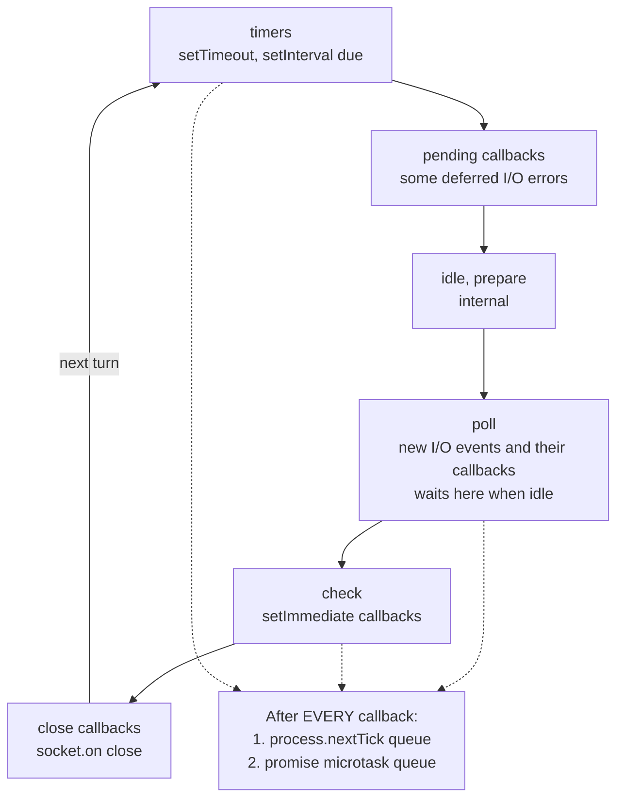
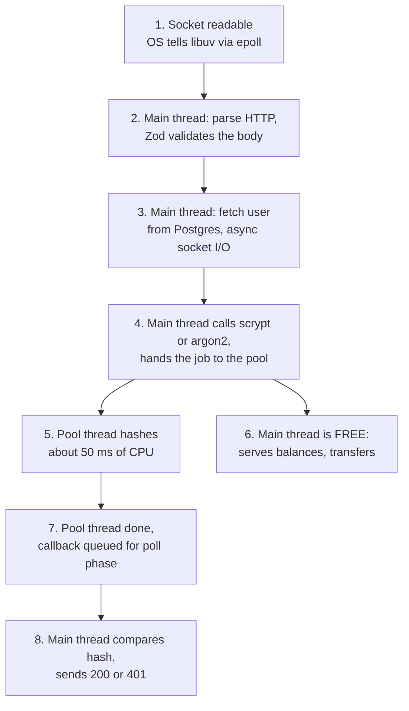
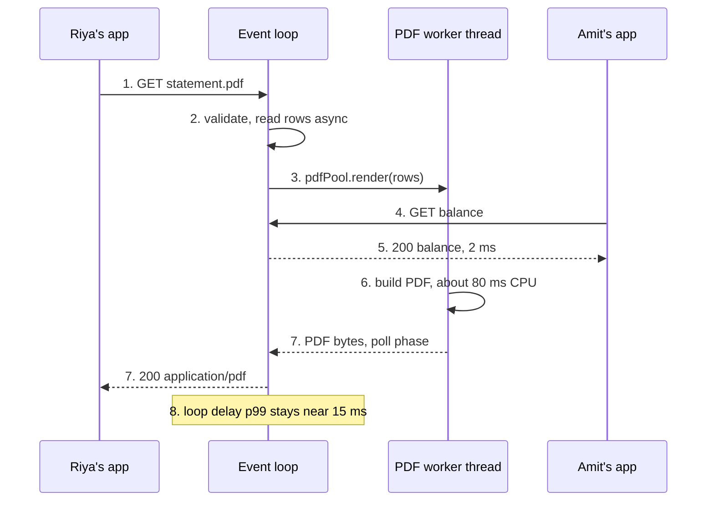
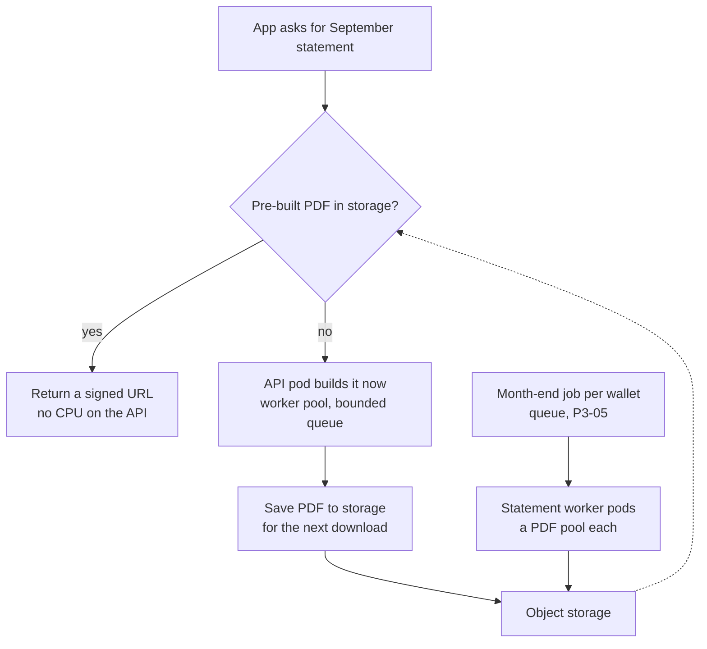
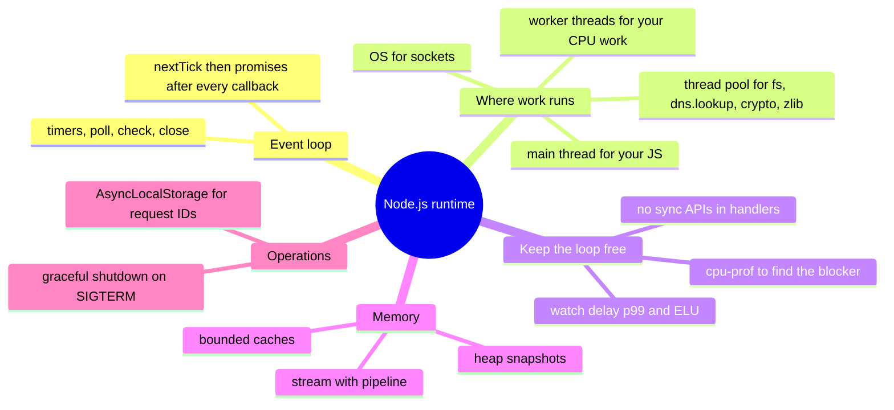

# P1-02 · The Node.js runtime

| | |
|---|---|
| **Phase** | 1 · Backend foundations |
| **Prerequisites** | P1-01 · How a request travels |
| **Leads to** | P3-05 · Queues and background jobs · P5-03 · Resilience patterns · P6-01 · Python for backend engineers |
| **Repo path** | `system-design/phase-1/p1-02-the-nodejs-runtime.md` |

**After this card you can:**

1. Explain the event loop's phases and the microtask queues, and predict the order of `nextTick`, promises, timers and `setImmediate`.
2. Say which work runs on the main thread, which on libuv's thread pool, and which on the operating system, and size the pool on purpose.
3. Find what is blocking the loop with event-loop delay, utilisation and a CPU profile, and move CPU work to a worker pool.
4. Stream large exports with backpressure, keep memory bounded, and carry request IDs with `AsyncLocalStorage`.
5. Shut a server down on SIGTERM without failing a single in-flight request.

> **About the numbers in this guide.** Everything marked **Real output** was run while writing this guide on 21 Oct 2026, on a 2-vCPU Linux sandbox with 7 GB of RAM, using Node.js 22.22.0 (libuv 1.51.0, V8 12.4), Fastify 5.12.7, Piscina 5.3.2 and pdfkit 0.20.2. Two CPUs matter here: thread-pool and worker-thread results stop scaling at two cores, where your laptop with 8 or more will keep going. The load tests are short (5 seconds, 8 clients) and ran on the same machine as the server, so compare directions, not decimals. Everything marked **Expected** was not run here.
>
> **Versions** (checked 21 Oct 2026): Node.js 24 is in maintenance LTS since 20 Oct 2026, and Node.js 26 becomes the active LTS on 28 Oct 2026. Everything in this guide works the same on 22, 24 and 26 unless a section says otherwise.

---

## 🧭 The concept in one minute

**Node.js runs your JavaScript on one thread**, the main thread. The **event loop** is that thread's routine: run a callback, check what finished (a socket has data, a timer is due, a file was read), run the next callback. Slow I/O never runs on this thread: the operating system or libuv's **thread pool** does it and reports back.

**One line:** Node.js is fast while every callback is short; one long callback makes every other user wait.

**Analogy.** A busy chai stall with one person at the counter. He takes an order, shouts it to the helpers at the back, takes the next order, and hands over each cup as a helper finishes it. Hundreds of customers are served by one person, because he never makes the tea himself. If he stops to grind masala for two minutes, the whole queue waits, even the people who only want a biscuit. The counter person is the event loop; the helpers are the thread pool and the operating system; grinding masala at the counter is a synchronous `scryptSync` or a huge `JSON.parse`.

**On the ledger platform.** Riya downloads her September statement as a PDF while Amit checks his balance. If the API builds the PDF on the main thread, Amit's 1 ms balance request waits behind it: in this guide's test, his p95 went from **2 to 8 ms up to 918 ms**. With the PDF built in a worker pool, his balance stays at single-digit milliseconds.

---

## 🔥 The problem it solves

Here is the ledger API with the code a new team often writes. Every number was measured in this guide.

1. **Login hashes passwords with the sync API.** Under 8 concurrent logins, a balance check that normally takes 2 ms waited **391 ms at p95**, and the event loop was **374 ms late** at p99. Every user paid for every login.
2. **Statement PDFs are built on the main thread.** Balance checks waited **918 ms at p95** and the loop was **607 ms late**, while only 16 PDFs a second were built.
3. **CSV exports are built in a string, then sent.** A 55 MB export pushed the process from **151 MB to 656 MB** of memory. Ten users exporting at once is 5 GB.
4. **A deploy sends SIGTERM and Node.js dies at once.** The in-flight transfer request is cut off with a socket error. The user does not know whether the money moved.
5. **A "cache" is a global `Map` with no limit.** It grows with every new wallet until the container is killed for using too much memory.

This card fixes all five: async APIs and the thread pool, a worker pool for CPU work, streams with backpressure, bounded caches, and graceful shutdown. And it shows how to **find** these problems in production with event-loop metrics and CPU profiles.

---

## 📚 Before you start

**Earlier cards used here:** P1-01 (connections, keep-alive, proxies and their timeouts), P1-05 (argon2id password hashing), P1-07 (Vitest), P1-08 (pino, `AsyncLocalStorage` for request IDs), P2-02 (the statement query and its index).

**Key terms**

| Term | Plain meaning |
|---|---|
| Main thread | The one thread that runs your JavaScript. |
| Event loop | The main thread's loop: wait for events, run their callbacks, repeat. |
| Callback | A function you hand over to be run later, when something happens. |
| Macrotask | A callback from a loop phase: a timer, an I/O result, a `setImmediate`. |
| Microtask | A callback that runs as soon as the current one finishes: promise reactions, `queueMicrotask`; Node also has `process.nextTick`. |
| libuv | The C library under Node.js that provides the event loop, async I/O and the thread pool. |
| Thread pool | A few background threads (4 by default) for work the OS cannot do asynchronously: files, `dns.lookup`, some crypto, zlib. |
| Blocking | A callback that runs so long that nothing else can run. |
| Event-loop delay | How late the loop runs a timer compared with when it should have. Users feel this as latency. |
| Event-loop utilisation (ELU) | The share of time the loop is busy running code rather than waiting. 1.00 means always busy. |
| Worker thread | A separate JavaScript thread with its own event loop and heap, inside the same process. |
| Stream | Data handled piece by piece instead of all at once. |
| Backpressure | A slow consumer telling a fast producer "wait". |
| RSS | Resident set size: how much RAM the process really uses. |
| Heap | V8's memory for JavaScript objects; a garbage collector frees what is no longer reachable. |
| SIGTERM | The signal Kubernetes, systemd and Docker send to ask a process to stop. |

---

## 🧠 How it works

### Mental model: one thread decides, many places work

| Where | What runs there | Examples |
|---|---|---|
| **Main thread** (the event loop) | All your JavaScript, `JSON.parse`, regex, sync APIs | Route handlers, Zod validation, building responses |
| **The operating system** | Network I/O, using epoll (Linux), kqueue (macOS) or IOCP (Windows) | Sockets for HTTP, Postgres, Redis; no thread is used per connection |
| **libuv's thread pool** (4 threads by default) | Work with no async OS API | `fs.*`, `dns.lookup`, `crypto.scrypt`/`pbkdf2`/`randomBytes`, `zlib` |
| **Worker threads** (you create them) | Your own CPU-heavy JavaScript | PDF building, big CSV parsing, image resizing |
| **V8 background threads** | Parts of garbage collection and compilation | You do not control these directly |

React comparison: the main thread is like the browser's main thread. A long `useEffect` that loops for 300 ms freezes clicks and scrolls for everyone on the page; here it freezes every request on the server.

### Diagram: the event-loop phases and the microtask queues (must-include)

**Diagram: one turn of the Node.js event loop**



**How to read this diagram.** The loop goes round the six phases in order; each phase has a queue of callbacks. The poll phase is where Node.js waits for network and file events when there is nothing else to do, and where most I/O callbacks run. After **every single callback**, in any phase, Node.js empties two microtask queues before moving on: first the `process.nextTick` queue, then the promise queue (`.then`, `await` continuations, `queueMicrotask`). Since libuv 1.45 (Node.js 20), timers are checked after the poll phase in each turn, plus once before the loop starts.

### Diagram: a login request that uses the thread pool (must-include)

**Diagram: POST /v1/auth/login with an async password hash**



**How to read this diagram.** Steps on the main thread (2, 3, 4, 8) are short. The expensive step (5) runs on one of libuv's pool threads, so during those 50 ms the main thread keeps serving other users (6). The database call (3) does not use the pool at all: socket I/O is handled by the operating system. If the handler called `scryptSync` instead, steps 5 and 6 would be swapped for "everyone waits".

---
## 🔬 Deep dive

One subsection per item on the card, in the card's order.

### 1. Event loop phases: timers, pending callbacks, poll, check, close

**What each phase does**

| Phase | Runs | Ledger example |
|---|---|---|
| **timers** | `setTimeout` and `setInterval` callbacks whose time has come | A 3 s timeout on a call to the ledger service fires |
| **pending callbacks** | A few I/O callbacks deferred from the last turn (for example some TCP errors) | Rarely matters in app code |
| **idle, prepare** | Internal to libuv | Never used directly |
| **poll** | New I/O events: a socket became readable, a file read finished, a pool job finished. **Waits here** when there is nothing else to do | An HTTP request arrives; Postgres returns rows; scrypt finishes |
| **check** | `setImmediate` callbacks | Code that yields to let I/O run, then continues |
| **close callbacks** | `close` events, such as `socket.on("close")` | Cleaning up when Riya's app disconnects |

Important details:
- **A timer is a minimum, not a promise.** `setTimeout(fn, 10)` runs `fn` at the first timers check after 10 ms have passed. If a callback blocks for 300 ms, the timer runs 300 ms late. That lateness **is** the event-loop delay.
- **The loop waits in poll**, so an idle Node.js process uses no CPU.
- **`setTimeout(0)` vs `setImmediate` is not fixed in the main module**; inside an I/O callback, `setImmediate` always runs first, because the check phase comes straight after poll.

**Minimal version (must-include):** `minimal/order.ts`. Who runs first?

```ts
// Who runs first? Sync code, process.nextTick, promise callbacks, setTimeout(0) and setImmediate.
import { readFile } from "node:fs";

const log = (msg: string) => console.log(msg);

log("1 sync: script starts");
setTimeout(() => log("6 timers phase: setTimeout 0"), 0);
setImmediate(() => log("7 check phase: setImmediate"));
Promise.resolve().then(() => log("4 microtask: promise.then"));
process.nextTick(() => log("3 nextTick queue: process.nextTick"));
queueMicrotask(() => log("5 microtask: queueMicrotask"));
log("2 sync: script ends");

// Inside an I/O callback (poll phase), the order of the two macrotasks is fixed: check comes before timers.
readFile(import.meta.filename, () => {
  setTimeout(() => log("   I/O round: setTimeout 0"), 0);
  setImmediate(() => log("   I/O round: setImmediate"));
  Promise.resolve().then(() => log("   I/O round: promise.then"));
  process.nextTick(() => log("   I/O round: nextTick"));
});
```

**Real output** (the file as an ES module, `npx tsx minimal/order.ts`)

```text
1 sync: script starts
2 sync: script ends
4 microtask: promise.then
5 microtask: queueMicrotask
3 nextTick queue: process.nextTick
7 check phase: setImmediate
6 timers phase: setTimeout 0
   I/O round: nextTick
   I/O round: promise.then
   I/O round: setImmediate
   I/O round: setTimeout 0
```

**Real output** (the same code as CommonJS, `node minimal/order.cjs`)

```text
1 sync: script starts
2 sync: script ends
3 nextTick queue: process.nextTick
4 microtask: promise.then
5 microtask: queueMicrotask
6 timers phase: setTimeout 0
7 check phase: setImmediate
   I/O round: nextTick
   I/O round: promise.then
   I/O round: setImmediate
   I/O round: setTimeout 0
```

**What to notice**
- **Sync code always finishes first**, then microtasks, then the loop phases.
- **In CommonJS, `nextTick` runs before promises.** In an ES module, the top-level code itself runs as part of a promise job, so promise callbacks queued there run **before** the `nextTick` queue. Same code, different order: this is the classic surprise.
- **`setTimeout(0)` and `setImmediate` swapped places between the two runs** in the main module. Never write code that depends on that order.
- **Inside the I/O callback, the order is fixed** and the same in both: `nextTick`, promise, `setImmediate`, then `setTimeout`.

### 2. Microtasks vs macrotasks: nextTick, promises, and the surprises

**What it is.** Macrotasks are the phase callbacks above: one runs, then the loop may move on. Microtasks run **in between**: after every callback, Node.js runs the whole `process.nextTick` queue, then the whole promise queue, and repeats until both are empty.

| | `process.nextTick(fn)` | Promise callbacks, `queueMicrotask(fn)` | `setImmediate(fn)` | `setTimeout(fn, 0)` |
|---|---|---|---|---|
| Queue | Node's nextTick queue | V8's microtask queue | check phase | timers phase |
| Runs | After the current callback, before promises (in CommonJS) | After the nextTick queue | Next check phase | First timers check after ≥ 1 ms |
| Starves I/O if it keeps re-queuing itself? | **Yes** | **Yes** | No | No |
| Use it for | Rarely: library code that must run before any I/O | `await` does this for you | Yielding: "let I/O run, then continue" | Delays |

**Why the names confuse everyone.** The Node.js docs say it themselves: `process.nextTick` fires *immediately*, and `setImmediate` fires on the *next* turn; "the names should be swapped", but changing them would break npm. They recommend `setImmediate` in all cases because it is easier to reason about.

**Microtasks can starve the loop.** Because the queue is emptied completely, a callback that keeps adding microtasks never lets the loop reach the timers or poll phase.

**Minimal version:** `minimal/starve.ts`

```ts
// Microtasks run until their queue is empty. A callback that keeps queuing more starves timers and I/O.
const started = performance.now();
setTimeout(() => console.log(`setTimeout(0) finally ran after ${(performance.now() - started).toFixed(0)} ms`), 0);

let n = 0;
function again(): void {
  if (++n < 2_000_000) process.nextTick(again);   // also true for promise chains: .then(again)
  else console.log(`${n.toLocaleString("en-IN")} nextTicks ran first, in ${(performance.now() - started).toFixed(0)} ms`);
}
process.nextTick(again);
```

**Real output**

```text
20,00,000 nextTicks ran first, in 175 ms
setTimeout(0) finally ran after 176 ms
```

A `setTimeout(0)` waited 176 ms, and during that time no HTTP request could have been read either. A long `while` loop over `await`s of already-resolved promises does the same. To give the loop a turn inside long work, use `await setImmediate()` from `node:timers/promises`, not another microtask.

### 3. The libuv thread pool: what runs there, size 4, UV_THREADPOOL_SIZE

**What it is.** Network sockets have async OS APIs, so they need no threads. Some things do not: file systems, the system's DNS resolver (`getaddrinfo`), and CPU-heavy crypto and compression. libuv runs those on a small pool of threads. From the Node.js docs, the pool is used by:

- **all `fs` APIs** except the file watchers and the explicitly synchronous ones;
- **async crypto:** `crypto.pbkdf2()`, `crypto.scrypt()`, `crypto.randomBytes()`, `crypto.randomFill()`, `crypto.generateKeyPair()`;
- **`dns.lookup()`** (what `http`, `undici` and `fetch` use by default), but not `dns.resolve*()`, which talks to DNS servers over the network;
- **all `zlib` APIs** except the explicitly synchronous ones;
- native addons that choose to, such as `argon2` (P1-05).

**Size.** The default is **4** threads. Set `UV_THREADPOOL_SIZE` in the environment **before** the process starts; the docs warn that setting `process.env.UV_THREADPOOL_SIZE` from inside the process is not guaranteed to work. libuv caps it at 1024.

**One pool for everything.** A slow network file system or a DNS server that takes 5 s to answer holds pool threads, and password hashes queue behind them, even though the two seem unrelated.

**Minimal version:** `minimal/threadpool.ts`. Eight async scrypt hashes at once (about 50 ms of CPU each).

```ts
// Eight async scrypt hashes at once. Run with UV_THREADPOOL_SIZE=4, then 8.
import { scrypt } from "node:crypto";
import { availableParallelism } from "node:os";

const t0 = performance.now();
const size = process.env.UV_THREADPOOL_SIZE ?? "4 (default)";
const done: string[] = [];
await Promise.all(Array.from({ length: 8 }, (_, i) => new Promise<void>((resolve) =>
  scrypt("Riya@2026", `salt-${i}`, 64, { N: 2 ** 14, r: 8, p: 1 }, () => {   // ~50 ms of CPU each
    done.push(`#${i + 1} ${(performance.now() - t0).toFixed(0)}ms`);
    resolve();
  }))));
console.log(`pool size ${size}, ${availableParallelism()} CPUs: ${done.join("  ")}`);
```

**Real output** (2 CPUs)

```text
pool size 4 (default), 2 CPUs: #1 58ms  #2 116ms  #3 121ms  #4 126ms  #5 148ms  #6 180ms  #7 215ms  #8 216ms
pool size 8, 2 CPUs: #2 123ms  #4 123ms  #6 160ms  #8 179ms  #1 217ms  #5 217ms  #3 218ms  #7 219ms
pool size 2, 2 CPUs: #1 52ms  #2 62ms  #3 111ms  #4 120ms  #6 166ms  #5 176ms  #7 210ms  #8 246ms
```

**What to notice**
- **All three finished in about 220 to 250 ms**: 8 hashes × 50 ms ÷ 2 cores. More threads cannot create more CPU.
- **With 8 threads, the first hash finished later** (123 ms) than with 2 (52 ms): eight hashes shared two cores, so they all crawled together.
- **On your laptop with 8+ cores (Expected):** with the default size 4, hashes finish in waves of four; with `UV_THREADPOOL_SIZE=8`, eight at once. That is the classic demo of the limit.

**Ten password hashes at once (card question 2).** With the default pool, four start and six wait in the pool's queue. Every other pool user (a file read for a statement template, a `dns.lookup` for a new connection) also waits behind them. Raising the pool size helps only up to the number of free CPU cores for CPU work, but helps more for slow I/O work such as network file systems. It also costs memory: each scrypt here needs 16 MiB while it runs, and the benchmark's process grew from **243 MB to 543 MB** between pool sizes 4 and 16, for the same throughput.

### 4. Blocking the loop, and how to measure it

**What it is.** Anything that runs on the main thread for a long time: sync crypto, sync `fs`, `JSON.parse` or `JSON.stringify` on big payloads, regexes that backtrack, big loops, sorting a million items. While it runs, no timer fires, no socket is read, no response is written.

**Minimal version:** `minimal/block.ts`. How late the loop gets during common sync operations.

```ts
// What a few common synchronous operations do to everyone else: the event-loop delay while they run.
import { scryptSync } from "node:crypto";
import { monitorEventLoopDelay } from "node:perf_hooks";
import { setTimeout as sleep } from "node:timers/promises";

async function measure(name: string, work: () => unknown): Promise<void> {
  const h = monitorEventLoopDelay({ resolution: 10 });
  h.enable();
  await sleep(50);                       // let the histogram see a healthy loop first
  const t = performance.now();
  work();                                // nothing else can run until this returns
  const took = performance.now() - t;
  await sleep(50);
  h.disable();
  console.log(`${name.padEnd(42)} ran ${took.toFixed(0).padStart(5)} ms | max event-loop delay ${(h.max / 1e6).toFixed(0).padStart(5)} ms`);
}

const bigJson = JSON.stringify(Array.from({ length: 4_00_000 }, (_, i) => ({ id: i, walletId: `w_${i % 5000}`, amountMinor: i * 7, note: "UPI payment to Sharma Kirana" })));
await measure("scryptSync x5 (5 password checks)", () => { for (let i = 0; i < 5; i++) scryptSync("pw", "salt", 64, { N: 2 ** 14, r: 8, p: 1 }); });
await measure(`JSON.parse of ${(bigJson.length / 1e6).toFixed(0)} MB`, () => JSON.parse(bigJson));
await measure("a loop over 50 lakh items", () => { let s = 0; for (let i = 0; i < 5_000_000; i++) s += Math.sqrt(i) % 3; return s; });
const evilRegex = /^(\d+)+$/;            // nested quantifier: "one or more groups of one or more digits"
evilRegex.test("1".repeat(18) + "!");     // warm up the regex engine so timings are fair
for (const n of [24, 26, 28]) {
  const evil = "1".repeat(n) + "!";      // almost matches, so the engine tries every way to split the 1s
  await measure(`ReDoS /^(\\d+)+$/ on ${n} digits + "!"`, () => evilRegex.test(evil));
}
```

**Real output**

```text
scryptSync x5 (5 password checks)          ran   218 ms | max event-loop delay   219 ms
JSON.parse of 37 MB                        ran   200 ms | max event-loop delay   201 ms
a loop over 50 lakh items                  ran    48 ms | max event-loop delay    59 ms
ReDoS /^(\d+)+$/ on 24 digits + "!"        ran   101 ms | max event-loop delay   112 ms
ReDoS /^(\d+)+$/ on 26 digits + "!"        ran   409 ms | max event-loop delay   420 ms
ReDoS /^(\d+)+$/ on 28 digits + "!"        ran  1680 ms | max event-loop delay  1690 ms
```

**What to notice**
- **The delay equals the work.** A 200 ms `JSON.parse` is a 200 ms pause for every user of this process.
- **ReDoS grows about 4 times per two extra digits** (101 → 409 → 1,680 ms). At that rate, 30 digits is about 7 s and 32 digits about 28 s (computed). A 33-character string from an attacker freezes the server. The same check written as `/^\d+$/` took **2.2 ms on 10 lakh digits**.
- **The regex looks harmless.** `(\d+)+` means "one or more groups of one or more digits": on a near-miss, the engine tries every way to split the digits into groups. Avoid nested quantifiers and overlapping alternatives, and limit input length before any regex runs (Zod's `.max()`, Fastify's 1 MiB default `bodyLimit`).

**Measuring it.** Two numbers, both built into Node.js:

| Metric | API | Means | Alert when |
|---|---|---|---|
| **Event-loop delay** | `perf_hooks.monitorEventLoopDelay()` | How late timers run (p50, p99, max), in nanoseconds | p99 above about 100 ms for a minute |
| **Event-loop utilisation** | `performance.eventLoopUtilization()` | Share of time the loop was busy, 0 to 1 | Near 1.0: the process is CPU-bound on the main thread; scale out or move work |

High utilisation with low delay is a busy but healthy process. High delay means something is blocking: find it with a CPU profile.

**Product version:** `src/lib/eventLoopMetrics.ts`

```ts
// Event-loop health for one process: delay (how late callbacks run) and utilisation (how busy the loop is).
import { monitorEventLoopDelay, performance, type EventLoopUtilization } from "node:perf_hooks";
import type { Logger } from "pino";

export interface LoopSnapshot { delayP50Ms: number; delayP99Ms: number; delayMaxMs: number; utilisation: number; rssMb: number; peakRssMb: number }

export function startEventLoopMetrics(opts: { log: Logger; intervalMs?: number; warnP99Ms?: number }) {
  const histogram = monitorEventLoopDelay({ resolution: 10 }); // samples every 10 ms, values in nanoseconds
  histogram.enable();
  let lastElu: EventLoopUtilization = performance.eventLoopUtilization();
  let peakRss = process.memoryUsage.rss();

  const rssSampler = setInterval(() => { peakRss = Math.max(peakRss, process.memoryUsage.rss()); }, 50);
  rssSampler.unref();

  function snapshot(reset = true): LoopSnapshot {
    const elu = performance.eventLoopUtilization(lastElu); // the share of time since the last call the loop was busy
    const snap: LoopSnapshot = {
      delayP50Ms: histogram.percentile(50) / 1e6,
      delayP99Ms: histogram.percentile(99) / 1e6,
      delayMaxMs: histogram.max / 1e6,
      utilisation: elu.utilization,
      rssMb: process.memoryUsage.rss() / 2 ** 20,
      peakRssMb: peakRss / 2 ** 20,
    };
    if (reset) {
      histogram.reset();
      lastElu = performance.eventLoopUtilization();
      peakRss = process.memoryUsage.rss();
    }
    return snap;
  }

  // Report every interval; warn when the loop is late enough for users to feel it.
  const reporter = setInterval(() => {
    const s = snapshot();
    const fields = { event_loop_delay_p99_ms: +s.delayP99Ms.toFixed(1), event_loop_utilisation: +s.utilisation.toFixed(2), rss_mb: Math.round(s.rssMb) };
    if (s.delayP99Ms > (opts.warnP99Ms ?? 100)) opts.log.warn(fields, "event loop is blocked");
    else opts.log.debug(fields, "event loop ok");
  }, opts.intervalMs ?? 10_000);
  reporter.unref();

  return { snapshot, stop: () => { histogram.disable(); clearInterval(rssSampler); clearInterval(reporter); } };
}
```

**What to notice**
- **`resolution: 10`** samples every 10 ms; the histogram reports nanoseconds, so divide by 1e6.
- **`eventLoopUtilization(last)`** gives the utilisation **since the last call**, so each report covers one interval.
- **It logs a warning with numbers** when p99 delay passes the threshold, so a blocked loop shows up in Loki (P1-08) and on dashboards (P5-01).
- **Peak RSS is sampled every 50 ms**, the number that decides whether the container gets killed.

**Finding the blocker: a CPU profile.** `node --cpu-prof` writes a `.cpuprofile` file on exit; open it in Chrome DevTools (Performance tab) or VS Code as a flame graph. **Real output** (the profile of `minimal/block.ts`, top functions by self time, summarised with a short script):

```text
total sampled 4439 ms; top self time:
     2398 ms  54.0%  RegExp: ^(\d+)+$
      609 ms  13.7%  (anonymous) block.ts:1
      565 ms  12.7%  (idle)
      271 ms   6.1%  scryptSync scrypt:65
      222 ms   5.0%  (garbage collector)
```

The regex is named directly. In production, the same works with `node --cpu-prof` on one instance for a few minutes, `--inspect` and Chrome DevTools, or tools like Clinic.js Doctor and Flame (13.0.0) and 0x (6.0.0), which wrap the same profiler.

**The fixes, in order of preference**
1. **Use the async API** (`scrypt`, `fs.promises`, async `zlib`): the work moves to the thread pool.
2. **Offload your own CPU work** to a worker pool (Deep dive 6 and the lab).
3. **Limit input size** before parsing or matching.
4. **Partition** long loops: process 1,000 items, `await setImmediate()`, continue. Fine for simple loops; for real CPU work, offload instead.

### 5. Streams and backpressure

**What it is.** A **stream** moves data in chunks instead of all at once.

| Type | Does | Example |
|---|---|---|
| Readable | Produces chunks | A file, a DB cursor, an incoming request body |
| Writable | Consumes chunks | An HTTP response, a file, a socket |
| Transform | Readable and writable; changes chunks | Rows to CSV lines, gzip |
| Duplex | Readable and writable, independent | A TCP socket |

Every writable has a buffer limit, `highWaterMark`: **64 KiB** for byte streams in Node.js 22 (**Real output** here: `Writable hwm 65536`), and **16 objects** in object mode. `write()` returns `false` once the buffer is past that limit. That `false` is **backpressure**: "stop until I emit `drain`". It is only advice: if you keep writing, Node.js keeps buffering, in memory.

**Minimal version:** `minimal/backpressure.ts`. 5 lakh CSV lines (about 27 MB) into a slow consumer.

```ts
// A fast producer and a slow consumer (a phone on 3G, a slow disk). Ignore write()'s return value, or respect it.
import { Writable } from "node:stream";

const LINES = 5_00_000;
const line = "2026-09-15T10:00:00+05:30,credit,50000,UPI from Amit\n";   // ~55 bytes

function slowSink(): Writable {
  return new Writable({
    highWaterMark: 64 * 1024,                                   // the buffer size where write() starts saying "stop"
    write(_chunk, _enc, done) { setImmediate(done); },          // accepts one chunk per loop turn
  });
}

async function run(respect: boolean): Promise<void> {
  const sink = slowSink();
  let peakBuffered = 0, peakRss = process.memoryUsage.rss();
  const t = performance.now();
  for (let i = 0; i < LINES; i++) {
    const ok = sink.write(line);
    peakBuffered = Math.max(peakBuffered, sink.writableLength);
    if (i % 10_000 === 0) peakRss = Math.max(peakRss, process.memoryUsage.rss());
    if (!ok && respect) await new Promise((resolve) => sink.once("drain", resolve)); // wait until the consumer catches up
  }
  await new Promise<void>((resolve) => sink.end(resolve));
  console.log(`${respect ? "waits for 'drain'  " : "ignores write()    "} peak buffered ${(peakBuffered / 2 ** 20).toFixed(1).padStart(5)} MB | peak RSS ${(peakRss / 2 ** 20).toFixed(0).padStart(4)} MB | ${(performance.now() - t).toFixed(0)} ms`);
}

await run(process.argv[2] === "respect");
```

**Real output**

```text
ignores write()     peak buffered  25.3 MB | peak RSS  218 MB | 1519 ms
waits for 'drain'   peak buffered   0.1 MB | peak RSS   94 MB | 719 ms
```

**What to notice**
- **Ignoring `write()` buffered almost the whole file** (25.3 of 27 MB) in memory. With a 2 GB file, that is about 2 GB of buffers; they live outside V8's heap, so the heap limit does not stop them, and a container with a 512 MB limit is killed.
- **Respecting backpressure kept the buffer at 0.1 MB**, and was even faster here, because the process did not spend time allocating and collecting memory.
- **You rarely write this loop yourself.** `stream.pipeline(source, ...transforms, destination, callback)` (or its promise version from `node:stream/promises`) wires backpressure between every stage and, just as important, **destroys every stage when one fails** or the client disconnects. `readable.pipe()` passes backpressure but does not clean up on errors.

The product version of a streamed CSV export, with `pipeline()`, is in the Hands-on lab, step 4.

---
### 6. Scaling out: worker threads vs the cluster module vs several processes

**The question.** One Node.js process runs JavaScript on one core. A server has 2, 8 or 64. How do you use the rest?

| | Worker threads (`node:worker_threads`, Piscina) | Cluster module (`node:cluster`) | Several processes behind a load balancer |
|---|---|---|---|
| What it is | Extra JavaScript threads **inside one process**, each with its own event loop and heap | One primary process forks N workers that share the listening port | N independent copies of the app (containers or pods), traffic spread by a load balancer (P3-03) |
| Shares memory | Can share `SharedArrayBuffer`; otherwise messages are copied | No | No |
| Good for | **CPU-heavy tasks** inside a request: PDFs, parsing, image work | Using all cores on one VM without containers | **Scaling the whole API**: more cores, more machines, isolation, rolling deploys |
| A crash takes down | The task (if handled) or the process | One worker; the primary restarts it | One instance; the others keep serving |
| Cost | A thread and its own V8 heap (tens of MB each) | A full process per worker | A full process (and container) per instance |
| On the ledger platform | Statement PDFs, CSV imports | Rarely: Kubernetes already runs several pods | The default: 3+ API pods |

**How to choose (card question 4).** Use **more processes** (pods) to serve more requests: they scale across machines, survive each other's crashes, and fit how Kubernetes deploys. Use **worker threads** when one request needs a lot of CPU and you want the event loop of that process to stay free. They are complements, not alternatives: each pod runs one event loop plus a small worker pool for CPU tasks. The `cluster` module is mostly for running on a single VM without an orchestrator.

**Minimal version:** a worker pool with Piscina is three lines: create a pool with a worker file, `await pool.run(input)`, close it on shutdown. The product version is `src/lib/pdfPool.ts` in the lab, step 3.

**Real result** (statement PDFs of 400 rows, 8 concurrent clients, balance checks running alongside; from the lab benchmark)

| Where the PDF is built | PDFs/s | PDF p95 | Balance p95 | Loop delay p99 | ELU |
|---|---|---|---|---|---|
| Main thread | 16 | 950.5 ms | **918.3 ms** | 607.1 ms | 1.00 |
| Piscina, 1 thread | 16 to 18 | 349.0 to 458.6 ms | 1.7 to 4.0 ms | 13.0 to 16.3 ms | 0.05 to 0.06 |
| Piscina, 2 threads | 25 to 27 | 350.9 to 394.7 ms | 4.7 to 7.9 ms | 13.7 to 14.7 ms | 0.06 to 0.07 |

**A real surprise worth knowing.** With **one** worker thread, three of the first eight PDF requests waited about **5.4 s** (p99 of 5,409 to 5,467 ms in six runs), until the rest of the queue had drained. It happened with all three of Piscina's `atomics` modes, and when calling `pool.run()` directly without HTTP, and never with two threads. It looks like a scheduling quirk in Piscina 5.3.2 with a single thread; we did not dig further. The lesson is general: **watch p99 and the age of the oldest queued task, not just averages**, and load-test the exact pool settings you ship.

**When not to use worker threads.** For I/O (database calls, HTTP): that is already async, and a thread adds only overhead. For tiny tasks (a few milliseconds): copying the input and output costs more than it saves.

### 7. Memory: the V8 heap, garbage collection, leaks and heap snapshots

**What it is.** JavaScript objects live on V8's **heap**. The garbage collector (GC) frees objects that nothing can reach any more. V8 splits the heap: a small "young generation" for new, short-lived objects (collected often and quickly) and an "old generation" for objects that survive (collected less often, with longer pauses). Some memory is outside the heap: `Buffer`s, and native memory used by addons and the thread pool.

- **Heap limit.** V8 picks a limit from the machine's memory; on this sandbox it was **8,240 MB** (**Real output**: `v8.getHeapStatistics().heap_size_limit`). In a container, set it below the container's limit with `--max-old-space-size=<MB>`, leaving room for buffers and native memory.
- **RSS vs heap.** `process.memoryUsage()` reports `rss` (all memory), `heapUsed`, `external` and `arrayBuffers`. Containers are killed on RSS.

**What a leak looks like in Node.js.** Not a forgotten `free()`, but something that keeps a reference forever:
- **Global caches without a limit**: a `Map` keyed by wallet, user or request.
- **Closures** that capture a large object and are stored somewhere long-lived (an event listener added on every request and never removed).
- **Timers and intervals** never cleared, holding their callbacks' data.
- **Unbounded queues**: an in-memory retry queue, or a worker pool with no `maxQueue`.

**Minimal version:** `minimal/leak.ts`. An unbounded `Map` vs an LRU cache with a size limit, and the GC pauses each causes.

```ts
// An unbounded "cache" vs a bounded LRU, and the garbage-collection pauses that a big heap brings.
import { PerformanceObserver } from "node:perf_hooks";
import { LRUCache } from "lru-cache";

let gcCount = 0, gcMaxMs = 0, gcTotalMs = 0;
new PerformanceObserver((list) => {
  for (const e of list.getEntries()) { gcCount++; gcTotalMs += e.duration; gcMaxMs = Math.max(gcMaxMs, e.duration); }
}).observe({ entryTypes: ["gc"] });

const mode = process.argv[2] ?? "unbounded";
const unbounded = new Map<string, string>();
const bounded = new LRUCache<string, string>({ max: 10_000 });     // the product way: a size limit

for (let i = 0; i < 3_00_000; i++) {
  const walletId = `w_${i}`;                                          // every request a new key: the map never stops growing
  const statementSummary = JSON.stringify({ walletId, month: "2026-09", lines: Array.from({ length: 10 }, (_, j) => `entry ${j} ${i}`) });
  if (mode === "unbounded") unbounded.set(walletId, statementSummary);
  else bounded.set(walletId, statementSummary);
}
await new Promise((r) => setTimeout(r, 100));                         // let the observer report
const heapMb = process.memoryUsage().heapUsed / 2 ** 20;
console.log(`${mode.padEnd(10)} entries ${(mode === "unbounded" ? unbounded.size : bounded.size).toLocaleString("en-IN").padStart(8)} | heap used ${heapMb.toFixed(0).padStart(4)} MB | GC runs ${gcCount}, total ${gcTotalMs.toFixed(0)} ms, longest pause ${gcMaxMs.toFixed(1)} ms`);
```

**Real output**

```text
unbounded  entries 3,00,000 | heap used  105 MB | GC runs 46, total 173 ms, longest pause 36.0 ms
lru        entries   10,000 | heap used   50 MB | GC runs 46, total 110 ms, longest pause 5.6 ms
```

**What to notice**
- **The unbounded map kept all 3 lakh entries** and the heap kept growing; in a server it grows with every new wallet until the process is killed.
- **A bigger live heap means longer GC pauses**: the longest pause was **36 ms** against 5.6 ms. GC pauses are event-loop pauses too.
- **`lru-cache` with `max`** (or `ttl`, or `maxSize`) is the product way. For data shared across pods, use Redis with TTLs (P3-02).

**Heap snapshots.** A snapshot lists every object on the heap and what keeps it alive. Take two, a few minutes apart under load, and compare them in Chrome DevTools' Memory tab: the type whose count keeps growing is the leak.

```bash
node --heapsnapshot-near-heap-limit=2 --max-old-space-size=512 dist/server.js   # write snapshots just before an out-of-memory crash
kill -USR2 <pid>      # with --heapsnapshot-signal=SIGUSR2: write a snapshot on demand
```

Or `v8.writeHeapSnapshot()` from an admin-only route. The Node.js docs warn that creating a snapshot **blocks the event loop** for a time that depends on heap size, and needs **about twice the heap's size** in memory. Take it from one instance that is out of the load balancer, never from all at once.

### 8. Async context: AsyncLocalStorage for request IDs

**What it is.** `AsyncLocalStorage` (ALS) keeps a value, such as the request ID, available to every function that runs as part of one request, across every `await`, without passing it as a parameter. P1-08 built request logging on it; here is the runtime view.

**Minimal version:** `minimal/als.ts`

```ts
// AsyncLocalStorage: a value set at the start of a request is visible after every await, per request.
import { AsyncLocalStorage } from "node:async_hooks";
import { setTimeout as sleep } from "node:timers/promises";

const requestContext = new AsyncLocalStorage<{ requestId: string }>();
const log = (msg: string) => console.log(`[${requestContext.getStore()?.requestId ?? "no request"}] ${msg}`);

async function debitWallet(): Promise<void> {           // deep inside the call stack: no requestId parameter
  await sleep(Math.random() * 20);
  log("wallet debited");
}

async function handleTransfer(requestId: string): Promise<void> {
  await requestContext.run({ requestId }, async () => {
    log("transfer received");
    await debitWallet();
    log("transfer done");
  });
}
await Promise.all([handleTransfer("req-a1"), handleTransfer("req-b2")]);  // two requests interleave, ids never mix
log("after both");
```

**Real output**

```text
[req-a1] transfer received
[req-b2] transfer received
[req-a1] wallet debited
[req-a1] transfer done
[req-b2] wallet debited
[req-b2] transfer done
[no request] after both
```

**What to notice**
- **Two requests interleaved on one thread**, and each line still had its own ID. A module-level `let currentRequestId` would have mixed them.
- **Outside `run()`, there is no store**: code started at boot (intervals, pool callbacks) has no request context unless you bind it (P1-08 shows `AsyncLocalStorage.bind` and how to carry IDs into queue jobs).

**Under the hood.** Since Node.js 24, ALS is built on `AsyncContextFrame` by default instead of the older `async_hooks` machinery, which makes it cheaper; `--no-async-context-frame` switches back. Your code does not change.

**When not to use it.** For values your function could simply take as a parameter in a small module. ALS is for cross-cutting context (request ID, tenant, user) that every layer needs.

### 9. Graceful shutdown: SIGTERM, stop accepting, drain

**What it is.** A deploy, a scale-down or a node drain sends **SIGTERM**. Node.js's default reaction is to exit at once, cutting every in-flight request. A graceful shutdown does this instead:

1. **Stop accepting new work:** close the listening socket; answer new requests on kept-alive connections with `503` and `Connection: close` (Fastify's `return503OnClosing`).
2. **Drain in-flight work:** let running requests finish.
3. **Close resources** they were using: worker pools, the database pool, queue connections, in that order.
4. **Exit**, with a **deadline**: if draining takes too long, exit anyway with a non-zero code. Kubernetes waits `terminationGracePeriodSeconds` (30 s by default) before sending SIGKILL, so the deadline must be shorter.

**Product version:** `src/lib/shutdown.ts`

```ts
// Graceful shutdown: stop taking new requests, let in-flight ones finish, then close what they were using.
import type { FastifyInstance } from "fastify";
import type { Logger } from "pino";

export function createShutdown(opts: { app: FastifyInstance; log: Logger; closers: Array<() => Promise<unknown>>; deadlineMs: number }) {
  let started = false;
  // Keep-alive clients (a load balancer's pool, another service) would otherwise hold their idle
  // connections open after the last response, and app.close() would wait for them until the deadline.
  opts.app.addHook("onSend", async (_request, reply) => {
    if (started) reply.header("connection", "close");
  });
  return async function shutdown(signal: string): Promise<void> {
    if (started) return;                  // a second SIGTERM must not start a second shutdown
    started = true;
    opts.log.info({ signal }, "shutting down: refusing new requests, draining in-flight ones");
    const force = setTimeout(() => {
      opts.log.error({ deadline_ms: opts.deadlineMs }, "drain deadline passed, exiting anyway");
      process.exit(1);
    }, opts.deadlineMs);
    force.unref();
    try {
      await opts.app.close();              // stops listening; new requests on kept-alive sockets get 503; waits for in-flight ones
      for (const close of opts.closers) await close(); // worker pools, DB pool, queues: only after requests are done
      opts.log.info("shutdown complete");
      process.exitCode = 0;
    } catch (err) {
      opts.log.error({ err }, "shutdown failed");
      process.exitCode = 1;
    } finally {
      clearTimeout(force);
    }
  };
}
```

**What to notice**
- **The `onSend` hook adds `Connection: close`** to responses once shutdown starts. Without it, a keep-alive client (a load balancer's pool, another service) keeps its idle connection open, and `app.close()` waits for it. This guide's first version did exactly that: in the test, the in-flight request finished, but the process was still alive 5 seconds later and "shutdown complete" was never logged (**Real output** below).
- **Closers run after `app.close()`**: closing the PDF pool or the DB pool before the last request finishes would fail that request.
- **The deadline timer is `unref()`'d**, so it does not keep the process alive by itself, and it is cleared on success.
- **A second SIGTERM does nothing**; some orchestrators send more than one.

**Real output** (first version, without the `Connection: close` hook; timestamps from the test script)

```text
679ms listening
993ms sent SIGTERM
1297ms new request error ECONNREFUSED
2205ms inflight -> {"status":200,"body":{"ok":true}}
7209ms exit -> "timeout"
```

The tests for the final version are in the lab, step 5.

---

## ⚖️ Comparisons and trade-offs

### Sync vs async vs worker pool (must-include)

8 concurrent clients on the heavy route for 5 s, plus one "other user" checking a balance every 50 ms. One run each (the PDF pool rows: several runs, ranges shown). **Real output**, summarised.

| Scenario | Heavy route: req/s | Heavy p95 | Heavy p99 | Balance p95 (other users) | Loop delay p99 | ELU | Peak RSS |
|---|---|---|---|---|---|---|---|
| Password hash, **sync** `scryptSync` | 24 | 636.8 ms | 667.7 ms | **390.9 ms** | **373.6 ms** | 1.00 | 183 MB |
| Password hash, **async**, pool 4 | 41 | 246.5 ms | 274.8 ms | 9.3 ms | 17.5 ms | 0.12 | 243 MB |
| Password hash, async, pool 8 | 41 | 232.8 ms | 249.4 ms | 13.9 ms | 22.0 ms | 0.12 | 292 MB |
| Password hash, async, pool 16 | 41 | 266.1 ms | 287.6 ms | 13.5 ms | 24.0 ms | 0.12 | 543 MB |
| Statement PDF on the **main thread** | 16 | 950.5 ms | 1,021.7 ms | **918.3 ms** | **607.1 ms** | 1.00 | 199 MB |
| Statement PDF in a **Piscina pool**, 2 threads | 25 to 27 | 350.9 to 394.7 ms | 391.0 to 413.1 ms | 4.7 to 7.9 ms | 13.7 to 14.7 ms | 0.06 to 0.07 | 310 to 319 MB |

**How to read it**
- **Sync blocks everyone.** Other users' balance checks were **42 times slower** at p95 with sync hashing than with async (391 ms against 9.3 ms), and the loop was 21 times later.
- **Async also used both cores.** 41 hashes/s instead of 24, because pool threads ran on both CPUs while the sync version used only the main thread.
- **Pool sizes 4, 8 and 16 gave the same throughput on 2 cores**, and size 16 used **300 MB more memory** (16 scrypts × 16 MiB in flight). Size the pool for your cores and your I/O, not "bigger is better".
- **The worker pool did for PDFs what the thread pool did for hashes**: balance p95 from 918 ms to under 8 ms, and more PDFs per second with two threads.
- **ELU 1.00** in both blocking rows: the main thread had no idle time at all.

### Partition vs offload vs scale out

| | Partition (yield with `setImmediate`) | Offload (thread pool, worker pool) | Scale out (more processes) |
|---|---|---|---|
| Idea | Do the work in small slices on the main thread | Do the work on another thread | Run more copies of the app |
| Good for | Simple loops over big arrays | Real CPU work: hashing, PDFs, parsing | More traffic overall |
| Keeps the loop responsive | Mostly (each slice still blocks briefly) | Yes | Per process, only if each process is healthy |
| Adds throughput | No | Yes, up to the number of cores | Yes, across machines |
| Cost | Code complexity | Threads, memory, copying data | Processes, memory, infrastructure |

---
## 🚶 Walkthrough on the ledger platform: Riya downloads a statement while Amit checks his balance

Both requests reach the same API pod at the same moment. The numbers in this list match the diagram.

1. **Riya's request arrives.** `GET /v1/wallets/{id}/statement.pdf?month=2026-09`. The OS reports the readable socket; the poll phase runs Fastify's handler on the main thread.
2. **The handler validates and reads the rows.** Zod checks the month; the statement rows come from Postgres through an async socket (P2-02's covering index). Between rows, the main thread is free.
3. **The handler hands the PDF to the worker pool.** `pdfPool.render(...)` posts the rows to a Piscina worker thread and `await`s. The main thread returns to the event loop at once.
4. **Amit's request arrives.** `GET /v1/wallets/{id}/balance`. The loop is idle, so it runs immediately.
5. **Amit gets his answer** in a few milliseconds, while Riya's PDF is still being built.
6. **The worker thread finishes the PDF** (about 60 to 100 ms of CPU on its own core) and posts the bytes back.
7. **The result lands in the poll phase**, the `await` continues as a microtask, and Fastify sends Riya's PDF.
8. **The loop stayed healthy throughout.** `eventLoopMetrics` keeps p99 delay under about 15 ms, so no warning is logged.

**Diagram: two users, one event loop, one worker thread**



**How to read this diagram.** Time runs down. The event loop only does short steps (2, 3, 5, 7). The long step (6) happens on the worker thread, so Amit's request (4, 5) slips in and finishes while Riya's PDF is still being built. If step 6 ran on the event loop, Amit's step 5 would move below it, and his 2 ms request would take as long as Riya's PDF.

---

## 🧪 Hands-on lab

Five steps, in the card's order, on the ledger API.

### Prerequisites

- Node.js 24 or 26, and the ledger API project from earlier cards.
- `autocannon` for load (`npm install -D autocannon`). autocannon reports p50, p90, p97.5 and p99 latency, but **not p95**; for p95, use the small load script below.

```bash
npm install fastify pino zod undici piscina pdfkit lru-cache
npm install -D typescript tsx @types/node @types/pdfkit vitest vite autocannon
```

**The lab server** `bench/server.ts`: one route per scenario, plus `/lab/metrics`, which returns event-loop numbers since the last call. It reuses the product modules from the steps below.

```ts
// LAB server: the same Fastify app, with one route per scenario in the benchmark table.
import { scryptSync, randomBytes } from "node:crypto";
import Fastify from "fastify";
import pino from "pino";
import { startEventLoopMetrics } from "../src/lib/eventLoopMetrics.js";
import { hashPassword } from "../src/lib/password.js";
import { createPdfPool } from "../src/lib/pdfPool.js";
import { buildStatementPdf, sampleRows } from "../src/lib/statementPdf.js";

const log = pino({ level: "warn" });
const app = Fastify({ logger: false });
const metrics = startEventLoopMetrics({ log, intervalMs: 60_000 });
const pool = createPdfPool({ taskTimeoutMs: 10_000, maxQueue: 1_000, maxThreads: Number(process.env.PDF_THREADS ?? 0) || undefined });
const statement = { walletId: "w_42", month: "2026-09", rows: sampleRows(400) };

app.get("/v1/wallets/:walletId/balance", async () => ({ currency: "INR", balanceMinor: 100590 })); // the "other users"
app.post("/lab/hash-sync", async () => {
  const salt = randomBytes(16);
  scryptSync("Riya@2026", salt, 64, { N: 2 ** 14, r: 8, p: 1, maxmem: 64 * 2 ** 20 }); // blocks the loop ~50 ms
  return { ok: true };
});
app.post("/lab/hash-async", async () => ({ ok: (await hashPassword("Riya@2026")).length > 0 }));
app.get("/lab/pdf-main", async (_req, reply) => reply.type("application/pdf").send(await buildStatementPdf(statement)));
app.get("/lab/pdf-pool", async (_req, reply) => reply.type("application/pdf").send(await pool.render(statement)));
app.get("/lab/metrics", async () => metrics.snapshot());

await app.listen({ port: Number(process.env.PORT ?? 3100), host: "127.0.0.1" });
process.once("SIGTERM", async () => { await app.close(); await pool.close(); process.exit(0); });
```

**The load script** `bench/load.ts`: C concurrent clients on the heavy route, plus one "other user" checking a balance every 50 ms; prints p95 and p99 for both and the server's event-loop numbers.

```ts
// LAB load generator: C concurrent clients on a heavy route, plus one "other user" checking a balance
// every 50 ms. Prints p95/p99 for both, then the server's event-loop numbers.
import { Pool } from "undici";

const [target = "/lab/hash-sync", method = "POST", seconds = "5", concurrency = "8"] = process.argv.slice(2);
const origin = "http://127.0.0.1:3100";
const pool = new Pool(origin, { connections: Number(concurrency) + 2 });
const until = Date.now() + Number(seconds) * 1000;
const heavy: number[] = [], probe: number[] = [];
let errors = 0;

async function timed(path: string, m: "GET" | "POST", into: number[]) {
  const t = performance.now();
  try { const r = await pool.request({ path, method: m, headersTimeout: 30_000 }); await r.body.dump(); if (r.statusCode >= 400) errors++; }
  catch { errors++; }
  into.push(performance.now() - t);
}
const pct = (xs: number[], q: number) => [...xs].sort((a, b) => a - b)[Math.min(xs.length - 1, Math.floor(q * xs.length))] ?? NaN;

await (await pool.request({ path: "/lab/metrics", method: "GET" })).body.dump(); // reset the server's counters
const workers = Array.from({ length: Number(concurrency) }, async () => { while (Date.now() < until) await timed(target, method as "GET" | "POST", heavy); });
const prober = (async () => { while (Date.now() < until) { await timed("/v1/wallets/w_42/balance", "GET", probe); await new Promise((r) => setTimeout(r, 50)); } })();
await Promise.all([...workers, prober]);
const m = (await (await pool.request({ path: "/lab/metrics", method: "GET" })).body.json()) as Record<string, number>;
const f = (x: number) => x.toFixed(1);
console.log(`${target.padEnd(15)} ${String(Math.round(heavy.length / Number(seconds))).padStart(4)} req/s  p95 ${f(pct(heavy, 0.95)).padStart(7)} ms  p99 ${f(pct(heavy, 0.99)).padStart(7)} ms | balance p95 ${f(pct(probe, 0.95)).padStart(6)} ms  p99 ${f(pct(probe, 0.99)).padStart(6)} ms | loop delay p99 ${f(m.delayP99Ms!).padStart(6)} ms  max ${f(m.delayMaxMs!).padStart(6)} ms  ELU ${m.utilisation!.toFixed(2)} | peak RSS ${Math.round(m.peakRssMb!)} MB | errors ${errors}`);
await pool.close();
```

### Step 1: A sync password hash, under load

```bash
UV_THREADPOOL_SIZE=4 npx tsx bench/server.ts &
npx tsx bench/load.ts /lab/hash-sync POST 5 8          # p95, balance p95, loop delay
npx autocannon -c 8 -d 10 -m POST http://127.0.0.1:3100/lab/hash-sync   # the card's tool: p90/p97.5/p99
```

**Real output** (`bench/load.ts`)

```text
/lab/hash-sync    24 req/s  p95   636.8 ms  p99   667.7 ms | balance p95  390.9 ms  p99  390.9 ms | loop delay p99  373.6 ms  max  373.6 ms  ELU 1.00 | peak RSS 183 MB | errors 0
```

The hash itself takes about 50 ms. Everything else is queueing: 8 clients wait for each other on one thread, and the balance checks wait with them.

### Step 2: The async API, and pool sizes 4, 8 and 16

`src/lib/password.ts`: the product version. The platform's real login uses argon2id (P1-05), which also runs in the thread pool; this file uses scrypt so the lab needs no native addon.

```ts
// Password hashing that runs in libuv's thread pool, never on the event loop.
// The platform uses argon2id (P1-05), which also runs in the pool; scrypt here keeps the lab dependency-free.
import { randomBytes, scrypt, timingSafeEqual, type ScryptOptions } from "node:crypto";

// Lab cost: about 50 ms per hash on the sandbox. OWASP's scrypt minimum is N = 2^17 (128 MiB), about 400 ms here.
const PARAMS: ScryptOptions = { N: 2 ** 14, r: 8, p: 1, maxmem: 64 * 2 ** 20 };
const KEY_LENGTH = 64;

function scryptAsync(password: string, salt: Buffer): Promise<Buffer> {
  return new Promise((resolve, reject) =>
    scrypt(password, salt, KEY_LENGTH, PARAMS, (err, key) => (err ? reject(err) : resolve(key))));
}

export async function hashPassword(password: string): Promise<string> {
  const salt = randomBytes(16);
  const key = await scryptAsync(password, salt); // the event loop is free while a pool thread works
  return `scrypt$${PARAMS.N}$${salt.toString("base64url")}$${key.toString("base64url")}`;
}

export async function verifyPassword(password: string, stored: string): Promise<boolean> {
  const [scheme, n, salt, key] = stored.split("$");
  if (scheme !== "scrypt" || Number(n) !== PARAMS.N || !salt || !key) return false;
  const expected = Buffer.from(key, "base64url");
  const actual = await scryptAsync(password, Buffer.from(salt, "base64url"));
  return expected.length === actual.length && timingSafeEqual(expected, actual); // constant time compare
}
```

**What to notice**
- **`scrypt` with a callback**, wrapped in a promise: the work runs on a pool thread. Never `scryptSync` in a request handler.
- **`timingSafeEqual`** compares hashes in constant time, so response time does not leak how many bytes matched.
- **The cost is a parameter in the stored string** (`scrypt$16384$salt$key`), so you can raise it later and re-hash on next login.
- **`maxmem`** must allow `128 × N × r` bytes (16 MiB here). That memory is used while the hash runs, per concurrent hash.

```bash
for size in 4 8 16; do
  UV_THREADPOOL_SIZE=$size npx tsx bench/server.ts & sleep 2
  npx tsx bench/load.ts /lab/hash-async POST 5 8
  kill %1; wait
done
```

**Real output**

```text
UV=4  /lab/hash-async   41 req/s  p95   246.5 ms  p99   274.8 ms | balance p95    9.3 ms  p99   18.4 ms | loop delay p99   17.5 ms  max   30.7 ms  ELU 0.12 | peak RSS 243 MB | errors 0
UV=8  /lab/hash-async   41 req/s  p95   232.8 ms  p99   249.4 ms | balance p95   13.9 ms  p99   36.9 ms | loop delay p99   22.0 ms  max   35.1 ms  ELU 0.12 | peak RSS 292 MB | errors 0
UV=16 /lab/hash-async   41 req/s  p95   266.1 ms  p99   287.6 ms | balance p95   13.5 ms  p99   22.1 ms | loop delay p99   24.0 ms  max   49.9 ms  ELU 0.12 | peak RSS 543 MB | errors 0
```

**Expected on a laptop with 8+ cores:** throughput keeps rising from size 4 to about your core count, then flattens; memory keeps rising with the size.

### Step 3: A statement PDF in a worker pool (Piscina)

`src/lib/statementPdf.ts`: the PDF builder. Pure CPU work.

```ts
// Builds a wallet statement PDF. Pure CPU work: layout, fonts, compression. Never call it on the main thread.
import PDFDocument from "pdfkit";

export interface StatementRow { date: string; description: string; direction: "debit" | "credit"; amountMinor: number }
export interface StatementInput { walletId: string; month: string; rows: StatementRow[] }

const rupees = (minor: number) => `Rs ${(minor / 100).toLocaleString("en-IN", { minimumFractionDigits: 2 })}`;

export function buildStatementPdf(input: StatementInput): Promise<Buffer> {
  return new Promise((resolve, reject) => {
    const doc = new PDFDocument({ size: "A4", margin: 40, compress: true });
    const chunks: Buffer[] = [];
    doc.on("data", (c: Buffer) => chunks.push(c));
    doc.on("end", () => resolve(Buffer.concat(chunks)));
    doc.on("error", reject);
    doc.fontSize(16).text(`Statement for wallet ${input.walletId}`).fontSize(10).text(`Month: ${input.month}`).moveDown();
    let balance = 0;
    for (const row of input.rows) {
      balance += row.direction === "credit" ? row.amountMinor : -row.amountMinor;
      doc.text(`${row.date}  ${row.description.padEnd(28)}  ${row.direction.padEnd(6)}  ${rupees(row.amountMinor).padStart(14)}  ${rupees(balance).padStart(16)}`);
    }
    doc.end();
  });
}

export function sampleRows(count: number): StatementRow[] {
  return Array.from({ length: count }, (_, i) => ({
    date: `2026-09-${String((i % 30) + 1).padStart(2, "0")}`,
    description: i % 3 === 0 ? `UPI to Sharma Kirana #${i}` : `Salary credit #${i}`,
    direction: i % 3 === 0 ? "debit" : "credit",
    amountMinor: 1_000 + ((i * 7919) % 5_00_000),
  }));
}
```

`src/workers/statementPdf.worker.ts`: what each worker thread runs.

```ts
// Runs inside a Piscina worker thread: the main event loop never sees the PDF work.
import { buildStatementPdf, type StatementInput } from "../lib/statementPdf.js";

export default async function renderStatement(input: StatementInput): Promise<Uint8Array> {
  const pdf = await buildStatementPdf(input);
  // Return a plain Uint8Array: it is copied (or transferred) back to the main thread.
  return new Uint8Array(pdf.buffer, pdf.byteOffset, pdf.byteLength);
}
```

`src/lib/pdfPool.ts`: the pool, bounded on purpose.

```ts
// A bounded worker-thread pool for statement PDFs. Bounded on purpose: a queue that can grow forever
// just moves the outage from CPU to memory.
import { availableParallelism } from "node:os";
import { Piscina } from "piscina";
import type { StatementInput } from "./statementPdf.js";

export class PdfQueueFullError extends Error {
  override name = "PdfQueueFullError";
}

export function createPdfPool(opts: { maxThreads?: number; maxQueue?: number; taskTimeoutMs: number }) {
  const maxThreads = opts.maxThreads ?? availableParallelism(); // one thread per core; the loop itself needs little CPU
  const pool = new Piscina<StatementInput, Uint8Array>({
    filename: new URL("../workers/statementPdf.worker.ts", import.meta.url).href,
    minThreads: 1,
    maxThreads,
    maxQueue: opts.maxQueue ?? maxThreads * 4,
    idleTimeout: 30_000,
  });

  async function render(input: StatementInput): Promise<Buffer> {
    if (pool.queueSize >= pool.options.maxQueue) throw new PdfQueueFullError("statement queue is full"); // shed load: 503
    const result = await pool.run(input, { signal: AbortSignal.timeout(opts.taskTimeoutMs) });
    return Buffer.from(result.buffer, result.byteOffset, result.byteLength);
  }

  return { render, stats: () => ({ threads: pool.threads.length, queued: pool.queueSize, completed: pool.completed }), close: () => pool.close() };
}
```

**What to notice**
- **`maxQueue`** caps waiting tasks; when it is full, the route answers `503` with `Retry-After` instead of letting memory and latency grow without limit (load shedding, P5-03).
- **`AbortSignal.timeout`** gives every task a deadline, shorter than the proxy's (P1-01's timeout budget).
- **`minThreads: 1`** keeps one thread warm: the first task in a fresh thread took 410 to 428 ms here (thread start and loading pdfkit) against 62 to 87 ms once warm (**Real output**, two runs).
- **`close()`** is called from graceful shutdown, after the last request has finished.

The PDF route is in `src/routes/statements.ts` (step 4). Run the comparison:

```bash
npx tsx bench/server.ts &
npx tsx bench/load.ts /lab/pdf-main GET 5 8
npx tsx bench/load.ts /lab/pdf-pool GET 5 8      # PDF_THREADS=2 in the environment for two threads
```

**Real output**

```text
UV=4  /lab/pdf-main     16 req/s  p95   950.5 ms  p99  1021.7 ms | balance p95  918.3 ms  p99  918.3 ms | loop delay p99  607.1 ms  max  607.1 ms  ELU 1.00 | peak RSS 199 MB | errors 0
PDF_THREADS=2 /lab/pdf-pool     25 req/s  p95   394.7 ms  p99   413.1 ms | balance p95    7.9 ms  p99    8.8 ms | loop delay p99   13.7 ms  max   17.8 ms  ELU 0.07 | peak RSS 319 MB | errors 0
PDF_THREADS=2 /lab/pdf-pool     27 req/s  p95   350.9 ms  p99   391.0 ms | balance p95    4.7 ms  p99   10.4 ms | loop delay p99   14.7 ms  max   23.0 ms  ELU 0.06 | peak RSS 310 MB | errors 0
```

### Step 4: Stream a large CSV export with pipeline()

`src/routes/statements.ts`: CSV streamed through `pipeline()`; PDF through the pool.

```ts
// Statement exports: CSV is streamed row by row; PDF is built in the worker pool. Neither blocks the loop.
import { PassThrough, Readable, Transform, pipeline } from "node:stream";
import type { FastifyInstance } from "fastify";
import { z } from "zod";
import { PdfQueueFullError, type createPdfPool } from "../lib/pdfPool.js";
import type { StatementRow } from "../lib/statementPdf.js";

export type EntrySource = (walletId: string, month: string) => AsyncIterable<StatementRow>; // a DB cursor in production (P2-02)

const Params = z.object({ walletId: z.string().regex(/^w_[A-Za-z0-9]{1,40}$/) });   // a simple, linear-time pattern
const Query = z.object({ month: z.string().regex(/^\d{4}-(0[1-9]|1[0-2])$/) });

const toCsvLine = () => new Transform({
  writableObjectMode: true,                                  // rows in, text out
  transform(row: StatementRow, _enc, done) {
    done(null, `${row.date},${row.direction},${row.amountMinor},"${row.description.replaceAll('"', '""')}"\n`);
  },
});

export function statementRoutes(deps: { entries: EntrySource; pdf: ReturnType<typeof createPdfPool> }) {
  return async (app: FastifyInstance) => {
    app.get("/v1/wallets/:walletId/statement.csv", async (request, reply) => {
      const { walletId } = Params.parse(request.params);
      const { month } = Query.parse(request.query);
      const body = new PassThrough();
      body.write("date,direction,amount_minor,description\n");
      // pipeline() passes backpressure along and destroys every stage on error or client disconnect,
      // so a closed browser tab also closes the database cursor.
      pipeline(Readable.from(deps.entries(walletId, month)), toCsvLine(), body, (err) => {
        if (err) request.log.warn({ err, wallet_id: walletId }, "statement export stopped");
      });
      return reply.type("text/csv; charset=utf-8").header("content-disposition", `attachment; filename="${walletId}-${month}.csv"`).send(body);
    });

    app.get("/v1/wallets/:walletId/statement.pdf", async (request, reply) => {
      const { walletId } = Params.parse(request.params);
      const { month } = Query.parse(request.query);
      const rows: StatementRow[] = [];
      for await (const row of deps.entries(walletId, month)) rows.push(row);   // a month of one wallet: bounded
      try {
        const pdf = await deps.pdf.render({ walletId, month, rows });             // CPU work on a worker thread
        return reply.type("application/pdf").send(pdf);
      } catch (error) {
        if (!(error instanceof PdfQueueFullError)) throw error;
        return reply.code(503).header("retry-after", "5").type("application/problem+json")
          .send({ type: "about:blank", title: "Statement service busy", status: 503 });
      }
    });
  };
}
```

**What to notice**
- **`pipeline(source, toCsvLine(), body, callback)`**: backpressure from the client's socket flows back to the database cursor, so a slow phone on 3G makes the cursor read slower instead of filling memory.
- **On error or disconnect, `pipeline` destroys every stage**, which closes the cursor; the callback logs it at `warn` (a closed tab is normal, not an error).
- **`Readable.from(asyncIterable)`** turns the repository's async iterator (P2-02's statement query through a cursor in production) into a stream.
- **The params use simple, linear regexes**, and Zod rejects anything longer before any work starts.

`src/server.ts`: builds the app, starts loop metrics and the pool, and wires shutdown.

```ts
// Entry point of the ledger API: build, listen, watch the event loop, shut down cleanly.
import Fastify, { type FastifyBaseLogger, type FastifyInstance } from "fastify";
import pino from "pino";
import { startEventLoopMetrics } from "./lib/eventLoopMetrics.js";
import { createPdfPool } from "./lib/pdfPool.js";
import { createShutdown } from "./lib/shutdown.js";
import { statementRoutes, type EntrySource } from "./routes/statements.js";

export async function startServer(opts: { port: number; entries: EntrySource; extraRoutes?: (app: FastifyInstance) => void }) {
  const log = pino({ level: process.env.LOG_LEVEL ?? "info" });
  const app = Fastify({ loggerInstance: log as FastifyBaseLogger, return503OnClosing: true, forceCloseConnections: "idle" });
  const loop = startEventLoopMetrics({ log, intervalMs: 10_000, warnP99Ms: 100 });
  const pdf = createPdfPool({ taskTimeoutMs: 10_000 });

  app.get("/v1/wallets/:walletId/balance", async () => ({ currency: "INR", balanceMinor: 100590 }));
  app.get("/internal/loop", async () => loop.snapshot(false));
  await app.register(statementRoutes({ entries: opts.entries, pdf }));
  opts.extraRoutes?.(app);

  const shutdown = createShutdown({ app, log, closers: [() => pdf.close(), async () => loop.stop()], deadlineMs: 20_000 });
  for (const signal of ["SIGTERM", "SIGINT"] as const) process.once(signal, () => void shutdown(signal));
  await app.listen({ port: opts.port, host: "127.0.0.1" });
  return app;
}
```

`demo/runServer.ts` starts it with fake entries (`demo/fakeEntries.ts`, a stand-in for the DB cursor that yields 1,000 rows per "round trip") and adds two lab-only routes: the buffered CSV for comparison, and a slow route for step 5.

```ts
// LAB entry point: the real server with fake entries and two lab-only routes.
import { setTimeout as sleep } from "node:timers/promises";
import { startServer } from "../src/server.js";
import { fakeEntries } from "./fakeEntries.js";

const rows = Number(process.env.ROWS ?? 10_00_000);
const entries = fakeEntries(rows);
await startServer({
  port: Number(process.env.PORT ?? 3200),
  entries,
  extraRoutes: (app) => {
    // The beginner way, for comparison: build the whole CSV in memory, then send it.
    app.get("/lab/statement-buffered.csv", async (_req, reply) => {
      let csv = "date,direction,amount_minor,description\n";
      for await (const r of entries("w_42", "2026-09")) csv += `${r.date},${r.direction},${r.amountMinor},"${r.description}"\n`;
      return reply.type("text/csv").send(csv);
    });
    app.get("/lab/slow", async (request) => {                // a request that is in flight when SIGTERM arrives
      await sleep(Number((request.query as { ms?: string }).ms ?? 1500));
      return { ok: true };
    });
  },
});
```

```bash
ROWS=1000000 LOG_LEVEL=warn npx tsx demo/runServer.ts &
curl -s -o /dev/null "http://127.0.0.1:3200/v1/wallets/w_42/statement.csv?month=2026-09" && curl -s http://127.0.0.1:3200/internal/loop
# restart, then the buffered version:
curl -s -o /dev/null "http://127.0.0.1:3200/lab/statement-buffered.csv" && curl -s http://127.0.0.1:3200/internal/loop
```

**Real output** (10 lakh rows, measured from a fresh process each time)

```text
streamed with pipeline()     55.2 MB in  3.4 s | RSS before   150 MB, peak   186 MB | loop delay max   30.8 ms
buffered in a string         55.2 MB in  2.6 s | RSS before   151 MB, peak   656 MB | loop delay max  291.5 ms
```

Buffering grew the process by **505 MB for a 55 MB file**, about 9 times the file's size, because the string is built piece by piece and then converted to bytes. Streaming grew it by 36 MB, and that number stays the same for a 5 GB export. Streaming took a little longer here only because the fake cursor pauses every 1,000 rows.

### Step 5: Graceful shutdown, proven by a test

`src/lib/shutdown.ts` is in Deep dive 9; `src/server.ts` above calls it for SIGTERM and SIGINT.

`test/shutdown.test.ts`

```ts
// A deploy sends SIGTERM. Requests already in flight must finish; the process must exit cleanly.
import { spawn, type ChildProcess } from "node:child_process";
import { once } from "node:events";
import { setTimeout as sleep } from "node:timers/promises";
import { request } from "undici";
import { describe, expect, it } from "vitest";

function start(script: string[], port: number): Promise<ChildProcess> {
  const child = spawn("node", script, { env: { ...process.env, PORT: String(port), ROWS: "1000", LOG_LEVEL: "info" }, stdio: ["ignore", "pipe", "pipe"] });
  return new Promise((resolve, reject) => {
    child.stdout!.on("data", (d: Buffer) => { if (d.toString().includes("listening")) resolve(child); });
    child.once("exit", (code) => reject(new Error(`server exited early with ${code}`)));
  });
}

describe("graceful shutdown", () => {
  it("finishes the in-flight request, refuses new ones, and exits with code 0", async () => {
    const server = await start(["--import", "tsx", "demo/runServer.ts"], 3301);
    const exited = once(server, "exit");                      // listen before it can happen
    const inFlight = request("http://127.0.0.1:3301/lab/slow?ms=1500").then(async (r) => ({ status: r.statusCode, body: await r.body.json() }));
    await sleep(300);
    server.kill("SIGTERM");                                   // what Kubernetes or systemd does on a deploy
    await sleep(300);
    await expect(request("http://127.0.0.1:3301/v1/wallets/w_42/balance")).rejects.toMatchObject({ code: "ECONNREFUSED" });
    await expect(inFlight).resolves.toEqual({ status: 200, body: { ok: true } });
    const [code] = await exited;
    expect(code).toBe(0);
  }, 15_000);

  it("without a SIGTERM handler, the in-flight request is cut off (the beginner way)", async () => {
    const naive = `require("node:http").createServer((req, res) => setTimeout(() => res.end("ok"), 1500)).listen(3302, () => console.log("listening"))`;
    const server = await start(["-e", naive], 3302);
    const inFlight = request("http://127.0.0.1:3302/slow");
    await sleep(300);
    server.kill("SIGTERM");                                   // default action: the process dies immediately
    await expect(inFlight).rejects.toMatchObject({ code: "UND_ERR_SOCKET" });
  }, 15_000);
});
```

**Real output** (`npx vitest run`)

```text
 ✓ test/shutdown.test.ts > graceful shutdown > finishes the in-flight request, refuses new ones, and exits with code 0 2337ms
 ✓ test/shutdown.test.ts > graceful shutdown > without a SIGTERM handler, the in-flight request is cut off (the beginner way) 355ms
      Tests  2 passed (2)
   Duration  2.97s (tests 96%, import 4%)
```

**The server's own log for the same sequence**, run by hand with curl (`PORT=3303`; `req-1` was a readiness check; lines shortened). **Real output**

```text
{"level":30,...,"msg":"Server listening at http://127.0.0.1:3303"}
{"level":30,...,"reqId":"req-2","req":{"method":"GET","url":"/lab/slow?ms=1500",...},"msg":"incoming request"}
{"level":30,...,"signal":"SIGTERM","msg":"shutting down: refusing new requests, draining in-flight ones"}
{"level":30,...,"reqId":"req-2","res":{"statusCode":200},"responseTime":1500.5832460000001,"msg":"request completed"}
{"level":30,...,"msg":"shutdown complete"}
```

A new request sent 0.3 s after SIGTERM got `curl: (7) Failed to connect ... Couldn't connect to server`, the in-flight one got `{"ok":true}` with status 200, and the process exited with code 0. The listener was closed first, so a load balancer would send new requests to another pod.

**Under real load (Expected).** Run `autocannon -c 20 -d 30` against the API, and restart the process in the middle (`kill -TERM`, then start it again, or `kubectl rollout restart` with two or more pods). With graceful shutdown and a readiness check that turns unhealthy at SIGTERM, autocannon should report **0 errors and 0 non-2xx**; without it, expect a burst of connection errors at the moment of the kill.

---

## 💥 Break it and measure it

| # | Break this | What you should see | Result here |
|---|---|---|---|
| 1 | `scryptSync` in the login handler | Every user's latency rises; ELU 1.00 | **Real:** balance p95 390.9 ms, loop delay p99 373.6 ms |
| 2 | Build PDFs on the main thread | Same, worse | **Real:** balance p95 918.3 ms, loop delay p99 607.1 ms |
| 3 | `UV_THREADPOOL_SIZE=16` on 2 cores | No more throughput, more memory | **Real:** 41 req/s at 4, 8 and 16; 243 MB → 543 MB |
| 4 | Send a 28-digit string to `/^(\d+)+$/` | One request freezes the process | **Real:** 1,680 ms; 30 digits about 7 s (computed) |
| 5 | Recursive `process.nextTick` | Timers and I/O never run | **Real:** `setTimeout(0)` ran after 176 ms |
| 6 | Ignore `write()`'s return value | Memory grows with the file | **Real:** 25.3 MB buffered vs 0.1 MB |
| 7 | Build a CSV export in a string | Memory about 9x the file | **Real:** peak RSS 656 MB vs 186 MB for 55 MB |
| 8 | A global `Map` cache with no limit | Heap and GC pauses grow | **Real:** longest GC pause 36.0 ms vs 5.6 ms |
| 9 | No SIGTERM handler | In-flight request cut off | **Real:** `UND_ERR_SOCKET` in the test |
| 10 | Graceful shutdown without `Connection: close` | Shutdown waits on idle keep-alive clients until the deadline | **Real:** still alive 5 s after the last response |
| 11 | A one-thread Piscina pool under 8 clients | Long p99 tail | **Real:** p99 about 5.4 s |

### Measurements

The card's Measure items, before and after each change. "Here" is **Real output** from this guide's 2-vCPU sandbox; fill the last column from your machine.

| Change | p95 / p99 (heavy route) | Other users' p95 | Loop delay p99 | ELU | Peak RSS | Your machine |
|---|---|---|---|---|---|---|
| Hash: sync → async (pool 4) | 636.8 / 667.7 → 246.5 / 274.8 ms | 390.9 → 9.3 ms | 373.6 → 17.5 ms | 1.00 → 0.12 | 183 → 243 MB | |
| Pool size 4 → 8 → 16 (async hash) | 246.5 → 232.8 → 266.1 ms (p95) | 9.3 → 13.9 → 13.5 ms | 17.5 → 22.0 → 24.0 ms | 0.12 | 243 → 292 → 543 MB | |
| PDF: main thread → Piscina, 2 threads | 950.5 / 1,021.7 → 350.9 to 394.7 / 391.0 to 413.1 ms | 918.3 → 4.7 to 7.9 ms | 607.1 → 13.7 to 14.7 ms | 1.00 → 0.06 to 0.07 | 199 → 310 to 319 MB | |
| CSV export: buffered → `pipeline()` (55 MB) | 2.6 s → 3.4 s total | | max 291.5 → 30.8 ms | | 656 → 186 MB | |
| Shutdown: none → graceful | in-flight request: error → 200 | | | | | |

---
## 🚫 Common mistakes and wrong mental models

### 1. Wrong mental model: "async means my code runs in parallel"

**The truth.** Your JavaScript always runs on one thread. `async` only means "this function returns a promise and may wait". Only the **waiting** (sockets, timers) and **thread-pool work** happen elsewhere. CPU work inside an `async` function still runs on the main thread, one call after another.

**Proof:** `asyncNotParallel.mjs`. Three CPU tasks vs three waits, both with `Promise.all`.

```js
// "async" does not move work off the main thread.
function burnCpu(ms) { const end = performance.now() + ms; while (performance.now() < end); }

async function feeReport(ms) { burnCpu(ms); return "done"; }                       // async, but pure CPU
async function fetchRates(ms) { await new Promise((r) => setTimeout(r, ms)); return "done"; } // real waiting

let start = performance.now();
await Promise.all([feeReport(200), feeReport(200), feeReport(200)]);
console.log(`3 async CPU tasks with Promise.all : ${(performance.now() - start).toFixed(0)} ms`);

start = performance.now();
await Promise.all([fetchRates(200), fetchRates(200), fetchRates(200)]);
console.log(`3 async waits with Promise.all     : ${(performance.now() - start).toFixed(0)} ms`);
```

**Real output**

```text
3 async CPU tasks with Promise.all : 600 ms
3 async waits with Promise.all     : 201 ms
```

The waits overlapped (200 ms total). The CPU tasks did not (600 ms, one after another), and for those 600 ms no other request could run.

**Beginner way vs product way** (a statement PDF in a route)

```ts
// Beginner way: "it's async, so it runs in the background". It runs on the main thread.
const pdf = await buildStatementPdf({ walletId, month, rows });
```

```ts
// Product way: a worker thread does the CPU work; the loop stays free for other users.
const pdf = await deps.pdf.render({ walletId, month, rows });
```

What breaks in the beginner way: every other user's latency rises by the PDF's build time (balance p95 918 ms in the benchmark). For "all 12 months as a zip", do not take 12 pool slots in one request; queue a background job (P3-05).

### 2. Sync `fs` or crypto calls inside request handlers

```ts
// Beginner way: reads the file and hashes on the main thread, for every request
app.post("/v1/auth/login", async (request) => {
  const policy = JSON.parse(readFileSync("config/password-policy.json", "utf8"));
  const hash = scryptSync(body.password, salt, 64, { N: 2 ** 14 });
  // ...
});
```

```ts
// Product way: read config once at startup (sync is fine before listen()); hash with the async API
const policy = passwordPolicySchema.parse(JSON.parse(await readFile(policyPath, "utf8"))); // at boot

app.post("/v1/auth/login", async (request) => {
  const ok = await verifyPassword(body.password, user.passwordHash); // src/lib/password.ts: thread pool
  // ...
});
```

What breaks: one 50 ms sync hash per login × 8 concurrent logins = everyone waits (balance p95 391 ms here). **Catch it early:** run tests with `node --trace-sync-io`, which prints a stack trace for sync I/O after the first turn of the loop, and enable the `n/no-sync` rule from `eslint-plugin-n` for `src/routes` and `src/services`.

### 3. Unbounded in-memory caches

```ts
// Beginner way: grows with every wallet ever seen, until the container is killed
const walletProfileCache = new Map<string, WalletProfile>();
```

```ts
// Product way: a size limit and a time limit
import { LRUCache } from "lru-cache";

const walletProfileCache = new LRUCache<string, WalletProfile>({
  max: 10_000,   // at most 10,000 profiles per pod
  ttl: 60_000,   // stale after 60 s; profile changes show up within a minute
});
```

What breaks: memory grows forever, and GC pauses grow with it (longest pause 36 ms vs 5.6 ms in Deep dive 7). Each pod also holds its own copy, so data can differ between pods; shared data with TTLs belongs in Redis (P3-02).

### 4. Ignoring the return value of `write()`

```ts
// Beginner way: write() returns false when the buffer is full; nobody checks
for await (const row of rows) res.write(toCsvLine(row));
res.end();
```

```ts
// Product way (by hand): wait for 'drain' when write() says "stop"
for await (const row of rows) {
  if (!res.write(toCsvLine(row))) await once(res, "drain");
}
res.end();
// Better: pipeline(Readable.from(rows), toCsvLine(), body, callback), as in lab step 4
```

What breaks: the whole export sits in memory while a slow client downloads it (25.3 MB buffered vs 0.1 MB in Deep dive 5; 656 MB vs 186 MB peak RSS for the 55 MB export).

### More wrong mental models

| Wrong model | Correct model |
|---|---|
| "Node.js is single-threaded, so it cannot use more than one core." | Your JavaScript runs on one thread. The thread pool, worker threads and V8's GC threads use other cores, and you can run several processes. |
| "A bigger `UV_THREADPOOL_SIZE` is always faster." | Only for work that waits on the pool. For CPU work, it helps up to the number of free cores, then only adds memory (543 MB at 16 vs 243 MB at 4 here). |
| "`setTimeout(fn, 0)` runs next." | It runs after the current callback, all microtasks, and at least one more pass of the loop. |
| "A promise runs its work in the background." | A promise is a receipt for a result. Whatever work produces it runs wherever it runs: the main thread for your JS, the OS or the pool for I/O. |
| "Use worker threads for database calls to make them faster." | DB calls are socket I/O; they are already async. A worker thread only adds copying and memory. |
| "`await` inside a long loop gives other requests a turn." | Awaiting an already-resolved promise is a microtask; I/O still cannot run. Yield with `await setImmediate()` from `node:timers/promises`. |
| "The GC prevents leaks." | The GC frees only what nothing references. A global map, a forgotten listener or a timer keeps objects alive forever. |
| "I can clean up in `process.on('exit')`." | `exit` handlers must be synchronous; async work there never finishes. Clean up in your SIGTERM handler. |

---

## ✅ Production checklist

**Keep the loop free**
- [ ] No sync APIs (`*Sync`, `execSync`) in request paths; `n/no-sync` lint rule on; tests run once with `--trace-sync-io`.
- [ ] Request size limits at the edge (Fastify's `bodyLimit`, 1 MiB by default) and Zod length limits **before** any regex.
- [ ] No regexes with nested quantifiers on user input (`(a+)+`, `(\d+)*`); simple linear patterns, or RE2 for user-defined patterns.
- [ ] CPU work above roughly 10 ms per request runs in a worker pool with `maxQueue`, a per-task timeout, and `503` plus `Retry-After` when full.
- [ ] `UV_THREADPOOL_SIZE` chosen by measurement, set in the environment (deployment manifest), not in code.

**Measure the loop**
- [ ] Event-loop delay p99 and ELU exported per pod as metrics (the `eventLoopMetrics` module or your metrics library's default Node.js metrics).
- [ ] An alert when loop delay p99 stays above about 100 ms for 5 minutes, with a runbook: capture a CPU profile (`--cpu-prof` or the inspector) on one pod.
- [ ] Load test with p95 and p99, not averages, before shipping changes to hot routes.

**Memory**
- [ ] Large responses and exports are streamed with `pipeline()`; no `res.write()` loops without `drain`.
- [ ] Every cache has `max` and/or `ttl`; every listener added per request is removed; every interval is cleared or `unref()`'d.
- [ ] `--max-old-space-size` set below the container's memory limit, leaving room for buffers and native memory.
- [ ] A way to take a heap snapshot from one instance out of rotation (`--heapsnapshot-signal`, or `--heapsnapshot-near-heap-limit` on a canary).

**Context and shutdown**
- [ ] Request IDs flow through `AsyncLocalStorage` (P1-08); work sent to worker threads or queues carries the request ID in its input, because the store does not cross threads.
- [ ] SIGTERM handler: readiness check fails, listener closes, `Connection: close` on responses, in-flight requests drain, then pools and DB connections close.
- [ ] Drain deadline shorter than Kubernetes' `terminationGracePeriodSeconds` (30 s by default); a short `preStop` sleep so load balancers stop sending traffic before the listener closes.
- [ ] A test proves an in-flight request survives SIGTERM (lab step 5).
- [ ] Unhandled promise rejections crash the process (the default since Node.js 15); they are logged, and the orchestrator restarts the pod.
- [ ] Production runs a supported LTS line (Node.js 24 or 26 as of Oct 2026).

---

## 🤖 Engineering with AI

**Where AI tools help**
- Turning sync code into async code, and writing the Piscina worker and pool wiring.
- Writing load-test scripts and summarising their output into a before/after table.
- Reading a CPU profile: paste the top functions by self time and ask what each one does and where it is called from.
- Writing the graceful-shutdown test, and reviewing regexes for nested quantifiers.

**Where AI commonly goes wrong on this concept**
- Uses `readFileSync`, `scryptSync` or `execSync` in handlers because the code is shorter.
- Wraps CPU work in `async` or `new Promise` and calls it "non-blocking".
- Uses `Promise.all` over thousands of items with no limit, which floods the pool, the DB pool and memory.
- Adds a module-level `Map` "cache" with no size or time limit.
- Writes `res.write()` loops that ignore the return value, or uses `pipe()` where `pipeline()` is needed.
- Writes shutdown code that calls `process.exit()` right after `server.close()` without waiting, or does async cleanup in `process.on("exit")`.
- Suggests `UV_THREADPOOL_SIZE=128`, or sets it inside the code after crypto or `fs` were already used.
- Suggests the `cluster` module inside Kubernetes pods, or `async_hooks.createHook` for request context where `AsyncLocalStorage` is the right tool.

**Review checklist for AI-generated code touching the runtime**
- [ ] Which lines run on the main thread for more than about 1 ms per request at realistic input sizes?
- [ ] Is there any `*Sync` call, big `JSON.parse`/`JSON.stringify`, or user-controlled regex on the request path?
- [ ] Is every `Promise.all` over a list bounded in size or concurrency?
- [ ] Is every cache, queue and pool bounded, with a clear behaviour when full?
- [ ] Do streams use `pipeline()` and handle client disconnects?
- [ ] Does shutdown stop accepting first, drain second, close resources last, with a deadline?
- [ ] Is there a before/after measurement (p99, loop delay, peak RSS), not just "it should be faster"?

**Prompts that work**

1. *"Here is my Fastify route and the functions it calls. For a 1 MB request body, list every call that runs on the main thread for more than about 1 ms, and every call that uses the libuv thread pool. For each, say why and suggest the smallest fix."*
   **Verify by:** running the route under load with `node --cpu-prof` and checking the top self-time functions match the list.
2. *"Move `buildStatementPdf` to a Piscina worker pool. Requirements: `maxQueue`, a per-task timeout with `AbortSignal.timeout`, a `503` Problem Details response with `Retry-After` when the queue is full, and `pool.close()` called from graceful shutdown. Keep the route's response unchanged and add a Vitest test for the queue-full path."*
   **Verify by:** loop delay p99 and other users' p95 under load before and after (lab step 3), and checking that `maxQueue` is set explicitly.
3. *"Review this shutdown code against this list: SIGTERM and SIGINT handled once; listener closed first; `Connection: close` for keep-alive clients; in-flight requests drained; pools and DB closed after the server; a deadline shorter than 30 s; correct exit code. Point to the line for each gap."*
   **Verify by:** the shutdown test in lab step 5, with a 1.5 s in-flight request and a keep-alive client.

---

## 🎤 Interview script

**How it shows up.** Event-loop questions are standard for Node.js roles: "predict this output", "how does one thread serve 10,000 connections?". Senior rounds ask: "p99 jumped after a release and CPU is high. How do you find what is blocking the loop?" System design rounds ask how you would build a report or statement export without hurting the API.

### 2-minute answer: "How would you find what is blocking the event loop in production?"

1. **Recognise the symptom.** Every route slows down together, even trivial ones like health checks and balance reads, and one core is at 100%. If only DB-backed routes were slow and ELU was low, I would look at the database instead.
2. **Confirm with loop metrics.** We export event-loop delay p99 and ELU per pod (`monitorEventLoopDelay`, `eventLoopUtilization`). Delay p99 in hundreds of ms with ELU near 1 means the main thread is busy running something. I check which pods, since when, and which release.
3. **Find the function.** I take a CPU profile on one pod: `node --cpu-prof` for a few minutes, or attach the inspector, or use Clinic.js Flame or 0x locally with the same traffic. In the flame graph I look for wide bars by self time. Usual suspects: sync crypto or `fs`, a big `JSON.parse` or `stringify`, a backtracking regex, sorting or looping over a big array, building a PDF or CSV in memory.
4. **Fix by moving or shrinking the work.** Async APIs for crypto and files (thread pool); a worker pool like Piscina for our own CPU-heavy JavaScript; streaming instead of buffering; body-size limits and safe regexes; or move it to a background job.
5. **Guard it.** An alert on loop delay p99, a lint rule against sync APIs, size limits at the edge, and a load test that checks p99 before release.

### Five likely follow-ups

1. **"Why not just raise `UV_THREADPOOL_SIZE` to 64?"**
   The pool runs CPU work like hashing on real cores. Once threads outnumber free cores, they share the cores and each task gets slower; on 2 cores, sizes 4, 8 and 16 all gave 41 hashes/s, and 16 used 300 MB more memory. A bigger pool helps when pool threads wait on slow I/O (network file systems, slow DNS). And it does nothing for JavaScript that blocks the main thread.
2. **"Worker threads or more pods?"**
   Pods to serve more traffic: they scale across machines, isolate crashes and fit rolling deploys. Worker threads when one request needs real CPU and I want that pod's loop to stay free. Usually both: several pods, each with a small worker pool sized to its CPU limit.
3. **"How does one thread handle 10,000 connections?"**
   Sockets are non-blocking. libuv registers them all with the OS (epoll on Linux), and the poll phase asks "which ones have data?" and runs only those callbacks. There is no thread per connection, just a file descriptor and some memory each. It works while every callback is short.
4. **"How do you deploy without failing in-flight requests?"**
   On SIGTERM: fail readiness, close the listener, send `Connection: close` so keep-alive clients reconnect elsewhere, let in-flight requests finish, then close the worker pool and DB pool. A deadline shorter than the grace period, and a test that proves a 1.5 s request survives SIGTERM. I learned the `Connection: close` part the hard way: without it, idle keep-alive connections kept the process alive until the deadline.
5. **"Memory grows slowly over days. How do you debug it?"**
   First, heap or RSS? If `heapUsed` grows, take two heap snapshots some minutes apart on one instance out of rotation and compare which object types grow and what retains them. Usual causes: caches without limits, listeners added per request, timers never cleared, unbounded queues. If RSS grows but the heap does not, look at buffers, streams without backpressure and native addons. Then fix with bounds and add a memory alert.

### Red flags interviewers notice

- "Node.js is single-threaded, so it can't do CPU work" (no mention of the pool, workers or processes).
- "Just make it async" without saying **where** the work then runs.
- Believing `Promise.all` runs CPU work in parallel.
- Answering with averages, or with no measurement at all.
- "Set the pool to 100" or "add more pods" as the first fix for a blocked loop.
- Calling `process.exit()` immediately on SIGTERM.

### Mini design: monthly statements for 1 crore wallets

**Scenario.** On the 1st of each month, users download their statement PDF. Product may later want to email every user a copy.

**Numbers** (computed; PDF build about 70 ms of CPU and 14.7 KiB, from this guide's warm runs)
- **On demand:** if 20% of wallets download on the 1st, that is 20 lakh PDFs, about **23 per second** on average and **69 per second** in a peak hour three times the average. At 70 ms each, that is about **4.9 cores** of PDF work at peak.
- **Pre-generate all:** 1 crore × 70 ms = **194 CPU-hours**, about **32 cores** for a 6-hour night window, and about **150 GB** of PDFs a month in object storage.

**Diagram: statement downloads with an on-demand path and a pre-built path**



**How to read this diagram.** A download first checks storage. If the PDF exists, the API returns a link and does no CPU work. If not, the API pod builds it in its worker pool, saves it, and returns it, so a second download is free. The month-end job path (bottom) is optional: turn it on only if every user must receive a copy, because it costs about 32 cores for 6 hours to build PDFs most users never open.

**Decisions to say out loud.** Worker pools keep API pods responsive; the bounded queue plus `503` protects the pod at peak; storage turns repeated downloads into cheap reads; background jobs move the bulk work off the API entirely; the CSV export streams from a read replica with a cursor (P2-02), so memory stays flat for any statement size.

---

## ❓ Questions from the card, answered

Try each one yourself first, then open the answer.

<details>
<summary><b>1. Why can one slow synchronous function hurt every user of a Node.js server?</b></summary>

All JavaScript for all requests runs on one main thread, one callback at a time. While a sync function runs, the event loop cannot read sockets, fire timers or send responses, so every other request waits until it finishes, even trivial ones. The delay adds to every request in flight.

In this guide's benchmark, 8 concurrent logins with `scryptSync` pushed another user's simple balance check from **9.3 ms to 391 ms at p95** (42 times slower), and the loop was 374 ms late at p99. One 200 ms `JSON.parse` is a 200 ms pause for everyone; one ReDoS input of 28 digits froze the process for 1.7 s.

</details>

<details>
<summary><b>2. Which APIs use the thread pool, and what happens when ten password hashes arrive at once?</b></summary>

The libuv thread pool runs: all async `fs` APIs (except file watchers), `dns.lookup()` (used by `http`, `fetch` and `undici` by default), async crypto (`scrypt`, `pbkdf2`, `randomBytes`, `randomFill`, `generateKeyPair`), async `zlib`, and native addons that choose to, like `argon2`. Socket I/O does **not** use the pool; the OS handles it.

With the default size of 4, ten async hashes run four at a time and six wait in the pool's queue. On a machine with at least 4 free cores and 50 ms per hash, they finish in three waves, the last after about 150 ms (computed). Meanwhile the main thread stays free for other requests, but **other pool users** (a file read, a `dns.lookup` for a new connection) queue behind the hashes. Raising `UV_THREADPOOL_SIZE` helps up to the number of free cores; on 2 cores, sizes 4, 8 and 16 all gave 41 hashes/s, and size 16 used 300 MB more memory. With `scryptSync` instead, all ten would run on the main thread, one after another, and block everyone for about 500 ms.

</details>

<details>
<summary><b>3. What is backpressure, and what happens if you ignore it while streaming a 2 GB file?</b></summary>

Backpressure is a slow consumer telling a fast producer to wait. In Node.js streams, `write()` returns `false` once the writable's buffer passes its `highWaterMark` (64 KiB for byte streams in Node.js 22), and emits `drain` when it is ready for more. `pipeline()` respects this between every stage automatically.

If you ignore it, the producer keeps going and everything not yet sent piles up in memory. Reading a 2 GB file from disk at about 500 MB/s takes about 4.3 s, while a phone on a 2 Mbps connection receives about 1 MB in that time and needs **about 143 minutes** for the whole file (computed). So almost the full **2 GB sits in the process's memory**; ten such downloads would need about 20 GB. These are buffers outside V8's heap, so `--max-old-space-size` does not stop them; the container is killed for using too much memory, taking every other request with it. With `pipeline()`, each download holds roughly a few hundred KB in its stream and socket buffers, whatever the client's speed. In this guide: 25.3 MB buffered vs 0.1 MB for a 27 MB file, and peak RSS 656 MB vs 186 MB for a 55 MB export.

</details>

<details>
<summary><b>4. Worker threads or more processes: how do you choose?</b></summary>

Ask what you are scaling.

- **More processes (pods behind a load balancer)** scale the whole API: more requests per second, across machines, with crash isolation and rolling deploys. This is the default way to use more cores in production.
- **Worker threads** keep one process responsive when a single request needs real CPU (a statement PDF, parsing a big CSV import, image work). They share the process's memory limit and are cheaper than a process, but a native crash in one still takes the process down.
- **The `cluster` module** is for using all cores on a single VM without an orchestrator; in Kubernetes, pods do that job.

They work together: each API pod runs one event loop plus a small worker pool sized to its CPU limit. In this guide, moving PDFs from the main thread to a 2-thread pool took other users' balance p95 from 918 ms to under 8 ms. Do not use worker threads for I/O (DB or HTTP calls) or tiny tasks; copying the data costs more than it saves.

</details>

---

## 🏋️ Exercises

### Beginner (no code)

1. **Draw the loop.** On paper, draw the six phases and the two microtask queues. Mark where these run: a `setTimeout` callback, a socket's data callback, a `setImmediate`, a promise `.then`, and `fs.readFile`'s callback.
   **Expected:** timers, poll, check, promise queue after any callback, poll (the result arrives as I/O). **Verify:** compare with the phases diagram.
2. **Classify the work.** For each, say main thread, OS or thread pool: `JSON.parse`, a Postgres query over TCP, `crypto.pbkdf2`, `dns.resolve4`, `zlib.gzip`, `fs.readFile`, Zod validation.
   **Expected:** main, OS, pool, OS (network), pool, pool, main. **Verify:** Deep dive 3's list.

### Intermediate (extend the lab)

3. **Pool sizes on your machine.** Run lab step 2 with `UV_THREADPOOL_SIZE` of 2, 4, 8, 16 and your core count. Plot hashes/s and peak RSS.
   **Expected:** throughput rises until about your core count, then flattens; RSS keeps rising. **Verify:** your table vs the 2-core table here.
4. **Find the blocker blind.** Ask a friend (or an AI tool) to hide a slow function in one route of the lab server without telling you which. Load the server, watch `/lab/metrics`, then find the function with `node --cpu-prof`.
   **Expected:** loop delay p99 jumps; the function is at the top of self time. **Verify:** it matches what they hid.

### Advanced (failure injection and 10x)

5. **Zero-error deploy.** Run two copies of the server behind nginx or Caddy (P1-01), keep `autocannon -c 20 -d 60` running, and restart one copy every 10 seconds with SIGTERM.
   **Expected:** 0 errors and 0 non-2xx with graceful shutdown; a burst of errors without it. **Verify:** autocannon's summary for both runs.
6. **10x export.** Export 1 crore rows (550 MB) with the streamed route while a slow client reads at 1 MB/s (`curl --limit-rate 1M`).
   **Expected:** peak RSS stays within a few tens of MB of the 10 lakh run; the buffered route would need several GB and likely crash. **Verify:** `/internal/loop` peak RSS.

---

## 📝 Quiz

1. In a **CommonJS** file, after the synchronous code, which runs first: a `process.nextTick` callback or a resolved promise's `.then`?
2. Which of these uses the libuv thread pool? (a) reading an HTTP request body (b) `dns.resolve4` (c) `crypto.pbkdf2` (d) `JSON.parse`
3. On a 2-core machine, you raise `UV_THREADPOOL_SIZE` from 4 to 16 for an endpoint that hashes passwords. What happens to throughput and memory?
4. Event-loop utilisation (ELU) is 1.00 on one pod. What does that mean?
5. `stream.write(chunk)` returns `false`. What should your code do?
6. Why use `pipeline()` instead of `readable.pipe(writable)`?
7. Which task is a good fit for worker threads? (a) a Postgres query (b) building a 400-row statement PDF (c) a 2 ms Zod validation (d) a Redis GET
8. A global `Map` cache grows to 3 lakh entries. Besides an eventual crash, what does the extra live heap do to latency?
9. Put the graceful-shutdown steps in order: close the PDF pool; close the listener; let in-flight requests finish; exit with code 0.
10. Why is `/^(\d+)+$/` dangerous on user input?

## 🔑 Quiz answer key

1. **`process.nextTick`.** In CommonJS, the nextTick queue is emptied before the promise queue. (In an ES module, the top-level code itself runs as a promise job, so promise callbacks queued there run first; see Deep dive 2.)
2. **(c)** `crypto.pbkdf2`. HTTP bodies are socket I/O (OS), `dns.resolve4` uses the network, and `JSON.parse` runs on the main thread.
3. **Throughput stays the same and memory rises.** Only 2 cores can hash; extra threads share them. Here: 41 hashes/s at 4, 8 and 16; RSS 243 MB → 543 MB.
4. **The main thread had no idle time.** It was running JavaScript the whole time, so new events wait; loop delay will be high. Find the blocker with a CPU profile.
5. **Stop writing and wait for the `drain` event**, then continue. Or use `pipeline()`, which does this for you.
6. **`pipeline()` destroys every stage when one fails or the client disconnects**, and reports the error in one callback. `pipe()` passes backpressure but leaves streams open on errors, leaking file handles and DB cursors.
7. **(b)**. The others are I/O (already async) or too small to be worth copying to a thread.
8. **Longer garbage-collection pauses**, which are event-loop pauses for every request: 36 ms vs 5.6 ms longest pause in Deep dive 7.
9. **Close the listener → let in-flight requests finish → close the PDF pool → exit with code 0.** Closing the pool first would fail in-flight PDF requests.
10. **Catastrophic backtracking (ReDoS).** The nested `+` gives the regex engine exponentially many ways to split the digits when the match fails, all on the main thread: 28 digits followed by "!" took 1.7 s here. Use `/^\d+$/`.

---

## 📖 Glossary

| Term | Meaning |
|---|---|
| AsyncContextFrame | The newer machinery behind `AsyncLocalStorage`, default since Node.js 24. |
| AsyncLocalStorage (ALS) | Keeps a per-request value (like a request ID) available across every `await` in that request. |
| Backpressure | A slow consumer signalling a fast producer to wait. |
| `cluster` module | Forks several Node.js processes that share one listening port. |
| CPU profile | A record of which functions used CPU time; `--cpu-prof` writes one. |
| `drain` | The event a writable stream emits when its buffer has room again. |
| epoll / kqueue / IOCP | The OS mechanisms (Linux / macOS / Windows) that tell libuv which sockets are ready. |
| Event-loop delay | How late a timer fires compared with its schedule; the main "is the loop blocked?" metric. |
| Event-loop utilisation (ELU) | Share of time the loop spends running code instead of waiting; 0 to 1. |
| Flame graph | A picture of a CPU profile; wide bars are where time goes. |
| Garbage collection (GC) | V8 freeing memory that nothing references any more; it pauses JavaScript briefly. |
| Heap snapshot | A file listing every object on the heap and what keeps it alive. |
| `highWaterMark` | A stream's buffer limit; `write()` returns `false` past it. |
| Keep-alive | Reusing one TCP connection for many HTTP requests (P1-01). |
| libuv | The C library that gives Node.js its event loop, async I/O and thread pool. |
| Load shedding | Rejecting work early (`503`) when full, so the work already accepted still finishes fast. |
| Macrotask | A callback from a loop phase: timer, I/O, `setImmediate`, close. |
| Microtask | A callback run right after the current one: `process.nextTick`, promise reactions, `queueMicrotask`. |
| Piscina | A worker-thread pool library for Node.js. |
| `pipeline()` | Connects streams with backpressure and cleans up every stage on error. |
| p95 / p99 | The latency 95% / 99% of requests are faster than. |
| ReDoS | Regular-expression denial of service: an input that makes a regex backtrack for seconds. |
| RSS | All memory the process uses in RAM, including buffers outside the heap. |
| SIGTERM / SIGKILL | "Please stop" (can be handled) / "stop now" (cannot be handled). |
| `terminationGracePeriodSeconds` | How long Kubernetes waits after SIGTERM before SIGKILL; 30 s by default. |
| Thread pool | libuv's background threads (4 by default) for fs, `dns.lookup`, some crypto and zlib. |
| `UV_THREADPOOL_SIZE` | The environment variable that sets the thread pool's size at startup. |
| V8 heap (young / old generation) | Where JS objects live; new objects are collected often and quickly, survivors less often with longer pauses. |
| Worker thread | An extra JavaScript thread with its own event loop and heap, inside the same process. |

---

## 🧾 Cheat sheet

**Diagram: the Node.js runtime on one screen**



**How to read this diagram.** Five branches, one per area of the card. Read each branch as a rule you can apply in code review.

**Rules**
1. Every callback must be short. Anything over about 10 ms of CPU leaves the main thread.
2. Async APIs for crypto and files; a worker pool for your own CPU-heavy code; more pods for more traffic.
3. Thread-pool size: measure; useful up to free cores for CPU work, and it costs memory.
4. Watch event-loop delay p99 and ELU per pod; find blockers with a CPU profile.
5. Stream with `pipeline()`; never build big responses in memory; respect `write()` returning `false`.
6. Bound everything: caches, queues, pools, request bodies, regex input.
7. Request IDs through `AsyncLocalStorage`; pass them explicitly into worker tasks and jobs.
8. SIGTERM: stop accepting, `Connection: close`, drain, close resources, exit, within a deadline.
9. Order in CommonJS: sync → nextTick → promises → timers/immediates. In ESM top-level code, promises before nextTick.

---

## ☑️ Completion checklist

- [ ] I can draw the event-loop phases and microtask queues from memory and predict `nextTick` / promise / `setImmediate` order.
- [ ] I can list which APIs use the thread pool and explain the ten-hashes case.
- [ ] Lab run on my machine: all five steps.
- [ ] Numbers filled in the Measurements table: **p95 and p99** for each change.
- [ ] Numbers filled in: **event-loop delay (ms)** before and after each change.
- [ ] Numbers filled in: **event-loop utilisation** before and after each change.
- [ ] Numbers filled in: **peak RSS** before and after each change (including streamed vs buffered CSV).
- [ ] The graceful-shutdown test passes, and a restart under autocannon shows 0 errors.
- [ ] I found a hidden blocker with `--cpu-prof` (exercise 4).
- [ ] I can give the 2-minute "what is blocking the loop" answer without notes.
- [ ] Phase 1 gate: my ledger API exports loop metrics, uses no sync APIs in handlers, streams exports, and shuts down gracefully.
- [ ] Post published.

---

## 📣 Learn in public

**Post 1: one login slowed everyone down**
- **Problem:** Our login used `scryptSync`. Under 8 concurrent logins, a simple balance check went from 9 ms to [your number] ms at p95.
- **Decision:** Switched to async `scrypt`, which runs on libuv's thread pool instead of the main thread.
- **Result:** Balance p95 back to [your number] ms; event-loop delay p99 from [before] to [after] ms.
- **Lesson:** In Node.js, one slow sync call is everyone's problem. Measure event-loop delay, not just route latency.

**Post 2: a 55 MB CSV that used 500 MB of RAM**
- **Problem:** Our statement export built the CSV in a string. Peak memory: [your number] MB for a 55 MB file.
- **Decision:** Streamed it with `pipeline()` from a DB cursor to the response.
- **Result:** Peak memory [your number] MB, and it stays flat for any file size or client speed.
- **Lesson:** `write()` returning `false` is a request, not a suggestion. `pipeline()` respects it for you.

**Post 3: our graceful shutdown wasn't graceful**
- **Problem:** We handled SIGTERM and called `app.close()`, but the process stayed alive until the deadline.
- **Decision:** Found that idle keep-alive connections kept it open; added `Connection: close` to responses during shutdown.
- **Result:** In-flight requests finish, the process exits in [your number] s, and a restart under load shows [your number] errors.
- **Lesson:** Write a test for shutdown. The bug only appears with a real keep-alive client.

**Hinglish video idea: "Ek chai wala, hazaar customers: Node.js ka event loop"**
Start with a chai stall: one person at the counter, helpers at the back. Show live on screen: a balance API at 2 ms, then add a sync password hash and watch it jump to hundreds of ms on a dashboard of loop delay. Fix it with async hashing and a Piscina pool, and end with the benchmark table. Hook line: "Node.js single-threaded hai, par slow nahi. Slow tab hota hai jab counter wala khud chai banane lagta hai."

---

## ➡️ Next cards

- **P3-05 · Queues and background jobs:** the statement mini design ends in a queue. Worker pools, bounded queues and graceful shutdown from this card become job consumers that drain safely during deploys.
- **P5-03 · Resilience patterns:** the PDF pool's `maxQueue` with `503` and `Retry-After` is load shedding; per-task timeouts and separate pools per job type are the first steps to bulkheads and timeouts across services.
- **P6-01 · Python for backend engineers:** Python's asyncio has the same event-loop rules: a sync call inside `async def` blocks every request, and CPU work goes to a process pool. This card's mental model transfers almost directly.

---

## 🔗 Sources and further reading

Checked on 21 Oct 2026.

- [The Node.js Event Loop](https://nodejs.org/en/learn/asynchronous-work/event-loop-timers-and-nexttick) (Node.js Learn): phases, `setImmediate` vs `setTimeout`, `process.nextTick`
- [Don't Block the Event Loop (or the Worker Pool)](https://nodejs.org/en/learn/asynchronous-work/dont-block-the-event-loop) (Node.js Learn): which APIs use the pool, ReDoS, JSON, partitioning and offloading
- [Backpressuring in Streams](https://nodejs.org/en/learn/modules/backpressuring-in-streams) (Node.js Learn)
- [Command-line options](https://nodejs.org/api/cli.html) (Node.js docs): `UV_THREADPOOL_SIZE`, `--cpu-prof`, `--trace-sync-io`, `--heapsnapshot-near-heap-limit`, `--heapsnapshot-signal`, `--no-async-context-frame`
- [Performance measurement APIs](https://nodejs.org/api/perf_hooks.html) (Node.js docs): `monitorEventLoopDelay`, `eventLoopUtilization`
- [Stream](https://nodejs.org/api/stream.html) (Node.js docs): `highWaterMark`, `write()`, `drain`, `pipeline()`
- [Worker threads](https://nodejs.org/api/worker_threads.html) and [Cluster](https://nodejs.org/api/cluster.html) (Node.js docs)
- [V8](https://nodejs.org/api/v8.html) (Node.js docs): `writeHeapSnapshot`, `getHeapStatistics`
- [Asynchronous context tracking](https://nodejs.org/api/async_context.html) (Node.js docs): `AsyncLocalStorage`
- [Process: signal events](https://nodejs.org/api/process.html#signal-events) (Node.js docs)
- [Node.js release schedule](https://github.com/nodejs/Release)
- [libuv design overview](https://docs.libuv.org/en/v1.x/design.html)
- [Piscina](https://github.com/piscinajs/piscina): pool options, `maxQueue`, `AbortSignal`
- [Fastify server options](https://fastify.dev/docs/latest/Reference/Server/): `return503OnClosing`, `forceCloseConnections`, `bodyLimit`
- [autocannon](https://github.com/mcollina/autocannon): load testing and its latency percentiles
- [Clinic.js](https://github.com/clinicjs/node-clinic) and [0x](https://github.com/davidmarkclements/0x): profiling and flame graphs
- [lru-cache](https://github.com/isaacs/node-lru-cache): bounded caches with `max` and `ttl`
- [eslint-plugin-n `no-sync` rule](https://github.com/eslint-community/eslint-plugin-n/blob/master/docs/rules/no-sync.md)
- [OWASP Password Storage Cheat Sheet](https://cheatsheetseries.owasp.org/cheatsheets/Password_Storage_Cheat_Sheet.html): scrypt and argon2id parameters
- [Kubernetes: Pod lifecycle](https://kubernetes.io/docs/concepts/workloads/pods/pod-lifecycle/): termination, grace period and `preStop` hooks
