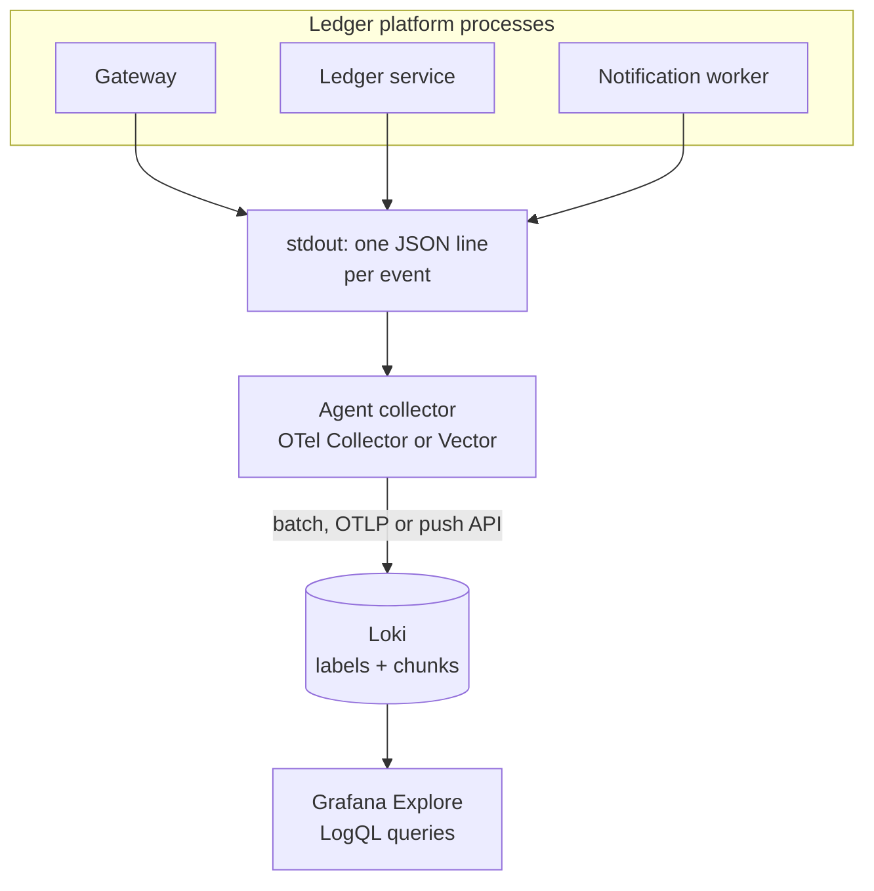
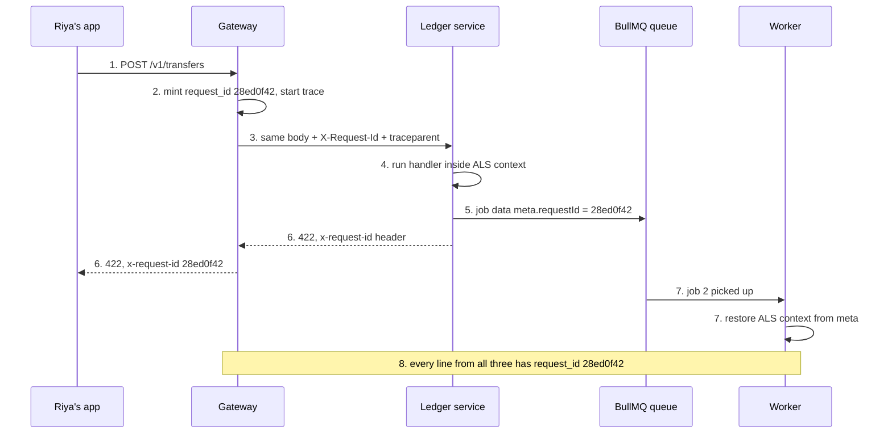
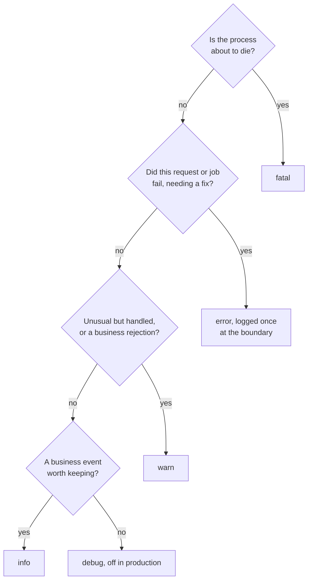
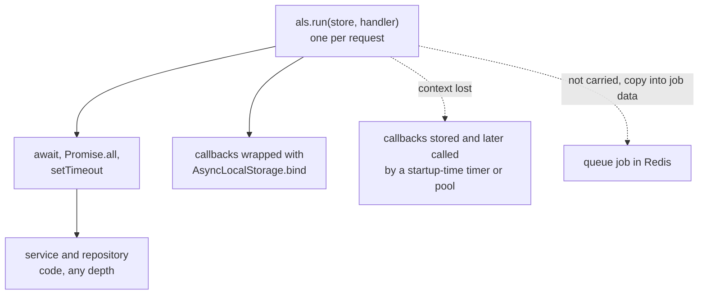
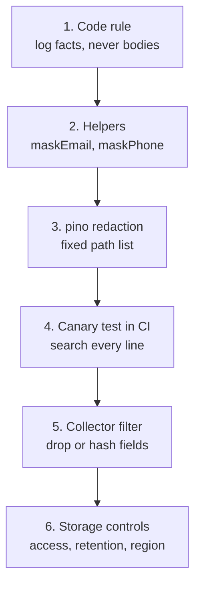
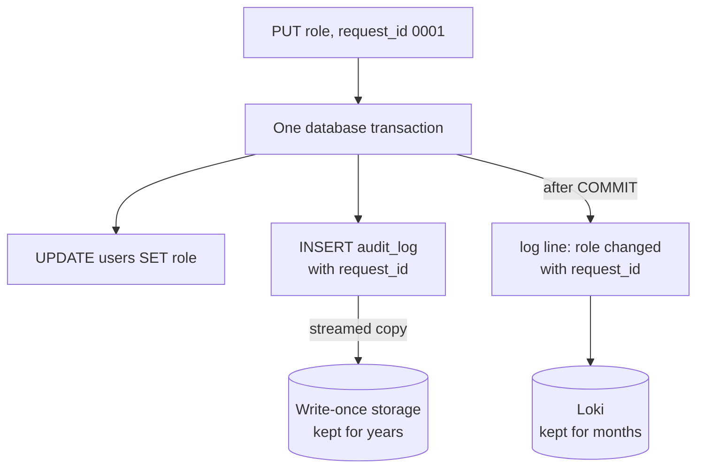
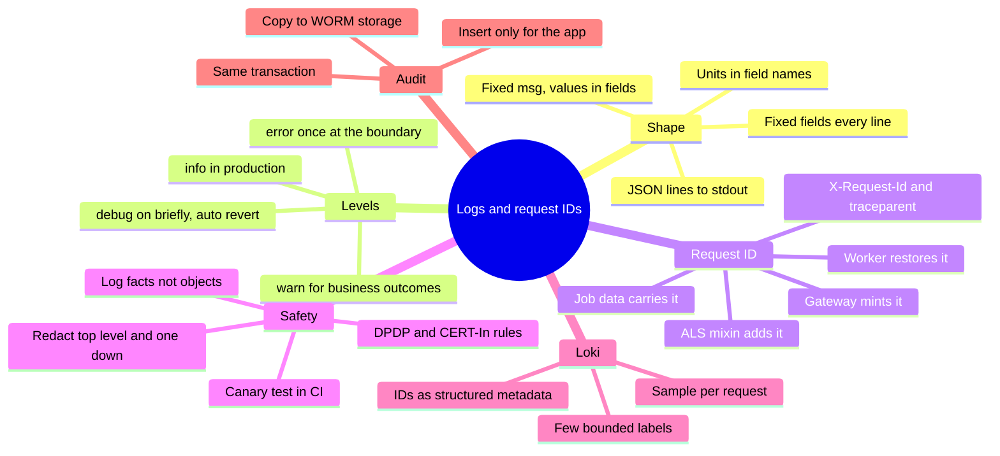

# P1-08 · Structured logging and request IDs

| | |
|---|---|
| **Phase** | 1 · Backend foundations |
| **Prerequisites** | P1-02 (this guide assumes Node's event loop, `async`/`await` and a basic Fastify app) |
| **Leads to** | P5-01 · Observability with OpenTelemetry · P5-08 · Incident response and postmortems |
| **Repo path** | `system-design/phase-1/p1-08-structured-logging-and-request-ids.md` |

**After this card you can:**

1. Write JSON logs with fixed fields that any tool can filter, and choose the right level for each line.
2. Carry one request ID from the gateway, through another service and a BullMQ queue, to a worker, without passing it by hand.
3. Keep passwords, tokens and card numbers out of logs with pino redaction, and prove it with a test.
4. Ship logs to Grafana Loki and find every line of one failed transfer with a single LogQL query.
5. Explain how an audit log differs from an application log, and build one that the app cannot rewrite.

> **About the numbers in this guide.** Everything marked **Real output** was run while writing this guide on 15 Oct 2026, on a 2-vCPU Linux sandbox with Node 22.22.0, Redis 7.0.15, PostgreSQL 16.15, Grafana Loki 3.7.8 (single binary) and the OpenTelemetry Collector contrib 0.162.0. There was no Docker, so the `grafana/otel-lgtm` image from the card was **not** run here. Instead, the same collector config was pointed at a local Loki. In the lab, only the endpoint changes. Everything marked **Expected** was not run.
>
> **Versions** (checked on npm and GitHub, 15 Oct 2026): pino 10.4.0, Fastify 5.12.7, BullMQ 6.3.15, ioredis 6.0.0, Zod 4.6.7, Vitest 5.0.4, Loki 3.7.8, OpenTelemetry Collector 0.162.0, Vector 0.59.0, Fluent Bit 5.1.4, `docker-otel-lgtm` v0.36.0.

---

## 🧭 The concept in one minute

A **log** is a line your program writes when something happens. A **structured log** is that line written as data, usually one JSON object per line, with the same field names every time.

**One line:** structured logs plus a request ID turn "search 3 GB of text" into "show me every line of request `28ed0f42`, from every service, in order".

**Analogy.** Think of a courier parcel with a tracking number. The parcel goes from the shop, to the hub, to a van, to your door. Each place scans the same number and writes a short, fixed-format entry. When the parcel is late, you type one number and see the whole journey. The request ID is the tracking number. Each service is a scanning point. Loki is the tracking website.

**On the ledger platform.** At 2 am, Riya's ₹20,000 transfer fails. She sends support a screenshot showing reference `28ed0f42`. Support runs one query and sees 9 lines from 3 services: the gateway received it, the ledger rejected it for insufficient funds (₹9,500 available), and the worker sent her a "payment failed" SMS. It takes 30 seconds, and nobody has to log in to a server.

---

## 🔥 The problem it solves

Here is the ledger platform with the logging most projects start with. Every number below was measured while writing this guide.

1. **Text logs give wrong answers.** Five log lines, written as text. Searching for `r-7f3a` returned 4 lines, and one of them belonged to a different request that only *mentioned* `r-7f3a` in its message. The JSON version, filtered on the `request_id` field, returned exactly 3.
2. **Every service makes its own ID.** The gateway logs `abc`, the ledger logs `xyz` and the worker logs a job number. You cannot join them, so a failed transfer becomes three separate investigations.
3. **Secrets leak through the gaps.** A redaction list with `*.password` caught `{ body: { password } }`. It did **not** catch a password two levels deep, under a key called `pwd`, inside a message string, or at the top level of a logged request body. That is 4 leaks from 4 everyday mistakes.
4. **Logs cost real money.** One transfer through gateway, ledger and worker wrote 10 lines, about 3.2 KB. At 20 lakh transfers a day, that is about **6 GiB a day**. India's CERT-In directions ask for logs to be kept for 180 days, which is about **1 TiB**. Noise costs money to store and slows every search.

This card fixes all four. You will write JSON lines with fixed fields, use one request ID that travels through HTTP headers and queue messages, apply redaction backed by a test, ship logs to Loki, and keep a separate audit log for "who did what".

---

## 📚 Before you start

**Earlier cards used here:** P1-03 (the transfer endpoint, Problem Details errors), P1-05 (login, roles, tokens), P1-06 (validated config, secrets), P1-07 (Vitest and `app.inject`), P2-01 (the `audit_log` table and append-only trigger). This guide says where each one comes in.

**Key terms**

| Term | Plain meaning |
|---|---|
| Structured log | A log line written as data (JSON here), with named fields instead of free text. |
| JSON lines (NDJSON) | One complete JSON object per line, so each line can be parsed on its own. |
| Log level | How important a line is: `trace`, `debug`, `info`, `warn`, `error`, `fatal`. |
| pino | A fast JSON logger for Node.js. Fastify uses it internally. |
| Child logger | A logger made from another one, with extra fields added to every line. |
| Redaction | Replacing sensitive values (passwords, tokens) before the line is written. |
| Request ID | A unique ID for one user action, shared by every service that handles it. |
| Correlation ID | Another name for the request ID: it lets you correlate (join) lines. |
| `X-Request-Id` | A common HTTP header for carrying the request ID. It is a convention, not a standard. |
| `traceparent` | The W3C standard header for distributed tracing: version, trace ID, parent span ID, flags. |
| Trace ID, span ID | A trace is the whole journey of a request; a span is one step of it (P5-01). |
| AsyncLocalStorage (ALS) | A Node.js feature that keeps a value available across every `await` of one request. |
| Collector, agent | A program that reads logs (files or stdout) and sends them to storage. |
| Loki | Grafana's log store. It indexes a few labels and stores the rest cheaply. |
| LogQL | Loki's query language, for example `{service_name="ledger"} \| request_id="..."`. |
| Label | A Loki index field. It must have few possible values (low cardinality). |
| Structured metadata | Per-line key-value data in Loki that is not indexed, so it can have many values. |
| Cardinality | How many different values a field can have. User IDs: millions. Service names: a handful. |
| Audit log | An append-only record of who did what, kept for compliance and disputes. |
| DPDP Act | India's Digital Personal Data Protection Act, 2023, with its Rules notified in November 2025. |

---

## 🧠 How it works

### Mental model: every line answers who, what, where and when

A good log line is a small, complete fact. It answers:

- **When:** `time`, in UTC ISO format so it sorts as text.
- **Where:** `service`, `env`, `version`. Which program, which environment, which build.
- **Which request:** `request_id`, `trace_id`, `span_id`. Plus `user_id` and `job_id` when they exist.
- **What happened:** `msg`, a short fixed phrase such as `"transfer rejected"`. Never put changing values in the message.
- **The numbers:** separate fields such as `amount_minor`, `available_minor`, `status`, `duration_ms`.

A React comparison: a text log is like rendering a string with the values pasted in. A structured log is like passing **props**. The values stay as separate, typed fields, so any tool can filter, count and group by them.

### Diagram: where logs go

**Diagram: from `log().info()` to a Grafana screen**



**How to read this diagram.** Each process only writes JSON lines to stdout. It does not know where logs go, so the code stays the same in dev, staging and production. An agent collector on the machine (or a sidecar in Kubernetes) reads those lines, batches them, and sends them to Loki. Loki indexes only a few labels, such as the service name. People query it from Grafana with LogQL.

### Diagram: how one request ID travels (must-include)

**Diagram: a request ID from gateway to service to queue to worker**



**How to read this diagram.** Time runs downwards, and the numbers match the walkthrough later in this guide. The gateway is the only place that creates the ID (step 2). Over HTTP, it travels as a header (step 3). Inside each process, AsyncLocalStorage carries it through every `await` (step 4). Redis knows nothing about ALS, so the ID goes **inside the job data** (step 5). The worker starts with no context and rebuilds it from the job before it does any work (step 7). Because every line carries the same `request_id`, one query finds them all (step 8).

---
## 🔬 Deep dive

One subsection per item on the card, in the card's order.

### 1. Structured vs text logs

**What it is.** A text log is a sentence for a human: `WARN [ledger] r-7f3a insufficient funds`. A structured log is a record for a machine: `{"level":"warn","service":"ledger","request_id":"r-7f3a","msg":"insufficient funds","available_minor":950000}`. Humans can still read it, and tools can query it.

**Minimal version:** `minimal/text-vs-json.ts`. The same five events, then the question "show me everything for request `r-7f3a`".

```ts
// The same five events as text lines and as JSON lines. Then: "show me everything for request r-7f3a".
const events = [
  { level: "info", service: "gateway", request_id: "r-7f3a", msg: "POST /v1/transfers received" },
  { level: "info", service: "ledger", request_id: "r-9c21", msg: "transfer completed", amount_minor: 50_000 },
  { level: "warn", service: "ledger", request_id: "r-7f3a", msg: "insufficient funds", amount_minor: 1_20_000 },
  { level: "info", service: "ledger", request_id: "r-9c21", msg: "retrying after r-7f3a released its lock" },
  { level: "info", service: "gateway", request_id: "r-7f3a", msg: "request completed", status: 422 },
];
const textLines = events.map((e) => `${e.level.toUpperCase()} [${e.service}] ${e.request_id} ${e.msg}`);
const jsonLines = events.map((e) => JSON.stringify(e));

// Text: the best you can do is search for the string, and it also matches a mention inside a message.
const textHits = textLines.filter((l) => l.includes("r-7f3a"));
// JSON: parse and compare one field exactly.
const jsonHits = jsonLines.map((l) => JSON.parse(l)).filter((e) => e.request_id === "r-7f3a");

console.log(`text search for "r-7f3a": ${textHits.length} lines (one is a different request)`);
textHits.forEach((l) => console.log("  " + l));
console.log(`JSON filter request_id == "r-7f3a": ${jsonHits.length} lines`);
// A question text logs cannot answer without a fragile regex:
const bigWarnings = jsonLines.map((l) => JSON.parse(l)).filter((e) => e.level === "warn" && (e.amount_minor ?? 0) > 1_00_000);
console.log(`warnings for transfers above ₹1,000: ${bigWarnings.length} ->`, bigWarnings.map((e) => e.msg));
```

**Real output**

```text
text search for "r-7f3a": 4 lines (one is a different request)
  INFO [gateway] r-7f3a POST /v1/transfers received
  WARN [ledger] r-7f3a insufficient funds
  INFO [ledger] r-9c21 retrying after r-7f3a released its lock
  INFO [gateway] r-7f3a request completed
JSON filter request_id == "r-7f3a": 3 lines
warnings for transfers above ₹1,000: 1 -> [ 'insufficient funds' ]
```

**What to notice**
- The text search is a string match, so it found a line that only **mentions** the ID. The JSON filter compares one field exactly.
- "Warnings above ₹1,000" is one filter on JSON. On text it needs a regex that breaks the day someone rewords the message.
- The JSON lines are longer. Structure costs bytes, and it saves hours.

**The fixed fields on the ledger platform.** Every line from every service has the same names. Agree on them once, as a team, and write them down.

| Field | Example | Why it is there |
|---|---|---|
| `time` | `2026-10-15T02:28:19.721Z` | UTC ISO-8601: sorts as text, no time-zone guessing at 2 am |
| `level` | `warn` | The label, not pino's number `40`, so any tool reads it |
| `msg` | `transfer rejected` | A fixed phrase you can group by. Values go in fields, never in `msg` |
| `service` | `ledger` | Which program wrote it |
| `env` | `prod` | Never mix staging lines into a production investigation |
| `version` | `1.8.0` | "Did this start after the 4 pm deploy?" |
| `request_id` | `28ed0f42-...` | Joins every line of one user action, across services |
| `trace_id`, `span_id` | `e5433180...`, `5746555e...` | The W3C trace context; P5-01 links logs to traces with these |
| `user_id`, `job_id` | `u_riya`, `2` | Present when known |

**Naming rules that save pain:** use `snake_case` everywhere; put the unit in the name (`duration_ms`, `amount_minor`); and keep each field's type fixed. If `status` is a number in one service and a string in another, every query breaks.

**When not to bother.** A one-off script run by hand can print text. Anything that runs unattended and handles money logs JSON.

### 2. Log levels

**What it is.** A level says how much a line matters and who should care. pino's levels, from lowest to highest: `trace` (10), `debug` (20), `info` (30), `warn` (40), `error` (50), `fatal` (60). A logger set to `info` writes `info` and above, and skips the rest.

| Level | Operational meaning | On the ledger platform |
|---|---|---|
| `fatal` | The process is about to die. Page someone now. | Config invalid at startup; uncaught exception |
| `error` | A request or job failed, and someone may need to act. Alerts count these. | Database timeout during a transfer; a job failed after all retries |
| `warn` | Something unusual but handled. Watch the rate, not each line. | Insufficient funds; a retry after a timeout; a login failure |
| `info` | A normal business event worth keeping. | Transfer requested and completed; request completed; job done |
| `debug` | Detail for developers. Off in production. | The balance that was checked; the SQL plan chosen |
| `trace` | Extremely detailed steps. Almost never used. | Each loop iteration |

**Rules.**
1. **An expected business outcome is not an error.** Insufficient funds is a `warn` (or even `info`). If it were `error`, the error alert would fire every evening when people's wallets run low, and soon nobody would trust it.
2. **One `error` per failure.** Log it once, where the request ends (the error handler). If the repository, the service and the route all log the same failure, you get three alerts for one problem.
3. **No `debug` in production by default.** It is the noisiest level, and it is where developers put full objects. A disabled `debug` call costs almost nothing, so you can leave the lines in the code. Measured here: 1,00,000 disabled `pino.debug()` calls took **5 ms**, about 0.05 µs each.

**Diagram: choosing a level**



**How to read this diagram.** Ask the questions from the top and stop at the first "yes". Most lines on a healthy system end at `info` or `debug`. `error` is reserved for failures someone must fix, so an error alert stays meaningful.

**Changing the level at runtime.** During an incident you may want `debug` for 15 minutes without a redeploy. pino lets you set `logger.level` while the process runs. The product version is an internal admin route that switches itself back (Hands-on lab, step 1).

There is a detail you need to know about child loggers first. **Minimal version:** `minimal/levels.ts`

```ts
// Changing the level at runtime: children follow the parent, unless they got a DIFFERENT level.
import pino from "pino";

const logger = pino({ level: "info", base: undefined, timestamp: false });
const inherits = logger.child({ component: "transfers" });
const pinnedWarn = logger.child({ component: "audit" }, { level: "warn" });
const sameAsParent = logger.child({ component: "payouts" }, { level: "info" }); // equal to parent: not pinned

logger.level = "debug"; // e.g. from an admin endpoint during an incident

console.log("root               ->", logger.level);
console.log("child, no level    ->", inherits.level);
console.log("child, level warn  ->", pinnedWarn.level);
console.log("child, level info  ->", sameAsParent.level);
```

**Real output**

```text
root               -> debug
child, no level    -> debug
child, level warn  -> warn
child, level info  -> debug
```

**What to notice**
- Children made without a level **follow** the parent, even children created before the change. Fastify's per-request loggers are children, so changing the root level reaches them.
- A child given a **different** level keeps it. That is how you keep a noisy module quiet while debugging another one.
- A child given the **same** level as its parent at creation is not pinned at all; it still follows. pino only stores a level on the child when it differs (checked in pino 10.4.0's source). This is surprising, so test it rather than assuming.

**Trade-off.** Runtime level changes are powerful and risky. `debug` can multiply log volume by ten in a minute, and debug lines are where personal data slips in. Protect the route (admin role, internal network only), give it a time limit, and log every change at `warn`.

### 3. pino in Node.js: fast JSON, child loggers, redaction

**Why pino is fast.** It does very little work per line. It builds the JSON with hand-tuned code instead of generic `JSON.stringify` on a big object, skips work for disabled levels, and writes to a destination stream without formatting for humans. Pretty-printing (`pino-pretty`) is for your terminal, not production.

**Minimal benchmark:** `minimal/hot-path.ts`. 1,00,000 log calls in a tight loop, each writing to a file.

```ts
// 1,00,000 log calls in a hot loop: console.log vs pino, all writing to files.
import { once } from "node:events";
import { closeSync, openSync, rmSync, statSync, writeSync } from "node:fs";
import pino from "pino";

const N = 1_00_000;
const event = { request_id: "r-7f3a", wallet_id: "w_riya", amount_minor: 50_000 };
const results: string[] = [];

function timeIt(name: string, file: string, run: (i: number) => void, done: () => void) {
  const start = process.hrtime.bigint();
  for (let i = 0; i < N; i++) run(i);
  done();
  const ms = Number(process.hrtime.bigint() - start) / 1e6;
  results.push(`${name.padEnd(36)} ${ms.toFixed(0).padStart(6)} ms  ${(statSync(file).size / 1e6).toFixed(1).padStart(5)} MB`);
}
for (const f of ["console", "sync", "async", "debug"]) rmSync(`/tmp/hot-${f}.log`, { force: true });

// console.log, redirected to a file with synchronous writes (what stdout to a file or pipe often is)
const fd = openSync("/tmp/hot-console.log", "w");
const realWrite = process.stdout.write.bind(process.stdout);
process.stdout.write = ((chunk: string) => (writeSync(fd, chunk), true)) as typeof process.stdout.write;
timeIt("console.log(msg, object)", "/tmp/hot-console.log", (i) => console.log("debit", { ...event, i }), () => {
  process.stdout.write = realWrite;
  closeSync(fd);
});

const syncLogger = pino({ base: undefined }, pino.destination({ dest: "/tmp/hot-sync.log", sync: true }));
timeIt("pino, sync destination", "/tmp/hot-sync.log", (i) => syncLogger.info({ ...event, i }, "debit"), () => syncLogger.flush());

const asyncDest = pino.destination({ dest: "/tmp/hot-async.log", sync: false, minLength: 4096 });
await once(asyncDest, "ready");
const asyncLogger = pino({ base: undefined }, asyncDest);
timeIt("pino, async destination (4 KB buffer)", "/tmp/hot-async.log", (i) => asyncLogger.info({ ...event, i }, "debit"), () => asyncDest.flushSync());

const debugOff = pino({ level: "info", base: undefined }, pino.destination({ dest: "/tmp/hot-debug.log", sync: true }));
timeIt("pino.debug() while level is info", "/tmp/hot-debug.log", (i) => debugOff.debug({ ...event, i }, "debit"), () => debugOff.flush());

console.log(results.join("\n"));
```

**Real output** (three runs)

```text
run 1
console.log(msg, object)                551 ms    9.1 MB
pino, sync destination                  390 ms   12.2 MB
pino, async destination (4 KB buffer)    496 ms   12.2 MB
pino.debug() while level is info          5 ms    0.0 MB
run 2
console.log(msg, object)                631 ms    9.1 MB
pino, sync destination                  345 ms   12.2 MB
pino, async destination (4 KB buffer)    514 ms   12.2 MB
pino.debug() while level is info          5 ms    0.0 MB
run 3
console.log(msg, object)                586 ms    9.1 MB
pino, sync destination                  363 ms   12.2 MB
pino, async destination (4 KB buffer)    540 ms   12.2 MB
pino.debug() while level is info          6 ms    0.0 MB
```

**What to notice**
- pino with a synchronous destination took about 3.7 µs per line; `console.log` took about 5.9 µs **and** wrote a format no tool can parse (it is `util.inspect` output, not JSON).
- The asynchronous destination was **slower** in this tight loop on a fast local disk. Async mode helps when the destination is slow (next point); it is not free speed.
- The biggest win by far is a line that is never written: 5 ms for 1,00,000 disabled `debug` calls.

**Where sync vs async really matters: a slow consumer.** Below, stdout is a pipe into a log shipper that stops reading for one second (`| (sleep 1; cat > /dev/null)`), and each mode writes 20,000 lines. `minimal/slow-pipe.ts`:

```ts
// stdout is a PIPE to a log shipper that is slow for one second. What happens to our event loop?
import { monitorEventLoopDelay } from "node:perf_hooks";
import pino from "pino";

const mode = process.argv[2] as "console" | "pino-sync" | "pino-async";
const delay = monitorEventLoopDelay({ resolution: 10 });
delay.enable();
const line = { request_id: "r-7f3a", wallet_id: "w_riya", note: "x".repeat(150) };
const logger =
  mode === "pino-sync" ? pino(pino.destination({ fd: 1, sync: true }))
  : mode === "pino-async" ? pino(pino.destination({ fd: 1, sync: false }))
  : null;

const started = Date.now();
let ticks = 0;
const ticker = setInterval(() => ticks++, 10); // a healthy loop ticks ~100 times a second
for (let batch = 0; batch < 20; batch++) {
  for (let i = 0; i < 1_000; i++) (logger ? logger.info(line, "debit") : console.log("debit", line));
  await new Promise((r) => setImmediate(r)); // give other work a chance between batches
}
clearInterval(ticker);
delay.disable();
const queued = mode === "console" ? `, still queued in memory ${(process.stdout.writableLength / 1e6).toFixed(1)} MB` : "";
process.stderr.write(`${mode.padEnd(10)} 20,000 lines: loop busy ${Date.now() - started} ms, timer ticks ${ticks}, max event-loop delay ${Math.round(delay.max / 1e6)} ms${queued}\n`);
logger?.flush();
```

**Real output**

```text
console    20,000 lines: loop busy 213 ms, timer ticks 13, max event-loop delay 20 ms, still queued in memory 4.3 MB
pino-sync  20,000 lines: loop busy 1252 ms, timer ticks 19, max event-loop delay 214 ms
pino-async 20,000 lines: loop busy 129 ms, timer ticks 8, max event-loop delay 20 ms
```

**What to notice**
- **pino with a sync destination waited for the slow reader.** The loop was busy for 1.25 s, and a single pause lasted 214 ms. A server would stop answering requests for that long.
- **`console.log` did not block, but it queued 4.3 MB in the process's memory.** Under sustained load that queue keeps growing.
- **pino async** kept the loop free. The price, in pino's own docs: the most recently buffered lines can be lost if the process or machine dies. Call `logger.flush()` on shutdown, as the lab's entry points do.
- The default in this guide is pino's synchronous stdout, which is safe and fast when the collector keeps up. Watch the collector's health instead of hoping.

**Child loggers.** `logger.child({ component: "payouts" })` returns a logger that adds `component` to every line. Children are cheap but not free, and Fastify already makes one per request (`request.log`).

**A trap with two sources of the same field.** If a child binding and a mixin (below) both add `request_id`, pino writes the key **twice**. `minimal/mixin-duplicate.ts`:

```ts
// A trap: a mixin and a child binding that both add request_id write the key twice.
import pino from "pino";

const logger = pino({ base: undefined, timestamp: false, mixin: () => ({ request_id: "r-from-mixin" }) });
logger.child({ request_id: "r-from-child" }).info("transfer started");
```

**Real output**

```text
{"level":30,"request_id":"r-from-child","request_id":"r-from-mixin","msg":"transfer started"}
```

That line is technically JSON, but tools disagree on which value wins. Rule: every field has exactly one source. In this guide, the request fields come **only** from the mixin.

**The product logger (must-include: the pino redaction config).** `src/lib/logger.ts` is the one place where format, fixed fields and redaction are decided. Every service imports it.

```ts
// The one place that decides log format, fixed fields and redaction. Every service uses it.
import pino, { type DestinationStream, type Logger } from "pino";
import { contextLogFields } from "./requestContext.js";

// Checked once at startup. Never build these from user input.
export const REDACT_PATHS = [
  "req.headers.authorization",
  "req.headers.cookie",
  'req.headers["x-api-key"]',
  'res.headers["set-cookie"]',
  // Secrets at the top level (someone logs request.body itself) and one level down ({ body }).
  ...["password", "newPassword", "otp", "pin", "cvv", "accessToken", "refreshToken", "idToken", "token", "cardNumber", "aadhaarNumber"]
    .flatMap((key) => [key, `*.${key}`]),
];

export interface LoggerOptions {
  service: string;
  env: string;
  version: string;
  level: string;
  destination?: DestinationStream; // tests pass an in-memory stream
}

export function createLogger(opts: LoggerOptions): Logger {
  return pino(
    {
      level: opts.level,
      base: { service: opts.service, env: opts.env, version: opts.version }, // replaces pid and hostname
      timestamp: pino.stdTimeFunctions.isoTime, // "2026-10-15T02:31:07.123Z": readable and sortable
      formatters: { level: (label) => ({ level: label }) }, // "warn" instead of 40
      mixin: contextLogFields, // request_id, trace_id, span_id, user_id, job_id from AsyncLocalStorage
      serializers: { err: pino.stdSerializers.errWithCause }, // keeps the cause as a nested object
      redact: { paths: REDACT_PATHS, censor: "[REDACTED]" },
    },
    opts.destination, // undefined -> stdout; the platform ships stdout
  );
}
```

**What to notice**
- **`REDACT_PATHS` lists each secret twice:** at the top level (`password`) and one level down (`*.password`). Measured in Deep dive 5, `*.password` alone missed a password logged as `logger.info(request.body)`.
- **`mixin: contextLogFields`** runs on every line and adds `request_id`, `trace_id`, `span_id`, `user_id` and `job_id` from AsyncLocalStorage (Deep dive 4). No code passes IDs by hand.
- **`base`** replaces pino's default `pid` and `hostname` with the fields we query on. The collector adds host details if you want them.
- **`errWithCause`** keeps an error's `cause` as a nested object with its own `code` (Deep dive 6).
- **`destination`** is a parameter, so a test can capture every line in memory.

**Redaction cost.** pino 10.4.0 does redaction through its `@pinojs/redact` dependency (its own docs still describe the older `fast-redact`). Paths are compiled once at startup. Wildcards cost more than exact paths. Measured on a no-op route, adding the 11 wildcard paths cut throughput by about 21% (6,910 → 5,447 requests per second). This guide keeps them, because a leaked password costs more than CPU. Section "Break it and measure it" shows the full numbers.

### 4. Correlation IDs: gateway, headers, queues and AsyncLocalStorage

**The rule.** One ID per user action, **created once, at the edge**, and passed everywhere that action goes: HTTP calls, queue messages, scheduled retries. No service makes its own ID when one arrives.

**Two headers, two jobs.**

| | `X-Request-Id` | `traceparent` (W3C Trace Context) |
|---|---|---|
| Status | A widely used convention, not a standard | W3C Recommendation (current version 23 Nov 2021) |
| Format | Any string; this guide accepts `[A-Za-z0-9._-]{8,64}` | `00-<32 hex trace-id>-<16 hex parent-id>-<2 hex flags>` |
| Example | `28ed0f42-2a88-4c83-8f67-169aa9abc86d` | `00-4bf92f3577b34da6a3ce929d0e0e4736-00f067aa0ba902b7-01` |
| Changes per hop? | No: same value everywhere | The trace-id stays; the parent-id becomes the caller's span each hop |
| Shown to customers | Yes: "quote reference 28ed0f42" | No |
| Used by | Logs, support, the API response | Tracing tools (P5-01), log-to-trace links |

The ledger platform uses both. `request_id` is what people search for. `trace_id` is what tracing tools join on. The spec says an all-zero trace-id or parent-id is invalid and must be ignored, and the parser in this guide does that.

**Never trust an ID from the internet as-is.** A client could send a newline and fake a whole log line (log injection), or reuse another customer's ID to confuse support. So:
- The **gateway always mints** a new `request_id`. If the app sent its own, the gateway logs it once as `client_request_id`.
- **Internal services** accept `X-Request-Id` from the gateway only if it is well-formed, and mint a new one otherwise.
- Fastify 5 helps: `requestIdHeader` defaults to `false`, so it does not take the ID from a header unless you ask it to.

**Minimal version 1, propagation:** `minimal/propagation.ts`. Gateway, service, queue and worker in one file, with no framework.

```ts
// One request id from the gateway, through an HTTP call and a queue, to a worker. No frameworks.
import { AsyncLocalStorage } from "node:async_hooks";
import { randomUUID } from "node:crypto";

const als = new AsyncLocalStorage<{ requestId: string }>();
const log = (service: string, msg: string) =>
  console.log(JSON.stringify({ service, request_id: als.getStore()?.requestId ?? null, msg }));

const queue: Array<{ data: { walletId: string; meta: { requestId: string } } }> = []; // stands in for Redis

// Ledger service: reads the header, runs the handler in a context, puts the id INTO the job.
async function ledgerHandler(headers: Record<string, string>, body: { walletId: string }) {
  return als.run({ requestId: headers["x-request-id"] ?? randomUUID() }, async () => {
    log("ledger", "transfer requested");
    queue.push({ data: { walletId: body.walletId, meta: { requestId: als.getStore()!.requestId } } });
    log("ledger", "notification queued");
  });
}

// Gateway: the only place that creates the id. It passes it on as a header.
async function gateway(body: { walletId: string }) {
  await als.run({ requestId: randomUUID() }, async () => {
    log("gateway", "request received");
    await ledgerHandler({ "x-request-id": als.getStore()!.requestId }, body); // a real fetch() sends this header
    log("gateway", "request completed");
  });
}

// Worker: started outside any request, so it must restore the id from the job.
async function worker() {
  for (const job of queue.splice(0)) {
    log("worker", "job picked up (before restoring)");
    await als.run({ requestId: job.data.meta.requestId }, async () => log("worker", "sms sent"));
  }
}

await gateway({ walletId: "w_riya" });
await worker();
```

**Real output**

```text
{"service":"gateway","request_id":"d81292bf-4c5f-46a1-ad6b-4ec29607b738","msg":"request received"}
{"service":"ledger","request_id":"d81292bf-4c5f-46a1-ad6b-4ec29607b738","msg":"transfer requested"}
{"service":"ledger","request_id":"d81292bf-4c5f-46a1-ad6b-4ec29607b738","msg":"notification queued"}
{"service":"gateway","request_id":"d81292bf-4c5f-46a1-ad6b-4ec29607b738","msg":"request completed"}
{"service":"worker","request_id":null,"msg":"job picked up (before restoring)"}
{"service":"worker","request_id":"d81292bf-4c5f-46a1-ad6b-4ec29607b738","msg":"sms sent"}
```

**What to notice**
- Over HTTP the ID is a **header**. Into the queue it is **job data** (`meta.requestId`). Redis, Kafka and BullMQ know nothing about AsyncLocalStorage.
- The worker's first line has `null`: a worker starts outside any request. It must restore the context from the job before it does anything else.
- The ledger code never received the ID as a function argument. It read it from the context.

**What AsyncLocalStorage is.** `AsyncLocalStorage` (in `node:async_hooks`, stable since Node 16.4) gives you a "current value" that follows your code through `await`, timers and promises. You call `als.run(store, fn)`, and anything `fn` starts, at any depth, can call `als.getStore()`. A React comparison: it is like Context for async code. The provider is `run()`, and any function "below" it can read the value without prop drilling.

**Minimal version 2, where context survives and where it is lost:** `minimal/als.ts`

```ts
// AsyncLocalStorage: a value set once per request is visible in every async step of that request.
import { AsyncLocalStorage } from "node:async_hooks";
import { EventEmitter } from "node:events";
import { setTimeout as sleep } from "node:timers/promises";

const als = new AsyncLocalStorage<{ requestId: string }>();
const log = (msg: string) => console.log(`${(als.getStore()?.requestId ?? "NONE").padEnd(6)} ${msg}`);

// A shared object created at startup, OUTSIDE any request (like a connection pool or batcher).
const batcher = new EventEmitter();
const pending: Array<() => void> = [];
const flusher = setInterval(() => pending.splice(0).forEach((fn) => fn()), 20); // flushes from the startup context
batcher.on("flushed", () => log("event listener ran"));

async function handleTransfer(requestId: string) {
  await als.run({ requestId }, async () => {
    log("handler start");
    await sleep(5);
    log("after await");
    await Promise.all([sleep(1).then(() => log("inside Promise.all")), new Promise<void>((r) => setTimeout(() => { log("inside setTimeout"); r(); }, 2))]);
    await new Promise<void>((r) => pending.push(() => { log("queued callback (LOST)"); r(); }));
    await new Promise<void>((r) => pending.push(AsyncLocalStorage.bind(() => { log("queued callback, bound (kept)"); r(); })));
    batcher.emit("flushed"); // listeners run synchronously in the emitter's caller: our context
  });
}
await Promise.all([handleTransfer("r-1"), handleTransfer("r-2")]);
log("outside any request");
clearInterval(flusher);
```

**Real output**

```text
r-1    handler start
r-2    handler start
r-1    after await
r-2    after await
r-1    inside Promise.all
r-1    inside setTimeout
r-2    inside Promise.all
r-2    inside setTimeout
NONE   queued callback (LOST)
NONE   queued callback (LOST)
r-1    queued callback, bound (kept)
r-2    queued callback, bound (kept)
r-1    event listener ran
r-2    event listener ran
NONE   outside any request
```

**What to notice**
- Two requests ran **at the same time** and their IDs never mixed. That is why a module-level `let currentRequestId` cannot work.
- The context survived `await`, `Promise.all` and `setTimeout`.
- It was **lost** when a callback was stored and later called by something created outside the request (here, a batcher's `setInterval`). Connection pools and home-made batchers do exactly this. `AsyncLocalStorage.bind(fn)` (or `AsyncResource`, or promisifying the callback API) fixes it.
- `EventEmitter` listeners run inside whoever calls `emit`. That worked here because the request emitted. It breaks when a background task emits.

**Diagram: where the context reaches, and where it does not**



**How to read this diagram.** Solid arrows are paths the context follows by itself: every `await`, every promise and timer created inside the request, and any depth of function calls. Dotted arrows are where it stops: callbacks run by something created outside the request, and anything that leaves the process, such as a Redis job. Those need `bind`, or the ID copied into the message.

**When not to use ALS for this.** In a tiny script, pass the ID as an argument. In a framework with its own request context that already reaches your code, use that. ALS has a small cost per request; measured here, the context alone (no logging) cost about 18 µs per request on a no-op route.

The product version is spread over a few short files: `correlation.ts`, `requestContext.ts`, a Fastify plugin, an HTTP client, the queue producer and the worker. They are in **Hands-on lab, step 2**.

### 5. What never to log

| Never log | Examples | Why | Log this instead |
|---|---|---|---|
| Credentials | Passwords, OTPs, PINs, CVV | Anyone with log access can log in as the user | `reason: "bad_credentials"` |
| Tokens and keys | `Authorization` header, access and refresh tokens, API keys, cookies, signed URLs | A token in a log is a live session for whoever reads it | `token_family_id`, the token's expiry |
| Card data | Full card number (PAN), CVV, expiry | PCI DSS requires the full number to be unreadable wherever it is stored, logs included, and the CVV must not be kept after authorisation | `card_last4: "1111"`, a card token |
| Government IDs | Aadhaar, PAN, passport numbers | Identity theft; UIDAI rules restrict storing Aadhaar numbers | A masked form, or an internal ID |
| Raw personal data | Full name with phone, address, email, date of birth, full request bodies | DPDP Act: collect and keep only what you need, for a stated purpose | `user_id`, `email_masked: "r***@example.test"` |
| Free-text user input | Transfer notes, chat messages | People type phone numbers and bank details into anything | Its length or a category |

**India's DPDP Act as context.** The Digital Personal Data Protection Act, 2023 governs personal data of people in India. The DPDP Rules, 2025 were notified on **13 November 2025** with a staggered start: some parts at once, consent-manager parts after 12 months (13 November 2026) and most duties after 18 months (13 May 2027). For logs, three points matter (summarised from a law firm's note; read the Rules themselves before acting):
- **Security safeguards include logs.** The Rules expect logging and monitoring of access to personal data, and keeping those logs for **one year** to detect and investigate breaches.
- **Breaches must be reported.** An initial notice without delay, and a detailed report within 72 hours. Good logs are how you know what leaked.
- **Logs are personal data too.** A log full of phone numbers is a store of personal data, with the same duties as your database.

**Two more Indian rules affect logging.** CERT-In's directions of 28 April 2022 require logs of ICT systems to be kept for **180 days, within India**, clocks synced to Indian government NTP servers (or servers traceable to them), and cyber incidents reported within **6 hours**. RBI rules for regulated entities add their own expectations. Your compliance team owns the exact list; your job is to make logs that can meet it.

**Enforce it automatically, in layers.** People forget; layers do not.

**Diagram: layers that keep secrets out of logs**



**How to read this diagram.** Each layer catches what the one above missed. The code rule stops most leaks. Masking helpers handle values you do need, such as an email's domain. pino redaction catches known key names. The canary test (Hands-on lab, step 5) fails the build when a secret reaches any line. The collector can drop or hash fields as a last net before data leaves the machine. Storage controls limit who can read what survives, and for how long.

**Redaction has gaps. Real ones.** `minimal/redaction.ts`:

```ts
// pino redaction: what it catches, and three things it does not.
import pino from "pino";

const logger = pino({
  base: undefined,
  timestamp: false,
  redact: {
    paths: ["req.headers.authorization", "*.password", "*.otp", "card.number"],
    censor: "[REDACTED]",
  },
});

logger.info({ req: { headers: { authorization: "Bearer eyJhbGciOi...", "user-agent": "okhttp/4.12" } } }, "headers");
logger.info({ body: { email: "riya@example.test", password: "Riya@2026" } }, "login body");
logger.info({ card: { number: "4111111111111111", last4: "1111" } }, "card");
// The gaps:
logger.info({ body: { user: { password: "Nested@123" } } }, "gap 1: two levels deep, *.password matches one level");
logger.info({ body: { pwd: "Short@123" } }, "gap 2: a key name nobody listed");
logger.info(`gap 3: login failed for riya@example.test with password Inline@123`);
// A fourth gap: the path "*.password" needs a parent object. Logging the body itself as the
// merging object puts password at the TOP level, which needs its own path.
logger.info({ email: "riya@example.test", password: "TopLevel@123" }, "gap 4: request.body logged directly");
```

**Real output**

```text
{"level":30,"req":{"headers":{"authorization":"[REDACTED]","user-agent":"okhttp/4.12"}},"msg":"headers"}
{"level":30,"body":{"email":"riya@example.test","password":"[REDACTED]"},"msg":"login body"}
{"level":30,"card":{"number":"[REDACTED]","last4":"1111"},"msg":"card"}
{"level":30,"body":{"user":{"password":"Nested@123"}},"msg":"gap 1: two levels deep, *.password matches one level"}
{"level":30,"body":{"pwd":"Short@123"},"msg":"gap 2: a key name nobody listed"}
{"level":30,"msg":"gap 3: login failed for riya@example.test with password Inline@123"}
{"level":30,"email":"riya@example.test","password":"TopLevel@123","msg":"gap 4: request.body logged directly"}
```

**What to notice**
- Redaction works on **paths**, not on meaning. It cannot see a password in a message string, under an unexpected key, or deeper than the wildcard reaches.
- Gap 4 is the most common one: `logger.info(request.body)` puts `password` at the top level, where `*.password` does not look. The product list covers both levels for that reason.
- Redaction is a safety net under a rule ("log facts, not objects"), not a replacement for it. The canary test proves the net holds for the paths that matter.

### 6. Logging errors well

**Minimal version:** `minimal/error-cause.ts`. One error with a cause, logged four ways.

```ts
// Logging an error with its cause chain: four ways, one good.
import pino from "pino";

class TransferFailedError extends Error {
  override name = "TransferFailedError";
  constructor(message: string, options: { cause: unknown }, readonly transferId: string) {
    super(message, options);
  }
}
const dbError = Object.assign(new Error("Connection terminated due to connection timeout"), { code: "57P01" });
const err = new TransferFailedError("could not debit wallet w_riya", { cause: dbError }, "t_42");

console.log("1. JSON.stringify(err):", JSON.stringify(err));
console.log("2. String(err):", String(err));
// Short stacks so the output fits on a screen: keep the first frame only.
const shortStacks = (line: string) => line.replace(/\\n    at [^"]*?(?=\\n[A-Za-z]|")/g, "\\n    at ...");
const write = (line: string) => process.stdout.write(shortStacks(line));
console.log("3. pino default err serializer:");
pino({ base: undefined, timestamp: false }, { write }).error({ err }, "transfer failed");
console.log("4. pino errWithCause serializer:");
pino({ base: undefined, timestamp: false, serializers: { err: pino.stdSerializers.errWithCause } }, { write }).error({ err }, "transfer failed");
```

**Real output** (stack frames shortened by the script)

```text
1. JSON.stringify(err): {"transferId":"t_42","name":"TransferFailedError"}
2. String(err): TransferFailedError: could not debit wallet w_riya
3. pino default err serializer:
{"level":50,"err":{"type":"TransferFailedError","message":"could not debit wallet w_riya: Connection terminated due to connection timeout","stack":"TransferFailedError: could not debit wallet w_riya\n    at ...\ncaused by: Error: Connection terminated due to connection timeout\n    at ...","transferId":"t_42","name":"TransferFailedError"},"msg":"transfer failed"}
4. pino errWithCause serializer:
{"level":50,"err":{"type":"TransferFailedError","message":"could not debit wallet w_riya","stack":"TransferFailedError: could not debit wallet w_riya\n    at ...","cause":{"type":"Error","message":"Connection terminated due to connection timeout","stack":"Error: Connection terminated due to connection timeout\n    at ...","code":"57P01"},"transferId":"t_42","name":"TransferFailedError"},"msg":"transfer failed"}
```

**What to notice**
- `JSON.stringify(err)` loses the message and the stack, because they are not enumerable properties. Never hand-serialise errors.
- `String(err)` keeps one line and loses the cause and the stack.
- pino's default serializer joins the cause into `message` and `stack`, but the cause's `code` (`57P01`, a Postgres "admin shutdown" code) is gone.
- `errWithCause` keeps the cause as its own object, with its `code`. You can now count "transfers failing because of `57P01`" in Loki.

**Rules for error lines.**
1. **Wrap with `cause`, do not replace.** `new TransferFailedError("could not debit wallet", { cause: dbError })` keeps the low-level reason and adds the business meaning.
2. **Log the `err` object, under `err`.** Never `log.error(err.message)`: that throws away the stack and the cause.
3. **Log once, at the boundary.** The error handler logs it. Inner layers wrap and rethrow.
4. **Add the context needed to act:** the IDs (automatic here), the inputs that matter (`wallet_id`, `amount_minor`), and what happened next (rolled back, will retry, gave up).
5. **Give the caller the ID.** The 500 response body carries `request_id`, so a customer or a partner can quote it to support.

**A real error line** from the lab pipeline (stack trimmed to one frame each, paths shortened to `/app`):

```json
{
  "level": "error",
  "time": "2026-10-15T02:28:19.754Z",
  "service": "ledger",
  "env": "dev",
  "version": "1.8.0",
  "request_id": "78dc0a6d-5964-4e03-b144-d5f6b2c1e5e3",
  "trace_id": "83fd506504f2be4d2d8731a30a9fb338",
  "span_id": "008c38bf7bf00328",
  "err": {
    "type": "TransferFailedError",
    "message": "could not debit wallet w_flaky",
    "stack": "TransferFailedError: could not debit wallet w_flaky\n    at Object.createTransfer (/app/demo/fakes.ts:16:15)",
    "cause": {
      "type": "Error",
      "message": "Connection terminated due to connection timeout",
      "stack": "Error: Connection terminated due to connection timeout\n    at Object.createTransfer (/app/demo/fakes.ts:15:39)",
      "code": "57P01"
    },
    "name": "TransferFailedError"
  },
  "msg": "unhandled error"
}
```

The client received `{"type":"about:blank","title":"Internal Server Error","status":500,"request_id":"78dc0a6d-5964-4e03-b144-d5f6b2c1e5e3"}`. No stack and no SQL leave the server, but the ID does.

### 7. Shipping and querying: collectors, Loki, sampling and cost

**What it is.** The app writes to stdout. That is all it should know. A **collector** (also called an agent) reads the output, parses it, adds details such as the host or Kubernetes pod, batches it and sends it to storage. This is the twelve-factor rule: treat logs as an event stream and let the environment route it.

| Collector | Written in | Strengths | Use it when |
|---|---|---|---|
| OpenTelemetry Collector | Go | One agent for logs, metrics and traces; vendor-neutral OTLP | You plan to adopt OpenTelemetry (P5-01). This guide's choice |
| Vector | Rust | Fast, a powerful transform language (VRL), many sinks | You need heavy reshaping or routing of logs |
| Fluent Bit | C | Very small footprint; the classic Kubernetes log agent | Memory per node is tight |
| Grafana Alloy | Go | Grafana's OpenTelemetry Collector distribution | You are all-in on Grafana Cloud |

**The real pipeline used in this guide.** The three services wrote to `logs/*.log`. The OpenTelemetry Collector tailed those files and sent them to Loki over OTLP. Loki accepts OTLP natively at `/otlp`. In the lab, only the endpoint changes to the `otel-lgtm` container's collector (`http://localhost:4318`).

`otelcol.yaml` (ran here; only the `include` path is shortened):

```yaml
# Agent collector: tails the services' JSON log files and sends them to Loki over OTLP.
receivers:
  file_log:
    include: [ ./logs/*.log ]
    start_at: beginning
    operators:
      - type: json_parser # every line is one JSON object
        timestamp:
          parse_from: attributes.time
          layout_type: gotime
          layout: "2006-01-02T15:04:05.000Z07:00"
        severity:
          parse_from: attributes.level
      - type: move
        from: attributes.msg
        to: body
      - type: move
        from: attributes.service
        to: resource["service.name"]
      - type: move
        from: attributes.env
        to: resource["deployment.environment.name"]
      - type: move
        from: attributes.version
        to: resource["service.version"]
      - type: remove
        field: attributes.time
processors:
  batch: {}
exporters:
  otlp_http/loki:
    endpoint: http://127.0.0.1:3100/otlp # lab: http://localhost:4318 (the otel-lgtm container)
service:
  pipelines:
    logs:
      receivers: [file_log]
      processors: [batch]
      exporters: [otlp_http/loki]
```

**What to notice**
- `service`, `env` and `version` become **resource attributes**. Loki turns `service.name` and `deployment.environment.name` into the labels `service_name` and `deployment_environment_name`; dots become underscores.
- Everything else (`request_id`, `trace_id`, `code`, the nested `err` fields) becomes **structured metadata**: stored with each line, searchable, but not indexed. Nested objects are flattened, so `err.cause.code` becomes `err_cause_code`.
- **Real gotcha, 15 Oct 2026:** with collector 0.162.0, the names `filelog` and `otlphttp` still worked but printed `"filelog" alias is deprecated; use "file_log" instead` and the same for `otlp_http`. Component names change across collector releases, so pin the version and read the warnings.

**Labels vs structured metadata: the cardinality rule.** Loki builds one stream per unique set of label values. Grafana's own guidance names request IDs as the classic thing to **remove** from labels: use filter expressions or structured metadata instead, and keep each label to a small, bounded set of values. Here, 10,035 lines from three services made exactly 3 streams:

**Real output** (`/loki/api/v1/series`)

```text
streams: 3 ['gateway', 'ledger', 'notification-worker']
```

If `request_id` were a label, those same lines would have made **3,013 streams** (one per request per service, counted from the files), most of them with 2 to 5 lines. The index grows and queries slow down.

**Querying (must-include: a LogQL query with its real result).** Every line of the failed transfer, from all three services:

```logql
{service_name=~"gateway|ledger|notification-worker"} | request_id="28ed0f42-2a88-4c83-8f67-169aa9abc86d"
```

**Real output** (via Loki's `query_range` API, times in IST, selected metadata shown on the right):

```text
07:58:19.721  ledger              info  transfer requested
07:58:19.724  ledger              warn  transfer rejected      code=INSUFFICIENT_FUNDS available_minor=950000
07:58:19.725  ledger              info  notification queued    job_id=2
07:58:19.726  ledger              info  request completed      status=422 duration_ms=6
07:58:19.727  notification-worker info  job started            job_id=2
07:58:19.727  gateway             info  upstream call          status=422 duration_ms=10
07:58:19.731  gateway             info  request completed      status=422 duration_ms=14
07:58:19.735  notification-worker info  sms sent               job_id=2 template=transfer_failed
07:58:19.735  notification-worker info  job completed          job_id=2
-- 9 lines, Loki execTime 37.3 ms over 10035 lines
```

**How to read it.** The ledger received the transfer, found ₹9,500 available for a ₹20,000 transfer, rejected it, queued a notification and answered 422 in 6 ms. The gateway saw the 422 after 10 ms and finished in 14 ms. The worker picked up job 2 and sent the "transfer failed" SMS. Two details: the timestamps have millisecond precision, so `sms sent` and `job completed` tie; and different machines' clocks drift, so do not rely on cross-service ordering to the millisecond. Use the IDs, not the clock, to join.

Two more real queries on the same data:

```logql
sum by (service_name) (count_over_time({deployment_environment_name="dev"} | detected_level="error" [1h]))
```

```text
{'service_name': 'gateway'} 1
{'service_name': 'ledger'} 2
```

```logql
{service_name="ledger"} | request_id="78dc0a6d-5964-4e03-b144-d5f6b2c1e5e3" | detected_level="error"
```

That one returned the `unhandled error` line, with `err_cause_code="57P01"` and `err_cause_message="Connection terminated due to connection timeout"` as metadata. You can filter on them directly: `| err_cause_code="57P01"`.

**If you push with Vector instead.** Vector's Loki sink sends the JSON line as the body. Then you either set `structured_metadata` in the sink or parse at query time with `| json`. This config passed `vector validate` (Vector 0.59.0):

```yaml
# Alternative agent: Vector tails the same files and pushes to Loki's native API.
sources:
  app_logs:
    type: file
    include: ["/var/log/ledger/*.log"]
    read_from: beginning
transforms:
  parse:
    type: remap
    inputs: [app_logs]
    source: |
      . = parse_json!(string!(.message))
sinks:
  loki:
    type: loki
    inputs: [parse]
    endpoint: http://localhost:3100
    encoding:
      codec: json
    labels: # few, bounded values only
      service: "{{ service }}"
      env: "{{ env }}"
    structured_metadata: # high-cardinality ids go here, never into labels
      request_id: "{{ request_id }}"
      trace_id: "{{ trace_id }}"
```

**Loki or Elasticsearch?**

| | Grafana Loki | Elasticsearch / OpenSearch |
|---|---|---|
| Indexes | Only labels; line content is scanned at query time | Every field, full text |
| Storage cost | Low (compressed chunks in object storage) | Higher (the index can be as big as the data) |
| Best query | "This service, this time range, this request ID" | "Any line containing this word, across everything, fast" |
| Operations | Simpler | More tuning: shards, mappings, heap |
| Pick it when | Logs are mostly for debugging known requests | You need ad-hoc full-text search and analytics on logs |

**Sampling and cost.** Measured here: one transfer wrote 10 lines and about 3.2 KB across three services (Hands-on lab, step 3). The cost arithmetic, computed in Python:

| Scenario | Volume | Cost per month at Grafana Cloud "starts at" prices* |
|---|---|---|
| 20 lakh transfers a day, every line kept | 5.97 GiB/day, about 192 GB/month | about $87 (write + process) |
| Keep every failed request, sample 10% of successful ones (2% failure rate assumed) | about 23 GB/month | about $10 |
| CERT-In's 180 days at full volume | about 1,075 GiB stored | depends on your storage tier |

\*Grafana Cloud pricing page, checked 15 Oct 2026: logs at $0.40/GB written and $0.05/GB processed ("starts at"), with 50 GB a month free. Prices change; use your provider's current page.

**Sample by request, never by line.** If you keep a random 10% of **lines**, every request has holes in it, and the one you need will be missing pieces. Decide once per request (hash the `request_id`, keep if `hash % 10 == 0`), and always keep requests that warned or failed. Also check whether the law or your regulator expects a full record. Audit logs (next section) are never sampled.

### 8. Audit logs vs application logs

**What it is.** An **application log** is for engineers: "what did the code do?". An **audit log** is for the business, auditors, regulators and disputes: "who did what, to which thing, and when?". Fintech systems need both, and they must not be mixed up.

| | Application log | Audit log |
|---|---|---|
| Question it answers | What happened inside the system? | Who did what to which record? |
| Readers | Engineers, on-call | Compliance, auditors, support in disputes, regulators |
| Where | Loki (or similar), via stdout | A database table in the same transaction as the change, then copied to write-once storage |
| Completeness | Best effort; may be sampled; lost lines are acceptable | Must be complete: no change without its audit row |
| Changes allowed | Rotated and deleted by retention | Append-only; never updated or deleted by the app |
| Retention | Days to months (CERT-In: 180 days) | Years (P2-01: PMLA and RBI KYC records kept at least 5 years) |
| Content | Technical detail, errors, timings | Actor, action, target, before and after, request ID |
| Personal data | Minimised and masked | Exactly what the record needs, under strict access |

**How the ledger platform builds it.** P2-01 already created `audit_log` with an append-only trigger. This card adds three things:

1. **A `request_id` column**, so an audit row and its application log lines can be joined.
2. **Write it in the same transaction** as the change. If the transfer rolls back, its audit row rolls back with it, and the reverse.
3. **Take the privileges away.** The trigger blocks `UPDATE` and `DELETE` row by row, but row triggers never fire on `TRUNCATE`.

**Diagram: one role change, two records**



**How to read this diagram.** The role change and its audit row are written in one transaction, so they succeed or fail together. The application log line is written after the commit, as an operational echo. The two records then go different ways: the audit row is copied to write-once storage and kept for years, and the log line goes to Loki and expires. The shared `request_id` joins them.

**Real output** (`demo/audit-demo.ts`, against PostgreSQL 16 with the P2-01 migrations plus migration 006 from Hands-on lab, step 4):

```text
{"level":"info","time":"2026-10-15T02:30:50.258Z","service":"ledger","env":"dev","version":"1.8.0","request_id":"req-role-change-0001","trace_id":"4bf92f3577b34da6a3ce929d0e0e4736","span_id":"00f067aa0ba902b7","user_id":"67170ebb-a27f-4643-9ca3-df485d45db66","target_user_id":"7fffcba0-06da-417d-be51-dbf4539ffc13","from":"user","to":"support","msg":"role changed"}
audit_log: [{"action":"user.role_change","entity_type":"user","details":{"to":"support","from":"user"},"request_id":"req-role-change-0001","by_lakshmi":true}]
app user    UPDATE   -> 42501 permission denied for table audit_log
app user    TRUNCATE -> 42501 permission denied for table audit_log
table owner DELETE   -> 23001 audit_log is append-only: DELETE is not allowed
table owner TRUNCATE -> SUCCEEDED (rows left: 0)
```

**What to notice**
- The application log line and the audit row share `request_id = req-role-change-0001`. Engineers and auditors can each follow the same action in their own tool.
- The app's database user cannot update or truncate the table (`42501`). That is the privilege layer from migration 006.
- The table owner hits the P2-01 trigger on `DELETE` (`23001`), **but `TRUNCATE` by the owner succeeded** and wiped the table. Row triggers do not fire on `TRUNCATE`. So nobody uses the owner account in daily work, and audit rows are also copied off the database (next point).

**Make it tamper-evident.** A table on a server you control can always be changed by someone with enough access. Fintech teams therefore also:
- Stream audit rows to **write-once (WORM) storage**, for example an object store bucket with object lock, owned by a different team and account.
- **Optional advanced understanding:** add a hash chain. Each row stores `sha256(previous_row_hash || this_row's_content)`. Changing or deleting any row breaks every hash after it, and a nightly job verifies the chain. The price is that inserts must be serialised.

The migration, the repository and the role-change service are in **Hands-on lab, step 4**.

---
## ⚖️ Comparisons and trade-offs

### Ways to carry the request ID inside one process

| Approach | How | Cost (measured, no-op route) | Risk |
|---|---|---|---|
| Pass it as an argument | `createTransfer(input, requestId)` everywhere | None | Every function signature changes; someone forgets once |
| Fastify's `request.log` only | Use the per-request child logger in handlers | Fastify makes it anyway | Code below the route (services, repositories, queues) cannot reach it |
| ALS + child logger per request | Store `request.log.child({...})` in ALS | 9,214 req/s with 3 lines | A second child per request; duplicate keys if a mixin also adds them |
| **ALS + mixin (this guide)** | The mixin reads the ALS store on every line | 11,819 req/s with 3 lines (+28%) | Code that runs outside the context gets no IDs, so restore it in workers |

### Logging setups compared on the same route

All numbers are **Real output** from `bench/logging-overhead.ts`: a no-op `POST /v1/transfers` route, autocannon with 10 connections for 6 s after a 2 s warm-up, two rounds averaged, logs written to a file.

| Setup | Requests per second | Of "no logging" | Approx. extra CPU per request | p99 latency |
|---|---|---|---|---|
| No logging | 16,366 | 100% | 0 µs | 1 ms |
| ALS context only, no logger | 12,593 | 76.9% | 18 µs | 2 to 3 ms |
| Fastify default logging + 2 app lines (4 lines, no IDs in app code) | 9,910 | 60.6% | 40 µs | 2 ms |
| `console.log`, 2 lines (not JSON, no levels) | 10,926 | 66.8% | 30 µs | 1 to 2 ms |
| **Product setup: pino + ALS mixin + redaction, 3 lines** | 5,585 | 34.1% | 118 µs | 3 ms |

**How to read it.** The product setup is the most expensive row, because it does the most: three lines per request, five context fields on each, and 26 redaction paths including wildcards. On a no-op route that looks large. A real transfer waits about 5 ms on Postgres, so 118 µs of CPU is about **2.4%** of it. If a service is CPU-bound, the levers are, in order: fewer lines per request, sampling, then exact redaction paths instead of wildcards (21% more throughput here).

### Text logs, `console.log` and pino

| | Text via `console.log` | JSON via pino |
|---|---|---|
| Machine-readable | No | Yes, every field |
| Levels you can switch off | No | Yes; a disabled call costs about 0.05 µs |
| Per line (measured) | 5.9 µs | 3.7 µs (sync destination) |
| Redaction | None | Built in, by path |
| Context fields | Pasted into the string by hand | Added by a mixin or child |
| Slow consumer on stdout | Did not block here, but queued 4.3 MB in memory | Sync blocked 1.25 s; async did not block |

---

## 🚶 Walkthrough on the ledger platform: Riya's failed ₹20,000 transfer

It is 2 am. Riya tries to send ₹20,000 to Amit from her ₹9,500 balance. The steps match the numbers in the sequence diagram in "How it works".

1. **Riya taps Pay.** The Android app sends `POST /v1/transfers` with its own `X-Request-Id: app-android-...`, for its own logs.
2. **The gateway mints the ID.** It ignores the app's value for correlation, mints `28ed0f42-...`, starts a trace and logs the app's ID once as `client_request_id`.
3. **The gateway calls the ledger.** `callService` adds `X-Request-Id: 28ed0f42-...` and a `traceparent` with the same trace ID, with a 3-second timeout.
4. **The ledger runs the request inside an ALS context.** Its plugin accepts the well-formed ID and wraps the whole request in `runWithContext`. The route logs `transfer requested`. The service finds ₹9,500 available and the route logs `transfer rejected` at `warn`, with `available_minor` and `code`. No function received the ID as a parameter.
5. **The ledger queues a notification.** `enqueue` reads the context and writes `meta.requestId` and `meta.traceparent` **into the job data**, then logs `notification queued` with the job ID.
6. **The responses go back.** The ledger answers 422 with Problem Details and an `x-request-id` header. The gateway relays it. The app shows "Payment failed. Reference: 28ed0f42".
7. **The worker sends the SMS.** It picks up job 2, rebuilds the context from `meta`, and logs `job started`, `sms sent` (with the phone number masked) and `job completed`, all with `request_id = 28ed0f42-...`.
8. **Support investigates in the morning.** Riya quotes the reference. One LogQL query returns 9 lines from 3 services (the real result is in Deep dive 7). The answer, "insufficient funds: ₹9,500 available, SMS sent at 07:58:19", takes seconds, without access to any server.

---

## 🧪 Hands-on lab

Five steps, in the card's order, on the ledger platform.

### Prerequisites

- **Node 22.12 or newer**, Docker, and the ledger project from earlier cards: P1-03's routes and services, P1-05's auth, P1-06's config loader, P2-01's migrations (including `audit_log`).
- The config loader (`src/config/env.ts`, P1-06) now also validates `SERVICE_NAME`, `APP_ENV`, `APP_VERSION`, `LOG_LEVEL`, `LEDGER_URL`, `REDIS_HOST` and `REDIS_PORT`. It is not reprinted here.

```bash
npm install pino fastify fastify-plugin bullmq ioredis zod pg
npm install -D vitest vite typescript tsx @types/node @types/pg autocannon pino-pretty
```

**`docker-compose.yml`** for the lab: Grafana with Loki, Tempo and an OpenTelemetry Collector in one container (`otel-lgtm`), an agent collector that tails your log files, and Redis for BullMQ.

```yaml
services:
  lgtm:
    image: grafana/otel-lgtm:0.36.0 # latest release on 15 Oct 2026; dev and testing only, not production
    ports: ["3000:3000", "4317:4317", "4318:4318"] # Grafana, OTLP gRPC, OTLP HTTP
  log-agent:
    image: otel/opentelemetry-collector-contrib:0.162.0
    volumes:
      - ./logs:/var/log/ledger:ro
      - ./otelcol.yaml:/etc/otelcol-contrib/config.yaml:ro
    depends_on: [lgtm]
  redis:
    image: redis:8-alpine
    ports: ["6379:6379"]
```

For the container, change two lines of the `otelcol.yaml` from Deep dive 7: `include: [ /var/log/ledger/*.log ]` and `endpoint: http://lgtm:4318`. The `lgtm` image's own collector forwards OTLP logs to its Loki. Grafana is on `http://localhost:3000` (user `admin`, password `admin`).

**Files added in this card**

```text
src/lib/logger.ts                 # step 1: format, fixed fields, redaction (Deep dive 3)
src/lib/rootLogger.ts             # step 1
src/lib/log.ts                    # step 1
src/lib/httpLogController.ts      # step 1
src/routes/adminLogLevel.ts       # step 1
src/lib/correlation.ts            # step 2
src/lib/requestContext.ts         # step 2
src/plugins/requestContext.ts     # step 2
src/lib/serviceClient.ts          # step 2
src/queues/notificationQueue.ts   # step 2
src/workers/notificationWorker.ts # step 2
src/plugins/errorHandler.ts       # step 2 (the logging part of P1-03's handler)
db/migrations/006_audit_request_context.sql   # step 4
src/repositories/auditRepository.ts           # step 4
src/services/roleService.ts                   # step 4
src/lib/mask.ts                   # step 5
test/loginLogging.test.ts         # step 5
otelcol.yaml                      # step 3
```

### Step 1: pino with child loggers and redaction

`src/lib/logger.ts` and its redaction config are in Deep dive 3. Around it:

`src/lib/rootLogger.ts`: the process-wide logger, from validated config.

```ts
// The process-wide logger, built from validated config (P1-06).
import { env } from "../config/env.js";
import { createLogger } from "./logger.js";

export const rootLogger = createLogger({
  service: env.SERVICE_NAME,
  env: env.APP_ENV,
  version: env.APP_VERSION,
  level: env.LOG_LEVEL,
});
```

`src/lib/log.ts`: what application code calls.

```ts
// What application code calls. Inside a request it is the app's logger; outside, the process logger.
import type { FastifyBaseLogger } from "fastify";
import { currentContext } from "./requestContext.js";
import { rootLogger } from "./rootLogger.js";

export function log(): FastifyBaseLogger {
  return currentContext()?.logger ?? rootLogger;
}
```

`src/lib/httpLogController.ts`: Fastify 5.12's `LogController` hook, used to write one line per request instead of two.

```ts
// Fastify's per-request log lines, our way: one line per request, written when it finishes.
import { LogController, type FastifyReply, type FastifyRequest } from "fastify";
import { log } from "./log.js";

export class HttpLogController extends LogController {
  constructor() {
    super({ disableRequestLogging: (req) => req.url === "/health" });
  }

  override incomingRequest(): void {
    // Skipped on purpose: the completion line below carries everything, at half the volume.
  }

  override requestCompleted(error: Error | null | undefined, request: FastifyRequest, reply: FastifyReply): void {
    if (this.isLogDisabled(request)) return;
    const fields = {
      method: request.method,
      route: request.routeOptions.url ?? "unmatched", // the template, never the raw URL with ids in it
      status: reply.statusCode,
      duration_ms: Math.round(reply.elapsedTime),
    };
    if (error || reply.statusCode >= 500) log().error({ ...fields, err: error }, "request failed");
    else log().info(fields, "request completed");
  }
}
```

`src/routes/adminLogLevel.ts`: switch on `debug` during an incident; it reverts on its own.

```ts
// PUT /internal/log-level: turn on debug during an incident; it switches itself back off.
import type { FastifyInstance } from "fastify";
import type { Logger } from "pino";
import { z } from "zod";
import { log } from "../lib/log.js";

const Body = z.object({ level: z.enum(["debug", "info", "warn", "error"]), minutes: z.number().int().min(1).max(60).default(15) });

export function logLevelRoutes(root: Logger) {
  const configured = root.level;
  let revertTimer: NodeJS.Timeout | undefined;
  return async (app: FastifyInstance) => {
    // Internal listener only, and admin role required (P1-05's requireRole preHandler goes here).
    app.put("/internal/log-level", async (request, reply) => {
      const { level, minutes } = Body.parse(request.body);
      root.level = level; // request loggers are children, so they follow
      clearTimeout(revertTimer);
      revertTimer = setTimeout(() => {
        root.level = configured;
        root.warn({ level: configured }, "log level reverted");
      }, minutes * 60_000).unref();
      log().warn({ level, minutes, configured }, "log level changed");
      return reply.code(204).send();
    });
  };
}
```

`src/apps/ledgerApp.ts`: wiring. `loggerInstance` hands our logger to Fastify; `genReqId` decides the request ID.

```ts
// Builds the ledger service. runLedger.ts listens; tests call buildLedgerApp() and inject().
import Fastify, { type FastifyBaseLogger, type FastifyInstance } from "fastify";
import type { Logger } from "pino";
import { requestIdFrom } from "../lib/correlation.js";
import { HttpLogController } from "../lib/httpLogController.js";
import { registerErrorHandler } from "../plugins/errorHandler.js";
import { requestContextPlugin } from "../plugins/requestContext.js";
import { logLevelRoutes } from "../routes/adminLogLevel.js";
import { authRoutes, type AuthDeps } from "../routes/auth.js";
import { transferRoutes, type TransferRouteDeps } from "../routes/transfers.js";

export interface LedgerDeps extends TransferRouteDeps, AuthDeps { logger: Logger }

export async function buildLedgerApp(deps: LedgerDeps): Promise<FastifyInstance> {
  const app = Fastify({
    loggerInstance: deps.logger as FastifyBaseLogger, // keeps plugin types simple
    genReqId: (req) => requestIdFrom(req.headers["x-request-id"]), // trust the gateway's id if well-formed
    logController: new HttpLogController(),
  });
  await app.register(requestContextPlugin);
  registerErrorHandler(app);
  await app.register(transferRoutes(deps));
  await app.register(authRoutes(deps));
  await app.register(logLevelRoutes(deps.logger));
  app.get("/health", async () => ({ status: "ok" }));
  return app;
}
```

**What to notice**
- `incomingRequest` is overridden to do nothing. Fastify's default writes "incoming request" **and** "request completed". One line at the end carries method, route, status and duration, at half the volume.
- `route` is the **template** (`/v1/transfers/:id`), not the raw URL. You can group by it, and it does not copy IDs or query strings into every line.
- `/health` is excluded. Load balancers and Kubernetes call it every few seconds per instance, which adds up to a large, useless share of your volume.
- Fastify 5.12 deprecates the top-level `disableRequestLogging` and `requestIdLogLabel` options in favour of `logController`. The real warning printed while benchmarking: `[FSTDEP023] FastifyDeprecation: disableRequestLogging option is deprecated. Use the logController option ...`.
- The `as FastifyBaseLogger` cast is a typing detail: with a pino `Logger` as `loggerInstance`, Fastify's generics no longer match plugins written for the default logger type.

### Step 2: X-Request-Id at the gateway, through the ledger and BullMQ, carried by AsyncLocalStorage

`src/lib/correlation.ts`: validate incoming IDs and parse `traceparent`.

```ts
// Request IDs and W3C traceparent: accept well-formed incoming values, create the rest.
import { randomBytes, randomUUID } from "node:crypto";

const REQUEST_ID = /^[A-Za-z0-9._-]{8,64}$/; // also blocks newlines and quotes: no log injection
const TRACEPARENT = /^00-([0-9a-f]{32})-([0-9a-f]{16})-([0-9a-f]{2})$/;

export function newRequestId(): string {
  return randomUUID();
}

export function isWellFormedRequestId(value: unknown): value is string {
  return typeof value === "string" && REQUEST_ID.test(value);
}

// Internal services trust a well-formed X-Request-Id from the gateway; anything else gets a new one.
export function requestIdFrom(header: string | string[] | undefined): string {
  return isWellFormedRequestId(header) ? header : newRequestId();
}

export interface TraceParent { traceId: string; parentId: string; flags: string }

export function parseTraceparent(header: string | string[] | undefined): TraceParent | null {
  if (typeof header !== "string") return null;
  const [, traceId, parentId, flags] = TRACEPARENT.exec(header) ?? [];
  if (!traceId || !parentId || !flags) return null;
  if (/^0+$/.test(traceId) || /^0+$/.test(parentId)) return null; // all-zero ids are invalid (W3C)
  return { traceId, parentId, flags };
}

export const newTraceId = (): string => randomBytes(16).toString("hex");
export const newSpanId = (): string => randomBytes(8).toString("hex");
export const formatTraceparent = (traceId: string, spanId: string): string => `00-${traceId}-${spanId}-01`;
```

`src/lib/requestContext.ts`: the AsyncLocalStorage store and the mixin's field function.

```ts
// One AsyncLocalStorage per process: any code running for a request can ask "which request is this?"
import { AsyncLocalStorage } from "node:async_hooks";
import type { FastifyBaseLogger } from "fastify";

export interface RequestContext {
  requestId: string; // X-Request-Id, created once at the gateway
  traceId: string; // from W3C traceparent; P5-01 replaces this with real OpenTelemetry spans
  spanId: string; // this service's part of the trace
  logger: FastifyBaseLogger; // the process logger; its mixin adds the fields below to every line
  userId?: string; // set after authentication
  jobId?: string; // set inside a queue worker
}

const storage = new AsyncLocalStorage<RequestContext>();

export function runWithContext<T>(context: RequestContext, work: () => T): T {
  return storage.run(context, work);
}

export function currentContext(): RequestContext | undefined {
  return storage.getStore();
}

// The store is one object per request, so a change here shows up in every later line of that request.
export function setUserId(userId: string): void {
  const context = storage.getStore();
  if (context) context.userId = userId;
}

// Called by the logger's mixin on EVERY line, so it must stay tiny and must return a new object.
export function contextLogFields(): Record<string, string> {
  const context = storage.getStore();
  if (!context) return {};
  const fields: Record<string, string> = { request_id: context.requestId, trace_id: context.traceId, span_id: context.spanId };
  if (context.userId) fields.user_id = context.userId;
  if (context.jobId) fields.job_id = context.jobId;
  return fields;
}
```

`src/plugins/requestContext.ts`: wraps every request in a context.

```ts
// Runs every request inside an AsyncLocalStorage context and echoes X-Request-Id to the caller.
import type { FastifyInstance } from "fastify";
import fp from "fastify-plugin";
import { newSpanId, newTraceId, parseTraceparent } from "../lib/correlation.js";
import { runWithContext } from "../lib/requestContext.js";

export const requestContextPlugin = fp(async (app: FastifyInstance) => {
  app.addHook("onRequest", (request, reply, done) => {
    const parent = parseTraceparent(request.headers.traceparent);
    const context = {
      requestId: request.id, // from genReqId: the gateway's id, checked, or a new one
      traceId: parent?.traceId ?? newTraceId(), // join the caller's trace, or start one
      spanId: newSpanId(),
      logger: app.log, // no child logger per request: the mixin reads the ids instead (cheaper)
    };
    reply.header("x-request-id", context.requestId);
    // Calling done() INSIDE run() makes the rest of the lifecycle (body parsing, handler, hooks) inherit the store.
    runWithContext(context, done);
  });
});
```

**What to notice**
- `runWithContext(context, done)`: calling Fastify's `done` **inside** `run()` is what makes body parsing, the handler and later hooks inherit the store. The real logs below show the route and the completion line, after a JSON body was parsed, both carrying the IDs.
- The store object is shared by the whole request, so `setUserId()` after login changes every later line.
- `contextLogFields()` returns a **new** object every time. pino mutates the object a mixin returns, so reusing one would leak fields between lines.

`src/lib/serviceClient.ts`: the only way services call each other.

```ts
// Every call to another internal service goes through here, so the ids always travel along.
import { formatTraceparent } from "./correlation.js";
import { log } from "./log.js";
import { currentContext } from "./requestContext.js";

export class ServiceCallError extends Error {
  override name = "ServiceCallError";
}

export async function callService<T>(
  baseUrl: string,
  path: string,
  init: { method: "GET" | "POST"; body?: unknown; timeoutMs?: number },
): Promise<{ status: number; body: T }> {
  const context = currentContext();
  const headers: Record<string, string> = { accept: "application/json" };
  if (context) {
    headers["x-request-id"] = context.requestId;
    headers.traceparent = formatTraceparent(context.traceId, context.spanId);
  }
  if (init.body !== undefined) headers["content-type"] = "application/json";

  const started = performance.now();
  try {
    const res = await fetch(new URL(path, baseUrl), {
      method: init.method,
      headers,
      body: init.body === undefined ? undefined : JSON.stringify(init.body),
      signal: AbortSignal.timeout(init.timeoutMs ?? 3_000), // never wait forever on a dependency
    });
    const body = (await res.json()) as T;
    log().info({ upstream: new URL(baseUrl).host, path, status: res.status, duration_ms: Math.round(performance.now() - started) }, "upstream call");
    return { status: res.status, body };
  } catch (error) {
    throw new ServiceCallError(`${init.method} ${path} failed`, { cause: error });
  }
}
```

`src/apps/gatewayApp.ts`: the edge always mints.

```ts
// The edge: always mints a fresh X-Request-Id, then forwards to the ledger service with it.
import Fastify, { type FastifyBaseLogger, type FastifyInstance } from "fastify";
import type { Logger } from "pino";
import { isWellFormedRequestId, newRequestId } from "../lib/correlation.js";
import { HttpLogController } from "../lib/httpLogController.js";
import { log } from "../lib/log.js";
import { callService } from "../lib/serviceClient.js";
import { registerErrorHandler } from "../plugins/errorHandler.js";
import { requestContextPlugin } from "../plugins/requestContext.js";

export async function buildGatewayApp(deps: { logger: Logger; ledgerUrl: string }): Promise<FastifyInstance> {
  const app = Fastify({
    loggerInstance: deps.logger as FastifyBaseLogger, // keeps plugin types simple
    genReqId: () => newRequestId(), // never let the internet choose our ids
    logController: new HttpLogController(),
  });
  await app.register(requestContextPlugin);
  registerErrorHandler(app);

  app.post("/v1/transfers", async (request, reply) => {
    const clientId = request.headers["x-request-id"];
    if (isWellFormedRequestId(clientId)) log().info({ client_request_id: clientId }, "client sent its own request id"); // kept, never trusted
    const upstream = await callService<unknown>(deps.ledgerUrl, "/v1/transfers", { method: "POST", body: request.body, timeoutMs: 3_000 });
    return reply.code(upstream.status).send(upstream.body);
  });
  app.get("/health", async () => ({ status: "ok" }));
  return app;
}
```

`src/queues/notificationQueue.ts`: the ID goes into the job data.

```ts
// Producer: Redis does not carry AsyncLocalStorage, so the ids go into the job data explicitly.
import { Queue } from "bullmq";
import { formatTraceparent } from "../lib/correlation.js";
import { log } from "../lib/log.js";
import { currentContext } from "../lib/requestContext.js";

export interface JobMeta { requestId: string; traceparent: string }
export interface TransferNotification {
  transferId: string;
  walletId: string;
  amountMinor: number;
  outcome: "completed" | "failed";
  meta: JobMeta;
}

export const NOTIFICATION_QUEUE = "transfer-notifications";

export function createNotificationQueue(connection: { host: string; port: number }) {
  const queue = new Queue<TransferNotification>(NOTIFICATION_QUEUE, { connection });

  async function enqueue(event: Omit<TransferNotification, "meta">): Promise<void> {
    const context = currentContext();
    if (!context) throw new Error("enqueue() called outside a request context"); // fail loudly, never send an orphan job
    const meta: JobMeta = { requestId: context.requestId, traceparent: formatTraceparent(context.traceId, context.spanId) };
    const job = await queue.add("transfer.notify", { ...event, meta }, {
      attempts: 3,
      backoff: { type: "exponential", delay: 500 },
      removeOnComplete: 1_000,
    });
    log().info({ queue: NOTIFICATION_QUEUE, job_id: job.id }, "notification queued");
  }

  return { queue, enqueue };
}
```

`src/workers/notificationWorker.ts`: the ID comes back out of the job data.

```ts
// Consumer: rebuild the request context from the job before any work, so every line carries the ids.
import { Worker } from "bullmq";
import type { FastifyBaseLogger } from "fastify";
import { newSpanId, newTraceId, parseTraceparent } from "../lib/correlation.js";
import { runWithContext } from "../lib/requestContext.js";
import { NOTIFICATION_QUEUE, type TransferNotification } from "../queues/notificationQueue.js";

export type SendNotification = (n: TransferNotification) => Promise<void>;

export function startNotificationWorker(connection: { host: string; port: number }, logger: FastifyBaseLogger, send: SendNotification) {
  const worker = new Worker<TransferNotification>(
    NOTIFICATION_QUEUE,
    async (job) => {
      const parent = parseTraceparent(job.data.meta.traceparent);
      const context = {
        requestId: job.data.meta.requestId, // the SAME id the gateway created
        traceId: parent?.traceId ?? newTraceId(),
        spanId: newSpanId(),
        jobId: job.id,
        logger,
      };
      await runWithContext(context, async () => {
        logger.info({ queue: job.queueName, attempt: job.attemptsMade + 1, waited_ms: Date.now() - job.timestamp }, "job started");
        await send(job.data);
        logger.info({ outcome: job.data.outcome }, "job completed");
      });
    },
    { connection, concurrency: 5 },
  );
  // Worker events run outside the job's context, so the ids are added by hand here.
  worker.on("failed", (job, err) => logger.error({ request_id: job?.data.meta.requestId, job_id: job?.id, err }, "job failed"));
  return worker;
}
```

`src/routes/transfers.ts`: the lines a 2 am investigation needs.

```ts
// POST /v1/transfers on the ledger service: the log lines a 2 am investigation needs.
import type { FastifyInstance } from "fastify";
import { z } from "zod";
import { log } from "../lib/log.js";
import type { TransferNotification } from "../queues/notificationQueue.js";
import { InsufficientFundsError, type TransferService } from "../services/transferService.js";

const CreateTransferBody = z.object({
  sourceWalletId: z.string().min(1),
  destinationWalletId: z.string().min(1),
  amountMinor: z.number().int().positive(),
  currency: z.literal("INR"),
});

export interface TransferRouteDeps {
  transfers: TransferService;
  notifications: { enqueue(event: Omit<TransferNotification, "meta">): Promise<void> };
}

export function transferRoutes(deps: TransferRouteDeps) {
  return async (app: FastifyInstance) => {
    app.post("/v1/transfers", async (request, reply) => {
      const input = CreateTransferBody.parse(request.body);
      const facts = { source_wallet_id: input.sourceWalletId, destination_wallet_id: input.destinationWalletId, amount_minor: input.amountMinor };
      log().info(facts, "transfer requested");
      try {
        const transfer = await deps.transfers.createTransfer(input);
        log().info({ ...facts, transfer_id: transfer.id }, "transfer completed");
        await deps.notifications.enqueue({ transferId: transfer.id, walletId: input.sourceWalletId, amountMinor: input.amountMinor, outcome: "completed" });
        return reply.code(201).send(transfer);
      } catch (error) {
        if (!(error instanceof InsufficientFundsError)) throw error; // the error handler logs it, once
        // An expected business outcome: warn, with the numbers support will ask for.
        log().warn({ ...facts, code: "INSUFFICIENT_FUNDS", available_minor: error.availableMinor }, "transfer rejected");
        await deps.notifications.enqueue({ transferId: "none", walletId: input.sourceWalletId, amountMinor: input.amountMinor, outcome: "failed" });
        return reply.code(422).type("application/problem+json")
          .send({ type: "https://docs.ledger.example/problems/insufficient-funds", title: "Insufficient funds", status: 422, code: "INSUFFICIENT_FUNDS" });
      }
    });
  };
}
```

`src/plugins/errorHandler.ts`: log once, with the cause; return the ID.

```ts
// The logging half of P1-03's error handler: log once, with the cause chain, and give the caller the id.
import type { FastifyInstance } from "fastify";
import { ZodError } from "zod";
import { log } from "../lib/log.js";

export function registerErrorHandler(app: FastifyInstance): void {
  app.setErrorHandler((error, request, reply) => {
    if (error instanceof ZodError) {
      log().info({ issues: error.issues.map((i) => i.path.join(".")) }, "validation failed"); // field names, never values
      return reply.code(400).type("application/problem+json").send({ title: "Bad Request", status: 400 });
    }
    log().error({ err: error }, "unhandled error");
    // The id in the body is what a customer reads out to support. It finds every line of this request.
    return reply.code(500).type("application/problem+json")
      .send({ type: "about:blank", title: "Internal Server Error", status: 500, request_id: request.id });
  });
}
```

`src/apps/runLedger.ts`: listen, flush and exit cleanly. The gateway and worker entry points follow the same pattern.

```ts
// Entry point of the ledger service: listen, and shut down cleanly on SIGTERM.
import { env } from "../config/env.js";
import { rootLogger } from "../lib/rootLogger.js";
import { createNotificationQueue } from "../queues/notificationQueue.js";
import { demoAuthenticate, createInMemoryTransfers } from "../../demo/fakes.js"; // LAB: P1-03/P1-05 services in real code
import { buildLedgerApp } from "./ledgerApp.js";

const notifications = createNotificationQueue({ host: env.REDIS_HOST, port: env.REDIS_PORT });
const app = await buildLedgerApp({ logger: rootLogger, transfers: createInMemoryTransfers(), notifications, authenticate: demoAuthenticate });
await app.listen({ port: env.PORT, host: "127.0.0.1" });

for (const signal of ["SIGTERM", "SIGINT"] as const) {
  process.once(signal, async () => {
    rootLogger.info({ signal }, "shutting down");
    await app.close(); // stop taking requests, finish the ones in flight
    await notifications.queue.close();
    rootLogger.flush();
    process.exit(0);
  });
}
process.on("uncaughtException", (err) => {
  rootLogger.fatal({ err }, "uncaught exception");
  rootLogger.flush();
  process.exit(1);
});
```

**What to notice**
- **The gateway never trusts an incoming ID** (`genReqId: () => newRequestId()`). The ledger trusts one only if it is well-formed (`requestIdFrom`).
- **`enqueue` throws outside a request context.** A job with no `requestId` is a silent break in the chain. Failing loudly in development is cheaper than finding out in an incident.
- **Worker events** (`worker.on("failed")`) run outside the job's context, so the IDs are added by hand there.
- **`validation failed` logs field names, never values.** `issues: ["amountMinor"]` is enough to debug and cannot leak what the user typed.
- **`TransferService`, the in-memory fakes and `demoAuthenticate`** come from P1-03 and P1-05 in the real project. The lab here used small fakes (`demo/fakes.ts`) so the pipeline ran without Postgres.

**Run it.** Three terminals (or `&`), each writing JSON lines to its own file:

```bash
mkdir -p logs
SERVICE_NAME=ledger PORT=4200 npx tsx src/apps/runLedger.ts >> logs/ledger.log 2>&1 &
SERVICE_NAME=notification-worker npx tsx src/apps/runWorker.ts >> logs/notification-worker.log 2>&1 &
SERVICE_NAME=gateway PORT=4100 LEDGER_URL=http://127.0.0.1:4200 npx tsx src/apps/runGateway.ts >> logs/gateway.log 2>&1 &

curl -si -X POST localhost:4100/v1/transfers -H 'content-type: application/json' \
  -d '{"sourceWalletId":"w_riya","destinationWalletId":"w_amit","amountMinor":2000000,"currency":"INR"}'
```

**Real output** (four transfers: success, insufficient funds, a database failure, invalid input):

```text
ok:      201 id=8820005c-7d94-4b45-9576-31932f628e7f body={"sourceWalletId":"w_riya","destinationWalletId":"w_amit","amountMinor":50000,"currency":"INR","id":"t_1","status":"completed"}
failed:  422 id=28ed0f42-2a88-4c83-8f67-169aa9abc86d body={"type":"https://docs.ledger.example/problems/insufficient-funds","title":"Insufficient funds","status":422,"code":"INSUFFICIENT_FUNDS"}
error:   500 id=78dc0a6d-5964-4e03-b144-d5f6b2c1e5e3 body={"type":"about:blank","title":"Internal Server Error","status":500,"request_id":"78dc0a6d-5964-4e03-b144-d5f6b2c1e5e3"}
invalid: 400 id=80b3abbf-6644-49a5-9ac1-4e9f8d9d1b2d body={"title":"Bad Request","status":400}
```

**Sample structured log lines (must-include).** Every line for the successful transfer `8820005c`, from the three files. **Real output:**

```json
{"level":"info","time":"2026-10-15T02:28:19.617Z","service":"gateway","env":"dev","version":"1.8.0","request_id":"8820005c-7d94-4b45-9576-31932f628e7f","trace_id":"52c8fce10758533b24fe7a64e40f796f","span_id":"2a612bebb238be6b","client_request_id":"app-android-7f3a91c2","msg":"client sent its own request id"}
{"level":"info","time":"2026-10-15T02:28:19.695Z","service":"gateway","env":"dev","version":"1.8.0","request_id":"8820005c-7d94-4b45-9576-31932f628e7f","trace_id":"52c8fce10758533b24fe7a64e40f796f","span_id":"2a612bebb238be6b","upstream":"127.0.0.1:4200","path":"/v1/transfers","status":201,"duration_ms":77,"msg":"upstream call"}
{"level":"info","time":"2026-10-15T02:28:19.700Z","service":"gateway","env":"dev","version":"1.8.0","request_id":"8820005c-7d94-4b45-9576-31932f628e7f","trace_id":"52c8fce10758533b24fe7a64e40f796f","span_id":"2a612bebb238be6b","method":"POST","route":"/v1/transfers","status":201,"duration_ms":88,"msg":"request completed"}
{"level":"info","time":"2026-10-15T02:28:19.674Z","service":"ledger","env":"dev","version":"1.8.0","request_id":"8820005c-7d94-4b45-9576-31932f628e7f","trace_id":"52c8fce10758533b24fe7a64e40f796f","span_id":"4fb0ddeb342dd39b","source_wallet_id":"w_riya","destination_wallet_id":"w_amit","amount_minor":50000,"msg":"transfer requested"}
{"level":"info","time":"2026-10-15T02:28:19.677Z","service":"ledger","env":"dev","version":"1.8.0","request_id":"8820005c-7d94-4b45-9576-31932f628e7f","trace_id":"52c8fce10758533b24fe7a64e40f796f","span_id":"4fb0ddeb342dd39b","wallet_id":"w_riya","amount_minor":50000,"msg":"wallet debited"}
{"level":"info","time":"2026-10-15T02:28:19.677Z","service":"ledger","env":"dev","version":"1.8.0","request_id":"8820005c-7d94-4b45-9576-31932f628e7f","trace_id":"52c8fce10758533b24fe7a64e40f796f","span_id":"4fb0ddeb342dd39b","source_wallet_id":"w_riya","destination_wallet_id":"w_amit","amount_minor":50000,"transfer_id":"t_1","msg":"transfer completed"}
{"level":"info","time":"2026-10-15T02:28:19.682Z","service":"ledger","env":"dev","version":"1.8.0","request_id":"8820005c-7d94-4b45-9576-31932f628e7f","trace_id":"52c8fce10758533b24fe7a64e40f796f","span_id":"4fb0ddeb342dd39b","queue":"transfer-notifications","job_id":"1","msg":"notification queued"}
{"level":"info","time":"2026-10-15T02:28:19.687Z","service":"ledger","env":"dev","version":"1.8.0","request_id":"8820005c-7d94-4b45-9576-31932f628e7f","trace_id":"52c8fce10758533b24fe7a64e40f796f","span_id":"4fb0ddeb342dd39b","method":"POST","route":"/v1/transfers","status":201,"duration_ms":17,"msg":"request completed"}
{"level":"info","time":"2026-10-15T02:28:19.687Z","service":"notification-worker","env":"dev","version":"1.8.0","request_id":"8820005c-7d94-4b45-9576-31932f628e7f","trace_id":"52c8fce10758533b24fe7a64e40f796f","span_id":"14cac6e6b22933f3","job_id":"1","queue":"transfer-notifications","attempt":1,"waited_ms":9,"msg":"job started"}
{"level":"info","time":"2026-10-15T02:28:19.693Z","service":"notification-worker","env":"dev","version":"1.8.0","request_id":"8820005c-7d94-4b45-9576-31932f628e7f","trace_id":"52c8fce10758533b24fe7a64e40f796f","span_id":"14cac6e6b22933f3","job_id":"1","to":"+91******3210","template":"transfer_sent","msg":"sms sent"}
{"level":"info","time":"2026-10-15T02:28:19.693Z","service":"notification-worker","env":"dev","version":"1.8.0","request_id":"8820005c-7d94-4b45-9576-31932f628e7f","trace_id":"52c8fce10758533b24fe7a64e40f796f","span_id":"14cac6e6b22933f3","job_id":"1","outcome":"completed","msg":"job completed"}
```

**What to notice**
- **One `request_id` and one `trace_id` in all three services.** Each service has its own `span_id`.
- **`wallet debited` comes from the fake service, two calls below the route.** It got the IDs from the mixin, without any parameter.
- **The worker's `waited_ms: 9`** is the time the job sat in Redis: a queue health signal for free.
- **The phone number is masked** (`+91******3210`), and no line contains the request body.
- **The gateway's `duration_ms: 88` includes the ledger's 17 ms.** This was the first request after start-up, so it paid for connection set-up and warm-up; the next ones took 6 to 14 ms end to end.

### Step 3: Ship logs to Grafana Loki and query one request across services

1. Start the stack: `docker compose up -d` (the first run pulls the images).
2. Start the three services as in step 2, writing to `./logs`. The `log-agent` container tails that folder.
3. Send some transfers, including one that fails.
4. Open Grafana → Explore → choose the Loki data source, and run:

```logql
{service_name=~"gateway|ledger|notification-worker"} | request_id="<the x-request-id of your failed transfer>"
```

**Real output** (the same collector config, pointed at a local Loki 3.7.8): see Deep dive 7. It returned 9 lines from 3 services in 37.3 ms of Loki execution time, out of 10,035 lines stored.

**Expected in the lab:** the same 9 lines in Grafana. Click a line to see its structured metadata (`request_id`, `trace_id`, `code`, `available_minor`). With `otel-lgtm`, Tempo is in the same container, and P5-01 links these log lines to traces through `trace_id`.

**Measure: log volume per 1,000 requests.** Send 1,000 transfers through the gateway and compare file sizes:

```bash
du -b logs/*.log > /tmp/before.txt
npx autocannon -a 1000 -c 10 -m POST -H content-type=application/json \
  -b '{"sourceWalletId":"w_bulk","destinationWalletId":"w_amit","amountMinor":1,"currency":"INR"}' \
  http://127.0.0.1:4100/v1/transfers
sleep 5 && du -b logs/*.log
```

**Real output** (differences computed in Python):

```text
1k requests in 3.02s, 354 kB read
gateway                639.5 KiB  2000 lines  327 B/line
ledger                1561.5 KiB  5000 lines  320 B/line
notification-worker    930.4 KiB  3000 lines  318 B/line
total 3131.4 KiB per 1,000 requests = 3207 B per request, 10 lines per request
20 lakh transfers/day: 5.97 GiB/day; 180 days = 1,075 GiB
```

**Measure: latency overhead of logging, with and without it.** `bench/logging-overhead.ts` runs the same no-op route under five setups with autocannon.

```ts
// Latency and throughput of one transfer-like route under five logging setups. Results go to stderr.
import autocannon from "autocannon";
import Fastify, { type FastifyBaseLogger, type FastifyInstance } from "fastify";
import pino from "pino";
import { HttpLogController } from "../src/lib/httpLogController.js";
import { log } from "../src/lib/log.js";
import { createLogger } from "../src/lib/logger.js";
import { requestContextPlugin } from "../src/plugins/requestContext.js";

type Variant = "no logging" | "ALS only, logger off" | "product: pino + ALS, 3 lines" | "Fastify default + 2 app lines" | "console.log, 2 lines";
const body = { sourceWalletId: "w_riya", destinationWalletId: "w_amit", amountMinor: 50_000, currency: "INR" };

async function build(variant: Variant): Promise<FastifyInstance> {
  const file = (name: string) => pino.destination({ dest: `/tmp/bench-${name}.log`, sync: true });
  const app =
    variant === "product: pino + ALS, 3 lines"
      ? Fastify({ loggerInstance: createLogger({ service: "ledger", env: "bench", version: "1", level: "info", destination: file("product") }) as FastifyBaseLogger, logController: new HttpLogController() })
      : variant === "Fastify default + 2 app lines"
        ? Fastify({ logger: { level: "info", stream: file("default") } })
        : Fastify({ logger: false });
  if (variant === "product: pino + ALS, 3 lines" || variant === "ALS only, logger off") await app.register(requestContextPlugin);
  app.post("/v1/transfers", async (request) => {
    const input = request.body as typeof body;
    const facts = { source_wallet_id: input.sourceWalletId, amount_minor: input.amountMinor };
    if (variant === "product: pino + ALS, 3 lines") log().info(facts, "transfer requested");
    if (variant === "Fastify default + 2 app lines") request.log.info(facts, "transfer requested");
    if (variant === "console.log, 2 lines") console.log("transfer requested", facts);
    const result = { id: "t_1", status: "completed", ...input };
    if (variant === "product: pino + ALS, 3 lines") log().info({ ...facts, transfer_id: result.id }, "transfer completed");
    if (variant === "Fastify default + 2 app lines") request.log.info({ ...facts, transfer_id: result.id }, "transfer completed");
    if (variant === "console.log, 2 lines") console.log("transfer completed", result);
    return result;
  });
  return app;
}

async function measure(variant: Variant) {
  const app = await build(variant);
  const url = (await app.listen({ port: 0, host: "127.0.0.1" })) + "/v1/transfers";
  const opts = { url, method: "POST" as const, connections: 10, headers: { "content-type": "application/json" }, body: JSON.stringify(body) };
  await autocannon({ ...opts, duration: 2 }); // warm-up, not recorded
  const r = await autocannon({ ...opts, duration: 6 });
  await app.close();
  return { reqPerSec: Math.round(r.requests.average), p50: r.latency.p50, p99: r.latency.p99 };
}

const variants: Variant[] = ["no logging", "ALS only, logger off", "product: pino + ALS, 3 lines", "Fastify default + 2 app lines", "console.log, 2 lines"];
for (const round of [1, 2]) {
  for (const v of variants) {
    const m = await measure(v);
    process.stderr.write(`round ${round} | ${v.padEnd(30)} | ${String(m.reqPerSec).padStart(6)} req/s | p50 ${m.p50} ms | p99 ${m.p99} ms\n`);
  }
}
```

```bash
SERVICE_NAME=bench npx tsx bench/logging-overhead.ts > /dev/null   # results go to stderr
```

autocannon 8 ships no TypeScript types, and `@types/autocannon` (7.12.7) was written for version 7. The lab used a one-line shim, `bench/autocannon.d.ts` containing `declare module "autocannon";`, so `tsc` stays clean.

**Real output**

```text
round 1 | no logging                     |  16664 req/s | p50 0 ms | p99 1 ms
round 1 | ALS only, logger off           |  13103 req/s | p50 0 ms | p99 2 ms
round 1 | product: pino + ALS, 3 lines   |   5851 req/s | p50 1 ms | p99 3 ms
round 1 | Fastify default + 2 app lines  |  10188 req/s | p50 0 ms | p99 2 ms
round 1 | console.log, 2 lines           |  10848 req/s | p50 0 ms | p99 1 ms
round 2 | no logging                     |  16067 req/s | p50 0 ms | p99 1 ms
round 2 | ALS only, logger off           |  12083 req/s | p50 0 ms | p99 3 ms
round 2 | product: pino + ALS, 3 lines   |   5319 req/s | p50 1 ms | p99 3 ms
round 2 | Fastify default + 2 app lines  |   9633 req/s | p50 0 ms | p99 2 ms
round 2 | console.log, 2 lines           |  11005 req/s | p50 0 ms | p99 1 ms
```

The averages and the per-request cost are in "Comparisons and trade-offs". On your machine, also run the same comparison against a route that really calls Postgres; the gap should shrink to a few percent (**Expected**).

**Measure: time to find every line of one failed transfer.** Two numbers. The machine time is Loki's (37.3 ms) or a local `grep` over three files (6 ms for 9 lines, **Real**). The number that matters is the human time: from "Riya says her payment failed" to "here is what happened". Time yourself in Grafana with the reference ID, then again **without** it, using only her user ID and an approximate time. Write both in the measurements table.

### Step 4: An append-only audit_log for transfers and role changes

P2-01 created `audit_log` and its append-only trigger. This migration links rows to requests and removes the app's ability to rewrite them.

```sql
-- db/migrations/006_audit_request_context.sql — tie each audit row to the request that caused it,
-- and make the table insert-only for the application's database role.
ALTER TABLE audit_log
  ADD COLUMN request_id text CHECK (request_id ~ '^[A-Za-z0-9._-]{8,64}$'),
  ADD COLUMN trace_id   text CHECK (trace_id ~ '^[0-9a-f]{32}$');
CREATE INDEX audit_log_by_request ON audit_log (request_id) WHERE request_id IS NOT NULL;

-- ledger_app is the group role the service's rotating login users belong to (P1-06).
-- The 005 trigger blocks UPDATE and DELETE row by row, but row triggers never fire on TRUNCATE,
-- so the privilege itself is taken away as well.
REVOKE UPDATE, DELETE, TRUNCATE ON audit_log FROM ledger_app;
GRANT SELECT, INSERT ON audit_log TO ledger_app;
```

`src/repositories/auditRepository.ts`: writes inside the caller's transaction.

```ts
// Writes one audit row INSIDE the caller's transaction: the change and its record commit together, or neither does.
import type { PoolClient } from "pg";
import { currentContext } from "../lib/requestContext.js";

export type AuditAction = "transfer.create" | "transfer.reverse" | "user.role_change";
export interface AuditEntry {
  tenantId: string;
  actorUserId: string | null; // null = the system (a job, a migration)
  action: AuditAction;
  entityType: "user" | "account" | "wallet" | "transfer";
  entityId: string;
  details: Record<string, string | number | boolean | null>; // facts, never secrets or raw personal data
}

export async function recordAudit(tx: PoolClient, entry: AuditEntry): Promise<void> {
  const context = currentContext(); // the same request_id as the application log lines
  await tx.query(
    `INSERT INTO audit_log (tenant_id, actor_user_id, action, entity_type, entity_id, details, request_id, trace_id)
     VALUES ($1, $2, $3, $4, $5, $6, $7, $8)`,
    [entry.tenantId, entry.actorUserId, entry.action, entry.entityType, entry.entityId, JSON.stringify(entry.details),
     context?.requestId ?? null, context?.traceId ?? null],
  );
}
```

`src/services/roleService.ts`: a role change, its audit row and its log line.

```ts
// Changing a user's role: the update, its audit row and its log line all carry the same request id.
import type { Pool } from "pg";
import { log } from "../lib/log.js";
import { recordAudit } from "../repositories/auditRepository.js";

export type Role = "user" | "support" | "admin";
export class UserNotFoundError extends Error {
  override name = "UserNotFoundError";
}

export async function changeRole(pool: Pool, input: { tenantId: string; actorUserId: string; userId: string; role: Role }) {
  const tx = await pool.connect();
  try {
    await tx.query("BEGIN");
    const { rows } = await tx.query<{ role: Role }>(
      "SELECT role FROM users WHERE tenant_id = $1 AND id = $2 FOR UPDATE",
      [input.tenantId, input.userId],
    );
    const previous = rows[0]?.role;
    if (!previous) throw new UserNotFoundError(`user ${input.userId} not found`);
    await tx.query("UPDATE users SET role = $3 WHERE tenant_id = $1 AND id = $2", [input.tenantId, input.userId, input.role]);
    await recordAudit(tx, {
      tenantId: input.tenantId, actorUserId: input.actorUserId, action: "user.role_change",
      entityType: "user", entityId: input.userId, details: { from: previous, to: input.role },
    });
    await tx.query("COMMIT");
    log().info({ target_user_id: input.userId, from: previous, to: input.role }, "role changed"); // operational echo
  } catch (error) {
    await tx.query("ROLLBACK");
    throw error;
  } finally {
    tx.release();
  }
}
```

**For transfers**, P1-03's transfer service calls the same function inside its existing transaction, after the ledger entries are written:

```ts
// src/services/transferService.ts (P1-03), inside the transaction, after the entries are inserted
await recordAudit(tx, {
  tenantId, actorUserId: userId, action: "transfer.create", entityType: "transfer", entityId: transfer.id,
  details: { amount_minor: input.amountMinor, currency: input.currency, source_wallet_id: input.sourceWalletId },
});
// ... COMMIT
```

`demo/audit-demo.ts`: run the role change as the app's database user, then try to rewrite history.

```ts
// Runs changeRole as the app's database user, then tries to rewrite history three ways.
import pg from "pg";
import { createLogger } from "../src/lib/logger.js";
import { runWithContext } from "../src/lib/requestContext.js";
import { changeRole } from "../src/services/roleService.js";

const admin = new pg.Pool({ connectionString: "postgres://postgres@localhost:5433/audit_demo" });
const app = new pg.Pool({ connectionString: "postgres://ledger_app_blue@localhost:5433/audit_demo" });
const logger = createLogger({ service: "ledger", env: "dev", version: "1.8.0", level: "info" });

const { rows: [tenant] } = await admin.query<{ id: string }>("INSERT INTO tenants (slug, name) VALUES ('kirana-pay', 'Kirana Pay') RETURNING id");
const { rows: [lakshmi, amit] } = await admin.query<{ id: string }>(
  "INSERT INTO users (tenant_id, email, role) VALUES ($1, 'lakshmi@example.test', 'admin'), ($1, 'amit@example.test', 'user') RETURNING id", [tenant!.id]);

await runWithContext({ requestId: "req-role-change-0001", traceId: "4bf92f3577b34da6a3ce929d0e0e4736", spanId: "00f067aa0ba902b7", logger, userId: lakshmi!.id }, () =>
  changeRole(app, { tenantId: tenant!.id, actorUserId: lakshmi!.id, userId: amit!.id, role: "support" }));

const { rows } = await admin.query("SELECT action, entity_type, details, request_id, actor_user_id = $1 AS by_lakshmi FROM audit_log", [lakshmi!.id]);
console.log("audit_log:", JSON.stringify(rows));

for (const [who, pool, sql] of [
  ["app user", app, "UPDATE audit_log SET details = '{\"from\":\"user\",\"to\":\"user\"}'"],
  ["app user", app, "TRUNCATE audit_log"],
  ["table owner", admin, "DELETE FROM audit_log"],
  ["table owner", admin, "TRUNCATE audit_log"],
] as const) {
  try {
    await pool.query(sql);
    console.log(`${who.padEnd(11)} ${sql.split(" ")[0]!.padEnd(8)} -> SUCCEEDED (rows left: ${(await admin.query("SELECT count(*)::int AS n FROM audit_log")).rows[0].n})`);
  } catch (e) {
    const err = e as { code?: string; message: string };
    console.log(`${who.padEnd(11)} ${sql.split(" ")[0]!.padEnd(8)} -> ${err.code} ${err.message}`);
  }
}
await Promise.all([admin.end(), app.end()]);
```

**Real output:** in Deep dive 8. The app user got `42501 permission denied` for `UPDATE` and `TRUNCATE`; the owner got `23001` for `DELETE`, and **succeeded** with `TRUNCATE`.

**What to notice**
- **Same transaction:** if `COMMIT` fails, neither the role change nor its audit row exists. An audit table written "after the fact" can miss changes.
- **`details` holds facts** (`from`, `to`, amounts, wallet IDs), never secrets or raw personal data.
- **The log line is an operational echo; the audit row is the record.** If Loki loses the line, the audit row still exists. If someone deletes audit rows, the copy in write-once storage still exists.
- **`changeRole` is easy to test** with P1-07's tools: run it inside `runWithContext` and assert the audit row's `request_id`.

### Step 5: A test that a login request's log lines never contain the password

`src/lib/mask.ts`

```ts
// Show just enough to help support, and no more (DPDP: collect and keep the minimum).
export function maskEmail(email: string): string {
  const [user = "", domain = ""] = email.split("@");
  return `${user.slice(0, 1)}***@${domain}`;
}
export function maskPhone(e164: string): string {
  return `${e164.slice(0, 3)}******${e164.slice(-4)}`;
}
```

`src/routes/auth.ts`: the route where secrets arrive in plain text.

```ts
// POST /v1/auth/login: the route where secrets arrive in plain text. Only facts are logged.
import type { FastifyInstance } from "fastify";
import { z } from "zod";
import { log } from "../lib/log.js";
import { maskEmail } from "../lib/mask.js";
import { setUserId } from "../lib/requestContext.js";

const LoginBody = z.object({ email: z.email(), password: z.string().min(1).max(256) });

export interface AuthDeps {
  authenticate(email: string, password: string): Promise<{ userId: string; accessToken: string } | null>; // P1-05
}

export function authRoutes(deps: AuthDeps) {
  return async (app: FastifyInstance) => {
    app.post("/v1/auth/login", async (request, reply) => {
      const { email, password } = LoginBody.parse(request.body);
      const result = await deps.authenticate(email, password);
      if (!result) {
        log().warn({ email_masked: maskEmail(email), reason: "bad_credentials" }, "login failed");
        return reply.code(401).type("application/problem+json").send({ title: "Unauthorized", status: 401 });
      }
      setUserId(result.userId); // every later line of this request carries user_id
      log().info("login succeeded");
      return { accessToken: result.accessToken };
    });
  };
}
```

`test/loginLogging.test.ts`

```ts
// Secrets must never reach a log line, whatever the code path. We capture EVERY line and search it.
import { randomUUID } from "node:crypto";
import { afterAll, beforeAll, describe, expect, it } from "vitest";
import { buildLedgerApp } from "../src/apps/ledgerApp.js";
import { createLogger } from "../src/lib/logger.js";

const lines: string[] = [];
const logger = createLogger({ service: "ledger", env: "test", version: "test", level: "debug", destination: { write: (l: string) => void lines.push(l) } });
const app = await buildLedgerApp({
  logger,
  authenticate: async (_email, password) => (password === "correct-horse" ? { userId: "u_riya", accessToken: "tok_canary_8f3e" } : null),
  transfers: { createTransfer: async () => { throw new Error("not used here"); } },
  notifications: { enqueue: async () => {} },
});
beforeAll(() => app.ready());
afterAll(() => app.close());

const canary = () => `canary-${randomUUID()}`; // unique, so a hit can only come from this test
const allLogs = () => lines.join("");

describe("login logging", () => {
  it("a failed login never writes the password or the bearer token, but does log the failure", async () => {
    const password = canary();
    const bearer = canary();
    const res = await app.inject({
      method: "POST",
      url: "/v1/auth/login",
      headers: { authorization: `Bearer ${bearer}`, "x-request-id": "req-login-test-0001" },
      payload: { email: "riya@example.test", password },
    });
    expect(res.statusCode).toBe(401);
    expect(allLogs()).not.toContain(password);
    expect(allLogs()).not.toContain(bearer);
    // Not vacuous: the failure WAS logged, with the request id and a masked email.
    const failure = lines.map((l) => JSON.parse(l)).find((e) => e.msg === "login failed");
    expect(failure).toMatchObject({ level: "warn", request_id: "req-login-test-0001", email_masked: "r***@example.test" });
  });

  it("a successful login logs the user id but never the issued token", async () => {
    const res = await app.inject({ method: "POST", url: "/v1/auth/login", payload: { email: "riya@example.test", password: "correct-horse" } });
    expect(res.json()).toEqual({ accessToken: "tok_canary_8f3e" });
    expect(allLogs()).not.toContain("tok_canary_8f3e");
    expect(allLogs()).not.toContain("correct-horse");
    expect(lines.map((l) => JSON.parse(l)).some((e) => e.msg === "login succeeded" && e.user_id === "u_riya")).toBe(true);
  });

  it("redaction still holds when someone logs the whole body by mistake", () => {
    const password = canary();
    logger.debug({ email: "riya@example.test", password }, "body logged as the merging object");
    logger.debug({ body: { email: "riya@example.test", password } }, "body logged under a key");
    expect(allLogs()).not.toContain(password);
  });
});
```

```bash
npx vitest run test/loginLogging.test.ts
```

**Real output**

```text
 ✓ test/loginLogging.test.ts > login logging > a failed login never writes the password or the bearer token, but does log the failure 19ms
 ✓ test/loginLogging.test.ts > login logging > a successful login logs the user id but never the issued token 5ms
 ✓ test/loginLogging.test.ts > login logging > redaction still holds when someone logs the whole body by mistake 1ms
      Tests  3 passed (3)
```

**Prove the test can fail.** In `REDACT_PATHS`, keep only the `*.${key}` paths (drop the top-level ones) and run it again. **Real output:**

```text
     × redaction still holds when someone logs the whole body by mistake 15ms
AssertionError: expected '{"level":"warn","time":"2026-10-15T02…' not to contain 'canary-6f78456f-52eb-4a69-9544-4fcab5…'
      Tests  1 failed | 2 passed (3)
```

**What to notice**
- **A canary** is a unique random value, so a match can only come from this test. Searching for `"password"` would also match the redaction censor and the field name.
- **The test searches every line**, not one chosen line. A leak in a "harmless" debug line is still a leak.
- **The test also checks the failure *was* logged**, with the request ID and masked email. A test that only says "no password anywhere" passes trivially when logging is broken.
- **The logger runs at `debug`** in the test, so the noisiest lines are covered too.

---
## 💥 Break it and measure it

| # | Break this | What you should see | Result |
|---|---|---|---|
| 1 | Keep only `*.password`-style paths in `REDACT_PATHS` | The canary test fails | **Real:** `expected '{"level":"warn",...' not to contain 'canary-6f78...'` |
| 2 | Log `request.body` directly with only `*.password` redacted | The password is written in clear text | **Real:** `"password":"TopLevel@123"` (Deep dive 5, gap 4) |
| 3 | Store a callback and call it later from a timer created at startup | Lines from that callback have no `request_id` | **Real:** `NONE queued callback (LOST)` (Deep dive 4) |
| 4 | Remove `meta` from the job data | Worker lines lose the request ID | **Real:** the minimal worker's first line had `"request_id":null` |
| 5 | Make `request_id` a Loki label | Thousands of tiny streams | **Real count:** 3,013 streams instead of 3 for the same lines |
| 6 | Write logs synchronously to a slow pipe | The event loop stalls | **Real:** busy 1,252 ms, one pause of 214 ms |
| 7 | `TRUNCATE audit_log` as the table owner | It works, despite the trigger | **Real:** `SUCCEEDED (rows left: 0)` |
| 8 | Switch `LOG_LEVEL` to `debug` at runtime for 5 minutes under load | Volume jumps; check the revert line appears | **Expected**: fill in your multiplier |
| 9 | Stop the `log-agent` container for 2 minutes, then start it | The services keep running; lines arrive late, none lost (they were in the files) | **Expected**: check in Grafana |

### Measurements

One row per item in the card's Measure field.

| Measure | Here (**Real**) | Your machine (fill after the lab) |
|---|---|---|
| Time to find every log line for one failed transfer: machine time | Loki: 37.3 ms execution over 10,035 lines (23 to 39 ms per HTTP query); `grep` over 3 local files: 6 ms | |
| Time to find every log line for one failed transfer: human time, with the reference ID | Not measured here | |
| Same, with only the user ID and an approximate time | Not measured here | |
| Log volume per 1,000 requests (gateway + ledger + worker) | **3,131 KiB, 10,000 lines** (3,207 B and 10 lines per request) | |
| Latency overhead of logging: throughput, no-op route | 16,366 req/s without logging → 5,585 req/s with the product setup | |
| Latency overhead of logging: p99 | 1 ms → 3 ms | |
| Latency overhead of logging: approx. CPU per request | about 118 µs (about 2.4% of a 5 ms database-bound request) | |
| Latency overhead on a real transfer (with Postgres) | Not run here | |

---

## 🚫 Common mistakes and wrong mental models

### Wrong mental model: "more logs means more observability"

More lines do not give more answers. They give more noise to scroll through and a bigger bill. At 10 lines per transfer, 20 lakh transfers a day is already about 6 GiB a day. Observability comes from **the right fields on a few lines**, joined by an ID, plus metrics and traces (P5-01).

**Beginner way**

```ts
log.info("here");
log.info("calling ledger with " + JSON.stringify(request.body));
for (const entry of entries) log.info("entry " + JSON.stringify(entry)); // one line per row, every request
log.info("done " + JSON.stringify(result));
```

**Product way**

```ts
log().info({ source_wallet_id, destination_wallet_id, amount_minor }, "transfer requested");
// ... no logs inside loops; one line per business event
log().info({ transfer_id, amount_minor }, "transfer completed");
// plus one "request completed" line from HttpLogController with status and duration_ms
```

**What breaks in the beginner way:** every value is pasted into a string, so nothing can be filtered or counted. The body may hold a password. The loop multiplies volume by the number of entries. And `"here"` tells nobody anything at 2 am.

### Logging full request bodies, secrets included

**Beginner way**

```ts
request.log.info({ body: request.body, headers: request.headers }, "login attempt");
```

**Product way**

```ts
log().warn({ email_masked: maskEmail(email), reason: "bad_credentials" }, "login failed");
```

**What breaks in the beginner way:** the body has the password and the headers have the bearer token. Redaction might catch `body.password`, but not `body.user.password`, `body.pwd` or a token in a custom header (Deep dive 5 measured all four gaps). Log facts, not objects.

### Each service generating its own ID instead of passing one along

**Beginner way**

```ts
// in every service
const app = Fastify({ logger: true, genReqId: () => randomUUID() });
```

**Product way**

```ts
// gateway: the only place that mints
const gateway = Fastify({ loggerInstance, genReqId: () => newRequestId() });
// every internal service: reuse the incoming ID when it is well-formed
const ledger = Fastify({ loggerInstance, genReqId: (req) => requestIdFrom(req.headers["x-request-id"]) });
// and every outgoing call goes through callService(), which sends X-Request-Id and traceparent
```

**What breaks in the beginner way:** the gateway logs `abc`, the ledger logs `xyz` and the worker logs a job number. A failed transfer becomes three investigations joined by guessing timestamps, which drift between machines.

### Heavy `console.log` use in hot paths

**Beginner way**

```ts
for (const entry of entries) {
  console.log("posting entry", entry); // in production, on every request
  await postEntry(tx, entry);
}
```

**Product way**

```ts
for (const entry of entries) {
  log().debug({ entry_id: entry.id, direction: entry.direction }, "posting entry"); // off in production: ~0.05 µs
  await postEntry(tx, entry);
}
log().info({ entries: entries.length, transfer_id }, "entries posted"); // one summary line
```

**What breaks in the beginner way:** `console.log` cannot be switched off by level, it is not JSON, and it cost 5.9 µs per line against pino's 3.7 µs here. When stdout was a slow pipe, it quietly queued 4.3 MB in memory.

### More wrong mental models

| Wrong model | Correction |
|---|---|
| "We have redaction configured, so secrets cannot leak." | Redaction matches paths. Messages, unexpected keys and deeper nesting slip through. Pair it with a "facts only" rule and a canary test. |
| "The request ID and the trace ID are the same thing." | The request ID is for people and support. `traceparent` carries a trace ID and a parent span ID for tracing tools, and the parent changes each hop. Carry both. |
| "Log the error everywhere it passes, to be safe." | One failure becomes three `error` lines and three alerts. Wrap with `cause` and log once at the boundary. |
| "Insufficient funds is an error." | It is an expected business outcome: `warn` or `info`. Errors are for things someone must fix. |
| "Application logs are our audit trail." | Application logs are best-effort, sampled, rotated and readable by engineers. An audit trail must be complete, append-only and kept for years. |
| "Debug logs are fine in production, they help." | They multiply volume and are where personal data hides. Turn them on briefly, on purpose, with an automatic revert. |

---

## ✅ Production checklist

- [ ] Every service logs JSON lines to stdout with `time`, `level`, `msg`, `service`, `env`, `version`, `request_id`, `trace_id`.
- [ ] Field names and types are agreed and written down; `msg` is a fixed phrase; units are in the names.
- [ ] The production level is `info`. A protected, time-limited way exists to raise it, and every change is logged.
- [ ] One completion line per request with route template, status and `duration_ms`; health checks are excluded.
- [ ] Only the gateway mints request IDs. Internal services accept a well-formed `X-Request-Id`; everything else gets a new one.
- [ ] `traceparent` is passed on every outgoing call; all-zero IDs are rejected.
- [ ] Every queue message carries `requestId` and `traceparent` in its data, and every worker restores the context before doing any work.
- [ ] Redaction covers the `Authorization` header, cookies, passwords, OTPs, tokens and card fields, at the top level and one level down.
- [ ] A canary test in CI proves login and token routes never write secrets, and was seen to fail once.
- [ ] Errors are wrapped with `cause`, logged once with the `err` object, and the 500 response carries `request_id`.
- [ ] `console.log` is banned in `src/` (an ESLint `no-console` rule).
- [ ] The collector config is version-pinned; labels are few and bounded; request and user IDs are structured metadata.
- [ ] Retention matches the rules you are under (CERT-In: 180 days in India), and access to logs is restricted and itself logged.
- [ ] Sampling, if any, is per request, always keeps warnings and errors, and never touches audit logs.
- [ ] The audit log is written in the same transaction as the change, is insert-only for the app's role, and is copied to write-once storage.
- [ ] On SIGTERM, every process stops taking work, finishes in-flight work, flushes its logger and exits.

---

## 🤖 Engineering with AI

**Where AI tools help with logging**
- Turning a codebase full of `console.log` calls into structured `log().info({ ... }, "fixed message")` calls, file by file.
- Drafting the redaction path list from your Zod schemas and DTOs ("every field that holds a credential, token or identity number").
- Writing LogQL for a question in plain words ("all failed transfers above ₹10,000 in the last hour, by error code").
- Reviewing a pull request for log lines that include bodies, headers, tokens or personal data.
- Explaining an unfamiliar stack trace and its `cause` chain.

**Where AI tools commonly go wrong here**
- Logging whole objects: `log.info({ req })`, `log.info(request.body)`, `log.error(JSON.stringify(err))`.
- Putting values into the message with template strings, so nothing can be filtered.
- Using `console.log` in product code, or leaving debug lines at `info`.
- Generating a new UUID in every service, or using `requestIdHeader: true` at the public edge.
- Adding `request_id` or `user_id` as Loki labels in a collector config.
- Logging the same error at every layer, and logging expected outcomes as `error`.
- Forgetting the queue hop: the producer sends the job, but the worker never restores the context.
- Logging inside loops on hot paths.

**Review checklist for AI-written code that logs**
- [ ] No request bodies, headers, tokens, passwords, OTPs or card data in any log call.
- [ ] Values are fields, the message is a fixed phrase, and units are in the field names.
- [ ] The level matches who must act: business outcomes are not `error`.
- [ ] Errors are logged once, as `{ err }`, with the `cause` kept.
- [ ] Outgoing HTTP calls go through `callService`; queue jobs carry `meta.requestId`.
- [ ] Workers and scheduled jobs restore a context before their first log line.
- [ ] No `console.log`; no logging inside loops on the request path.
- [ ] Collector and Loki configs keep high-cardinality IDs out of labels.

**Prompts that work**

1. *"List every `log` and `console` call in this diff. For each, say whether it could ever include a password, token, OTP, card number, Aadhaar, phone number, email or a full request or response body, and rewrite it to log only named facts with masked values."*
   **Verify by:** running the canary test, then grepping the diff for `body`, `headers` and template strings inside log calls.
2. *"Here is our Zod schema for every request body. Generate pino redact paths for each field that holds a secret or identity number, at the top level and one level down. Do not use paths deeper than that; list those fields separately so we can fix the code instead."*
   **Verify by:** adding each field to the canary test with a unique value and checking that no line contains it.
3. *"Write a LogQL query for Loki 3 where `service_name` is a label and `request_id`, `code` and `amount_minor` are structured metadata: count rejected transfers by `code` over the last hour, and show the lines for the slowest 5 requests by `duration_ms`."*
   **Verify by:** running it in Grafana Explore against the lab data and checking the counts against `grep` on the log files.

---

## 🎤 Interview script

**How it comes up**
- **"How would you debug this?"**: a payment failed, a job ran twice, latency spiked at 2 am.
- **Production readiness**: "What do you check before this service goes live?"
- **Security and compliance follow-ups**: "How do you keep personal data out of logs?" and "What is your audit trail?"

**A 2-minute spoken answer: "A customer's payment failed last night. How do you find out why?"**

1. **(15 s) Start from the ID.** "Our app shows a reference on every error, which is the request ID from the gateway. If the customer has it, I search for it. If not, I find their requests by user ID and time, then take the ID from there."
2. **(25 s) Why one query is enough.** "The gateway mints the ID and passes it as `X-Request-Id`, along with W3C `traceparent`. Each service keeps it in AsyncLocalStorage, so every log line carries it automatically. For queues, the ID goes into the job data and the worker restores it."
3. **(25 s) What the lines tell me.** "Logs are JSON with fixed fields, so I filter on `request_id` in Loki and read the story in order: received, rejected with insufficient funds and the available balance, notification queued, SMS sent. Errors keep their cause chain, so a database timeout shows its Postgres error code."
4. **(20 s) Safety.** "Secrets never reach logs: pino redaction on known paths, a canary test in CI, and a rule to log facts rather than objects."
5. **(20 s) Cost and limits.** "IDs are structured metadata, not Loki labels, which keeps streams few. We keep about 180 days for CERT-In and sample successful requests per request if volume grows."
6. **(15 s) The audit trail is separate.** "Who did what lives in an append-only `audit_log`, written in the same transaction, with the same request ID."

**Five likely follow-ups**

1. **"How does the ID survive `await` without passing it everywhere?"** AsyncLocalStorage. Each request runs inside `als.run(store, ...)`. Everything it starts, including `await`s and timers, sees the same store. Concurrent requests do not mix. It is lost only with callbacks that were stored by something created outside the request, which `AsyncLocalStorage.bind` fixes.
2. **"Why not put the request ID in a Loki label? Searching would be faster."** Each unique label set is a stream. Request IDs are unbounded, so you get millions of tiny streams: index bloat, small chunks and slow queries. Grafana's own guidance uses request IDs as the example of what not to label. Filter on structured metadata instead; it was 37 ms over 10,000 lines here.
3. **"What is the difference between `X-Request-Id` and `traceparent`?"** `X-Request-Id` is a convention: one value, the same everywhere, shown to customers. `traceparent` is the W3C standard: a trace ID that stays the same and a parent span ID that changes each hop, used by tracing tools. I carry both and log both.
4. **"How do you stop logs from becoming a data-protection problem?"** Minimise: log IDs and masked values, not bodies. Enforce with redaction and a canary test. Restrict who can read logs, keep data in India where required, and set retention to what the rules require (CERT-In 180 days; the DPDP Rules ask for one year of processing logs as a security safeguard), not "forever".
5. **"Isn't logging slow?"** It costs CPU: about 118 µs per request on a no-op route here, about 2.4% of a 5 ms database-bound request. Levels make disabled lines nearly free. The real risks are a sync logger blocking on a slow collector and unbounded volume, so I watch the collector and keep lines per request low.

**Red flags interviewers notice**
- "We grep the servers."
- `console.log` in production code, or `JSON.stringify(err)`.
- Every service making its own request ID; no plan for queue hops.
- Logging full request bodies "for debugging".
- User IDs or request IDs as Loki or Prometheus labels.
- Treating application logs as the audit trail.

**Mini design: logs for a payments platform doing 20 lakh transfers a day**

- **Volume (computed from the lab's 3.2 KB per transfer):** about 6 GiB a day raw. Keep every line for 30 days in Loki for debugging. Keep 180 days in cheaper object storage for CERT-In. Sample successful requests per request only if cost demands it.
- **Pipeline:** stdout → an OpenTelemetry Collector agent per node → Loki. Labels: `service_name`, `deployment_environment_name`, maybe `region`. Everything else is structured metadata.
- **Correlation:** the gateway mints `request_id` and starts the trace; every hop passes `X-Request-Id` and `traceparent`; every queue message carries both.
- **Safety:** shared logger package with redaction; a canary test per sensitive route; an ESLint rule against `console`; masked helpers for phone and email.
- **Audit:** `audit_log` rows in the same transaction, insert-only for the app role, streamed to write-once storage, kept for years.

**Interface sketch (low-level design):** what every service imports.

```ts
// packages/observability/src/index.d.ts — the shared contract every service uses
import type { Logger } from "pino";

export interface RequestContext { requestId: string; traceId: string; spanId: string; userId?: string; jobId?: string }
export interface CallOptions { method: "GET" | "POST"; body?: unknown; timeoutMs?: number }
export interface JobMeta { requestId: string; traceparent: string }

export declare function createLogger(opts: { service: string; env: string; version: string; level: string }): Logger;
export declare function runWithContext<T>(context: RequestContext, work: () => T): T;
export declare function log(): Logger; // use anywhere; it adds the context fields itself
export declare function callService<T>(baseUrl: string, path: string, init: CallOptions): Promise<{ status: number; body: T }>;
export declare function jobMeta(): JobMeta; // put into every queue message
export declare function contextFromJob(meta: JobMeta, jobId: string): RequestContext; // workers
```

---
## ❓ Questions from the card, answered

Try to answer each one yourself first, then open the answer.

<details>
<summary><b>1. Why log JSON instead of plain text?</b></summary>

Because a log is only useful if you can **ask it questions**, and JSON makes every value a field you can filter, count and group.

- **Exact filters instead of string search.** Searching text for `r-7f3a` returned a line from a different request that merely mentioned it. Filtering JSON on `request_id` returned exactly the right 3 lines (Deep dive 1).
- **Questions text cannot answer safely.** "Warnings for transfers above ₹1,000" or "rejections by `code` in the last hour" are one filter on JSON, and a fragile regex on text.
- **The same shape everywhere.** Every service writes `time`, `level`, `service`, `request_id` and `msg` with the same names, so one query covers the gateway, the ledger and the worker.
- **Tools understand it.** Collectors move fields into Loki structured metadata (`request_id`, `err_cause_code`) without custom parsing rules that break when someone rewords a message.
- **Safer.** Redaction works on named fields. In a text line, a password is just more characters.

The cost is a little more size per line (pino's JSON lines were about 34% bigger than `console.log` text here), which is cheap compared with an hour lost at 2 am.
</details>

<details>
<summary><b>2. How does one request ID travel from the gateway through a queue to a worker?</b></summary>

1. **The gateway mints it** (a UUID) for every incoming request, and never trusts one from the internet. If the app sent its own, it is logged once as `client_request_id`.
2. **Over HTTP it is a header.** Every internal call goes through one client that adds `X-Request-Id` and a W3C `traceparent`.
3. **Inside a service, AsyncLocalStorage carries it.** A plugin wraps each request in `runWithContext(...)`. The logger's mixin reads the store on every line, so code at any depth logs the ID without receiving it as a parameter.
4. **Into the queue it goes as data.** Redis knows nothing about ALS, so the producer writes `meta: { requestId, traceparent }` into the BullMQ job.
5. **The worker restores it.** Before any work, the worker builds a context from `job.data.meta` and runs the job inside `runWithContext`. Its lines carry the same `request_id`, plus `job_id`.
6. **Back to the user.** The `x-request-id` response header and the 500 body let the customer quote it to support.

The real pipeline in this guide showed one `request_id` and one `trace_id` on all 11 lines of a transfer, across three processes (Hands-on lab, step 2).
</details>

<details>
<summary><b>3. What must never appear in logs, and how do you enforce that automatically?</b></summary>

**Never:** passwords, OTPs, PINs, CVVs; bearer tokens, refresh tokens, API keys, cookies, signed URLs; full card numbers; Aadhaar and other government ID numbers; raw personal data such as full request bodies, phone numbers with names, addresses and free-text notes. Log IDs and masked forms instead (`user_id`, `card_last4`, `r***@example.test`, `+91******3210`).

**Enforce in layers, because each layer has gaps:**
1. **A code rule:** log facts as named fields, never whole objects (`request.body`, `request.headers`, `err.config`).
2. **Masking helpers** for the values you do need.
3. **pino redaction** on a fixed list of paths, at the top level and one level down. Redaction missed four everyday cases when the list was too narrow (Deep dive 5).
4. **A canary test in CI:** send unique secret values through the login and token routes, capture every log line, and fail if any value appears. It failed, as it should, when the top-level paths were removed (Hands-on lab, step 5).
5. **The collector** can drop or hash fields before data leaves the machine.
6. **Storage controls:** restricted access, retention that matches the rules (CERT-In 180 days, DPDP Rules one year for processing logs), and data kept in India where required.

Plus an ESLint `no-console` rule, and code review with the checklist in "Engineering with AI".
</details>

<details>
<summary><b>4. How are audit logs different from application logs?</b></summary>

| | Application log | Audit log |
|---|---|---|
| Purpose | Debugging: what did the code do? | Accountability: who did what to which record? |
| Readers | Engineers | Compliance, auditors, support in disputes, regulators |
| Completeness | Best effort; may be sampled or lost | Must be complete: no change without its row |
| Storage | Loki via stdout; rotated after days or months | A database table written in the **same transaction** as the change, copied to write-once storage, kept for years |
| Mutability | Deleted by retention | Append-only; the app's role can only `INSERT` and `SELECT` |

On the ledger platform, both carry the same `request_id`, so an engineer and an auditor can follow the same action from either side. The real demo showed the app's database user blocked from `UPDATE` and `TRUNCATE` (`42501`), the trigger blocking the owner's `DELETE` (`23001`), and the owner still able to `TRUNCATE`. That last result is why the audit rows are also shipped to write-once storage that a different team owns.
</details>

---

## 🏋️ Exercises

**Beginner (no code)**

1. Take five log lines from a project you know and rewrite them as JSON with this card's fixed fields. Mark which values moved out of `msg` into fields.
   *Expected outcome:* every `msg` is a fixed phrase; numbers have units in their names.
   *Verify by:* asking "could I count these by `msg`?" for each line.
2. Draw the journey of a request ID for a flow with **two** queues (transfer → ledger-posted event → notification). Mark every place the ID must be copied by hand.
   *Expected outcome:* each queue hop and each worker start is marked.
   *Verify by:* checking no worker starts work before restoring the context.

**Intermediate (extend the lab)**

1. Add `GET /v1/transfers/:id` to the gateway and the ledger. Check that `route` in the completion line is `/v1/transfers/:id`, not the real ID.
   *Expected outcome:* one route value no matter how many transfers are fetched.
   *Verify by:* `sum by (route) (count_over_time(... [5m]))` in LogQL shows one row.
2. Add per-request sampling to the collector or the logger: keep every request that logged `warn` or `error`, and 10% of the rest, decided by a hash of `request_id`.
   *Expected outcome:* volume drops by about 90% for successful traffic, and failed requests stay complete.
   *Verify by:* the volume measurement from step 3, and a query for one failed transfer still returning all its lines.
3. Extend the canary test to `POST /v1/auth/refresh` (P1-05) and to any route that accepts a card number.
   *Expected outcome:* green, and red when you remove the matching redact path.
   *Verify by:* removing the path once and watching it fail.

**Advanced (failure injection and 10x)**

1. **10x volume:** replay 10,000 transfers with debug on for one service. Measure the volume multiplier and how long Loki takes to answer the step 3 query.
   *Expected outcome:* volume grows several times; query time grows much less, because the stream selector still narrows the search.
   *Verify by:* the numbers in your measurements table.
2. **Collector outage:** stop the `log-agent` for 5 minutes under load, then start it.
   *Expected outcome:* the services do not slow down (they write to files), and the collector catches up, with no gaps.
   *Verify by:* `count_over_time` per minute across the outage window.
3. **Tamper evidence:** add a hash chain to `audit_log` (each row stores `sha256(previous_hash || row content)`) and a verifier script. Then change one row as the table owner.
   *Expected outcome:* the verifier reports the first broken row.
   *Verify by:* running it before and after the change.

---

## 📝 Quiz

1. Which of these belongs in `msg`: `"transfer rejected"` or `"transfer of 2000000 rejected for w_riya"`?
2. Fastify 5's `requestIdHeader` default is `false`. Why is that safer at the edge?
3. A worker's log lines have no `request_id`. Name the two most likely causes.
4. Why did `*.password` not redact `logger.info(request.body)`?
5. What does the default pino err serializer lose that `errWithCause` keeps?
6. Why must `request_id` not be a Loki label, and where should it go instead?
7. Pino children made without a level follow the parent's level changes. What surprising case also follows?
8. Which level should "insufficient funds" use, and why not `error`?
9. The app's database role cannot `UPDATE` `audit_log`. Why is that not enough on its own?
10. You want to cut log cost by 90%. Why sample per request rather than per line?

### Answer key

1. `"transfer rejected"`. The amount and wallet go in their own fields, so the message stays a fixed phrase you can group by.
2. It does not take the request ID from a client header unless you choose to. At the edge, a client could otherwise inject fake or colliding IDs, or newlines.
3. The producer did not put `requestId` into the job data, or the worker logged before restoring the context (or from an event handler like `worker.on("failed")` that runs outside it).
4. `*.password` matches `password` one level below some parent key. Logging the body itself puts `password` at the top level, which needs its own path.
5. The cause's own fields, such as its `code` (`57P01`). The default joins the cause into `message` and `stack`; `errWithCause` keeps it as a nested object.
6. Request IDs are unbounded, so every value creates a new stream (3,013 instead of 3 here). Put it in structured metadata and filter with `| request_id="..."`.
7. A child created with the **same** level as its parent: pino only stores a level on a child when it differs, so that child still follows the parent.
8. `warn` (or `info`): it is an expected business outcome that needs no fix. `error` would page people for normal customer behaviour.
9. Row triggers never fire on `TRUNCATE`, and the table owner can still truncate. So the owner account is kept out of daily use, and audit rows are copied to write-once storage.
10. Per-line sampling leaves holes in every request. Per-request sampling keeps whole stories, and you can always keep every request that warned or failed.

---

## 📖 Glossary

| Term | Meaning |
|---|---|
| Agent (collector) | A process on each machine that reads logs and ships them. |
| AsyncLocalStorage | A Node.js API that keeps a per-request value available across `await`s. |
| Audit log | An append-only, complete record of who did what, kept for years. |
| Cardinality | The number of different values a field can take. |
| Canary value | A unique random value used in a test so that any match must come from the test. |
| Child logger | A pino logger that adds fixed fields to every line of its parent. |
| Correlation ID | An ID that links all the work done for one action; here, `request_id`. |
| DPDP Act | India's Digital Personal Data Protection Act, 2023; its Rules were notified on 13 Nov 2025. |
| `errWithCause` | pino's error serializer that keeps `cause` as a nested object. |
| Label (Loki) | An indexed key-value pair that defines a stream; keep the values few. |
| `LogController` | Fastify 5.12's class for customising its own request log lines. |
| LogQL | Loki's query language. |
| Mixin (pino) | A function that adds fields to every log line; here it reads AsyncLocalStorage. |
| NDJSON | Newline-delimited JSON: one JSON object per line. |
| OTLP | The OpenTelemetry Protocol, used to send logs, metrics and traces. |
| Redaction | Replacing sensitive values in a log line before it is written. |
| Sampling | Keeping only part of the logs; do it per request. |
| Span ID | The ID of one step (one service's part) of a trace. |
| Stream (Loki) | All lines sharing one exact set of label values. |
| Structured metadata | Per-line, non-indexed key-value data in Loki. |
| `traceparent` | The W3C header carrying the trace ID, parent span ID and flags. |
| WORM storage | Write-once, read-many storage: data cannot be changed or deleted for a set time. |
| `X-Request-Id` | A common (non-standard) header for the request ID. |

---

## 🗒️ Cheat sheet



**How to read this diagram.** The centre is the card. Each branch is one area, and its leaves are the rules to remember. Read it before an interview or before reviewing a pull request that adds logging.

**Rules on one screen**

- One JSON line per event, to stdout, with `time`, `level`, `msg`, `service`, `env`, `version`, `request_id`, `trace_id`.
- `msg` is a fixed phrase; numbers and IDs are fields with units in their names.
- `info` in production; business outcomes are `warn` or `info`; `error` once, at the boundary, with `{ err }` and its `cause`.
- The gateway mints the request ID. Services pass `X-Request-Id` and `traceparent`. Queues carry them in the job data. Workers restore them first.
- AsyncLocalStorage plus a pino mixin puts the IDs on every line without parameters. Every field has exactly one source.
- Never log bodies, headers, tokens, passwords, OTPs, card numbers or Aadhaar numbers. Redact both levels and prove it with a canary test.
- In Loki, labels are few and bounded; IDs go to structured metadata. Sample per request, never per line.
- Logging costs CPU and money: one completion line per request, no logs in loops, no `console.log`.
- The audit log is a different thing: same transaction, insert-only for the app, copied to write-once storage, kept for years.

---

## ✔️ Completion checklist

**Card measures**
- [ ] Time to find every log line of one failed transfer, with and without the reference ID, recorded.
- [ ] Log volume per 1,000 requests recorded for your services.
- [ ] Latency overhead recorded: throughput and p99 with logging off and on.

**Lab steps**
- [ ] Step 1: pino with fixed fields, a completion-line controller, redaction and a self-reverting level switch.
- [ ] Step 2: `X-Request-Id` from the gateway reaches the ledger and the BullMQ worker; every line carries it automatically.
- [ ] Step 3: logs reach Loki in `otel-lgtm`, and one LogQL query returns a failed transfer from all three services.
- [ ] Step 4: `audit_log` has `request_id`, is written in the same transaction, and the app's role can only insert and select.
- [ ] Step 5: the canary login test passes, and I saw it fail once.

**Phase 1 gate**
- [ ] I can explain, without notes, how one request ID crosses an HTTP hop and a queue hop.
- [ ] I can review a pull request for logging mistakes with the checklist above.

**Publishing**
- [ ] Lab run on my machine.
- [ ] My numbers filled in the measurements table.
- [ ] One post published from the ideas below.

---

## 📣 Learn in public

Use **your own** numbers; the ones here are from this guide's sandbox.

**Post 1: "Our redaction config had four holes"**
- *Problem:* we redacted `*.password` and felt safe.
- *Decision:* I wrote seven realistic log calls with fake secrets and checked the output.
- *Result:* [4] of them leaked: two levels deep, an unlisted key, a password in the message, and `logger.info(request.body)`.
- *Lesson:* redaction is a net under a rule. Log facts, not objects, and add a canary test that fails the build.

**Post 2: "One ID, three services, one query"**
- *Problem:* a failed transfer touched the gateway, the ledger and a BullMQ worker, and each had its own ID.
- *Decision:* mint one request ID at the gateway, pass it as a header and inside job data, and let AsyncLocalStorage add it to every line.
- *Result:* one LogQL query returned all [9] lines in [37] ms, out of [10,035].
- *Lesson:* correlation is designed at the edges: HTTP calls and queue messages.

**Post 3: "What logging really costs"**
- *Problem:* is structured logging slowing my API?
- *Decision:* benchmark a no-op route with no logging, `console.log`, Fastify's defaults and the full setup.
- *Result:* [16,366 → 5,585] req/s on a no-op route, about [118 µs] per request, about [2.4%] of a real 5 ms request. Wildcard redaction alone cost [21%] throughput.
- *Lesson:* measure before you optimise; the biggest win is fewer lines, not a faster logger.

**Hinglish video idea: "2 baje payment fail hua. Logs se 30 second mein pata karo"**
Open with three terminals of plain-text logs and try to find one failed payment with `grep`: it shows the wrong line. Then switch on JSON, the gateway request ID and the BullMQ meta, and run one LogQL query in Grafana: 9 lines, three services, the full story. End with the redaction gaps demo: "`*.password` lagaya, phir bhi password log mein aa gaya, dekho kaise".

---

## ➡️ Next cards

- **P5-01 · Observability with OpenTelemetry.** This card already passes `traceparent` and logs `trace_id` and `span_id`. P5-01 replaces the home-made trace fields with real OpenTelemetry spans, adds metrics, and links each log line to its trace in Grafana (Tempo is already inside `otel-lgtm`).
- **P5-08 · Incident response and postmortems.** The 2 am walkthrough here is the first five minutes of an incident. P5-08 builds the rest: alerts on `error` rates, runbooks that start from a LogQL query, timelines rebuilt from logs and audit rows, and blameless postmortems.

---

## 🔗 Sources and further reading

All links checked on 15 Oct 2026.

- [pino documentation](https://getpino.io/) — API (`mixin`, `formatters`, `redact`, `level`), redaction, asynchronous logging; read locally from the pino 10.4.0 package docs.
- [Fastify: Server options](https://fastify.dev/docs/latest/Reference/Server/) — `loggerInstance`, `genReqId`, `requestIdHeader` (default `false`), `logController`.
- [Node.js: Asynchronous context tracking](https://nodejs.org/api/async_context.html) — `AsyncLocalStorage`, `run()`, `bind()`, `snapshot()`, troubleshooting context loss.
- [W3C Trace Context](https://www.w3.org/TR/trace-context/) — the `traceparent` and `tracestate` headers.
- [BullMQ: migrating from v5 to v6](https://docs.bullmq.io/guide/migrations/migrate-from-v5-to-v6).
- [Grafana Loki: label best practices](https://grafana.com/docs/loki/latest/get-started/labels/bp-labels/) and [ingesting OpenTelemetry logs](https://grafana.com/docs/loki/latest/send-data/otel/).
- [grafana/docker-otel-lgtm](https://github.com/grafana/docker-otel-lgtm) and its [run script](https://raw.githubusercontent.com/grafana/docker-otel-lgtm/main/run-lgtm.sh) — components, ports, "for development, demo and testing".
- [Vector: Loki sink](https://vector.dev/docs/reference/configuration/sinks/loki/) — labels and `structured_metadata`.
- [Grafana Cloud pricing](https://grafana.com/pricing/) — logs prices used in the cost table.
- [The Twelve-Factor App: Logs](https://12factor.net/logs) — logs as event streams to stdout.
- DPDP Rules, 2025: [AZB & Partners' summary](https://www.azbpartners.com/bank/update-indias-digital-personal-data-protection-framework-comes-into-effect/), [PIB document](https://static.pib.gov.in/WriteReadData/specificdocs/documents/2025/nov/doc20251117695301.pdf), and the [DPDP Act, 2023](https://www.indiacode.nic.in/bitstream/123456789/22037/2/a2023-22.pdf).
- CERT-In directions of 28 April 2022: [Internet Society's brief](https://www.internetsociety.org/wp-content/uploads/2022/06/IIB-India-CERT-In-Directions-2022.pdf) — 180-day log retention in India, NTP sync, 6-hour reporting.
- Versions: the npm registry (`npm view <package> version`) and the GitHub release tags of Loki, the OpenTelemetry Collector releases, Vector, Fluent Bit, Alloy and `docker-otel-lgtm`, 15 Oct 2026.
